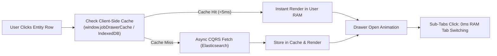

# 🚪 Drawer Master Skill (Client, Candidate & Job Drawers)

This skill governs the architecture, UI/UX, and data synchronization for all sliding side-drawers in JERO (Direct Client Drawer, Candidate Drawer, Job Details Drawer, Contact Drawer).

## Architecture & Data Flow

## Checklist for Any Drawer Work

1. **Sub-Tab Synchronization**:
   - Ensure every tab button has a clear active indicator (`#009ef7` blue line or soft `#f1faff` background).
   - Clicking sub-tabs must switch content **instantly in-memory** without full drawer reloads.
   - Use `data-tab-target` attributes and delegated event handlers.

2. **Counter Accuracy & Tab Badges**:
   - Tab counters (Jobs, Candidates, Interviews, Activity) must be sourced from the Elasticsearch DTO or Web Worker array count.
   - Render numbers with `font-variant-numeric: tabular-nums;`.
   - Never query MySQL `SELECT COUNT(*)` on drawer load.

3. **15.6" Screen Fit & Scroll Containment**:
   - Zero horizontal overflow.
   - Body must have `overflow-y: auto; max-height: calc(100vh - 140px);`.
   - Sticky header for title, quick metadata, and close (X) button.

4. **Event Bus Isolation**:
   - Scope state variables to `window.jeroDrawerState = window.jeroDrawerState || {}`.
   - Never leak drawer state into global page filters.
