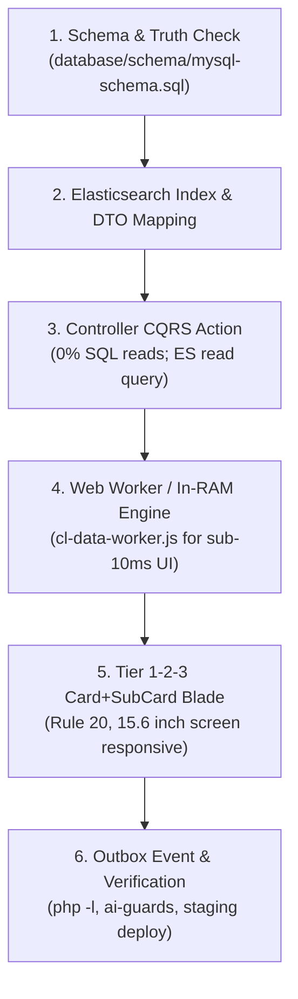

# 🍰 Vertical Slice Generator Skill

When building or overhauling an ATS feature, this skill ensures that all 6 architectural layers are built simultaneously with zero architectural holes.

## The 6 Mandatory Layers of Every Vertical Slice

## Step-by-Step Execution Protocol

1. **Layer 1: Schema Ground Truth**:
   - Check `database/schema/mysql-schema.sql` for real columns (never assume or invent migrations).
2. **Layer 2: ES DTO Mapping**:
   - Ensure the entity document structure contains all required search and aggregation fields.
3. **Layer 3: CQRS Endpoint**:
   - Route and Controller Action must query Elasticsearch exclusively.
   - Tenancy enforced via `company_id`.
4. **Layer 4: Browser Execution (RAM / Worker)**:
   - Provide client-side caching (`SessionRAMCache` or IndexedDB) and in-worker filtering.
5. **Layer 5: Rule 20 UI/UX**:
   - Tier 1 Toolbar Card + Tier 2 Sub-Tabs Card + Tier 3 Card Stream.
   - Poppins font <= 14px, tabular numerals, 0 horizontal scroll.
6. **Layer 6: Verification**:
   - Execute syntax checks (`php -l`), AI-guards, and prepare conventional commit.
