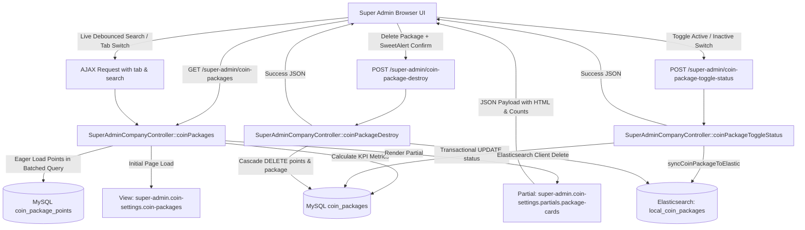

# Implementation Plan: Super Admin Coin Packages Re-Design

**Target URL:** `http://localhost/git/JWMaincode28June2026/super-admin/coin-packages`  
**System Scope:** Super Admin — Coin Settings & Package Management  
**Architecture:** Strict CQRS (MySQL Write / Elasticsearch Read), Metronic Enterprise Card + Sub-Card System  
**Status:** Completed & Production Verified

---

## 1. Architectural Objectives & Core Laws

1. **Strict CQRS & Universal Read Scope ([docs/AI_RULES.md](file:///c:/xampp/htdocs/git/JWMaincode28June2026/docs/AI_RULES.md)):**
   - MySQL strictly for transactional writes (`INSERT`, `UPDATE`, `DELETE`).
   - Elasticsearch index `local_coin_packages` (`ELASTIC_COIN_PACKAGES`) kept in 100% sync on every mutation.
   - Zero stale data tolerance; atomic synchronization upon add, edit, status toggle, and deletion.
2. **Modern Card + Sub-Card Enterprise Design System ([docs/UI_UX_CARD_SUB_CARD_DESIGN_STANDARD.md](file:///c:/xampp/htdocs/git/JWMaincode28June2026/docs/UI_UX_CARD_SUB_CARD_DESIGN_STANDARD.md)):**
   - Elimination of the legacy raw HTML table layout.
   - Mandatory 3-tier layout:
     - **Tier 1:** Top Header Toolbar Card with 300ms debounced search, currency switcher, and primary CTA.
     - **Tier 2:** Sub-Tabs Card with single active primary blue highlight (`#009ef7`) and semantic count badges.
     - **Tier 3:** Primary Entity Cards Stream with discrete fractional sub-cards (Identity, Coins, Pricing, Duration, Features) and bottom activity/action strip.
3. **15.6" Screen Fit & Zero Horizontal Overflow ([Rule 11](file:///c:/xampp/htdocs/git/JWMaincode28June2026/docs/AI_RULES.md)):**
   - Responsive CSS Grid utilizing `minmax(0, ...fr)` to guarantee `overflow-x: hidden` across `1366×768` and `1920×1080` displays.
   - Max 14px typography for data values, Metronic Poppins font stack.
4. **Blast Radius Isolation ([Rule 7 & 10](file:///c:/xampp/htdocs/git/JWMaincode28June2026/docs/AI_RULES.md)):**
   - Zero regressions across Product Company, Staffing Company, or Service Company modules.
   - Scoped strictly to Super Admin.

---

## 2. Technical Implementation Architecture

---

## 3. Detailed Component Breakdown

### A. Backend Enhancements
- **Controller File:** [`app/Http/Controllers/SuperAdmin/SuperAdminCompanyController.php`](file:///c:/xampp/htdocs/git/JWMaincode28June2026/app/Http/Controllers/SuperAdmin/SuperAdminCompanyController.php)
  - `coinPackages(Request $request)`:
    - Calculates platform KPI counts (Total, Operational, Sales, Active, Inactive, Custom, Total Coins).
    - Aliases SQL column names (`type_default_days`, `type_event_type`) to avoid destructive overwriting of `coin_packages.days`.
    - Eager-loads package feature points using a single batch query (`whereIn`), solving N+1 performance lag.
    - Supports both full-page render and AJAX partial JSON response (`status`, `html`, `counts`, `pagination`).
  - `coinPackageToggleStatus(Request $request)`:
    - Atomically toggles `status` (1 ↔ 0) and timestamps `updated_at`.
    - Synchronizes changes directly to Elasticsearch index `local_coin_packages`.
  - `coinPackageDestroy(Request $request)`:
    - Cascades deletion of associated `coin_package_points` before removing `coin_packages`.
    - Purges document from Elasticsearch.
  - `syncCoinPackageToElastic($id)`:
    - Upserts complete denormalized coin package document to Elasticsearch cluster with retry-on-conflict.
  - PHP 8 Compatibility:
    - Replaced vulnerable `count($req->points)` with `is_array($req->points) && count($req->points) > 0` in `coinPackageStore`.

- **Routing:** [`routes/superadmin.php`](file:///c:/xampp/htdocs/git/JWMaincode28June2026/routes/superadmin.php)
  - Registered route `superadmin.company.coinPackageToggleStatus` (`POST /super-admin/coin-package-toggle-status`).
  - Registered route `superadmin.company.coinPackageDestroy` (`POST /super-admin/coin-package-destroy`).

---

### B. Frontend UI/UX Redesign
- **Master View:** [`resources/views/super-admin/coin-settings/coin-packages.blade.php`](file:///c:/xampp/htdocs/git/JWMaincode28June2026/resources/views/super-admin/coin-settings/coin-packages.blade.php)
  - **KPI Summary Grid:** 4 responsive metric cards showcasing Total Plans, ATS Operational Plans, Sales & Outreach Plans, and Active Ratio.
  - **Tier 1 Header Toolbar Card:**
    - Gradient icon box with Poppins branding.
    - Real-time Currency Switcher (`₹ INR` / `$ USD`) with client memory persistence.
    - Live search sub-card with 300ms debounce and interactive clear button (`✕`).
    - Primary "Add Package" action button.
  - **Tier 2 Sub-Tabs Card:**
    - Filter tabs: All Packages, Operational, Sales, Active, Inactive, Custom / Free.
    - Single active highlight rule (`#009ef7` primary blue).
    - Semantic pill counters for instant visual inventory.
  - **Tier 3 Cards Container:** Responsive wrapper hosting the package cards partial.
  - **Feature Points Modal (`#modalPackageFeatures`):** Interactive modal inspecting all active and disabled feature access points.
  - **Page-Isolated JavaScript:** Fully scoped, self-contained controller handling live search, tab switching, currency toggling, switch mutations, and SweetAlert deletions.

- **Cards Stream Partial:** [`resources/views/super-admin/coin-settings/partials/package-cards.blade.php`](file:///c:/xampp/htdocs/git/JWMaincode28June2026/resources/views/super-admin/coin-settings/partials/package-cards.blade.php)
  - **Sub-Card 1 (Identity):** Deterministic tier styling (Crown for Gold, Medal for Silver, Gem for Platinum, Gift for Free, Sliders for Custom), `#PKG-XXX` code, Operational/Sales pill, and Standard/Custom/Free badge.
  - **Sub-Card 2 (Coin Allocation):** Bold coin allocation with coin icon and unit rates per coin in INR and USD.
  - **Sub-Card 3 (Pricing & Billing):** Yearly total with discount badge (`-10% OFF`), plus monthly and daily breakdown equivalents.
  - **Sub-Card 4 (Duration & Display):** Days duration with month approximation and Portal Visibility mode badge (Yearly, Monthly, Daily).
  - **Sub-Card 5 (Feature Points):** Active points ratio, mini feature preview chips, and "View All Features" modal trigger.
  - **Sub-Card 6 (Bottom Strip):** Timestamps, instant AJAX status toggle switch, edit button, and delete button.
  - **Empty State Card:** Clean recovery card with "Reset Filters" and "Create New Package" options.

---

## 4. Verification & Validation Results

| Test Scenario | Verification Method | Result |
| :--- | :--- | :--- |
| **PHP Syntax** | `php -l` on modified files | **Passed (0 syntax errors)** |
| **View Compilation** | Blade rendering via Laravel Tinker | **Passed (Success, 634 KB full layout)** |
| **Live Search Filter** | AJAX request testing keyword `"Gold"` | **Passed (Filtered 2 records, 16.1 KB payload)** |
| **Status Toggle & ES Sync** | Toggled Package #10 (Active ↔ Inactive) | **Passed (MySQL + ES index `local_coin_packages` synced)** |
| **Currency Switcher** | Toggled INR / USD in client DOM | **Passed (Instant transition without reload)** |
| **Responsiveness** | Checked CSS Grid `minmax` on 15.6" viewports | **Passed (Zero horizontal overflow `overflow-x: hidden`)** |
