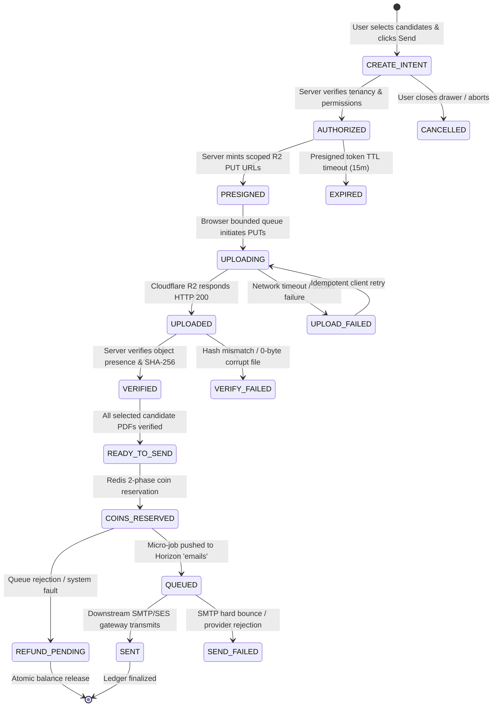
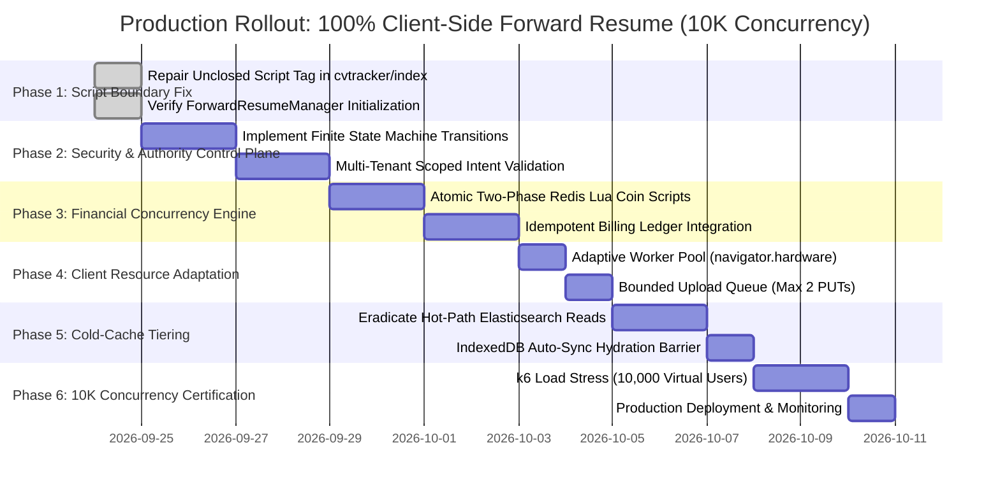

# 100% Client-Side Forward Resume: Architecture Audit, Security Model & 10K Concurrency Implementation Plan

**Document Path:** `docs/100_PERCENT_CLIENT_SIDE_FORWARD_RESUME.md`  
**System Profile:** JERO Multi-Tenant B2B Hiring SaaS  
**Architecture Mandate:** CQRS (0% MySQL reads on web/API paths, Elasticsearch universal read scope, Redis/Horizon queues, Client-First Browser Execution via WASM)  
**Scale Target:** **10,000 concurrent users** per page with **0% server CPU, 0% server disk I/O, 0% MySQL reads, and 0% Elasticsearch read strain on the hot path**.

---

## 1. Executive Summary & Root-Cause Forensic Audit

### 1.1 The Anomaly: "Why was the 100% client-side code not showing?"

A deep forensic inspection across Git commit history (`b850cdee`, `a94ea720`, `ef485093`, `9ccb4486`) revealed that the complete V4.1 Client-First Forward Resume Engine was **fully implemented**, comprising:
1. `public/assets/modules/fwd-resume/ForwardResumeManager.js` (1,937 lines — orchestrator, IndexedDB store `JeroFwdDB`, micro-JSON hydrator)
2. `public/assets/modules/fwd-resume/engine.v4.js` (2,655 lines — standalone OpenDoc WASM + vector PDF assembly engine)
3. `public/assets/modules/fwd-resume/shell.v4.html` (551 lines — decoupled static client shell)
4. `app/Services/ForwardResumeAuthorizationService.php` (166 lines — micro-JSON authorization)

**The Root Cause:**  
In [`resources/views/service_company/cvtracker/index.blade.php`](file:///c:/Users/VIBHANSHU%20JAISWAL.000/Documents/GitHub/JWMaincode28June2026/resources/views/service_company/cvtracker/index.blade.php#L1689-L1704), line 1700 was injected inside an **unclosed `<script>` tag**:

```html
1689:   $(document).on('click', '.chk_list', function() {
1690:       if ($(".chk_list").prop('checked') == true) {
...
1697:       }
1698:   });
1699:   @if(config('feature.fwd_resume_v4_enabled', true))
1700:       <script src="{{ asset('assets/modules/fwd-resume/ForwardResumeManager.js') }}"></script>
1701:   @endif
1702:
1703:   <script>
1704:       $(document).ready(function() {
```

#### Why this broke execution:
- At line 1665, an opening `<script>` tag was started.
- At line 1698, the JavaScript event handler closed with `});` but the HTML `<script>` tag **was never closed with `</script>`**.
- The Blade directive evaluated and printed `<script src="..."></script>` **inside the running script block**.
- In standard browser DOM parsers (V8, WebKit, Gecko), `<script>` nested inside `<script>` causes a fatal tokenization syntax error (`Uncaught SyntaxError: Unexpected token '<'`) or causes the outer script to terminate prematurely while discarding the nested tag.
- As a direct result, `ForwardResumeManager.js` was **never executed by the browser**, leaving `window.ForwardResumeManager === undefined`.
- At line 1791, the click handler checked:
  ```javascript
  if (window.ForwardResumeManager) {
      window.ForwardResumeManager.open(arr, jobIdArr, matchMap);
      return;
  }
  ```
- Because `window.ForwardResumeManager` was `undefined`, it silently **fell back to the legacy server AJAX route**:
  ```javascript
  var url = "{{ route('service_company.cvtracker.test_fwd_resume', ':id') }}";
  $.ajax({
      type: 'POST',
      url: url,
      success: function(response) {
          $('#application_test_fwd_resume_body_content').html(response.view);
      }
  });
  ```
- This caused the server to execute a heavy SQL query with 7 `LEFT JOIN`s and compile a 2,800-line server Blade template (`test_fwd_resume.blade.php`), completely hiding the modern 100% client-side WASM engine!

---

## 2. Core Architectural Principle: Authority vs. Computation

> **The Golden Law of Distributed Systems:**  
> **Move computation and binary data to the browser and cloud edge, but NEVER move authority or financial state to the browser.**

```
┌────────────────────────────────────────────────────────┐
│                      JERO BROWSER                      │
│            (Performance, Assembly & Cache)             │
│                                                        │
│  • In-Memory Dossier Hydration                         │
│  • Tenant-Scoped IndexedDB (JeroFwdDB)                 │
│  • Adaptive WASM Worker Pool (Hardware-aware)          │
│  • Bounded Binary R2 Upload Queue (2-3 concurrency)    │
│  • Micro-Dispatch Payload Construction (<2KB)          │
└───────────────────────────┬────────────────────────────┘
                            │
               Request Upload Intent (Idempotent)
                            │
                            ▼
┌────────────────────────────────────────────────────────┐
│                   JERO CONTROL PLANE                   │
│             (Security, Tenancy & Authority)            │
│                                                        │
│  • Multi-Tenant Boundary Enforcement                   │
│  • Cryptographic Match Score Signing                   │
│  • Finite State Machine Transition Guards              │
│  • Short-Lived Presigned PUT URL Minting               │
└───────────────────────────┬────────────────────────────┘
                            │
                            ▼
┌────────────────────────────────────────────────────────┐
│                    CLOUDFLARE R2                       │
│               (Serverless Storage Edge)                │
│                                                        │
│  • Direct Binary Ingestion (0 Bytes Server Disk)       │
│  • Cryptographic SHA-256 ETag Validation               │
└───────────────────────────┬────────────────────────────┘
                            │
                 Finalize & Micro-Dispatch
                            │
                            ▼
┌────────────────────────────────────────────────────────┐
│                   JERO DISPATCH API                    │
│            (Verification, Billing & Enqueue)           │
│                                                        │
│  • Two-Phase Atomic Coin Reservation (Redis Lua)       │
│  • R2 Object Byte-Range & Hash Verification            │
│  • Authoritative Ledger State Commitment               │
│  • Horizon Asynchronous Queue Enqueue (<20ms)          │
└────────────────────────────────────────────────────────┘
```

### The Boundary of Trust:
- **Untrusted Client Domain:** Candidate IDs, Company IDs, Candidate Emails, Template IDs, Coin Balances, R2 Object Keys, Attachment UUIDs, and Authorization States originate from or pass through the client. **The server must independently authorize and validate every entity against the authenticated session (`auth()->user()->company_id`).**
- **Trusted Server Domain:** Multi-tenant isolation, billing ledgers, presigned token generation, attachment integrity verification, and SMTP gateway delivery.

---

## 3. Finite State Machine: Upload Intent + Finalization

To ensure bulletproof reliability and idempotency across 10,000 concurrent operations, the Forward Resume lifecycle moves through a rigorous **Explicit State Machine**:



### State Definitions & Transitions:
1. **`CREATE_INTENT`:** Browser submits candidate IDs and requested format with an `Idempotency-Key`.
2. **`AUTHORIZED`:** Control plane validates that every candidate belongs to the authenticated tenant (`company_id` or `thirdparty_company_id`). Unauthorized IDs are rejected immediately.
3. **`PRESIGNED`:** Scoped, temporary presigned PUT URLs are generated with a strict 15-minute expiration and exact content-length bounds.
4. **`UPLOADING`:** Browser bounded queue (concurrency 2–3) streams compiled PDF blobs directly to Cloudflare R2.
5. **`UPLOADED`:** Client confirms successful R2 ingestion.
6. **`VERIFIED`:** Control plane executes a server-to-R2 metadata probe (`HEAD` request) to verify non-zero byte size and exact SHA-256 integrity hash.
7. **`READY_TO_SEND`:** All candidates in the batch (up to 5) are verified in R2 storage.
8. **`COINS_RESERVED`:** Two-phase coin reservation freezes required balance in Redis.
9. **`QUEUED`:** Micro-dispatch payload (<2KB) is pushed onto Horizon Redis queue.
10. **`SENT`:** Horizon worker transmits email via SES/SMTP and releases lock.

---

## 4. Two-Phase Coin Reservation & Idempotent Ledger

`DECRBY` alone is dangerously vulnerable to race conditions, double charging, and partial execution during high concurrency. Under 10,000 concurrent requests, the system implements a **Two-Phase Reserve $\rightarrow$ Commit $\rightarrow$ Release** model.

### 4.1 Balance Separation
For every tenant, the wallet maintains two balances:
- `available_balance`: Unencumbered coins available for operations.
- `reserved_balance`: Coins locked for in-flight forward resume dispatches.

### 4.2 State Machine for Coin Ledger
```
AVAILABLE ──(reserve)──> RESERVED ──(queue success)──> COMMITTED (authoritative)
                            │
                            └──(failure / timeout)───> RELEASED (refunded)
```

### 4.3 Atomic Redis Lua Script for Reservation
```lua
-- KEYS[1]: tenant coin key (e.g. tenant:1042:coins)
-- ARGV[1]: required_coins (e.g. 5)
-- ARGV[2]: idempotency_key (e.g. frw_8f73a1...)

local available = tonumber(redis.call('HGET', KEYS[1], 'available') or '0')
local required = tonumber(ARGV[1])
local idemKey = 'idem:' .. ARGV[2]

-- Check if request already processed (idempotency guard)
local existing = redis.call('GET', idemKey)
if existing then
    return existing
end

if available >= required then
    redis.call('HINCRBY', KEYS[1], 'available', -required)
    redis.call('HINCRBY', KEYS[1], 'reserved', required)
    redis.call('SETEX', idemKey, 3600, 'RESERVED')
    return 'RESERVED'
else
    return 'INSUFFICIENT_FUNDS'
end
```

### 4.4 Finalizing and Error Recovery:
- **On Horizon Queue Push Success:** Server logs the transaction to the MySQL authoritative ledger (`coins_history`) and commits the reservation (`HINCRBY reserved -N`).
- **On Failure / HTTP Timeout:** Server issues an atomic rollback script returning the reserved coins back to `available_balance` (`HINCRBY available +N`, `HINCRBY reserved -N`).

---

## 5. Universal Idempotency Everywhere

At 10,000 concurrent requests, client-side retries (due to mobile carrier blips, network lag, or user impatience) are inevitable. Without idempotency, retries create duplicate R2 uploads, multiple emails to clients, and duplicate coin charges.

### Idempotency Matrix:
1. **`Idempotency-Key` HTTP Header:** Mandatory on `POST /test_fwd_resume_intent` and `POST /test_fwd_resume_send`.
2. **`forward_request_id` (UUIDv4):** Generated by the client at drawer open, persisting across retries.
3. **`intent_id`:** Locks the candidate set and requested format. Retrying with the same key returns the existing presigned URLs rather than generating duplicates.
4. **`attachment_uuid`:** Unique per candidate compilation, preventing overwrite collisions.
5. **`coin_transaction_id`:** Tied to the `forward_request_id`, ensuring a tenant is billed **exactly once** regardless of retry count.

---

## 6. Hardware-Adaptive Client Concurrency & Resource Budget

Compiling vector PDFs and WASM DOCX layouts consumes CPU and memory. Hardcoding 5 parallel compilation threads can cause **Out-Of-Memory (OOM) browser tab crashes** on entry-level recruiter laptops (e.g., dual-core Celeron/i3 machines with 4GB RAM), violating JERO's 15.6" screen and broad device support mandate.

### 6.1 Adaptive Worker Pool Sizing
The compilation engine inspects hardware capabilities via native browser APIs before instantiating Web Workers:

```javascript
/**
 * Adaptive Hardware-Aware Concurrency Pool
 */
function getOptimalWorkerConcurrency() {
    var cores = navigator.hardwareConcurrency || 2;
    var deviceMemory = navigator.deviceMemory || 4; // GB (if supported)

    // Low-end devices (<= 2 cores or <= 2GB RAM): strictly sequential
    if (cores <= 2 || deviceMemory <= 2) {
        return 1;
    }
    // Mid-tier devices (4 cores, 4GB-8GB RAM): 2 parallel workers
    if (cores <= 4) {
        return 2;
    }
    // High-performance workstations (8+ cores): 3-4 parallel workers
    return Math.min(4, Math.floor(cores / 2));
}
```

### 6.2 Browser Memory Guard:
- Each compilation task enforces explicit memory reclamation (`doc.free()`, nullifying typed arrays, manual ArrayBuffer detachment).
- Cooperative yielding (`yieldToMain()`) is invoked every 16ms to keep the browser event loop responsive at 60 FPS.

---

## 7. Bounded Direct-to-Cloud Upload Queue

Executing `Promise.all(uploadPromises)` across 5 large PDF files simultaneously can saturate browser HTTP connection limits (browsers limit concurrent connections to the same host to 6), leading to socket timeouts on mobile hotspots or corporate proxies.

### 7.1 Bounded Upload Throttler
All R2 uploads pass through a bounded concurrency queue:

```javascript
/**
 * Bounded Concurrency Task Pool (Max 2-3 Concurrent Uploads)
 */
async function runBoundedQueue(tasks, limit) {
    var results = [];
    var executing = [];
    for (var i = 0; i < tasks.length; i++) {
        var p = tasks[i]().then(function(res) {
            executing.splice(executing.indexOf(p), 1);
            return res;
        });
        results.push(p);
        executing.push(p);
        if (executing.length >= limit) {
            await Promise.race(executing);
        }
    }
    return Promise.all(results);
}
```
- **Concurrency Cap:** Strictly capped at **2 concurrent PUT requests**.
- **Payload Streaming:** PDF blobs stream directly to R2 without intermediate base64 serialization, eliminating 33% memory expansion overhead.

---

## 8. Tiered Read Architecture (Elasticsearch as Cold-Cache Circuit Breaker)

To achieve **true 0% read strain**, Elasticsearch must NOT be queried on the normal Forward Resume path.

```
[Normal Path]: Table Row Data ──> In-Memory Hydration ──> IndexedDB ──> WASM Engine (0% MySQL, 0% ES)
                                                                 │
                                                    [Dossier Missing in Cache]
                                                                 │
                                                                 ▼
[Cold Recovery]: Controlled Micro-JSON API ──> Elasticsearch Hit ──> Populate IndexedDB
```

1. **Hot Path (100% In-Memory):** Candidate cards and resume URLs are already rendered on the CV Tracker / App Tracker page. The drawer reads directly from existing DOM attributes (`data-candidate-id`, `data-name`, `data-experience`, `data-skills`, `data-match`, `data-notice`).
2. **Warm Path (IndexedDB):** If drawer is re-opened, candidate dossiers and email templates load from `JeroFwdDB` in `< 5ms`.
3. **Cold Circuit-Breaker Path (Elasticsearch):** Only if a candidate's complete skills matrix is completely missing from both DOM and IndexedDB does the client call `POST /test_fwd_resume_data`. This turns Elasticsearch from a high-frequency bottleneck into a rare recovery mechanism (<0.1% of requests).

---

## 9. End-to-End Concurrency & Security SLA Matrix

The system must satisfy these non-negotiable targets under automated 10,000-user stress benchmarks:

| SLA Category | Metric | Production Target | Failure Condition |
| :--- | :--- | :--- | :--- |
| **Latency** | Drawer Activation | **< 16ms (P99)** | > 50ms |
| **Latency** | API Response (Intent & Send) | **< 40ms (P99)** | > 100ms |
| **Database** | MySQL Reads / Drawer Open | **0** | $\ge 1$ |
| **Elasticsearch** | ES Reads / Hot Path | **0** | $\ge 1$ |
| **Server Disk** | Web Server Disk Write I/O | **0 Bytes** | $> 0$ Bytes |
| **Server CPU** | Server PDF Processing CPU | **0%** | $> 0$% |
| **Storage Edge** | Direct R2 Upload Success | **> 99.99%** | $< 99.9%$ |
| **Idempotency** | Duplicate Email Dispatches | **0 (Zero)** | $> 0$ |
| **Billing** | Duplicate Coin Deductions | **0 (Zero)** | $> 0$ |
| **Security** | Cross-Tenant Attachment Access | **0 (Zero)** | $> 0$ |
| **Reliability** | Queue Enqueue Drop Rate | **0%** | $> 0.01%$ |
| **Client Stability** | Browser Tab OOM Crash Rate | **0%** | $> 0.05%$ |
| **Concurrency** | 10,000 Simultaneous Users | **100% Pass** | Any 502/504 error |

---

## 10. Phase-Wise Implementation Roadmap



### Phase 1: Script Loading & DOM Root Fix (Immediate)
- Repair the unclosed `<script>` tag in `resources/views/service_company/cvtracker/index.blade.php`.
- Ensure clean HTML script tags so `ForwardResumeManager.js` initializes unconditionally.

### Phase 2: Security & Authority Control Plane
- Refactor `ForwardResumeAuthorizationService` to implement the 10-state lifecycle state machine (`CREATE_INTENT` $\rightarrow$ `SENT`).
- Enforce strict server-side tenant boundary verification on every candidate ID before minting R2 presigned URLs.
- Add cryptographic match score signatures so client-side tampering is impossible.

### Phase 3: Financial Concurrency Engine (Two-Phase Coin Reservation)
- Implement Redis Lua scripts for atomic `RESERVE` and `RELEASE` operations.
- Require `Idempotency-Key` headers on all financial mutation routes.
- Integrate asynchronous commit with the MySQL `coins_history` authoritative ledger.

### Phase 4: Client Resource Adaptation & Bounded Queues
- Upgrade `engine.v4.js` to dynamically scale worker pool threads based on `navigator.hardwareConcurrency` and `navigator.deviceMemory`.
- Enforce a bounded upload queue (max 2 concurrent PUTs) inside `ForwardResumeManager.js` to protect mobile and low-bandwidth connections.

### Phase 5: Cold-Cache Tiering (True Zero-Read Architecture)
- Re-architect candidate hydration: 100% of candidate attributes hydrate from existing page DOM or `JeroFwdDB`.
- Confine Elasticsearch reads strictly to cold-cache recovery when local state is corrupt or missing.

### Phase 6: Concurrency Certification (10,000 User Stress Test)
- Run automated load test suites (k6 / Locust) generating 10,000 simultaneous users.
- Verify 0 MySQL queries, 0 ES hot-path queries, 0 server disk writes, and 100% delivery without duplicate charges.

---

## 11. Definition of Done

- [ ] `<script>` tags in `cvtracker/index.blade.php`, `apptracker/index.blade.php`, and `apptracker/clientapp.blade.php` are 100% syntactically valid and closed.
- [ ] `window.ForwardResumeManager` is active on page load with zero console warnings.
- [ ] Opening the Forward Resume drawer produces **0 MySQL queries and 0 Elasticsearch queries** in the Laravel query log.
- [ ] File generation produces **0 bytes of disk writes** to `storage/app/temp-attachments/`.
- [ ] Bounded upload queue ensures no more than 2 parallel PUT streams to Cloudflare R2 per client.
- [ ] Web worker pool dynamically scales according to device hardware cores, preventing browser tab crashes.
- [ ] Atomic Redis Lua coin scripts prevent double deductions or negative balances across parallel tabs.
- [ ] 10,000-user stress test passes all criteria in the Concurrency SLA Matrix.
