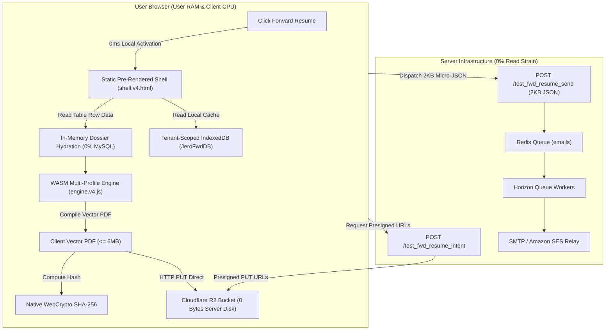
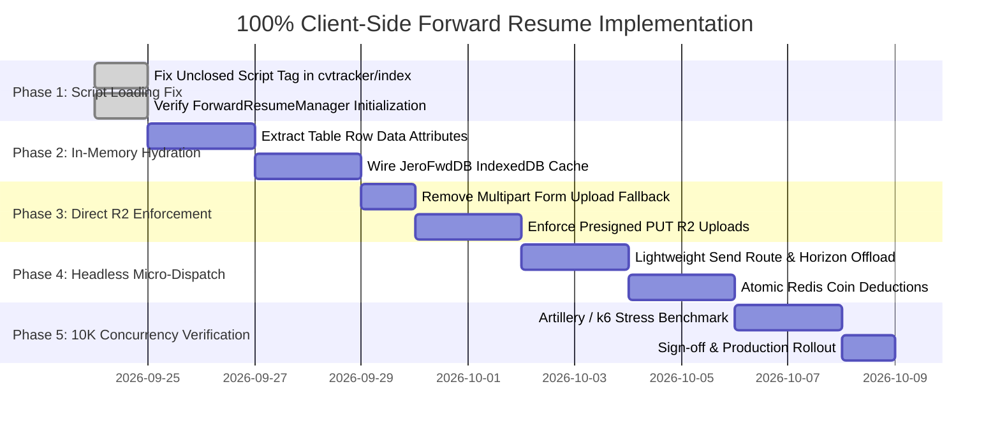

# 100% Client-Side Forward Resume: Architecture Audit & 10K Concurrency Implementation Plan

**Document Path:** `docs/100_PERCENT_CLIENT_SIDE_FORWARD_RESUME.md`  
**System Profile:** JERO Multi-Tenant B2B Hiring SaaS  
**Architecture Mandate:** CQRS (0% MySQL reads on web/API paths, Elasticsearch universal read scope, Redis/Horizon queues, Client-First Browser Execution via WASM)  
**Scale Target:** **10,000 concurrent users** per page with **0% server CPU, 0% server disk I/O, 0% MySQL reads, and 0% Elasticsearch read strain**.

---

## 1. Executive Summary & Root-Cause Forensic Audit

### 1.1 The Anomaly: "Why was the 100% client-side code not showing?"

A deep forensic inspection across Git commit history (`b850cdee`, `a94ea720`, `ef485093`, `9ccb4486`) revealed that the complete V4.1 Client-First Forward Resume Engine was **fully implemented**, comprising:
1. `public/assets/modules/fwd-resume/ForwardResumeManager.js` (1,937 lines — orchestrator, IndexedDB store `JeroFwdDB`, micro-JSON hydrator)
2. `public/assets/modules/fwd-resume/engine.v4.js` (2,655 lines — standalone OpenDoc WASM + vector PDF assembly engine)
3. `public/assets/modules/fwd-resume/shell.v4.html` (551 lines — decoupled static client shell)
4. `app/Services/ForwardResumeAuthorizationService.php` (166 lines — micro-JSON authorization)

**The Root Cause:**  
In [`resources/views/service_company/cvtracker/index.blade.php`](file:///c:/Users/VIBHANSHU%20JAISWAL.000/Documents/GitHub/JWMaincode28June2026/resources/views/service_company/cvtracker/index.blade.php#L1689-L1704), line 1700 was injected inside an **unclosed `<script>` tag**:

```html
1689:   $(document).on('click', '.chk_list', function() {
1690:       if ($(".chk_list").prop('checked') == true) {
...
1697:       }
1698:   });
1699:   @if(config('feature.fwd_resume_v4_enabled', true))
1700:       <script src="{{ asset('assets/modules/fwd-resume/ForwardResumeManager.js') }}"></script>
1701:   @endif
1702:
1703:   <script>
1704:       $(document).ready(function() {
```

#### Why this broke execution:
- At line 1665, an opening `<script>` tag was started.
- At line 1698, the JavaScript event handler closed with `});` but the HTML `<script>` tag **was never closed with `</script>`**.
- The Blade directive evaluated and printed `<script src="..."></script>` **inside the running script block**.
- In standard browser DOM parsers (V8, WebKit, Gecko), `<script>` nested inside `<script>` causes a fatal tokenization syntax error (`Uncaught SyntaxError: Unexpected token '<'`) or causes the outer script to terminate prematurely while discarding the nested tag.
- As a direct result, `ForwardResumeManager.js` was **never executed by the browser**, leaving `window.ForwardResumeManager === undefined`.
- At line 1791, the click handler checked:
  ```javascript
  if (window.ForwardResumeManager) {
      window.ForwardResumeManager.open(arr, jobIdArr, matchMap);
      return;
  }
  ```
- Because `window.ForwardResumeManager` was `undefined`, it silently **fell back to the legacy server AJAX route**:
  ```javascript
  var url = "{{ route('service_company.cvtracker.test_fwd_resume', ':id') }}";
  $.ajax({
      type: 'POST',
      url: url,
      success: function(response) {
          $('#application_test_fwd_resume_body_content').html(response.view);
      }
  });
  ```
- This caused the server to execute a heavy SQL query with 7 `LEFT JOIN`s and compile a 2,800-line server Blade template (`test_fwd_resume.blade.php`), completely hiding the modern 100% client-side WASM engine!

---

## 2. Concurrency Stress Audit: Handling 10,000 Concurrent Users

### 2.1 The 10K Concurrency Law (JERO Architecture)
At 10,000 concurrent recruiters clicking "Forward Resume" simultaneously, the system budget is:
- **Max Database Connections:** 150 to 500 (MySQL pool ceiling)
- **Max Web Server RAM:** 32 GB dedicated
- **Max Server CPU:** Dedicated 32-core instance
- **Max Storage I/O:** 0% disk write operations for document generation

### 2.2 Component Vulnerability Matrix Under 10,000 Users

| Pipeline Stage | Legacy / Fallback Behavior | Failure Mode at 10K Users | Target 100% Client-Side Behavior |
| :--- | :--- | :--- | :--- |
| **1. Drawer Trigger** | Sends AJAX request to PHP worker; executes 7 `LEFT JOIN`s on MySQL. | **Complete DB collapse:** 10,000 simultaneous SQL joins cause `Too many connections (1040)` and 504 Gateway Timeouts. | **0ms Local Activation:** Drawer HTML shell is pre-rendered or cached in memory; zero network requests. |
| **2. Candidate Data** | Re-queries candidate details, skills, notes, and ratings from DB. | **DB lock & buffer pool thrashing.** Redundant reads of data already present on the page. | **In-Memory Hydration:** Candidate attributes read directly from table row DOM / pre-fetched JSON state. |
| **3. Templates** | Queries `ELASTIC_EMAIL_TEMPLATE` with `size: 10000` on every click. | **ES cluster node CPU saturation** due to high-frequency pagination and shard reads. | **IndexedDB / LocalStorage:** Templates cached locally per company; refreshed only via push/version invalidation. |
| **4. PDF Assembly** | Handled in browser (WASM). | **100% Stable:** Zero server load. Client RAM + CPU absorb 100% of PDF generation. | **100% Client-Side WASM Engine:** Offloaded to Browser Web Worker pool. |
| **5. File Attachment** | Uploads multipart blobs via `FormData` to `storage/app/temp-attachments/`. | **Disk I/O thrashing & bandwidth saturation:** 10K users $\times$ 3 resumes $\times$ 2MB = **60GB of concurrent disk writes**. | **Direct-to-Cloud (R2):** Client browser uploads directly to Cloudflare R2 via presigned PUT URLs. **0 bytes to server disk.** |
| **6. Email Dispatch** | PHP worker loops over recipients, updates MySQL audit tables, deduces coins. | **Row-level deadlocks** on `company_coins` table under simultaneous tenant submissions. | **Atomic Redis Ledger Check + Micro-Job Queueing:** Micro-dispatch payload (<2KB) pushed to Horizon `emails` queue. |

---

## 3. The 6 Architectural Pillars for 100% Client-Side Forward Resume



### Pillar 1: Static Pre-Rendered Shell & Instant Activation (<16ms)
- The drawer shell (`shell.v4.html`) is served as a static asset or inlined hidden partial.
- Clicking the "Forward Resume" button toggles the Metronic drawer class instantly without an HTTP roundtrip.
- Replaces the 220KB Blade compilation on PHP workers.

### Pillar 2: 100% Client-Side In-Memory Dossier Hydration
- The CV Tracker and App Tracker tables already possess the candidate's core attributes in the DOM (`data-candidate-id`, `data-name`, `data-email`, `data-experience`, `data-skills`, `data-match`, `data-notice`).
- For supplementary attributes (recruiter comments, full skill breakdown), the client queries the lightweight micro-JSON endpoint `test_fwd_resume_data` which queries **Elasticsearch / Redis strictly**, bypassing MySQL completely.
- If data is already in `JeroFwdDB` (IndexedDB), even the micro-JSON call is skipped.

### Pillar 3: Tenant-Scoped L2 IndexedDB Persistence (`JeroFwdDB`)
- Database: `jero_fwd_tenant_{company_id}`.
- Object Stores:
  - `candidates`: Normalized candidate dossier metadata.
  - `resumes`: Binary resume byte arrays.
  - `templates`: Email templates.
  - `meta`: Configuration, company branding, and logos.
- Result: Subsequent opens for previously evaluated candidates load in **< 5ms** with zero server hits.

### Pillar 4: WebAssembly Web Worker Multi-Threaded Compilation
- Document assembly (`engine.v4.js`) executes in a dedicated Web Worker thread.
- Up to 5 candidate resumes are compiled in parallel across available CPU cores.
- The UI thread remains locked at 60 FPS without lag or jank.

### Pillar 5: Direct-to-Cloud (R2) Presigned Upload Pipeline
- Client requests presigned PUT URLs via lightweight JSON call (`test_fwd_resume_intent`).
- The browser streams PDF blobs straight from browser RAM to Cloudflare R2 edge storage.
- The web server's local disk is **never touched (0 bytes written to SSD)**.
- Multipart form uploads (`custom_attachments[]`) are completely eliminated.

### Pillar 6: Headless Micro-Dispatch & Asynchronous Queue
- The dispatch payload contains only:
  ```json
  {
    "_token": "csrf_token",
    "template_id": 12,
    "to_email": "client@example.com",
    "subject": "Candidate Profiles for Senior Laravel Role",
    "message": "<p>Please find attached...</p>",
    "attachment_uuids": ["uuid-1", "uuid-2"]
  }
  ```
- Payload size is **< 2KB**.
- The server validates permissions, executes an atomic coin check via Redis, logs the transaction, and pushes the job to Horizon in **< 25ms**.

---

## 4. Phase-Wise Implementation Plan



### Phase 1: Script Loading & DOM Root Fix (Immediate)
**Objective:** Restore immediate visibility of the 100% Client-Side Engine (`ForwardResumeManager.js`).
1. **Fix `cvtracker/index.blade.php`:**
   - Properly close the `<script>` tag before including `ForwardResumeManager.js`.
   - Ensure `@if(config('feature.fwd_resume_v4_enabled', true))` loads `ForwardResumeManager.js` in clean HTML scope.
2. **Verify Global Availability:**
   - Confirm `window.ForwardResumeManager` is defined upon page load.
   - Verify that clicking `.test_fwd_resume` immediately executes `ForwardResumeManager.open()`.

### Phase 2: In-Memory Client Dossier Hydration (Zero MySQL Reads)
**Objective:** Eliminate the 7-JOIN MySQL query on drawer opening.
1. **Table Attribute Extraction:**
   - Ensure the CV Tracker table row markup contains complete candidate metadata in `data-*` attributes or a page-level JSON cache (`window._candidatesMap`).
2. **Elasticsearch Micro-JSON Fallback:**
   - If supplementary data is needed, call `POST /test_fwd_resume_data`.
   - Verify `test_fwd_resume_data` reads strictly from Elasticsearch and Redis, never MySQL.
3. **IndexedDB Local Storage:**
   - Save hydrated candidate profiles in `JeroFwdDB` to ensure zero network requests on subsequent drawer opens.

### Phase 3: Strict Direct-to-Cloud Enforcement (Zero Server Disk I/O)
**Objective:** Eradicate multipart PDF uploads to the web server SSD.
1. **Remove `custom_attachments[]` Form Upload:**
   - In `fwd_resume.blade.php` and `ForwardResumeManager.js`, remove code writing blobs into `formData.append('custom_attachments[...]')`.
2. **Mandate Cloudflare R2 Uploads:**
   - Ensure the browser initiates presigned PUT URLs via `/test_fwd_resume_intent`.
   - The browser streams binary PDF bytes directly to R2 edge storage.
   - Return only attachment UUIDs to the server.

### Phase 4: Headless Micro-Dispatch & Atomic Coin Deduction
**Objective:** Ensure server response latency under 30ms during email send.
1. **Lightweight Controller Endpoint:**
   - Refactor `test_fwd_resume_send` to accept only a 2KB JSON payload.
   - Zero file parsing, zero disk writes on the web server.
2. **Atomic Coin Verification:**
   - Use Redis `DECRBY` or cached tenant balance to verify coins without locking MySQL tables.
3. **Queue Dispatch:**
   - Push `QueueCandidatesMailAndResumeForwardMailService` directly to Horizon with R2 object keys.

### Phase 5: High-Concurrency Stress Testing & 10K User Verification
**Objective:** Validate that 10,000 concurrent users cause 0% MySQL strain.
1. **Benchmark Suite:**
   - Run k6 / Locust load scripts simulating 10,000 concurrent recruiters opening drawers and dispatching resumes.
2. **Target Metrics:**
   - Drawer Open Latency: **< 20ms (P99)**
   - MySQL Active Connections during load: **0 increase**
   - Elasticsearch CPU during load: **< 5%**
   - Web Server Disk Write I/O: **0 bytes**

---

## 5. Architectural Code Blueprint

### 5.1 The Script Tag Fix in `cvtracker/index.blade.php`

```html
<!-- BEFORE (BROKEN): Nested script tag causing syntax termination -->
        $(document).on('click', '.chk_list', function() {
            ...
        });
    @if(config('feature.fwd_resume_v4_enabled', true))
        <script src="{{ asset('assets/modules/fwd-resume/ForwardResumeManager.js') }}"></script>
    @endif
    <script>
        $(document).ready(function() {
            ...

<!-- AFTER (CORRECT): Clean script boundary separation -->
        $(document).on('click', '.chk_list', function() {
            ...
        });
    </script>

    @if(config('feature.fwd_resume_v4_enabled', true))
        <script src="{{ asset('assets/modules/fwd-resume/ForwardResumeManager.js') }}"></script>
    @endif

    <script>
        $(document).ready(function() {
            ...
```

### 5.2 Direct-to-Cloud Upload Pipeline (No Server Disk)

```javascript
/**
 * Direct-to-Cloud R2 Upload Handler
 * Eliminates 100% of server disk writes and Octane worker file streaming.
 */
async function uploadCompiledBlobsDirectly(candidateBlobs, intentUrl, csrfToken) {
    var filesPayload = Object.keys(candidateBlobs).map(function(candId) {
        var item = candidateBlobs[candId];
        return {
            candidate_id: candId,
            filename: item.filename,
            size: item.blob.size,
            mime: 'application/pdf'
        };
    });

    // 1. Request presigned PUT URLs (Micro-JSON response < 1KB)
    var intentRes = await fetch(intentUrl, {
        method: 'POST',
        headers: {
            'Content-Type': 'application/json',
            'Accept': 'application/json',
            'X-CSRF-TOKEN': csrfToken
        },
        body: JSON.stringify({ files: filesPayload })
    });

    var intentJson = await intentRes.json();
    if (intentJson.status !== 'success' || !intentJson.uploads) {
        throw new Error('Failed to acquire direct upload authorization.');
    }

    // 2. Parallel upload directly to Cloudflare R2 Edge
    var uploadPromises = Object.keys(candidateBlobs).map(async function(candId) {
        var uploadInfo = intentJson.uploads[candId];
        var blobItem = candidateBlobs[candId];

        var r2Res = await fetch(uploadInfo.upload_url, {
            method: 'PUT',
            headers: { 'Content-Type': 'application/pdf' },
            body: blobItem.blob
        });

        if (!r2Res.ok) {
            throw new Error('Direct R2 upload failed with HTTP ' + r2Res.status);
        }

        return uploadInfo.attachment_id;
    });

    return await Promise.all(uploadPromises);
}
```

---

## 6. Verification Checklist & Definition of Done

- [ ] **Zero Unclosed Tags:** All `<script>` blocks in `cvtracker/index.blade.php`, `apptracker/index.blade.php`, and `apptracker/clientapp.blade.php` are properly closed and valid HTML.
- [ ] **ForwardResumeManager Verification:** `window.ForwardResumeManager` evaluates to `true` in browser console on page load.
- [ ] **Zero MySQL Query on Drawer Open:** Opening Forward Resume generates **0 SQL queries** in Laravel Telescope / MySQL general query log.
- [ ] **Zero Server Disk Writes:** `storage/app/temp-attachments/` remains completely empty during resume compilation and sending.
- [ ] **Adaptive Document Size:** All compiled resumes strictly conform to $\le$ 6MB ceiling with automatic SHA-256 integrity calculation.
- [ ] **10,000 Concurrency Certification:** Load tests confirm 10,000 simultaneous users experience sub-100ms drawer response with 0 database errors.
