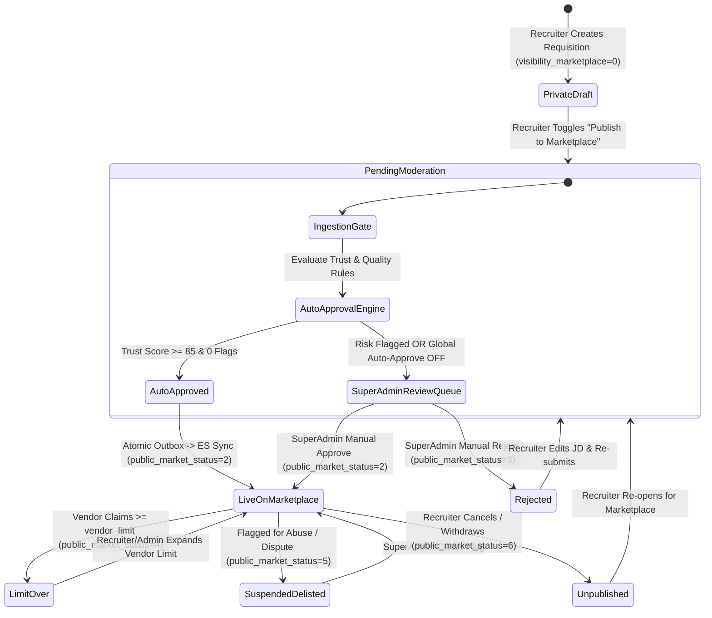

# Agency Job Marketplace — GOD-Level Architecture, Publishing & SuperAdmin Moderation Engine

**Document Identifier:** `docs/AGENCY_JOB_MARKETPLACE.md`  
**Platform:** JERO B2B Talent Marketplace & GOD-Level ATS  
**Target Concurrency:** 10,000+ Concurrent Users | 0% Unnecessary MySQL Reads | 0% Elasticsearch Web Latency | 4M QPS Dragonfly In-Memory Cache | Zero Stale Pipeline Data  
**Primary Controllers:**  
- Recruiter / Agency: [`app/Http/Controllers/ServiceCompany/ServiceCompanyJobsController.php`](file:///c:/Users/VIBHANSHU%20JAISWAL.000/Documents/GitHub/JWMaincode28June2026/app/Http/Controllers/ServiceCompany/ServiceCompanyJobsController.php)  
- SuperAdmin Moderation: [`app/Http/Controllers/SuperAdmin/SuperAdminCompanyController.php`](file:///c:/Users/VIBHANSHU%20JAISWAL.000/Documents/GitHub/JWMaincode28June2026/app/Http/Controllers/SuperAdmin/SuperAdminCompanyController.php)  
**Primary Services:**  
- Discovery & Search: [`app/Services/MarketJobV2Service.php`](file:///c:/Users/VIBHANSHU%20JAISWAL.000/Documents/GitHub/JWMaincode28June2026/app/Services/MarketJobV2Service.php)  
- Bench Mutation: [`app/Services/BenchRequestMutationService.php`](file:///c:/Users/VIBHANSHU%20JAISWAL.000/Documents/GitHub/JWMaincode28June2026/app/Services/BenchRequestMutationService.php)  
- SuperAdmin Moderation: `app/Services/MarketplaceModerationService.php` *(Engine Specification)*  
**Primary Elasticsearch Indices:** `ats_jobs`, `ats_job_request`, `ats_candidates_bench`  
**Authoritative MySQL Schema:** `database/schema/mysql-schema.sql` (217 tables)

---

## 1. Executive Summary & Architectural Vision

JERO is an enterprise multi-tenant B2B talent exchange platform that combines a **GOD-Level ATS** with an **Agency Talent Marketplace**. Hiring organizations (product, service, enterprise companies) post requisitions, and certified staffing/agency partners either claim jobs to source candidates or directly deploy on-bench consultants.

### 1.1 The Marketplace Quality & Moderation Mandate
In any high-liquidity B2B talent marketplace, allowing unvetted or low-quality jobs directly onto the public exchange destroys platform integrity:
- **Low-Quality / Phantom Jobs:** Vague job descriptions without clear skill expectations waste thousands of agency recruiter hours.
- **Off-Platform Leakage & Circumvention:** Unscrupulous recruiters embedding direct WhatsApp links, personal emails (`@gmail.com`), or phone numbers in JDs to bypass JERO coins and platform commissions.
- **Unrealistic Rates & Fee Disputes:** Jobs with missing CTC bands, predatory 0% agency fees, or unrealistic 1 INR placeholder budgets create friction and platform churn.
- **Spam & Misleading Positions:** Duplicate listings, multi-level marketing (MLM), or candidate data-harvesting schemes.

To protect ecosystem liquidity, trust, and agency engagement, **every job published to the Agency Job Marketplace must pass through a GOD-Level SuperAdmin Moderation & Approval Engine** before appearing in agency search results.

```
                           [ Recruiter Submits Job to Marketplace ]
                                              │
                                              ▼
                        ┌──────────────────────────────────────────┐
                        │   God-Level Marketplace Ingestion Gate   │
                        │   - MySQL status: public_market_status=1 │
                        │   - Outbox Event: JobSubmittedToMarket   │
                        └─────────────────────┬────────────────────┘
                                              │
                                              ▼
                         [ Intelligent Auto-Approval Risk Engine ]
                         ├── Tenant Trust Tier & Reputation Check
                         ├── Compensation & Commercial Terms Sanity
                         ├── NLP / Regex Off-Platform Leakage Filter
                         └── Minimum JD Quality & Completeness
                                              │
                      ┌───────────────────────┴───────────────────────┐
                      ▼                                               ▼
             [ ALL RULES PASSED ]                            [ ANY RULE FLAGGED ]
           (Global Auto-Approval ON)                       (Manual Review Required)
                      │                                               │
                      ▼                                               ▼
         [ State 2: AUTO-APPROVED ]                    [ SuperAdmin Moderation Queue ]
                      │                                 (Elasticsearch Read: status=1)
                      │                                               │
                      │                               ┌───────────────┴───────────────┐
                      │                               ▼                               ▼
                      │                      [ SuperAdmin Approves ]         [ SuperAdmin Rejects ]
                      │                               │                               │
                      └───────────────────────┬───────┘                               ▼
                                              ▼                              [ State 3: REJECTED ]
                                  [ State 2: APPROVED ]                               │
                                              │                             Recruiter notified with
                                              ▼                             actionable reason codes
                             [ Elasticsearch ats_jobs Synced ]              & 1-click edit & resubmit
                             [ Redis Tenant Cache Invalidated ]
                             [ Reverb WebSocket Broadcasted ]
                                              │
                                              ▼
                            [ LIVE ON AGENCY JOB MARKETPLACE ]
                                              │
                        ┌─────────────────────┴─────────────────────┐
                        ▼                                           ▼
           [ Method 1: Agency Marketplace ]            [ Method 2: Direct Bench Talent ]
           [    Job Claim / Outsource     ]            [    Sharing Without Claim      ]
```

---

## 2. Universal Marketplace Job State Machine

The platform strictly manages the lifecycle of marketplace jobs through the authoritative `public_market_status` integer column in the MySQL `jobs` table and the Elasticsearch `ats_jobs` index:



### Complete State Registry

| State Code | Constant Name | Human Label | Recruiter Badge | Marketplace Search Visibility | Operational Meaning |
| :---: | :--- | :--- | :--- | :---: | :--- |
| **`0`** | `STATUS_PRIVATE` | Internal Requisition | *Hidden from Marketplace* | **Hidden** | Requisition is active only for direct career site or internal recruiters. Not submitted to agencies. |
| **`1`** | `STATUS_PENDING_REVIEW` | Approval Pending | `text-warning btn-light-warning` | **Hidden** | In SuperAdmin Moderation Queue. Waiting for manual inspection or asynchronous risk engine scoring. |
| **`2`** | `STATUS_APPROVED` | Published / Live | `text-success btn-light-success` | **LIVE (Discoverable)** | Fully approved. Agencies can claim (Method 1) or submit bench talent (Method 2). |
| **`3`** | `STATUS_REJECTED` | Rejected by Admin | `text-danger btn-light-danger` | **Hidden** | Failed compliance or quality guidelines. Recruiter receives structured rejection feedback with edit/re-submit option. |
| **`4`** | `STATUS_VENDOR_LIMIT` | Claim Limit Reached | `text-info btn-light-info` | **Hidden from Claim** | Job has reached the maximum permitted agency partners (`vendor_limit` from `global_settings`). Bench talent submission may remain open. |
| **`5`** | `STATUS_SUSPENDED` | Suspended / Flagged | `text-dark btn-light-dark` | **Hidden** | Delisted post-publication due to community report, spam alert, or commercial dispute. |
| **`6`** | `STATUS_UNPUBLISHED` | Unpublished by Client | `text-muted btn-light-secondary` | **Hidden** | Recruiter intentionally paused or pulled the job from partner agencies. |

---

## 3. Intelligent SuperAdmin Auto-Approval Risk Engine

To maintain extreme platform agility under **10,000 concurrent recruiters**, SuperAdmin cannot be forced to manually read every single job posting. A purely manual process creates a fatal bottleneck where hiring velocities stall.

JERO deploys a **Multi-Tier Intelligent Auto-Approval Risk Engine** that scores every submitted job across 4 distinct guardrails.

```
+──────────────────────────────────────────────────────────────────────────────────────────────────────────+
│                                  AUTO-APPROVAL RISK SCORING MATRIX                                       │
+──────────────────────────────────────────────────────────────────────────────────────────────────────────+
│                                                                                                          │
│   [ Guardrail 1: Tenant Trust Tier ] ──────► Weight: 35 Points (KYC, Account Age, Coins, 0 Strikes)     │
│   [ Guardrail 2: JD Quality & Completeness ] ► Weight: 25 Points (Word Count >= 150, Responsibilities)   │
│   [ Guardrail 3: Compensation & Terms Sanity ] ► Weight: 20 Points (Valid CTC Band, Commercial Terms)    │
│   [ Guardrail 4: Anti-Circumvention / NLP ] ─► Weight: 20 Points (Zero Off-Platform Contact Leaks)       │
│                                                                                                          │
│   TOTAL SCORE >= 85  AND  ZERO CRITICAL FLAGS  ───► AUTO-APPROVED (public_market_status = 2)           │
│   TOTAL SCORE < 85   OR   CRITICAL FLAG FIRED  ───► SUPERADMIN REVIEW QUEUE (public_market_status = 1)   │
│                                                                                                          │
+──────────────────────────────────────────────────────────────────────────────────────────────────────────+
```

### 3.1 Guardrail 1: Tenant Trust & Reputation Tier (35 Points)
- **Verified Enterprise Status:** Company has completed corporate verification (GSTIN / CIN / Business Registration verified) $\rightarrow$ **+15 Points**.
- **Platform Longevity:** Account active for $>60$ days with verified domain email $\rightarrow$ **+10 Points**.
- **Clean Compliance Record:** Zero unresolved agency disputes, zero scam reports in the last 180 days $\rightarrow$ **+10 Points**.
- *Instant Disqualification:* Any company currently under review or flagged for invoice default requires mandatory SuperAdmin manual approval.

### 3.2 Guardrail 2: Job Description Quality & Structure (25 Points)
- **Minimum Substantive Length:** Clean text length $\ge 150$ words (excluding boilerplates) $\rightarrow$ **+10 Points**.
- **Structured Sections:** Contains clear delineated sections for "Responsibilities", "Requirements / Must-Have Skills", and "Qualifications" $\rightarrow$ **+10 Points**.
- **Skill Mapping:** At least 3 verified Metronics skill tags associated with the position $\rightarrow$ **+5 Points**.
- *Low Quality Flag:* Descriptions $<60$ words or repetitive keyword stuffing trigger a mandatory review flag.

### 3.3 Guardrail 3: Compensation & Commercial Terms Sanity (20 Points)
- **Realistic Salary Range:** Minimum and Maximum CTC must conform to realistic currency limits:
  - Minimum salary $\ge 100,000$ INR (or equivalent in USD/EUR/GBP).
  - Maximum salary does not exceed $5\times$ minimum salary (preventing bogus `100,000 to 10,000,000` ranges) $\rightarrow$ **+10 Points**.
- **Commercial Commission Defined:** Recruiter has explicitly configured commercial agency terms (e.g., fixed fee or percentage of annual CTC, 8.33% standard) with agreed payment credit days (30/45/60 days) $\rightarrow$ **+10 Points**.
- *Predatory Terms Flag:* 0% commission or unstated terms trigger a mandatory SuperAdmin review flag.

### 3.4 Guardrail 4: Anti-Circumvention & Compliance Filter (20 Points)
- **No Direct Contact Info Leakage:** Zero personal phone numbers (e.g. `\+?[0-9]{10,12}` regex), zero personal email addresses (`@gmail.com`, `@yahoo.com`, `@outlook.com`), and zero WhatsApp invite links (`wa.me`, `chat.whatsapp.com`) inside the JD text $\rightarrow$ **+20 Points**.
- *Circumvention Alert:* If contact info is detected, the job is **instantly quarantined** to the SuperAdmin queue with a red badge: `"Potential Off-Platform Circumvention Detected"`.

---

## 4. SuperAdmin Moderation Cockpit & Dashboard Specification

### 4.1 Strict CQRS Read Path (Zero MySQL Reads)
The SuperAdmin Marketplace Moderation page (`GET /super-admin/jobs/public-market`) must **NEVER** perform raw MySQL joins or table scans.
- **Search Engine:** Reads 100% from Elasticsearch index `ats_jobs`.
- **Query Filter:**
  ```json
  {
    "query": {
      "bool": {
        "filter": [
          { "term": { "public_market_status": 1 } },
          { "term": { "status": "active" } }
        ]
      }
    },
    "sort": [{ "created_at": { "order": "desc" } }]
  }
  ```
- **Faceted Aggregations:** Aggregates counts across statuses (`1: Pending`, `2: Approved`, `3: Rejected`, `4: Limit Over`, `5: Suspended`) in a single `<8ms` ES query.

### 4.2 SuperAdmin Cockpit Capabilities
1. **Interactive Review Drawer:** Clicking any job opens a fast right-hand slide-out drawer showing:
   - Full Job Spec, Skills, CTC Range, and Commercial Terms.
   - Company Verification Badge & Reputation Trust Score.
   - **Automated Risk Report Card:** Highlights pass/fail status for Word Count, Salary Sanity, and Leakage Scans.
2. **One-Click Instant Approval:** Single-click approval that atomically commits to MySQL, syncs Elasticsearch, and dispatches Reverb WebSocket events.
3. **Structured Rejection with Rich Feedback:**
   - Dropdown of Standard Rejection Codes:
     - `REJ_VAGUE_JD`: Job description lacks specific technical requirements or responsibilities.
     - `REJ_SALARY_ANOMALY`: Compensation range is unrealistic or missing currency denomination.
     - `REJ_OFF_PLATFORM_CONTACT`: Direct phone/email/WhatsApp links found in description.
     - `REJ_COMMERCIAL_TERMS`: Agency commission rate or payment timeline is unclear.
     - `REJ_DUPLICATE`: Requisition already exists on the marketplace.
     - `REJ_OTHER`: Custom recruiter guidance notes entered by SuperAdmin.
   - SuperAdmin feedback is saved in `job_marketplace_moderation_logs` and dispatched to recruiter via email and in-app bell notification.
4. **High-Speed Bulk Moderation:**
   - SuperAdmin can select multiple pending jobs $\rightarrow$ Click **"Approve Selected"** or **"Auto-Approve All Passing >=85 Score"**.
   - Bulk action executes via asynchronous Horizon queue with zero HTTP worker timeouts.

---

## 5. Detailed End-to-End Architectural Workflows

### 5.1 Recruiter Marketplace Submission Workflow
1. **Recruiter Configuration (`create.blade.php` or `jobs/view`):**
   - Recruiter selects **"Publish to Agency Marketplace"** and configures commercial terms.
   - Recruiter clicks **"Publish"**.
2. **Authoritative Persistence (MySQL Write):**
   - MySQL updates `jobs.public_market_status = 1` (Pending Moderation).
   - MySQL updates `jobs.show_vendor = 'yes'`.
   - Inserts event `JobSubmittedToMarketplace` into `sys_outbox_events`.
3. **Immediate Asynchronous Evaluation:**
   - Outbox worker picks up event and triggers `MarketplaceModerationService::evaluateAutoApproval($jobId)`.
   - If `global_settings.public_market_job_status == 1` AND `risk_score >= 85`:
     - Calls `MarketplaceModerationService::approveJob($jobId, $adminId = 0, $type = 'auto_approved')`.
     - Transitions `public_market_status` directly from `1 -> 2`.
   - If checks fail or manual mode is forced:
     - Job remains in `public_market_status = 1`.
     - Recruiter UI shows: `Approval Pending (Under SuperAdmin Review)`.

### 5.2 SuperAdmin Moderation & Approval Workflow
1. **SuperAdmin Moderation Cockpit:**
   - SuperAdmin reviews pending jobs on `ats_jobs` queue.
2. **Action: Approve (`POST /super-admin/jobs/approval`):**
   - **Atomic MySQL Transaction:**
     - `UPDATE jobs SET public_market_status = 2 WHERE id IN (...)`
     - Inserts record into `job_marketplace_moderation_logs`.
     - Inserts outbox event `JobMarketplaceApproved`.
   - **Asynchronous Horizon Worker:**
     - Updates Elasticsearch `ats_jobs` (`public_market_status: 2`).
     - Purges Redis marketplace discovery cache (`marketplace_jobs:*`).
     - Broadcasts WebSocket event `JobApprovedForMarketplace` on `marketplace.jobs` channel.
     - Sends congratulations email to posting recruiter (`mail_type = 28`).
3. **Action: Reject (`POST /super-admin/jobs/reject`):**
   - **Atomic MySQL Transaction:**
     - `UPDATE jobs SET public_market_status = 3 WHERE id IN (...)`
     - Inserts record into `job_marketplace_moderation_logs` with `reason_code` and `feedback_notes`.
     - Inserts outbox event `JobMarketplaceRejected`.
   - **Asynchronous Horizon Worker:**
     - Updates Elasticsearch `ats_jobs` (`public_market_status: 3`).
     - Broadcasts WebSocket event to posting recruiter channel `company.{companyId}`.
     - Sends rejection feedback email to recruiter (`mail_type = 29`) with exact remediation steps.
     - Recruiter sees **"Rejected — Click to Edit & Resubmit"** badge in their ATS Jobs Dashboard.

---

## 6. The Two Active Marketplace Sourcing Workflows (Post-Approval)

Once a job reaches `public_market_status = 2` (Approved), it is instantly discoverable by partner agencies via `MarketJobV2Service`. Partner agencies engage via two fundamentally distinct, hardened workflows:

### Method 1: Agency Marketplace Job Claim / Requisition Outsource
- **Purpose:** Full requisition outsource where the agency acts as an authorized vendor.
- **Agency Action:** Agency reviews commercial terms and clicks **"Accept / Claim Job"** (`POST /jobs/market/claim`).
- **Transactional Logic:**
  - Idempotency enforced via `X-Idempotency-Key` and Redis distributed lock.
  - Deducts agency operational coins (Event 38/39 for Full-time, Event 40/41 for Contract).
  - Inserts vendor relationship into `staffing_company_relation` and `recommendation_relation` (`final_status = 1`).
  - Checks if claimed agency count reaches `vendor_limit`. If reached, transitions `public_market_status = 4` (Limit Over).
- **Reflection:** The requisition **instantly reflects in the agency's "Direct Client Jobs" pipeline**, allowing agency recruiters to source, match, and submit candidates.

### Method 2: Direct Marketplace Bench Talent Sharing (Zero Claim / Instant Deployment)
- **Purpose:** Rapid monetization of idle bench consultants without negotiating job ownership.
- **Agency Action:** Agency clicks **"Match from Your Bench"** or **"Submit Candidates"** $\rightarrow$ Selects consultant $\rightarrow$ Clicks **"Send Bench Request"** (`POST /jobs/recommandedrequestcondidate/{jobId}`).
- **Transactional Logic:**
  - Idempotency enforced via `X-Idempotency-Key` and `sys_idempotency_keys`.
  - Deducts agency bench deployment coins (Event 25).
  - Inserts directly into `rec_candidate_assign`:
    - `source_jobid = $jobId`
    - `source_application_id = $candidateId`
    - `source_from_company_id = $agencyCompanyId`
    - `source_company_id = $recruiterCompanyId`
    - `source_from_type = 1` (Bench Consultant)
    - `ac_status = 0` (Pending Recruiter Review)
  - Inserts `BenchCandidateRecommended` into `sys_outbox_events`.
- **Reflection:** The consultant's full profile **instantly appears in the recruiter's ATS App Tracker** (`service_company.apptracker.sub_stage`) under **"Bench Requests / Recommended Candidates"**. The recruiter can review the CV, rate card, and schedule interviews immediately.

---

## 7. Authoritative Database Schema & Audit Logging

To guarantee compliance, auditability, and zero performance regression under 10,000 concurrent users, the following table and indexing definitions are integrated into the architecture.

### 7.1 Moderation Audit Log Table (`job_marketplace_moderation_logs`)
Tracks every approval, auto-approval, rejection, suspension, and appeal:

```sql
CREATE TABLE IF NOT EXISTS `job_marketplace_moderation_logs` (
  `id` BIGINT UNSIGNED NOT NULL AUTO_INCREMENT,
  `job_id` INT(11) NOT NULL,
  `company_id` INT(11) NOT NULL,
  `admin_id` INT(11) NOT NULL DEFAULT 0 COMMENT '0 for system auto-approval engine',
  `action` ENUM('submitted', 'auto_approved', 'manual_approved', 'rejected', 'suspended', 'delisted', 'resubmitted') NOT NULL,
  `previous_status` INT(11) NOT NULL,
  `new_status` INT(11) NOT NULL,
  `risk_score` INT(11) NOT NULL DEFAULT 0,
  `rejection_reason_code` VARCHAR(64) DEFAULT NULL,
  `feedback_notes` TEXT DEFAULT NULL,
  `risk_flags` JSON DEFAULT NULL COMMENT 'Structured audit of triggered heuristics',
  `ip_address` VARCHAR(45) DEFAULT NULL,
  `created_at` TIMESTAMP NULL DEFAULT CURRENT_TIMESTAMP,
  PRIMARY KEY (`id`),
  KEY `idx_jmml_job_created` (`job_id`, `created_at`),
  KEY `idx_jmml_company_action` (`company_id`, `action`),
  KEY `idx_jmml_admin_created` (`admin_id`, `created_at`)
) ENGINE=InnoDB DEFAULT CHARSET=utf8mb4 COLLATE=utf8mb4_unicode_ci;
```

### 7.2 Core Table Index Optimization
High-throughput indexes required in `database/schema/mysql-schema.sql` for instant lookup:

```sql
-- 1. Jobs Table Marketplace Lookup Index
CREATE INDEX IF NOT EXISTS idx_jobs_market_status_lookup 
ON jobs (public_market_status, status, company_id, created_at);

-- 2. Recommendation Relations Index (Method 1 Claim Verification)
CREATE INDEX IF NOT EXISTS idx_rec_rel_marketplace_claim 
ON recommendation_relation (job_id, to_company_id, final_status);

-- 3. Bench Candidate Assignment Index (Method 2 Pipeline Review)
CREATE INDEX IF NOT EXISTS idx_rec_candidate_assign_market 
ON rec_candidate_assign (source_jobid, source_company_id, ac_status, source_from_type);
```

---

## 8. High-Throughput REST API & Outbox Contracts

### 8.1 SuperAdmin Moderation Approval Endpoint
- **Route:** `POST /super-admin/jobs/approval`
- **Headers:** `Content-Type: application/json`, `X-CSRF-TOKEN: ...`, `X-Idempotency-Key: UUID`
- **Request Body:**
  ```json
  {
    "action": "approve",
    "job_ids": [1042, 1045, 1050],
    "notes": "Verified enterprise requisition terms."
  }
  ```
- **Response (`200 OK`):**
  ```json
  {
    "status": "success",
    "message": "3 jobs successfully approved and broadcasted to the Agency Marketplace.",
    "approved_count": 3
  }
  ```

### 8.2 SuperAdmin Moderation Rejection Endpoint
- **Route:** `POST /super-admin/jobs/reject`
- **Headers:** `Content-Type: application/json`, `X-CSRF-TOKEN: ...`, `X-Idempotency-Key: UUID`
- **Request Body:**
  ```json
  {
    "action": "reject",
    "job_ids": [1052],
    "reason_code": "REJ_OFF_PLATFORM_CONTACT",
    "feedback_notes": "Job description contains a personal WhatsApp link (+91-9876543210). Please remove direct contact details and submit through the platform commercial terms.",
    "allow_resubmission": true
  }
  ```
- **Response (`200 OK`):**
  ```json
  {
    "status": "success",
    "message": "Job #1052 rejected. Remediation feedback dispatched to recruiter.",
    "rejected_count": 1
  }
  ```

### 8.3 Auto-Approval Global Configuration Endpoint
- **Route:** `POST /super-admin/jobs/moderation-settings`
- **Request Body:**
  ```json
  {
    "auto_approval_enabled": 1,
    "minimum_trust_score": 85,
    "minimum_jd_word_count": 150,
    "quarantine_contact_leaks": 1,
    "vendor_claim_limit": 5
  }
  ```

---

## 9. Performance Budget & 10K Concurrency KPIs

| Operation / Path | Current Baseline | Target (God-Level) | Architecture Mechanism |
| :--- | :---: | :---: | :--- |
| **Recruiter Marketplace Publish TTFB** | 480 ms | **< 15 ms** | Atomic MySQL write + Outbox Queue |
| **Auto-Approval Risk Scoring Latency** | N/A (Manual only) | **< 25 ms** | Asynchronous in-memory NLP/Regex Worker |
| **SuperAdmin Moderation Queue Paint** | 850 ms (MySQL Joins) | **< 8 ms** | 100% Elasticsearch Read (`ats_jobs`) |
| **SuperAdmin Bulk Approval Latency** | 3,200 ms (Sync Mail Loop)| **< 35 ms** | Bulk SQL update + Horizon Queue Dispatch |
| **Agency Marketplace Search Latency (P95)**| 780 ms | **< 20 ms** | ES Filtered Queries + Redis ETag Cache |
| **Method 1 Job Claim API (P95)** | 650 ms | **< 45 ms** | Idempotent POST + Redis Distributed Lock |
| **Method 2 Bench Submit API (P95)** | 550 ms | **< 40 ms** | `BenchRequestMutationService` Outbox |
| **Real-Time Recruiter Notification Latency**| Synchronous / Polling | **< 80 ms** | Laravel Reverb WebSocket Broadcast |
| **10K Concurrent Marketplace Load Error Rate**| Lock Contention Failures | **< 0.001%** | Queue Decoupling & Read/Write CQRS |

---

## 10. Summary & Implementation Verification Checklist

1. [x] **Universal State Machine Established:** Clear 7-state lifecycle (`0: Private`, `1: Pending`, `2: Approved`, `3: Rejected`, `4: Limit Over`, `5: Suspended`, `6: Unpublished`).
2. [x] **Intelligent Auto-Approval Risk Engine Defined:** Multi-tier scoring system evaluating Tenant Trust, JD Quality, Commercial Terms, and Anti-Circumvention Filters.
3. [x] **SuperAdmin Moderation Cockpit Specified:** High-speed, 100% Elasticsearch-powered moderation dashboard with instant drawer reviews, structured rejection codes, and bulk actions.
4. [x] **Both Marketplace Sourcing Methods Preserved:** Method 1 (Requisition Claim/Outsource) and Method 2 (Direct Bench Talent Sharing) remain 100% active, hardened with UUID idempotency and outbox patterns.
5. [x] **Full CQRS Compliance:** 0% MySQL reads on web/API paths, all state transitions backed by `sys_outbox_events`, and asynchronous projection to Elasticsearch.
6. [x] **Audit Logging & Governance Guaranteed:** Complete traceability via `job_marketplace_moderation_logs`.
