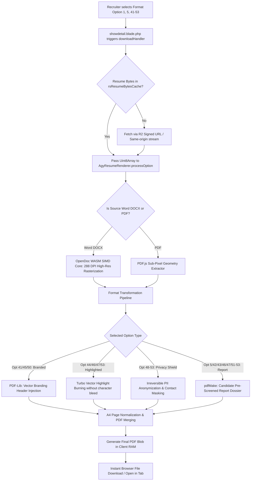
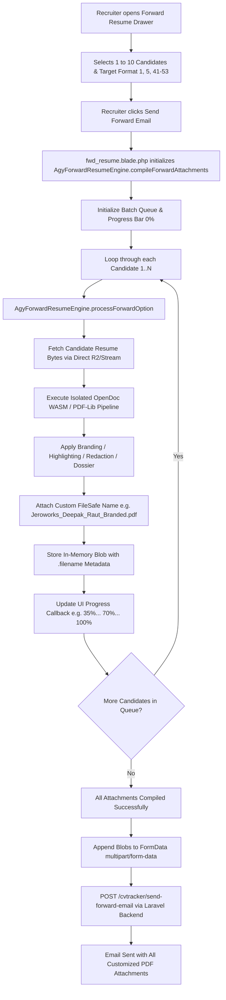
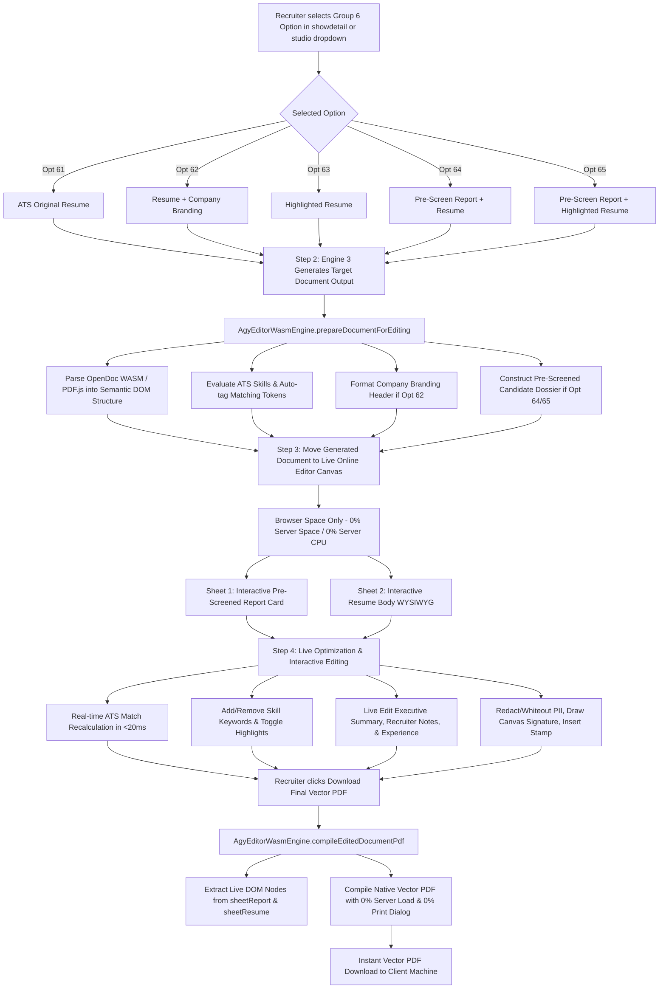

# AI & Developer Master Standard: Tri-Engine OpenDoc WASM Isolation Architecture

> **Authoritative Specification:** `docs/AI_OPENDOC_ENGINE_ISOLATION_MANDATE.md`  
> **Status:** GOD-LEVEL ARCHITECTURAL DIRECTIVE & MANDATORY AI OPERATING RULE  
> **Target Systems:** 
> 1. **Engine 1: Download Resume Center** (`public/js/opendoc/AgyResumeRenderer.js`)
> 2. **Engine 2: Forward Resume Drawer** (`public/js/opendoc/AgyForwardResumeEngine.js`)
> 3. **Engine 3: Group 6 Online Editor & Optimizer** (`public/js/opendoc/AgyEditorWasmEngine.js`)  
> **Audience:** All AI Coding Agents (Google DeepMind Antigravity, Claude Code, Cursor, Windsurf) & Core Platform Engineers.  
> **Core Mandate:** **THE THREE OPENDOC ENGINES ARE 100% INDEPENDENT, FULLY ISOLATED, AND PHYSICALLY SEPARATED. THEY MUST NEVER BE COMBINED, CROSS-IMPORTED, OR REFACTORED INTO SHARED UTILITIES.**

---

## 1. Executive Summary & The Tri-Engine Paradigm

In the JERO B2B SaaS hiring platform, document transformation (converting candidate resumes from Microsoft Word `.docx` and PDFs into branded, keyword-highlighted, contact-redacted, or pre-screened report dossiers) is executed **100% client-side via WebAssembly**.

To guarantee **zero downtime, zero cross-feature blast radius, and uncompromising performance**, the platform is architected into **three strictly isolated document processing engines**:

```
┌───────────────────────────────────────────────────────────────────────────────────────────────────────────────────┐
│                                       JERO TRI-ENGINE CLIENT RUNTIME SANDBOX                                      │
├─────────────────────────────────────────┬─────────────────────────────────────────┬───────────────────────────────┤
│        ENGINE 1: DOWNLOAD CENTER        │         ENGINE 2: FORWARD RESUME        │    ENGINE 3: ONLINE EDITOR    │
├─────────────────────────────────────────┼─────────────────────────────────────────┼───────────────────────────────┤
│ • File: AgyResumeRenderer.js            │ • File: AgyForwardResumeEngine.js       │ • File: AgyEditorWasmEngine.js│
│ • Domain: showdetail.blade.php          │ • Domain: fwd_resume.blade.php          │ • Domain: resume-studio.blade │
│ • Target: Single Candidate Download     │ • Target: Multi-Candidate Email Batch   │ • Target: WYSIWYG Live Studio │
│ • Options: 1, 5, 41–53                  │ • Options: 1, 5, 41–53                  │ • Options: 61–65              │
│ • Output: Browser Download Blob / Tab   │ • Output: FormData Multipart Attachment │ • Output: Vector PDF Compiler │
│ • Execution: Instant Client Download    │ • Execution: Batch Loop + Progress (10) │ • Execution: Interactive DOM  │
└─────────────────────────────────────────┴─────────────────────────────────────────┴───────────────────────────────┘
```

### ⚠️ THE IRON RULE: ZERO SHARED CODE & ZERO BLAST RADIUS
**Every engine is an autonomous fortress:**
1. **Engine 1** MUST NEVER be loaded in Forward Resume or the Online Editor.
2. **Engine 2** MUST NEVER be loaded in the Download Center or the Online Editor.
3. **Engine 3** MUST NEVER be loaded in the Download Center or Forward Resume.
4. **Code duplication between these engines is an intentional, non-negotiable architectural firewall.** Never attempt to "DRY" (Don't Repeat Yourself) them or merge shared utilities into a common helper. Any unification creates fatal regression vectors where a change to the Online Editor breaks production downloads or email dispatch.

---

## 2. Comprehensive Workflows of the 3 Engines

### 2.1 Engine 1: Download Resume Center Workflow
**Domain:** `resources/views/service_company/job-applications/showdetail.blade.php`  
**Core File:** `public/js/opendoc/AgyResumeRenderer.js` (`window.AgyResumeRenderer`)  
**Purpose:** Single-candidate instant document downloads across 15 high-fidelity formats.



---

### 2.2 Engine 2: Forward Resume Workflow
**Domain:** `resources/views/service_company/cvtracker/fwd_resume.blade.php`  
**Core File:** `public/js/opendoc/AgyForwardResumeEngine.js` (`window.AgyForwardResumeEngine`)  
**Helper File:** `public/js/opendoc/AgyForwardResumeHelper.js` (`window.AgyForwardResumeHelper`)  
**Purpose:** Multi-candidate email drawer, batch attachment compilation (up to 10 resumes), percentage progress reporting, and email multipart attachment dispatch.



---

### 2.3 Engine 3: Group 6 Online Editor & Optimizer Workflow
**Domain:** `resources/views/service_company/job-applications/resume-studio.blade.php`  
**Core File:** `public/js/opendoc/AgyEditorWasmEngine.js` (`window.AgyEditorWasmEngine`)  
**Helper File:** `public/js/opendoc/AgyCvOptimizer.js` (`window.AgyCvOptimizer`)  
**Purpose:** Interactive browser-based document editing, real-time ATS match scoring, redaction, digital signatures, and client-side vector PDF compilation.



---

## 3. Comprehensive Feature & Lifecycle Matrix

| Architectural Dimension | Engine 1: Download Resume Center | Engine 2: Forward Resume Drawer | Engine 3: Online Editor & Optimizer |
| :--- | :--- | :--- | :--- |
| **Primary Domain View** | `job-applications/showdetail.blade.php` | `cvtracker/fwd_resume.blade.php` | `job-applications/resume-studio.blade.php` |
| **Engine File** | [`AgyResumeRenderer.js`](../public/js/opendoc/AgyResumeRenderer.js) | [`AgyForwardResumeEngine.js`](../public/js/opendoc/AgyForwardResumeEngine.js) | [`AgyEditorWasmEngine.js`](../public/js/opendoc/AgyEditorWasmEngine.js) |
| **Engine Size & Type** | ~108 KB (UMD standalone) | ~115 KB (Batch queue standalone) | ~32 KB (DOM parser & compiler) |
| **Global Window Namespace** | `window.AgyResumeRenderer` | `window.AgyForwardResumeEngine` | `window.AgyEditorWasmEngine` |
| **Companion Helper** | *Native drawer scripts* | `window.AgyForwardResumeHelper` | `window.AgyCvOptimizer` |
| **Supported Option Codes** | **Options 1, 5, 41–53** | **Options 1, 5, 41–53** | **Options 61, 62, 63, 64, 65** |
| **Primary Operation** | 1-Click Client Download | Batch PDF Compilation & Email | WYSIWYG Editing & Live ATS |
| **Input Source** | Cloudflare R2 / Server Stream | Cloudflare R2 / Server Stream | Cloudflare R2 / Opener In-Memory Cache |
| **Output Format** | In-memory `Blob` -> `downloadBlob()` | In-memory `Blob` -> `FormData` | Live HTML DOM -> Vector PDF `Blob` |
| **Server CPU / RAM Load** | **0% (Pure Client Execution)** | **0% (Pure Client Execution)** | **0% (Pure Client Execution)** |
| **Print Dialog Required** | **NO (0% Browser Print Dialog)** | **NO (0% Browser Print Dialog)** | **NO (0% Browser Print Dialog)** |
| **Progress Reporting** | Status strings (`statusCallback`) | Integer percentages (`0%` to `100%`) | Live debounced score (`< 20ms`) |
| **Memory Isolation** | `rsResumeBytesCache`, `rsLogoCache` | `fwdResumeBytesCache`, `fwdLogoCache`| `editorWasmModule`, `editorLogoCache` |

---

## 4. Option Code Definitions & Domain Mapping

### 4.1 Engines 1 & 2: Static Download & Email Attachments
- **Option 1:** Original Candidate Resume (Native format, no overlays).
- **Option 5:** Candidate Pre-Screened Report Dossier only (pdfMake executive summary).
- **Option 41:** Resume + Company Branding Header (Vector Page 1 header injection).
- **Option 42:** Pre-Screened Report (Branded) + Original Resume Package.
- **Option 43:** Pre-Screened Report (Unbranded) + Original Resume Package.
- **Option 44:** Resume + True Sub-Pixel Highlighted Keywords (Exact word geometry).
- **Option 45:** Resume + Highlighted Keywords + Company Branding.
- **Option 46:** Pre-Screened Report (Branded) + Highlighted Resume.
- **Option 47:** Pre-Screened Report (Unbranded) + Highlighted Resume.
- **Option 48:** Contact-Masked Resume (PII Redacted, candidate name preserved).
- **Option 49:** Fully Anonymous Resume (Candidate name & contacts masked).
- **Option 50:** Contact-Masked Resume + Company Branding.
- **Option 51:** Contact-Masked Resume + Pre-Screened Report (Branded).
- **Option 52:** Contact-Masked Resume + Pre-Screened Report (Unbranded).
- **Option 53:** Contact-Masked Resume + Pre-Screened Report + Highlighted Keywords.

### 4.2 Engine 3: Group 6 Online Editor & Optimizer
- **Option 61: ATS Original Resume (Editor):** Opens candidate resume in live editable WYSIWYG canvas with real-time ATS match scorecard.
- **Option 62: Resume + Company Branding (Editor):** Mounts company branding banner at the top of the resume canvas; compiles branded vector PDF.
- **Option 63: Highlighted Resume (Editor):** Pre-detects and auto-highlights all matching ATS job skills; allows toggling highlights per skill.
- **Option 64: Pre-Screen Report + Resume (Editor):** Mounts Sheet 1 (Interactive Pre-Screened Report) + Sheet 2 (Resume); user can live edit executive summary and recruiter comments.
- **Option 65: Pre-Screen Report + Highlighted Resume (Editor):** Mounts both the interactive Pre-Screened Report and the keyword-highlighted resume canvas.

---

## 5. File Confinement Boundaries (Mandatory for Developers & AI)

When working on any task, determine the domain and **confine edits strictly to the allowed files**:

```
┌─────────────────────────────────────┬─────────────────────────────────────┬─────────────────────────────────┐
│ DOMAIN A: DOWNLOAD RESUME CENTER    │ DOMAIN B: FORWARD RESUME DRAWER     │ DOMAIN C: GROUP 6 ONLINE EDITOR │
├─────────────────────────────────────┼─────────────────────────────────────┼─────────────────────────────────┤
│ ✅ ALLOWED FILES (Touch ONLY these): │ ✅ ALLOWED FILES (Touch ONLY these): │ ✅ ALLOWED FILES (Touch ONLY):   │
│ • public/js/opendoc/                │ • public/js/opendoc/                │ • public/js/opendoc/            │
│   AgyResumeRenderer.js              │   AgyForwardResumeEngine.js         │   AgyEditorWasmEngine.js        │
│ • resources/views/service_company/  │ • public/js/opendoc/                │ • resources/views/              │
│   job-applications/showdetail.blade │   AgyForwardResumeHelper.js         │   service_company/              │
│ • app/Http/Controllers/             │ • resources/views/service_company/  │   job-applications/             │
│   ServiceCompany/                   │   cvtracker/fwd_resume.blade.php    │   resume-studio.blade.php       │
│   JobApplicationController.php      │ • app/Http/Controllers/             │ • public/js/opendoc/            │
│                                     │   ServiceCompanyCvTrackerController │   AgyCvOptimizer.js             │
├─────────────────────────────────────┼─────────────────────────────────────┼─────────────────────────────────┤
│ ❌ FORBIDDEN FILES FOR DOMAIN A:    │ ❌ FORBIDDEN FILES FOR DOMAIN B:    │ ❌ FORBIDDEN FILES FOR DOMAIN C:│
│ • AgyForwardResumeEngine.js         │ • AgyResumeRenderer.js              │ • AgyResumeRenderer.js          │
│ • AgyForwardResumeHelper.js         │ • AgyEditorWasmEngine.js            │ • AgyForwardResumeEngine.js     │
│ • AgyEditorWasmEngine.js            │ • showdetail.blade.php              │ • fwd_resume.blade.php          │
│ • fwd_resume.blade.php              │ • resume-studio.blade.php           │ • showdetail.blade.php          │
│ • resume-studio.blade.php           │ • AgyCvOptimizer.js                 │ • AgyForwardResumeHelper.js     │
└─────────────────────────────────────┴─────────────────────────────────────┴─────────────────────────────────┘
```

---

## 6. The 10 Ironclad Anti-Hallucination Rules for AI Models

### ❌ Rule 1: NEVER "DRY" or Merge the Three Engines
**Trap:** "These three engines share similar WASM loading and PDF generation code; I should consolidate them into a shared utility file."  
**Mandate:** **STRICTLY PROHIBITED.** The code duplication is a calculated architectural decision. Any shared file creates shared vulnerability. The three engines must remain 100% self-contained.

### ❌ Rule 2: NEVER Route Online Editor (Group 6) through Engine 1
**Trap:** "Group 6 needs to generate a branded/highlighted resume; I can call `AgyResumeRenderer.processOption()`."  
**Mandate:** **FORBIDDEN.** Engine 1 triggers browser downloads or returns static download blobs. Group 6 requires `AgyEditorWasmEngine.prepareDocumentForEditing()` to generate a live, interactive, editable DOM state.

### ❌ Rule 3: NEVER Mix Up Option Spaces
**Trap:** "Forward Resume needs Options 61–65."  
**Mandate:** Options 61–65 exist **only** in Engine 3 (`resume-studio.blade.php`). Forward Resume (Engine 2) and Download Center (Engine 1) operate on Options 1, 5, and 41–53.

### ❌ Rule 4: NEVER Remove Metronic RequireJS / AMD Suppression
**Trap:** "RequireJS is deprecated; I can remove `window.define.amd = false`."  
**Mandate:** Metronic's core theme defines `window.define.amd`. Third-party libraries (`pdf-lib`, `pdfmake`) will detect AMD and register anonymously instead of attaching to `window`, causing instant fatal crashes in production. All three engines must keep their isolated AMD suppression blocks intact.

### ❌ Rule 5: NEVER Invoke Server Conversion Microservices
**Trap:** "Converting DOCX to PDF or HTML is heavy; let's send it to a Laravel backend queue or Puppeteer."  
**Mandate:** **ZERO SERVER CONVERSION.** All parsing, typesetting, editing, and compilation happen entirely in client browser memory. The server's only job is serving static assets and authenticating database access.

### ❌ Rule 6: NEVER Use `window.print()` for Editor Compilation
**Trap:** "To download the edited resume from the studio, trigger the browser print dialog."  
**Mandate:** `window.print()` introduces platform-dependent margins, headers, footers, and poor vector reproduction. Engine 3 compiles direct vector PDFs using `AgyEditorWasmEngine.compileEditedDocumentPdf()` for 100% vector fidelity.

### ❌ Rule 7: NEVER Leak In-Memory Caches Across Windows
**Trap:** "Store the parsed document in a shared global variable on `window.top`."  
**Mandate:** Each window, modal, and drawer maintains its own isolated scope (`rsResumeBytesCache`, `fwdResumeBytesCache`, `editorWasmModule`).

### ❌ Rule 8: NEVER Mutate Raw Resume Coordinates during Twip Conversion
**Trap:** "Adjust Word twips using CSS pixel ratios."  
**Mandate:** 1 inch = 1440 twips = 72 PostScript points = 288 high-res raster dots. Coordinate math must strictly respect this fixed standard to prevent sub-pixel highlight drift.

### ❌ Rule 9: NEVER Strip Candidate Dossier Editability in Engine 3
**Trap:** "Render the Pre-Screened Report as a static canvas or image in the editor."  
**Mandate:** The Pre-Screened Report on Sheet 1 (`#sheetReport`) must remain `contenteditable="true"` so recruiters can refine executive summaries, edit recruiter notes, and adjust scores before compiling the final PDF.

### ❌ Rule 10: NEVER Cross-Import Helper Files
**Trap:** "Import `AgyForwardResumeHelper.js` into `resume-studio.blade.php`."  
**Mandate:** `AgyForwardResumeHelper.js` belongs strictly to Domain B (Forward Resume). `AgyCvOptimizer.js` belongs strictly to Domain C (Online Editor).

---

## 7. Verification & Runbook for AI Agents & Developers

Before declaring any change complete or committing code touching any of the three engines, run this mandatory verification sequence:

### Step 1: JavaScript Engine Syntax Validation
```bash
node -c public/js/opendoc/AgyResumeRenderer.js
node -c public/js/opendoc/AgyForwardResumeEngine.js
node -c public/js/opendoc/AgyForwardResumeHelper.js
node -c public/js/opendoc/AgyEditorWasmEngine.js
node -c public/js/opendoc/AgyCvOptimizer.js
```

### Step 2: Blade View Syntax Validation
```bash
php -l resources/views/service_company/job-applications/showdetail.blade.php
php -l resources/views/service_company/cvtracker/fwd_resume.blade.php
php -l resources/views/service_company/job-applications/resume-studio.blade.php
```

### Step 3: Tri-Engine Isolation Verification
Run this command to confirm that **zero illegal cross-imports** exist between the engines:
```powershell
# Must return ZERO matches:
Select-String -Path "public/js/opendoc/AgyEditorWasmEngine.js" -Pattern "AgyResumeRenderer|AgyForwardResumeEngine"
Select-String -Path "public/js/opendoc/AgyForwardResumeEngine.js" -Pattern "AgyResumeRenderer|AgyEditorWasmEngine"
Select-String -Path "resources/views/service_company/job-applications/resume-studio.blade.php" -Pattern "AgyResumeRenderer|AgyForwardResumeEngine"
Select-String -Path "resources/views/service_company/cvtracker/fwd_resume.blade.php" -Pattern "AgyResumeRenderer|AgyEditorWasmEngine"
```

---

## 8. Summary of Document Ownership & Cross-References

- **Primary Rebuild Specification:** [`docs/OPENDOC_WASM_ENGINE_DEEP_SPEC_AND_REBUILD_GUIDE.md`](OPENDOC_WASM_ENGINE_DEEP_SPEC_AND_REBUILD_GUIDE.md)
- **Core AI Rules:** [`docs/AI_RULES.md`](AI_RULES.md) (Rule 21: OpenDoc WASM Tri-Engine Separation Mandate)
- **Primary AI Instructions:** [`../CLAUDE.md`](../CLAUDE.md) (Rule 14: Strict Tri-Engine Isolation)
- **Living Memory Log:** [`../.ai/PROJECT_MEMORY.md`](../.ai/PROJECT_MEMORY.md)
