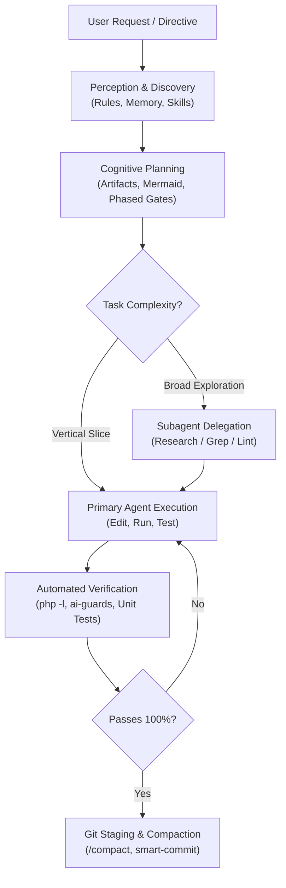

# ⚡ ANTIGRAVITY GOD-LEVEL OPERATIONAL MASTER GUIDE
### The Complete Enterprise Blueprint for Autonomous Agentic Engineering

> **Purpose:** This document establishes the definitive, God-Level operating manual for using **Google Antigravity** on the JERO enterprise codebase. It transforms the AI assistant from a reactive chat autocomplete into an autonomous, high-velocity engineering engine capable of executing complex vertical slices with zero regressions, zero context amnesia, and 100% architectural compliance.

---

## 📑 TABLE OF CONTENTS
1. [Core Mental Model & Architecture](#1-core-mental-model--architecture)
2. [The Antigravity File System & Discovery Tree](#2-the-antigravity-file-system--discovery-tree)
3. [Custom Skills Architecture (.agents/skills/)](#3-custom-skills-architecture-agentsskills)
4. [God-Level Subagent Orchestration](#4-god-level-subagent-orchestration)
5. [Brain Artifacts & Interactive Feedback Loops](#5-brain-artifacts--interactive-feedback-loops)
6. [Slash Commands Super-Powers Playbook](#6-slash-commands-super-powers-playbook)
7. [Automated Lifecycle Hooks & Quality Guards (hooks.json)](#7-automated-lifecycle-hooks--quality-guards-hooksjson)
8. [Dual-Model Selection Matrix (Flash vs. Thinking)](#8-dual-model-selection-matrix-flash-vs-thinking)
9. [Eliminating Anti-Patterns: The Continuous Vertical Slice Workflow](#9-eliminating-anti-patterns-the-continuous-vertical-slice-workflow)
10. [Standard Operating Procedures (Cheat-Sheet Prompts)](#10-standard-operating-procedures-cheat-sheet-prompts)

---

## 1. Core Mental Model & Architecture

Antigravity is not a passive language model sitting behind a chat prompt. It is an **Autonomous Agent Runtime** running on a continuous Perception-Action-Verification loop:



### The Three Context Tiers
1. **Tier 1: Global & System Instructions (Immutable)**
   - Hard rules defined in `AGENTS.md` and `GEMINI.md`. Loaded automatically on session start.
2. **Tier 2: Progressive Skills (On-Demand)**
   - Folders under `.agents/skills/<name>/SKILL.md`. Only the **name and description** are loaded initially (consuming minimal tokens). The full implementation protocol is pulled into memory **only when triggered**.
3. **Tier 3: Ephemeral Active Memory (Dynamic)**
   - The active tool calls, command outputs, and conversation turns. Kept fresh and compact using `/compact` and subagent offloading.

---

## 2. The Antigravity File System & Discovery Tree

To unlock Antigravity's autonomous capabilities, the repository must leverage its native directory structure:

```
c:\Users\...\JWMaincode28June2026/
├── .agents/                        <-- Workspace Customizations Root
│   ├── skills/                     <-- Progressive-Disclosure Skills
│   │   ├── god-audit/
│   │   │   └── SKILL.md            <-- Multi-step Audit Runbook
│   │   ├── card-subcard/
│   │   │   └── SKILL.md            <-- Modern Card + Sub-Card Engine
│   │   ├── cqrs-browser-exec/
│   │   │   └── SKILL.md            <-- 0% Server Strain Client-First Standard
│   │   └── smart-commit/
│   │       └── SKILL.md            <-- Verification & Staging Protocol
│   ├── hooks.json                  <-- Agent Lifecycle Hooks
│   └── mcp_config.json             <-- Model Context Protocol Server Config
├── docs/                           <-- Enterprise Knowledge Base
│   ├── AI_RULES.md                 <-- God-Level Directives
│   ├── UI_UX_CARD_SUB_CARD_DESIGN_STANDARD.md
│   └── ...
├── AGENTS.md                       <-- Auto-loaded entry point rules
└── .ai/
    └── PROJECT_MEMORY.md           <-- Living session state & decisions
```

---

## 3. Custom Skills Architecture (`.agents/skills/`)

### Why Skills Outperform Prompt Pasting
* **Prompt Pasting:** You copy/paste 30 lines of instructions every prompt. This consumes ~500 tokens per turn, clutters working memory, and suffers from human omission.
* **Progressive Skills:** The agent only sees: `god-audit: Runs a forensic, God-Level architecture, UI/UX, and performance audit on any JERO module.` When you say "Audit the Client Drawer", Antigravity loads the full runbook automatically.

### Core JERO Skills Definitions

#### 1. Skill: `god-audit`
Path: `.agents/skills/god-audit/SKILL.md`
```yaml
---
name: god-audit
description: Forensic God-Level architecture, UI/UX, performance, and multi-tenant security audit for JERO modules.
---
# God-Level Audit Runbook
When performing an audit on any module, drawer, or listing:
1. **CQRS 100% Read Compliance**:
   - Check request paths for 0% MySQL reads. Verify that search, filters, aggregations, and pagination hit Elasticsearch.
2. **10K Concurrency & Client-First Execution**:
   - Verify client-side state caching (RAM / IndexedDB / Web Worker).
   - Ensure document assembly, formatting, and exports execute in user RAM (0% server strain).
3. **Multi-Tenant Scoping**:
   - Verify `company_id` isolation on every raw query and cache key (`tenant_id = company_id`).
4. **UI/UX Enterprise Standard (Rule 20 & 15.6" Fit)**:
   - Audit viewport fit for 1366x768 and 1920x1080 (0 horizontal overflow).
   - Validate Modern Card + Sub-Card 3-Tier standard:
     - Tier 1: White toolbar card with 300ms debounced search & clear button.
     - Tier 2: Dedicated white sub-tabs card with active blue highlight (#009ef7).
     - Tier 3: Discrete sub-cards with bottom activity strip.
5. **Output**:
   - Always write audit results to a Brain Artifact with an executive summary, violation matrix, and Mermaid diagram.
```

#### 2. Skill: `card-subcard`
Path: `.agents/skills/card-subcard/SKILL.md`
```yaml
---
name: card-subcard
description: Generates or refactors views strictly into the Modern Card + Sub-Card Enterprise Design System (Rule 20).
---
# Modern Card + Sub-Card Implementation Standard
1. **Card Hierarchy**:
   - Tier 1 Toolbar: `#ffffff`, border `#e2e8f0`, radius 10px, box-shadow `0 1px 3px rgba(0,0,0,0.05)`.
   - Tier 2 Sub-Tabs: Pure white card with `#009ef7` active blue indicators and numeric badges.
   - Tier 3 Stream: Multi-column CSS grid using `minmax(0, 1fr)` ensuring zero horizontal scrolling.
2. **Typography & Controls**:
   - Font: Poppins only. Max font 14px. Numeric counters must use `font-variant-numeric: tabular-nums;`.
   - Search: Instant 300ms debounce with clear (X) button resetting filter immediately.
   - Status: Subtle 3.5px left-border status accent (`#10b981` active, `#cbd5e1` inactive).
```

#### 3. Skill: `smart-commit`
Path: `.agents/skills/smart-commit/SKILL.md`
```yaml
---
name: smart-commit
description: Automated pre-commit verification, AI guard enforcement, and safe staging deployment.
---
# Smart Commit Protocol
Execute strictly in this sequence:
1. Syntax check: Run `php -l` on every touched PHP and Blade file.
2. Guard check: Run `bash scripts/ai-guards.sh` (or check for `dd()`, `dump()`, raw `env()`, and unescaped Blade `{!! !!}`).
3. Status review: Inspect `git status --porcelain` to verify only intended files are staged.
4. Tenancy check: Ensure all touched DB calls filter by `company_id`.
5. Staging commit: Formulate conventional commit message with module prefix and push strictly to `origin/staging` (NEVER `main`).
```

---

## 4. God-Level Subagent Orchestration

One of Antigravity's most formidable capabilities is **Subagent Delegation** via `invoke_subagent`.

```
                    ┌───────────────────────────────────────────────┐
                    │          PRIMARY ORCHESTRATOR AGENT           │
                    │   (Focus: High-Level Logic & Architecture)    │
                    └───────────────────────────────────────────────┘
                                            │
                 ┌──────────────────────────┴──────────────────────────┐
                 ▼                                                     ▼
┌─────────────────────────────────┐                   ┌─────────────────────────────────┐
│     SUBAGENT 1: RESEARCH        │                   │     SUBAGENT 2: AUDITOR         │
│ Model: flash                    │                   │ Model: flash                    │
│ Task: Scan 25 Blade files, grep │                   │ Task: Grep raw queries for      │
│ event listeners, map CSS classes│                   │ missing company_id & dd() calls │
└─────────────────────────────────┘                   └─────────────────────────────────┘
                 │                                                     │
                 └──────────────────────────┬──────────────────────────┘
                                            ▼
                    ┌───────────────────────────────────────────────┐
                    │      Crisp 10-Line Synthesis Returned        │
                    │      Primary Agent Executes Clean Edits       │
                    └───────────────────────────────────────────────┘
```

### When to Spawn Subagents
1. **Massive Codebase Exploration**:
   - Never let your primary agent read 15 full files sequentially.
   - *Directive:* `"Spawn a research subagent to grep all occurrences of cl-data-worker.js and extract the exported event names."*
2. **Pre-Implementation Forensic Audits**:
   - *Directive:* `"Launch an auditor subagent to inspect resources/views/service_company/client/ for unescaped {!! !!} statements and missing company_id filters."*
3. **Parallel Verification**:
   - Run tests or linter checks in the background while the primary agent prepares the commit message or updates `PROJECT_MEMORY.md`.

### Subagent Workspace Modes
* `inherit`: Default. Operates in the same workspace. Perfect for read-only research, grepping, and audits.
* `branch`: Creates an isolated git branch workspace. Ideal when experimenting with high-risk structural rewrites without touching active files.
* `share`: Shares the underlying repository directory without duplicating disk space.

---

## 5. Brain Artifacts & Interactive Feedback Loops

Antigravity features an integrated markdown artifact rendering engine. Artifacts live in `<appDataDir>\brain\<conversation-id>\`.

### The Three Rules of God-Level Artifacts
1. **Never Dump Multi-Screen Plans in Chat**:
   - When asking for an audit or phased implementation plan, mandate:
     *"Write the implementation plan as an artifact with `RequestFeedback: true`."*
2. **The "Proceed" Feedback Button**:
   - Setting `RequestFeedback: true` in the artifact metadata embeds a native **"Proceed"** button into the Antigravity UI.
   - You can review the step-by-step checklist, click "Proceed", and the agent executes the plan systematically.
3. **Visual Architecture via Mermaid**:
   - Antigravity natively renders Mermaid flowcharts, sequence diagrams, and entity-relationship models inside artifacts.

---

## 6. Slash Commands Super-Powers Playbook

Antigravity provides specialized slash commands in the chat interface that eliminate repetitive prompting:

| Slash Command | God-Level Use Case in JERO | How It Accelerates Development |
| :--- | :--- | :--- |
| **`/compact`** | **Context Hygiene** | Summarizes turns, purges stale tool logs, and retains active DOM/variable memory. Run every 10–15 turns instead of killing the session! |
| **`/goal`** | **Vertical Slice Autonomy** | Executes an end-to-end task (e.g. "Migrate Client Drawer Activity Tab to Card + Sub-Card") and does not stop until verified. |
| **`/plan`** | **Architecture First** | Forces the agent to produce a structured, phased roadmap and file-impact matrix before modifying a single line of code. |
| **`/browser`** | **Visual Responsive Verification** | Launches headless/interactive browser to verify 15.6" screen layouts (1366x768 & 1920x1080) with zero horizontal overflow. |
| **`/grill-me`** | **Architectural Alignment** | The agent interviews you with targeted technical questions to resolve ambiguities before embarking on major refactors. |
| **`/boost`** | **Ultra-Deep Reasoning** | Activates maximum cognitive depth for intricate multi-tenant database indexing, CQRS reconciliation, or distributed race conditions. |
| **`/learn`** | **Persistent Preference Memory** | Teaches Antigravity a permanent preference (e.g., *"Always use Poppins max 14px and tabular-nums on ATS counters"*). |

---

## 7. Automated Lifecycle Hooks & Quality Guards (`hooks.json`)

To prevent bugs before they reach Git, configure Antigravity hooks in `.agents/hooks.json`.

```json
{
  "description": "JERO Enterprise Lifecycle Guards",
  "hooks": {
    "post_tool_edit": [
      {
        "matcher": "**/*.php",
        "command": "php -l \"$FILE_PATH\"",
        "action_on_failure": "halt_and_report",
        "description": "Ensure zero PHP syntax errors on every file modification."
      }
    ],
    "pre_git_commit": [
      {
        "command": "bash scripts/ai-guards.sh",
        "action_on_failure": "block_commit",
        "description": "Block commit if dd(), dump(), or unescaped env() calls are detected."
      }
    ]
  }
}
```

---

## 8. Dual-Model Selection Matrix (Flash vs. Thinking)

Antigravity allows dynamic switching of the underlying model. Use each model where its architecture excels:

```
                            ┌───────────────────────────────────────┐
                            │      ANTIGRAVITY MODEL SELECTION      │
                            └───────────────────────────────────────┘
                                                │
                     ┌──────────────────────────┴──────────────────────────┐
                     ▼                                                     ▼
┌─────────────────────────────────────────┐   ┌─────────────────────────────────────────┐
│         CLAUDE SONNET / THINKING        │   │         GEMINI 3.8 FLASH (HIGH)         │
│  "The Chief Architect"                  │   │  "The Hyper-Speed Implementation Beast" │
├─────────────────────────────────────────┤   ├─────────────────────────────────────────┤
│ • Forensic root-cause audits            │   │ • Card + Sub-Card HTML/CSS refactoring  │
│ • CQRS outbox idempotency design        │   │ • Batch Blade updates & DOM styling     │
│ • Complex multi-tenant edge cases       │   │ • Running unit tests & linters (php -l) │
│ • Cross-service race condition analysis │   │ • Git commits, push & memory updates    │
└─────────────────────────────────────────┘   └─────────────────────────────────────────┘
```

---

## 9. Eliminating Anti-Patterns: The Continuous Vertical Slice Workflow

### The Anti-Pattern: Micro-Session Fragmenting
```
❌ BAD WORKFLOW:
Session 1: "Fix counter" ➡️ "commit and push" ➡️ KILL SESSION
Session 2: "Fix subtabs" ➡️ "commit and push" ➡️ KILL SESSION (Amnesia: broke counter!)
Session 3: "Restore counter & fix layout" ➡️ "commit and push" ➡️ KILL SESSION
```

### The God-Level Pattern: Continuous Cohesive Slice
```
✅ GOD-LEVEL WORKFLOW:
Single Session: "Execute vertical refactor of Client Drawer (KPI, Tabs, Counters)"
Turn 1: Agent creates Artifact implementation plan (Phases 0–6)
Turn 2: You review Artifact and click "Proceed"
Turn 3: Agent edits Blade, JS, and CSS cohesively
Turn 4: When context reaches 15 turns ➡️ Type `/compact`
Turn 5: Agent verifies via `php -l` and unit tests
Turn 6: Execute `@smart-commit` (pushed safely to staging)
```

---

## 10. Standard Operating Procedures (Cheat-Sheet Prompts)

Copy-paste these standardized operational prompts to drive Antigravity at peak efficiency:

### 1. The God-Level Audit Prompt
```text
@god-audit
Module: <Module Name or Route, e.g., service_company/client drawer>
Task: Conduct a forensic audit covering 100% CQRS reads, 10K concurrency browser execution, 15.6" screen layout, and multi-tenant scoping.
Format: Write the audit report as an Artifact with a Mermaid diagram and an actionable remediation matrix.
```

### 2. The Card + Sub-Card Refactor Prompt
```text
@card-subcard
Target: <Blade view path>
Task: Refactor this screen into the Modern Card + Sub-Card Enterprise Standard (Rule 20).
Requirements: Tier 1 toolbar card (#ffffff, 300ms debounced search + clear), Tier 2 dedicated sub-tabs card, Tier 3 card stream. Zero horizontal overflow at 1366x768 and 1920x1080.
Output: Show plan in an artifact before modifying code.
```

### 3. The Deep Investigation Prompt (Subagent Delegated)
```text
Investigate <Issue / Feature>. 
Spawn a research subagent using Flash to grep the codebase, locate all related event listeners and AJAX routes, and return a concise dependency map. 
Do not read controllers whole; grep methods only.
```

### 4. The Safe Commit & Deploy Prompt
```text
@smart-commit
Task: Verify all modified files with `php -l` and `bash scripts/ai-guards.sh`. 
Ensure company_id isolation is intact. Stage modified files, formulate a conventional commit message referencing the module, and push strictly to origin/staging.
```
