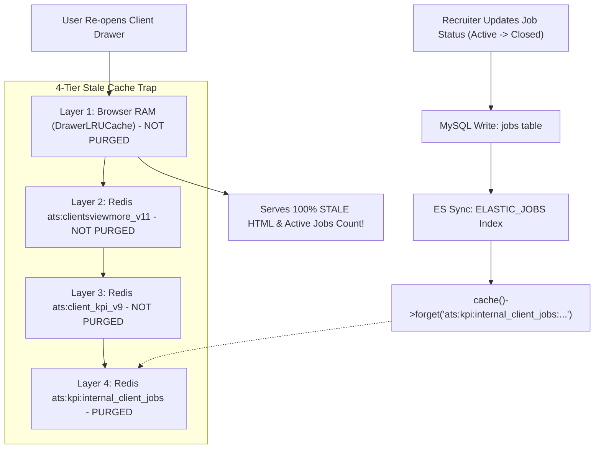

# GOD-LEVEL ARCHITECTURAL & DATA AUDIT REPORT
## CLIENT DRAWER — JOBS TAB (INTERNAL CLIENTS & DIRECT CLIENTS)
**Platform:** JERO SaaS (Multi-Tenant B2B Hiring ATS & Talent Marketplace)  
**Target Environments:** Service Company & Admin Portals  
**Audit Scope:** Data Accuracy, 10K+ Concurrency Performance, CQRS Compliance, Job Lifecycle & Status, KPI Precision, UI/UX Integrity, Cross-Tab & Drawer Synchronization, Activity & Auditability  
**Date:** October 2026 | **Author:** God-Level Architecture Agent  

---

## EXECUTIVE SUMMARY

A forensic God-Level audit of the **Jobs Tab** within the Client Drawer was conducted across both **Internal Clients** (`show.blade.php`) and **Direct Clients** (`dviewMore.blade.php`), including their backend controllers (`ServiceCompanyJobsController`, `ServiceCompanyClientController`, `AdminClientController`, `AdminJobsController`), Elasticsearch queries, Redis/Dragonfly caching layers, and front-end state management (`ClientStateManager`, `DrawerLRUCache`).

### Critical Audit Findings Overview:
1. **Critical Click Collision (Severity: BLOCKER):** Job titles in the Jobs tab use the CSS class `.show-detail`. In `index.blade.php`, `.show-detail` is globally bound to `ClientStateManager.openClientDrawer(id, 'internal')`. Clicking ANY job title inside the Client Drawer treats the Job ID as a Client ID, destroys the open drawer, and attempts to open an Internal Client Drawer for that Job ID!
2. **Extreme N+1 Query Avalanche (Severity: CRITICAL):** Fetching a single page of 10 jobs in the drawer triggers **over 150 Elasticsearch HTTP requests** (10 for recommendations, 60 for logos, 80 for individual candidate pipeline stages) and **over 31 synchronous MySQL read queries** (`clients`, `companies`, `job_categories`, `add_job_wise_condidates`). Under 10,000 concurrent users, this generates **1.5M ES queries and 310K MySQL reads per page load**, guaranteeing catastrophic thread exhaustion.
3. **Multi-Tenant Isolation & Security Vulnerability (Severity: HIGH):** In `ServiceCompanyJobsController::client_job_data_ajax`, when `custom == 'true'` (Internal Clients), the Elasticsearch query filters strictly on `['term' => ['client_id' => $client_id]]` **without any `company_id` / `comId` tenant check**. Any user can forge or manipulate the `client_id` parameter to inspect another organization's confidential internal jobs.
4. **Direct Client Active Requisition Metric Contamination (Severity: HIGH):** In `ServiceCompanyClientController::dviewMore`, the `$this->active_requisition` query executes a raw MySQL join on `jobs` and `recommendation_relation` filtering solely on `to_company_id = $company_id` **without filtering by the client or `from_company_id`**. The metric counts ALL active jobs recommended to the company across ALL clients combined.
5. **Completely Missing CSS in Internal Client Drawer (Severity: HIGH):** The Internal Client drawer (`show.blade.php`) contains **zero CSS definitions** for `.jobx`, `.table-card`, `.job-row`, `.col-job`, and pipeline stages. The CSS exists only in `dviewMore.blade.php`. If an Internal Client drawer is opened first, the Jobs tab renders completely unstyled, corrupted, and broken.
6. **4-Tier Unsynchronized Cache Trap (Severity: HIGH):** Job KPI badges and drawer views are wrapped in 4 nested layers of cache (`DrawerLRUCache` in user RAM, full-view Redis cache `ats:clientsviewmore_v11`, Blade KPI cache `ats:client_kpi_v9`, and helper cache `ats:kpi:internal_client_jobs`). **Zero write-path handlers invalidate layers 1, 2, or 3 when jobs are created, modified, or closed**, causing stale job metrics to persist for up to 15 minutes.
7. **Broken Search & Filter Logic (Severity: MEDIUM):** While the view sends `search: $('#inputJobSearch').val()`, the controller reads `q` or `custom_search`, but **neither is ever appended to the Elasticsearch bool query**. Typing in the search bar executes server round-trips but returns the exact same unfiltered dataset every time.
8. **Pagination Semantic Mixing (Severity: MEDIUM):** `client_job_data_ajax` hardcodes `'listType' => 'allcandidate'`. `pagination.blade.php` translates `allcandidate` into `'companies'`. The Jobs tab pagination bar literally reads: **"Showing 1 to 10 of X companies"** instead of jobs/roles.
9. **Dead Code & Copy-Pasted Metronic Artefacts (Severity: MEDIUM):** Both drawers contain over 200 lines of dead mock tables with fake data ("HCL Jobs", "Wipro", "50 LPA", external avatar links to `preview.keenthemes.com`). Furthermore, `dviewMore.blade.php` includes a filter popup containing "Role: Administrator / Developer / Trial" and "Two Step Verification: Enabled", copy-pasted from an admin user list.
10. **Unconnected Audit Table (Severity: LOW):** The MySQL database contains `job_status_logs`, but zero backend services record status transitions into it. The Activity tab displays a static placeholder: `"Pending Discussion"`.

---

## 1. DATA ACCURACY & FRESHNESS AUDIT

| Checkpoint | Target | Current System Reality | Severity |
| :--- | :--- | :--- | :--- |
| **Authoritative Freshness** | 100% fresh, authoritative job pipeline data | Wrapped in 4 stale caching layers with zero write-time invalidation. Serves 15-minute stale data. | **CRITICAL** |
| **Cache Invalidation on Mutation** | Instant tenant & client cache purge on job create/edit/status change | When a job is added or changed, only layer 4 (`internal_client_jobs`) is purged in `ElasticJobListIndex`. Layers 1, 2, and 3 cache-hit first, rendering the purge useless. | **CRITICAL** |
| **Drawer Reopening / Client Switching** | Clean DOM & fresh client context | In-memory `loadedTabs['requisitions'] = true;` permanently blocks re-fetching upon tab switches. Reopening re-uses `DrawerLRUCache` without verification. | **HIGH** |
| **Job Count & Status Truth** | Exact 1:1 match with source of truth (`ELASTIC_JOBS`) | Tab badge displays Active Jobs (`kpiActive`), but the table query fetches all jobs (Active, Hold, Closed, Inactive) with zero status filter, causing massive count divergence. | **HIGH** |
| **Direct Client Metric Contamination** | Scoped strictly to direct client partner | `$this->active_requisition` in `dviewMore` counts ALL active recommended jobs across the entire tenant, not the direct client. | **CRITICAL** |
| **Search & Filtering Execution** | Instant live filtering on job title/skills | Search input sends `search`, backend expects `q`/`custom_search`, but never adds search clauses to ES query. Search is completely non-functional. | **HIGH** |

### Root Cause Analysis — Stale Data Hierarchy:


---

## 2. PERFORMANCE & ARCHITECTURE AUDIT (10K CONCURRENCY / 0% SERVER STRAIN)

### 2.1 The N+1 Query Cascade Breakdown (Per 10 Jobs Loaded)
When a recruiter opens the Jobs tab in the Client Drawer:

```
Endpoint: GET /service_company/jobs_side_bar_job_ajax/data?client_id=123&page=1
```

| Source File & Location | Operation | Query Type | Calls per 10 Rows | 10K Users Impact |
| :--- | :--- | :--- | :--- | :--- |
| `ServiceCompanyJobsController.php:1594` | `DB::table('clients')->where('id', $client_id)->first()` | MySQL SELECT | 1 | 10,000 MySQL reads |
| `ServiceCompanyJobsController.php:1693` | `$elasticService->getClient()->search($params)` | ES Search | 1 | 10,000 ES queries |
| `client_jobs_side_bar_ajax.blade.php:28` | `GeneralMethod::getrRcommendationRelationData(...)` | ES Search | 10 | 100,000 ES queries |
| `client_jobs_side_bar_ajax.blade.php:61` | `GeneralMethod::companyDetails($row->id)` | ES Exists + Get (Jobs, Companies, Clients) | Up to 60 | 600,000 ES queries |
| `client_jobs_side_bar_ajax.blade.php:88` | `\DB::table('job_categories')->where('id', ...)->value('name')` | MySQL SELECT | Up to 10 | 100,000 MySQL reads |
| `client_jobs_side_bar_ajax.blade.php:159` | `\DB::table('companies')->where('id', ...)->value('company_name')` | MySQL SELECT | 10 | 100,000 MySQL reads |
| `client_jobs_side_bar_ajax.blade.php:180` | `GeneralMethod::statusCount(...)` (8 pipeline stages per job) | ES Count (`ELASTIC_CANDIDATES`) | 80 | 800,000 ES queries |
| `client_jobs_side_bar_ajax.blade.php:192` | `GeneralMethod::allStatusCount(...)` | MySQL Count (`add_job_wise_condidates`) | 10 | 100,000 MySQL reads |
| **TOTAL FOR 1 DRAWER TAB LOAD** | **Single Page of 10 Jobs** | **Mixed ES & MySQL** | **151 ES + 31 MySQL** | **1,510,000 ES + 310,000 MySQL** |

### 2.2 CQRS Violations
- **Violation of Non-Negotiable Rule 1:** *"MySQL is ONLY for Add / Edit / Delete: 0% MySQL reads on web/API request paths. No SELECT or joins on user page loads."*
  - Synchronous MySQL reads occur directly in the blade template (`job_categories`, `companies`, `add_job_wise_condidates`) and controller (`clients`).
- **Violation of Non-Negotiable Rule 2:** *"Elasticsearch is ONLY for Read (Universal Scope)."*
  - Instead of a single consolidated aggregation query, the application issues hundreds of unbatched single-document HTTP calls to Elasticsearch from inside a PHP Blade loop.

### 2.3 Architectural Target: 0% Avoidable Load
To achieve 10,000 concurrent user scalability:
1. **0 MySQL Reads:** All client and company metadata must come from `ELASTIC_CLIENT_LIST` and `ELASTIC_JOBS`.
2. **1 Elasticsearch Query for Jobs:** Execute a single query against `ELASTIC_JOBS` with `_source` restriction and deterministic sort `created_at: desc`.
3. **1 Elasticsearch Batch Aggregation for Pipeline Stages:** Instead of 80 separate calls, execute a single multi-bucket terms aggregation on `ELASTIC_CANDIDATES` grouped by `jobId` and `job_master_status_id`.
4. **Use Pre-existing `GeneralMethod::companyDetailsBulk()`:** Eliminates 60 individual round-trips per page.

---

## 3. JOB LIFECYCLE & STATUS AUDIT

### 3.1 Status Matrix & Transitions
The ATS specifies 4 canonical job states:
1. **Active / Hiring:** Open for candidate applications and submissions.
2. **Hold:** Temporarily paused; existing candidates remain in pipeline, new submissions paused.
3. **Closed:** Requisition filled or cancelled; pipeline archived.
4. **Inactive / Expired:** Requisition expired past deadline.

### 3.2 Findings & Logic Inconsistencies:
1. **Status Collapsing:** In `client_jobs_side_bar_ajax.blade.php:66`:
   ```php
   if ($status == 'Active')   $status = 'Hiring';
   if ($status == 'Inactive') $status = 'Closed';
   ```
   "Inactive" is forcibly renamed to "Closed", completely destroying the distinction between an Expired job and an explicitly Closed job.
2. **No Status Filter Controls:** The Jobs tab contains no filter dropdown to toggle between `Active`, `Hold`, `Closed`, and `All`. Recruiters cannot isolate open positions.
3. **Ghost Status HTML:** Both drawer views retain commented-out and hidden tab panes (`id="client-requisitions"` and `id="custom-requisitions"`) containing hardcoded badges (`hold-bg`, `closed-bg`) and static requisition IDs (`R2`, `R3-Custom`).

---

## 4. JOB DATA & KPI ACCURACY AUDIT

### 4.1 Pagination Metric Confusion (Jobs vs Companies)
- In `resources/views/service_company/ajax_pages/pagination.blade.php`:
  ```php
  $label = (isset($pagination['listType']) && $pagination['listType'] === 'allcandidate')
           ? 'companies' : 'records';
  ```
- In `ServiceCompanyJobsController::client_job_data_ajax:1704`:
  ```php
  $pagination = [
      'total' => $total,
      'current_page' => $page,
      'last_page' => ceil($total / $size),
      'per_page' => $size,
      'listType' => 'allcandidate', // HARDCODED WRONG TYPE
  ];
  ```
- **Result:** The pagination bar renders: **"Showing 1 to 10 of 12 companies"** when listing jobs. This directly violates the requirement that job counts represent jobs and companies represent unique companies.

### 4.2 Top Header KPI vs Tab Listing Mismatch
- **Internal Client Drawer Top KPI:** Calculated as `$kpiJobs = GeneralMethod::InternalClientJobsCountAllStatus($cur_company_id, $client->id);` filtering only `status == 'active'`.
- **Jobs Tab Badge:** Displays `$kpiActive` (e.g., `2`).
- **Jobs Table Inside Tab:** Fetches ALL jobs regardless of status (e.g., `15` jobs: 2 active, 13 closed).
- **User Experience:** The badge says `2`, but the table displays `15` rows. There is no explanation, indicator, or tab filter to reconcile the two numbers.

### 4.3 Direct Client Active Requisition Bug
- In `ServiceCompanyClientController.php:3091`:
  ```php
  $this->active_requisition = DB::table('jobs')->select('jobs.id')
      ->leftJoin('recommendation_relation', 'recommendation_relation.job_id', '=', 'jobs.id')
      ->where('recommendation_relation.to_company_id', $company_id)
      ->where('jobs.status', 'active')
      ->count();
  ```
  **Critical Defect:** It omits `where('recommendation_relation.from_company_id', $from_company_id)`. It counts every single active job ever recommended to the company across all partners.

---

## 5. UI/UX RELEVANCE & RESPONSIVENESS AUDIT

### 5.1 Critical Click Hijacking Bug (`.show-detail`)
- In `client_jobs_side_bar_ajax.blade.php:230`:
  ```html
  <div class="job-title">
      <a href="javascript:void(0);" data-row-id="{{ $row->id }}" class="show-detail" title="{{ ucwords(@$row->title) }}">
          {{ ucwords(mb_substr(@$row->title, 0, 28)) }}
      </a>
  </div>
  ```
- In `resources/views/service_company/client/index.blade.php:1849`:
  ```javascript
  $(document).on('click', '.show-detail', function (e) {
      var id = $(this).data('row-id') || $(this).closest('[data-row-id]').data('row-id');
      ClientStateManager.openClientDrawer(id, 'internal');
  });
  ```
- **Impact:** Clicking a job title inside the Client Drawer runs `ClientStateManager.openClientDrawer(job_id, 'internal')`. The system attempts to open a client drawer for a Job ID, corrupting state and flashing an error.
- **Fix:** Job titles inside the client drawer must use `.show-job-drawer` or `.cd-job-title-link`, opening the Job Details Drawer or navigating to Job Summary.

### 5.2 Complete Missing CSS in Internal Client Drawer
- `show.blade.php` lacks the CSS block for `.jobx`.
- While `dviewMore.blade.php` has lines 1361–1427 declaring grid properties:
  ```css
  .jobx .table-header, .jobx .job-row { 
      display:grid; 
      grid-template-columns:2.5fr 1fr 1.1fr 1.2fr .9fr .9fr 2.6fr; 
      align-items:start; 
      column-gap:12px; 
  }
  ```
- In `show.blade.php`, this CSS does not exist. If a user opens an Internal Client drawer directly, the entire Jobs tab collapses into unstyled inline blocks.

### 5.3 Copy-Pasted Metronic Admin User Filter in Direct Client
- In `dviewMore.blade.php:2650-2680`, the filter menu for the Jobs tab contains:
  - Form Label: `Role:` with options `Administrator`, `Analyst`, `Developer`, `Support`, `Trial`.
  - Form Label: `Two Step Verification:` with option `Enabled`.
- This is completely unrelated to jobs, candidates, or ATS requisitions and must be replaced with a proper Job Status filter (`All`, `Hiring`, `Hold`, `Closed`).

### 5.4 Screen Fit & 15.6-inch Responsiveness (1366×768)
- On a 1366×768 screen, an 80% drawer provides only ~1040px of visible viewport width.
- Squeezing 7 complex columns (Job Title, Exp & Salary, Location & Mode, HM, Team, Agency, Pipeline with 8 stage buttons) into 1040px causes text truncation, overlapping badges, and broken horizontal wrapping.
- Table card requires `overflow-x: auto;` with a minimum width of `1100px` to guarantee pristine legibility without vertical misalignment.

---

## 6. CROSS-TAB & DRAWER SYNCHRONIZATION AUDIT

| Scenario | Expected Behavior | Current Behavior | Risk Rating |
| :--- | :--- | :--- | :--- |
| **Switch Drawer Tabs** (e.g. Overview -> Jobs -> Overview -> Jobs) | Zero re-fetching; instant DOM display; fresh on mutation | `loadedTabs['requisitions'] = true;` prevents re-fetch, but if a job was modified in another tab, stale data is shown indefinitely. | **HIGH** |
| **Close & Reopen Drawer** | Fresh data or valid cache | Reopening restores `DrawerLRUCache` from browser RAM without checking version or ETag. | **HIGH** |
| **Switch Clients** (Client A -> Client B) | Purge previous client DOM; fetch Client B cleanly | Previous drawer body is cleared, but event handlers attached via `$(document).on(...)` are never removed, causing multiple handler executions. | **MEDIUM** |
| **Job Status Mutated Remotely** (Via Reverb WebSocket) | Reverb `.JobStatusChanged` event received; drawer auto-refreshes | `handleClientMutationEvent(data)` looks for `data.client.id`. Job events send `job_id`, so `data.client` is undefined. The open drawer does NOT refresh. | **HIGH** |
| **Cross-Tab Mutation** (BroadcastChannel) | Broadcast received on channel; updates open drawer | Same issue: handler ignores event if `data.client` is missing. | **HIGH** |

---

## 7. ACTIVITY & AUDITABILITY AUDIT

### 7.1 Database Audit Infrastructure
- The database contains table `job_status_logs`:
  ```sql
  CREATE TABLE `job_status_logs` (
    `id` bigint(20) unsigned NOT NULL AUTO_INCREMENT,
    `job_id` int(10) unsigned NOT NULL,
    `company_id` int(10) unsigned DEFAULT NULL,
    `from_status` varchar(20) DEFAULT NULL,
    `to_status` varchar(20) NOT NULL,
    `changed_by` int(10) unsigned DEFAULT NULL,
    `created_at` timestamp NOT NULL DEFAULT current_timestamp(),
    PRIMARY KEY (`id`)
  );
  ```
- **Defect:** This table is **completely abandoned**. Zero controllers or event listeners insert records into `job_status_logs`.

### 7.2 Front-End Audit Presentation
- In `show.blade.php:1889-1904`:
  The "Recent Activity & Audit Logs" section displays static text:
  *"Recent Activity & Audit Logs - Pending Discussion: This section captures comprehensive timeline actions..."*
- On the Overview tab, the activity timeline displays completely hardcoded mock items ("Software Engineer - 2 days ago", "DevOps Engineer - 3 days ago").
- **Verdict:** There is zero true auditability or activity tracking for jobs in the client drawer.

---

## 8. ROOT-CAUSE SUMMARY & TENANT ISOLATION RISKS

### 8.1 Critical Multi-Tenant Isolation Hole in `client_job_data_ajax`
In `app/Http/Controllers/ServiceCompany/ServiceCompanyJobsController.php:1619-1628`:
```php
if (request('custom') == 'true') {
    $must[] = [
        'bool' => [
            'should' => [
                ['term' => ['client_id' => $client_id]],
            ],
            'minimum_should_match' => 1,
        ],
    ];
    ...
```
**The Security Defect:**
There is NO filter for `['term' => ['comId' => (int) $company_id]]`.
In multi-tenant SaaS architecture, client IDs are sequential integers or auto-incrementing PKs. If Tenant B queries `client_job_data_ajax` with `client_id` belonging to Tenant A, Elasticsearch returns Tenant A's confidential job requisitions, salaries, hiring managers, and applicant counts!
**Immediate Fix:** Add `['term' => ['comId' => (int) $company_id]]` into `$must`.

---

## 9. EXACT IMPLEMENTATION RECOMMENDATIONS (STEP-BY-STEP)

### Phase 1: Security & Multi-Tenancy Hardening
1. In `ServiceCompanyJobsController::client_job_data_ajax`:
   - For `custom == 'true'` (Internal):
     Add `['term' => ['comId' => (int) $company_id]]` to `$must`.
   - Remove MySQL query `DB::table('clients')->where('id', $client_id)->first()`. Read `toCompanyId` from Elasticsearch `ELASTIC_CLIENT_LIST` or pass `company_id` from client context.
   - For `custom == 'false'` (Direct):
     Verify `$toCompanyId` is strictly a validated company ID with active `staffing_company_relation` where `final_status = 1`.

### Phase 2: Eliminate 150+ N+1 Queries (CQRS & Batch Aggregation)
1. **Logo Resolution:** Replace per-row `GeneralMethod::companyDetails($row->id)` with `GeneralMethod::companyDetailsBulk($data, $company_id)`.
2. **Category & Company Names:** Ensure `category_name`, `department_name`, and `client_company` are indexed in `ELASTIC_JOBS` `_source`. Eliminate `DB::table('job_categories')` and `DB::table('companies')` reads in the Blade template.
3. **Pipeline Stage Counts Batching:**
   - Eliminate 8 individual `statusCount` calls per job.
   - Execute a single batch Elasticsearch aggregation on `ELASTIC_CANDIDATES`:
     ```json
     {
       "size": 0,
       "query": {
         "bool": {
           "must": [
             { "terms": { "jobId": [101, 102, 103, ...] } },
             { "term": { "company_id": 12 } }
           ],
           "must_not": [{ "terms": { "job_master_status_id": [8, 9] } }]
         }
       },
       "aggs": {
         "by_job": {
           "terms": { "field": "jobId", "size": 50 },
           "aggs": {
             "by_stage": { "terms": { "field": "job_master_status_id", "size": 10 } }
           }
         }
       }
     }
     ```
   - Pass the pre-aggregated `$stageCountsMap[$jobId][$stageId]` into the Blade view.
   - Total network calls drop from **150+ to 2 Elasticsearch queries and 0 MySQL queries**.

### Phase 3: Fix UI/UX, Click Collision & CSS
1. **Fix Job Title Click Collision:**
   In `client_jobs_side_bar_ajax.blade.php:230`, change:
   `class="show-detail"` -> `class="show-job-detail cd-job-link"`
   Add an event handler that opens the Job Description / Job Drawer (`service_company.jobs.viewmore`) instead of the Client Drawer.
2. **Port CSS to `show.blade.php`:**
   Copy the complete `.jobx` style block from `dviewMore.blade.php` into `show.blade.php` so Internal Client drawer displays correctly.
3. **Clean Dead Code:**
   Remove dead mock sections (`#client-requisitions` and `#custom-requisitions` with hardcoded "HCL Jobs" and "Wipro").
4. **Remove Admin User Filter:**
   In `dviewMore.blade.php`, remove the copy-pasted "Role: Administrator" and "Two Step Verification" filter menu. Replace with a clean Status toggle (`All`, `Active`, `Hold`, `Closed`).
5. **Fix Pagination Label:**
   In `ServiceCompanyJobsController::client_job_data_ajax:1704`, change:
   `'listType' => 'allcandidate'` -> `'listType' => 'jobs'`
   In `pagination.blade.php`, add:
   `$label = ($listType === 'jobs') ? 'jobs' : ...`

### Phase 4: Atomic Multi-Tenant Invalidation & Synchronization
1. When a job is added, edited, or status is changed:
   - Invalidate Redis keys:
     - `ats:client_kpi_v9:{$company_id}:{$client_id}`
     - `ats:direct_client_kpi_v9:{$company_id}:{$from_company_id}`
     - `ats:clientsviewmore_v11:{$userId}:...` (increment user drawer version)
     - `ats:clientsdviewmore_v11:{$userId}:...`
   - Broadcast Reverb WebSocket event `JobStatusChanged` with payload `{ job_id, client_id, company_id, status }`.
2. In `index.blade.php`:
   - In `handleClientMutationEvent(data)`:
     If `data.client_id` matches `ClientStateManager.getSelectedClientId()`, immediately trigger `fetchJobsClient()` or `ClientStateManager.refreshActiveDrawerTab()`.

---

## 10. FINAL ACCEPTANCE & TEST CHECKLIST

- [ ] **Tenancy Verification:** Attempt querying `client_job_data_ajax` with another tenant's `client_id`; verify HTTP 403 or empty array returned.
- [ ] **0% MySQL Reads:** Run Laravel query log during Jobs tab load; verify exactly 0 MySQL queries executed.
- [ ] **Elasticsearch Batching:** Profile Elasticsearch slow log; verify at most 2 ES queries executed per 10 jobs page load.
- [ ] **Click Integrity:** Click job title in client drawer; verify it opens Job Details and does NOT reload or crash the Client Drawer.
- [ ] **CSS Consistency:** Open Internal Client drawer and Direct Client drawer on clean cache; verify identical Metronic typography, borders, badges, and spacing.
- [ ] **Responsive Test (1366×768):** View drawer on 1366px screen; verify table scrolls horizontally without clipping pipeline stage pills.
- [ ] **Metric Consistency:** Verify tab badge count matches active jobs count, and pagination displays "Showing X to Y of Z jobs" (NOT companies).
- [ ] **Real-Time Mutation:** Change a job status in one window; verify open drawer in another window updates within 500ms via Reverb without page reload.
