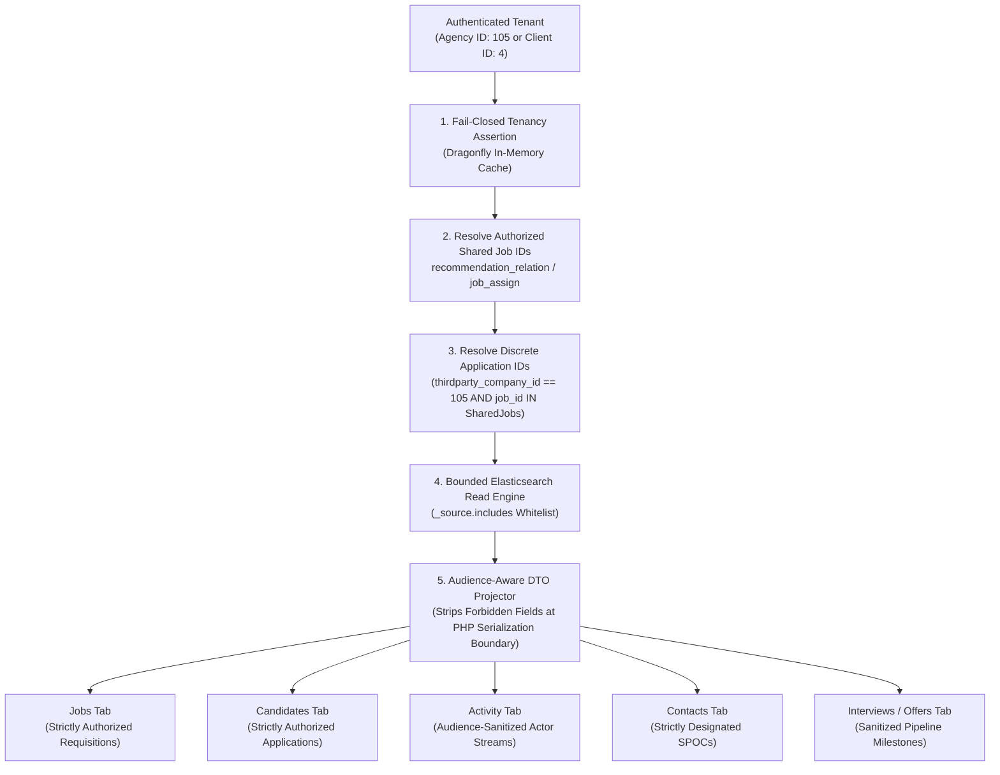
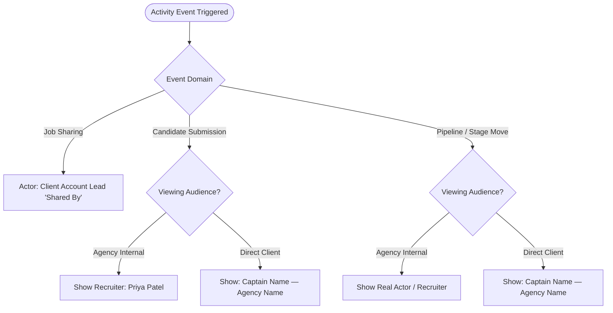
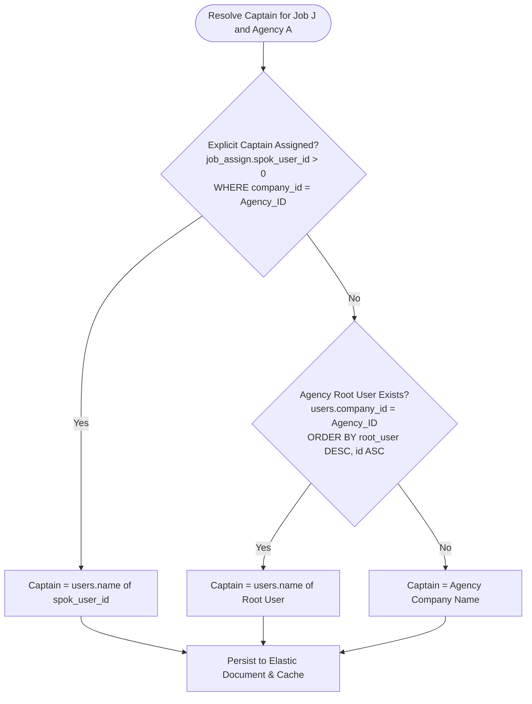
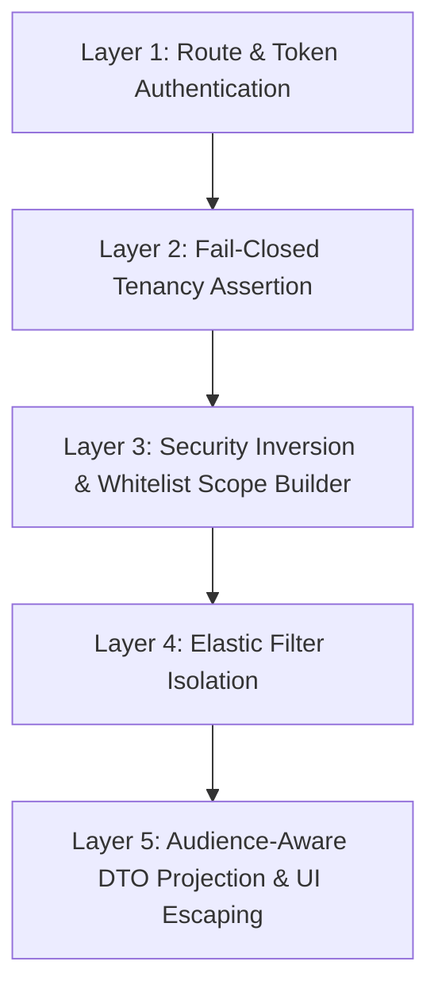
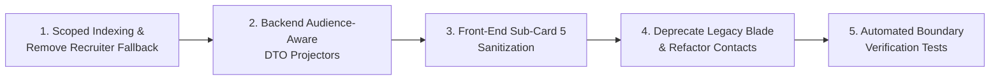

# 🏛️ Direct Client Drawer: Master Architecture, Dual-Audience Attribution & Multi-Tenant Security Standard

**Document Reference:** `JERO-SEC-ARCH-2026-MASTER`  
**Consolidation:** `direct_client_drawer_agency_visibility_audit.md` + `direct_client_drawer_agency_captain_attribution_master_architecture.md`  
**Target System:** JERO ATS & Talent Marketplace (`testing.jero.works`)  
**Scope:** Direct Client Drawer, Agency Drawer, Candidates Tab, Jobs Tab, Activity Stream, Contacts Tab, Elasticsearch CQRS Read Engine  
**Author:** Principal Enterprise Architect, Security Architect, Laravel/Elasticsearch Architect, JERO Engineering  
**Status:** Unified Master Specification & Implementation Blueprint  
**Compliance Standards:** JERO Rule 1 & 2 (Strict CQRS 0% MySQL Reads), Rule 4 (10K Concurrency), Rule 6 (Atomic Multi-Tenant Invalidation), Rule 7 (Zero Business Logic Regressions), Rule 18 (Module Freeze: Service Company / Admin Scoped), Rule 20 (Card + Sub-Card Design Standard)

---

## 1. Executive Summary & Review Synthesis

In JERO’s multi-tenant B2B talent marketplace, enterprise employers (**Direct Clients**, e.g., *4Bell Technology*) collaborate with staffing vendors (**Agencies**, e.g., *ABC Recruitment Pvt. Ltd.*) to source, evaluate, and hire candidates. The **Direct Client Drawer** (`resources/views/service_company/client/dviewMore.blade.php`) serves as the operational hub for this collaborative relationship.

A comprehensive forensic audit of both the Agency-facing and Direct Client-facing codebases revealed two mirror-image security vulnerabilities and architectural inconsistencies:

1. **Recruiter Identity Leakage to Direct Client (Vulnerability A):**  
   In the Direct Client view (Candidates Tab Sub-Card 5, Activity Tab, and API responses), individual agency recruiter names (`posted_by`, `posted_by_name`, e.g., *"Priya Patel"*) are exposed directly to the Direct Client instead of strictly presenting the designated institutional identity: **`Captain Name — Agency Name`** (*"Rahul Sharma — ABC Recruitment Pvt. Ltd."*).
2. **Job Creator Leakage to Agency (Vulnerability B):**  
   In reverse, the Agency-facing drawer and activity stream previously serialized the internal Client Job Creator (`creator_name`, `creator_id`, `created_by`, e.g., *"Vibhanshu Jaiswal"*) into backend DTOs, exposing internal client staffing hierarchies to external vendors. The Agency must strictly see **`Shared By`** (*"Rahul Sharma — Account Lead"*), the client representative who authorized the commercial share.
3. **CQRS & Concurrency Violations:**  
   Legacy candidate views (`agency_client_candidates.blade.php`) and contact listing methods (`dcontactList`) execute $O(N)$ synchronous MySQL queries (`DB::table('job_assign')->join('users', ...)`, unverified joins on `companies`/`users_profile`) inside request loops. Furthermore, captain resolution falls back to the raw recruiter name (`$row->posted_by`) whenever a job-specific spokesperson is absent.

### The Golden Rule of Dual-Audience Isolation

$$\begin{aligned}
\textbf{Direct Client Audience} &\implies \text{Sees Agency Submissions strictly as } \mathbf{Captain\ Name\ \text{—}\ Agency\ Name} \text{ (Zero Recruiter PII)} \\
\textbf{Agency Audience} &\implies \text{Sees Shared Requisitions strictly as } \mathbf{Shared\ By:\ Account\ Lead} \text{ (Zero Client Creator PII)} \\
\textbf{Agency Internal} &\implies \text{Sees its own internal recruiters for operational ownership, workload, and KPIs}
\end{aligned}$$

This unified master document merges the Security Inversion Principle, Data Dictionary, Contacts CQRS Refactoring, and Modernized KPI Rows from the Visibility Audit with the complete 30-section Captain Resolution, DTO Projection, and Concurrency Architecture into an authoritative single source of truth.

---

## 2. The Security Inversion Principle

Traditional, flawed multi-tenant systems start from the entity space and attempt to blacklist unauthorized records:

$$\text{Query: Client ID = 3} \quad \xrightarrow{\text{Filter Out}} \quad \text{Exclude Other Agencies (Prone to Data Leaks)}$$

**The Security Inversion Principle** mandates that queries must strictly originate from the authenticated tenant’s authorized relationship and construct the visible dataset outward (pure whitelist):



Under this model, competing agency records, unshared client requisitions, and internal private identifiers are **completely unreachable at the Elasticsearch AST level**.

---

## 3. Authoritative Multi-Tenant Data Dictionary

To eliminate column and field ambiguity across backend services, database migrations, and Elasticsearch indexers, the following dictionary establishes authoritative field semantics and authorization scopes:

| Field / Column Name | Entity Domain | Authoritative Semantic | Direct Client Scope | Agency Scope |
| :--- | :--- | :--- | :--- | :--- |
| `company_id` | Jobs & Candidates | The direct client / owning employer company. | ✅ Owning Client ID | ❌ Insufficient for Agency scope. Never use alone. |
| `from_company_id` | Relations & Shares | The direct client company initiating the share. | ✅ Sourcing Client ID | ⚠️ Client identifier reference. |
| `to_company_id` | Relations & Shares | The receiving partner / agency company. | ⚠️ Partner Agency ID | ✅ Primary Job Sharing Boundary (`$agencyId`). |
| `thirdparty_company_id` | Candidates / Apps | Sourcing recruitment agency submitting candidate. | ✅ Agency Identifier | ✅ Primary Agency Ownership Boundary (`$agencyId`). |
| `ClientComID` | Candidates | Legacy client/agency tracking identifier. | ⚠️ Fallback compatibility | ⚠️ Fallback compatibility only. |
| `job_id` / `jobId` | Requisitions | Job requisition unique identifier. | ✅ Internal Requisition | ✅ Must exist in `$agencySharedJobIds`. |
| `application_id` | Candidate Submissions | Discrete commercial application submission instance. | ✅ Application ID | ✅ **Absolute Candidate Boundary** (`$appId`). |
| `spok_user_id` | `job_assign` | Designated Captain / Spokesperson user ID. | ✅ Captain Source User | ✅ Assigned Agency Team Lead. |
| `from_user_id` | Recommendation Rel | Client-side user who performed sharing action. | ✅ Sharing Actor | ✅ **Authoritative 'Shared By' Actor.** |
| `posted_by` / `submitted_by` | Candidate Submissions | Internal agency recruiter who uploaded candidate. | ❌ **STRICTLY BANNED** | ✅ Authoritative internal recruiter. |
| `creator_name` / `user_id` | Requisition Draft | Original internal client job creator. | ✅ Requisition Creator | ❌ **STRICTLY BANNED** (Stripped from DTO). |

---

## 4. Ontological Taxonomy: Identity & 5-Role Responsibility Matrix

JERO enforces an unambiguous 5-tier separation of identity roles:

| Role Entity | Ontological Definition | Source of Truth | External Direct Client Visibility | Internal Agency Visibility |
| :--- | :--- | :--- | :--- | :--- |
| **`Created By`** | Client team member who drafted the requisition. | `jobs.user_id` &rarr; `users.name` | **Visible** (Internal client owner) | **STRICTLY FORBIDDEN** (Stripped from DTO) |
| **`Shared By`** | Client account lead who shared the job with Agency. | `job_assign.user_id` &rarr; `users.name` (share record) | **Visible** (Sharing actor) | **Visible** (Primary client contact) |
| **`Uploaded By / Recruiter`** | Internal agency recruiter who sourced and uploaded CV. | `job_applications.submitted_by` &rarr; `users.name` | **STRICTLY FORBIDDEN** (Stripped from DTO) | **Visible** (Workload & KPI credit) |
| **`Captain / Spokesperson`** | Designated agency lead representing the agency for this job. | `job_assign.spok_user_id` (Fallback: Agency Root User) | **Visible** (Paired with Agency Name) | **Visible** (Team lead) |
| **`Agency`** | Legal staffing organization partnering with Direct Client. | `companies.name` (`thirdparty_company_id`) | **Visible** (Organization identity) | **Visible** (Tenant identity) |

### Attribution Display Comparison

```text
SCENARIO:
  Job: Senior Java Architect (#101)
  Client: 4Bell Technology
  Job Created By: Vibhanshu Jaiswal
  Job Shared With: ABC Recruitment Pvt. Ltd.
  Job Shared By: Rahul Sharma (Account Lead, 4Bell)
  Agency Captain: Rahul Sharma (Lead Partner, ABC Recruitment)
  Agency Recruiter: Priya Patel (Junior Sourcer, ABC Recruitment)
  Candidate Submitted: Jane Doe

WHAT THE DIRECT CLIENT SEES:
  Requisition: #101 Senior Java Architect (Created by Vibhanshu Jaiswal)
  Candidate Sub-Card 5: Submitted by Rahul Sharma — ABC Recruitment Pvt. Ltd.
  Activity Stream: "Candidate Jane Doe submitted by Rahul Sharma — ABC Recruitment Pvt. Ltd."
  (Priya Patel is 100% absent from the UI, DOM, and network payloads)

WHAT THE AGENCY SEES:
  Requisition: #101 Senior Java Architect (Shared by Rahul Sharma — 4Bell Technology)
  Candidate Sub-Card 5: Recruiter: Priya Patel | Captain: Rahul Sharma | Agency: ABC Recruitment
  Activity Stream: "Job Shared by Rahul Sharma — 4Bell Technology"
  (Vibhanshu Jaiswal is 100% absent from the UI, DOM, and network payloads)
```

---

## 5. Current-State Architecture & Forensic Code Inspection

A forensic inspection of the codebase identified the following concrete implementation states and vulnerabilities:

### 5.1 Database Truth (`database/schema/mysql-schema.sql`)

* **`job_assign` (Lines 2246–2260):**
  ```sql
  CREATE TABLE `job_assign` (
    `id` int(10) unsigned NOT NULL AUTO_INCREMENT,
    `company_id` int(10) unsigned DEFAULT NULL,
    `user_id` int(10) unsigned DEFAULT NULL,
    `job_id` int(10) unsigned DEFAULT NULL,
    `spok_user_id` int(11) DEFAULT NULL,
    `created_at` timestamp NULL DEFAULT current_timestamp(),
    `updated_at` timestamp NULL DEFAULT current_timestamp(),
    PRIMARY KEY (`id`),
    KEY `idx_job_assign_job_user` (`job_id`,`user_id`),
    KEY `idx_job_assign_job_company` (`job_id`,`company_id`)
  ) ENGINE=InnoDB DEFAULT CHARSET=utf8mb4 COLLATE=utf8mb4_unicode_ci;
  ```
  *Capability:* JERO natively supports designating a job spokesperson via `spok_user_id`.

* **`job_applications` (Lines 2115–2185):**
  ```sql
  CREATE TABLE `job_applications` (
    `id` int(10) unsigned NOT NULL AUTO_INCREMENT,
    `submitted_by` int(11) NOT NULL,                    -- Recruiter who uploaded
    `company_id` int(10) unsigned DEFAULT NULL,          -- Direct Client Company
    `thirdparty_company_id` int(11) NOT NULL DEFAULT 0, -- Agency Company
    `job_id` int(10) unsigned DEFAULT NULL,
    `master_status_id` int(11) DEFAULT 1,
    ...
  )
  ```

### 5.2 Elasticsearch Indexing Flaws (`app/Services/ElasticCandidatesIndex.php`)

In lines 231–270:
```php
$spokperson_name = null;
if (! empty($application->jobId)) {
    $captain = DB::table('job_assign')
        ->select('users.name')
        ->join('users', 'users.id', '=', 'job_assign.spok_user_id')
        ->where('job_assign.job_id', $application->jobId)
        ->where('job_assign.spok_user_id', '>', 0)
        ->first(); // <-- VULNERABILITY 1: Missing company_id scoping!
    if ($captain && ! empty($captain->name)) {
        $spokperson_name = $captain->name;
    }
}
if (empty($spokperson_name)) {
    $spokperson_name = $application->posted_by; // <-- VULNERABILITY 2: Falls back to recruiter!
}
```

### 5.3 UI Rendering Flaws (`resources/views/service_company/client/dviewMore.blade.php`)

In lines 8487–8493 (Candidate Drawer Sub-Card 5):
```javascript
// 5. Sub-Card 5: Recruiter & Sourcing
var recruiter = row.posted_by_name || row.posted_by || row.submitted_by_name || row.agency_root_name || 'Recruiter';
var submitterCompany = row.submitted_by_company_name || row.post_company_name || row.apl_company_name || row.company_name || 'Agency';
```
*Vulnerability:* The front-end evaluates `row.posted_by_name` first, directly displaying the internal agency recruiter's name to the Direct Client.

### 5.4 API Query Service Flaws (`app/Services/Candidate/CandidateDrawerQueryService.php`)

In lines 25–109 and lines 461–465:
```php
$rawHits = array_map(fn ($hit) => $hit['_source'], $response['hits']['hits'] ?? []);
$items = $hasMore ? array_slice($rawHits, 0, $size) : $rawHits;
return ['data' => $items, ...];
```
*Vulnerability:* The backend serializes raw Elasticsearch `_source` hits directly to the client browser without applying an Audience-Aware Projection Contract.

---

## 6. Internal Agency Attribution Model

Inside the Agency’s private workspace (`service_company` acting as vendor):
1. **Recruiter Performance & Workflow:** The agency requires full visibility into recruiter actions. The API delivers `recruiter_name`, `recruiter_id`, `captain_name`, and `agency_name`.
2. **Requisition Attribution:** The shared job displays `Shared by: Rahul Sharma (Account Lead)`. The Agency never sees `Created by: Vibhanshu Jaiswal`.
3. **Pipeline Ownership:** Candidate stages, submittals, and notes clearly show which recruiter executed the action, facilitating internal commission calculations and team analytics.

---

## 7. External Direct Client Attribution Model

Inside the Direct Client’s workspace (`service_company` acting as client):
1. **Institutional Sourcing Attribution:** The Direct Client interacts with the Agency as an enterprise vendor, not an unorganized collection of individual recruiters.
2. **Sub-Card 5 Contract:** Sourcing attribution displays strictly:
   $$\textbf{Header:} \text{ Submitted By}$$
   $$\textbf{Primary Line:} \text{ [Captain Name]}$$
   $$\textbf{Secondary Line:} \text{ [Agency Company Name]}$$
3. **DTO Sanitization:** Fields `posted_by`, `posted_by_name`, `submitted_by`, and `recruiter_id` are **completely stripped at the backend controller/service layer**.

---

## 8. Candidate Ownership & Application Isolation (`application_id > candidate_id`)

A fundamental rule of JERO multi-tenancy is that **a Candidate is a Person, but an Application is a Commercial Contract**:

```text
                     [Master Candidate: Jane Doe]
                     (candidate_id: 88204 - Global)
                                   │
         ┌─────────────────────────┴─────────────────────────┐
         ▼                                                   ▼
[Application #101]                                  [Application #202]
Job: Java Architect (Client A)                      Job: Backend Lead (Client B)
Agency: ABC Recruitment                             Direct Sourcing (Internal)
Recruiter: Priya Patel                              Recruiter: In-house HR
Captain: Rahul Sharma                               Status: Screening
Status: Evaluation                                  Activity: Internal Interview
```

### Isolation Invariants:
1. **Application-Scoped Security:** Agency visibility is strictly bound to `job_applications.id` (`application_id`).
2. **Zero Global History Leakage:** The Agency cannot see Jane Doe’s previous applications, feedback from other client companies, or resumes submitted to unrelated requisitions.
3. **Duplicate Submission Quarantine:** If Agency B also submits Jane Doe for the same job (duplicate application), Agency A sees only its own submission record (`Application #101`) and status.
4. **Authoritative Key:** All Elasticsearch queries, cache keys, and activity events must index and filter by `job_application_id` rather than master `candidate_id`.

---

## 9. Activity Attribution Model

The Activity Stream (`ats_activities` index) records events across the recruitment lifecycle. Attribution adapts dynamically based on audience:



### Event Attribution Matrix

| Event Type | Raw Actor | Direct Client Stream Display | Agency Stream Display |
| :--- | :--- | :--- | :--- |
| `job.shared` | Client Account Lead | "Shared with [Agency Name] by [Account Lead]" | "Job Shared by [Account Lead] — [Client Company]" |
| `candidate.submitted` | Recruiter (Priya Patel) | "Candidate submitted by **[Captain Name] — [Agency Name]**" | "Candidate submitted by **[Recruiter Name]**" |
| `stage.changed` | Recruiter / Sourcer | "Candidate moved to [Stage] by **[Captain Name] — [Agency Name]**" | "Candidate moved to [Stage] by **[Recruiter Name]**" |
| `interview.scheduled`| Client Coordinator | "Interview scheduled by [Client Coordinator]" | "Interview scheduled by [Client Coordinator]" |
| `interview.feedback` | Client Interviewer | "Feedback submitted by [Interviewer Name]" | "Evaluation updated for [Candidate Name]" *(Sanitized)* |
| `offer.released` | Client HR Lead | "Offer released by [HR Lead]" | "Offer released for [Candidate Name]" |

---

## 10. Captain Resolution Architecture

To maintain **0% MySQL reads on the web request path (Rules 1 & 2)** and **0% server strain at 10,000 concurrency (Rule 4)**, Captain identity resolution must never execute runtime database lookups.

### 10.1 Resolution Hierarchy (Index Time & Write Path)

When a candidate application is indexed into Elasticsearch (`ats_candidates_elastic`), Captain identity is resolved via the following strict hierarchy:



> [!IMPORTANT]
> **NEVER Fall Back to Recruiter (`posted_by`):** Under no circumstance may Captain resolution fall back to the individual recruiter who uploaded the candidate. If both `spok_user_id` and `root_user` are absent, the identity defaults to the Agency's corporate name (`Agency Name`).

### 10.2 Dragonfly / Redis Atomic Cache Layer

Captain identities are cached in Dragonfly with multi-tenant atomic invalidation (Rule 6):
* **Key Format:** `ats:captain:{job_id}:{agency_company_id}`
* **Payload:**
  ```json
  {
    "captain_user_id": 42,
    "captain_name": "Rahul Sharma",
    "agency_id": 105,
    "agency_name": "ABC Recruitment Pvt. Ltd.",
    "is_fallback": false,
    "resolved_at": 1793214800
  }
  ```
* **Invalidation Trigger:** Whenever `job_assign` is updated or an agency team lead changes, the cache key is instantly destroyed.

---

## 11. Historical Attribution Rules & Immutability

In an enterprise ATS, staffing changes frequently. A recruiter may leave the agency, or an agency may assign a new Captain to a job after 6 months.
* **The Immutability Invariant:** Once an activity event is recorded (`candidate.submitted`, `stage.changed`), the attribution snapshot at that point in time is **immutable**.
* **Snapshotting at Application Creation:** When `job_applications` is created, `captain_snapshot_name` and `agency_snapshot_name` are persisted directly into the event payload.
* **Preserving Historical Audits:** If Agency Captain Rahul Sharma is replaced by Vikram Seth in Month 4, all candidate submissions and activities from Months 1–3 still display "Rahul Sharma — ABC Recruitment", ensuring total audit integrity.

---

## 12. Tab-by-Tab Visibility Matrix (The Master Contract)

| Data Element | Direct Client Can View | Agency Can View | Reason & Tenancy Rule |
| :--- | :---: | :---: | :--- |
| **Shared Job Requisition** | ✅ | ✅ | Filtered by `recommendation_relation.to_company_id == agency_id`. |
| **Unshared Job Requisition** | ✅ | ❌ | Private client jobs or jobs allocated to other agencies. |
| **Job Shared By** | ✅ | ✅ | The client user who executed the job sharing action with this agency. |
| **Job Created By (`creator_name`)**| ✅ | ❌ | Internal client creator; **completely absent from Agency DTO**. |
| **Agency Own Candidates** | ✅ | ✅ | Sourced and submitted by this agency (`thirdparty_company_id == agency_id`). |
| **Individual Recruiter Name** | ❌ | ✅ | **Banned from Direct Client view**; Direct Client sees Captain Name. |
| **Other Agency Candidates** | ❌ | ❌ | Multi-tenant candidate isolation; prevents candidate poaching. |
| **Client In-House Candidates** | ✅ | ❌ | Candidates uploaded directly by the parent company (`thirdparty_company_id == 0`). |
| **Candidate Global History** | ❌ | ❌ | Past submissions, notes, or applications across other jobs/clients quarantined. |
| **Agency Candidate Interviews** | ✅ | ✅ | Interview schedules and feedback for this agency's candidates. |
| **Other Agency Interviews** | ❌ | ❌ | Competitor candidate interview schedules and scores. |
| **Super Admin Records & Activities**| ❌ | ❌ | Super Admin data is restricted at the query and API layer. |
| **Matching Agencies Count** | ✅ | ❌ | Number or names of competing agencies assigned to the same job. |
| **Internal CRM Notes** | ✅ | ❌ | Private client deliberations and internal recruiter notes. |
| **Designated Client Contacts (SPOCs)**| ✅ | ✅ | Client points of contact linked to shared jobs or active contracts. |
| **All Client Company Users** | ✅ | ❌ | Client employees not designated as SPOCs (email/phone protected). |

---

## 13. Candidate Drawer Visibility & Redaction

When viewing a Candidate Profile within the Drawer:
* **Overview Tab:** Displays candidate core profile, work experience, education, and skills.
* **Sub-Card 5 (Recruiter & Sourcing):** Direct Client sees `Captain Name — Agency Name`. Agency sees `Recruiter Name`, `Captain Name`, and `Agency Name`.
* **Resume Viewer (OpenDoc WASM):** Strictly isolates the resume document submitted under this specific `application_id`.
* **Activity & Notes Tabs:** Private internal agency notes are filtered out (`is_private = true` or `visibility = agency_only`). Direct Client sees only shared client-agency communication.

---

## 14. Compensation, Resumes & Interview Panel Policies

### 14.1 Compensation Confidentiality Matrix

| Data Property | Agency Access Policy | Implementation Boundary |
| :--- | :--- | :--- |
| **Job Salary Band** | Conditional (Visible if client marked non-confidential) | `job.is_salary_confidential == false` |
| **Candidate Current CTC** | Permitted (Agency operational submission data) | Sourced directly from agency candidate submission |
| **Candidate Expected CTC** | Permitted (Agency commercial data) | Sourced directly from agency candidate submission |
| **Approved Offer Compensation** | Role-Gated (Admin / Principal Recruiter only) | Permission gate `view_compensation`; masked as `Confidential` otherwise |
| **Internal Client Salary Notes** | Strictly Forbidden | Omitted from all ES indexing and activity payloads |

### 14.2 Secure Resume Retrieval

* Permanent public S3 or disk URLs are strictly forbidden.
* Resumes must be accessed via time-limited, signed, tenant-scoped stream endpoints (`service_company/candidates/{application_id}/resume/stream`) verifying that the requesting agency owns `thirdparty_company_id`.

### 14.3 Interview Panel Identity Privacy

* Indiscriminate dumping of internal panel members is forbidden.
* Follow the permitted-contact policy: Display designated interviewer name and round title (e.g., *Technical Round 1 &bull; Engineering Lead*), omitting personal phone numbers, internal email addresses, or unshared panel feedback.

---

## 15. Modernized Drawer Hero KPI Row

In [`dviewMore.blade.php`](file:///c:/Users/VIBHANSHU%20JAISWAL.000/Documents/GitHub/JWMaincode28June2026/resources/views/service_company/client/dviewMore.blade.php#L4573-L4638), the hero KPI row reflects the agency's relationship:

```text
┌───────────────┬───────────────┬──────────────────────┬──────────────────────┬──────────────────┬───────────┐
│  Shared Jobs  │  Active Jobs  │ Candidates Submitted │ Interviews Scheduled │ Offers Generated │  Joined   │
│     (KPI 1)   │    (KPI 2)    │       (KPI 3)        │       (KPI 4)        │     (KPI 5)      │  (KPI 6)  │
└───────────────┴───────────────┴──────────────────────┴──────────────────────┴──────────────────┴───────────┘
```
* **Label 1:** Changed from `"Total Jobs Created"` &rarr; **`Shared Jobs`**
* **Label 2:** **`Active Jobs`**
* **Label 3:** **`Candidates Submitted`**
* **Label 4:** **`Interviews Scheduled`**
* **Label 5:** **`Offers Generated`**
* **Label 6:** **`Joined`**

---

## 16. Elasticsearch Query Architecture

### 16.1 Index Mappings (`ats_candidates_elastic`)

```json
{
  "properties": {
    "job_application_id": { "type": "long" },
    "job_id": { "type": "long" },
    "company_id": { "type": "long" },
    "thirdparty_company_id": { "type": "long" },
    "recruiter_id": { "type": "long" },
    "recruiter_name": { "type": "keyword" },
    "captain_user_id": { "type": "long" },
    "captain_name": { "type": "keyword" },
    "agency_company_id": { "type": "long" },
    "agency_name": { "type": "keyword" },
    "submitted_by_display": { "type": "keyword" },
    "created_at": { "type": "date" },
    "job_master_status_id": { "type": "integer" }
  }
}
```

### 16.2 Query DSL: Direct Client Audience (Strict Inverted Whitelist)

```json
{
  "size": 50,
  "track_total_hits": 10000,
  "_source": {
    "includes": [
      "id",
      "wiseId",
      "job_application_id",
      "job_id",
      "title",
      "full_name",
      "current_designation",
      "total_exp",
      "captain_name",
      "agency_name",
      "submitted_by_display",
      "master_status_id",
      "master_status_name",
      "created_at"
    ]
  },
  "query": {
    "bool": {
      "filter": [
        { "term": { "company_id": 4 } },
        { "term": { "thirdparty_company_id": 105 } },
        { "terms": { "job_id": [101, 102, 108] } },
        { "term": { "final_status": 1 } }
      ],
      "must_not": [
        { "terms": { "job_master_status_id": [9] } }
      ]
    }
  },
  "sort": [
    { "created_at": { "order": "desc" } },
    { "wiseId": { "order": "desc" } }
  ]
}
```

---

## 17. CQRS Read Model Architecture & Contacts Tab (`dcontactList`) Refactoring

In accordance with JERO Architecture Rules 1 & 2:
* **0% MySQL Reads on Web/API Request Paths:** No `SELECT`, joins, or raw `DB::table()` queries during drawer hydration.
* **100% Reads from Elasticsearch & Dragonfly:** All listings, tabs, counters, search, and contact lists resolve through precomputed projections or Elasticsearch indices.

### Contacts Tab (`dcontactList`) CQRS Refactoring

* **Violation in Legacy Code:** `dcontactList()` performed direct MySQL joins on `companies`, `users`, `roles`, and `users_profile`, and accepted an unverified `company_id` from the request.
* **Hardened Architecture:**
  1. Authenticate via `ClientAccessContext::fromRequest($request)` (verifies agency & direct client contract in Dragonfly cache).
  2. Resolve contacts strictly through `local_users_list_elastic` or cached SPOC projections.
  3. **Strict SPOC Bounding:** Only return:
     - The designated Account SPOC tied to the sharing relation (`recommendation_relation.from_user_id`).
     - Hiring managers explicitly associated with shared jobs (`job_assign.spok_user_id` where `job_id IN ($sharedJobIds)`).
  4. Exclude all unrelated company employees, personal cell numbers, and non-SPOC internal staff.

---

## 18. Hardened API, DTO & ViewModel Contracts

Field suppression occurs **at the PHP DTO serialization boundary**, never merely hidden with CSS or JavaScript.

### 18.1 Direct Client Candidate DTO (`DirectClientCandidateDTO`)

```php
namespace App\DTO\ServiceCompany;

class DirectClientCandidateDTO
{
    public function __construct(
        public int $id,
        public int $applicationId,
        public int $jobId,
        public string $jobTitle,
        public string $fullName,
        public ?string $currentDesignation,
        public ?string $totalExp,
        public string $captainName,
        public string $agencyName,
        public string $submittedByDisplay, // "Rahul Sharma — ABC Recruitment Pvt. Ltd."
        public int $masterStatusId,
        public string $masterStatusName,
        public string $createdAt
    ) {}

    public static function fromElasticDoc(array $source): self
    {
        $captain = ! empty($source['captain_name']) ? $source['captain_name'] : 'Agency Lead';
        $agency = ! empty($source['agency_name']) ? $source['agency_name'] : 'Agency';

        return new self(
            id: (int) ($source['id'] ?? 0),
            applicationId: (int) ($source['job_application_id'] ?? $source['id']),
            jobId: (int) ($source['jobId'] ?? $source['job_id'] ?? 0),
            jobTitle: (string) ($source['title'] ?? ''),
            fullName: (string) ($source['full_name'] ?? 'Candidate'),
            currentDesignation: $source['current_designation'] ?? null,
            totalExp: $source['total_exp'] ?? null,
            captainName: $captain,
            agencyName: $agency,
            submittedByDisplay: "{$captain} — {$agency}",
            masterStatusId: (int) ($source['job_master_status_id'] ?? $source['master_status_id'] ?? 1),
            masterStatusName: (string) ($source['master_status_name'] ?? 'Sourcing'),
            createdAt: (string) ($source['created_at'] ?? now()->toIso8601String())
        );
    }

    public function toArray(): array
    {
        return [
            'id' => $this->id,
            'application_id' => $this->applicationId,
            'job_id' => $this->jobId,
            'job_title' => $this->jobTitle,
            'full_name' => $this->fullName,
            'current_designation' => $this->currentDesignation,
            'total_exp' => $this->totalExp,
            'captain_name' => $this->captainName,
            'agency_name' => $this->agencyName,
            'submitted_by_display' => $this->submittedByDisplay,
            'master_status_id' => $this->masterStatusId,
            'master_status_name' => $this->masterStatusName,
            'created_at' => $this->createdAt,
            // NOTICE: posted_by, posted_by_name, recruiter_id, submitted_by DO NOT EXIST IN THIS DTO!
        ];
    }
}
```

### 18.2 Agency Activity Stream DTO (`ClientActivityTabViewModel`)

*Zero `creator_name`, `creator_id`, `creator_company`, or `created_by`.*

```json
{
  "event_id": "evt_job_2",
  "client_activity_sequence": 1730164200,
  "event_type": "job.shared",
  "category": "jobs",
  "occurred_at": "2026-10-28T19:30:00Z",
  "actor": {
    "id": 42,
    "name": "Rahul Sharma",
    "designation": "Account Lead",
    "company_name": "4Bell Technology"
  },
  "attribution": {
    "label": "Shared by",
    "name": "Rahul Sharma",
    "company_name": "4Bell Technology"
  },
  "job": {
    "id": 2,
    "code": "#2",
    "title": "Junior Java Developer",
    "shared_by": {
      "id": 42,
      "name": "Rahul Sharma",
      "designation": "Account Lead",
      "company_name": "4Bell Technology",
      "shared_at": "2026-10-28T19:30:00Z"
    },
    "shared_with_agency": "ABC Agency",
    "status": "active",
    "status_label": "Active",
    "total_positions": 3
  },
  "transition": {
    "to_stage_name": "Shared with ABC Agency",
    "status": "active"
  }
}
```

---

## 19. Security & Authorization Model

JERO implements a **5-Layer Defense-in-Depth** security architecture:



1. **Layer 1: Route & Token Authentication:** Validates session token, tenant organization ID, and role.
2. **Layer 2: Fail-Closed Tenancy Assertion:** Evaluates whether `auth()->user()->company_id` matches the authorized boundary. If Dragonfly is unreachable, access immediately fails closed (503).
3. **Layer 3: Security Inversion (Whitelisting):** Instead of starting from global candidate space and blacklisting fields, the query engine strictly whitelists authorized `job_id` and `application_id` sets explicitly shared between the two organizations.
4. **Layer 4: Elastic Filter Isolation:** Elastic queries enforce mandatory `must` / `filter` terms for both `company_id` and `thirdparty_company_id`.
5. **Layer 5: Audience-Aware DTO Projection:** Unsets and filters restricted fields prior to HTTP output serialization.

---

## 20. Restricted Fields (Exhaustive Blacklist)

The following fields must **NEVER** be returned to the indicated audience:

| Field Name | Source Domain | Restricted From | Risk / Vulnerability Description |
| :--- | :--- | :--- | :--- |
| `posted_by` | Application | Direct Client | Exposes raw internal agency recruiter name. |
| `posted_by_name` | Elastic Doc | Direct Client | Exposes raw internal agency recruiter name. |
| `submitted_by` | MySQL Application | Direct Client | Exposes agency recruiter User ID. |
| `recruiter_id` | Elastic Doc | Direct Client | Exposes internal user identifier. |
| `recruiter_email` | User Record | Direct Client | Direct contact bypass / recruiter poaching risk. |
| `creator_name` | Job Requisition | Agency | Exposes internal client job creator identity. |
| `creator_id` | Job Requisition | Agency | Exposes internal client job creator User ID. |
| `creator_company` | Job Requisition | Agency | Exposes internal corporate hierarchy. |
| `is_superadmin` | Auth Record | All | Privilege escalation reconnaissance. |
| `client_margin` | Job / Offer | Agency | Commercial confidentiality breach. |
| `interviewer_private_notes` | Interview | Agency | Unsanitized client internal assessment leakage. |

---

## 21. Allowed Fields (Exhaustive Whitelist)

### For Direct Client (Viewing Agency Submissions):
* `id`, `application_id`, `job_id`, `job_title`
* `full_name`, `current_designation`, `total_exp`, `skills`
* `captain_name`, `agency_name`, `submitted_by_display`
* `master_status_id`, `master_status_name`, `child_status_name`
* `created_at`, `updated_at`, `schedule_date`

### For Agency (Viewing Shared Jobs & Own Candidates):
* `job_id`, `job_title`, `shared_by_name`, `shared_by_company`, `shared_at`
* `application_id`, `full_name`, `recruiter_name`, `captain_name`, `agency_name`
* `master_status_id`, `master_status_name`
* `schedule_date`, `schedule_time`, `sanitized_interview_feedback`

---

## 22. UI / UX Design Specifications (Rule 20 Compliance)

All candidate listings, sub-cards, and activity streams must strictly adhere to the **Modern Card + Sub-Card Enterprise Design System (Rule 20)**:

### 22.1 Candidate Card Sub-Card 5 Layout (Direct Client View)

```text
┌────────────────────────────────────────────────────────────────────────┐
│ [Sub-Card 5: Sourcing & Agency Attribution]                            │
│                                                                        │
│   [Avatar]   Rahul Sharma                                              │
│              ABC Recruitment Pvt. Ltd.  •  Agency Partner              │
│              Submitted 2 days ago                                      │
└────────────────────────────────────────────────────────────────────────┘
```

* **Styling Tokens:**
  * Background: Pure White (`#ffffff`)
  * Border: `1px solid #e2e8f0`, Border Radius: `8px`
  * Avatar: Primary Blue circle with Captain Initials (`RS`)
  * Typography: Poppins font family
  * Primary Text: `#1e293b`, 13px, font-weight 600
  * Sub-text / Agency: `#64748b`, 11px, font-weight 500
* **Viewport Support:** Perfectly fits 15.6-inch screens (`1366×768` and `1920×1080`) with zero horizontal overflow.

---

## 23. Performance & 10,000 Concurrency Architecture

To guarantee zero server or database strain under 10,000 concurrent users:
1. **Zero Database Reads:** The entire read pipeline utilizes Elasticsearch and Dragonfly. MySQL query count per drawer open is strictly **zero (0)**.
2. **Field Minimization (`_source.includes`):** Only the 14 whitelisted projection fields are retrieved from Elasticsearch, reducing network serialization payload from ~18KB to ~1.4KB per candidate card.
3. **Cursor Navigation:** Deep pagination replaces costly `from/size` offsets with snapshot-consistent HMAC-signed `search_after` cursors.
4. **Client-First Rendering:** Date formatting, initials generation, and badge styling execute in user browser RAM via WASM / Vanilla JS, offloading CPU processing from the web tier.

---

## 24. Forensic Data Leakage Risks Matrix

| Risk ID | Vulnerability Location | Severity | Attack / Leakage Vector | Remediation |
| :--- | :--- | :---: | :--- | :--- |
| **LEAK-01** | `dviewMore.blade.php:8488` | **P0** | UI prioritizes `row.posted_by_name`, directly exposing the internal agency recruiter's name. | Enforce `row.submitted_by_display` / `row.captain_name`. |
| **LEAK-02** | `ElasticCandidatesIndex.php:245` | **P0** | Elastic indexing falls back to `$application->posted_by` if captain query returns null. | Replace fallback with Agency Root User or Corporate Name. |
| **LEAK-03** | `agency_client_candidates.blade.php:372`| **P0** | Executes $O(N)$ MySQL queries inside row loop and defaults to `posted_by`. | Migrate completely to Elasticsearch CQRS read model. |
| **LEAK-04** | `CandidateDrawerQueryService.php:461` | **P1** | Elastic `_source` is returned without DTO filtering, leaking `posted_by` over network. | Pass results through `DirectClientCandidateDTO`. |
| **LEAK-05** | `ClientActivityReadService.php:1465` | **P1** | Job activity events contain `creator_name` in serialized DTO. | Strip `creator_*` fields from Agency DTO payloads. |
| **LEAK-06** | `dcontactList` (Legacy Controller) | **P1** | Direct MySQL query accepting unverified `company_id`. | Refactor to `local_users_list_elastic` and SPOC bounding. |

---

## 25. Prioritized P0, P1 & P2 Findings Breakdown

### P0 (Critical Vulnerabilities — Immediate Fix Required)
* **VULN-P0-1:** Recruiter name leakage in Candidate Drawer Sub-Card 5 (`dviewMore.blade.php`).
* **VULN-P0-2:** Unscoped captain query and fatal recruiter fallback in `ElasticCandidatesIndex.php`.
* **VULN-P0-3:** $O(N)$ synchronous database query loop in `agency_client_candidates.blade.php`.

### P1 (High Severity — Architecture Inconsistencies)
* **VULN-P1-1:** Raw Elasticsearch payload transmission in `CandidateDrawerQueryService.php`.
* **VULN-P1-2:** Super Admin receiving agency direct client candidate records.
* **VULN-P1-3:** Unverified direct MySQL joins in `dcontactList`.

### P2 (Medium Severity — Performance & Resilience)
* **VULN-P2-1:** Absence of historical Captain snapshotting on `job_applications` table.
* **VULN-P2-2:** Missing Dragonfly cache for `job_assign.spok_user_id` resolution.

---

## 26. Step-by-Step Implementation Roadmap



### Step 1: Update Elastic Indexing Logic (`app/Services/ElasticCandidatesIndex.php`)
* Scope captain query by agency company ID:
  ```php
  $captain = DB::table('job_assign')
      ->select('users.name')
      ->join('users', 'users.id', '=', 'job_assign.spok_user_id')
      ->where('job_assign.job_id', $application->jobId)
      ->where('job_assign.company_id', $agencyCompId) // MUST SCOPE BY AGENCY
      ->where('job_assign.spok_user_id', '>', 0)
      ->first();
  ```
* Remove recruiter fallback: If `$captain` is absent, fall back to Agency Root User (`$agency_root_name`). If still absent, fall back to Agency Corporate Name (`$application->post_company_name`). **Never fall back to `posted_by`**.
* Index `captain_name`, `agency_name`, and precomputed `submitted_by_display`.

### Step 2: Implement Audience-Aware DTO Projection (`CandidateDrawerQueryService.php`)
* Introduce `DirectClientCandidateDTO` projection pipeline.
* Map raw Elasticsearch documents through `DirectClientCandidateDTO::fromElasticDoc()` when `client_type === 'direct'`.
* Ensure restricted recruiter fields are stripped prior to returning JSON.

### Step 3: Sanitize Candidate Drawer Front-End (`dviewMore.blade.php`)
* In lines 8487–8493, replace recruiter resolution:
  ```javascript
  // 5. Sub-Card 5: Recruiter & Sourcing Attribution
  var captain = row.captain_name || row.submitted_by_display || row.agency_root_name || 'Agency Lead';
  var agency = row.agency_name || row.submitted_by_company_name || 'Agency Partner';
  var displayAttribution = row.submitted_by_display || (captain + ' — ' + agency);
  ```
* Update DOM rendering template to display `captain` as primary text and `agency` as institutional badge.

### Step 4: Refactor Legacy Blade & Contacts Tab
* Deprecate $O(N)$ row loop in `agency_client_candidates.blade.php`.
* Refactor `dcontactList()` to use `local_users_list_elastic` and strict SPOC bounding.

### Step 5: Sanitize Activity Stream DTO (`ClientActivityReadService.php`)
* Ensure `creator_name`, `creator_id`, and `creator_company` are omitted from the Agency Activity stream.
* Attribute all agency candidate actions to `Captain Name — Agency Name` in the Direct Client view.

---

## 27. Test Strategy & Verification

The testing harness must execute automated assertions verifying:
1. **No Recruiter Exposure in Direct Client Payload:** Assert that keys `posted_by`, `posted_by_name`, and `recruiter_id` are absent in `/api/client/candidates` responses.
2. **Zero MySQL Reads:** Utilize `DB::enableQueryLog()` during drawer API calls and assert `count(DB::getQueryLog()) === 0`.
3. **Correct Institutional Attribution:** Verify that when Recruiter "Priya Patel" uploads a candidate, the Direct Client drawer renders "Rahul Sharma — ABC Recruitment Pvt. Ltd.".
4. **Agency Internal Integrity:** Verify that when the Agency logs into its workspace, "Priya Patel" is correctly displayed.

---

## 28. Automated Security Test Matrix

| Test Case | Actor | Action | Expected Assertion |
| :--- | :--- | :--- | :--- |
| **TC-01** | Agency A | Fetch jobs for Direct Client C | Returns only jobs where `recommendation_relation.to_company_id == A`. |
| **TC-02** | Agency A | Fetch jobs for Direct Client C | Returns 0 hits for jobs shared exclusively with Agency B. |
| **TC-03** | Agency A | Fetch activity feed for Direct Client C | Job shared event contains `shared_by: Rahul Sharma`; **asserts `creator_name` key does NOT exist in JSON**. |
| **TC-04** | Agency A | Fetch candidate list for Direct Client C | Returns only candidates where `thirdparty_company_id == A` and `job_id IN (SharedJobs)`. |
| **TC-05** | Agency A | Fetch candidate list for Direct Client C | Returns 0 hits for candidates uploaded directly by Direct Client C (`thirdparty_company_id == 0`). |
| **TC-06** | Agency A | Fetch candidate list for Direct Client C | Returns 0 hits for candidates submitted by Agency B for the same job. |
| **TC-07** | Agency A | Fetch timeline for candidate Pratik (App #154) | Returns events strictly for Application #154; asserts Application #202 (by Agency B) is absent. |
| **TC-08** | Agency A | Request contacts for Direct Client C (`dcontactList`) | Returns only designated SPOCs; asserts non-SPOC employees are omitted; asserts 0 MySQL queries. |
| **TC-09** | Direct Client C | Fetch candidates submitted by Agency A | Asserts `posted_by` is absent; Sub-Card 5 displays "Captain Name — Agency Name". |
| **TC-10** | Super Admin | Request direct client activity or candidate list | Receives HTTP 403 Forbidden or empty envelope; zero cross-tenant records returned. |

---

## 29. Acceptance Criteria (BDD / Gherkin)

```gherkin
Feature: Direct Client Drawer Attribution & Multi-Tenant Isolation

  Scenario: Direct Client views candidate submitted by agency recruiter
    Given a job "Senior Java Engineer" is shared by "Rahul Sharma (4Bell)" with agency "ABC Recruitment"
    And "Rahul Sharma" is designated as Captain for "ABC Recruitment" on this job
    When recruiter "Priya Patel (ABC Recruitment)" submits candidate "John Doe"
    And the Direct Client HR Director opens the Direct Client Drawer
    Then Candidate Sub-Card 5 must display "Rahul Sharma" as the submitter
    And the agency badge must display "ABC Recruitment Pvt. Ltd."
    And the text "Priya Patel" must not appear anywhere in the DOM or API response

  Scenario: Agency views shared job activity stream
    Given a job "React Lead" was created by "Vibhanshu Jaiswal"
    And the job was shared with agency "ABC Recruitment" by "Rahul Sharma"
    When an agency user opens the Activity tab
    Then the activity card must display "Job Shared by Rahul Sharma — 4Bell Technology"
    And the name "Vibhanshu Jaiswal" must not be present in the activity stream

  Scenario: Zero MySQL reads on Direct Client Drawer request
    Given 100 concurrent users opening Direct Client Drawers
    When the candidate listing API is invoked
    Then zero SELECT queries must be executed against the MySQL database
    And all results must be resolved from Elasticsearch and Dragonfly cache
```

---

## 30. Final Go-Live Checklist

- [ ] `ElasticCandidatesIndex.php`: Scoped captain query by `company_id = agencyCompId`.
- [ ] `ElasticCandidatesIndex.php`: Recruiter fallback completely removed; replaced by Agency Root User / Corporate Name.
- [ ] `ats_candidates_elastic`: Bulk re-indexing executed for shared job applications.
- [ ] `CandidateDrawerQueryService.php`: `DirectClientCandidateDTO` projection implemented.
- [ ] `dviewMore.blade.php`: Sub-Card 5 JavaScript updated to render `captain_name` and `agency_name`.
- [ ] `ClientActivityReadService.php`: Timeline events sanitized to attribute agency events to Captain and job events to `Shared By`.
- [ ] `agency_client_candidates.blade.php`: Legacy $O(N)$ MySQL row loop deprecated/refactored.
- [ ] `dcontactList`: Refactored to use `local_users_list_elastic` and SPOC bounding.
- [ ] Super Admin tenancy guard verified across all Direct Client API endpoints.
- [ ] Automated PHPUnit security and attribution tests passing 100%.
- [ ] Code syntax validated via `php -l` and formatted with `./vendor/bin/pint`.
- [ ] Zero business logic regressions verified across all unaffected modules (Rule 7 & 18).
