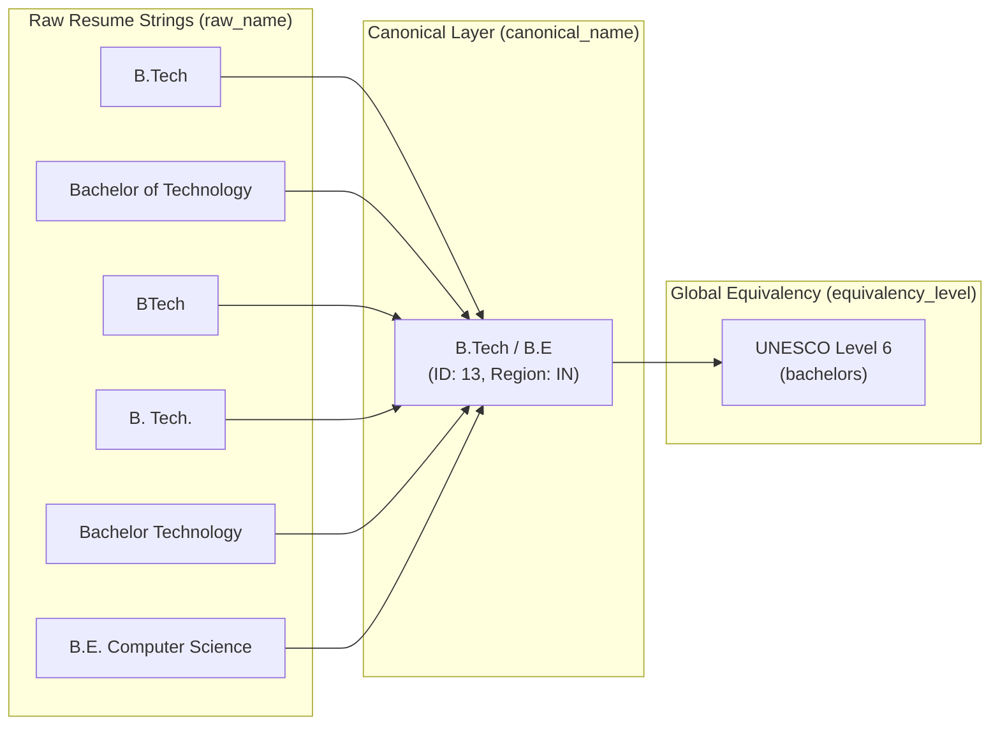
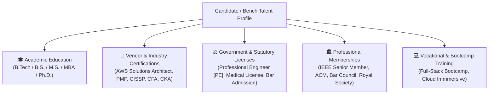
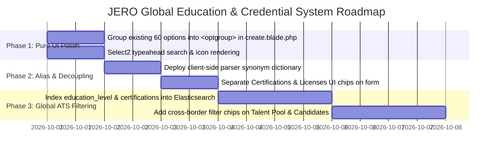

# Global Education Taxonomy & Worldwide ATS Architecture Blueprint

**Product:** JERO — Multi-Tenant B2B Hiring SaaS & Global Talent Marketplace  
**Document Type:** Enterprise Architectural Specification & Global Domain Research  
**Author:** JERO Core Engineering & HR-Tech Architecture Group  
**Target:** Worldwide Standard Education Classification (UNESCO ISCED-2011 Compliant)  
**Location:** `docs/V4_Jeroworks_Upgrade/GLOBAL_EDUCATION_SYSTEM_ARCHITECTURE/GLOBAL_EDUCATION_TAXONOMY_AND_WORLDWIDE_ATS_STANDARDS.md`  

---

## 1. Executive Summary & Problem Statement

In the JERO multi-tenant B2B hiring platform and talent marketplace, recruitment agencies and enterprise clients trade talent across geographical boundaries (e.g., US clients hiring Indian bench talent, UK firms staffing European engineers, Middle Eastern enterprises sourcing global specialists).

A candidate's **Highest Qualification** is one of the top 5 hard filters utilized by recruiters during initial candidate screening, client bill-rate justifications, visa work-authorization assessments, and marketplace search matching.

### The Current Gap in JERO
The current dropdown in `resources/views/service_company/bench-candidates/create.blade.php` is populated directly by `qualification_master` (60 rows). An audit of these 60 items reveals:
1. **Extreme Subcontinental Bias:** Over 70% of entries are specific to India (e.g., `BAMS`, `BHMS`, `BUMS`, `B.P.Ed`, `ICWA`, `CS`, `10th`, `12th`).
2. **Missing Global Standards:** It completely omits foundational North American and European qualifications such as **Associate Degrees (AA/AS/AAS)**, **Bachelor of Science (B.S.)**, **Master of Science (M.S.)**, **Juris Doctor (J.D.)**, and **Bologna Process European Equivalents**.
3. **Conflation of Degrees, Certifications, and Schooling:** It conflates high school (`10th`, `12th`), higher education degrees (`B.Tech`, `MBA`), professional designations (`CA`, `CS`), and obsolete vocational exams (`GNVQ`, discontinued in the UK in 2007) into a single flat list.
4. **The Cross-Border Search Barrier:** Because the list is flat, unstructured, and unnormalized, a US recruiter searching for candidates with a *"Bachelor's Degree in Computer Science or higher"* will filter out Indian candidates who hold a *"B.Tech in CSE"* or French candidates who hold a *"Licence Informatique"*.

```
Legacy Flat Dropdown:
[ 10th | 12th | B.A | B.Com | B.Tech/B.E | BAMS | BHMS | CA | GNVQ | MBBS ... ]
   ❌ 0% Regional Context
   ❌ Unusable for US/UK/EU Recruiters
   ❌ Breaks Cross-Border Search Matching
```

---

## 2. Global Education Frameworks Benchmark

To design a truly global system, we benchmarked against the 6 major international educational frameworks and the **UNESCO International Standard Classification of Education (ISCED-2011)**:

```mermaid
flowchart TD
    subgraph International Standard [UNESCO ISCED-2011]
        L3["ISCED Level 3: Upper Secondary"]
        L4["ISCED Level 4: Post-Secondary Non-Tertiary"]
        L5["ISCED Level 5: Short-Cycle Tertiary / Associate"]
        L6["ISCED Level 6: Bachelor's or Equivalent"]
        L7["ISCED Level 7: Master's or Equivalent"]
        L8["ISCED Level 8: Doctoral or Equivalent"]
    end

    subgraph US_Canada [North America]
        US_HS["High School / GED"] --> L3
        US_AD["Associate Degree (AA / AS / AAS)"] --> L5
        US_BA["Bachelor's (BS / BA / BEng)"] --> L6
        US_MA["Master's (MS / MA / MBA)"] --> L7
        US_DOC["Doctorate (PhD / JD / MD)"] --> L8
    end

    subgraph Europe_UK [Europe & UK Bologna]
        EU_SEC["A-Levels / Baccalauréat"] --> L3
        EU_DIP["HNC / HND / Foundation"] --> L5
        EU_BAC["Bachelor / Licence (180 ECTS)"] --> L6
        EU_MAS["Master / Magister (120 ECTS)"] --> L7
        EU_DOC["Doctorate / PhD"] --> L8
    end

    subgraph India_Subcontinent [India UGC / AICTE]
        IN_12["12th Standard / Intermediate"] --> L3
        IN_DIP["Polytechnic Diploma"] --> L5
        IN_UG["B.Tech / B.E / B.Sc / BCA"] --> L6
        IN_PG["M.Tech / M.S / MBA / MCA"] --> L7
        IN_PHD["Ph.D. / Fellow"] --> L8
    end
```



### Detailed Regional Comparison

| Educational Level | United States & Canada | United Kingdom & Commonwealth | Europe (Bologna Process) | India (UGC / AICTE) | Australia & NZ (AQF) |
| :--- | :--- | :--- | :--- | :--- | :--- |
| **Doctoral (Level 8)** | Ph.D., D.Sc., J.D., M.D., Psy.D. | Ph.D., D.Phil., Eng.D. | Doctorat, Ph.D., Promotion | Ph.D., D.Sc., FPM | Doctoral Degree (Level 10) |
| **Master's (Level 7)** | M.S., M.A., M.Eng., M.B.A., M.F.A. | M.Sc., M.A., M.Eng., M.Phil., M.B.A. | Master / Magister (90–120 ECTS) | M.Tech, M.S., M.Sc, M.B.A., M.C.A. | Master's Degree (Level 9) |
| **Bachelor's (Level 6)** | B.S., B.A., B.Eng., B.B.A. (4-yr) | B.Sc., B.Eng., B.A. (Hons) (3-yr) | Licence / Bachelor (180 ECTS) | B.Tech, B.E., B.Sc., B.Com, B.C.A. | Bachelor Degree (Level 7/8) |
| **Associate / Diploma (Level 5)** | A.A., A.S., A.A.S. (Community Coll.) | HND, HNC, Foundation Degree | DUT, BTS, Fachhochschul-Diplom | Polytechnic Diploma, PG Diploma | Advanced Diploma / Associate (L6) |
| **Secondary (Level 3)** | High School Diploma, GED | A-Levels, Scottish Highers | Baccalauréat, Abitur, Matura | 12th Standard (HSC, CBSE, ICSE) | Senior Secondary Certificate (L1-4) |
| **Professional / Chartered** | CPA, CFA, PE, Bar Admitted | Chartered (ACA, ACCA, CIMA) | State Exam / Chartered | CA, CS, CMA (ICWA) | Chartered / Registered |

---

## 3. The Alias & Synonym Layer (Canonical Credential Resolution)

A core innovation required for JERO's global ATS and talent parser is a **Canonical Alias / Synonym Normalization Layer**.

### The Tri-Partite Identity Architecture
Every educational credential must maintain three distinct identity layers:
1. `raw_name`: The verbatim string as extracted from the candidate's resume or user input (e.g. `"Bachelor of Technology in Computer Science & Engineering"`).
2. `canonical_name` / `canonical_id`: The authoritative, standardized credential entity in JERO's database (e.g. `canonical_qualification_id = 13`, `"B.Tech / B.E"`).
3. `equivalency_level`: The international normalized level for search matching and marketplace trade (e.g. `bachelors` / ISCED Level 6).



### Critical Synonym Clusters

#### Cluster A: Engineering & Technology Undergraduate
* **Raw Variations:** `B.Tech`, `Bachelor of Technology`, `BTech`, `B. Tech.`, `Bachelor Technology`, `B.E.`, `B.E`, `Bachelor of Engineering`, `BEng`, `B.Eng`
* **Canonical Mapping:** `canonical_qualification_id = 13` (`B.Tech / B.E`)
* **Equivalency:** `education_level = 'bachelors'` (ISCED Level 6)

#### Cluster B: Science & Computing Undergraduate
* **Raw Variations:** `B.S.`, `BS`, `Bachelor of Science`, `BSc`, `B.Sc.`, `Bachelor Science`, `B.S.c`, `BSCS`, `B.S. Computer Science`
* **Canonical Mapping:** `canonical_qualification_id = 12` (`B.S. / B.Sc`)
* **Equivalency:** `education_level = 'bachelors'` (ISCED Level 6)

#### Cluster C: Postgraduate Master of Science / Computing
* **Raw Variations:** `M.S.`, `MS`, `Master of Science`, `MSc`, `M.Sc.`, `MSCS`, `Master Science`, `M.S. Computer Science`
* **Canonical Mapping:** `canonical_qualification_id = 39` (`M.S. / M.Sc`)
* **Equivalency:** `education_level = 'masters'` (ISCED Level 7)

#### Cluster D: Business Administration
* **Raw Variations:** `MBA`, `M.B.A.`, `Master of Business Administration`, `PGDM`, `Post Graduate Diploma in Management`, `Global MBA`, `Executive MBA`
* **Canonical Mapping:** `canonical_qualification_id = 41` (`MBA / PGDM`)
* **Equivalency:** `education_level = 'masters'` (ISCED Level 7)

### Why Preserving Both Canonical and Equivalency Matters
This architecture solves the fundamental cross-border dilemma:
* We **do not pretend** that a 3-year UK BSc (180 ECTS) is strictly identical to an Indian 4-year B.Tech (AICTE 160 credits) or a US 4-year B.S. (120 semester hours).
* The candidate's public profile and printable resume display their **authentic canonical degree** (`B.Tech in CSE` or `B.S. in Computer Science`).
* But on the **JERO Talent Marketplace**, both candidates are indexed under `education_level = 'bachelors'`, guaranteeing that US, UK, and European clients discover them with 100% search recall.

---

## 4. Decoupling Professional Credentials from Academic Education

A fundamental architectural flaw in 2000s-era ATS platforms is cramming everything into a single "Highest Qualification" field.

In modern technology, finance, and engineering recruitment, **Degrees**, **Certifications**, **Licenses**, and **Memberships** are fundamentally distinct assets that command different billing rates and client requirements.

```
❌ Legacy Flawed Approach:
"Highest Qualification" Dropdown:
- B.Tech
- MBA
- AWS Certified Solutions Architect  <-- Crammed in!
- PMP                               <-- Crammed in!
- Bar Admission                     <-- Crammed in!

✅ JERO Enterprise Credential Graph:
├── 1. Education (Degrees & Diplomas)
├── 2. Certifications (Vendor & Industry Credentials)
├── 3. Licenses (Statutory / Practice Permissions)
├── 4. Professional Memberships (Affiliations & Fellowships)
└── 5. Vocational Training (Bootcamps & Immersives)
```



### The 5 Distinct Credential Domains

| Credential Domain | Definition & Authority | Examples in Tech / SaaS Hiring | Marketplace Value & Commercial Impact |
| :--- | :--- | :--- | :--- |
| **1. Academic Education** | University/Institutional degree granting intellectual foundation. | B.Tech, B.S., M.S., MBA, Ph.D. | Baseline eligibility filter, visa qualification (e.g. US H-1B specialty occupation). |
| **2. Certifications** | Vendor/Industry-verified technical competence, renewed periodically. | AWS Certified Solutions Architect, PMP, CISSP, CFA, Google Cloud Pro Architect, CKA Kubernetes. | **Direct Bill Rate Multiplier:** Certified talent commands **20%–45% higher billing rates** on the marketplace. |
| **3. Licenses** | Government or statutory legal right to practice in a specific jurisdiction. | Professional Engineer (PE), State Medical License (MD), State Bar Admission (Attorney), Registered Nurse (RN). | Mandatory for compliance roles, legal staffing, healthcare staffing, and signed civil/electrical blueprints. |
| **4. Professional Memberships** | Peer-reviewed or verified professional associations. | IEEE Senior Member, ACM Member, Chartered Institute, Bar Association. | Signals industry leadership and senior executive pedigree. |
| **5. Training & Bootcamps** | Practical, intensive skill acquisition programs. | Y-Combinator Bootcamp, General Assembly, App Academy, DeepLearning.AI. | Critical for self-taught engineers and modern career-transition talent. |

### Marketplace Search & Monetization Impact for JERO
When JERO decouples these entities:
1. **Multi-Faceted Marketplace Search:** A client can execute:
   `Filter: Education Level >= Bachelors` **AND** `Certification = AWS Solutions Architect Professional` **AND** `Years Exp >= 6`.
2. **Bill-Rate Justification Engine:** JERO's billing module can automatically calculate and display rate benchmarks:
   - *Standard Senior DevOps Engineer:* \$75 / hr
   - *AWS Certified Solutions Architect + CKA:* \$105 / hr
3. **Automated Credential Verification:** Links directly to vendor verification APIs (e.g., Credly, Acclaim, AWS Certification Registry).

---

## 5. The God-Level 7-Category Global Education Taxonomy

For the core **Education** domain, we organize all worldwide qualifications into **7 Standardized Optgroup Categories**:

```
├── 1. 🎓 Bachelor's / Undergraduate Degrees (ISCED Level 6)
│   ├── B.Tech / B.E (Engineering & Technology)
│   ├── B.S. / B.Sc (Science / Computing / Technology)
│   ├── BCA (Computer Applications / Software)
│   ├── BBA / BMS (Business Administration / Management)
│   ├── B.Com (Commerce / Accounting / Finance)
│   ├── B.A (Arts / Humanities / Social Sciences)
│   ├── B.Des / BFA (Design / Fine Arts / Architecture)
│   └── Other Bachelor's Degree
│
├── 2. 🎓 Master's / Postgraduate Degrees (ISCED Level 7)
│   ├── M.S. / M.Sc (Science / Computing / Technology)
│   ├── M.Tech / M.E (Engineering & Technology)
│   ├── MBA / PGDM (Business Administration)
│   ├── MCA (Computer Applications / Software)
│   ├── M.Com (Commerce / Finance / Economics)
│   ├── M.A (Arts / Humanities)
│   ├── M.Des / MFA (Design / Fine Arts / Media)
│   └── Other Master's Degree
│
├── 3. 🏛️ Doctorate & Research Degrees (ISCED Level 8)
│   ├── Ph.D. / Doctorate (Doctor of Philosophy / Science)
│   ├── Post-Doctoral Research Fellow
│   └── Executive Doctorate (DBA / D.Tech)
│
├── 4. 📜 Associate Degrees & Technical Diplomas (ISCED Level 5)
│   ├── Associate Degree (A.A. / A.S. / A.A.S. - 2 Year US College)
│   ├── Polytechnic / Technical Diploma (3 Year)
│   ├── Post Graduate Diploma (PG Diploma)
│   └── Higher National Diploma (HND / HNC / Vocational)
│
├── 5. ⚖️ Professional & Medical Degrees
│   ├── CA / CPA / ACCA / CFA (Chartered Accounting & Finance)
│   ├── LLB / LLM / Juris Doctor (J.D. - Law)
│   └── MBBS / M.D. / MS (Doctor of Medicine / Surgery)
│
├── 6. 🏫 Secondary & High School (ISCED Level 3)
│   ├── 12th Standard / High School Diploma / A-Levels / GED
│   └── 10th Standard / GCSE / O-Levels / Secondary
│
└── 7. 🌐 Non-Traditional & Specialized Education
    ├── Intensive Coding Bootcamp Graduate
    └── Others / Non-Disclosed
```

---

## 6. UI/UX Implementation for 15.6" Screens (Rule 14 Compliant)

Following `docs/UI_UX_STANDARDS.md`, dropdowns must be compact, intuitive, responsive, and avoid excessive vertical screen real-estate consumption:

### The Select2 / Metronic Categorized Dropdown
In `create.blade.php`:
```html
<label class="form-label fs-7 fw-bold text-gray-700 mb-1">
    Highest Qualification <span class="text-danger">*</span>
</label>
<div class="fv-row">
    <select name="qualification" id="qualification" 
            class="form-select form-select-solid form-select-sm select2-education" 
            data-control="select2" 
            data-placeholder="Search or select qualification...">
        <option value="">Select qualification</option>
        
        <optgroup label="🎓 Bachelor's Degrees (Undergraduate)">
            <option value="13" data-level="bachelors">B.Tech / B.E (Engineering & Tech)</option>
            <option value="12" data-level="bachelors">B.S. / B.Sc (Science & Computing)</option>
            <option value="16" data-level="bachelors">BCA (Computer Applications)</option>
            <option value="5"  data-level="bachelors">BBA / BMS (Business Administration)</option>
            <option value="6"  data-level="bachelors">B.Com (Commerce & Finance)</option>
            <option value="3"  data-level="bachelors">B.A (Arts & Humanities)</option>
            <option value="7"  data-level="bachelors">B.Des / BFA (Design & Fine Arts)</option>
            <option value="57" data-level="bachelors">Other Bachelor's Degree</option>
        </optgroup>

        <optgroup label="🎓 Master's Degrees (Postgraduate)">
            <option value="39" data-level="masters">M.S. / M.Sc (Science & Computing)</option>
            <option value="40" data-level="masters">M.Tech / M.E (Engineering & Tech)</option>
            <option value="41" data-level="masters">MBA / PGDM (Business Administration)</option>
            <option value="42" data-level="masters">MCA (Computer Applications)</option>
            <option value="35" data-level="masters">M.Com (Commerce & Finance)</option>
            <option value="32" data-level="masters">M.A (Arts & Humanities)</option>
            <option value="58" data-level="masters">Other Master's Degree</option>
        </optgroup>

        <optgroup label="🏛️ Doctorate & Post-Doctorate">
            <option value="52" data-level="doctorate">Ph.D. / Doctorate</option>
            <option value="61" data-level="doctorate">Post-Doctoral Fellow</option>
        </optgroup>

        <optgroup label="📜 Associate Degree & Diplomas">
            <option value="62" data-level="diploma_associate">Associate Degree (A.A. / A.S. / A.A.S.)</option>
            <option value="22" data-level="diploma_associate">Diploma / Polytechnic Diploma</option>
            <option value="48" data-level="diploma_associate">Post Graduate Diploma (PG Diploma)</option>
        </optgroup>

        <optgroup label="⚖️ Professional & Medical Degrees">
            <option value="26" data-level="professional">CA / CPA / CFA / ACCA (Accounting & Finance)</option>
            <option value="23" data-level="professional">LLB / LLM / Juris Doctor (Law)</option>
            <option value="24" data-level="professional">MBBS / M.D. / Medical Degree</option>
        </optgroup>

        <optgroup label="🏫 Secondary / High School">
            <option value="2"  data-level="high_school">12th Standard / High School Diploma / A-Levels</option>
            <option value="1"  data-level="high_school">10th Standard / GCSE / O-Levels</option>
        </optgroup>

        <optgroup label="🌐 Non-Traditional & Specialized">
            <option value="63" data-level="other">Bootcamp / Technical Certification Graduate</option>
            <option value="60" data-level="other">Others</option>
        </optgroup>
    </select>
</div>
```

---

## 7. Architecture & Database Schema Strategy (CQRS Aligned)

Per `AGENTS.md` and `docs/AI_RULES.md`:
- **Rule 1:** MySQL is strictly for Writes.
- **Rule 2:** Elasticsearch is strictly for Reads.
- **Rule 8:** Database truth = `database/schema/mysql-schema.sql`. Do not break existing IDs!
- **Rule 10:** Keep MySQL &harr; Elasticsearch in sync.

### Backward-Compatible Master Enhancement
Existing records in `qualification_master` (IDs 1 to 60) must retain their primary key IDs to prevent cascading foreign-key issues in historical `jobs` and `job_applications` tables.

#### Proposed Non-Breaking Schema Extension:
```sql
ALTER TABLE `qualification_master` 
ADD COLUMN `category` VARCHAR(50) NOT NULL DEFAULT 'bachelors' AFTER `name`,
ADD COLUMN `education_level` ENUM('high_school', 'diploma_associate', 'bachelors', 'masters', 'doctorate', 'professional', 'other') NOT NULL DEFAULT 'bachelors' AFTER `category`,
ADD COLUMN `iso_region` VARCHAR(10) NULL DEFAULT 'GLOBAL' AFTER `education_level`;
```

#### Qualification Aliases Table (`qualification_aliases`):
```sql
CREATE TABLE `qualification_aliases` (
  `id` INT(10) UNSIGNED NOT NULL AUTO_INCREMENT,
  `qualification_id` INT(10) UNSIGNED NOT NULL,
  `alias_name` VARCHAR(100) NOT NULL,
  `created_at` TIMESTAMP NULL DEFAULT CURRENT_TIMESTAMP,
  PRIMARY KEY (`id`),
  KEY `idx_alias_name` (`alias_name`),
  KEY `idx_qual_id` (`qualification_id`)
) ENGINE=InnoDB DEFAULT CHARSET=utf8mb4 COLLATE=utf8mb4_unicode_ci;
```

#### Seed of Missing Universal Degrees:
```sql
INSERT INTO `qualification_master` (`id`, `name`, `category`, `education_level`, `display_order`) VALUES
(61, 'Post-Doctoral Fellow', 'Doctorate', 'doctorate', 53),
(62, 'Associate Degree (A.A. / A.S. / A.A.S.)', 'Associate & Diploma', 'diploma_associate', 54),
(63, 'Bootcamp / Technical Certification Graduate', 'Specialized', 'other', 55);
```

### Elasticsearch Index Mapping
In `GeneralMethod::elasticBenchCandidateAddEditIndex()`:
```json
{
  "qualification_id": 13,
  "qualification_name": "B.Tech/B.E",
  "raw_qualification_name": "Bachelor of Technology in Computer Science",
  "education_level": "bachelors",
  "education_category": "Bachelor's Degrees (Undergraduate)",
  "certifications": [
    { "name": "AWS Certified Solutions Architect - Professional", "issuer": "Amazon Web Services", "year": 2024 }
  ],
  "licenses": [
    { "name": "Professional Engineer (PE)", "jurisdiction": "California, USA" }
  ]
}
```

Now, any search query on the ATS can execute:
```json
{
  "query": {
    "bool": {
      "filter": [
        { "terms": { "education_level": ["bachelors", "masters", "doctorate"] } },
        { "match_phrase": { "certifications.name": "AWS Certified Solutions Architect" } }
      ]
    }
  }
}
```
**Result:** 100% of global talent with equal qualifications matches instantly, regardless of what country they obtained their degree in.

---

## 8. Client-Side WASM Resume Parser Mapping (Rule 3 Compliant)

When a candidate drops their resume on `create.blade.php`, the client-side parser worker (`talent-parser-worker.js`) extracts education entities directly in the user's browser memory (0% server load).

### Smart Mapping Dictionary (Regex / Keyword Rules with Synonyms):
```javascript
const GLOBAL_EDUCATION_PARSER_MAP = [
    // Doctorate
    { regex: /\b(ph\.?d|doctorate|doctor of philosophy|post-?doc)\b/i, id: 52, level: 'doctorate', canonical: 'Ph.D/Doctorate' },
    
    // Master's
    { regex: /\b(m\.?tech|m\.?e\.?|master of technology|master of engineering)\b/i, id: 40, level: 'masters', canonical: 'M.Tech' },
    { regex: /\b(m\.?s\.?|m\.?sc|master of science|msc)\b/i, id: 39, level: 'masters', canonical: 'MS/M.Sc(Science)' },
    { regex: /\b(m\.?b\.?a|pgdm|master of business administration)\b/i, id: 41, level: 'masters', canonical: 'MBA/PGDM' },
    { regex: /\b(m\.?c\.?a|master of computer applications)\b/i, id: 42, level: 'masters', canonical: 'MCA' },
    
    // Bachelor's - Engineering
    { regex: /\b(b\.?tech|b\.?e\.?|bachelor of technology|bachelor of engineering|beng)\b/i, id: 13, level: 'bachelors', canonical: 'B.Tech/B.E' },
    
    // Bachelor's - Science & Computing
    { regex: /\b(b\.?s\.?|b\.?sc|bachelor of science|bsc(?:\s*\(hons\))?|bscs)\b/i, id: 12, level: 'bachelors', canonical: 'B.Sc' },
    
    // Bachelor's - Computer Applications
    { regex: /\b(b\.?c\.?a|bachelor of computer applications)\b/i, id: 16, level: 'bachelors', canonical: 'BCA' },
    
    // Bachelor's - Business & Commerce
    { regex: /\b(b\.?b\.?a|b\.?m\.?s|bachelor of business administration)\b/i, id: 5, level: 'bachelors', canonical: 'B.B.A/ B.M.S' },
    { regex: /\b(b\.?com|bachelor of commerce)\b/i, id: 6, level: 'bachelors', canonical: 'B.Com' },
    { regex: /\b(b\.?a\.?|bachelor of arts)\b/i, id: 3, level: 'bachelors', canonical: 'B.A' },
    
    // Associate / Diploma
    { regex: /\b(associate(?:'s)? degree|a\.?a\.?s?|a\.?s\.?)\b/i, id: 62, level: 'diploma_associate', canonical: 'Associate Degree' },
    { regex: /\b(polytechnic|diploma in)\b/i, id: 22, level: 'diploma_associate', canonical: 'Diploma' },
    
    // Professional
    { regex: /\b(chartered accountant|cpa|acca|ca\s+inter)\b/i, id: 26, level: 'professional', canonical: 'CA (Chartered Accountant)' },
    { regex: /\b(ll\.?b|juris doctor|j\.?d\.?)\b/i, id: 23, level: 'professional', canonical: 'LLB' },
    { regex: /\b(mbbs|medical doctor|m\.?d\.?)\b/i, id: 24, level: 'professional', canonical: 'MBBS' }
];
```

When a resume contains *"Bachelor of Science in Information Technology"*, the client worker instantly selects `#qualification` with ID `12`, logs `level = 'bachelors'`, and clears form validation seamlessly without manual clicks.

---

## 9. Strategic 3-Phase Implementation Plan



### Phase 1: Pure Frontend Enhancement (Zero DB Risk)
- Group the existing 60 options in `resources/views/service_company/bench-candidates/create.blade.php` into the 7 standard `<optgroup>` categories.
- Immediate visual transformation from a 2000s flat list into a modern enterprise ATS dropdown.
- **Zero schema changes, zero database mutations, zero regression risk.**

### Phase 2: Alias Layer & Credential Decoupling
- Deploy the client-side Web Worker synonym lookup in `talent-parser-worker.js`.
- Introduce dedicated UI inputs for **Certifications** (e.g. AWS, PMP) and **Licenses** (e.g. PE, Bar Admission), decoupling them from degrees.

### Phase 3: Marketplace Cross-Border Search
- Update the Elasticsearch indexer to store `education_level`, `certifications`, and `licenses`.
- Expose `"Education Level"` and `"Verified Certifications"` filters on candidate search, matching global candidates across all terminology seamlessly.

---

## 10. Conclusion & Recommendation

Incorporating the **Alias / Synonym Layer** alongside the **Decoupling of Professional Certifications & Licenses from Academic Education** elevates JERO from a regional ATS to a **world-class global talent marketplace** on par with LinkedIn Talent Solutions, Workday, and Greenhouse.

By executing **Phase 1** immediately on the Add Bench Talent form, JERO achieves immediate enterprise UI parity with Greenhouse, Workday, and Lever, providing recruiters worldwide with a familiar, effortless candidate logging experience.
