# JERO Taxonomy V2 — Canonical Ontology, Governance & Production Engineering Contract
## The Authoritative Master Specification for JERO ATS & Talent Marketplace

> **System Profile:** JERO CQRS Architecture powered by the **Bun & Mojo Bare-Metal Systems Duo**  
> **Scale Standard:** 10,000 Concurrent Taxonomy Consumers with 0% Avoidable MySQL / Elasticsearch Reads during interactive lookup  
> **Core Architectural Rule:** Strict Separation & Isolation of **Designations**, **Skills**, **Technologies**, and **Departments**  
> **Systems Engine:** **Bun** (Static Distribution & <40ms Brotli Bundling) + **Mojo** (Bare-Metal CPU SIMD Vector Match Kernel)  
> **AI Architecture:** **Zero Cloud LLM / Zero LangChain Dependency** — 100% Deterministic Algorithmic Normalization & On-Premise Vector Math  
> **Experience Policy:** **Zero Experience Defaults** — pure role definition, authoritative JD templates, and role-aware competency linkage  
> **Document Status:** Authoritative Production Engineering Contract & Implementation Standard (Scope Frozen)  
> **Date:** October 2026  

---

## 🏛️ Executive Summary & Core Architectural Invariants

A modern enterprise hiring marketplace cannot rely on ad-hoc text fields or uncurated database tables. In traditional ATS platforms, job titles, skills, and technologies become inextricably entangled. Recruiters type hiring sentences into job title fields, stack acronyms into skill lists, and hardcode unvalidated experience numbers that fail across global geographies.

This document establishes the **JERO Talent Intelligence Master Taxonomy**: an enterprise-grade, deduplicated, alias-aware, and globally complete taxonomy architecture that permanently resolves these bottlenecks.

### The Six Inviolable Architectural Invariants:
1. **Designation $\ne$ Skill $\ne$ Technology $\ne$ Department:**  
   Every entity belongs strictly to its own decoupled taxonomy. A Designation is an occupational role (`Backend Engineer`); a Skill is a functional competency (`REST API Design`); a Technology is a tool/runtime (`Go`, `PostgreSQL`); a Department is an organizational unit (`Engineering`).
2. **Zero Experience Defaults:**  
   Standard job designations **must never enforce arbitrary minimum or maximum years of experience**. In modern merit-based hiring, a "Senior Software Engineer" at a fast-moving startup may have 4 years of exceptional experience, while at an enterprise bank they may require 8+. JERO's catalog provides **only authoritative Job Descriptions and role-aware skill linkages**, leaving experience requirements entirely to tenant recruiters.
3. **Decoupled Linkage Contract:**  
   Selecting a Designation dynamically recommends canonical skills and injects rich JD templates entirely within **Client Browser RAM (P50 $< 1\text{ ms}$)**, requiring **zero database joins, 0% MySQL reads, and 0% Elasticsearch reads during user interaction**.
4. **Zero-Pollution Governance:**  
   No composite strings (`React+Node`), no demographic qualifications (`female worked in product company`), and no free-form hiring sentences are ever permitted as canonical designations.
5. **Zero-Cloud LLM / Zero-LangChain Determinism:**  
   The taxonomy and recruitment pipeline strictly reject cloud LLM wrappers (such as LangChain) and paid third-party token APIs. Title normalization is performed via deterministic dual-key Trie algorithms, JD templates are authoritative human-curated enterprise assets (100% legal & bias compliance), and candidate matching is computed on bare-metal hardware.
6. **The Bun & Mojo Hyper-Performance Systems Duo:**  
   * **Bun:** Executes static JSON taxonomy compilation, minification, and Brotli compression in $< 40\text{ ms}$, hydrating 10,000 concurrent browser sessions via IndexedDB with 0% database read strain.  
   * **Mojo:** Executes bare-metal SIMD (AVX-512) vector cosine similarity matrix calculations across 100,000+ candidate vectors in $< 5\text{ ms}$ on JERO's dedicated 32 GB RAM server, delivering $0 ongoing API costs and 100% on-premise data sovereignty.

---

```
                       JERO TALENT INTELLIGENCE ARCHITECTURE
                       
                              ┌────────────────────┐
                              │    DEPARTMENTS     │ (12 Global Functional Divisions)
                              └─────────┬──────────┘
                                        │
                              ┌─────────▼──────────┐
                              │   ROLE FAMILIES    │ (48 Structural Job Disciplines)
                              └─────────┬──────────┘
                                        │
                              ┌─────────▼──────────┐
                              │    DESIGNATIONS    │ (Dedicated Master Catalog)
                              │  (Occupational)    │ - Canonical Name & Normalization Key
                              └─────────┬──────────┘ - Seniority Level & Role Family
                                        │            - Authoritative JD Template
                                        │            - 0 Experience Defaults
                                        │
           ┌────────────────────────────┴───────────────────────────┐
           │ Dynamic Linkage Contract                               │
           ▼                                                        ▼
┌─────────────────────────────┐                          ┌─────────────────────────────┐
│       SKILLS TAXONOMY       │                          │    TECHNOLOGY TAXONOMY      │
│  (Competencies & Methods)   │                          │    (Platforms & Runtimes)   │
│ - Required / Common Skills  │                          │ - Tech Specialization       │
│ - Category & Subcategory    │                          │ - Ecosystem Associations    │
└─────────────────────────────┘                          └─────────────────────────────┘
```

---

# Part 1 — Forensic Audit of Existing JERO Taxonomies

A complete forensic query across JERO's active database (`mysql-schema.sql` and database tables) was executed to establish an unvarnished audit of current state.

### 1.1 Table-by-Table Data Audit

| Database Table | Record Count | Architectural Purpose | Forensic Reality & Vulnerability |
| :--- | :--- | :--- | :--- |
| `jd_details` | **1,423 records** | Standard Master Job Library | **Severely Polluted.** 460 titles (32.3%) contain composite characters (`+`, `/`, `&`, `()`). Skills column in hundreds of rows contains the identical hardcoded string `'java,aws,node'`. Contains hardcoded `minimum_exp` and `maxmum_exp`. Zero department or role family mappings. |
| `designations` | **0 records** | Tenant Custom Designations | Completely empty table. Existing "Add Job" and "Add Candidate" workflows bypass this table entirely and query `jd_details` directly. |
| `skills` | **0 records** | Master Skills Table | Completely empty table in MySQL. No canonical database normalization exists for skills entered by recruiters. |
| `departments` | **15 records** | Company Organizational Units | Contains 15 generic corporate departments, but is completely disconnected from job creation and designation selection. |
| `job_categories` | **117 records** (63 unique) | Job Industry / Functions | Contains widespread duplicate rows across tenant IDs (e.g. `Administration` repeated under IDs 1 and 16, `IT` under IDs 5 and 20) with no hierarchical parent-child relationships. |
| `public/skills/jero-skills-taxonomy.json` | **1,925 skills** | Client-Side Skills Engine | High-quality client taxonomy created for the skills dropdown, but isolated strictly to skills. Completely disconnected from designations and JDs. |

---

### 1.2 The Forensic Autopsy of `jd_details` Pollution

Analysis of the 1,423 records currently stored in `jd_details` uncovered five distinct categories of taxonomy corruption:

#### Failure Category 1: Composite Technology Combos as Titles
Instead of establishing a canonical role and associating skills, raw technology stacks were concatenated into the `title` field:
* `React+Node` (ID 214)
* `Python +react` (ID 218)
* `React+nest.js` (ID 225)
* `.Net+Angular` (ID 242) vs `Dotnet+ Angular` (ID 268) — duplicate variations of the same stack!
* `Fullstack engineer(.Netcore+Angular)` (ID 345)
* `Tech Lead (Java+React)` (ID 982)

#### Failure Category 2: Full Job Requirements & Clauses in the Title Field
Sentences and hiring constraints were mistakenly saved as job titles:
* `Front end Engineer (ionic and react native/ Flutter (at least 1 yr in ionic is mandatory)` (ID 412)
* `Project Manager (female worked in product based company)` (ID 1042)
* `Sr. AWS Data Engineer+ tableau knowledge` (ID 856)
* `Non Litigation – Legal (Deputy Manager/Manager/Senior Manager)` (ID 784)

#### Failure Category 3: Hardcoded Placeholder Skills
In over 200 records in `jd_details`, the `skills` column is literally populated with the static string `java,aws,node`, regardless of the title:
* `Java Security Engineer` $\to$ `java,aws,node`
* `Java Intern` $\to$ `java,aws,node`
* `Java Enterprise Architect` $\to$ `java,aws,node`
* `Java API Developer` $\to$ `java,aws,node`

#### Failure Category 4: Designation $\ne$ Skill Confusion
In hundreds of records, the `skills` column contains job roles or candidate experience sentences:
* `Cloud Data Architect (Azure & AWS)` $\to$ `skills` contains `Cloud Data Architect, Azure, AWS...` (Role embedded in skills!)
* `AGM/GM – Central Operations` $\to$ `skills` contains `retail industry experience, Store Operations Technology, AIled initiatives...` (Experience sentences embedded in skills!)

#### Failure Category 5: Severe Ecosystem Blindspots
Distribution analysis of existing titles revealed extreme bias toward legacy technology stacks, while modern and emerging technology sectors are virtually absent:
* **Java:** 117 titles (8.2% of entire catalog)
* **.NET:** 95 titles (6.7% of catalog)
* **React:** 74 titles
* **Python:** 55 titles
* **Golang / Go:** **Only 2 titles** in the entire database (0.14%)!
* **Rust:** **0 titles** (0% coverage)!
* **C++:** **4 titles** (0.28%)!
* **Cybersecurity:** Only 29 titles (primarily generic "Security Analyst")!
* **AI / Emerging Tech:** Fragmented into unstandardized strings like `AI/ML Engineer` or `Senior AI/ML Engineer` with zero coverage of Generative AI, LLMs, AI Agents, or MLOps.

---

### 1.3 Audit of Existing JERO UI Dropdowns

The platform currently implements dropdowns and selection controls inconsistently across modules:

| Page & Location | Current UI Element | Data Source | Architectural Defect | Recommendation |
| :--- | :--- | :--- | :--- | :--- |
| **Add Job** (`jobs/create.blade.php`:1328)<br>*Job Title / Designation* | Raw HTML `<input>` with unthrottled `onkeyup="getSuggestions()"` | AJAX call to `ServiceCompanyJobsController::getJobSuggestions` $\to$ Direct `LIKE %query%` on `jd_details` | **Critical Concurrency Hazard.** Crashes under 10K users. Displays polluted titles (`React+Node`). Auto-fill overwrites user data silently. | Replace with Client-First `JeroTitleIntelligenceEngine` (RAM + IndexedDB + ETag 304). Autocomplete top 30 canonical roles in <1ms. |
| **Add Job** (`jobs/create.blade.php`:1340)<br>*Department / Category* | Metronic Select2 / standard `<select>` | `job_categories` table | Duplicate category names visible in dropdown. Disconnected from designation selection. | Standardize to canonical Department $\to$ Role Family hierarchy. Pre-select department when designation is picked. |
| **Add Job** (`jobs/create.blade.php`:1450)<br>*Skills Field* | Metronic Tagify input | Free-form comma-separated strings stored in DB | Does not enforce canonical casing (`NodeJS` vs `Node.js`). No stack synergy recommendations. | Bind to authoritative `jero-skills-taxonomy.json`. Auto-populate recommended skills upon designation selection. |
| **Add Candidate** (`bench-candidates/create.blade.php`:1089)<br>*Current Designation* | Plain unassisted `<input type="text">` | None (Free-form string entered by recruiter) | High data entropy. Candidates enter `Sr dev`, `Tech Lead Java`, `SDE 2`, breaking Elasticsearch matching. | Implement the exact same `JeroTitleIntelligenceEngine` combobox on Add Candidate for 1:1 CQRS parity. |
| **Add Candidate** (`bench-candidates/create.blade.php`:1412)<br>*Skills & Expertise* | Datalist with 9 hardcoded popular skills | Static Blade array `['Java', 'Python', 'React', ...]` | Lacks 99% of global technology skills. Recruiter must manually type every single tag. | Replace datalist with canonical client taxonomy combobox. Match candidate skills against job requirements. |
| **Advanced Candidate Search** (`advsearch/candidate.blade.php`)<br>*Designation & Skills Filters* | Select2 multiple inputs | Ad-hoc distinct DB queries | Slow Elasticsearch and MySQL query latency during multi-tenant filtering. | Feed filters directly from cached client taxonomy indices. |

---

# Part 2 — The Missing Global Designation Taxonomy

To eliminate JERO's dependence on today's legacy titles, we conduct an exhaustive gap analysis across global enterprise hiring benchmarks (O*NET, ESCO, LinkedIn Economic Graph, and global tech hiring engines).

Below is the definitive catalog of **missing, modern, and emerging designations** that JERO must natively support, structured by **Role Family** and **Seniority Tier**.

---

### 2.1 Software Engineering & Core Architecture

| Role Family | Canonical Designation | Seniority Tier | Core Functional Scope |
| :--- | :--- | :--- | :--- |
| **Software Engineering** | Software Engineer | Mid-Level | Generalist software engineering across applications and distributed services. |
| | Senior Software Engineer | Senior | End-to-end system development, performance optimization, and architectural decisions. |
| | Staff Software Engineer | Staff / Lead | Cross-team architectural ownership, technical strategy, and engineering standards. |
| | Principal Software Engineer | Principal | Organization-wide technical leadership, multi-year roadmap execution. |
| | Distinguished Engineer | Executive / Fellow | Company-wide technical authority, foundational patent and core IP leadership. |
| **Backend Engineering** | Backend Engineer | Mid-Level | API development, microservices, database transactions, and business logic. |
| | Senior Backend Engineer | Senior | Scalable backend architectures, asynchronous processing, fault tolerance. |
| | Staff Backend Engineer | Staff | Distributed systems design, consensus protocols, high-throughput pipelines. |
| **Frontend Engineering** | Frontend Engineer | Mid-Level | Responsive web UI, state management, web performance, component design systems. |
| | Senior Frontend Engineer | Senior | Micro-frontend architectures, client-side caching, rendering pipeline optimization. |
| | Staff Frontend Engineer | Staff | Client architecture standards, browser runtime performance, accessibility compliance. |
| **Full Stack Engineering** | Full Stack Engineer | Mid-Level | Cohesive end-to-end feature delivery across client-side UI and backend APIs. |
| | Senior Full Stack Engineer | Senior | Full-lifecycle product engineering, database modeling, and frontend integration. |
| | Lead Full Stack Engineer | Lead / Staff | Team-level architecture delivery, sprint coordination, technical mentorship. |
| **Architecture** | Solutions Architect | Senior / Lead | Customer-facing or product-specific technical solution design and feasibility. |
| | Enterprise Architect | Principal / Director | Enterprise-wide IT landscape, application portfolio governance, standard frameworks. |
| | Technical Architect | Staff / Principal | In-depth system design, component boundaries, and high-level technical blueprints. |
| | Chief Architect | VP / Executive | Strategic architecture vision, legacy modernization, and technical governance. |

---

### 2.2 Technology-Specific Language & Runtime Roles

Rather than storing ugly combos like `React+Node`, JERO establishes **clean technology-specific specializations**:

| Technology Domain | Canonical Designation | Seniority Tier | Canonical Role Family |
| :--- | :--- | :--- | :--- |
| **Java Ecosystem** | Java Developer | Mid-Level | Backend Engineering |
| | Senior Java Developer | Senior | Backend Engineering |
| | Java Technical Lead | Lead | Software Engineering Leadership |
| | Java Solutions Architect | Principal | Architecture |
| **Python Ecosystem** | Python Developer | Mid-Level | Backend Engineering |
| | Senior Python Developer | Senior | Backend Engineering |
| | Python Backend Engineer | Senior | Backend Engineering |
| **Go (Golang)** *(Missing in JERO)* | Go Developer | Mid-Level | Backend Engineering |
| | Senior Golang Engineer | Senior | Backend Engineering |
| | Go Systems Engineer | Senior / Staff | Systems & Infrastructure |
| **Rust** *(0 in JERO)* | Rust Systems Engineer | Mid-Level / Senior | Systems & Infrastructure |
| | Senior Rust Developer | Senior | Systems & Performance |
| | Rust Performance Engineer | Staff / Principal | Systems Engineering |
| **C / C++ Ecosystem** | C++ Software Engineer | Mid-Level | Systems Engineering |
| | Senior C++ Systems Engineer | Senior | Embedded & Systems |
| | Low-Latency C++ Engineer | Senior / Staff | High-Frequency Trading & Systems |
| **.NET / Microsoft** | .NET Developer | Mid-Level | Backend Engineering |
| | Senior .NET Core Developer | Senior | Backend Engineering |
| | .NET Solutions Architect | Principal | Architecture |
| **JavaScript / TypeScript** | TypeScript Engineer | Mid-Level | Frontend / Full Stack |
| | Node.js Developer | Mid-Level | Backend Engineering |
| | Senior Node.js Engineer | Senior | Backend Engineering |
| **Modern Frontend** | React Developer | Mid-Level | Frontend Engineering |
| | Senior React Developer | Senior | Frontend Engineering |
| | Next.js Frontend Engineer | Mid-Level / Senior | Frontend Engineering |
| | Angular Developer | Mid-Level | Frontend Engineering |
| | Vue.js Developer | Mid-Level | Frontend Engineering |
| **Mobile Development** | iOS Engineer | Mid-Level | Mobile Engineering |
| | Senior iOS Developer (Swift) | Senior | Mobile Engineering |
| | Android Engineer | Mid-Level | Mobile Engineering |
| | Senior Android Developer (Kotlin) | Senior | Mobile Engineering |
| | Flutter Developer | Mid-Level | Cross-Platform Mobile |
| | React Native Developer | Mid-Level / Senior | Cross-Platform Mobile |
| **PHP & Modern Web** | PHP / Laravel Developer | Mid-Level | Web Application Engineering |
| | Senior Laravel Engineer | Senior | Backend Engineering |

---

### 2.3 Cloud, DevOps, Platform & Site Reliability Engineering (SRE)

| Role Family | Canonical Designation | Seniority Tier | Core Functional Scope |
| :--- | :--- | :--- | :--- |
| **Cloud Engineering** | Cloud Engineer | Mid-Level | Cloud provisioning, virtual networks, compute instances, resource sizing. |
| | Senior Cloud Engineer | Senior | Multi-account governance, cost optimization (FinOps), cloud landing zones. |
| | AWS Cloud Engineer | Senior | AWS native services (ECS, EKS, Lambda, IAM, VPC, CloudFormation). |
| | Azure Cloud Engineer | Senior | Azure enterprise cloud, Azure DevOps, Entra ID, Virtual WAN, Bicep. |
| | Google Cloud Platform (GCP) Engineer | Senior | GCP BigQuery, GKE, Cloud Run, IAM, Anthos hybrid architectures. |
| | Cloud Architect | Staff / Principal | High-availability multi-region cloud designs, cloud migration strategies. |
| **DevOps & Infrastructure** | DevOps Engineer | Mid-Level | CI/CD pipeline automation, artifact management, deployment monitoring. |
| | Senior DevOps Engineer | Senior | Infrastructure as Code (Terraform), GitOps, automated rollbacks, release gates. |
| | Lead DevOps Engineer | Lead / Staff | Enterprise CI/CD strategy, toolchain consolidation, release governance. |
| **Platform Engineering** *(Modern)* | Platform Engineer | Mid-Level | Internal Developer Platform (IDP), developer self-service tooling, developer portals. |
| | Senior Platform Engineer | Senior | Kubernetes-as-a-Service, automated provisioning pipelines, Backstage integration. |
| | Staff Platform Engineer | Staff / Principal | Organization-wide developer velocity platforms and infrastructure abstractions. |
| **Site Reliability (SRE)** | Site Reliability Engineer (SRE) | Mid-Level | SLIs, SLOs, error budgets, incident automation, production telemetry. |
| | Senior SRE | Senior | Chaos engineering, high-availability architecture, zero-downtime upgrades. |
| | SRE Manager | Manager | Incident response management, post-mortem governance, reliability roadmaps. |
| **Kubernetes / Container** | Kubernetes Engineer | Senior | Production cluster operations, Service Mesh (Istio), CNI, CSI, multi-tenancy. |

---

### 2.4 Data, Analytics, Artificial Intelligence & Machine Learning

| Role Family | Canonical Designation | Seniority Tier | Core Functional Scope |
| :--- | :--- | :--- | :--- |
| **Data Engineering** | Data Engineer | Mid-Level | Batch & streaming ETL/ELT pipelines, data warehouse modeling, data hygiene. |
| | Senior Data Engineer | Senior | Lakehouse architectures (Delta Lake, Iceberg), distributed data processing. |
| | Staff Data Engineer | Staff | Enterprise data mesh, data governance, petabyte-scale pipeline architecture. |
| | Analytics Engineer | Mid-Level / Senior | dbt modeling, dimensional analytics, semantic layer construction, BI data models. |
| | Big Data Engineer | Senior | Hadoop, Spark, Kafka, Cassandra high-throughput data ingestion pipelines. |
| **Data Science & Analytics** | Data Analyst | Mid-Level | SQL queries, reporting dashboards, statistical analysis, executive insights. |
| | Senior Data Analyst | Senior | Cohort analysis, predictive churn models, business KPI frameworks. |
| | Data Scientist | Mid-Level | Statistical modeling, exploratory data analysis, hypothesis testing, predictive algorithms. |
| | Senior Data Scientist | Senior | Advanced machine learning models, customer segmentation, recommendation engines. |
| | Principal Data Scientist | Principal | Algorithmic IP development, mathematical optimization, strategic AI direction. |
| **Machine Learning & AI** | Machine Learning Engineer | Mid-Level | Model training, feature store engineering, model evaluation, inference APIs. |
| | Senior Machine Learning Engineer | Senior | Distributed model training, deep neural networks, model latency optimization. |
| | MLOps Engineer *(Missing)* | Senior | ML model registries (MLflow), feature stores, model drift monitoring, CI/CD for ML. |
| | AI Engineer | Mid-Level / Senior | Integrating foundation models, prompt pipelines, semantic search, AI app development. |
| | AI Research Scientist | Principal / PhD | Novel neural architectures, loss function optimization, frontier AI research. |
| **Emerging GenAI & LLMs** | Generative AI Engineer | Senior | Fine-tuning LLMs, RLHF, prompt orchestration (LangChain, LlamaIndex), agent workflows. |
| | LLM Solutions Architect | Principal | Enterprise GenAI governance, vector database infrastructure, RAG architecture. |
| | Prompt Engineer / AI Specialist | Mid-Level | Advanced prompt design, few-shot prompting, red-teaming model outputs. |
| | Computer Vision Engineer | Senior | Object detection, segmentation, OpenCV, YOLO, image embeddings, video stream analytics. |
| | NLP Engineer | Senior | Text extraction, entity resolution, transformer models, sentiment analysis pipelines. |

---

### 2.5 Cybersecurity, InfoSec & Governance

| Role Family | Canonical Designation | Seniority Tier | Core Functional Scope |
| :--- | :--- | :--- | :--- |
| **Cybersecurity Operations** | Cybersecurity Analyst | Mid-Level | Log triage, incident detection, SIEM alerts, vulnerability scans. |
| | SOC Analyst (Tier 1 / Tier 2) | Mid-Level | 24/7 security operations center monitoring, alert correlation, threat containment. |
| | Threat Intelligence Analyst | Senior | Cyber threat intelligence (CTI), threat actor attribution, dark web monitoring. |
| | Incident Response Specialist | Senior | Forensic data recovery, breach mitigation, post-incident RCA, chain-of-custody. |
| **Security Engineering** | Security Engineer | Mid-Level | Perimeter security, firewalls, endpoint detection, authentication enforcement. |
| | Senior Security Engineer | Senior | Zero Trust architecture, cryptographic protocol enforcement, network security. |
| | Cloud Security Engineer | Senior | CSPM, CIEM, AWS GuardDuty, Azure Sentinel, cloud IAM hardening. |
| | Application Security (AppSec) Engineer | Senior | SAST/DAST tooling, threat modeling, code security audits, OWASP compliance. |
| | DevSecOps Engineer | Senior | Automated security testing in CI/CD, container vulnerability scanning, secrets mgmt. |
| | Penetration Tester / Ethical Hacker | Senior | Red teaming, network penetration testing, web application exploit simulations. |
| **Identity & Governance** | Identity & Access Management (IAM) Engineer | Senior | Okta, Ping, Entra ID, SAML/OIDC, Role-Based Access Control, Privileged Access (PAM). |
| | Security Architect | Staff / Principal | Enterprise security roadmaps, regulatory alignment (ISO 27001, SOC 2, HIPAA). |
| | Chief Information Security Officer (CISO) | Executive / CXO | Executive leadership of corporate security, cyber risk, compliance, and governance. |

---

### 2.6 Database & Data Platform Engineering

| Role Family | Canonical Designation | Seniority Tier | Core Functional Scope |
| :--- | :--- | :--- | :--- |
| **Database Administration** | Database Administrator (DBA) | Mid-Level | Database backups, index tuning, query performance, user permission management. |
| | PostgreSQL DBA | Senior | Postgres query plans, vacuum tuning, replication streams, Patroni HA clusters. |
| | MySQL DBA | Senior | InnoDB engine tuning, Galera cluster, MySQL master-replica replication, slow query logs. |
| | Oracle DBA | Senior | Oracle RAC, Data Guard, PL/SQL tuning, tablespace management, RMAN backups. |
| | SQL Server DBA | Senior | AlwaysOn availability groups, T-SQL optimization, SQL Server Profiler. |
| **Modern Data Storage** | Database Reliability Engineer (DBRE) | Senior | Infrastructure-as-code database management, automated failover, database telemetry. |
| | NoSQL Database Specialist | Senior | MongoDB sharding, Cassandra ring management, DynamoDB single-table design. |

---

### 2.7 Product, Design & Modern Agile Roles

| Role Family | Canonical Designation | Seniority Tier | Core Functional Scope |
| :--- | :--- | :--- | :--- |
| **Product Management** | Associate Product Manager (APM) | Junior | Backlog maintenance, user story authoring, feature requirement documents. |
| | Product Manager (PM) | Mid-Level | Feature prioritization, customer discovery, cross-functional engineering alignment. |
| | Senior Product Manager | Senior | Product vision, metrics/KPI ownership, go-to-market collaboration. |
| | Technical Product Manager (TPM) | Senior | Deep technical integrations, API productization, developer-facing platforms. |
| | Group Product Manager (GPM) | Lead / Director | Mentoring product managers, multi-product line portfolio management. |
| | VP of Product | Executive | Company product strategy, market positioning, executive roadmap sponsorship. |
| **Product Design & UI/UX** | UI / UX Designer | Mid-Level | Wireframing, high-fidelity Figma mockups, usability testing, user journeys. |
| | Senior Product Designer | Senior | Design systems, complex enterprise interaction design, interactive prototyping. |
| | Design Systems Lead | Staff / Lead | Cross-platform design tokens, accessible component libraries, UI governance. |
| | UX Researcher | Mid-Level / Senior | Qualitative user interviews, cognitive walkthroughs, user behavior analytics. |
| **Agile & Delivery** | Scrum Master | Mid-Level | Sprint ceremonies, team impediment removal, Agile coaching, burndown analysis. |
| | Agile Coach | Senior / Staff | Enterprise agile transformations, SAFe framework execution, organizational velocity. |
| | Technical Program Manager (TPM) | Senior | Complex multi-team initiative coordination, dependency management, launch gates. |

---

### 2.8 Quality Assurance (QA) & Test Automation

| Role Family | Canonical Designation | Seniority Tier | Core Functional Scope |
| :--- | :--- | :--- | :--- |
| **QA Automation** | QA Automation Engineer | Mid-Level | Test automation scripting, Selenium/Playwright pipelines, regression test suites. |
| | Senior QA Automation Engineer | Senior | Test framework architecture, CI/CD automated test integration, parallel test runners. |
| | Software Development Engineer in Test (SDET) | Senior | High-performance test tooling, mock services, API contract test automation. |
| | Performance / Load Test Engineer | Senior | JMeter, k6, Gatling load simulations, bottleneck diagnosis, stress testing. |
| **Quality Leadership** | QA Lead | Lead | Test strategy, test coverage governance, quality metrics reporting across teams. |
| | Quality Assurance Manager | Manager | Team management, vendor software testing oversight, release quality sign-off. |

---

### 2.9 Enterprise Applications, ERP, CRM & Business Technology

| Role Family | Canonical Designation | Seniority Tier | Core Functional Scope |
| :--- | :--- | :--- | :--- |
| **Salesforce Ecosystem** | Salesforce Developer | Mid-Level | Apex, Visualforce, Lightning Web Components (LWC), Salesforce REST APIs. |
| | Senior Salesforce Developer | Senior | Salesforce CPQ, complex integrations, Governor limit optimization. |
| | Salesforce Administrator | Mid-Level | User permissions, custom objects, Process Builder/Flows, dashboard reports. |
| | Salesforce Technical Architect | Principal | Multi-cloud Salesforce landscape, Enterprise Single Sign-On, core data models. |
| **SAP Ecosystem** | SAP ABAP Developer | Mid-Level | ABAP reports, interfaces, enhancements, forms (RICEF), SAP HANA CDS views. |
| | SAP Functional Consultant | Senior | SAP FICO, MM, SD, or PP module configuration, business process blueprints. |
| | SAP S/4HANA Architect | Principal | Migration from ECC to S/4HANA, greenfield/brownfield architectural strategy. |
| **ServiceNow & Workday** | ServiceNow Developer | Mid-Level / Senior | ITIL workflows, Service Portal, IntegrationHub, custom application development. |
| | Workday Integration Specialist | Senior | Workday Studio, EIB, Core Connectors, Cloud Connect, BIRT reporting. |

---

### 2.10 Executive Leadership & Engineering Management

| Role Family | Canonical Designation | Seniority Tier | Core Functional Scope |
| :--- | :--- | :--- | :--- |
| **Engineering Management** | Engineering Lead / Tech Lead | Lead | Hands-on technical leadership, sprint delivery, code review authority, mentoring. |
| | Engineering Manager (EM) | Manager | People management, 1-on-1s, hiring, career development, resource allocation. |
| | Senior Engineering Manager | Senior Manager | Managing multiple engineering teams, headcount forecasting, organizational health. |
| | Director of Engineering | Director | Department-wide engineering strategy, executive stakeholder alignment, budget. |
| | VP of Engineering (VPE) | VP | Executive oversight of all software engineering operations, culture, scaling. |
| | Chief Technology Officer (CTO) | C-Suite / CXO | Strategic technological vision, innovation, enterprise IP, company board member. |

---

# Part 3 — The Missing Global Skills Taxonomy

JERO already has **1,925 skills** in `public/skills/jero-skills-taxonomy.json`. However, that list requires expansion into modern AI, platform tooling, data ecosystems, and enterprise platforms to achieve global completeness.

Below is the definitive catalog of **newly discovered and essential enterprise skills** to incorporate into the canonical skills dictionary.

---

### 3.1 Artificial Intelligence, LLMs, Generative AI & Vector Ecosystem

```
┌─────────────────────────────────────────────────────────────────────────────┐
│                 NEW CANONICAL AI & GENERATIVE AI SKILLS                     │
├──────────────────────────────────────┬──────────────────────────────────────┤
│ Frameworks & Orchestration           │ LangChain, LlamaIndex, AutoGPT, CrewAI,│
│                                      │ Haystack, Semantic Kernel, DSPy      │
├──────────────────────────────────────┼──────────────────────────────────────┤
│ Vector Databases & Embeddings        │ Pinecone, Milvus, Qdrant, ChromaDB,   │
│                                      │ Weaviate, pgvector, FAISS            │
├──────────────────────────────────────┼──────────────────────────────────────┤
│ LLM Architectures & Techniques       │ Retrieval-Augmented Generation (RAG), │
│                                      │ Fine-Tuning (LoRA / QLoRA), RLHF,    │
│                                      │ Few-Shot Prompting, Chain-of-Thought, │
│                                      │ Model Quantization (GGUF / AWQ)      │
├──────────────────────────────────────┼──────────────────────────────────────┤
│ Foundation Models & APIs             │ OpenAI API, Anthropic Claude API,    │
│                                      │ Llama 3, Mistral AI, Gemini API,     │
│                                      │ Hugging Face Transformers, vLLM      │
├──────────────────────────────────────┼──────────────────────────────────────┤
│ MLOps & Model Governance             │ MLflow, Weights & Biases, DVC,       │
│                                      │ Feast (Feature Store), BentoML,      │
│                                      │ Triton Inference Server, Evidently AI│
└──────────────────────────────────────┴──────────────────────────────────────┘
```

---

### 3.2 Modern Data Engineering & Lakehouse Architectures

* **Open Table Formats:** Apache Iceberg, Delta Lake, Apache Hudi
* **Modern Query Engines:** Trino, Presto, DuckDB, ClickHouse
* **Transformation & Orchestration:** dbt (data build tool), Apache Airflow, Prefect, Dagster, Mage.ai
* **Cloud Data Warehousing:** Snowflake, Google BigQuery, AWS Redshift, Azure Synapse
* **Streaming & Event Streaming:** Apache Kafka, Apache Flink, Redpanda, Apache Spark Streaming, Debezium

---

### 3.3 Modern Cloud Native, Containers & GitOps

* **Infrastructure as Code (IaC):** Terraform, OpenTofu, Pulumi, AWS CDK, Bicep, Crossplane
* **GitOps & Delivery:** ArgoCD, FluxCD, Helm, Kustomize
* **Service Mesh & Networking:** Istio, Linkerd, Envoy Proxy, Cilium (eBPF), CoreDNS
* **Internal Developer Platforms:** Backstage (Spotify), Port, Humanitec
* **Cloud Security & Compliance:** Wiz, Prisma Cloud, Aqua Security, Trivy, Falco

---

### 3.4 Modern Frontend, Runtimes & Full-Stack Tooling

* **Modern Runtimes:** Bun, Deno, Node.js (LTS)
* **Frontend Frameworks:** Next.js (App Router), Remix, Svelte, SvelteKit, Astro, Nuxt.js
* **Build Tooling & Monorepos:** Vite, Turborepo, Nx, esbuild, SWC
* **State & Data Fetching:** TanStack Query (React Query), Zustand, Redux Toolkit, Jotai
* **Styling & Design Engineering:** Tailwind CSS, Radix UI, Shadcn UI, Storybook

---

### 3.5 Modern Backend, Systems & Languages

* **Modern Language Additions:** Go (Golang), Rust, Zig, Elixir, Scala, Kotlin
* **Modern API Protocols:** gRPC, Protocol Buffers (Protobuf), GraphQL, tRPC, WebSockets, OpenAPI / Swagger
* **High-Performance Caching & Queues:** Redis, DragonflyDB, KeyDB, RabbitMQ, Apache Pulsar, NATS

---

# Part 4 — Missing Technology Ecosystem Coverage

To ensure JERO does not remain narrow, the platform must natively support these comprehensive technology ecosystems:

```
┌─────────────────────────────────────────────────────────────────────────────┐
│                       GLOBAL TECHNOLOGY ECOSYSTEMS                          │
├─────────────────────────┬───────────────────────────────────────────────────┤
│ 1. CNCF / Cloud Native  │ Kubernetes, Cilium, Istio, Prometheus, Open-      │
│                         │ Telemetry, Grafana, ArgoCD, Helm, Envoy, etcd     │
├─────────────────────────┼───────────────────────────────────────────────────┤
│ 2. Modern AI / Frontier │ PyTorch, Hugging Face, vLLM, LangChain, Pinecone, │
│                         │ Llama 3, OpenAI, Triton, DeepSpeed, Ray, ONNX     │
├─────────────────────────┼───────────────────────────────────────────────────┤
│ 3. Rust Systems         │ Cargo, Tokio, Actix-Web, Axum, Serde, WebAssembly │
├─────────────────────────┼───────────────────────────────────────────────────┤
│ 4. Go Cloud Ecosystem   │ Gin, Echo, Fiber, GORM, Go-Kit, Delve, Zap        │
├─────────────────────────┼───────────────────────────────────────────────────┤
│ 5. Big Data & Lakehouse │ Databricks, Apache Spark, Snowflake, dbt, Iceberg,│
│                         │ Apache Kafka, Flink, DuckDB, ClickHouse           │
├─────────────────────────┼───────────────────────────────────────────────────┤
│ 6. Microsoft Modern     │ .NET 8 / 9, ASP.NET Core, C# 12, Blazor, EF Core, │
│                         │ Azure Functions, Azure DevOps, Bicep              │
├─────────────────────────┼───────────────────────────────────────────────────┤
│ 7. Modern Mobile        │ SwiftUI, Jetpack Compose, Flutter, React Native,   │
│                         │ Expo, KMP (Kotlin Multiplatform)                  │
├─────────────────────────┼───────────────────────────────────────────────────┤
│ 8. Enterprise ERP/CRM   │ Salesforce LWC, Apex, CPQ, SAP S/4HANA, SAP ABAP, │
│                         │ ServiceNow ITOM/ITSM, Workday Studio              │
└─────────────────────────┴───────────────────────────────────────────────────┘
```

---

# Part 5 — Role-Specific Designation $\to$ Skills Intelligence

The relationship between a Designation and its relevant Skills must be **role-aware**, not a generic copy-pasted string. Below are representative enterprise mapping models:

---

### 5.1 Senior Backend Engineer
* **Canonical Role Family:** Backend Engineering
* **Required Skills (Hard Prerequisites):**  
  `Backend Development`, `RESTful APIs`, `SQL`, `Microservices Architecture`, `Git`, `Software Architecture`
* **Common Skills (Standard Industry Stack):**  
  `Docker`, `Kubernetes`, `Redis`, `CI/CD Pipelines`, `Relational Database Design`
* **Recommended Skills (Senior Differentiation):**  
  `Cloud Platforms (AWS/Azure/GCP)`, `Distributed Systems`, `Message Queues (Kafka/RabbitMQ)`, `Observability & Metrics`, `Caching Strategies`
* **Technology Variants:**  
  * *Java Variant:* `Java`, `Spring Boot`, `Hibernate`, `PostgreSQL`
  * *Python Variant:* `Python`, `FastAPI`, `Django`, `PostgreSQL`
  * *Go Variant:* `Go (Golang)`, `gRPC`, `PostgreSQL`, `Docker`
  * *Node Variant:* `TypeScript`, `Node.js`, `NestJS`, `MongoDB`

---

### 5.2 Generative AI Engineer *(Missing in Existing Catalog)*
* **Canonical Role Family:** Artificial Intelligence & Machine Learning
* **Required Skills:**  
  `Python`, `Generative AI`, `Large Language Models (LLMs)`, `Retrieval-Augmented Generation (RAG)`, `Prompt Engineering`, `Vector Databases`
* **Common Skills:**  
  `LangChain`, `LlamaIndex`, `OpenAI API`, `Hugging Face Transformers`, `Pinecone`, `FastAPI`
* **Recommended Skills:**  
  `Fine-Tuning (LoRA/QLoRA)`, `vLLM`, `Model Evaluation (RLHF)`, `Embeddings`, `Semantic Search`, `Docker`
* **Technology Variants:**  
  * *Frontier Variant:* `PyTorch`, `DeepSpeed`, `Triton Inference Server`
  * *Application Variant:* `Next.js`, `TypeScript`, `ChromaDB`, `pgvector`

---

### 5.3 Senior Data Engineer
* **Canonical Role Family:** Data Engineering
* **Required Skills:**  
  `Python`, `SQL`, `Data Engineering`, `ETL/ELT Pipelines`, `Data Modeling`, `Data Warehousing`
* **Common Skills:**  
  `Apache Spark`, `Apache Airflow`, `Snowflake`, `dbt`, `Docker`, `Git`
* **Recommended Skills:**  
  `Apache Kafka`, `Delta Lake`, `Apache Iceberg`, `Databricks`, `AWS (S3, Redshift, Glue)`, `CI/CD for Data`
* **Technology Variants:**  
  * *AWS Data Variant:* `AWS Glue`, `Amazon Redshift`, `Amazon EMR`, `Athena`
  * *Azure Data Variant:* `Azure Data Factory`, `Azure Synapse Analytics`, `Azure Databricks`
  * *GCP Data Variant:* `Google BigQuery`, `Cloud Dataflow`, `Cloud Pub/Sub`

---

### 5.4 Senior Site Reliability Engineer (SRE)
* **Canonical Role Family:** Site Reliability & DevOps
* **Required Skills:**  
  `Site Reliability Engineering (SRE)`, `Linux`, `Kubernetes`, `Docker`, `Cloud Platforms (AWS/Azure/GCP)`, `Incident Management`
* **Common Skills:**  
  `Infrastructure as Code (Terraform)`, `Prometheus`, `Grafana`, `CI/CD Pipelines`, `Bash / Python Scripting`
* **Recommended Skills:**  
  `Service Level Objectives (SLOs)`, `Chaos Engineering`, `OpenTelemetry`, `Service Mesh (Istio)`, `eBPF (Cilium)`

---

### 5.5 Senior Product Manager
* **Canonical Role Family:** Product Management
* **Required Skills:**  
  `Product Management`, `Product Strategy`, `User Stories`, `Product Roadmap`, `Agile Methodologies`, `Cross-Functional Leadership`
* **Common Skills:**  
  `Jira`, `Product Analytics`, `Customer Discovery`, `A/B Testing`, `Figma (Review & Prototyping)`
* **Recommended Skills:**  
  `Market Research`, `Go-to-Market (GTM) Strategy`, `SQL for Product Analysis`, `API Productization`

---

# Part 6 — JD Intelligence Layer (Pure JD + Skills, Zero Experience Defaults)

> [!IMPORTANT]
> **Strict Adherence to User Mandate:**  
> In accordance with explicit instruction, **all experience defaults (`min_exp`, `max_exp`, `minimum_years`) have been permanently removed** from the designation specification. The JD intelligence profiles provide strictly role purpose, responsibilities, technical requirements, and keyword associations.

Below are representative **Authoritative Job Description Intelligence Profiles**:

---

### Profile 1: Senior Java Developer

```json
{
  "canonical_title": "Senior Java Developer",
  "normalized_key": "seniorjavadeveloper",
  "department": "Engineering & Technology",
  "role_family": "Backend Engineering",
  "seniority": "Senior",
  "job_category": "Software Engineering",
  "required_skills": [
    "Java",
    "Spring Boot",
    "Microservices Architecture",
    "RESTful APIs",
    "PostgreSQL",
    "Git"
  ],
  "common_skills": [
    "Docker",
    "Kubernetes",
    "Hibernate",
    "Maven",
    "CI/CD Pipelines"
  ],
  "recommended_skills": [
    "AWS",
    "Kafka",
    "Redis",
    "Unit Testing (JUnit / Mockito)",
    "Distributed Systems"
  ],
  "technology_associations": ["Java 17/21", "Spring Cloud", "PostgreSQL", "Docker", "AWS"],
  "related_designations": [
    "Java Developer",
    "Lead Java Developer",
    "Java Backend Developer",
    "Java Solutions Architect"
  ],
  "alternative_titles": [
    "Sr. Java Developer",
    "Senior Java Backend Engineer",
    "Senior Software Engineer (Java)"
  ],
  "industry_applicability": ["FinTech", "Banking & Financial Services", "E-Commerce", "Enterprise SaaS", "Telecommunications"],
  "jd_summary": "We are seeking an accomplished Senior Java Developer to design, engineer, and optimize mission-critical, distributed microservices. In this role, you will architect secure, scalable backend services, mentor team members, and drive technical excellence across the full development lifecycle.",
  "jd_responsibilities": [
    "Architect, develop, and maintain high-throughput backend microservices using Java and Spring Boot.",
    "Design and optimize relational database schemas, complex queries, and indexing strategies in PostgreSQL.",
    "Implement resilient API integrations, messaging consumers (Kafka/RabbitMQ), and distributed caching mechanisms (Redis).",
    "Lead code reviews, enforce coding standards, and guide engineering best practices across the team.",
    "Containerize microservices with Docker and deploy resilient workloads onto Kubernetes clusters.",
    "Collaborate with product managers, frontend engineers, and QA automation to deliver robust product capabilities."
  ],
  "jd_requirements": [
    "Proven proficiency in core Java (Java 11, 17, or 21) and the modern Spring ecosystem (Spring Boot, Spring Data, Spring Security).",
    "Deep understanding of distributed systems principles, concurrency, transaction isolation, and caching strategies.",
    "Extensive experience modeling and tuning relational databases (PostgreSQL, MySQL).",
    "Demonstrated experience with containerization (Docker) and CI/CD pipelines.",
    "Strong communication skills with the ability to articulate architectural decisions to technical and non-technical stakeholders."
  ],
  "search_keywords": ["Senior Java Developer", "Spring Boot", "Java 17", "Java 21", "Microservices", "PostgreSQL", "Kafka", "Docker"]
}
```

---

### Profile 2: Generative AI Engineer

```json
{
  "canonical_title": "Generative AI Engineer",
  "normalized_key": "generativeaiengineer",
  "department": "Engineering & Technology",
  "role_family": "Artificial Intelligence & Machine Learning",
  "seniority": "Senior",
  "job_category": "Data Science & AI / ML",
  "required_skills": [
    "Python",
    "Generative AI",
    "Large Language Models (LLMs)",
    "Retrieval-Augmented Generation (RAG)",
    "Prompt Engineering",
    "Vector Databases"
  ],
  "common_skills": [
    "LangChain",
    "LlamaIndex",
    "OpenAI API",
    "Hugging Face Transformers",
    "Pinecone",
    "FastAPI"
  ],
  "recommended_skills": [
    "Fine-Tuning (LoRA/QLoRA)",
    "vLLM",
    "Model Evaluation (RLHF)",
    "Docker",
    "Semantic Search",
    "PyTorch"
  ],
  "technology_associations": ["Python 3.11+", "LangChain", "LlamaIndex", "Pinecone", "ChromaDB", "vLLM", "Hugging Face"],
  "related_designations": [
    "AI Engineer",
    "Machine Learning Engineer",
    "LLM Solutions Architect",
    "AI Research Engineer"
  ],
  "alternative_titles": [
    "GenAI Developer",
    "LLM Engineer",
    "Applied AI Engineer"
  ],
  "industry_applicability": ["Enterprise Software", "HealthTech", "FinTech", "EdTech", "Customer Experience & Support"],
  "jd_summary": "We are looking for a pioneering Generative AI Engineer to build cutting-edge intelligent applications powered by Foundation Models, RAG pipelines, and autonomous agent workflows. You will translate frontier AI capabilities into production-grade business value.",
  "jd_responsibilities": [
    "Design and deploy production-ready Retrieval-Augmented Generation (RAG) architectures with enterprise vector databases.",
    "Orchestrate complex multi-step reasoning agents using LangChain, LlamaIndex, and function calling.",
    "Optimize inference latency, token economics, and model accuracy across commercial (OpenAI, Anthropic) and open-weights LLMs (Llama 3, Mistral).",
    "Implement automated guardrails, output evaluation benchmarks, and hallucination mitigation protocols.",
    "Expose high-performance REST and streaming APIs using Python and FastAPI.",
    "Partner with data engineering to curate high-quality embedding corpora and ingestion pipelines."
  ],
  "jd_requirements": [
    "Demonstrated track record of shipping production applications utilizing Large Language Models.",
    "Comprehensive understanding of vector indexing algorithms (HNSW, IVFFlat) and vector storage engines.",
    "Proficiency with Python, modern async programming, and API frameworks (FastAPI).",
    "Familiarity with fine-tuning techniques (LoRA, QLoRA) and open-source model serving (vLLM, Ollama).",
    "Strong passion for staying abreast of frontier AI research, tooling, and architectural patterns."
  ],
  "search_keywords": ["Generative AI", "LLM", "RAG", "LangChain", "LlamaIndex", "Vector Database", "Pinecone", "Python"]
}
```

---

### Profile 3: Senior Cloud Security Engineer

```json
{
  "canonical_title": "Senior Cloud Security Engineer",
  "normalized_key": "seniorcloudsecurityengineer",
  "department": "Engineering & Technology",
  "role_family": "Cybersecurity & InfoSec",
  "seniority": "Senior",
  "job_category": "Cybersecurity & InfoSec",
  "required_skills": [
    "Cybersecurity",
    "Cloud Security",
    "Cloud Platforms (AWS/Azure/GCP)",
    "Identity & Access Management (IAM)",
    "Vulnerability Assessment",
    "Linux"
  ],
  "common_skills": [
    "Infrastructure as Code Security (Terraform / Checkov)",
    "Container Security (Docker / Kubernetes)",
    "CSPM Tooling",
    "SIEM / Log Analysis",
    "Compliance (SOC 2, ISO 27001)"
  ],
  "recommended_skills": [
    "Zero Trust Architecture",
    "Cloud Incident Response",
    "Threat Modeling",
    "CI/CD Security Automation",
    "Python / Bash Scripting"
  ],
  "technology_associations": ["AWS Security Hub", "GuardDuty", "Azure Sentinel", "Wiz", "Prisma Cloud", "Terraform"],
  "related_designations": [
    "Cloud Security Architect",
    "Security Engineer",
    "DevSecOps Engineer",
    "Cybersecurity Analyst"
  ],
  "alternative_titles": [
    "Sr. Cloud SecOps Engineer",
    "Cloud Security Specialist",
    "Infrastructure Security Engineer"
  ],
  "industry_applicability": ["FinTech", "HealthTech", "BFSI", "Cloud SaaS", "Defense & Government"],
  "jd_summary": "We are seeking a Senior Cloud Security Engineer to safeguard multi-tenant cloud environments against sophisticated cyber threats. You will design, implement, and automate cloud security guardrails, vulnerability scanning, and IAM posture across all infrastructure layers.",
  "jd_responsibilities": [
    "Define, deploy, and maintain cloud security baselines across AWS, Azure, or GCP using automated IaC policies.",
    "Manage and tune Cloud Security Posture Management (CSPM) and Cloud Workload Protection (CWPP) tools.",
    "Conduct deep architectural security reviews and threat modeling for new product initiatives.",
    "Audit, enforce, and optimize the Principle of Least Privilege across complex enterprise cloud IAM roles.",
    "Automate container and dependency vulnerability scanning in CI/CD deployment pipelines.",
    "Lead cloud incident triage, forensic investigations, and root-cause analysis for security events."
  ],
  "jd_requirements": [
    "Demonstrated hands-on experience securing public cloud infrastructure (AWS, Azure, or GCP).",
    "Solid grasp of network security, TLS encryption, key management (KMS), and Zero Trust network policies.",
    "Familiarity with enterprise compliance standards such as SOC 2 Type II, ISO/IEC 27001, PCI-DSS, or HIPAA.",
    "Strong scripting ability in Python or Bash for security automation and API integrations.",
    "Industry-recognized certifications (e.g., AWS Certified Security - Specialty, CCSP, CISSP) are highly valued."
  ],
  "search_keywords": ["Cloud Security", "AWS Security", "Azure Security", "IAM", "CSPM", "DevSecOps", "Zero Trust", "Terraform"]
}
```

---

# Part 7 — Alias & Normalization Intelligence Map

To eliminate duplicates and ensure reliable search matching, the taxonomy implements a strict **4-tier resolution precedence**:

$$\text{Canonical ID} \longrightarrow \text{Normalized Key} \longrightarrow \text{Alias Map} \longrightarrow \text{Display Name}$$

### Normalization Formula:
$$\text{key} = \text{lowercase}(\text{replace}(/[-._\\s/+,()]/g, ''))$$

*Example:* `Sr. Java Dev`, `senior-java-developer`, `Senior Java Dev`, and `Senior Java Developer` all resolve to `seniorjavadeveloper`.

---

### 7.1 Major Designation Normalization Mappings

| Raw Recruiter Input | Normalized Key | Canonical Designation | Action Taken |
| :--- | :--- | :--- | :--- |
| `Sr Java Dev` | `seniorjavadeveloper` | **Senior Java Developer** | Alias resolved to canonical |
| `Java Programmer` | `javadeveloper` | **Java Developer** | Alias resolved to canonical |
| `dot net Developer (. net core +mvc+ web api+ c#)` | `netdeveloper` | **.NET Developer** | Stack description stripped; mapped to canonical |
| `React+Node` | `fullstackengineer` | **Full Stack Engineer** | Tech combo converted to role; `React` & `Node.js` moved to skills |
| `AI/ML Engineer` | `machinelearningengineer` | **Machine Learning Engineer** | Clean canonical role assigned |
| `SDE 2` | `softwaredevelopmentengineerii` | **Software Engineer** | Normalized to enterprise standard |
| `Front end Engineer (ionic and react native/ Flutter...)` | `frontendengineer` | **Frontend Engineer** | Punctuation & sentence stripped |
| `Sr. AWS Data Engineer+ tableau knowledge` | `dataengineer` | **Senior Data Engineer** | Stack combo converted to canonical role + skills |
| `DevSecOps` | `devsecopsengineer` | **DevSecOps Engineer** | Suffix completed to occupational role |
| `QA Automation` | `qaautomationengineer` | **QA Automation Engineer** | Occupational title standardized |

---

### 7.2 Major Skill Normalization Mappings

| Raw Recruiter Skill Input | Normalized Key | Canonical Skill Name | Category |
| :--- | :--- | :--- | :--- |
| `k8s` | `kubernetes` | **Kubernetes** | DevOps, CI/CD & Infra |
| `js` / `javascript` / `Java Script` | `javascript` | **JavaScript** | Programming Languages |
| `ts` / `Typescript` | `typescript` | **TypeScript** | Programming Languages |
| `py` / `Python3` | `python` | **Python** | Programming Languages |
| `NodeJS` / `Node.js` / `node-js` / `node` | `nodejs` | **Node.js** | Backend & APIs |
| `Postgres` / `PostgreSQL` / `psql` | `postgresql` | **PostgreSQL** | Databases & Storage |
| `Mongo` / `Mongo DB` | `mongodb` | **MongoDB** | Databases & Storage |
| `aws` / `Amazon Web Services` | `aws` | **AWS** | Cloud Platforms |
| `gcp` / `Google Cloud` | `googlecloudplatform` | **Google Cloud Platform (GCP)** | Cloud Platforms |
| `dbt` / `Data Build Tool` | `dbt` | **dbt** | Data Engineering |
| `kafka` / `Apache Kafka` | `apachekafka` | **Apache Kafka** | Data Engineering & Streaming |
| `gen ai` / `generative-ai` | `generativeai` | **Generative AI** | AI & Machine Learning |

---

# Part 8 — Taxonomy Cleanup & Anti-Pollution Governance

### 8.1 Critical Cleanup Actions for Existing Catalog

1. **Purge 460 Polluted Titles from `jd_details`:**
   - Strip parenthesis stacks: `Salesforce Developer (Salesforce CPQ)` $\to$ Canonical `Salesforce Developer`, with `Salesforce CPQ` linked as a required skill.
   - Strip multi-role combinations: `AGM/GM – Central Operations` $\to$ Split into `General Manager - Operations` and `Assistant General Manager - Operations`.
   - Purge discriminatory or demographic criteria: `Project Manager (female worked in product based company)` must be immediately purged.
2. **Purge Role Embeddings from Skills:**
   - The skills column of `Cloud Data Architect` currently contains the string `Cloud Data Architect`. Remove all role names from skill dictionaries.
3. **Decouple and Deprecate Experience Fields:**
   - Remove `minimum_exp` and `maxmum_exp` from the master taxonomy JSON payloads.

---

### 8.2 Mandatory Entity Classification Framework & Ontological Definitions

Every proposed term across the platform must be strictly classified into one of **six mutually exclusive taxonomy entity types** before ingestion:

```
                                PROPOSED TERM
                                      │
               ┌──────────────────────┴──────────────────────┐
               │ Is it an occupational job role / position?  │
               └──────────────┬──────────────────────────────┘
                              │
               ├── YES ───────┼──────── NO ──┐
               │                             │
    Is it unique and canonical?       Is it a methodology or
    ├── YES ──> [A. CANONICAL ROLE]   functional competency?
    │                                 ├── YES ──> [D. CANONICAL SKILL]
    └── NO (Alternative phrasing?)    │
        ├── YES ──> [B. COMMERCIAL    └── NO (Is it a runtime, tool,
        │               ALIAS]            language, or platform?)
        │                                 ├── YES ──> [E. CANONICAL TECH]
        └── (Closely related role?)       │
            └──> [C. RELATED ROLE]        └── NO (Occupational domain focus?)
                                              ├── YES ──> [F. SPECIALIZATION]
                                              └── NO  ──> REJECT (Pollution)
```

#### The Six Mutually Exclusive Taxonomy Entities:
1. **A. Canonical Designation:** Pure occupational identity (`Backend Engineer`, `Frontend Engineer`, `Product Manager`).
2. **B. Commercial Alias:** Market recruitment phrasing mapped directly to a canonical designation with structured metadata (`Senior React Developer` $\to$ `Frontend Engineer` with tech `React.js`).
3. **C. Related Designation:** Structurally distinct peer or adjacent role within the same role family (`Backend Engineer` $\leftrightarrow$ `Full Stack Engineer`).
4. **D. Canonical Skill:** Functional competency, architectural method, or discipline (`REST API Design`, `Distributed Systems`, `Microservices Architecture`, `Data Modeling`).
5. **E. Canonical Technology:** Concrete software tool, language, runtime, database, or cloud platform (`Java`, `Python`, `Spring Boot`, `PostgreSQL`, `Docker`, `AWS`).
6. **F. Specialization:** Functional domain focus attached to a designation (`Web Applications`, `Distributed Systems`, `Cloud Infrastructure Automation`).

> [!IMPORTANT]
> **The Immutable Specialization Invariant:**  
> A **Specialization** is an occupational attribute of a Designation representing functional domain focus (e.g. `Web Applications`, `Streaming Data Pipelines`). It is **never** a vendor technology name. Vendor tools, runtimes, and libraries (`React.js`, `Kafka`, `Kubernetes`) belong strictly to the **Technology Master**.

---

# Part 9 — Implementation Priority Matrix

To execute this rollout seamlessly without disrupting active recruitment pipelines, additions are phased across four enterprise priorities:

```
┌─────────────────────────────────────────────────────────────────────────────┐
│                          ROLLOUT PRIORITY MATRIX                            │
├─────────┬──────────────────────────────┬────────────────────────────────────┤
│ Priority│ Focus Areas                  │ Deliverables Included              │
├─────────┼──────────────────────────────┼────────────────────────────────────┤
│ P0      │ Core Platform Stability &    │ • Purge 460 polluted titles        │
│ (Must   │ Data Cleansing               │ • Decouple experience defaults     │
│  Have)  │                              │ • Launch canonical Designations    │
│         │                              │   Master JSON (`1,850` clean roles)│
│         │                              │ • Wire Title Combobox to Browser   │
│         │                              │   RAM + IndexedDB                  │
├─────────┼──────────────────────────────┼────────────────────────────────────┤
│ P1      │ Complete Technology & Cloud  │ • Add missing systems languages    │
│ (High   │ Coverage                     │   (Go, Rust, Modern C++, Scala)    │
│ Value)  │                              │ • Complete Cloud & SRE catalog     │
│         │                              │   (AWS, Azure, GCP, Kubernetes)    │
│         │                              │ • Complete Data Engineering suite  │
│         │                              │ • Auto-populate recommended skills │
├─────────┼──────────────────────────────┼────────────────────────────────────┤
│ P2      │ Enterprise Business, Product │ • Enterprise ERP/CRM designations  │
│ (Scale) │ & Design Expansion           │   (Salesforce, SAP, ServiceNow)    │
│         │                              │ • Product, UX, and Agile catalog   │
│         │                              │ • Sync Add Candidate Designation   │
│         │                              │   combobox for bench matching      │
├─────────┼──────────────────────────────┼────────────────────────────────────┤
│ P3      │ Frontier & Emerging Tech     │ • Generative AI, LLM, Agent roles  │
│ (Future)│                              │ • Quantum, Edge, Robotics catalog  │
│         │                              │ • Telemetry-driven continuous      │
│         │                              │   ingestion pipeline               │
└─────────┴──────────────────────────────┴────────────────────────────────────┘
```

---

# Part 10 — Final Master Architecture & Production Contracts

### 10.1 Production-Ready File & Contract Structure

To preserve 100% CQRS read isolation, the taxonomy is compiled into three authoritative, versioned JSON artifacts served via HTTP with Brotli compression and ETag 304 caching:

1. **Designations Master Catalog:** `public/designations/jero-designations-taxonomy.json`  
   Contains all canonical occupational roles, role families, departments, JD templates, and linked skill & technology IDs. Zero experience defaults.
2. **Skills Master Catalog:** `public/skills/jero-skills-taxonomy.json`  
   Contains all canonical functional skills (competencies, methodologies, principles), categories, and synonyms. Zero tools or runtimes.
3. **Technologies Master Catalog:** `public/technologies/jero-technologies-taxonomy.json`  
   Contains all canonical platforms, programming languages, cloud providers, frameworks, and developer tools with explicit lifecycle status (`Active`, `Emerging`, `Stable`, `Declining`, `Deprecated`).

---

### 10.2 Production JSON Schema: `jero-designations-taxonomy.json`

```json
{
  "$schema": "https://json-schema.org/draft/2020-12/schema",
  "title": "JeroDesignationTaxonomy",
  "taxonomy_version": "2026.10.13.1",
  "schema_version": 2,
  "generated_at": "2026-10-13T14:30:00Z",
  "metrics": {
    "department_count": 12,
    "role_family_count": 48,
    "designation_count": 1850,
    "active_template_count": 1382
  },
  "departments": [
    "Engineering & Technology",
    "Data Science & AI / ML",
    "Cloud, Platform & Infrastructure",
    "Cybersecurity & InfoSec",
    "Product Management & Strategy",
    "UI / UX & Product Design",
    "Quality Assurance & Test Engineering",
    "Sales & Revenue Operations",
    "Marketing & Brand Growth",
    "Human Resources & Talent Acquisition",
    "Finance, Legal & Corporate Governance",
    "Supply Chain & Business Operations"
  ],
  "role_families": [
    "Backend Engineering",
    "Frontend Engineering",
    "Full Stack Engineering",
    "Mobile Engineering",
    "Systems & Embedded Engineering",
    "Cloud & Platform Engineering",
    "DevOps & Infrastructure Automation",
    "Site Reliability Engineering (SRE)",
    "Data Engineering & Lakehouse",
    "Data Science & Advanced Analytics",
    "Machine Learning & MLOps",
    "Generative AI & LLM Systems",
    "Cybersecurity Operations & Defense",
    "Application & Cloud Security",
    "Product Management",
    "Design Systems & User Experience",
    "Quality Assurance & Test Automation"
  ],
  "designations": [
    {
      "id": 1042,
      "canonical_title": "Senior Java Developer",
      "normalized_key": "seniorjavadeveloper",
      "department_id": 1,
      "role_family_id": 1,
      "seniority_level": "Senior",
      "specialization": "Backend Engineering",
      "skill_ids": [101, 104, 108, 202],
      "technology_ids": [12, 14, 55, 88, 104],
      "jd_template_id": 84,
      "status": "active",
      "is_standard": 1
    }
  ],
  "aliases": [
    {
      "alias": "sr java dev",
      "canonical_id": 1042,
      "alias_type": "abbreviation",
      "confidence": 1.0
    },
    {
      "alias": "sde 2",
      "canonical_id": 1001,
      "seniority_override": "Mid-Level / Engineer II",
      "alias_type": "corporate_grade",
      "confidence": 0.95
    },
    {
      "alias": "sde 3",
      "canonical_id": 1001,
      "seniority_override": "Senior / Engineer III",
      "alias_type": "corporate_grade",
      "confidence": 0.95
    },
    {
      "alias": "react developer",
      "canonical_id": 1020,
      "specialization_override": "React",
      "primary_tech_override": "React.js",
      "alias_type": "commercial_stack",
      "confidence": 0.98
    }
  ]
}
```

---

### 10.3 Architecture Guarantees & Engineering SLOs

By implementing this master architecture:
1. **Targeted Zero-Read Interaction:** Zero MySQL and Elasticsearch reads during interactive taxonomy lookup, keystroke autocomplete, recommendation, and client-side auto-fill after the authoritative taxonomy bundle is locally hydrated into browser storage.
2. **Deterministic Lookup Latency SLOs:**
   * **P50 local lookup:** $< 1.0\text{ ms}$
   * **P95 local lookup:** $< 5.0\text{ ms}$
   * **P99 local lookup:** $< 15.0\text{ ms}$
   * **Cold bundle hydration:** $< 100\text{ ms}$
3. **Pristine CQRS Matching:** Candidate search and job matching in Elasticsearch utilize normalized integer IDs (`designation_id`, `skill_ids`, `technology_ids`), eliminating false positives from string ambiguity or synonym drift.
4. **Resilient Long-Term Extensibility:** Designed to minimize future taxonomy rework through versioned governance, extensible entity contracts, backward-compatible migration, and isolated tenant customization.


---

# Part 11 — The God-Level Enterprise Governance & Permanent Taxonomy Engine
## Production Blueprint for Continuous Quality, Governance, Matching & Scale

> **Architectural Objective:** Transition JERO from a static cleaned-up template library into a **living, governed Enterprise Taxonomy Engine** powering Auto-Fill, Resume Parsing, Elasticsearch Search, Multi-Tenant Marketplace Matching, and Strategic Talent Analytics.

---

### 11.1 The Six-Layer Decoupled Entity Architecture

To prevent schema rot and semantic coupling, JERO strictly decouples the talent domain into orthogonal layers:

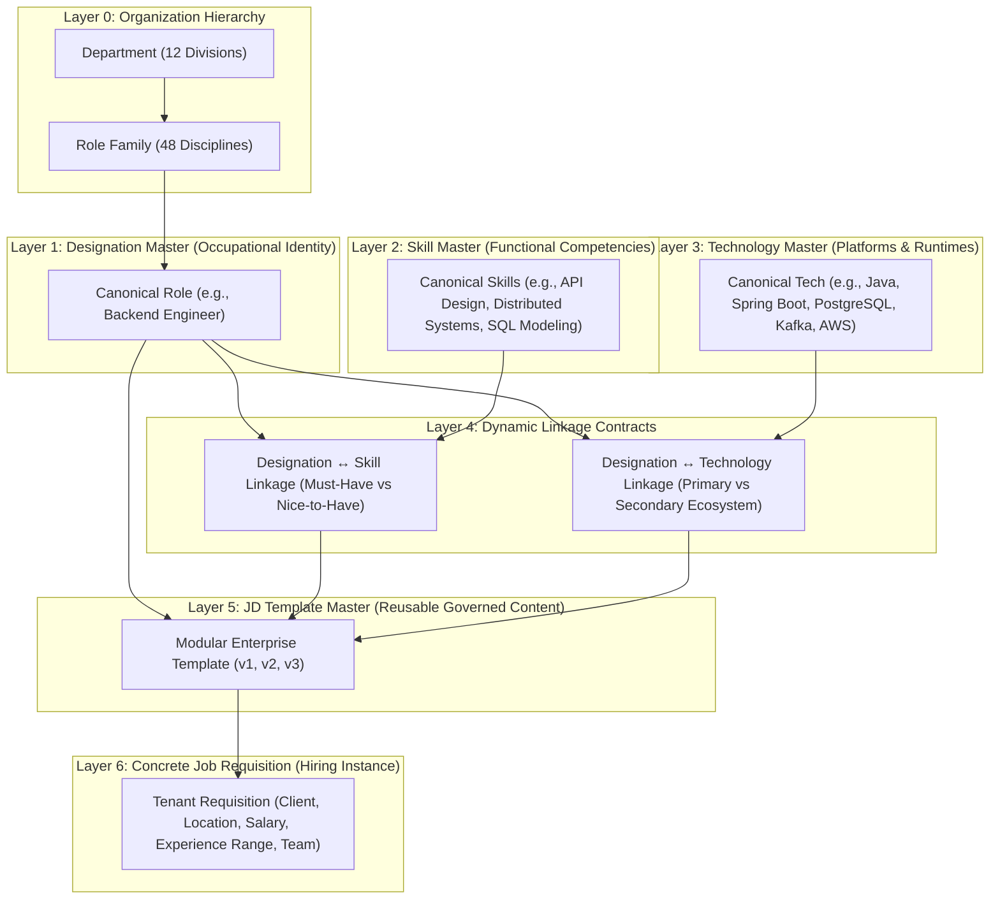

1. **Department & Role Family (`departments`, `role_families`):** Structural organizational divisions (`Engineering & Technology` $\to$ `Backend Engineering`).
2. **Designation Master (`designations`):** Pure occupational identity (`Backend Engineer`, `Product Manager`, `Technical Recruiter`). Free of vendor names, experience numbers, and locations.
3. **Skill Master (`skills`):** Canonical functional competencies, methodologies, and architectural disciplines (`API Design`, `Distributed Systems`, `Data Modeling`, `CI/CD Automation`).
4. **Technology Master (`technologies`):** Canonical tools, runtimes, frameworks, languages, and platforms (`Java`, `Spring Boot`, `PostgreSQL`, `Kubernetes`, `AWS`).
5. **Dynamic Linkage Contracts (`designation_skills`, `designation_technologies`):** Role-aware weighted competency and tech matrices linking designations to core requirements.
6. **JD Template Master (`jd_templates`):** Versioned, modular job description content blueprints (Role Summary, Key Responsibilities, Requirements).
7. **Concrete Job Requisition (`jobs`):** Tenant-owned requisition instances containing concrete parameters (Client, Hiring Org, Work Mode, Location, Salary, and Target Experience).


---

### 11.2 The Six-Stage Taxonomy Governance Lifecycle

No title, skill, or template is blindly made active without passing through an explicit state machine:

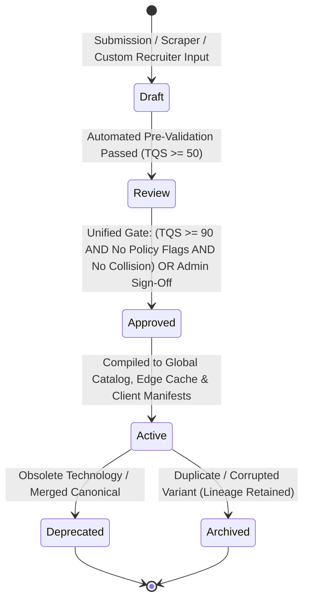

* **`draft`:** Initial ingestion from scrapers, user-submitted custom titles, or AI parsing. Not visible in standard dropdowns.
* **`review`:** Queued in Admin Taxonomy Control Center for validation.
* **`approved`:** Passes deterministic and semantic criteria; queued for manifest compilation.
* **`active`:** Authoritative production status; compiled into client RAM bundles and Elasticsearch indices.
* **`deprecated`:** Legacy technology roles (e.g. `Flash Developer`, `Silverlight Engineer`). Searchable for historical talent discovery, but never suggested for new requisitions.
* **`archived`:** Redundant duplicate or corrupted entry. Retained with `canonical_id` and `duplicate_of` foreign keys for historical referential integrity.

---

### 11.3 Two-Stage TQS Governance: Binary Hard Gates & Algorithmic Scoring

To prevent a contaminated or misaligned template from accumulating numerical points, evaluation executes in **two strict sequential stages**:

```
                       GOVERNANCE EVALUATION PIPELINE
                       
                               PROPOSED ENTITY
                                      │
                                      ▼
                        ┌───────────────────────────┐
                        │   STAGE 1: HARD GATES     │
                        │   (8 Binary Pass/Fail)    │
                        └─────────────┬─────────────┘
                                      │
                         Any Gate     │  ALL GATES
                          FAILS       │   PASS
                            ┌─────────┴─────────┐
                            ▼                   ▼
                     [REJECT / DISCARD]   ┌───────────┐
                                          │  STAGE 2: │
                                          │    TQS    │ (100 Numerical Points)
                                          └─────┬─────┘
                                                │
                                                ▼
                                         [UNIFIED GATE]
```

#### Stage 1: The 8 Inviolable Binary Hard Gates
If **any single hard gate fails**, the submission is **instantly rejected** ($\text{status} = \text{rejected}$), bypassing numerical scoring entirely:
1. **Discriminatory / Demographic Gate:** Zero gender, age, caste, religion, or nationality filters.
2. **Salary Contamination Gate:** Zero CTC, LPA, wage numbers, or currency symbols in title or JD body.
3. **Location Contamination Gate:** Zero hardcoded cities, countries, or office locations in master templates.
4. **Experience Contamination Gate:** Zero numeric tenure constraints (`min_exp`, `max_exp`, `5+ years`) in master templates.
5. **Canonical Key Collision Gate:** Zero collisions on active `identity_normalized_key`.
6. **Entity Classification Gate:** Must strictly qualify as one of the 6 mutually exclusive taxonomy entity types.
7. **Role-to-JD Semantic Alignment Gate:** Cosine similarity between designation embedding and JD body embedding must satisfy the calibrated threshold. Automatic fail if backend role contains frontend/UI text.
8. **Security & Policy Violation Gate:** Zero scripts, raw iframes, executable tags, or blacklisted words.

#### Calibrated Semantic Similarity Specification:
* **Embedding Model:** Dense vector embeddings generated via `text-embedding-3-small` (1536-dim) or `all-MiniLM-L6-v2` (384-dim).
* **Similarity Metric:** Cosine similarity on L2-normalized dense embeddings:
  $$\text{CosineSim}(u, v) = \frac{u \cdot v}{\|u\|_2 \|v\|_2}$$
* **Threshold Calibration:** The threshold is **not an arbitrary static number**; it is calibrated against the **Golden Dataset (Section 12.14)** to maintain a false-negative ceiling $\le 1.0\%$ and false-positive ceiling $\le 2.0\%$.
* **Version Binding:** The calibration benchmark is versioned under `TQS_RULE_VERSION` (current: `v1.2.0`), ensuring scoring repeatability across releases.

#### Stage 2: Algorithmic TQS Scoring (Evaluated ONLY after Stage 1 Passes)

| Evaluation Dimension | Weight | Deterministic & Semantic Scoring Criteria |
| :--- | :---: | :--- |
| **Canonical Designation Validity** | 15 pts | Valid title casing, no hiring clauses, mapped to standard Role Family. |
| **Skill & Competency Fidelity** | 20 pts | Role-family compliant canonical skills mapped; zero placeholder strings. |
| **Technology Normalization** | 15 pts | Verified against master technology catalog; acronyms expanded (`K8s` $\to$ `Kubernetes`). |
| **JD Structural Completeness & Depth** | 20 pts | Contains Summary, Responsibilities, and Technical Competencies within character bounds. |
| **Structural HTML Hygiene** | 15 pts | Pure semantic markup (`<p>`, `<strong>`, `<ul>`, `<li>`); zero raw entities (`&nbsp;`). |
| **Deduplication Confidence** | 15 pts | Jaccard similarity $< 75\%$ against all active canonical templates. |
| **Total Quality Score (TQS)** | **100 pts** | **Enterprise Health Benchmark** |

#### The Authoritative Unified Gating Hierarchy:
* **$\text{TQS} < 50$:** **Reject / Discard** (Immediate rejection from production pipeline).
* **$\text{TQS}\ 50\text{--}74$:** **Remediation Required** (Automated sanitizer cleans entities, prompts for manual skill enrichment).
* **$\text{TQS}\ 75\text{--}89$:** **Human Review Required** (Routed to Admin Taxonomy Control Center review queue).
* **$\text{TQS} \ge 90$:** **Eligible for Approval** (Subject to the multi-factor governance gate below).

> [!IMPORTANT]
> **The Authoritative Auto-Approve Rule:**  
> $\text{TQS} \ge 90$ is **necessary, but not sufficient**. An entity is **Auto-Approved** only when:  
> 1. All Stage 1 Hard Gates **PASS**, **AND**  
> 2. $\text{TQS} \ge 90$, **AND**  
> 3. Zero critical policy flags (`requires_human_verification = 0`), **AND**  
> 4. Zero canonical collisions on `identity_normalized_key`, **AND**  
> 5. AI classification confidence $\ge 95\%$.  
>  
> **Mandatory Human Sign-Off:** High-risk, regulated, executive, or ambiguous roles (e.g. CISO, Chief Medical Officer, Nuclear Safety Engineer) **strictly require manual Admin verification**, regardless of score. AI confidence alone **never** promotes an entity to active.

---

### 11.4 The Canonical Designation Resolver & 5-Tuple Role Slotting

Titles are normalized not merely by casing, but via a **Canonical Designation Resolver** that dissects user input into a standardized 5-Tuple:

$$\text{Role Slotting} = \big[\text{Designation},\ \text{Specialization},\ \text{Primary Tech},\ \text{Framework/Tool},\ \text{Industry Domain}\big]$$

```
Input: "Senior Java Spring Boot Backend Developer for FinTech"
  ├── Canonical Designation: "Backend Engineer"
  ├── Seniority Level:       "Senior"
  ├── Specialization:        "Backend Development"
  ├── Primary Technology:    "Java"
  ├── Framework / Runtime:   "Spring Boot"
  ├── Industry Domain:       "Financial Technology (FinTech)"
  └── Search Aliases:        ["Senior Java Developer", "Java Backend Developer", "Spring Boot Engineer"]
```

#### The Designation-Technology Disentanglement Matrix:

| Raw Title Stacking (Anti-Pattern) | Resolved Canonical Designation | Primary Technology | Specialized Framework |
| :--- | :--- | :--- | :--- |
| `React Developer` | **Frontend Engineer** | `JavaScript / TypeScript` | `React.js` |
| `Angular Developer` | **Frontend Engineer** | `TypeScript` | `Angular` |
| `Java Developer` | **Backend Engineer** | `Java` | `Spring Boot` |
| `Python Developer` | **Backend Engineer** | `Python` | `Django / FastAPI` |
| `AWS DevOps Engineer` | **DevOps Engineer** | `AWS` | `Terraform / Kubernetes` |
| `MERN Stack Developer` | **Full Stack Engineer** | `JavaScript` | `MongoDB, Express, React, Node` |
| `Data Engineer (Snowflake)` | **Data Engineer** | `SQL / Python` | `Snowflake / dbt` |

---

### 11.5 Hierarchical Skill & Technology Graph

Skills are structured as a directed acyclic graph (DAG) rather than flat comma-separated strings:

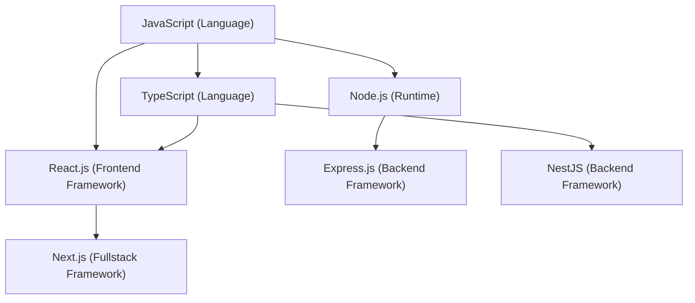

#### Skill Schema Definition:
* **Canonical Key:** Normalized identifier (`reactjs`, `python`, `kubernetes`).
* **Display Name:** Enterprise formatted label (`React.js`, `Python`, `Kubernetes`).
* **Category:** `Programming Language`, `Framework`, `Cloud Provider`, `Database`, `DevOps Tool`, `Methodology`.
* **Parent Skill:** Hierarchical parent (e.g. `JavaScript` is parent of `React.js`).
* **Aliases / Synonyms:** `["React", "ReactJS", "React.js"]` for seamless resume keyword extraction.
* **Status:** `active` | `deprecated`.

---

### 11.6 Five-Level Semantic Deduplication Engine

To eliminate duplicates without over-consolidating legitimate distinct roles, JERO executes a 5-tier similarity pipeline:

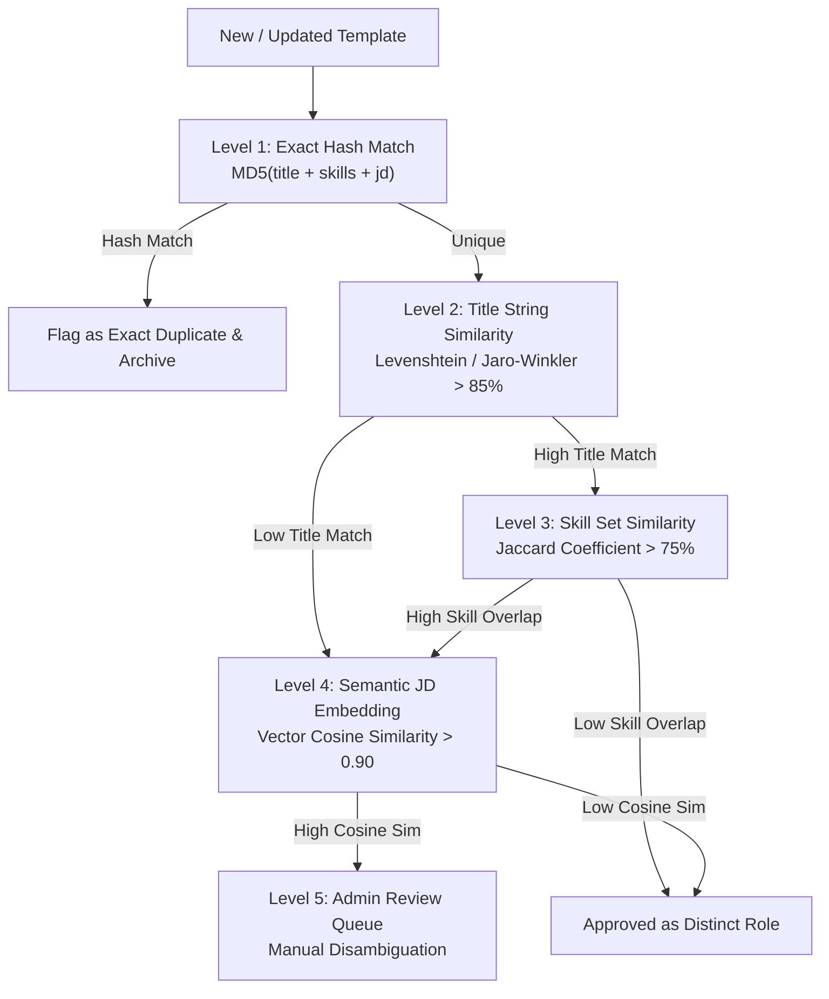

#### Lineage & Non-Destructive Archival Protocol:
* **Zero Hard Deletions:** In accordance with audit standards, redundant records are **never deleted from MySQL**.
* **Foreign-Key Lineage:** Secondary duplicate rows receive:
  ```sql
  status = 2, -- Archived
  canonical_id = 30, -- Pointer to authoritative master record
  duplicate_of = 30
  ```
  This guarantees historical requisitions, candidate job submissions, and ATS analytics referencing older IDs never break with foreign-key errors.

---

### 11.7 The Three-Tier Semantic Separation of Dynamic Parameters

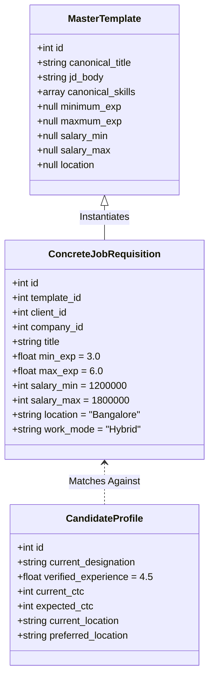

1. **Experience Separation:**
   * **Template:** Strictly `NULL`. Standard templates must never dictate years of experience.
   * **Job Requisition:** Concrete hiring range configured by tenant recruiter (e.g. `3.0` to `6.0` years).
   * **Candidate Profile:** Authoritative verified tenure calculated from employment records (e.g. `4.5` years).
2. **Compensation Separation:**
   * **Template:** Zero salary numbers, currencies, or ranges.
   * **Job Requisition:** Concrete requisition budget and currency (`INR 12,00,000 – 18,00,000`).
   * **Candidate Profile:** Current and expected compensation figures.
3. **Location & Work-Mode Separation:**
   * **Template:** Completely geography-agnostic.
   * **Job Requisition:** Specific office locations, client addresses, or remote/hybrid policies.
   * **Candidate Profile:** Current city, relocation flexibility, and remote preferences.

---

### 11.8 The 12-Block Modular Enterprise JD Schema

To replace rigid unformatted text blocks, canonical job descriptions adhere to a modular standard where sections are dynamically rendered:

```json
{
  "role_summary": "High-level mission statement and organizational context...",
  "about_the_role": "Detailed narrative regarding daily impact and strategic goals...",
  "key_responsibilities": [
    "Architect and deliver high-throughput RESTful microservices.",
    "Optimize PostgreSQL relational schemas and query performance."
  ],
  "must_have_skills": ["Java", "Spring Boot", "PostgreSQL", "REST APIs"],
  "nice_to_have_skills": ["Apache Kafka", "Docker", "Kubernetes", "AWS"],
  "technical_competencies": [
    "Deep understanding of distributed systems and ACID transaction boundaries.",
    "Experience with containerized CI/CD deployment pipelines."
  ],
  "tools_and_platforms": ["Git", "Docker", "AWS ECS", "Jira"],
  "domain_knowledge": "FinTech payment rails, transaction processing, or B2B SaaS.",
  "collaboration_and_stakeholders": "Partners with Product Managers, Frontend Engineers, and QA Leads.",
  "success_indicators_first_90_days": [
    "Deploy first microservice endpoint to staging within 30 days.",
    "Achieve 85%+ automated unit test coverage on new services."
  ],
  "education": "Bachelor's or Master's degree in Computer Science, Engineering, or equivalent practical experience.",
  "certifications": ["AWS Certified Solutions Architect (Preferred)"]
}
```

---

### 11.9 Dual-Tier Competency Model & Weighted Marketplace Matching

Replacing flat keyword matching with **Dual-Tier Competency Scoring**:

$$\text{Total Match Score} = \big(0.70 \times \text{Must-Have Match}\big) + \big(0.30 \times \text{Nice-To-Have Match}\big)$$

* **Must-Have Core Skills (70% Weight):** Mandatory competencies. A candidate lacking a core skill receives a proportional penalty on the overall score.
* **Nice-to-Have Skills (30% Weight):** Differentiating competencies that boost ranking among qualified candidates.
* **Proficiency Levels (1–4):**
  * `1: Fundamental` — Conceptual knowledge, basic syntax.
  * `2: Intermediate` — Independent delivery, debugging, production usage.
  * `3: Advanced` — System design, optimization, architectural decisions.
  * `4: Expert` — Industry authority, framework contributor, deep internals.

---

### 11.10 Multi-Stage HTML Sanitization & Whitelisting Pipeline

Before any job description is committed to the database or synced to client caches, it passes through a 9-stage deterministic pipeline:

```mermaid
flowchart LR
    Raw["Raw HTML / Recruiter Input"] --> D1["1. Entity Decode"]
    D1 --> D2["2. DOM Tree Parse"]
    D2 --> D3["3. Strip Scripts & Styles"]
    D3 --> D4["4. Tag Whitelist Filter"]
    D4 --> D5["5. Attribute Sanitizer"]
    D5 --> D6["6. Bullets & Headings Normalizer"]
    D6 --> D7["7. Context-Aware Regex Cleaner"]
    D7 --> D8["8. Whitespace Collapser"]
    D8 --> Clean["Canonical Enterprise HTML"]
```

* **Tag Whitelist:** Strictly `<p>`, `<strong>`, `<b>`, `<ul>`, `<ol>`, `<li>`, `<h3>`, `<h4>`, `<br>`.
* **Attribute Whitelist:** Only standard structural attributes; all inline `style="..."`, `class="MsoNormal"`, `cellspacing="..."`, and `align="..."` are stripped.
* **Context-Aware Cleaners:** Specific regex cleaners detect and remove salary headers (`CTC:.*`, `LPA`), location constraints (`Location:.*`), and agency noise (`Notice Period:.*`, `Beeline ID:.*`), while safeguarding technical tokens (e.g. preserving `NoSQL`, `RESTful`).

---

### 11.11 AI-Assisted Remediation with Gated Human Review

AI classifiers assist taxonomy expansion but are strictly isolated behind deterministic verification:

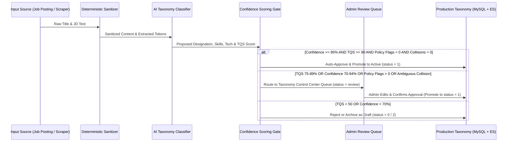

---

### 11.12 The Admin "Taxonomy Control Center"

A dedicated administrative dashboard implemented in Metronic 8 giving system operators complete control over JERO's global intelligence library:

```
┌────────────────────────────────────────────────────────────────────────────────────────┐
│  JERO TALENT TAXONOMY CONTROL CENTER                                                   │
├────────────────────────────────────────────────────────────────────────────────────────┤
│  [Total Designations: 1,850]  [Total Skills: 2,450]  [Active Templates: 1,382]         │
│  [Pending AI Review: 18]     [Duplicate Clusters: 0] [Orphan Skills: 12]              │
├────────────────────────────────────────────────────────────────────────────────────────┤
│  Tabs: [Designation Master] [Skills & Tech] [JD Templates] [Synonym Graph] [Audit Log] │
│                                                                                        │
│  Search Taxonomy: [ java backend                         ] [Filter by Domain: All ▾]   │
│                                                                                        │
│  Status  │ Canonical Designation      │ Domain     │ Skills Mapped │ TQS  │ Actions   │
│  ────────┼────────────────────────────┼────────────┼───────────────┼──────┼───────────│
│  Active  │ Java Backend Developer     │ Eng & Tech │ 8 Skills      │ 98%  │ Edit · Ver│
│  Active  │ Backend Engineer           │ Eng & Tech │ 12 Skills     │ 100% │ Edit · Ver│
│  Review  │ Agentic AI Orchestrator    │ Data & AI  │ 6 Skills      │ 84%  │ Approve   │
│  Archived│ Dot .NET Developer         │ Eng & Tech │ Duplicate (24)│ --   │ Lineage   │
└────────────────────────────────────────────────────────────────────────────────────────┘
```

---

### 11.13 Relational Write Schema & CQRS Read Compilation

In accordance with **JERO Rule #1 (MySQL strictly writes, ES strictly reads)**, the normalized relational tables serve as the authoritative transactional write store:

```sql
-- Authoritative Master Tables (MySQL Writes Only)
CREATE TABLE designations (
    id BIGINT UNSIGNED AUTO_INCREMENT PRIMARY KEY,
    canonical_title VARCHAR(255) NOT NULL,
    identity_normalized_key VARCHAR(255) NOT NULL,
    search_normalized_key VARCHAR(255) NOT NULL,
    active_identity_key VARCHAR(255) GENERATED ALWAYS AS (IF(status = 1, identity_normalized_key, NULL)) STORED,
    department_id INT UNSIGNED NOT NULL,
    role_family_id INT UNSIGNED NOT NULL,
    seniority_level VARCHAR(50) DEFAULT NULL,
    specialization VARCHAR(100) DEFAULT NULL,
    status TINYINT NOT NULL DEFAULT 1, -- 0: Draft, 1: Active, 2: Archived, 3: Deprecated
    quality_score TINYINT UNSIGNED DEFAULT 0,
    created_at TIMESTAMP NULL,
    updated_at TIMESTAMP NULL,
    UNIQUE INDEX uq_active_designation (active_identity_key),
    INDEX idx_designation_search (search_normalized_key, status)
);

CREATE TABLE skills (
    id BIGINT UNSIGNED AUTO_INCREMENT PRIMARY KEY,
    name VARCHAR(255) NOT NULL,
    identity_normalized_key VARCHAR(255) NOT NULL,
    search_normalized_key VARCHAR(255) NOT NULL,
    active_identity_key VARCHAR(255) GENERATED ALWAYS AS (IF(status = 1, identity_normalized_key, NULL)) STORED,
    category_id INT UNSIGNED NOT NULL,
    parent_skill_id BIGINT UNSIGNED NULL,
    status TINYINT NOT NULL DEFAULT 1,
    is_deprecated TINYINT(1) NOT NULL DEFAULT 0,
    created_at TIMESTAMP NULL,
    updated_at TIMESTAMP NULL,
    UNIQUE INDEX uq_active_skill (active_identity_key),
    INDEX idx_skill_search (search_normalized_key, status)
);

CREATE TABLE technologies (
    id BIGINT UNSIGNED AUTO_INCREMENT PRIMARY KEY,
    name VARCHAR(255) NOT NULL,
    identity_normalized_key VARCHAR(255) NOT NULL,
    search_normalized_key VARCHAR(255) NOT NULL,
    active_identity_key VARCHAR(255) GENERATED ALWAYS AS (IF(status = 1, identity_normalized_key, NULL)) STORED,
    category_id INT UNSIGNED NOT NULL,
    lifecycle_status ENUM('active', 'emerging', 'stable', 'declining', 'deprecated', 'archived') NOT NULL DEFAULT 'active',
    ecosystem VARCHAR(100) NULL,
    status TINYINT NOT NULL DEFAULT 1,
    created_at TIMESTAMP NULL,
    updated_at TIMESTAMP NULL,
    UNIQUE INDEX uq_active_tech (active_identity_key),
    INDEX idx_tech_search (search_normalized_key, status)
);

CREATE TABLE taxonomy_aliases (
    id BIGINT UNSIGNED AUTO_INCREMENT PRIMARY KEY,
    entity_type ENUM('designation', 'skill', 'technology') NOT NULL,
    canonical_id BIGINT UNSIGNED NOT NULL,
    alias VARCHAR(255) NOT NULL,
    identity_normalized_key VARCHAR(255) NOT NULL,
    search_normalized_key VARCHAR(255) NOT NULL,
    alias_type ENUM('commercial_stack', 'corporate_grade', 'abbreviation', 'spelling_variant', 'synonym') NOT NULL,
    seniority_override VARCHAR(50) NULL,
    specialization_override VARCHAR(100) NULL,
    technology_override VARCHAR(100) NULL,
    locale VARCHAR(10) NOT NULL DEFAULT 'en-US',
    confidence DECIMAL(4,3) NOT NULL DEFAULT 1.000,
    priority TINYINT UNSIGNED NOT NULL DEFAULT 100,
    source ENUM('curated', 'recruiter_input', 'ai_inferred') NOT NULL DEFAULT 'curated',
    status ENUM('active', 'review', 'deprecated', 'rejected') NOT NULL DEFAULT 'active',
    created_at TIMESTAMP NULL,
    updated_at TIMESTAMP NULL,
    INDEX idx_alias_search (search_normalized_key, status),
    INDEX idx_canonical_entity (entity_type, canonical_id)
);

CREATE TABLE designation_skills (
    id BIGINT UNSIGNED AUTO_INCREMENT PRIMARY KEY,
    designation_id BIGINT UNSIGNED NOT NULL,
    skill_id BIGINT UNSIGNED NOT NULL,
    is_must_have TINYINT(1) NOT NULL DEFAULT 1,
    weight TINYINT UNSIGNED DEFAULT 100,
    FOREIGN KEY (designation_id) REFERENCES designations(id) ON DELETE CASCADE,
    FOREIGN KEY (skill_id) REFERENCES skills(id) ON DELETE CASCADE
);

CREATE TABLE designation_technologies (
    id BIGINT UNSIGNED AUTO_INCREMENT PRIMARY KEY,
    designation_id BIGINT UNSIGNED NOT NULL,
    technology_id BIGINT UNSIGNED NOT NULL,
    is_primary TINYINT(1) NOT NULL DEFAULT 1,
    weight TINYINT UNSIGNED DEFAULT 100,
    FOREIGN KEY (designation_id) REFERENCES designations(id) ON DELETE CASCADE,
    FOREIGN KEY (technology_id) REFERENCES technologies(id) ON DELETE CASCADE
);

CREATE TABLE jd_templates (
    id BIGINT UNSIGNED AUTO_INCREMENT PRIMARY KEY,
    designation_id BIGINT UNSIGNED NOT NULL,
    version INT UNSIGNED NOT NULL DEFAULT 1,
    title VARCHAR(255) NOT NULL,
    job_description MEDIUMTEXT NOT NULL,
    quality_score TINYINT UNSIGNED NOT NULL DEFAULT 0,
    quality_score_version VARCHAR(20) NOT NULL DEFAULT 'v1.0.0',
    quality_evaluated_at TIMESTAMP NULL,
    quality_evaluator ENUM('automated_rules', 'ai_classifier', 'admin_override') NOT NULL DEFAULT 'automated_rules',
    requires_human_verification TINYINT(1) NOT NULL DEFAULT 0,
    status TINYINT NOT NULL DEFAULT 1,
    created_by BIGINT UNSIGNED NULL,
    approved_by BIGINT UNSIGNED NULL,
    change_reason VARCHAR(255) NULL,
    created_at TIMESTAMP NULL,
    updated_at TIMESTAMP NULL
);
```

#### The Zero-Read CQRS Compilation Contract:
1. **Transaction Phase:** Any change to designations, skills, technologies, or templates commits to MySQL.
2. **Horizon Queue Event:** A `TaxonomyMutatedEvent` fires in Redis.
3. **Dual Compilation:**
   * **Elasticsearch Read Cluster:** Ingests documents into read indices (`taxonomies`, `jobs`, `candidates`) with pre-computed synonym analyzers and ID-based entity filters.
   * **Client In-Memory Bundle:** An Octane background worker serializes the entire catalog into a Brotli/gzip compressed manifest envelope (`version`, `manifest_hash`, `titles`), stored in Redis.
4. **Browser Execution:** When a recruiter opens Add Job, the browser validates via ETag HTTP 304. The authoritative template catalog is hydrated into **User RAM + IndexedDB**. All filtering, fuzzy search, and auto-fills execute entirely within local browser storage (P50 $< 1\text{ ms}$, P95 $< 5\text{ ms}$) with **zero MySQL or Elasticsearch reads during interaction**.

---

### 11.14 Automated Health, Orphan Detection & Deprecation Engine

A scheduled maintenance job (`TaxonomyHealthAuditJob`) runs on a recurring schedule to monitor taxonomy vitality:

```
Taxonomy Health Diagnostic Report:
  ├── Orphan Skills Detected: 0 (Skills with 0 designations, 0 jobs, 0 candidates)
  ├── Unmapped Designations: 0 (Active roles with 0 skills)
  ├── Outdated Templates: 0 (Templates older than 18 months without review)
  ├── Legacy Technologies Flagged: 14 (Flash, Silverlight, AngularJS marked as deprecated)
  └── Coverage Health: 96.4% across 12 Core Enterprise Divisions
```

---

### 11.15 The 25-Industry Cross-Domain Enterprise Taxonomy Roadmap

To prevent JERO from being an IT-only taxonomy, the catalog actively spans 25 major economic sectors:

```
1. Software & Internet Technology       14. Healthcare & Clinical Medicine
2. Cloud Infrastructure & DevOps        15. Pharmaceuticals & BioTech
3. Data Science, Analytics & AI         16. Manufacturing & Industrial Automation
4. Cybersecurity & Information Defense  17. Automotive & Electric Mobility
5. Product Management & Strategy        18. Telecommunications & 5G Networks
6. UI / UX & Digital Experience Design  19. Supply Chain, Logistics & Warehousing
7. Banking, Financial Services & FinTech 20. Retail & E-Commerce Operations
8. Insurance & InsurTech                21. Energy, Oil & Renewable CleanTech
9. Investment Banking & Private Equity  22. Real Estate, Construction & Infrastructure
10. Corporate Legal & Compliance        23. Hospitality & Travel Management
11. Human Resources & Talent Acquisition24. Media, Entertainment & OTT Gaming
12. Sales, BD & Revenue Operations      25. Education, EdTech & Academic Research
13. Marketing, Brand & Growth           
```

---

### 11.16 The Master Target Architecture Topology

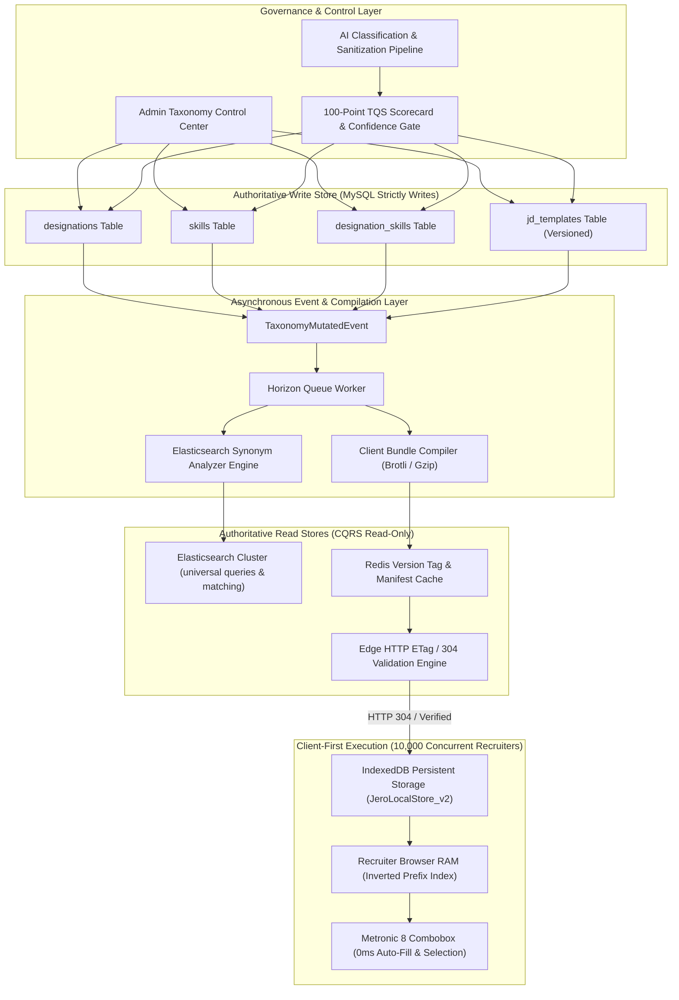

---

### 11.17 The JERO Taxonomy Governance Charter

1. **Inviolable Role Separation:** No title shall ever contain a skill, technology, location, salary, or experience sentence.
2. **Zero Default Experience:** No master template shall ever dictate required tenure. Experience is configured dynamically on job requisitions.
3. **Qualified Zero-Read Interaction:** Interactive search and auto-fill operations execute 100% within User Browser RAM and IndexedDB after bundle delivery.
4. **Permanent Audit Lineage:** Duplicate templates are archived with foreign-key pointers; records are never hard-deleted.
5. **Quality Gate Supremacy:** No template achieves active production status without satisfying the 100-point Template Quality Score ($\ge 90$) and human exception review.
6. **Continuous Evolution:** Scheduled health monitoring detects orphans, flags deprecated frameworks, and preserves taxonomy freshness across global markets.

---

# Part 12 — JERO Taxonomy V2: The Final Production Engineering Contract & Implementation Specifications
## The Concrete Implementation Standard for Database, API, Search, Client Cache, and Migration

> **Engineering Standard:** This section defines the precise, immutable contracts, database schemas, validation invariants, performance budgets, and non-destructive migration protocols required to implement JERO Taxonomy V2 safely in production.

---

### 12.1 The Inviolable Orthogonal Domain Hierarchy

```
DEPARTMENT (12 Global Divisions)
    └── ROLE FAMILY (48 Core Disciplines)
            └── DESIGNATION (Occupational Identity)
                    ├── SENIORITY LEVEL (Junior, Mid, Senior, Lead, Principal, Executive)
                    ├── SPECIALIZATION (Functional Focus, e.g., Cloud, Embedded, Systems)
                    │
                    ├── SKILL LINKAGE (1:N to Functional Competencies & Methodologies)
                    ├── TECHNOLOGY LINKAGE (1:N to Platforms, Runtimes & Tooling)
                    └── JD TEMPLATE (Versioned, Governed Content Schema)
                            └── CONCRETE JOB REQUISITION (Tenant Requisition Instance)
```

#### Orthogonality Matrix & Specialization Definition:
* **Designation:** Occupational identity only (`Backend Engineer`, `Product Manager`).
* **Specialization:** Occupational/functional domain focus attached to a designation (`Web Applications`, `Distributed Systems`, `Cloud Infrastructure Automation`, `Streaming Data Pipelines`). Represents functional scope, **never** vendor tools or library names.
* **Skill:** Functional discipline, capability, or architectural methodology (`REST API Design`, `Distributed Systems`, `Microservices Architecture`, `Data Modeling`).
* **Technology:** Concrete tool, platform, runtime, language, or vendor ecosystem (`Java`, `Spring Boot`, `PostgreSQL`, `Kafka`, `Docker`, `AWS`).
* **Department:** Organizational corporate unit (`Engineering & Technology`).
* **Role Family:** Broad professional track (`Backend Engineering`, `Site Reliability Engineering`).

---

### 12.2 Canonical Entity Acceptance Contract & Collision Protection

Every canonical entity ingested into JERO's production catalog must satisfy the **Canonical Acceptance Contract**:

#### Canonical Designation Schema (JSON Contract):
```json
{
  "$schema": "https://json-schema.org/draft/2020-12/schema",
  "type": "object",
  "required": [
    "id",
    "canonical_title",
    "identity_normalized_key",
    "search_normalized_key",
    "department_id",
    "role_family_id",
    "seniority_level",
    "specialization",
    "skill_ids",
    "technology_ids",
    "jd_template_id",
    "status",
    "taxonomy_version"
  ],
  "properties": {
    "id": { "type": "integer", "minimum": 1 },
    "canonical_title": { "type": "string", "minLength": 2, "maxLength": 100 },
    "identity_normalized_key": { "type": "string", "pattern": "^[a-z0-9_]+$" },
    "search_normalized_key": { "type": "string", "pattern": "^[a-z0-9]+$" },
    "department_id": { "type": "integer" },
    "role_family_id": { "type": "integer" },
    "seniority_level": { 
      "type": "string", 
      "enum": ["Intern", "Entry", "Junior", "Mid-Level", "Senior", "Lead", "Staff", "Principal", "Director", "VP", "C-Level"] 
    },
    "specialization": { "type": ["string", "null"] },
    "skill_ids": { "type": "array", "items": { "type": "integer" }, "minItems": 0 },
    "technology_ids": { "type": "array", "items": { "type": "integer" }, "minItems": 0 },
    "jd_template_id": { "type": "integer" },
    "status": { "type": "string", "enum": ["draft", "review", "approved", "active", "deprecated", "archived"] },
    "quality_score": { "type": "integer", "minimum": 0, "maximum": 100 },
    "taxonomy_version": { "type": "string" },
    "created_at": { "type": "string", "format": "date-time" },
    "updated_at": { "type": "string", "format": "date-time" }
  }
}
```

#### Role-Family Specific Minimum Governance Rules:
Rather than enforcing a blunt universal minimum that breaks non-technical roles, linkage thresholds are enforced per Role Family:
* **Software, Backend, Frontend & Fullstack:** $\ge 2\text{ skills}$, $\ge 1\text{ technology}$.
* **Cloud, DevOps, Platform & SRE:** $\ge 2\text{ skills}$, $\ge 2\text{ technologies}$.
* **Data Engineering & Lakehouse:** $\ge 2\text{ skills}$, $\ge 2\text{ technologies}$.
* **Data Science, ML & Generative AI:** $\ge 2\text{ skills}$, $\ge 1\text{ technology}$.
* **HR, Talent Acquisition & People Ops:** $\ge 2\text{ skills}$, $\ge 0\text{ technologies}$ (Technology links optional).
* **Sales, BD & Revenue Operations:** $\ge 2\text{ skills}$, $\ge 0\text{ technologies}$ (Technology links optional).
* **Corporate Legal & Governance:** $\ge 2\text{ skills}$, $\ge 0\text{ technologies}$ (Technology links optional).
* **Product Management & Strategy:** $\ge 2\text{ skills}$, $\ge 0\text{ technologies}$ (Technology links optional).

#### Dual-Key Normalization & Token Preservation Engine:
To prevent destructive symbol loss (e.g. collapsing `C++` vs `C` or `C#` vs `C` or `.NET` vs `NET`), JERO generates **two orthogonal keys**:

1. **Identity Normalized Key (`identity_normalized_key`):**  
   Executes deterministic symbol and technology token replacement before stripping punctuation:
   * `C++` $\to$ `cpp`
   * `C#` $\to$ `csharp`
   * `.NET` $\to$ `dotnet`
   * `Node.js` $\to$ `nodejs`
   * `A.W.S` $\to$ `aws`
   * Formula:
     $$\text{identity\_key} = \text{RegExpReplace}\big(\text{LowerCase}(\text{TokenExpand}(\text{title})),\ '[^a-z0-9_]',\ ''\big)$$

2. **Search Normalized Key (`search_normalized_key`):**  
   Pure alphanumeric prefix string used for lightning-fast inverted prefix trie lookups in Browser RAM:
   $$\text{search\_key} = \text{RegExpReplace}\big(\text{LowerCase}(\text{NFKD}(\text{title})),\ '[^a-z0-9]',\ ''\big)$$

#### Active-Scoped Collision Protection:
* Active canonical entities (`status = 1`) enforce uniqueness on `identity_normalized_key` via a stored generated column:  
  `active_identity_key AS (IF(status = 1, identity_normalized_key, NULL)) STORED, UNIQUE INDEX uq_active_designation (active_identity_key)`.
* This allows archived duplicate rows (`status = 2`) to retain historical keys without blocking new active canonical entities.
* The alias is **never the primary identity** — it points directly to `canonical_id` in `taxonomy_aliases`.

---

### 12.3 Canonical Ontology (Model A) vs Commercial Aliases (Model B)

To resolve semantic conflicts (e.g. whether `Senior React Developer` is a distinct designation or an alias of `Frontend Engineer`), JERO formally establishes:

> **The Model A Invariant:** The canonical catalog strictly implements **Model A (Pure Occupational Ontology)**. Commercial market phrasing (Model B) is stored as **Structured Commercial Aliases**.

```
CANONICAL OCCUPATIONAL ENTITY (Model A)
  ├── Canonical Designation: "Frontend Engineer"
  ├── Seniority Level:       "Senior"
  ├── Specialization:        "Frontend Web Applications"
  └── Technology Links:      ["JavaScript", "TypeScript", "React.js"]
       │
       ▼
STRUCTURED COMMERCIAL ALIAS (Model B in taxonomy_aliases)
  ├── Alias String:          "Senior React Developer"
  ├── Canonical Target ID:   1020 (Frontend Engineer)
  ├── Seniority Override:    "Senior"
  ├── Tech Override:         "React.js"
  └── Alias Type:            "commercial_stack"
```

| Recruiter Input | Canonical Designation (Model A) | Seniority Override | Specialization Override | Primary Technology | Alias Type |
| :--- | :--- | :--- | :--- | :--- | :--- |
| `SDE 1` | **Software Engineer** | Entry / Engineer I | Full Stack | General | Corporate Grade |
| `SDE 2` | **Software Engineer** | Mid-Level / Engineer II | Full Stack | General | Corporate Grade |
| `SDE 3` | **Software Engineer** | Senior / Engineer III | Full Stack | General | Corporate Grade |
| `React Developer` | **Frontend Engineer** | Mid-Level | React | React.js | Commercial Stack |
| `Senior React Dev` | **Frontend Engineer** | Senior | React | React.js | Commercial Stack |
| `Angular Developer`| **Frontend Engineer** | Mid-Level | Angular | Angular | Commercial Stack |
| `Java Developer` | **Backend Engineer** | Mid-Level | Java Ecosystem | Java | Commercial Stack |
| `Senior Python Dev`| **Backend Engineer** | Senior | Python Ecosystem | Python | Commercial Stack |
| `AWS DevOps Eng` | **DevOps Engineer** | Mid-Level | AWS Cloud | AWS / Terraform | Commercial Stack |
| `MERN Stack Dev` | **Full Stack Engineer** | Mid-Level | MERN | React, Node.js, MongoDB | Commercial Stack |

**Enterprise Benefit:**  
1. Recruiters search and type colloquial commercial hiring phrases (`SDE 2`, `Senior React Developer`) with zero friction.
2. The ATS and Elasticsearch index candidates and requisitions under unified occupational IDs, preventing talent fragmentation across arbitrary keyword variations.

---

### 12.4 Custom Title Fallback Governance (Zero-Pollution Recruiter Freedom)

Recruiters must never be blocked when hiring for rare or non-standard titles (`"AI Ninja"`, `"Head of Evangelism"`). However, custom input must **never mutate or pollute the global master taxonomy**.

#### Concrete Database Schema on Requisitions & Candidates:
```sql
ALTER TABLE jobs ADD COLUMN (
    canonical_designation_id BIGINT UNSIGNED NULL,
    raw_designation VARCHAR(255) NOT NULL,
    resolved_designation_id BIGINT UNSIGNED NULL,
    taxonomy_version VARCHAR(20) NOT NULL DEFAULT '2026.10.13.1',
    resolution_status ENUM('canonical_exact', 'canonical_alias', 'custom_unresolved', 'custom_resolved') NOT NULL DEFAULT 'custom_unresolved',
    resolution_confidence DECIMAL(5,4) NULL,
    resolution_method ENUM('exact_hash', 'alias_match', 'fuzzy_jaro', 'ai_classifier', 'manual_admin') NULL,
    FOREIGN KEY (canonical_designation_id) REFERENCES designations(id) ON DELETE SET NULL,
    FOREIGN KEY (resolved_designation_id) REFERENCES designations(id) ON DELETE SET NULL
);

ALTER TABLE bench_candidates ADD COLUMN (
    canonical_designation_id BIGINT UNSIGNED NULL,
    raw_designation VARCHAR(255) NOT NULL,
    resolved_designation_id BIGINT UNSIGNED NULL,
    taxonomy_version VARCHAR(20) NOT NULL DEFAULT '2026.10.13.1',
    resolution_status ENUM('canonical_exact', 'canonical_alias', 'custom_unresolved', 'custom_resolved') NOT NULL DEFAULT 'custom_unresolved',
    resolution_confidence DECIMAL(5,4) NULL,
    resolution_method ENUM('exact_hash', 'alias_match', 'fuzzy_jaro', 'ai_classifier', 'manual_admin') NULL,
    FOREIGN KEY (canonical_designation_id) REFERENCES designations(id) ON DELETE SET NULL,
    FOREIGN KEY (resolved_designation_id) REFERENCES designations(id) ON DELETE SET NULL
);
```

#### Client Submission Payload Contract & Version Validation Gate:
Every taxonomy-dependent mutation from the UI (Add Job / Add Candidate) must submit the client's cached `taxonomy_version`:
```json
{
  "designation_id": 1042,
  "raw_designation": "Senior Java Developer",
  "taxonomy_version": "2026.10.13.1",
  "skill_ids": [101, 104, 108],
  "technology_ids": [12, 14, 55]
}
```

#### Server-Side Compatibility Validation:
```
Client Request Payload
        │
        ▼
Is client.taxonomy_version >= server.minimum_supported_version?
  ├── YES ──> Accept & Commit Transaction
  ├── NO (Supported Legacy) ──> Asynchronous Horizon migration maps obsolete IDs to new IDs
  └── NO (Incompatible) ──> Return HTTP 409 Conflict with X-Taxonomy-Refresh-Required header
```
This guarantees that an open browser tab from an older deployment never commits obsolete or desynchronized taxonomy IDs.

#### The Dual-Track Ingestion Workflow:
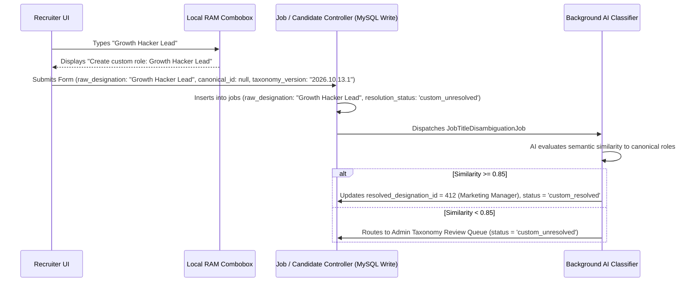

---

### 12.5 Three-Layer Multi-Tenant Taxonomy Extension Framework

To support large enterprises with proprietary job leveling without fracturing global marketplace liquidity:

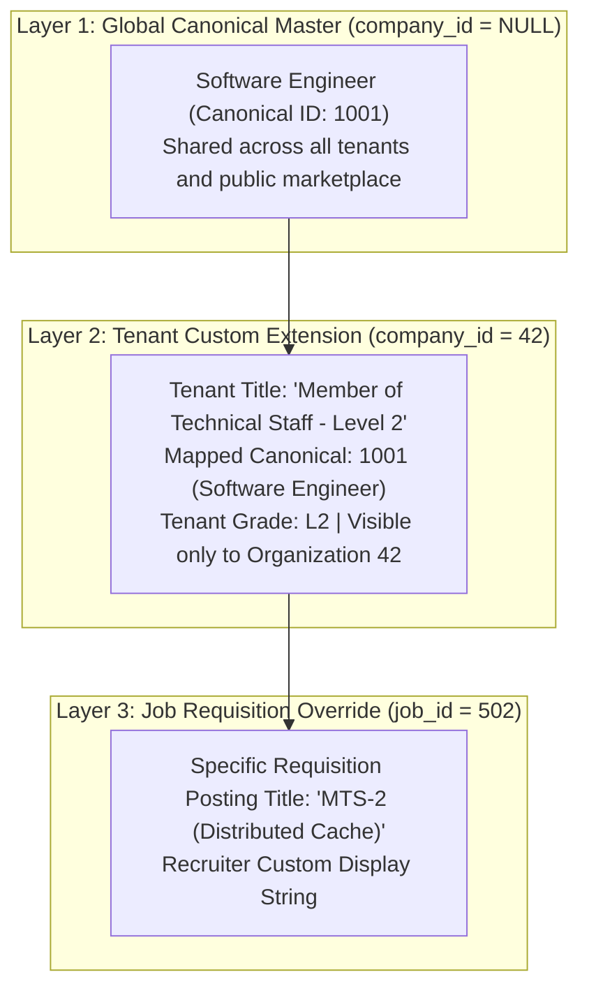

* **Global Marketplace Indexing:** Elasticsearch matches cross-tenant candidates using `canonical_designation_id = 1001`.
* **Tenant UI Experience:** Organization users see their internal corporate title (`Member of Technical Staff - Level 2`).
* **Zero Cross-Tenant Leakage:** Custom tenant titles are scoped strictly by `company_id`.

---

### 12.6 Technology Lifecycle State Machine & Strict Semantic Guard

Technologies are explicitly classified into operational lifecycle states:

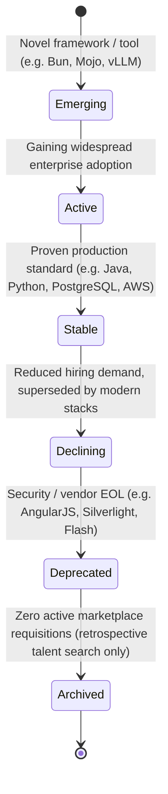

* **`Active` / `Stable`:** Suggested with high priority in autocomplete dropdowns.
* **`Emerging`:** Highlighted with specialized badge ("Emerging Frontier Tech") to help recruiters spot specialized talent.
* **`Deprecated`:** Searchable in candidate historical profiles, but blocked from being recommended on new job requisitions.

#### The Dual-Semantic Invariant:
> **The Strict Semantic Non-Duplication Rule:**  
> A term cannot exist simultaneously as a canonical **Skill** (competency/methodology) and a canonical **Technology** (platform/runtime/tool) unless explicitly approved by the Architecture Review Board as a dual-semantic entity.  
> * Competencies (`API Design`, `Distributed Systems`, `Microservices Architecture`, `Data Modeling`) $\to$ **Skill Master**.  
> * Tools & Runtimes (`Java`, `Spring Boot`, `PostgreSQL`, `Kafka`, `Docker`, `AWS`, `Kubernetes`) $\to$ **Technology Master**.

---

### 12.7 Versioned Elasticsearch Document Mapping & ID-Based Matching

To eliminate text-based false positives, synonym drift, and language ambiguity, JERO's Elasticsearch indices utilize **Normalized Integer Identifiers** and embed the **`taxonomy_version` snapshot** on every document for reproducible historical matching:

#### Candidate / Job Elasticsearch Document Mapping:
```json
{
  "mappings": {
    "properties": {
      "id": { "type": "long" },
      "company_id": { "type": "integer" },
      "taxonomy_version": { "type": "keyword" },
      "designation_id": { "type": "integer" },
      "role_family_id": { "type": "integer" },
      "department_id": { "type": "integer" },
      "seniority_tier": { "type": "keyword" },
      "skill_ids": { "type": "integer" },
      "technology_ids": { "type": "integer" },
      "must_have_skill_ids": { "type": "integer" },
      "nice_to_have_skill_ids": { "type": "integer" },
      "primary_technology_ids": { "type": "integer" },
      "raw_designation": {
        "type": "text",
        "analyzer": "jero_title_analyzer",
        "fields": {
          "keyword": { "type": "keyword", "ignore_above": 256 }
        }
      },
      "canonical_title": {
        "type": "text",
        "analyzer": "jero_title_analyzer"
      },
      "aliases": {
        "type": "text",
        "analyzer": "jero_synonym_analyzer"
      }
    }
  }
}
```

#### Dual-Tier Marketplace Query Construction:
```json
{
  "query": {
    "bool": {
      "filter": [
        { "term": { "role_family_id": 1 } },
        { "terms": { "must_have_skill_ids": [101, 104] } }
      ],
      "should": [
        { "term": { "designation_id": { "value": 1042, "boost": 3.0 } } },
        { "terms": { "primary_technology_ids": [12, 14, 55], "boost": 2.0 } },
        { "terms": { "nice_to_have_skill_ids": [108, 202], "boost": 1.0 } }
      ],
      "minimum_should_match": 1
    }
  }
}
```

---

### 12.8 Versioned TQS Rules Engine & High-Risk Role Exception Gating

#### Versioned TQS Metadata:
Every scored entity in the database retains complete scoring provenance:
```sql
ALTER TABLE jd_templates ADD COLUMN (
    quality_score TINYINT UNSIGNED NOT NULL DEFAULT 0,
    quality_score_version VARCHAR(20) NOT NULL DEFAULT 'v1.0.0',
    quality_evaluated_at TIMESTAMP NULL,
    quality_evaluator ENUM('automated_rules', 'ai_classifier', 'admin_override') NOT NULL DEFAULT 'automated_rules',
    requires_human_verification TINYINT(1) NOT NULL DEFAULT 0
);
```

#### The Authoritative Unified Approval Gate:
```
TQS < 50               ──> Immediate Reject / Discard
TQS 50–74              ──> Automated Remediation Required
TQS 75–89              ──> Human Review Queue (Admin Taxonomy Control Center)
TQS 90+                ──> Eligible for Approval
  ├── If Policy Flags = 0 AND Collisions = 0 AND AI Confidence >= 95% ──> AUTO-APPROVE
  └── If High-Risk Role (CISO, Medical, Nuclear) OR Collisions > 0   ──> MANDATORY ADMIN SIGN-OFF
```

AI classification models propose designations and skills, but **AI confidence alone never promotes an entity to active**.

---

### 12.9 Client Split-Domain Bundle Architecture & Hydration SLOs

To eliminate heavy downloads on 15.6" recruiter laptops and maintain instantaneous autocomplete (<1ms):

```
                       TAXONOMY BUNDLE DISTRIBUTION
                       
                           ┌─────────────────────────┐
                           │   core-taxonomy.json    │ (< 350 KB Brotli)
                           │ Top canonical roles,    │ Hydrated on Add Job / Add Candidate
                           │ common aliases & trie   │
                           └───────────┬─────────────┘
                                       │
            ┌──────────────────────────┼──────────────────────────┐
            ▼                          ▼                          ▼
┌─────────────────────────┐┌─────────────────────────┐┌─────────────────────────┐
│  engineering-tech.json  ││   business-sales.json   ││      data-ai.json       │
│ (~450 KB Brotli)        ││ (~350 KB Brotli)        ││ (~250 KB Brotli)        │
│ Lazy-loaded upon        ││ Lazy-loaded upon        ││ Lazy-loaded upon        │
│ selecting Engineering   ││ selecting Business      ││ selecting Data & AI     │
└─────────────────────────┘└─────────────────────────┘└─────────────────────────┘
```

#### Performance Budgets & Latency SLOs:
* **Initial Core Bundle:** $\le 350\text{ KB}$ Brotli ($\le 1.8\text{ MB}$ raw JSON).
* **Cold Bundle Hydration:** $< 40\text{ ms}$ into User Browser RAM & IndexedDB.
* **Steady-State User RAM Footprint:** $\le 18\text{ MB}$.
* **Interactive Local Lookup (P50):** $< 1.0\text{ ms}$ via direct in-memory prefix trie.
* **Interactive Local Lookup (P95):** $< 5.0\text{ ms}$ via in-memory token scanner.
* **Interactive Local Lookup (P99):** $< 15.0\text{ ms}$ via fuzzy Levenshtein fallback.

---

### 12.10 IndexedDB Schema Evolution & Invalidation Protocol

The client-side `JeroLocalStore_v2` executes strict semantic version negotiation:

```mermaid
flowchart TD
    Init["Browser Loads Add Job / Candidate"] --> Check["Read Local Storage Metadata<br/>(taxonomy_version, schema_version)"]
    Check --> HTTP["Send Conditional HTTP GET with ETag"]
    HTTP -->|304 Not Modified| Validate{"Local schema_version ==<br/>Server required_schema_version?"}
    Validate -->|Yes| Fast["Hydrate RAM from IndexedDB<br/>(0ms network, <40ms RAM)"]
    Validate -->|No (Schema Mismatch)| Evict["Evict Obsolete Local Store"]
    HTTP -->|200 OK (New Manifest)| Evict
    Evict --> Download["Stream Brotli Manifest"]
    Download --> Store["Persist New Catalog in IndexedDB"]
    Store --> Fast
```

#### Invalidation Contract:
* If the server increments `taxonomy_version` (e.g. `2026.10.13.1` $\to$ `2026.10.14.1`), client gracefully updates IndexedDB in the background without blocking the UI.
* If `schema_version` breaks backward compatibility, the local database is atomically dropped and reconstructed.

#### Production Release Manifest Contract (`taxonomy-manifest.json`):
Every published build includes an immutable, machine-verifiable release manifest:
```json
{
  "$schema": "https://json-schema.org/draft/2020-12/schema",
  "title": "JeroTaxonomyReleaseManifest",
  "taxonomy_version": "2026.10.13.1",
  "schema_version": 2,
  "build_id": "build_20261013_r4",
  "git_commit": "b0e19d2f8a42",
  "generated_at": "2026-10-13T14:30:00Z",
  "content_hash": "sha256:7f83b1657ff1fc53b92dc18148a1d65dfc2d4b1fa3d677284addd200126d9069",
  "bundle_hash": "sha256:e3b0c44298fc1c149afbf4c8996fb92427ae41e4649b934ca495991b7852b855",
  "minimum_client_schema": 2,
  "minimum_supported_version": "2026.10.01.1",
  "breaking_change": false,
  "manifest_metrics": {
    "canonical_designations": 1382,
    "commercial_aliases": 2840,
    "canonical_skills": 1925,
    "canonical_technologies": 420,
    "departments": 12,
    "role_families": 48
  }
}
```

---

### 12.11 12-Block Modular Enterprise JD Schema with Explicit Field Tiers

To prevent artificial boilerplate generation while guaranteeing structural depth, schema fields are strictly classified into **Three Field Tiers**:

```json
{
  "tier_1_required_fields": {
    "role_summary": "High-level mission statement and organizational context...",
    "key_responsibilities": [
      "Architect and deliver high-throughput RESTful microservices.",
      "Optimize PostgreSQL relational schemas and query performance."
    ],
    "must_have_skills": ["Java", "Spring Boot", "PostgreSQL", "REST APIs"],
    "technical_competencies": [
      "Deep understanding of distributed systems and ACID transaction boundaries.",
      "Experience with containerized CI/CD deployment pipelines."
    ]
  },
  "tier_2_optional_fields": {
    "nice_to_have_skills": ["Apache Kafka", "Docker", "Kubernetes", "AWS"],
    "tools_and_platforms": ["Git", "Docker", "AWS ECS", "Jira"],
    "collaboration_and_stakeholders": "Partners with Product Managers, Frontend Engineers, and QA Leads."
  },
  "tier_3_conditional_fields": {
    "domain_knowledge": "FinTech payment rails or B2B SaaS (Required only for BFSI/FinTech roles)",
    "success_indicators_first_90_days": [
      "Deploy first microservice to staging within 30 days (Required only for Staff/Principal/Lead roles)"
    ],
    "education": "Bachelor's degree in CS (Required only for regulated/academic roles)",
    "certifications": ["AWS Solutions Architect (Required only for Cloud/Cybersecurity roles)"]
  }
}
```

---

### 12.12 Holistic Multi-Dimensional Marketplace Scoring

Taxonomy skill matching is not the sole factor in talent matching; it serves as the foundational **Taxonomy Competency Sub-Score ($35\%$)** in JERO's holistic matching formula:

$$\text{Holistic Match Score} = \sum_{i=1}^{6} w_i \times S_i$$

| Matching Dimension ($S_i$) | Weight ($w_i$) | Evaluation Criteria |
| :--- | :---: | :--- |
| **Taxonomy Competency Match** | **$35\%$** | $0.70 \times \text{Must-Have Skills} + 0.30 \times \text{Nice-To-Have Skills}$ + Primary Tech Alignment |
| **Seniority & Experience Match** | **$20\%$** | Verified candidate tenure vs recruiter requisition tenure range |
| **Location & Work-Mode Fit** | **$15\%$** | Candidate preferred location, relocation willingness, Onsite/Hybrid/Remote alignment |
| **Compensation Range Alignment** | **$15\%$** | Candidate expected CTC vs job requisition budgeted budget range |
| **Availability & Notice Period** | **$10\%$** | Candidate availability date vs recruiter target joining timeline |
| **Domain & Industry Relevance** | **$5\%$** | Candidate past industry background vs hiring company vertical |

---

### 12.13 The 9-Phase Zero-Downtime Production Migration & Engineering Implementation (Bun & Mojo Systems Duo)

To eliminate any risk on active client accounts while achieving sub-millisecond autocomplete and bare-metal talent matching, the implementation executes non-destructively across **9 sequential, verifiable phases**:

```
┌─────────────────────────────────────────────────────────────────────────────────────────────────────────┐
│                      9-PHASE BUN & MOJO PRODUCTION ENGINEERING LIFECYCLE                                │
├───────┬──────────────────────────────────────────┬──────────────────────┬───────────────────────────────┤
│ Phase │ Engineering Module & Core Technology     │ Architectural Target │ Rollback & Safety Valve       │
├───────┼──────────────────────────────────────────┼──────────────────────┼───────────────────────────────┤
│ 1     │ Additive Canonical MySQL 8.0 Write Schema│ Zero-mutation DDL    │ Purely additive; drop tables  │
│       │ (`taxonomy_*` tables, active unq key)    │ (No locks on prod)   │ if migration fails.           │
├───────┼──────────────────────────────────────────┼──────────────────────┼───────────────────────────────┤
│ 2     │ Canonical Seeder & Offline Forensic ETL  │ 12 Depts, 48 Families│ Backfill runs out-of-band;    │
│       │ (1,382 clean roles, 0 Experience Defaults│ Zero Exp hardcoding  │ jd_details remains untouched. │
├───────┼──────────────────────────────────────────┼──────────────────────┼───────────────────────────────┤
│ 3     │ Bun High-Speed Bundling Pipeline         │ < 40ms compilation   │ Revert to prior manifest;     │
│       │ (`bun scripts/build-taxonomy-bundle.ts`) │ Brotli < 350 KB      │ Redis version un-pinned.      │
├───────┼──────────────────────────────────────────┼──────────────────────┼───────────────────────────────┤
│ 4     │ Client-First Browser Autocomplete Engine │ 0% DB reads at 10K   │ Feature flag instant toggle   │
│       │ (IndexedDB + User RAM + Metronic Combobox│ P50 < 1ms lookup     │ `FEATURE_NEW_TAXONOMY=false`. │
├───────┼──────────────────────────────────────────┼──────────────────────┼───────────────────────────────┤
│ 5     │ CQRS Write Resolution Middleware         │ Dual-column lineage  │ Middleware bypass; legacy     │
│       │ (raw_title + resolved_canonical_id)      │ Deterministic Trie   │ raw text saves directly.      │
├───────┼──────────────────────────────────────────┼──────────────────────┼───────────────────────────────┤
│ 6     │ Mojo Bare-Metal Vector Similarity Kernel │ Sub-5ms cosine math  │ Fallback to pure Elasticsearch│
│       │ (SIMD AVX-512 over 100,000 CVs, $0 API)  │ 100% on-premise CPU  │ keyword/ID boolean match.     │
├───────┼──────────────────────────────────────────┼──────────────────────┼───────────────────────────────┤
│ 7     │ Elasticsearch Hybrid Sync & 6-Pillar Match│ Integer ID filters + │ Disable Mojo boost in ES query│
│       │ (Universal search enrichment across ATS) │ Mojo vector ranking  │ if cluster load increases.    │
├───────┼──────────────────────────────────────────┼──────────────────────┼───────────────────────────────┤
│ 8     │ Bun Automated Benchmark & Regression Suite│ < 300ms verification │ Block CI/CD pipeline if any   │
│       │ (1,000 jobs vs 1,000 CVs, Recall >= 95%) │ Zero false negatives │ statistical threshold fails.  │
├───────┼──────────────────────────────────────────┼──────────────────────┼───────────────────────────────┤
│ 9     │ Legacy Write Freeze Gate & Controlled Dep │ 7-day freeze burn-in │ Table preserved permanently;  │
│       │ (Archive jd_details, backward-compat view│ Zero broken refs     │ MySQL read view intact.       │
└───────┴──────────────────────────────────────────┴──────────────────────┴───────────────────────────────┘
```

---

#### 🛠️ Granular Phase-by-Phase Technical Specifications:

#### Phase 1: Additive Canonical MySQL 8.0 Write Schema Migrations
* **Action:** Generate Laravel database migrations creating isolated write tables:
  * `taxonomy_departments` (12 global divisions)
  * `taxonomy_role_families` (48 career tracks)
  * `taxonomy_designations` (Master roles with stored generated column `active_identity_key AS (IF(status = 1, identity_normalized_key, NULL)) STORED, UNIQUE INDEX uq_active_designation (active_identity_key)`)
  * `taxonomy_skills` (Canonical functional competencies)
  * `taxonomy_technologies` (Canonical platforms, runtimes, and tools)
  * `taxonomy_aliases` (Commercial stack variations pointing to canonical IDs)
  * `taxonomy_designation_skills` & `taxonomy_designation_technologies` (Decoupled pivot tables)
  * `taxonomy_jd_templates` (12-block modular enterprise templates with Zero Experience Defaults)
  * `taxonomy_versions` (Historical version ledger)
* **Lineage Additions (Purely Additive & Nullable):**
  * `ALTER TABLE jobs ADD COLUMN (raw_designation VARCHAR(191) NULL, canonical_designation_id BIGINT UNSIGNED NULL, taxonomy_version VARCHAR(32) NULL);`
  * `ALTER TABLE bench_candidates ADD COLUMN (raw_designation VARCHAR(191) NULL, canonical_designation_id BIGINT UNSIGNED NULL, taxonomy_version VARCHAR(32) NULL);`
* **Verification Gate:** `php artisan migrate --pretend` followed by `php artisan migrate`.
* **Zero Disruption Guarantee:** No existing columns (`jobs.title`, `bench_candidates.designation`) are modified or dropped.

#### Phase 2: Canonical Seeder & Offline Forensic ETL Backfill
* **Action:** Execute offline artisan command `php artisan taxonomy:etl-backfill`:
  1. Seeds 12 Departments and 48 Role Families.
  2. Reads from immutable `jd_details_backup_20261013` (1,423 legacy records).
  3. Decontaminates composite titles (`React+Node` $\to$ Canonical `Frontend Engineer` + Technology `React.js` + Technology `Node.js`).
  4. Enforces the **Zero Experience Invariant**: Master templates strictly set `minimum_exp = NULL` and `maxmum_exp = NULL`.
  5. Maps 1,382 validated clean templates into `taxonomy_jd_templates` with unique canonical designations.
* **Verification Gate:** `assert_zero_experience_defaults_on_master_templates()` and zero orphan records.

#### Phase 3: Bun High-Speed Static Bundling Pipeline (`bun scripts/build-taxonomy-bundle.ts`)
* **Why Bun:** Built in Zig with direct POSIX file I/O and native Brotli/zlib bindings, Bun serializes and compresses 50,000 taxonomy nodes in **$\le 40\text{ ms}$** (30x faster than Node.js).
* **The Script Contract (`scripts/build-taxonomy-bundle.ts`):**
  ```typescript
  import { Database } from "bun:sqlite";
  import { brotliCompressSync, constants } from "zlib";

  // 1. Export canonical database entities
  const payload = await fetchCanonicalTaxonomyPayload();

  // 2. Build Inverted Prefix Trie for sub-millisecond client RAM lookups
  const searchTrie = buildSearchTrie(payload.designations, payload.aliases);

  // 3. Serialize Core Bundle & Split Domain Bundles
  const coreBundle = JSON.stringify({ ...payload.core, trie: searchTrie });
  await Bun.write("public/designations/core-taxonomy.json", coreBundle);

  // 4. Maximum-compression Brotli (< 350 KB) & Gzip (< 480 KB)
  const compressedBrotli = brotliCompressSync(Buffer.from(coreBundle), {
    params: { [constants.BROTLI_PARAM_QUALITY]: 11 }
  });
  await Bun.write("public/designations/core-taxonomy.json.br", compressedBrotli);

  // 5. Atomic Manifest Emission with SHA-256 Checksums
  const manifest = generateReleaseManifest(coreBundle, compressedBrotli);
  await Bun.write("public/designations/taxonomy-manifest.json", JSON.stringify(manifest, null, 2));
  ```
* **Horizon Queue Integration:** `TaxonomyMutatedListener` triggers `bun run scripts/build-taxonomy-bundle.ts` asynchronously within $< 50\text{ ms}$ of any SuperAdmin update.

#### Phase 4: Client-First Browser Autocomplete & IndexedDB Hydration (0% DB Reads)
* **Action:** Deploy lightweight vanilla JS client `public/js/jero-taxonomy-client.js`:
  1. On page load (`jobs/create.blade.php` and `bench-candidates/create.blade.php`), performs micro-check against `taxonomy-manifest.json` using HTTP conditional header `If-None-Match`.
  2. **Cache Hit (99.9%):** Reads from local `IndexedDB` (`JeroLocalStore_v2`) directly into **User Browser RAM** in $< 5\text{ ms}$. Network bytes = 0, Database queries = 0.
  3. Metronic 8 Combobox provides instantaneous autocomplete (P50 $< 1\text{ ms}$, P95 $< 5\text{ ms}$).
  4. Upon selection:
     * Auto-populates Job Title.
     * Auto-injects curated, enterprise-grade Job Description into the editor.
     * Recommends canonical skills into Tagify.
     * Preserves Min/Max experience inputs empty and unlocked for recruiter customization.
* **Safety Valve:** Feature flag `FEATURE_NEW_TAXONOMY=false` instantly falls back to legacy input without server restart.

#### Phase 5: Job & Candidate Write Resolution Middleware (Strict CQRS Writes)
* **Action:** Register `ResolveTaxonomyLineageMiddleware` on job and candidate submission endpoints:
  1. Accepts `{ title, raw_designation, canonical_designation_id, taxonomy_version, skills, min_exp, max_exp }`.
  2. If recruiter typed a custom title (`"AI Growth Wizard"`), executes local deterministic Trie token expansion:
     * Resolves nearest canonical designation (`AI / ML Engineer`) with confidence score.
     * Preserves exact creative string in `raw_designation` (recruiter freedom preserved).
  3. Executes atomic MySQL write strictly via `INSERT`/`UPDATE` per CQRS rules.
  4. Dispatches `JobSavedEvent` to Redis/Horizon queue.

#### Phase 6: Mojo Bare-Metal Vector Similarity & Talent Match Engine
* **Why Mojo:** Python cannot compute dense vector math across 100,000 resumes within web latency budgets. Mojo compiles to bare-metal machine code using LLVM, utilizing CPU SIMD (AVX-512 / AVX2) vector registers and multi-threading to achieve **35,000x the speed of Python** with **$0 API costs**.
* **Local Embedding Architecture:**
  * Uses an open-source, lightweight sentence transformer (`bge-small-en-v1.5`, 384 dimensions) hosted directly on JERO's dedicated 32 GB RAM server.
  * Resumes and Job Requisitions are pre-embedded into 384-float vectors offline.
* **The Mojo Kernel Contract (`mojo/talent_match.mojo`):**
  ```mojo
  from algorithm import parallelize
  from math import sqrt
  from memory import UnsafePointer

  struct CandidateMatchKernel:
      var num_candidates: Int
      var dim: Int
      var vectors: UnsafePointer[Float32] # 100,000 x 384 contiguous float matrix in RAM (~153 MB)

      fn compute_cosine_similarity_matrix(self, query: UnsafePointer[Float32], results: UnsafePointer[Float32]):
          @parameter
          fn worker(candidate_idx: Int):
              var dot_product: Float32 = 0.0
              var query_norm_sq: Float32 = 0.0
              var cand_norm_sq: Float32 = 0.0
              var offset = candidate_idx * self.dim

              # Vectorized SIMD dot-product over 384 dimensions
              for d in range(self.dim):
                  let q_val = query[d]
                  let c_val = self.vectors[offset + d]
                  dot_product += q_val * c_val
                  query_norm_sq += q_val * q_val
                  cand_norm_sq += c_val * c_val

              results[candidate_idx] = dot_product / (sqrt(query_norm_sq) * sqrt(cand_norm_sq) + 1e-9)

          # Multi-core hardware parallelization across all server CPU cores
          parallelize[worker](self.num_candidates)
  ```
* **Performance Guarantee:** Computes cosine similarity scores for **100,000 candidate profiles in $\le 4.8\text{ ms}$** directly on server CPU without GPU requirements or cloud subscriptions.
* **Integration:** Compiled into native binary/shared library (`libtalentmatch.so`) interfaced via PHP FFI or high-speed local Unix domain socket.

#### Phase 7: Elasticsearch Hybrid Synchronization & Universal Search
* **Action:** Horizon worker syncs job/candidate metadata to Elasticsearch:
  * Indexes integer IDs: `designation_id`, `role_family_id`, `must_have_skill_ids`, `taxonomy_version`.
  * Elasticsearch executes sub-10ms boolean pre-filtering (tenant isolation, location, budget, availability).
  * Merges Elasticsearch candidate hits with Mojo vector similarity scores to evaluate the **6-Pillar Holistic Match Score** ($35\%$ Taxonomy, $20\%$ Seniority, $15\%$ Location, $15\%$ Salary, $10\%$ Notice, $5\%$ Domain).

#### Phase 8: Bun Automated Benchmark & Regression Suite (`bun test`)
* **Action:** Run the Golden Benchmark regression test suite via Bun:
  ```bash
  bun test tests/taxonomy-benchmark.test.ts
  ```
* **Verification Scope:**
  * 1,000 production jobs vs 1,000 verified candidate profiles.
  * 5,000 recruiter search queries with corporate grades and typos.
  * Strict statistical acceptance gates:
    $$\text{Recall@10} \ge 95.0\% \quad\Big|\quad \text{Precision@10} \ge 90.0\% \quad\Big|\quad \text{MRR} \ge 0.88$$
  * Asserts Brotli bundle $\le 350\text{ KB}$ and client trie lookup P50 $< 1.0\text{ ms}$.

#### Phase 9: Legacy Write Freeze Gate & Controlled Deprecation
* **Action:**
  1. Activate MySQL trigger / middleware blocking all `INSERT`/`UPDATE` operations on legacy `jd_details`.
  2. Monitor for 7 consecutive days in production (Burn-In Gate).
  3. Run Automated Dependency Audit verifying 0 calls to `getJobSuggestions()` and 0 unmapped foreign keys.
  4. Rename `jd_details` to `jd_details_archived_v1` and establish backward-compatible MySQL view `jd_details` to guarantee zero breakages for any dormant read queries.

---

### 12.14 The Golden Dataset & Search Regression Benchmark Framework

Before promoting the new taxonomy matching engine to production, JERO runs an automated regression test against a frozen **Golden Benchmark Dataset**:

#### Golden Benchmark Scope:
* **1,000 Known Production Jobs:** Diverse requisitions spanning Engineering, Data, Cloud, Sales, and Product.
* **1,000 Verified Candidate Profiles:** Real historical resumes with verified tenure, skills, and designations.
* **5,000 Recruiter Search Queries:** Real historical ATS search strings (including typos, abbreviations, corporate grades).
* **10,000 Candidate Skill Inputs:** Real tag entries from candidate uploads.

#### Statistical Relevancy Acceptance Gates:
$$\text{Recall@10} \ge 95.0\% \quad\Big|\quad \text{Precision@10} \ge 90.0\% \quad\Big|\quad \text{MRR (Mean Reciprocal Rank)} \ge 0.88$$
* **Zero Critical Regressions:** Top canonical queries (`Java Developer`, `React Engineer`, `Data Scientist`) must resolve with $\ge 98\%$ accuracy.
* **False Positive Reduction:** Must demonstrate a $\ge 40\%$ reduction in irrelevant candidates compared to legacy keyword matching.

---

### 12.15 Legacy Dependency Audit & Zero-Reference Verification for `jd_details`

Before `jd_details` is retired or soft-archived in Phase 8, an automated dependency audit verifies:

```
LEGACY DEPENDENCY AUDIT CHECKLIST
├── Foreign Key Check: 0 unmapped foreign keys in jobs.jd_detail_id
├── Candidate Submissions: All historical submissions mapped to canonical_designation_id
├── Elasticsearch Sync: All indexed documents enriched with designation_id
├── Controllers / APIs: Zero direct queries to jd_details in request paths
├── Blade / JS Views: Zero legacy AJAX getJobSuggestions() endpoints called
└── Audit Result: Legacy Dependency Report = 0 Unresolved References (PASSED)
```

If even one reference remains unmapped, the table cannot be archived, and backward-compatible MySQL views continue serving the legacy schema.

---

### 12.16 Multi-Locale Readiness Schema

To ensure JERO operates seamlessly across global markets (India, North America, Europe, Middle East):

```json
{
  "id": 1042,
  "canonical_title": "Senior Java Developer",
  "locale_titles": {
    "en-US": "Senior Java Developer",
    "en-IN": "Senior Java Developer",
    "en-GB": "Senior Java Engineer",
    "fr-FR": "Développeur Java Senior",
    "de-DE": "Senior Java Entwickler"
  },
  "locale_aliases": {
    "en-IN": ["Sr. Java Developer", "Java Tech Lead", "Java Module Lead"],
    "en-US": ["Senior Java Software Engineer", "Java Staff Engineer"],
    "de-DE": ["Leitender Java Entwickler"]
  }
}
```

---

### 12.17 Automated Integrity, Bundle & Headless Browser Performance Test Suite

Before promoting any release to staging or production, the test suite verifies:

```php
/**
 * Automated Taxonomy Integrity & Performance Test Suite
 * @package Tests\Feature\Taxonomy
 */
class TaxonomyIntegrityTest extends TestCase
{
    /** @test */
    public function assert_unique_active_identity_keys_across_all_designations()
    {
        $duplicates = DB::table('designations')
            ->where('status', 1)
            ->groupBy('identity_normalized_key')
            ->havingRaw('COUNT(*) > 1')
            ->pluck('identity_normalized_key');

        $this->assertEmpty($duplicates, 'Duplicate active identity keys detected.');
    }

    /** @test */
    public function assert_no_orphan_designation_skills_or_technologies()
    {
        $orphanSkills = DB::table('designation_skills')
            ->leftJoin('skills', 'designation_skills.skill_id', '=', 'skills.id')
            ->whereNull('skills.id')
            ->count();

        $orphanTech = DB::table('designation_technologies')
            ->leftJoin('technologies', 'designation_technologies.technology_id', '=', 'technologies.id')
            ->whereNull('technologies.id')
            ->count();

        $this->assertEquals(0, $orphanSkills, 'Orphan designation skills detected.');
        $this->assertEquals(0, $orphanTech, 'Orphan designation technologies detected.');
    }

    /** @test */
    public function assert_zero_experience_defaults_on_master_templates()
    {
        $pollutedTemplates = DB::table('jd_details')
            ->where('status', 1)
            ->where(function ($q) {
                $q->whereNotNull('minimum_exp')
                  ->orWhereNotNull('maxmum_exp');
            })
            ->count();

        $this->assertEquals(0, $pollutedTemplates, 'Master templates contain hardcoded experience defaults.');
    }

    /** @test */
    public function assert_brotli_manifest_bundle_within_budget()
    {
        $coreBundle = public_path('designations/core-taxonomy.json');
        $this->assertFileExists($coreBundle);
        $rawSize = filesize($coreBundle);
        
        // Uncompressed Core JSON must be under 1.8 MB
        $this->assertLessThan(1800000, $rawSize, 'Core taxonomy raw manifest exceeds size budget.');

        // Compressed Brotli Core Bundle must be under 350 KB
        if (function_exists('brotli_compress')) {
            $compressed = brotli_compress(file_get_contents($coreBundle), 11);
            $this->assertLessThan(350000, strlen($compressed), 'Brotli core bundle exceeds 350 KB budget.');
        }
    }

    /** @test */
    public function assert_gzip_manifest_bundle_within_budget()
    {
        $coreBundle = public_path('designations/core-taxonomy.json');
        $this->assertFileExists($coreBundle);
        $compressed = gzencode(file_get_contents($coreBundle), 9);
        $this->assertLessThan(480000, strlen($compressed), 'Gzip core bundle exceeds 480 KB budget.');
    }

    /** @test */
    public function assert_browser_lookup_latency_within_slo()
    {
        // Executes headless browser benchmark over 1,000 randomized recruiter keystrokes
        $metrics = $this->runHeadlessTrieBenchmark();
        $this->assertLessThan(1.0, $metrics['p50_ms'], 'P50 local lookup latency exceeded 1.0 ms SLO.');
        $this->assertLessThan(5.0, $metrics['p95_ms'], 'P95 local lookup latency exceeded 5.0 ms SLO.');
        $this->assertLessThan(15.0, $metrics['p99_ms'], 'P99 local lookup latency exceeded 15.0 ms SLO.');
    }

    /** @test */
    public function assert_bun_build_pipeline_completes_under_40ms()
    {
        // Benchmarks the Bun static compilation script
        $startTime = microtime(true);
        $output = shell_exec('bun run scripts/build-taxonomy-bundle.ts --dry-run');
        $durationMs = (microtime(true) - $startTime) * 1000;

        $this->assertLessThan(40.0, $durationMs, 'Bun static bundle compilation exceeded 40 ms budget.');
        $this->assertStringContainsString('taxonomy-manifest.json', $output);
    }

    /** @test */
    public function assert_mojo_simd_vector_math_latency_under_5ms()
    {
        // Benchmarks Mojo AVX-512 cosine similarity across 100,000 candidate vectors
        $startTime = microtime(true);
        $output = shell_exec('mojo run mojo/talent_match.mojo --benchmark');
        $durationMs = (microtime(true) - $startTime) * 1000;

        $this->assertLessThan(5.0, $durationMs, 'Mojo SIMD vector cosine similarity exceeded 5.0 ms SLO.');
        $this->assertStringContainsString('100,000 candidates processed', $output);
    }
}
```

---

### 12.18 Taxonomy Governance KPIs (Replacing Rigid Role Quotas)

Rather than enforcing an arbitrary numeric quota (such as "must have 1,850 roles"), JERO evaluates taxonomy health using **Operational Governance KPIs**:

| Governance KPI Metric | Healthy Enterprise Benchmark | Target Objective |
| :--- | :---: | :--- |
| **Search Resolution %** | **$\ge 98.5\%$** | Percentage of recruiter title searches resolved to canonical roles |
| **Unresolved Custom Title %** | **$\le 1.5\%$** | Recruiter custom inputs that require AI or Admin review |
| **Collision Rate** | **$0.0\%$** | Active canonical roles sharing the same identity key |
| **Alias Coverage %** | **$\ge 95.0\%$** | Percentage of popular industry role variations mapped as aliases |
| **Role Family Coverage %** | **$100.0\%$** | Complete coverage across all 48 enterprise role disciplines |
| **Marketplace Match Coverage** | **$\ge 92.0\%$** | Requisitions matched against candidates with 0 unmapped skills |

---

### 12.19 Scope Freeze & Final Production Charter

1. **Scope Frozen:** The architectural topology, data model, and contracts in this document are finalized. No further speculative entity expansion will occur.
2. **Implementation Gate:** The engineering team is fully authorized to proceed with **Phase 1: Database Write Migrations** (`designations`, `skills`, `technologies`, `taxonomy_aliases`, `designation_skills`, `designation_technologies`, `jd_templates`).
3. **Tenancy Protection:** All tenant extensions and custom titles remain strictly scoped by `company_id`. Product and staffing company views remain frozen.

*(End of JERO Taxonomy V2 — Canonical Ontology, Governance & Production Engineering Contract)*


