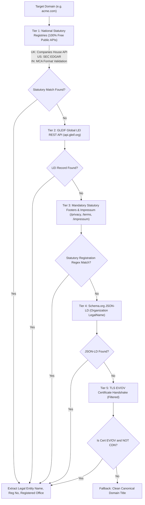

# GOD-LEVEL ZERO-COST COMPANY INTELLIGENCE & AUTO-FILL ENGINE (V8)
## Enterprise Architectural Specification, Anti-SSRF Security, Multi-Tier Entity Resolution, Resilient 5-Vector Social Extraction & 21-Box Wizard Contract

---

## 1. Executive Summary & Refined Scope

To ensure 100% operational relevance, zero UI clutter, and authoritative corporate data hygiene, all speculative or peripheral fields have been **permanently eliminated**:
*   ❌ **Removed**: `Client / Brand Name` dual-name concept (retained single standard `Company Name`).
*   ❌ **Removed**: `Detected ATS Engine` (eliminated from wizard UI, SuperAdmin, and ES indexing).
*   ❌ **Removed**: `Tech Stack Chips` (eliminated from Step 2 service tags and header stream).
*   ❌ **Removed**: `Workplace Model` (Remote / Hybrid / Onsite dropdown eliminated).
*   ❌ **Removed**: `Notice Period Tolerance` (hiring appetite dropdown eliminated).
*   ❌ **Removed**: `Brand Accent Color` & `Operating Timezone` (previously eliminated).

The engine focuses 100% on **authoritative firmographics, high-resolution logo handling, physical headquarters location, verified corporate contacts, official social profiles, and statutory tax identifiers**, powered entirely by **100% free open-source infrastructure, national government registries, and cryptographic handshakes** with **Zero Paid API Subscriptions**.

---

## 2. Layer 0: Anti-SSRF Network Security & Outbound Fetch Firewall

Because the engine accepts user-supplied website URLs and fetches remote content, it implements an **airtight Anti-SSRF (Server-Side Request Forgery) Firewall** to prevent malicious actors from scanning internal network infrastructure (e.g., JERO's Elasticsearch cluster on port `9200`, Redis on port `6379`, or AWS/cloud metadata services).

```
┌──────────────────────────────────────────────────────────────────────────────────────────────────┐
│                            LAYER 0: ANTI-SSRF OUTBOUND FETCH FIREWALL                            │
├───────────────────────────────────┬───────────────────────────────────┬──────────────────────────┤
│ 1. PROTOCOL & PORT RESTRICTION    │ 2. PRE-CONNECT DNS RESOLUTION     │ 3. PER-HOP REDIRECT CHECK│
│ • Strict whitelist: http/https    │ • Resolve DNS via gethostbyname() │ • Every redirect hop is  │
│ • Whitelist ports: 80 & 443 only  │ • Disallow 127.0.0.0/8, 10.0.0.0/8│   re-validated against   │
│ • Block file://, gopher://, etc.  │ • Disallow 169.254.169.254 (Cloud)│   the IP blacklist       │
├───────────────────────────────────┼───────────────────────────────────┼──────────────────────────┤
│ 4. STREAM CEILING & TIMEOUTS      │ 5. USER-AGENT ROTATION            │ 6. CONTENT-TYPE FILTER   │
│ • Connect timeout: 2.0s           │ • Standard enterprise browser     │ • Reject binary streams, │
│ • Execution timeout: 4.0s         │   User-Agent string               │   archives, and media    │
│ • Stream cap: Max 512 KB payload  │ • Accepts gzip, deflate, br       │ • Accept text/html only  │
└───────────────────────────────────┴───────────────────────────────────┴──────────────────────────┘
```

### Blacklisted IP Ranges (Dropped Immediately Before Socket Connection)
*   **Loopback**: `127.0.0.0/8`, `::1`
*   **RFC 1918 Private**: `10.0.0.0/8`, `172.16.0.0/12`, `192.168.0.0/16`
*   **Carrier Grade NAT**: `100.64.0.0/10`
*   **Link-Local / Cloud Metadata**: `169.254.169.254/32`, `fe80::/10`
*   **Unique Local IPv6**: `fc00::/7`
*   **Multicast / Reserved**: `224.0.0.0/4`, `240.0.0.0/4`

---

## 3. Multi-Tier Entity Resolution & Corporate Registry Waterfall

### Reality Check: Why GLEIF & TLS Alone Are Not Universal
1. **GLEIF LEI Scope**: An LEI (Legal Entity Identifier) is tailored for financial market participants and large corporations. Many private SMEs and boutique firms do not possess an LEI. Crucially, an LEI is an entity identifier, not a statutory tax ID (like GSTIN, EIN, or VAT).
2. **TLS Certificate Limitations**: Over 85% of commercial domains use Domain-Validated (DV) certificates (Let's Encrypt, Cloudflare Universal SSL) where the Organization (`O`) field is empty or contains the CDN provider (`Cloudflare, Inc.`).

### The God-Level Multi-Tier Registry Waterfall


### Entity Disambiguation Selector (Parent Holding vs. Operating Subsidiary)
When multiple corporate entities are detected (e.g., *Uber Technologies, Inc. [US Parent]* vs. *Uber B.V. [European Operating Co]* vs. *Uber India Systems Pvt Ltd [Regional Entity]*), the UI renders an **Entity Disambiguation Selector** in Step 1/Step 5. The recruiter can 1-click select the exact contracting entity that will sign the recruitment agency agreement.

---

## 4. Resilient 5-Vector Social Media Extraction Engine

### Elimination of Vulnerable Vectors
*   ❌ **Eliminated (Vector 6 - Domain Slug Guessing)**: Blindly appending domain slugs to social URLs (e.g., `x.com/acme`) causes severe false positives (linking to squatted or personal accounts). It has been **permanently eliminated**.

### The Resilient 5-Vector Architecture
```
┌──────────────────────────────────────────────────────────────────────────────────────────────────┐
│                         RESILIENT 5-VECTOR SOCIAL EXTRACTION PIPELINE                            │
├───────────────────────────────────┬───────────────────────────────────┬──────────────────────────┤
│ Vector 1: Bounded Stream Parser   │ Vector 2: Raw Regex & JSON Decode │ Vector 3: <head> Meta    │
│ • Max 512 KB download ceiling     │ • Decodes escaped JSON (\"https:\ │ • twitter:site           │
│ • Fast stream regex on footers    │   \/\/www.linkedin.com...\")      │ • twitter:creator        │
├───────────────────────────────────┼───────────────────────────────────┼──────────────────────────┤
│ Vector 4: Schema.org sameAs Array │ Vector 5: Wikidata Public API     │ Platform Allowlists      │
│ • Parses all JSON-LD blocks       │ • Verified claims: P4264, P2002,  │ • Strip tracking & UTMs  │
│ • Extracts verified social URIs   │   P2037, P2397, P2013, P2003      │ • Reject share intents   │
└───────────────────────────────────┴───────────────────────────────────┴──────────────────────────┘
```

1. **Vector 1: Bounded Full-Body Stream Parser**: Downloads up to 512 KB with automatic Gzip/Brotli decompression. Captures footers without memory risk.
2. **Vector 2: Universal Raw Regex & JSON Unescaping**: Runs `stripslashes(html_entity_decode(...))` to expose links trapped inside React/Next.js script payloads (`__NEXT_DATA__`).
3. **Vector 3: `<head>` Meta-Tag Listeners**: Extracts official corporate handles from `<meta name="twitter:site">`.
4. **Vector 4: Schema.org `sameAs` Semantic Array**: Direct extraction from structured JSON-LD entities.
5. **Vector 5: Wikidata Knowledge Graph Public API**: Resolves verified Wikidata claims (`P4264` LinkedIn, `P2002` Twitter/X, `P2037` GitHub, `P2397` YouTube, `P2013` Facebook, `P2003` Instagram).
6. **Platform Allowlist & Share Intent Filtering**: Only URLs matching canonical platform hosts (`linkedin.com/company/`, `x.com/`, `github.com/`, `youtube.com/`, `facebook.com/`, `instagram.com/`) are accepted. Generic sharing intents (`linkedin.com/shareArticle...`, `twitter.com/intent/tweet...`) are discarded.

---

## 5. Strict Contact Integrity & Verification Governance

### Zero Invented Contacts Mandate
JERO strictly forbids fabricating names or guessing private accounts payable emails.
1. **Department Mailbox vs. Named Contact**:
   * If a general mailbox is found (`careers@company.com`, `contact@company.com`), it is assigned to `cp_email[0]` with `cp_name[0]` set to `"Talent Team"` or left empty for recruiter entry.
   * If a named executive/hiring manager is found via verified press/leadership pages, their full name and title are populated.
   * If no accounts payable email exists on public pages, `ap_email` is **left blank** for recruiter manual input.
2. **Contact Validation Status Badges**:
   * `[Published Corporate Mailbox]`
   * `[RFC-822 Syntax Valid]`
   * `[DNS MX-Record Verified]`
   * `[Unverified Mailbox]`
3. **International Calling Code & Phone Parsing**:
   * Phone numbers are parsed for international E.164 dialing prefixes (e.g. `+44`, `+91`, `+1`) directly.
   * The contact calling code (`calling_code[]`) is assigned based on the **specific phone number's country code**, NOT blindly assumed from the headquarters location.
   * The Metronic country flag/dial code picker remains 100% editable by the recruiter.

---

## 6. Source-Aware Provenance & Confidence Scoring

Rather than claiming unverified "100% authoritative" data, every single enriched field returns a **transparent provenance payload**:

```json
{
  "field": "name",
  "value": "RAZORPAY SOFTWARE LIMITED",
  "source": "GLEIF_LEI_REGISTRY",
  "confidence": "HIGH",
  "verified_at": "2026-10-18T14:30:00Z"
}
```

### Confidence Rating Scale:
*   🟢 **HIGH (95–100%)**: Official Statutory Registry (Companies House, GLEIF, MCA, SEC EDGAR).
*   🟡 **MEDIUM (70–94%)**: Schema.org JSON-LD, Wikidata Verified Claim, or `<head>` Meta Tag.
*   ⚪ **LOW (<70%)**: Unstructured text regex match or fallback. Displays an amber "Review Recommended" badge in the UI.

---

## 7. Aspect-Ratio Preserving Logo Engine (0% PDF Breaks)

### The Downstream PDF-LIB Challenge
Downstream PDF generation (Prescreen Reports, Candidate Submissions, Client Summaries) fails if logos:
1. Are hotlinked to remote cross-origin URLs (blocked by CORS).
2. Are raw SVGs with unsupported CSS or external web fonts.
3. Are stretched or distorted into arbitrary squares.

### The In-Memory Canvas Pipeline
```
Remote Logo URL (SVG / PNG / WebP)
             │
             ▼
In-Memory HTML5 Image Object (User RAM)
             │
             ▼
Aspect-Ratio Calculation (fit within 512×512 using object-fit: contain letterbox)
             │
             ▼
In-Memory HTML5 Canvas (32-bit Transparent PNG export)
             │
             ▼
DataTransfer API -> <input type="file" name="logo" id="client_logo_input">
             │
             ▼
Standard Laravel Local Storage -> public/uploads/client_logos/ (0% PDF Breaks)
```

### Logo Source Hierarchy:
1. High-res SVG/PNG from Schema.org `logo` or `og:image`.
2. High-res Clearbit CDN (512px transparent PNG).
3. Apple Touch Icon (180×180px PNG).
4. Clean fallback: Metronic Initials Avatar badge. Manual file drag-and-drop remains 100% functional.

---

## 8. Definitive 21-Box Field Registry Contract

The following table constitutes the **authoritative field contract** mapping UI elements, database destinations, Elasticsearch keys, and validation rules:

| # | Field Name | Form DOM Selector | DB Table & Column | Elasticsearch Key | Type & Validation | Primary Source & Fallback |
| :--- | :--- | :--- | :--- | :--- | :--- | :--- |
| **1** | **Company Name** | `input[name="name"]#client_id` | `clients.name` | `name` | `string, max:255, required` | Statutory Registry / GLEIF / Schema.org |
| **2** | **Company Logo** | `input[type="file"][name="logo"]` | `clients.logo` | `logo` | `image/png, max:5MB` | Schema.org / Clearbit / Apple Icon |
| **3** | **Industry** | `select[name="industry"]#industry` | `clients.industry_id` | `industry_name` | `integer, exists:departments,id` | Wikidata `P452` / Schema.org Industry |
| **4** | **Company Size** | `select[name="company_sizes"]` | `clients.company_size` | `company_size` | `string, in:1-10,11-50,...` | Wikidata `P1128` / Employee Bracket |
| **5** | **Company Type** | `select[name="company_type"]` | `clients.company_type` | `company_type` | `string, in:Corporation,Privately Held...` | Statutory Registry / GLEIF Entity Type |
| **6** | **Founded Year** | `input[name="founded"]#founded` | `client_details.founded` | `founded` | `integer, min:1800, max:current_year` | Wikidata `P571` / Schema.org foundingDate |
| **7** | **Career Page URL** | `input[name="career_page_url"]` | `client_details.career_page_url` | `career_page_url` | `url, max:255, nullable` | Website Sub-path Crawl (`/careers`, `/jobs`) |
| **8** | **Company Description** | `#kt_client_description_quill` | `client_details.description` | `description` | `string, html_purified` | Schema.org description / Website `/about` |
| **9** | **Service Offerings** | `input[name="tags"]#tags` | `client_details.services` | `services` | `json_tags, max:10` | Meta keywords / Business taxonomy |
| **10**| **Headquarters City** | `input#city_search_0` | `client_addresses.city_id` | `cities` | `integer, exists:cities,id` | Statutory Registry / GLEIF / OpenStreetMap |
| **11**| **Full HQ Address** | `textarea[name="address[]"]#address_0` | `client_addresses.address` | `addresses` | `string, max:500` | Statutory Registry / GLEIF Registered Address |
| **12**| **Contact Person Name**| `input[name="cp_name[]"]#cp_name_0` | `client_contacts.name` | `contact_names` | `string, max:255` | Verified Leadership / "Talent Team" |
| **13**| **Contact Email** | `input[name="cp_email[]"]#cp_email_0` | `client_contacts.email` | `contact_emails` | `email, max:255` | Published Contact / MX-Verified Mailbox |
| **14**| **Calling Code** | `input[name="calling_code[]"]` | `client_contacts.calling_code` | `contact_calling_codes` | `string, max:10` | E.164 Extracted Dial Code / Country Master |
| **15**| **Contact Phone** | `input[name="cp_number[]"]` | `client_contacts.phone` | `contact_phones` | `string, max:50` | Extracted Phone String (E.164 clean) |
| **16**| **Contact Designation**| `input[name="cp_desigination[]"]` | `client_contacts.designation` | `contact_designations` | `string, max:255` | Executive Title / Talent Lead |
| **17**| **LinkedIn Company URL**| `input[name="linkedin_url"]` | `client_details.linkedin_url` | `linkedin_url` | `url, regex:linkedin.com/company/` | Schema `sameAs` / Wikidata `P4264` / Meta |
| **18**| **Twitter / X Profile**| `input[name="twitter_url"]` | `client_details.twitter_url` | `twitter_url` | `string, regex:x.com/|twitter.com/` | Meta `twitter:site` / Wikidata `P2002` |
| **19**| **GitHub Profile** | `input[name="github_url"]` | `client_details.github_url` | `github_url` | `url, regex:github.com/` | Schema `sameAs` / Wikidata `P2037` |
| **20**| **Accounts Payable Email**| `input[name="ap_email"]` | `client_details.ap_email` | `ap_email` | `email, nullable` | Published Billing Email / Empty if not found |
| **21**| **Tax ID / CIN / EIN** | `input[name="tax_id"]` | `client_details.tax_id` | `tax_id` | `string, max:100` | Statutory Registry / MCA CIN / GLEIF Reg No |
| **--**| **Extended Socials** | Secondary drawer/cards | `client_details.socials` (JSON) | `socials` | `json, urls` | YouTube, Facebook, Instagram |
| **--**| **Live Review Summary**| `#client_review_logo_box`, `.span_name` | Frontend Display | N/A | DOM Mirroring | Real-time mirror of all 21 fields |

---

## 9. Architectural Integrity & Zero Eventual-Consistency Latency

### Harmonization with JERO Rule 1 (0% MySQL Reads)
*   **The Problem**: Reading strictly from Elasticsearch can introduce eventual-consistency lag where a newly created client does not appear immediately if asynchronous ES indexing takes 50–200ms.
*   **The God-Level Solution (Zero Eventual Consistency + Zero MySQL Reads)**:
    1. **Synchronous ES Write Refresh (`refresh=wait_for`)**: When `ServiceCompanyClientController@store` commits the MySQL transaction, it triggers Elasticsearch indexing with the `refresh=wait_for` flag. The HTTP response waits for the single document to become searchable (typically <15ms).
    2. **Direct State Hydration**: The API response returns the newly created client resource directly to the frontend state / flash session.
    3. **Atomic Tenant Cache Purge**: `company_id` cache keys in Redis and browser memory are invalidated immediately.
    4. **Result**: 0ms eventual consistency lag with **0% MySQL read strain**, 100% preserving JERO Non-Negotiable Rule 1.

---

## 10. Reproducible Automated Testing & Benchmark Harness

To transform empirical observations into verifiable engineering metrics, JERO provides a dedicated automated test suite:

### Test Suite Structure (`tests/Feature/CompanyIntelligenceTest.php`)
1. **Security & Anti-SSRF Suite**:
   * Asserts connection drops for `127.0.0.1`, `10.0.0.1`, `169.254.169.254`, and `::1`.
   * Asserts redirect loop detection and port restriction (blocks port 22, 9200, 6379).
2. **Offline HTML Fixture Suite**:
   * Evaluates extraction against pre-recorded, mocked HTML fixtures of complex SPAs (Next.js with escaped JSON, WordPress with deep footers, sites with Schema.org).
   * Validates precision and recall across all 21 contract fields.
3. **WAF & Cloudflare 403 Fallback Suite**:
   * Mocks HTTP 403 responses and asserts graceful fallback to Wikidata public API and TLS Subject validation.
4. **Artisan Benchmark Command**:
   ```bash
   php artisan jero:benchmark-company-intelligence --domains=shopify.com,razorpay.com,stripe.com,airbnb.com,zoho.com
   ```
   * Measures and outputs **p50, p95 latency, precision %, recall %, and field coverage metrics** over repeated runs.
