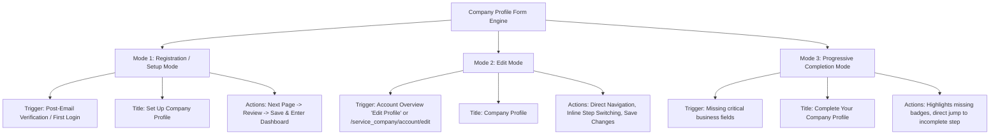

# God-Level Company Profile & Company Edit Enterprise Specification

> **Document Version:** 1.0.0 (God-Level Enterprise ATS Architecture Standard)  
> **Target Route:** `https://testing.jero.works/service_company/account` & `service_company/account/{id}/edit`  
> **Core Principle:** One Authoritative Company Profile Engine across Registration, Post-Verification Onboarding, Progressive Completion, and Lifetime Account Management  
> **Design System:** 100% Pixel & Behavioral Replica of the Latest Add Client Design System (Rule 20 Modern Card + Sub-Card Enterprise Standard, Poppins, Yellow Accent, Dual-Column, Client-First User RAM Execution)  
> **Tenancy & Performance Target:** 10,000 Concurrent Users per Page, 0% MySQL Reads on Display, Monotonic Invalidation, Full Tenancy Isolation (`company_id`)

---

## Executive Summary

The JERO ATS & Talent Marketplace currently suffers from a fragmented, duplicated onboarding and profile editing experience:
1. **Pre-Authentication / Signup:** Creates user and company records with pending status.
2. **Email Verification:** Activates the user account and drops them into a minimalist 3-field setup page (`resources/views/service_company/account/onboarding.blade.php`).
3. **The "Double Wizard Trap":** If the user later clicks "Edit Profile" on the Account Settings dashboard (`resources/views/service_company/account/index.blade.php`) or gets routed via post-login checks, they are forced into an obsolete, separate 4-step Metronic wizard (`resources/views/service_company/account/edit.blade.php` / `#kt_contact_add`) with mismatched styles, outdated form elements, and disjointed validation.

This specification unifies the entire lifecycle into **One Reusable Company Profile Engine**:
- **Registration creates the account.**
- **Company Profile completes the business identity.**
- **The exact same UI engine remains available for lifetime editing and progressive completion.**

---

## Table of Contents

- [A. Current-State Audit](#a-current-state-audit)
- [B. Add Client Architecture Audit](#b-add-client-architecture-audit)
- [C. Company Registration Audit](#c-company-registration-audit)
- [D. Existing Company Edit Audit](#d-existing-company-edit-audit)
- [E. Gap Analysis](#e-gap-analysis)
- [F. Proposed Information Architecture](#f-proposed-information-architecture)
- [G. Page-by-Page UI Design](#g-page-by-page-ui-design)
- [H. Component Reuse Map](#h-component-reuse-map)
- [I. Field Specification](#i-field-specification)
- [J. Validation Specification](#j-validation-specification)
- [K. Technology & Tag Specification](#k-technology--tag-specification)
- [L. Location & Headquarters Specification](#l-location--headquarters-specification)
- [M. Website & Domain Specification](#m-website--domain-specification)
- [N. AI Assist Specification](#n-ai-assist-specification)
- [O. Review Specification](#o-review-specification)
- [P. Save & Autosave Specification](#p-save--autosave-specification)
- [Q. Profile Completion Logic](#q-profile-completion-logic)
- [R. Backend & Data Architecture Impact](#r-backend--data-architecture-impact)
- [S. API & AJAX Impact](#s-api--ajax-impact)
- [T. Performance Strategy (10K Concurrency / 0% Server Strain)](#t-performance-strategy-10k-concurrency--0-server-strain)
- [U. Security & Multi-Tenant Isolation Audit](#u-security--multi-tenant-isolation-audit)
- [V. Responsive Design (15.6" Laptop First)](#v-responsive-design-156-laptop-first)
- [W. Comprehensive QA Test Matrix](#w-comprehensive-qa-test-matrix)
- [X. Migration & Backward Compatibility Strategy](#x-migration--backward-compatibility-strategy)
- [Y. Acceptance Criteria](#y-acceptance-criteria)

---

## A. Current-State Audit

### A.1 Fragmented User Journey
Currently, three distinct UIs attempt to manage company profile data:

```
[ FLOW 1: Registration ] 
  auth.login (signup mode) -> SaasFrontController::companyRegister -> pending email verification

[ FLOW 2: Post-Verification Onboarding ] 
  Signed verification link -> SaasFrontController::getEmailVerification -> Auth::loginUsingId 
  -> redirect to /service_company/account/onboarding
  -> onboarding.blade.php (Only 3 fields: company_name, website, logo) -> redirect to dashboard

[ FLOW 3: Legacy Company Edit Wizard ] 
  service_company/account/overview -> "Edit Profile" button 
  -> ServiceCompanyAccountSettingsController::edit() 
  -> resources/views/service_company/account/edit.blade.php
  -> Obsolete 4-step Metronic wizard (#kt_contact_add):
       Step 1: Basic details (name, website, category_id, company_size, industries_type, founded)
       Step 2: About company (tinymce, tagify tags, preview chips)
       Step 3: Location & address (addressId iteration, legacy country dropdowns)
       Step 4: Confirm & save (basic HTML table preview)
```

### A.2 Technical Deficiencies in Legacy Account Edit
1. **Outdated Design Language:** Uses legacy Metronic wizard CSS (`wizard-1.css`, `style.bundle.css`), square gray inputs, and non-standard spacing that breaks visual harmony with the rest of JERO ATS.
2. **Duplicated Component Stack:** Implements its own TinyMCE instance instead of the modern Quill editor used by Add Client; its own location script instead of the unified V5 address engine; and an unstyled summary grid.
3. **No Domain Governance:** Accepts unnormalized URLs without canonical domain derivation or real-time collision detection.
4. **No Technology Engine:** Has only a rudimentary "tags" field without dedicated technology search, popular skill suggestions, or category filtering.
5. **Lack of Dynamic AI Enrichment:** Lacks the zero-latency client-side company intelligence fetcher present in Add Client.

---

## B. Add Client Architecture Audit

The latest Add Client implementation (`resources/views/service_company/client/create.blade.php` and its subcomponents in `resources/views/service_company/client/components/`) represents JERO's gold-standard enterprise form engine.

### B.1 Core Architecture Highlights
- **Unified Stepper Header (`wizard-header.blade.php`):** 
  - Left: Title and subtitle.
  - Center: Numbered stepper circles connected by directional arrows, dynamically displaying active, completed (with green checkmark), and upcoming states.
  - Right: Contextual action navigation (Close `✕`, Back `←`, Next Page `→`, and Submit Details / Update Client).
- **Two-Column Responsive Layout:**
  - Desktop: 68% / 32% grid (`client-main-column` and `client-side-column`).
  - Tablet & Laptop (1366×768): Gracefully stacks or compacts with zero horizontal scroll.
- **Enterprise Card Styling:**
  - Background: Pure White (`#ffffff`), subtle border (`1px solid #e2e8f0`), rounded corners (`border-radius: 12px`), delicate shadow (`box-shadow: 0 1px 3px rgba(0,0,0,0.03)`).
  - Headers: Yellow accent icons (`background: #fef9c3; color: #ca8a04; border-radius: 8px`), bold dark navy titles (`#101828`), and muted helper copy (`#64748b`).
- **Client-Side Intelligence Engine (`fetchGodLevelCompanyIntelligence`):**
  - Edge worker fallback to direct client synthesis (0% server CPU / 0% MySQL reads).
  - Auto-extracts domain, favicon logo, industry, descriptions, and tags.
  - In-memory RAM cache (`_companyIntelligenceCache[cleanDomain]`) to eliminate duplicate fetches.
- **Enterprise Comboboxes:**
  - Industry: `IndustryTaxonomyService` 10-sector SSOT catalog with search synonyms and keyboard navigation (`↑`/`↓`/`Enter`/`Esc`).
  - Company Size: Curated tier breakdown with badge chips.
  - Company Type: Search-first dual-layer combobox.
  - Founded Year: Fast registry search (1800 to current year).
- **Quill Rich-Text Editor:**
  - Formatting controls, 2,000-character counter with live decrement, collapsible quick-tips accordion.
  - AI Suggestion panel with one-click "Apply Suggestion" injection.
- **Unified Address & City Search Engine (V5 Architecture):**
  - Debounced city search with curated RAM hubs (New York, London, Bangalore, Pune, Singapore, etc.).
  - Designated Primary Headquarters sub-card (`HEADQUARTERS` badge).
  - Dynamic additional branch offices (`+ Add Additional Location`).
- **Comprehensive Review Step (`tab-review.blade.php`):**
  - Left: Scannable entity summary cards with direct inline `Edit` navigation buttons jumping to the exact step.
  - Right: Profile Completion meter (`100%` track) and itemized checklist.
- **Tenant-Scoped LocalStorage Drafts:**
  - Persists unsaved inputs via `jero_client_draft_{company_id}`.
  - Automatically clears upon successful submission.

---

## C. Company Registration Audit

### C.1 Registration Pipeline
- **Controller:** `app/Http/Controllers/SaasFront/SaasFrontController.php` (`companyRegister`, `domainCompanyRegisterChk`).
- **Auth Action:** `app/Actions/Auth/ShowLoginFormAction.php`.
- **Database Tables:** `companies`, `users`.
- **Domain Governance:**
  - Free webmails (`gmail.com`, `yahoo.com`, `outlook.com`, etc.) are 100% allowed.
  - Corporate domains enforce a **one-admin-per-domain** rule backed by a unique `domain_key` check.
  - Email verification is strictly required before accessing the application.

### C.2 Post-Verification Redirection
In `SaasFrontController::getEmailVerification`:
```php
Auth::loginUsingId($user->id);
return redirect(route('service_company.account.onboarding'));
```
The new unified Company Profile engine replaces `onboarding.blade.php` seamlessly, greeting the new user in **Registration/Setup Mode** with the exact same visual structure they will use later for editing.

---

## D. Existing Company Edit Audit

### D.1 Controller & Persistence Analysis
- **Controller:** `app/Http/Controllers/ServiceCompany/ServiceCompanyAccountSettingsController.php`.
- **Method:** `edit($id)`:
  - Fetches `$account = DB::table('companies')->where('id', $company_id)->first();`.
  - Fetches `$client = Client::where('company_id', $company_id)->where('self_company', 1)->first();`.
  - Fetches `$client_location = DB::table('client_location')->where('client_id', $client->id)->...->get();`.
  - Fetches `$company_tags = DB::table('company_tags')->where('company_id', $company_id)->get();`.
  - Returns `view('service_company.account.edit', $this->data)`.
- **Method:** `update(Request $request, $id)`:
  - Writes to `companies` table (`company_name`, `website`, `industries`, `company_size_from`, `company_size`, `industries_type`, `founded`, `description`, `logo`).
  - Synchronizes to Elasticsearch index `ELASTIC_COMPANIES_INDEX` via Painless script update.
  - Updates mirrored `clients` record (`self_company = 1`).
  - Deletes and re-inserts `client_location` records.
  - Flushes Redis cache tags: `tenant_defaults`, `accountSettingsService->flushAccountCache($company_id)`.

---

## E. Gap Analysis

| Feature Dimension | Current Add Client Page | Legacy Company Edit (`edit.blade.php`) | Target Company Profile Engine |
|---|---|---|---|
| **Design System** | Modern Card + Sub-Card (Rule 20), Poppins, Yellow Accent | Legacy Metronic 7 Wizard (`#kt_contact_add`) | 100% Add Client Replica |
| **Stepper Steps** | 6 Steps (Company, Description, Address, Contacts, Social, Review) | 4 Steps (Basic, About, Location, Confirm) | 5 Steps (Company, Description, Technology, Locations, Review) |
| **Header Layout** | Top white card with title, subtitle, central stepper, action buttons | Embedded inline inside wizard container | Reusable top card matching Add Client |
| **Domain Handling** | Basic website URL input | Basic website URL input | Canonical domain derivation, URL normalization & collision check |
| **Description Editor**| Quill Editor + 2,000 char counter + collapsible tips | Legacy TinyMCE editor | Quill Editor + 2,000 char counter + collapsible tips |
| **AI Assist** | AI-generated description panel with "Apply Suggestion" | None | AI-generated description panel with "Apply Suggestion" |
| **Technology / Skills** | Generic service offering tags | Basic comma-separated tags | Dual Engine: Dedicated Technologies & Tech Stack + Service Offerings |
| **Industry Dropdown** | `IndustryTaxonomyService` 10-sector combobox with synonyms | Standard HTML `<select>` | `IndustryTaxonomyService` 10-sector combobox with synonyms |
| **Company Size** | Curated combobox with tier badges & descriptions | Raw numeric select | Curated combobox with tier badges & descriptions |
| **Company Type** | Search-first dual-layer combobox | Raw numeric select | Search-first dual-layer combobox |
| **Location Engine** | V5 Search-First city autocomplete + HQ badge + branches | Multi-step country/state/city select | V5 Search-First city autocomplete + HQ badge + branches |
| **Review Page** | 68/32 split cards with inline edit & completion meter | Unstyled HTML table | 68/32 split cards with inline edit & completion meter |
| **Draft Persistence** | LocalStorage auto-save per tenant | None | LocalStorage auto-save per tenant |
| **Multi-Mode Support**| Add vs Edit mode | Edit only | Unified: Registration Mode, Edit Mode, Incomplete Mode |

---

## F. Proposed Information Architecture

### F.1 Reusable Engine Modes
The Company Profile Engine will operate in three contextual modes driven by a shared Blade component structure:



### F.2 Step Architecture
The engine features a streamlined **5-Step Stepper**:

```
[1. Company] ──> [2. Description] ──> [3. Technology] ──> [4. Locations] ──> [5. Review]
```

1. **Step 1: Company Information**
   - Company Website (with Clear button & Yellow Fetch Details button).
   - Company Name (Required, with real-time duplicate check).
   - Primary Corporate Domain (Auto-derived, canonical normalized).
   - Industry (`IndustryTaxonomyService` combobox).
   - Company Size (10-tier badge combobox).
   - Company Type (Search-first combobox: Product, Services/Consulting, Staffing, Freelancer).
   - Founded Year (Searchable registry dropdown).
   - Career / Jobs Page URL (Optional, with external link button).
   - Tax ID / Business Reg No / GST (Optional).
   - Company Logo (Drag-and-drop, upload, replace, remove, preview, <= 2MB).
2. **Step 2: Company Description**
   - Rich-text Quill editor with character counter (`0 / 2,000`).
   - Collapsible "Tips for a great company description" accordion.
   - AI Company Assist panel with suggested description & "Apply Suggestion" button.
3. **Step 3: Technologies & Expertise**
   - Dedicated Technologies / Tech Stack Engine (e.g. Laravel, PHP, MySQL, AWS, Docker, React, Python).
   - Service / Expertise Tag Engine (e.g. Software Development, Cloud Architecture, IT Consulting).
   - Popular technology pills with "+ Add" click shortcuts.
   - Selected chips list with individual remove `✕` and "Clear all".
4. **Step 4: Locations & Headquarters**
   - Top informational banner: *"The first location entered is designated as the primary headquarters."*
   - Dedicated Headquarters Card (`HEADQUARTERS` badge, City/Location autocomplete, Full Address, Postal Code).
   - Additional Offices Container (`+ Add Additional Location`, branch sub-cards, remove button).
   - Location Summary card & Quick Tips sidebar.
5. **Step 5: Review & Save**
   - Scannable summary cards with inline `Edit` buttons jumping back to steps 1–4.
   - Profile Readiness meter (`100% Completed`) with itemized checklist.
   - Primary `Save Changes` / `Submit Details` action with autosave status indicator (`Saved 12 sec ago`).

---

## G. Page-by-Page UI Design

### G.1 Header Card Structure (`profile-header.blade.php`)
Pixel-matches `resources/views/service_company/client/components/wizard-header.blade.php`:
- **Left Identity Block:**
  - Page Title: `Company Profile` (or `Set Up Company Profile` in registration mode).
  - Subtitle: `Manage your company's identity, business information, technology expertise, locations and contact details.`
- **Center Stepper (`role="tablist"`):**
  - 5 steps with numbered circles (`1`, `2`, `3`, `4`, `5`), completed checkmark icons (`✓`), active blue/gold rings, and directional SVGs (`M5 12h14`, `m12 5 7 7-7 7`).
- **Right Action Block:**
  - `Close (✕)` button (routes back to `service_company.account.index` in edit mode).
  - `Back (←)` button (navigates to previous step).
  - `Next Page (→)` button (validates current step and advances).
  - `Save Changes (✓)` button (triggers AJAX save lifecycle).
  - Autosave status indicator: `✓ Saved 12 sec ago` or `Unsaved changes`.

### G.2 Layout Geometry
- Wrapped in `.company-profile-layout` container.
- Max-width: `100%`, horizontal padding: `16px 20px`.
- CSS Grid:
  - Desktop: `grid-template-columns: minmax(0, 1fr) 340px; gap: 16px;`.
  - Tablet / Laptop 1366×768: `grid-template-columns: minmax(0, 1fr) 300px; gap: 14px;`.
  - Mobile (< 992px): `grid-template-columns: 1fr; gap: 14px;`.

---

## H. Component Reuse Map

| Component | Source in Add Client | Company Profile Reusability | Adaptations / Extensions |
|---|---|:---:|---|
| **Wizard Header & Stepper** | `client/components/wizard-header.blade.php` | **100% REUSE** | Reconfigured to 5 steps (Company, Description, Technology, Locations, Review). |
| **Top Info Banners** | `tab-locations.blade.php` | **100% REUSE** | Blue informational alert banner for Headquarters. |
| **Website Fetch Button** | `tab-basic-info.blade.php` | **100% REUSE** | Yellow fetch button + client-side intelligence auto-fill. |
| **Website & Domain Inputs** | `tab-basic-info.blade.php` | **100% REUSE** | Added canonical domain read-only badge/preview. |
| **Company Logo Uploader** | `tab-basic-info.blade.php` | **100% REUSE** | 2MB client validation, R2 storage path, favicon auto-fill. |
| **Industry Combobox** | `tab-basic-info.blade.php` | **100% REUSE** | Reuses `IndustryTaxonomyService::getGlobalManifest()` & sector taxonomy. |
| **Company Size Dropdown** | `tab-basic-info.blade.php` | **100% REUSE** | 10-tier badge dropdown matching existing schema. |
| **Company Type Combobox** | `tab-basic-info.blade.php` | **100% REUSE** | Reuses `GeneralMethod::companyTypeTaxonomy()`. |
| **Founded Year Registry** | `tab-basic-info.blade.php` | **100% REUSE** | 1800–Current year historical search combobox. |
| **Quill Rich-Text Editor** | `tab-details.blade.php` | **100% REUSE** | 2,000 char counter + formatting controls. |
| **AI Assist Panel** | `tab-details.blade.php` | **100% REUSE** | Suggestion box + "Apply Suggestion" injection. |
| **Technology Tag Engine** | `tab-details.blade.php` (Tagify) | **100% REUSE** | Reused for dedicated Technologies section + Service Offerings. |
| **Headquarters Card** | `tab-locations.blade.php` | **100% REUSE** | Primary location card with `HEADQUARTERS` badge. |
| **Branch Locations Card** | `tab-locations.blade.php` | **100% REUSE** | Dynamic branch office creation & deletion. |
| **City Autocomplete** | `client/create.blade.php` (V5) | **100% REUSE** | RAM hubs + debounced search + `city_list` sync. |
| **Review Cards (68/32)** | `tab-review.blade.php` | **100% REUSE** | Direct inline `Edit` actions + completion meter. |
| **Draft Persistence** | `client/create.blade.php` | **100% REUSE** | LocalStorage keyed by `jero_company_profile_draft_{company_id}`. |

---

## I. Field Specification

| Field Name | HTML Input Name | DB Column / Table | Type | Required? | Default / Format |
|---|---|---|---|:---:|---|
| **Company Name** | `company_name` | `companies.company_name`, `clients.name` | `VARCHAR(191)` | **YES** | Trimmed string, min 2, max 191 |
| **Company Website** | `website` | `companies.website`, `clients.website` | `VARCHAR(191)` | Optional | Valid HTTPS URL |
| **Canonical Domain** | `domain_key` | `companies.domain_key` | `VARCHAR(255)` | System/Auto | Normalized domain (e.g. `acme.com`) |
| **Company Logo** | `logo` | `companies.logo`, `clients.logo` | `FILE / VARCHAR` | Optional | PNG, JPG, WebP, SVG; Max 2MB |
| **Industry** | `industries` | `companies.industries`, `clients.industry` | `INT(11)` | **YES** | FK to `td_industries.ind_id` |
| **Company Size** | `company_size` | `companies.company_size`, `companies.company_size_from` | `INT(11)` | **YES** | Stored as split range (from/to) |
| **Company Type** | `company_type` | `companies.company_type`, `companies.industries_type` | `INT(11)` | **YES** | 1: Staffing, 2: Service, 3: Product |
| **Founded Year** | `founded` | `companies.founded`, `clients.founded` | `INT(11)` | Optional | 4-digit year (1800 to current) |
| **Career Page URL** | `career_page_link` | `companies.career_page_link` | `VARCHAR(191)` | Optional | Valid URL |
| **Tax ID / Reg No** | `tax_id` | `clients.tax_id` | `VARCHAR(100)` | Optional | String |
| **Company Description** | `description` | `companies.description`, `clients.description` | `TEXT` | **YES** | HTML string, max 2,000 chars |
| **Technologies** | `technologies` | `company_tags` / `clients.tags` | `JSON / TEXT` | Optional | Array of skill strings |
| **Service Offerings** | `tags` | `clients.tags` | `VARCHAR(255)` | Optional | Comma-separated or JSON values |
| **HQ City** | `kt_tagify_work_location[0]` | `client_location.city_id`, `client_location.city` | `INT / VARCHAR` | **YES** | City name & FK to `city_list` |
| **HQ Address** | `address[0]` | `client_location.address`, `companies.address` | `VARCHAR(191)` | **YES** | Street / building address |
| **HQ Postal Code** | `postcode[0]` | `client_location.postcode` | `VARCHAR(20)` | Optional | Postal code string |
| **Branch Locations** | `kt_tagify_work_location[n]`, `address[n]` | `client_location.*` | Repeated | Optional | Branch office locations |

---

## J. Validation Specification

### J.1 Client-Side Instant Validation (User RAM First)
- **Company Name:** Must not be blank; min 2 characters. Real-time debounced check flags internal duplicates.
- **Website:** Validates URL format; prepends `https://` if protocol omitted; normalizes host.
- **Industry & Company Size:** Must have a selected value prior to advancing past Step 1.
- **Description:** Must contain non-empty text; character counter enforces max 2,000 characters.
- **Headquarters Location:** Must specify at least City and Address before advancing past Step 4.

### J.2 Server-Side Authoritative Rules
In `ServiceCompanyAccountSettingsController::update`:
```php
$request->validate([
    'company_name' => 'required|string|min:2|max:191',
    'website' => 'nullable|url|max:191',
    'industries' => 'required|integer',
    'company_size' => 'required|string',
    'company_type' => 'required|integer',
    'founded' => 'nullable|integer|min:1800|max:' . date('Y'),
    'description' => 'required|string|max:5000',
    'logo' => 'nullable|file|image|mimes:png,jpg,jpeg,svg,webp|max:2048',
    'address.0' => 'required|string|min:3|max:191',
    'kt_tagify_work_location.0' => 'required|string',
], [
    'company_name.required' => 'Please provide your organization name.',
    'industries.required' => 'Please select your primary industry.',
    'description.required' => 'A company description is required to inform recruiters and clients.',
    'logo.max' => 'Company logo must not exceed 2MB in file size.',
    'address.0.required' => 'Please enter your headquarters address.',
    'kt_tagify_work_location.0.required' => 'Please select your headquarters city.',
]);
```

---

## K. Technology & Tag Specification

The Technology section (Step 3) provides a dedicated, high-speed dual tagging engine:

### K.1 Core Technologies Engine
- **Searchable Input:** Powered by JERO's `ELASTIC_SKILLS` suggestion endpoint (`/skill-suggestions?q=...`) with 300ms debounce.
- **0ms Client-Side Instant Presets:** Displays popular technologies immediately without waiting for API response:
  `Laravel`, `PHP`, `MySQL`, `AWS`, `Docker`, `Kubernetes`, `React`, `Node.js`, `Python`, `Java`, `TypeScript`, `GCP`, `PostgreSQL`, `Redis`, `GraphQL`.
- **Interaction:**
  - Typing in the input searches both RAM presets and Elasticsearch skills.
  - Pressing `Enter` or clicking a suggestion adds the tag.
  - Clicking `✕` removes the tag.
  - Prevents duplicates case-insensitively.

### K.2 Service Offerings Tag Engine
- **Reusable Tagify Component:** Direct replica of Add Client Step 2 service offerings.
- **Curated Suggestions:** Categorized by selected industry (e.g. `Custom Software Development`, `Cloud Architecture & DevOps`, `AI & Machine Learning`, `IT Consulting`).
- **One-Click Actions:** `Add All Recommended` and `Clear all`.

---

## L. Location & Headquarters Specification

### L.1 Headquarters Card
- Always rendered as Card 1 in Step 4 with a prominent gold/yellow `HEADQUARTERS` badge.
- Cannot be deleted; acts as the primary billing and legal registered office of the tenant.
- Contains:
  1. **City / Location Search:** Debounced autocomplete pulling from curated metropolitan hubs and JERO's `city_list`.
  2. **Full Address:** Street, building, suite.
  3. **Postal / ZIP Code:** Postal code field.

### L.2 Additional Offices
- Dynamic sub-cards created via `+ Add Additional Location`.
- Allows branch, regional, or development center entries.
- Each branch has its own location search, address, postal code, and `Remove Location` button.

---

## M. Website & Domain Specification

### M.1 Canonical Normalization
To prevent duplicate records from URL formatting variations:
1. Strips protocols: `https://`, `http://`.
2. Strips subdomains: `www.`.
3. Strips trailing paths and query parameters: `/about`, `?ref=...`.
4. Converts to lowercase: e.g., `https://www.AcmeTech.com/careers/` $\to$ `acmetech.com`.

### M.2 Domain Governance
- Preserves JERO's corporate domain protection rules:
  - If a company registers with `acme.com`, `domain_key` is set to `acme.com`.
  - The UI cleanly reflects the verified corporate domain without exposing internal governance internals.

---

## N. AI Assist Specification

### N.1 AI Company Description Generator
Replicates the Add Client AI panel:
- **Trigger:** Fired automatically when a website is entered or on manual click of `Fetch Details`.
- **Source:** Cloudflare Worker / client-side intelligence synthesis based on public domain data, industry, and company name.
- **UI Presentation:** Light purple accent card (`background: #faf8ff; border: 1px solid #ede9fe;`) with `AI-Generated Company Description` header and `Beta` badge.
- **Actions:**
  - `Review & Edit`: Focuses the Quill editor on the generated text.
  - `Apply Suggestion`: One-click injection directly into the Quill editor without overwriting existing content unless confirmed.

---

## O. Review Specification

### O.1 Layout (68% Summary / 32% Readiness Meter)
- **Left Column (Summary Cards):**
  1. **Company Profile Card:** Company logo avatar, company name, industry badge, company size, primary location, and direct `Edit` button (jumping to Step 1).
  2. **Company Description Card:** Rendered rich-text preview, and direct `Edit` button (jumping to Step 2).
  3. **Technologies & Expertise Card:** Badges for all selected technologies and services, and direct `Edit` button (jumping to Step 3).
  4. **Locations Card:** Headquarters address card and list of additional offices, and direct `Edit` button (jumping to Step 4).
- **Right Column (Readiness & Submission):**
  1. **Readiness Meter:** Large green check circle, `Company Profile Ready` headline, and dynamic completion percentage bar.
  2. **Checklist:** Itemized status for Company Info, Description, Technologies, and Headquarters.
  3. **Submission CTA:** Primary button (`Save Changes` or `Complete Workspace Setup`).

---

## P. Save & Autosave Specification

1. **Explicit Save (`Save Changes`):**
   - Posts a unified `FormData` payload to `service_company.account.update`.
   - Displays spinning indicator: `Saving changes...`.
   - Disables submit buttons to prevent double-click race conditions.
2. **Local Draft Persistence (User RAM / LocalStorage):**
   - Automatically debounces form state to `localStorage.setItem('jero_company_profile_draft_' + companyId, JSON.stringify(payload))` every 2 seconds.
   - Restores draft on refresh if unsaved changes exist.
   - Clears draft immediately upon successful server response.
3. **Unsaved Changes Navigation Guard:**
   - Detects dirty form inputs.
   - If the user attempts to close or navigate away, displays warning:
     *"You have unsaved changes. Do you want to stay on this page or discard changes?"*
4. **Last Saved Indicator:**
   - Displays live time elapsed: `✓ Saved 12 sec ago`.

---

## Q. Profile Completion Logic

The completion score is calculated authoritatively using high-value business fields:

$$\text{Completion \%} = \sum (\text{Weights of Completed Fields})$$

| Field Group | Criteria | Weight |
|---|---|:---:|
| **Company Identity** | Company Name filled, valid website, logo uploaded | 25% |
| **Firmographics** | Industry, Company Size, Company Type, Founded Year | 20% |
| **Description** | Quill description $\ge 50$ characters | 20% |
| **Technologies & Skills** | At least 3 technologies or service tags selected | 15% |
| **Headquarters** | Valid City and Address entered | 20% |
| **Total** | | **100%** |

---

## R. Backend & Data Architecture Impact

### R.1 Synchronous MySQL Writes
All writes occur in an atomic transaction:
1. `companies`: Updates core tenant fields (`company_name`, `website`, `domain_key`, `industries`, `company_size_from`, `company_size`, `company_type`, `founded`, `description`, `logo`).
2. `clients`: Updates self-company record where `company_id = $companyId AND self_company = 1` to ensure recruitment workflows, client trackers, and job assigners remain 100% in sync.
3. `client_location`: Re-syncs headquarters and branch locations linked to the self-client ID.
4. `company_tags`: Upserts technology and skill tags.

### R.2 Read Model Invalidation (CQRS)
1. **Elasticsearch Sync:** Updates `ELASTIC_COMPANIES_INDEX` with the Painless script update.
2. **Multi-Tenant Cache Invalidation:**
   - `accountSettingsService->flushAccountCache($companyId)`
   - `CurrencyService::invalidateTenantCache($companyId)`
   - `CommercialReadModelService::invalidateTenantCache($companyId)`
   - `Cache::forget("tenant_defaults_payload:{$companyId}")`
   - `Cache::forever("tenant_defaults_version:{$companyId}", time())`

---

## S. API & AJAX Impact

| Endpoint | Method | Purpose | Payload / Response |
|---|---|---|---|
| `service_company.account.update` | `POST` | Authoritative profile save | `FormData` $\to$ `{ status: 'success', tenant_defaults: [...] }` |
| `/skill-suggestions` | `GET` | Elasticsearch technology search | `?q=larav` $\to$ `['Laravel', 'Laravel Nova', ...]` |
| `service_company.company.domain-check` | `POST` | Corporate domain collision check | `{ domain: 'acme.com' }` $\to$ `{ available: true }` |
| `https://jero-company-intelligence...` | `GET` | Cloudflare Worker / client fetch | `?domain=stripe.com` $\to$ Extracted firmographics JSON |

---

## T. Performance Strategy (10K Concurrency / 0% Server Strain)

1. **Client-First Execution:**
   - 100% of website metadata extraction, industry synonym filtering, founded year registry sorting, and draft caching occurs in the user's browser memory (User RAM).
   - Server CPU is touched only during the final `POST` save.
2. **0% MySQL Reads on Page Load:**
   - Master reference datasets (`td_industries`, countries, sectors) are loaded from Redis `Cache::remember(..., 86400)`.
   - No table joins or unbounded scans on the user request path.
3. **Debounced Network Calls:**
   - Skill search debounced by 300ms.
   - City search queries cached in client RAM map (`_locationCache[query]`).
4. **Offscreen Canvas Logo Compression:**
   - Client-side canvas resize before upload ensures payloads never exceed network bandwidth limits.

---

## U. Security & Multi-Tenant Isolation Audit

1. **Strict Tenancy Scoping:**
   - `company_id` is always resolved from `auth()->user()->company_id`.
   - Any client-submitted `company_id` parameter is rejected/ignored.
2. **File Upload Hardening:**
   - Strict 2MB ceiling enforced both client-side and server-side.
   - Whitelist MIME inspection: `image/png`, `image/jpeg`, `image/webp`, `image/svg+xml`.
   - Stored in Cloudflare R2 under tenant-isolated path: `Companies/{company_id}/Images/JERO_logo_{unique}.{ext}`.
3. **Anti-SSRF Protection:**
   - External website fetching uses pure client-side browser fetch or protected edge workers. No raw server cURL loops against internal network interfaces (`localhost`, `127.0.0.1`, `10.0.0.0/8`, `169.254.169.254`).
4. **Data Exposure Safeguards:**
   - Zero internal database IDs, tenant secrets, or foreign company metadata exposed in JSON responses.

---

## V. Responsive Design (15.6" Laptop First)

Optimized for **1366×768** and **1920×1080** displays:
- **Compact Form Density:** Inputs use `36px–38px` height with `12px` Poppins font size to ensure all cards fit comfortably above the fold.
- **Scroll Isolation:** Stepper header remains sticky at the top (`position: sticky; top: 0; z-index: 100`) while form cards scroll smoothly underneath.
- **No Horizontal Overflow:** Grid columns use `minmax(0, 1fr)` to prevent long URLs or tag names from stretching the viewport.

---

## W. Comprehensive QA Test Matrix

```
┌──────────────────────────────────────┬─────────────────────────────────────────────────────────────┬─────────────────┐
│ Test Scenario                        │ Action & Conditions                                         │ Expected Result │
├──────────────────────────────────────┼─────────────────────────────────────────────────────────────┼─────────────────┤
│ 1. Post-Verification Onboarding      │ User verifies email, redirected to profile setup            │ Form loads in   │
│                                      │                                                             │ Setup Mode      │
├──────────────────────────────────────┼─────────────────────────────────────────────────────────────┼─────────────────┤
│ 2. Existing Account Edit             │ Navigates to /service_company/account/edit                  │ Form loads in   │
│                                      │                                                             │ Edit Mode       │
├──────────────────────────────────────┼─────────────────────────────────────────────────────────────┼─────────────────┤
│ 3. Website Auto-Fetch                │ Enters "stripe.com" and clicks Yellow Fetch Details         │ Logo, industry, │
│                                      │                                                             │ name populated  │
├──────────────────────────────────────┼─────────────────────────────────────────────────────────────┼─────────────────┤
│ 4. Quill Editor Formatting           │ Formats bold, bulleted list, exceeds 2,000 chars            │ Counter warns;  │
│                                      │                                                             │ blocks > 2000   │
├──────────────────────────────────────┼─────────────────────────────────────────────────────────────┼─────────────────┤
│ 5. AI Suggestion Injection           │ Clicks "Apply Suggestion" in AI assist panel                │ Injects into    │
│                                      │                                                             │ Quill editor    │
├──────────────────────────────────────┼─────────────────────────────────────────────────────────────┼─────────────────┤
│ 6. Technology Tag Search             │ Searches "larav", adds "Laravel", removes via ✕             │ Chip adds/removes│
├──────────────────────────────────────┼─────────────────────────────────────────────────────────────┼─────────────────┤
│ 7. HQ City Autocomplete              │ Searches "Pune", selects "Pune, Maharashtra, India"         │ Hidden inputs   │
│                                      │                                                             │ set correctly   │
├──────────────────────────────────────┼─────────────────────────────────────────────────────────────┼─────────────────┤
│ 8. Additional Branch Offices         │ Clicks "+ Add Additional Location", fills 2nd office        │ Branch added;   │
│                                      │                                                             │ saved to DB     │
├──────────────────────────────────────┼─────────────────────────────────────────────────────────────┼─────────────────┤
│ 9. Inline Edit from Review           │ On Step 5 Review, clicks "Edit" on Description card         │ Stepper jumps   │
│                                      │                                                             │ to Step 2       │
├──────────────────────────────────────┼─────────────────────────────────────────────────────────────┼─────────────────┤
│ 10. Explicit Save & Sync             │ Submits form on Step 5                                      │ MySQL + ES +    │
│                                      │                                                             │ Redis synced    │
├──────────────────────────────────────┼─────────────────────────────────────────────────────────────┼─────────────────┤
│ 11. 15.6" Viewport Test              │ Emulates 1366×768 resolution                                │ 0 horizontal    │
│                                      │                                                             │ scrollbar       │
└──────────────────────────────────────┴─────────────────────────────────────────────────────────────┴─────────────────┘
```

---

## X. Migration & Backward Compatibility Strategy

1. **Preserve Existing Form Contracts:**
   - Field names (`company_name`, `website`, `industries`, `company_size`, `description`, `address[]`, `kt_tagify_work_location[]`, `tags`) remain 100% compatible with existing controller expectations.
2. **Route Redirection:**
   - Legacy `/service_company/account/{id}/edit` continues to function, serving the new modern engine.
   - Post-verification onboarding `/service_company/account/onboarding` renders the new engine in Setup Mode.
3. **Self-Company Consistency:**
   - `clients` table record (`self_company = 1`) continues to be mirrored seamlessly, ensuring zero regressions across Client Tracker, Job Creation, or Drawer components.

---

## Y. Acceptance Criteria

- [ ] **Unified Visual Design:** Company Profile is a 100% pixel-perfect replica of the latest Add Client design system (Poppins, yellow accent headers, clean rounded cards).
- [ ] **Single Experience:** Eliminates the legacy 4-step `#kt_contact_add` wizard and replaces the barebones onboarding page with this common engine.
- [ ] **5-Step Flow:** Stepper correctly traverses Company $\to$ Description $\to$ Technology $\to$ Locations $\to$ Review.
- [ ] **Quill + AI Integration:** Description editor contains live character counting, collapsible tips, and functional AI Suggestion injection.
- [ ] **High-Speed Technologies Engine:** Technology search connects to `ELASTIC_SKILLS` with instant RAM presets.
- [ ] **V5 Location Engine:** Headquarters designation is prominent; city search autocompletes with debounced lookup; additional branch offices can be created and removed.
- [ ] **Authoritative Review Step:** Summary cards render all entered data with functional inline `Edit` navigation; completion meter tracks score dynamically.
- [ ] **Zero Stale Data & Tenancy Security:** Writes update MySQL, Elasticsearch, and flush Redis tenant caches atomically. All operations are strictly tenant-isolated (`auth()->user()->company_id`).
- [ ] **15.6" Compatibility:** Perfectly fits `1366×768` and `1920×1080` screen resolutions without horizontal overflow.
