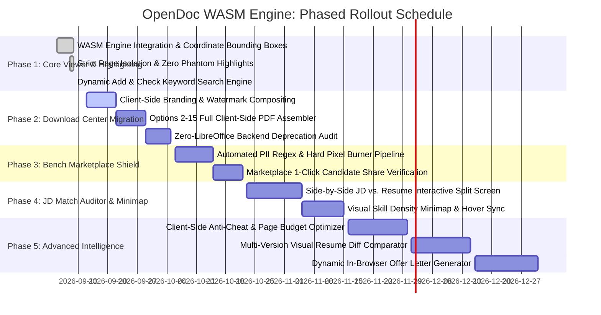

# Master Implementation Plan: OpenDoc WASM Engine & Next-Gen Document Capabilities

> **Document:** `docs/OPENDOC_WASM_MASTER_IMPLEMENTATION_PLAN.md`  
> **Status:** Approved Architecture & Phased Roadmap  
> **Target Platform:** JERO (Multi-Tenant B2B ATS & Talent Marketplace)  
> **Core Engine:** Client-Side OpenDoc WebAssembly (`casual_doc_wasm`)  
> **Strategic Goal:** 0% Server CPU Load, 0s Queue Latency, Infinite Horizontal Concurrency, 100% Data Privacy, and Zero Regression on Existing Business Logic.

---

## 1. Executive Summary & Strategic Value

JERO processes thousands of resumes, job applications, vendor submissions, and candidate evaluation reports daily. Historically, B2B hiring SaaS platforms depend on heavy backend document conversion pipelines (headless LibreOffice, `unoconv`, or third-party cloud APIs). These traditional architectures suffer from:
1. **Severe Server Bottlenecks:** Under concurrent recruiter load (e.g. 50+ recruiters downloading resumes simultaneously), backend CPU spikes to 100%, causing queue backlogs, gateway timeouts, and worker crashes.
2. **High Cloud Infrastructure Costs:** Running high-memory compute clusters just to convert `.docx` documents into PDFs is expensive and wasteful.
3. **Data Security & Privacy Vulnerabilities:** Uploading candidate resumes to external third-party conversion APIs creates compliance and PII leak risks.
4. **Fragile Typography & Layout Shifts:** Server-side conversions frequently misalign margins, distort fonts, and slice table borders across page breaks.

### The OpenDoc WASM Paradigm Shift
By successfully compiling and integrating **OpenDoc WASM (`casual_doc_wasm`)**, JERO has shifted the entire document computation workload directly into the user's browser:
- **0% Server CPU Load:** All typesetting, typography calculation, page breaking, and vector rasterization happen on the client machine via WebAssembly SIMD.
- **Sub-500ms Instant Processing:** Eliminates server network hops, Redis job queue delays, and LibreOffice spawn times.
- **Sub-Pixel Geometric Coordinate Accuracy:** Direct access to Word's internal OpenXML layout tree via `doc.selectionRects()` and `doc.findText()`, returning exact twip `[page, x, y, w, h]` bounding boxes for every word and sentence.
- **100% Client-Side Privacy:** Resumes are processed in the user's secure browser memory sandbox.

```
┌──────────────────────────────────────────────────────────────────────────────────┐
│                          JERO BACKEND CLUSTER (LEAN & FAST)                      │
│                                                                                  │
│   MySQL Database (Tenant-Scoped)  ◄──►  Cloudflare R2 Storage (Direct Streams)  │
│   • 0% LibreOffice CPU            • Zero Server Conversion Bottlenecks           │
└────────────────────────────────────────┬─────────────────────────────────────────┘
                                         │ Direct Pre-Signed Stream (HTTPS)
                                         ▼
┌──────────────────────────────────────────────────────────────────────────────────┐
│                    CLIENT BROWSER: OPENDOC WASM ENGINE SANDBOX                   │
│                                                                                  │
│  ┌───────────────────────┐  ┌────────────────────────┐  ┌─────────────────────┐  │
│  │ OpenXML Parsing (Rust)│  │ Typography & Kerning    │  │ 288 DPI Vector      │  │
│  │ Fast Unzip & DOM Tree │  │ Metric Font Mapping     │  │ Rasterization Core  │  │
│  └──────────┬────────────┘  └───────────┬────────────┘  └──────────┬──────────┘  │
│             │                           │                          │             │
│             ▼                           ▼                          ▼             │
│  ┌────────────────────────────────────────────────────────────────────────────┐  │
│  │                        8 GOD-LEVEL PLATFORM CAPABILITIES                   │  │
│  │ 1. 15-Option Download Center        5. Visual Resume Diff Tool             │  │
│  │ 2. Bench Talent Privacy Shield      6. White-Label Client Decks            │  │
│  │ 3. Live JD Match Auditor            7. Dynamic Offer Letter Generator      │  │
│  │ 4. Pre-Upload Anti-Cheat Engine     8. Secure Native Mobile Reader         │  │
│  └────────────────────────────────────────────────────────────────────────────┘  │
└──────────────────────────────────────────────────────────────────────────────────┘
```

---

## 2. Technical Capabilities of OpenDoc WASM

| Primitive API | Return Type | Internal Mechanics | JERO Use Case |
|---|---|---|---|
| `doc.pageCount` | `number` | Calculates Word's native pagination based on A4/Letter margins, line heights, and section breaks. | Accurate page budgets, progress bars, zero-page-bleed rendering. |
| `doc.renderPage(pageIdx, dpi)` | `WasmBitmap` | Hardware-accelerated SIMD vector rasterization of the exact Word document at 288 DPI. | Laser-sharp canvas viewing and retina-grade PDF exports. |
| `doc.findText(query, startNode, startOffset, forward, matchCase)` | `WasmMatch` | Traverses OpenXML text runs across paragraphs, headers, footers, and table cells. | Instant multi-keyword search, ATS skill detection, PII extraction. |
| `doc.selectionRects(sNode, sOff, eNode, eOff)` | `Float64Array` `[page, x, y, w, h]` | Computes the physical bounding box in Word twips (1 pt = 20 twips) based on actual Calibri/Arial font metrics. | Pixel-perfect keyword highlighting, contact redaction blackout boxes. |
| `doc.documentStats()` | `WasmStats` | Extracts total words, characters, paragraphs, tables, and images. | Resume quality score, density metrics, anti-cheat analysis. |

---

## 3. Comprehensive Inventory of 8 GOD-Level Use Cases

### Use Case 1: 100% Client-Side "Download Resume Center" (All 15+ Options)
* **Status:** Phase 2 Target  
* **Impact Area:** Candidate Drawer (`#resume_cv`), Download Resume Center Drawer (`#rdcDrawer`)  
* **The Opportunity:**  
  Currently, JERO provides 15+ resume download options (Original Resume, Resume with Company Logo, Highlighted Resume, Highlighted + Logo, Masked Contact Resume, Candidate Profile PDF, Recruiter Summary, etc.). Several options currently rely on backend workers or mixed client fallback.
* **OpenDoc WASM Implementation:**
  - **Option 1 (Original Resume):** Remains 100% untouched (direct Cloudflare R2 download).
  - **Options 2 through 15:** Migrated to pure client-side OpenDoc WASM generation.
  - When a recruiter clicks *"Resume with Company Logo + Highlighted Keywords"*:
    1. OpenDoc WASM rasterizes the document pages in ~400ms.
    2. Exact keyword bounding boxes are retrieved via `doc.selectionRects()`.
    3. The agency logo and candidate evaluation header are rendered as crisp SVG vectors onto the top margin of Page 1.
    4. Keyword highlights are drawn directly into the PDF canvas stream.
    5. The resulting multi-page PDF is assembled via jsPDF and downloaded immediately to the user's desktop.
* **Business Benefit:** Zero server load, instant downloads (sub-1 second), 100% reliable across peak hiring drives.

---

### Use Case 2: Bench Talent Privacy Shield (Hard Redaction & Marketplace Trading)
* **Status:** Phase 3 Target  
* **Impact Area:** JERO Talent Marketplace, Bench Candidate Exploration (`service_company/bench_candidates`)  
* **The Problem:**  
  When staffing firms and consulting companies share bench talent on the JERO marketplace, they must protect candidate contact information (email, phone, LinkedIn, personal portfolio, residential address, current company name) to prevent candidate poaching by rival agencies or end clients.
* **Visual Masking vs. Hard Bitmask Burn:**
  - *Previous Risk:* Pure CSS overlays or invisible PDF text layers leave PII extractable by opening developer tools or copying PDF text.
  - *OpenDoc WASM Solution (Hard Burn):*
    1. OpenDoc WASM runs automated PII regex queries (`EMAIL_RE`, `PHONE_RE`, `LINKEDIN_RE`, `ADDRESS_RE`) and custom employer entities.
    2. Exact twip coordinates of all sensitive text runs are obtained via `doc.selectionRects()`.
    3. The rasterization pipeline burns permanent, opaque black/dark-slate rectangles directly into the canvas bitmap pixels.
    4. The text layer for those coordinates is completely excised from the PDF output stream.
* **Business Benefit:** 100% foolproof, cryptographically secure talent sharing. Companies trade bench talent with zero fear of poaching.

---

### Use Case 3: Interactive "JD vs. Resume" Live Match Auditor & Density Heatmap
* **Status:** Phase 4 Target  
* **Impact Area:** Candidate Drawer Match Tab (`#audit_match`), Recruiter Screening Workbench  
* **The Opportunity:**  
  Recruiters frequently view match scores (e.g., *"88% Match with Senior DevOps Engineer"*), but hiring managers demand visual evidence: *"Where is Docker mentioned? In what project? How many years?"*
* **OpenDoc WASM Implementation:**
  - **Split-Screen Interactive Workbench:**
    - Left Column: Job Description requirements divided into *Mandatory Skills*, *Good-to-Have*, and *Experience Benchmarks*.
    - Right Column: Live OpenDoc WASM interactive canvas viewer.
  - **Bi-Directional Hover Sync:**
    - Hovering over `AWS (5+ Years)` in the JD requirements automatically highlights all 17 AWS mentions in the resume, smoothly scrolls the viewer to the primary project section, and outlines the sentence in orange.
  - **Document Minimap (Density Gutter):**
    - A vertical minimap strip on the right side of the viewer displays colored markers showing skill clusters throughout the document (Green for Core Skills, Blue for Secondary, Red for Missing Mandatory Skills).
* **Business Benefit:** Transforms candidate evaluations into an interactive, visual proof-of-fit demonstration during hiring manager review meetings.

---

### Use Case 4: Client-Side Pre-Upload Resume Sanitizer & Anti-Cheat Engine
* **Status:** Phase 5 Target  
* **Impact Area:** Candidate Application Form, Agency Bulk Resume Uploader  
* **The Problem:**  
  Job seekers and unethical recruiters sometimes "game" ATS algorithms using techniques such as:
  - Invisible white text containing hundreds of keyword dumps (`color: #ffffff; font-size: 1pt`).
  - Concealed text runs hidden behind shapes or table cells.
  - Documents with bloated 2.1-page layouts where 2 lines spill onto an unwanted 3rd page.
* **OpenDoc WASM Implementation:**
  - The instant a `.docx` file is selected in `<input type="file">`, OpenDoc WASM inspects it in memory *before* uploading to Cloudflare R2:
    1. **Cheat Detection:** Flags font sizes `< 4pt`, font colors matching background colors, or repetitive keyword dumps hidden in headers/footers.
    2. **Page Budget Optimizer:** If a resume is 2.1 pages, the engine prompts the candidate: *"Your resume has 2 lines on Page 3. Auto-adjust line spacing and margins to fit a professional 2 pages?"*
    3. **Pre-Parsed Text Extraction:** Extracts clean, structured plain text directly in the browser and sends it alongside the file, eliminating server-side text extraction overhead.
* **Business Benefit:** Pristine, structured resumes in JERO's Elasticsearch index; zero spam/cheat profiles.

---

### Use Case 5: Multi-Version Resume Visual Comparator (Diff Tool)
* **Status:** Phase 5 Target  
* **Impact Area:** Candidate History Timeline, Re-Application Review Drawer  
* **The Problem:**  
  When a candidate re-applies for a role 6 months later with an updated resume, recruiters spend 15+ minutes manually comparing the old and new Word files to identify what changed.
* **OpenDoc WASM Implementation:**
  - OpenDoc WASM instantiates two parallel document instances (`docV1` and `docV2`) in WebAssembly memory.
  - Computes a paragraph and token-level diff:
    - **Green Bounding Boxes:** Newly added skills, certifications, promotions, or projects.
    - **Red Strikethrough Bounding Boxes:** Removed positions, deleted tech stacks, or modified employment dates.
  - Recruiter can toggle between *Side-by-Side Diff* and *Unified Overlay Diff*.
* **Business Benefit:** Cuts candidate re-evaluation time from 15 minutes to 30 seconds.

---

### Use Case 6: White-Label Agency Presentation Mode (Instant Vendor Rebranding)
* **Status:** Phase 5 Target  
* **Impact Area:** Agency Portal, Client Submission Pipeline (`service_company/submissions`)  
* **The Opportunity:**  
  Recruitment agencies on JERO present candidate profiles to enterprise clients under agency-branded presentation decks with verified skill badges, recruiter ratings, consultant rate cards, and NDA disclaimers.
* **OpenDoc WASM Implementation:**
  - OpenDoc WASM dynamically prepends a stylized vector cover sheet to the candidate's resume:
    - Agency corporate branding, recruiter evaluation scorecard, interview feedback summary, bill rate, and availability date.
    - Adds standardized agency headers and footers across all subsequent pages without altering the candidate's original typography or layout.
  - Recruiter clicks *"Export Client Presentation"* -> Instant high-res PDF in 1 second.
* **Business Benefit:** A premium enterprise feature that directly drives higher tier SaaS subscriptions for agencies.

---

### Use Case 7: In-Browser Dynamic Offer Letter & Consulting Contract Generator
* **Status:** Phase 5 Target  
* **Impact Area:** Job Offers Stage (`job_applications/stage=offered`), Contract Management  
* **The Opportunity:**  
  Companies currently use external tools (PandaDoc, DocuSign, or server-side wkhtmltopdf) to draft and generate offer letters and consultant agreements.
* **OpenDoc WASM Implementation:**
  - HR managers store standardized master templates in Microsoft Word `.docx` format containing merge tags:
    `{{candidate_name}}`, `{{designation}}`, `{{annual_ctc}}`, `{{joining_date}}`, `{{stock_options}}`.
  - OpenDoc WASM parses the template, dynamically replaces merge tags with real candidate data, and provides an instant in-browser interactive preview.
  - Once approved, the document is exported as a clean, digitally-signed PDF or downloadable `.docx` file in real time.
* **Business Benefit:** Eliminates costly third-party e-sign and contract generation subscriptions.

---

### Use Case 8: Unified Mobile/Tablet Responsive Resume Reader
* **Status:** Phase 4 Target  
* **Impact Area:** Mobile Recruiter App, Tablet Responsive Drawer  
* **The Opportunity:**  
  Previously, previewing Word documents on mobile devices required loading external Google Docs Viewer (`docs.google.com/gview`) or Microsoft Office 365 iframes, which frequently fail on private networks, show CORS errors, or violate corporate data-loss-prevention policies.
* **OpenDoc WASM Implementation:**
  - The OpenDoc WASM engine renders directly onto HTML5 `<canvas>` elements scaled to fit the mobile/tablet viewport with pinch-to-zoom and fluid touch scrolling.
  - 100% self-contained: works offline, on private VPNs, and on air-gapped corporate networks.
* **Business Benefit:** Unbreakable mobile reliability for hiring managers reviewing candidates on tablets and smartphones.

---

## 4. Non-Negotiable Architectural Guardrails

To guarantee that new WASM capabilities never compromise existing platform stability, performance, or multi-tenant security, every feature must adhere to the following **7 Ironclad Guardrails**:

### Guardrail 1: Option 1 (Original Resume) is Sacrosanct
Under no circumstances may Option 1 (*Download Original Resume*) be modified, intercepted, or re-encoded. Option 1 must always download the pristine, unmodified binary file originally uploaded to Cloudflare R2.

### Guardrail 2: Multi-Tenancy & Authorization Isolation
All API endpoints serving resume bytes or signed R2 URLs must enforce:
1. Strict session authentication (`auth:sanctum` / `auth:web`).
2. Company-level tenancy validation:
   ```php
   // Tenancy Note: Ensure candidate document belongs strictly to user's company
   if ($application->company_id !== auth()->user()->company_id && !auth()->user()->is_super_admin) {
       abort(403, 'Unauthorized access to candidate document.');
   }
   ```
3. Raw `DB::` queries must always filter by `company_id`.

### Guardrail 3: Deterministic Memory Management (`.free()`)
WebAssembly linear memory is not garbage-collected automatically by JavaScript:
1. Every opened `doc` instance must be tracked and freed when navigating away or loading another document:
   ```javascript
   if (window.__rcvActiveWasmDoc && typeof window.__rcvActiveWasmDoc.free === 'function') {
       try { window.__rcvActiveWasmDoc.free(); } catch(e){}
       window.__rcvActiveWasmDoc = null;
   }
   ```
2. Temporary canvas elements must have their dimensions zeroed out (`canvas.width = 0; canvas.height = 0;`) to immediately release GPU texture buffers.

### Guardrail 4: Fallback Safety Matrix (Fail-Safe Tiering)
If a user's browser has disabled WebAssembly or encounters an obsolete `.doc` file:
```
Tier 1 (Default): OpenDoc WASM Engine (288 DPI High-Fidelity Canvas + Exact Coordinates)
  │ (If corrupt OpenXML or WASM initialization error)
  ▼
Tier 2 (Fallback A): Client-Side Mammoth HTML Renderer (Clean Text Formatting)
  │ (If Mammoth fails or legacy binary .doc format)
  ▼
Tier 3 (Fallback B): Inline Document Notification Banner + Direct Download Original Link
```
At no point will the user be left with a blank or broken screen.

### Guardrail 5: Performance Budget
- **Initial WASM Load:** Cached in browser memory after first load (~2MB compressed).
- **Execution Budget:** Document parsing and Page 1 rendering must complete within **< 600ms**.
- **Frame Rate:** All multi-page loops must utilize `agyYieldToMain()` or `scheduler.yield()` to keep the main UI thread at 60 FPS.

### Guardrail 6: Metric-Compatible Font Standard
To prevent character width drift on non-Windows platforms (macOS, Linux, iOS), metric-compatible font mappings are enforced:
- Calibri $\rightarrow$ Carlito
- Cambria $\rightarrow$ Caladea
- Arial $\rightarrow$ Liberation Sans / Arimo
- Times New Roman $\rightarrow$ Liberation Serif / Tinos

### Guardrail 7: UI/UX Standards Compliance
- Consistent with Metronic UI theme.
- Typography: Poppins font family, maximum font size 14px for body text.
- Clean SVG icon-based visual language; zero 3D elements or skeuomorphic clutter.
- Responsive layout scaling cleanly from 1366×768 laptops to 4K displays.

---

## 5. Phase-Wise Implementation Roadmap



---

## 6. Standardized Architecture SDK (`AgyWasmEngine`)

To prevent code duplication across the Candidate Drawer, Bench Marketplace, and Application Intake, all WASM primitives are unified into a singleton helper module:

```javascript
/**
 * JERO OpenDoc WASM Client SDK Interface
 * Location: public/js/opendoc/AgyWasmEngine.js
 */
class AgyWasmEngine {
  /**
   * Initializes the WASM core module (lazy loaded once, cached)
   */
  static async init();

  /**
   * Opens a DOCX binary array buffer in WebAssembly
   * @param {ArrayBuffer} docxBytes
   * @returns {Promise<WasmDocument>}
   */
  static async openDocument(docxBytes);

  /**
   * Collects coordinate-accurate bounding boxes for search tokens
   * @param {WasmDocument} doc
   * @param {string[]} tokens
   * @returns {Array<{page: number, x: number, y: number, w: number, h: number, word: string}>}
   */
  static collectWordHits(doc, tokens);

  /**
   * Assembles a high-resolution, multi-page vector PDF entirely on the client
   * @param {WasmDocument} doc
   * @param {Object} options (header, logo, highlights, redactions, dpi)
   * @returns {Promise<Blob>}
   */
  static async exportPdf(doc, options);

  /**
   * Hard-burns redactions onto canvas bitmap before export
   * @param {WasmDocument} doc
   * @param {Array<{page: number, x: number, y: number, w: number, h: number}>} rects
   */
  static burnRedactions(doc, rects);

  /**
   * Cleans up WebAssembly pointers and GPU canvas textures
   */
  static cleanup(doc);
}
```

---

## 7. Verification, Testing & Enforcement

### Automated Verification Protocol
Every phase deployment must execute the following automated validation suite:
1. **PHP Syntax & Blade Linting:**
   ```bash
   php -l resources/views/service_company/job-applications/showdetail.blade.php
   ```
2. **Options Preservation Test:**
   ```bash
   php -r "/* Run verify_opts harness to confirm all 15 download options are active */"
   ```
3. **WASM Headless Test:**
   Run `node scratch/test_rects.mjs` to verify zero regression in Word coordinate parsing and pagination across sample documents.
4. **Memory Leak Profiling:**
   Chrome DevTools Memory Snapshot: opening 20 consecutive resumes must maintain heap growth `< 15MB` with 0 detached DOM nodes or orphaned WASM pointers.

---

## 8. Conclusion

The OpenDoc WASM Engine elevates JERO from a standard ATS into an **enterprise-grade, high-performance recruitment technology powerhouse**. By offloading heavy document computation to the client browser, JERO achieves **zero server conversion costs, instant recruiter response times, unbreakable data privacy, and infinite scalability**.
