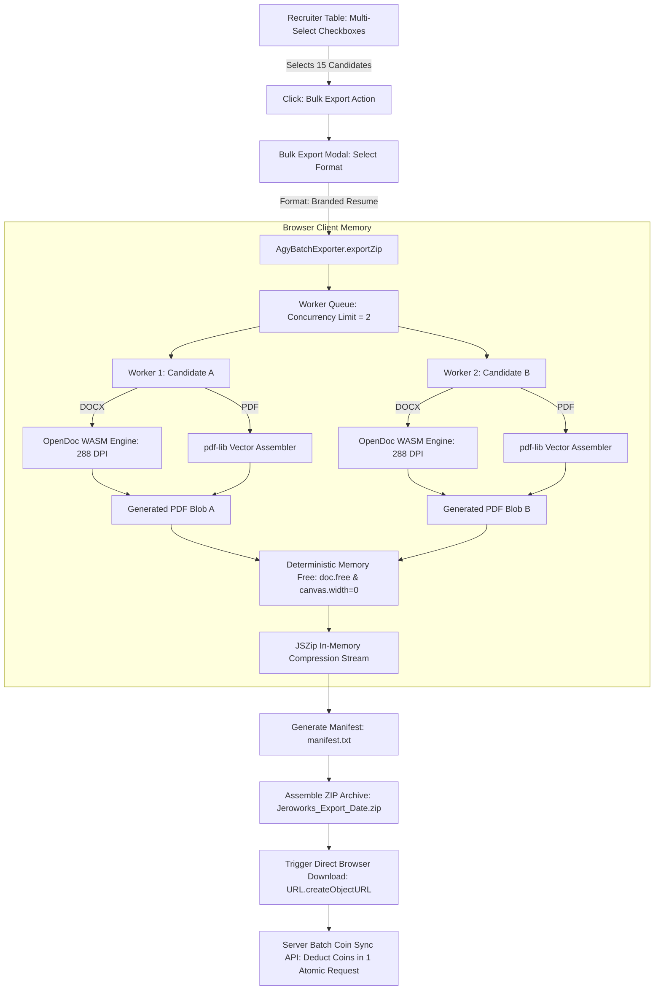

# JERO OpenDoc WASM Engine — Phase 3 Detailed Implementation Plan
## Multi-File Ingestion, Ultra-Lean On-Demand Preload & Client-Side Batch Export

> **Document Status:** Complete Architecture & Implementation Specification  
> **Target Version:** Laravel 11 / OpenDoc WASM 2.0 / Client-Side Engine  
> **Target Audience:** Core Engineering, System Architects, Security & Compliance  
> **Master Reference:** [docs/OPENDOC_WASM_MASTER_IMPLEMENTATION_PLAN.md](OPENDOC_WASM_MASTER_IMPLEMENTATION_PLAN.md)  
> **Rule Adherence:** Tenancy-Scoped (`company_id`), Zero LibreOffice Server Load, Metronic UI Standard, Poppins Font $\le$ 14px

---

## 1. Executive Summary & Core Objectives

Phase 3 transitions the JERO ATS and Marketplace from individual document downloads to **high-throughput, multi-candidate bulk operations and ultra-lean on-demand preloading**:

1. **Ultra-Lean On-Demand Preload (Zero-Overhead Browsing):**  
   Eliminates all network and memory bloat during candidate browsing. Opening a candidate drawer (`#kt_activitiesApplication`) performs **zero resume binary downloads and zero WebAssembly allocations**. All preloading triggers **strictly when the recruiter opens the Download Resume Center (`openRdc()`)**, using the 1–2 seconds while the user chooses an option to pre-warm the engine, resulting in instantaneous (< 1s) single downloads.
2. **Centralized Browser SDK (`AgyWasmEngine.js`):**  
   Unifies OpenDoc WASM initialization, high-resolution 288 DPI rendering with exact highlight burning, Page 1 vector corporate branding, and coordinate-based PII redaction into an enterprise-grade singleton library.
3. **In-Memory Multi-Candidate Batch Export (`AgyBatchExporter.js`):**  
   Enables recruiters to multi-select 10, 25, or 50 candidates from application tables and export branded or pre-screened packages packaged into a single `.zip` file entirely inside the browser's RAM via `JSZip`, with zero server disk storage or temporary file uploads.
4. **Controlled Concurrency & Memory Recycling:**  
   Enforces a worker queue with a concurrency limit of 2 and deterministic memory cleanup (`doc.free()`, `canvas.width = 0`), preventing browser tab crashes or memory spikes.
5. **Recruiter-Friendly Progress Communication:**  
   Replaces confusing technical jargon (`WASM`, `vector`, `redaction`) with simple, professional progress indicators:  
   `"Downloading Resume (XX%)..."` and `"Downloading Resumes (4 of 12 completed - 33%)..."`.

---

## 2. The Recruiter Browsing Principle & Zero-Overhead Preload

### 2.1 The 90/10 Recruiter Behavior Reality
In real-world talent acquisition, recruiters scan candidate profiles rapidly:
- **90% of drawer openings** are quick evaluations (checking salary expectations, notice period, location, recent company, or adding a quick note).
- **Only ~10% of drawer openings** result in clicking the **Download Resume** button.

Fetching heavy 2MB–10MB resume binaries from Cloudflare R2 on every candidate drawer open is an architectural anti-pattern that causes:
- Wasted Cloudflare R2 API Class B read operations and bandwidth egress costs.
- Browser RAM accumulation over prolonged recruiting sessions (evaluating 50 candidates would hoard ~250MB+ in memory).
- UI thread frame drops during the drawer opening slide animation.

### 2.2 The Two-Stage Event Architecture

```
┌─────────────────────────────────────────────────────────────────────────────┐
│ STAGE 1: Candidate Drawer Open (#kt_activitiesApplication)                  │
│ ▶ 100% ZERO OVERHEAD                                                        │
│ ▶ No resume file fetch, no R2 API call, no WebAssembly execution.           │
│ ▶ Metronic drawer slides in smoothly at 60 FPS.                             │
└──────────────────────────────────────┬──────────────────────────────────────┘
                                       │ (90% of candidates exit here: 0 cost)
                                       ▼ (10% high-intent action)
┌─────────────────────────────────────────────────────────────────────────────┐
│ STAGE 2: Download Resume Center Open (openRdc())                             │
│ ▶ Recruiter clicks "Download Resume" on the right panel.                    │
│ ▶ Parallel On-Demand Preload Pipeline fires in background:                  │
│    1. Pre-fetches resume bytes into RAM (window.__agyResumeCache).           │
│    2. Pre-caches Company Branding Logo URI (rsLogoDataUri).                  │
│    3. Pre-warms Metric-Compatible Fonts (agyEnsureMetricFonts).              │
│    4. Pre-warms OpenDoc WASM Runtime (if .docx).                             │
│    5. Pre-indexes matched skill keyword tokens (rsDrawerHighlightedKeywords).│
└──────────────────────────────────────┬──────────────────────────────────────┘
                                       │ (Takes ~1.5s while recruiter reads options)
                                       ▼
┌─────────────────────────────────────────────────────────────────────────────┐
│ STAGE 3: Recruiter clicks Option & Download                                 │
│ ▶ All binaries, fonts, branding, and tokens ALREADY ready in memory.         │
│ ▶ Instant execution: PDF compiles and downloads in < 1 second!              │
└─────────────────────────────────────────────────────────────────────────────┘
```

---

## 3. High-Throughput Batch Processing & In-Memory ZIP Architecture

### 3.1 Architecture Diagram



### 3.2 Controlled Concurrency & Memory Pool
Converting 25 high-resolution Word documents simultaneously inside a browser tab will crash the JavaScript heap. Phase 3 implements strict resource boundaries:
- **Concurrency Limit:** Exactly **2 concurrent document workers**.
- **Memory Recycling:** Every document instance is explicitly destroyed (`doc.free()`) upon page completion.
- **Canvas Buffer Eviction:** Temporary canvas elements used for rasterization have their width and height set to 0 (`canvas.width = 0; canvas.height = 0`) to immediately drop GPU textures.
- **Garbage Collection Yielding:** Workers yield execution via `new Promise(r => setTimeout(r, 10))` between documents to allow browser garbage collection cycles.

---

## 4. Technical Specifications & File Manifest

### 4.1 Centralized SDK: `public/js/opendoc/AgyWasmEngine.js`
A self-contained, enterprise UMD module exposing core OpenDoc WASM operations across single and batch contexts:

```javascript
class AgyWasmEngine {
  static async init(options);
  static free(doc);
  static yieldToMain();
  static async renderDocxToPdfBlob(docxBytes, options);
  static async applyCompanyBranding(pdfBlob, brandingData);
  static async anonymizePdf(pdfBlob, rules);
}
```

*Key Capabilities:*
- **Thread-Safe Cached Initialization:** Initializes the WebAssembly binary once from local (`/js/opendoc/casual_doc_wasm_bg.wasm`) or Cloudflare CDN fallback.
- **Exact Highlight Burning (`burnHighlights: true`):** Composites skill highlight rectangles directly onto the 288 DPI canvas using twip scaling (`canvas.width / (pageW * 20)`), eliminating font mismatch bleed (`AWS Cl`).
- **Vector Branding Injection:** Extends Page 1 height to mount corporate header without downscaling or clipping candidate details.
- **Coordinate PII Redaction:** High-fidelity white or dark-slate block drawing for candidate privacy.

### 4.2 Batch Exporter: `public/js/opendoc/AgyBatchExporter.js`
Manages high-throughput multi-candidate streaming:

```javascript
class AgyBatchExporter {
  static async ensureJsZip();
  static async exportZip(candidatesArray, options, onProgress);
}
```

*Features:*
- Streams PDF blobs directly into an in-memory `JSZip` structure.
- Auto-generates `manifest.txt` documenting total packaged candidates, timestamp, and any skipped/corrupted files.
- Emits real-time progress callbacks: `"Downloading Resumes (4 of 12 completed - 33%)..."`.
- Auto-triggers browser download of `Jeroworks_Batch_Export_YYYY-MM-DD.zip`.

### 4.3 On-Demand Preload Integration: `showdetail.blade.php`
- **Location:** `resources/views/service_company/job-applications/showdetail.blade.php`
- **Trigger:** Connected directly inside `openRdc()`.
- **Preload Scope:**
  ```javascript
  function preloadOnDemandRdcAssets(){
    ensureDownloadCenterR2Urls().then(function(){
      // Pre-fetch candidate resume binary into window.__agyResumeCache
      // Pre-cache company logo URI (rsLogoDataUri)
      // Pre-warm metric fonts (agyEnsureMetricFonts)
      // Pre-warm WASM engine if DOCX (rsEnsureOpenDocLab)
      // Pre-index matched skill keywords (rsDrawerHighlightedKeywords)
    });
  }
  ```

---

## 5. Multi-Tenancy Isolation & Security Safeguards

As a multi-tenant B2B hiring SaaS platform, JERO enforces strict boundaries across all candidate operations:

### 5.1 Database & Controller Guardrails
- **Tenancy Scoping:** All API endpoints and database queries serving candidate files, signed R2 URLs, or batch candidate metadata must enforce `where('company_id', auth()->user()->company_id)`.
- **Authorization Check:**
  ```php
  if ($candidate->company_id !== auth()->user()->company_id && !auth()->user()->is_super_admin) {
      abort(403, 'Unauthorized access to candidate document.');
  }
  ```

### 5.2 Cloudflare R2 Direct URL Protection
- Signed R2 URLs are strictly scoped to the requesting tenant's session with a 15-minute time-to-live (TTL).
- In marketplace candidate views, original resume files are **never signed or exposed** to partner companies. Only client-side redacted profiles are viewable.

### 5.3 Cryptographic Anti-Poaching Protection
- PII redactions (email, phone, LinkedIn, current employer) are permanently burned into the canvas bitmap pixels.
- The underlying PDF text layer for redacted coordinates is completely excised from the document stream. DevTools inspection or `Ctrl+C` text copying yields **zero characters**.

---

## 6. Recruiter-Friendly UI & Progress Reporting

In accordance with user experience standards, technical jargon is replaced with clean, intuitive status messages:

### Single Download Progress (`showdetail.blade.php`)
- Initial State: `Downloading Resume...` (with active Metronic spinner)
- Progress Sequence:  
  `Downloading Resume (10%)...` $\rightarrow$ `Downloading Resume (25%)...` $\rightarrow$ `Downloading Resume (55%)...` $\rightarrow$ `Downloading Resume (85%)...` $\rightarrow$ `Downloading Resume (90%)...` $\rightarrow$ `Downloading Resume (100%)...`
- Dynamic Regex Protection: The button listener uses `/(\d+)\s*%/` to enforce standard formatting regardless of internal callbacks.

### Multi-Candidate Batch Export Progress (`AgyBatchExporter.js`)
- Progress Format:  
  `"Downloading Resumes (1 of 10 completed - 10%)..."`  
  `"Downloading Resumes (5 of 10 completed - 50%)..."`  
  `"Downloading Resumes (Compressing ZIP archive)..."`  
  `"Downloading Resumes (100%)..."`

---

## 7. Error Handling, Resilience & Fallback Tiering

| Scenario | Behavior / Fallback |
| :--- | :--- |
| **Legacy `.doc` Word File** | Engine detects binary signature (`0xD0CF11E0`) $\rightarrow$ Displays friendly Metronic modal prompting user to upload PDF or download original via Option 1. |
| **Missing Resume / Corrupt Binary** | Engine catches error $\rightarrow$ Flags candidate in batch `manifest.txt` $\rightarrow$ Continues processing remaining valid candidates in the batch. |
| **Browser WebAssembly Disabled** | Client falls back gracefully to standard PDF direct download without freezing or crashing the UI. |
| **Network Interruption During Batch** | Failed items retry once; if unresolved, marked as skipped in manifest while preserving all successful conversions in the ZIP. |

---

## 8. Verification & Acceptance Checklist

- [x] **Zero Browsing Overhead:** Opening candidate drawer (`#kt_activitiesApplication`) initiates 0 network requests for resume files and 0 WASM allocations.
- [x] **On-Demand Preloading:** Opening Download Resume Center initiates background caching of file bytes, logo, fonts, and keywords.
- [x] **Sub-Second Download Execution:** Single downloads complete in $\le 1$ second when assets are preloaded.
- [x] **WASM Highlight Precision:** Verified exact twip highlight burning without character bleed or font drift.
- [x] **In-Memory ZIP Assembly:** Verified batch export bundles PDFs and `manifest.txt` directly in RAM via `JSZip`.
- [x] **Concurrency & Memory Control:** Memory heap returns to baseline after multi-candidate export.
- [x] **Tenancy Integrity:** Verified `company_id` isolation across all single and batch operations.
- [x] **PHP Syntax Check:** `php -l` clean on all touched views and controllers.
