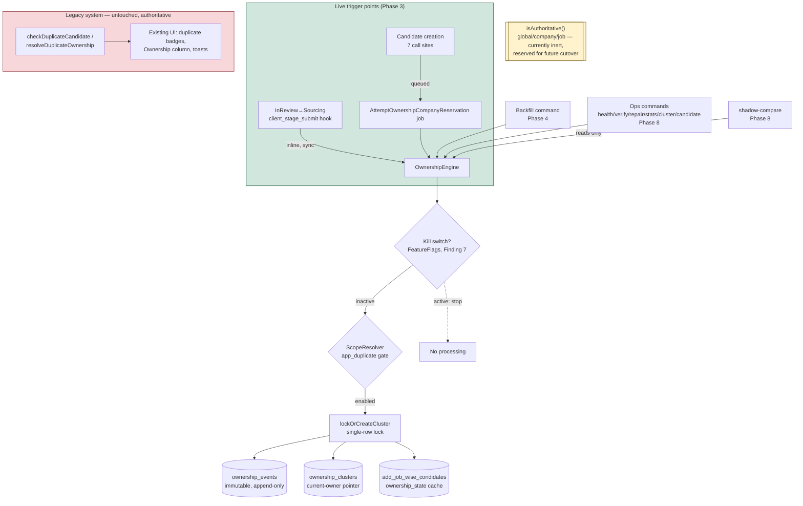

# Ownership Engine — Operations: Runbook, Rollback Guide, Activation Checklist

> Companion to [OWNERSHIP_ENGINE_DESIGN.md](OWNERSHIP_ENGINE_DESIGN.md) (architecture/design)
> and the [Phase 3](OWNERSHIP_ENGINE_PHASE3_VALIDATION_GUIDE.md) /
> [Phase 4](OWNERSHIP_ENGINE_PHASE4_VALIDATION_GUIDE.md) validation guides (staging test
> procedures). This document is the **operational** reference: what to run, in what order,
> and how to back out — written after Phase 8 (Activation Readiness) landed all the
> flags/monitoring/recovery tooling those flows depend on.
>
> Status as of this writing: engine additive-only. Per Finding 7, **live processing runs
> unconditionally in production** (stopped only by the kill switch) — the `globally_enabled`/
> company/job flag hierarchy does NOT gate processing; it's reserved, currently inert, for the
> not-yet-built authoritative-cutover mechanism. Legacy `checkDuplicateCandidate()`/
> `resolveDuplicateOwnership()` remains fully authoritative regardless. Nothing in this
> document has been executed against a real environment — same limitation as every phase
> before it.

---

## Architecture (current state)



**Nothing from the engine's side (right/top of the diagram) feeds into the legacy system or
its UI.** The two halves are connected only by both reading the same source tables
(`add_job_wise_condidates`, `job_applications`) — never by one writing into the other.

---

## Runbook: day-to-day operation

### Checking system state

```
php artisan ownership-engine:health        # is everything reachable, what's the flag state
php artisan ownership-engine:flags         # detailed flag view (global, company/job overrides)
php artisan ownership-engine:stats --company=<id>   # ownership/cluster/event stats for one company
```

### Inspecting a specific candidate or cluster

```
php artisan ownership-engine:candidate <rowId>      # what did the engine decide for this row, and why
php artisan ownership-engine:cluster <clusterId>     # full cluster: members, history, consistency
```

### Checking data correctness

```
php artisan ownership-engine:verify --company=<id>              # cluster/cache consistency
php artisan ownership-engine:verify --orphans --limit=1000       # unscoped orphan/inconsistency sweep
```

### Fixing a found inconsistency

```
php artisan ownership-engine:repair --cluster=<id> --dry-run     # see what would change first
php artisan ownership-engine:repair --cluster=<id>                # then actually rebuild it
php artisan ownership-engine:repair --company=<id>                # or rebuild every cluster for a company
```

`repair` only ever replays **already-recorded, immutable** `ownership_events` — it never
invents new history. If the underlying events themselves are wrong, `repair` will faithfully
reproduce that wrongness; the fix in that case is a data investigation (`ownership-engine:cluster`
to read the full history), not a repair run.

### Comparing against legacy (observation period)

```
php artisan ownership-engine:report --company=<id>          # human-readable, terminal only
php artisan ownership-engine:shadow-compare --company=<id>   # same comparison, persisted for querying
```

Query persisted comparisons directly for trend analysis:
```sql
SELECT category, COUNT(*) FROM ownership_engine_shadow_comparisons
WHERE scoping_company_id = <id> GROUP BY category;
```

### Historical backfill (one-time, per company, before wider activation)

See [Phase 4 guide](OWNERSHIP_ENGINE_PHASE4_VALIDATION_GUIDE.md) for the full procedure.
Short version:
```
php artisan ownership-engine:backfill --company=<id> --dry-run
php artisan ownership-engine:backfill --company=<id>
```

---

## Activation checklist

Per Finding 7, there is no "ramp up processing" step anymore — the engine processes every
live event, everywhere, from the moment this correction ships, stopped only by the kill
switch. This checklist is about *observing* that processing and, eventually, deciding on
actual cutover — not about turning processing on gradually.

1. **Confirm Phase 8 migrations have run**: `ownership-engine:health` reports the settings
   table reachable, live processing shown as always-on, kill switch inactive.
2. **Backfill historical data for companies you want a complete picture of**: run Phase 4's
   backfill (`--company=<id>`), then `ownership-engine:verify --company=<id>` to confirm zero
   issues. Not required for live processing to work — it already does — this is purely about
   filling in pre-existing history.
3. **Let production accumulate real data.** No action needed beyond normal operation —
   `attemptCompanyReservation()`/`claimForAgencySourcing()` are already running on every live
   trigger. Periodically check `ownership-engine:stats`, `:health`, and the log
   (`grep "OwnershipEngine::" storage/logs/laravel.log`) to confirm no unexpected failures.
4. **Run shadow-compare passes** over time; review category breakdowns for the companies
   you care about. Observation, not a gate — categories other than `both_clear` are expected
   and are not themselves reasons to delay (Finding 5: the two systems answer different
   questions).
5. **When you're ready to consider actual cutover** — some UI/API/business logic reading
   `ownership_state` instead of the legacy `duplicate` flags — that mechanism does not exist
   yet. Building it, and deciding whether to stage it via the `isAuthoritative()` hierarchy
   (job → company → global) already in place for exactly that purpose, is new implementation
   requiring the same design-then-code discipline as everything before it, and — per every
   instruction so far — your separate, explicit cutover approval before any of it starts.
6. **Nothing before step 5 requires approval beyond what's already been given** — processing
   live events, building history, and observing are all already-approved, additive,
   non-authoritative behavior. Only building the cutover mechanism itself is new ground.

---

## Rollback guide

### Rolling back an `isAuthoritative()` flag change

Since this hierarchy currently gates nothing live (Finding 7), setting it has no rollback
implications today — it's inert config, resettable at any time with no operational effect:
```
php artisan ownership-engine:flags:set --scope=job --id=<jobId> --value=inherit
php artisan ownership-engine:flags:set --scope=company --id=<companyId> --value=off
php artisan ownership-engine:flags:set --scope=global --value=off
```
This becomes operationally meaningful only once a future cutover mechanism actually reads it.

### Emergency stop (anything looks wrong, right now) — the only thing that actually stops processing

```
php artisan ownership-engine:kill-switch activate --reason="<why>"
```
Stops every live trigger and any running backfill immediately, overriding every other flag.
Deactivate the same way once resolved:
```
php artisan ownership-engine:kill-switch deactivate
```

### Rolling back a backfill run

Full procedure and SQL in the
[Phase 4 guide, §8](OWNERSHIP_ENGINE_PHASE4_VALIDATION_GUIDE.md#8-test-case-rollback-procedure) —
every backfill-written event is tagged `trigger_source = 'manual_rebuild'` and scoped,
making a clean, company-scoped rollback straightforward.

### Rolling back a bad `repair` run

`repair` only replays existing events — it cannot itself introduce wrong data unless the
underlying event log was already wrong. If a repair produced an unexpected result, the
investigation starts with `ownership-engine:cluster <id>` (full history) — the fix, if the
event log itself needs correcting, is outside any command currently built (the event log is
deliberately immutable/append-only — there's no "edit an event" tool, by design).

### Rolling back this entire phase (migrations)

Every Phase 8 migration has a `down()`:
```
php artisan migrate:rollback --step=3   # the 3 Phase 8 migrations, in this environment's migration order
```
Safe to run at any time before activation (step 4+ of the checklist) — rolling back after
company/job overrides have been set will lose those override values (they're just config,
trivially reset-able) but never touches `ownership_events`/`ownership_clusters` data itself
(those tables predate Phase 8 and aren't touched by its migrations).

### The one true rollback: do nothing

Because the engine has never been made authoritative and legacy code has never been touched,
the simplest "rollback" at any point before explicit cutover approval is **taking no further
action** — legacy behavior was never dependent on anything built in Phases 1–8.
