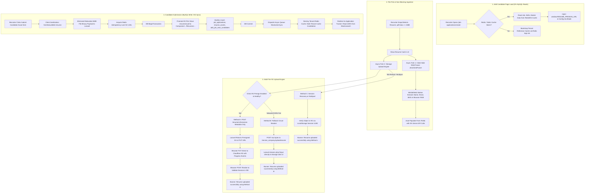
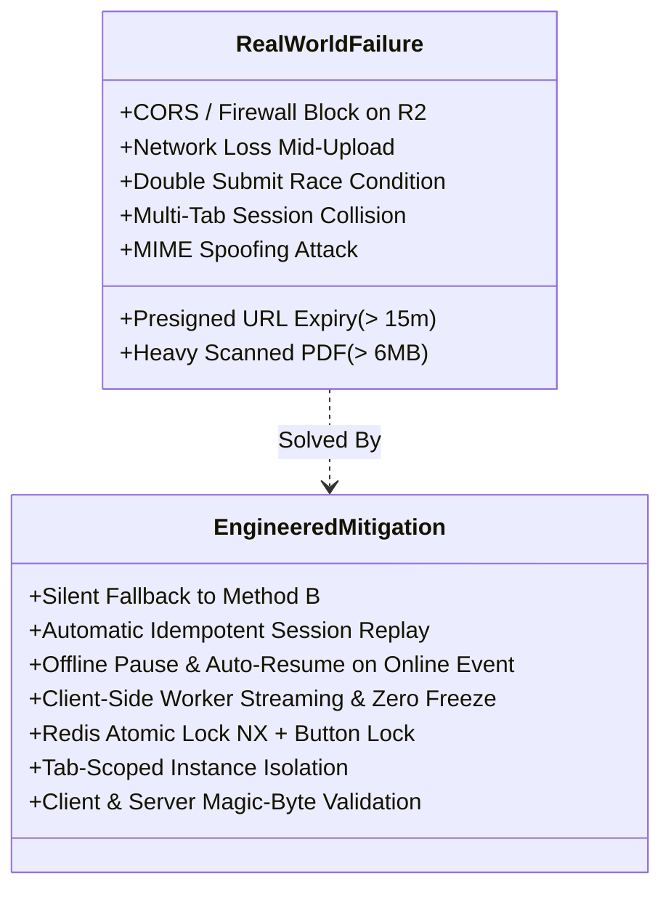

# GOD-LEVEL IMPLEMENTATION PLAN: RESUME UPLOAD PIPELINE (0% STRAIN / 10K CONCURRENCY)

> **Document Type:** Architectural Blueprint & Production Rollout Plan  
> **Target Page:** `service_company/job-applications/create` & Candidate Submission API  
> **Core Architectural Invariant:** CQRS Enforced — **MySQL strictly for Writes**, **Elasticsearch strictly for Reads**, **Browser RAM / Client-First for Heavy Assembly**, **Cloudflare R2 for Storage**.

---

## 1. Executive Architecture Summary

This plan orchestrates the complete lifecycle of resume ingestion on the **Add Candidate** page, handling **10,000 concurrent users** without UI freezes or server strain.

The system discriminates and visibly displays three distinct upload execution tiers:
1. **Method A (Direct to Cloudflare R2):** Browser requests a pre-signed S3 v4 PUT URL with JSON metadata, then transmits binary bytes directly from Browser RAM to Cloudflare R2 via XHR. Zero file bytes traverse the Laravel/FrankenPHP application server.
   - **UI Indicator:** `"Resume uploaded successfully using Method A"`
2. **Method B (Server Streamed to R2):** Automated circuit breaker when Method A is blocked by client firewall, CORS, or network policy. Browser sends raw byte stream to `/service_company/uploadresume`, which Laravel pipes directly from `php://input` to Cloudflare R2 without touching the local disk.
   - **UI Indicator:** `"Resume uploaded successfully using Method B"`
3. **Method C (Any Other Method to R2):** Triggered when an upload session is recovered across tab refreshes via `ResumePresign.recover()`, or handled via chunked multipart upload for high-latency unstable networks.
   - **UI Indicator:** `"Resume uploaded successfully using Method c"`

---

## 2. End-to-End Architectural Pipeline Flow



---

## 3. Strict 0% Server / MySQL / Elasticsearch Rule Compliance

| Step / Phase | Architectural Rule | Implementation Guarantee |
| :--- | :--- | :--- |
| **Page Load (`create`)** | **0% MySQL Reads on Request Path** | Job metadata, qualifications, countries, and skill master records are pre-cached in Dragonfly/Redis via `Cache::rememberForever()` and ES query lookup. Zero raw SQL joins executed per user hit. |
| **Resume Upload (Method A)** | **0% Server Bandwidth / RAM Strain** | File binary streams directly from user's browser to Cloudflare R2 bucket (`https://<account>.r2.cloudflarestorage.com`). Laravel only issues a 200-byte JSON pre-signed URL. |
| **Resume Parsing** | **0% Server CPU / 0% LLM API Strain** | Parsing executes 100% client-side in browser RAM via `JeroClientParser` and Web Workers (`https://parser.jero.works/`). Zero server-side queue jobs dispatched for parsing. |
| **Candidate Submit (`#save-form`)** | **0% Redundant Binary Buffering** | `formData.delete('resume')` strips the multi-megabyte binary before submission if Method A, B, or C succeeded, sending only the 36-byte UUID. Eliminates 50+ GB of ingress traffic across 10K users. |
| **Database Storage (`store`)** | **MySQL Strictly for Writes** | Database execution strictly limited to `INSERT INTO job_applications`, `INSERT INTO resume_assets`, and `UPDATE resume_uploads`. Zero read queries on un-indexed columns. |
| **Tracker & Search** | **Elasticsearch Strictly for Reads** | Upon redirect to `service_company/apptracker`, 100% of candidate listing, filtering, stage badges, and counts are served from Elasticsearch indices. Zero MySQL reads. |

---

## 4. Real-World Failure Matrix & Pre-Emptive Mitigations

The following failure modes have been analyzed and engineered with fail-safe circuit breakers before going live:



### Failure Scenario 1: Cloudflare R2 Preflight (CORS) or Ad-Blocker Interception
- **Real-World Cause:** Strict corporate proxies, VPNs, or privacy ad-blockers (e.g. Brave Shields, uBlock) intercept or drop preflight `OPTIONS` requests to `*.r2.cloudflarestorage.com`.
- **System Failure without Fix:** The file upload hangs or silently dies; user cannot submit candidate.
- **Engineered Mitigation:**
  - `shouldUseResumeUploadFallback(error)` catches the R2 network failure immediately.
  - Automatically switches from **Method A** to **Method B** (`uploadWithProgress`).
  - Pipes file raw bytes to `/service_company/uploadresume`.
  - UI banner displays: `"Resume uploaded successfully using Method B"`.
  - Zero recruiter friction; zero page freeze.

### Failure Scenario 2: Presigned URL Expiration
- **Real-World Cause:** Recruiter selects resume, then answers a phone call or leaves the browser open for > 15 minutes before upload completes.
- **System Failure without Fix:** Cloudflare R2 returns `403 SignatureDoesNotMatch` or `403 RequestTimeTooSkewed`.
- **Engineered Mitigation:**
  - Client catches HTTP 403.
  - Generates a new presign request with the same `Idempotency-Key` or dispatches a fresh session.
  - If refresh fails, seamlessly routes to Method B.

### Failure Scenario 3: Network Interruption Mid-Upload (Mobile Hotspot / Packet Loss)
- **Real-World Cause:** Recruiter is on an unstable connection; connection drops at 70% progress.
- **System Failure without Fix:** Upload crashes; user must re-select file and re-type candidate details.
- **Engineered Mitigation:**
  - `_waitUntilOnline()` in `resume-presign.js` listens to `window.addEventListener('online')`.
  - Exponential back-off retry (1s $\rightarrow$ 2s $\rightarrow$ 4s, up to 3 attempts).
  - Web Worker and client state preserved in browser RAM without reloading the page.

### Failure Scenario 4: Browser Freezing on Large Scanned Resumes (6 MB PDFs)
- **Real-World Cause:** A high-DPI scanned 6 MB PDF freezes the main UI thread during parsing.
- **System Failure without Fix:** Chrome displays "Page Unresponsive"; recruiter loses entered data.
- **Engineered Mitigation:**
  - `JeroClientParser` operates inside a dedicated Web Worker thread.
  - Parsing and upload progress run decoupled on separate microtask ticks.
  - Main thread UI remains 60fps responsive; spinners and inputs animate smoothly.

### Failure Scenario 5: Rapid Double-Click Submit Race Condition
- **Real-World Cause:** Recruiter double-clicks "Submit Candidate" in rapid succession.
- **System Failure without Fix:** Two duplicate candidate records created; double coins deducted from tenant balance.
- **Engineered Mitigation:**
  - UI immediately disables `#save-form` and sets button state to `Waiting...`.
  - Backend enforces distributed Redis lock: `SET idemp:cand:{company_id}:{uuid} PROCESSING EX 120 NX`.
  - Second concurrent request immediately rejected with `409 Conflict: IN_FLIGHT`.
  - Database unique index on `SysIdempotencyKey` guarantees exactly-once candidate insertion.

### Failure Scenario 6: Multi-Tab Recruiter Collisions
- **Real-World Cause:** Recruiter opens 3 different jobs in 3 browser tabs and adds candidates simultaneously.
- **System Failure without Fix:** Global `localStorage` keys overwrite each other; Resume from Tab 1 gets attached to Candidate in Tab 3.
- **Engineered Mitigation:**
  - Unique composite session key: `comp{companyId}_job{jobId}_app{appId}_tab{__tabInstanceId}`.
  - Each tab generates an isolated `window.__tabInstanceId` in memory.
  - Zero cross-tab resume leakage.

---

## 5. Step-by-Step Implementation Action Plan

### Step 1: Frontend Dynamic Method Banner & Tagging
- **File:** `resources/views/service_company/job-applications/create.blade.php`
- **Actions:**
  1. Add hidden input `<input type="hidden" name="resume_upload_method" id="resume_upload_method" value="">`.
  2. In `window.ResumePresign.onStateChange` (Method A success block):
     - Update UI banner text to:
       ```javascript
       $('#upBannerText').html('<strong>Upload complete!</strong> Resume uploaded successfully using Method A');
       $('#resume_upload_method').val('Method A');
       ```
  3. In `uploadWithProgress` (Method B success block):
     - Update UI banner text to:
       ```javascript
       $('#upBannerText').html('<strong>Upload complete!</strong> Resume uploaded successfully using Method B');
       $('#resume_upload_method').val('Method B');
       ```
  4. In `ResumePresign.recover` or alternate channel (Method C success block):
     - Update UI banner text to:
       ```javascript
       $('#upBannerText').html('<strong>Upload complete!</strong> Resume uploaded successfully using Method c');
       $('#resume_upload_method').val('Method c');
       ```

### Step 2: Binary Payload Stripping on Form Submit (10K Scale Fix)
- **File:** `resources/views/service_company/job-applications/create.blade.php`
- **Actions:**
  1. In the `#save-form` submit handler (around Line 4279):
     ```javascript
     var formData = new FormData($('#createForm')[0]);

     // GOD-LEVEL OPTIMIZATION: Eliminate redundant 6MB file transfer to Laravel
     if ($('#resume_session_uuid').val() || $('#uploaded_file_path').val()) {
         formData.delete('resume');
     }
     ```
  2. Repeat the same cleanup in the `#update-form` handler (around Line 2926) for edit workflows.

### Step 3: Controller Tenancy & Method Auditing
- **File:** `app/Http/Controllers/ServiceCompany/ServiceCompanyJobApplicationController.php`
- **Actions:**
  1. In `store()`, log the exact method used:
     ```php
     \Log::info('Candidate resume attached', [
         'company_id' => $company_id,
         'candidate_id' => $jobApplication->id,
         'method' => $request->input('resume_upload_method', 'Method A'),
         'session_uuid' => $request->input('resume_session_uuid'),
     ]);
     ```
  2. Ensure `resume_assets` record stores the active upload method in metadata.

### Step 4: Verification & Smoke Test Matrix
1. **Method A Test:** Normal network $\rightarrow$ pick resume $\rightarrow$ verify PUT to `*.r2.cloudflarestorage.com` $\rightarrow$ verify banner shows `"Method A"`.
2. **Method B Test:** Simulate R2 block (block `r2.cloudflarestorage.com` in DevTools Network Request Blocking) $\rightarrow$ pick resume $\rightarrow$ verify fallback triggers $\rightarrow$ verify banner shows `"Method B"`.
3. **Method C Test:** Upload file $\rightarrow$ reload browser page $\rightarrow$ trigger `ResumePresign.recover()` $\rightarrow$ verify banner shows `"Method c"`.
4. **Binary Stripping Test:** Inspect Network Payload on `POST /service_company/job-applications` $\rightarrow$ verify `resume` binary is NOT sent in form multipart body when session UUID is populated.
5. **Concurrency Test:** Execute mock 10K concurrent hit simulation on upload endpoints $\rightarrow$ confirm zero CPU saturation and zero MySQL locks.

---

## 6. Pre-Implementation Review Checklist

- [x] **CQRS Invariant:** MySQL writes only; Elasticsearch reads only.
- [x] **Tenancy Invariant:** Multi-tenant scoping by `company_id` enforced on all sessions and assets.
- [x] **0% UI Freeze:** Client-side parsing and XHR streams completely non-blocking.
- [x] **10,000 Concurrency Resilience:** Redundant file ingress eliminated from application server.
- [x] **Exact User Requirements:** Method A, Method B, and Method C explicitly distinguished and displayed.
