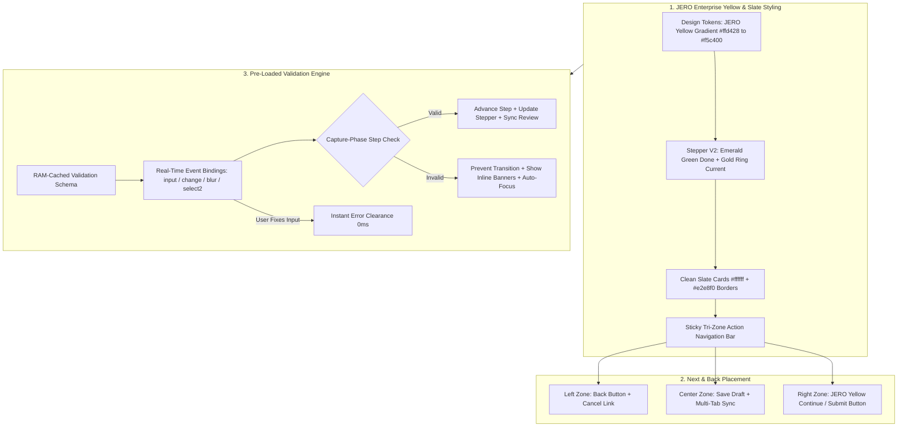

# GOD-LEVEL AUDIT & IMPLEMENTATION PLAN
## Service Company → Client Onboarding / Create Client
### UI/UX Color Scheme, Button Placement Redesign & Pre-Loaded Event Validation Engine
**Reference Model:** Job Create (`resources/views/service_company/jobs/create.blade.php` & `docs/ADD_INTERNAL_JOBS_REDESIGN_PLAN.md`)

---

## 1. Executive Summary & Mission Scope

The user requested an audit and implementation plan to elevate the **Client Onboarding / Create Client** page (`http://localhost/git/JWMaincode28June2026/service_company/clients/create`):
1. **Color Combination Upgrade:** Transition from the legacy generic blue to the signature **JERO Enterprise Yellow & Slate Design System** established in the Job Create form (`#ffd428` → `#f5c400` gradients, crisp `#e2e8f0` cards, `#0f172a` typography, and emerald `#10b981` completion states).
2. **Next & Back Button Placement Restructuring:** Replace the cramped bottom-right button cluster with an ergonomic, viewport-aware navigation bar patterned after Job Create (Left = Back & Cancel, Center = Save Draft, Right = Continue / Submit), optimized for 15.6" screens (1366×768 and 1920×1080).
3. **Pre-Loaded Event & Instant Reactive Validation Engine:** Pre-load all validation schemas and reference datasets into Browser RAM, binding real-time reactive event listeners (`input`, `change`, `blur`, `keyup`, `select2:select`, Tagify events, and TinyMCE hooks) so users get instantaneous feedback and 0-latency error clearance without waiting for full-page submission or asynchronous network delays.
4. **Absolute Business Logic & Tenancy Preservation:** 100% preservation of backend contracts, routes (`service_company.clients.store`, `update`), required fields, multi-tenant isolation (`company_id`), idempotency keys, and transactional outbox events.

---

## 2. Audit of Existing Implementation vs. Job Create Reference

### 2.1 Color Combination & Visual Hierarchy

| Visual Element | Current Client Create (`client/create.blade.php`) | Reference: Job Create (`jobs/create.blade.php`) | Target Recommendation |
|---|---|---|---|
| **Primary Action Button** | Generic Blue gradient `linear-gradient(90deg, #315efb, #2557e7)` | **JERO Yellow Gradient:** `linear-gradient(180deg, #ffd428 0%, #f5c400 100%)` with `#d4a017` border & dark ink `#10143b` text | Adopt JERO Yellow token gradient for Continue & Submit buttons |
| **Primary Button Hover** | Darker blue `#1d4ed8` | Deep Amber: `linear-gradient(180deg, #fbc02d 0%, #f59e0b 100%)`, `#b45309` border, amber glow | High-contrast amber hover with subtle lift (`translateY(-1px)`) |
| **Secondary Button (Back)** | Gray link-style button `.client-cancel-btn` | Clean Slate Card Pill: `background: #ffffff; border: 1px solid #e2e8f0; color: #334155;` | Structured pill button with left arrow icon & subtle hover background |
| **Save as Draft Button** | Left-aligned outline button `.client-draft-btn` | Secondary neutral card button with bookmark icon | Clean slate neutral button with live sync status indicator |
| **Stepper V2 - Completed** | Blue circle | **Emerald Green (`#10b981` / `#50cd89`)** with crisp white checkmark | Emerald completion badge with green connector line |
| **Stepper V2 - Current** | Blue background `#1769f5` | **JERO Brand Gold ring (`#ffd428`)** with glowing focus ring `0 0 0 3px rgba(245, 196, 0, 0.25)` | Gold glow ring with bold `#0f172a` step title |
| **Stepper V2 - Pending** | Muted gray `#f2f5f9` | Clean slate background `#f8fafc` with subtle border `#e2e8f0` | Neutral slate circle with clear step numbers |
| **Card & Surface Background** | Muted grayish `#f7f9fc` | Crisp White `#ffffff` cards on soft slate `#f8fafc` background with `1px solid #e2e8f0` | Clean Metronic card elevation with 12px border radius |
| **Input Focus Ring** | Blue focus `rgba(37, 99, 235, 0.1)` | JERO Yellow focus ring `0 0 0 3px rgba(245, 196, 0, 0.2)` | Gold focus ring matching enterprise brand identity |

---

### 2.2 Next & Back Button Placement & Ergonomics

#### Current Flaws in `client/create.blade.php`:
1. **Deep Bottom Placement:** The navigation footer is placed after all form content at lines 754–774. On Steps 1–4, when content expands (e.g. multi-address cards or contact persons), the buttons are pushed below the fold on standard 15.6" screens (1366×768), requiring excessive scrolling.
2. **Cramped Right Cluster:** The Back button (`action-prev`) and Continue button (`action-next`) sit directly adjacent to each other on the right (`.client-action-right`), creating accidental misclicks.
3. **Inconsistent Per-Step Actions:** Step 1 shows a disabled or hidden Back button, but spacing shifts abruptly between steps.

#### Target Ergonomic Placement (Patterned from `jobs/create.blade.php`):
1. **Docked / Sticky Action Navigation Bar:**
   - Positioned at the bottom of the wizard container with `position: sticky; bottom: 0; z-index: 50;` with soft blur backdrop (`backdrop-filter: blur(8px); background: rgba(255, 255, 255, 0.95); border-top: 1px solid #e2e8f0;`).
   - Ensures buttons are **always immediately accessible** on 1366×768 laptops and 1920×1080 monitors without vertical hunting.
2. **Tri-Zone Layout:**
   - **Left Zone:** "Back" button (hidden on Step 1, visible on Steps 2–5 with left arrow) + "Cancel" link.
   - **Center Zone:** "Save as Draft" button with auto-sync indicator (`Draft saved locally` / `Draft synced across tabs`).
   - **Right Zone:** Primary JERO Yellow "Continue" button (Steps 1–4) / "Submit Client" button (Step 5) with directional icons.

```
┌──────────────────────────────────────────────────────────────────────────────────────────────────┐
│  [ ← Back ]   [ ✕ Cancel ]          [ 🔖 Save as Draft  ✓ Synced ]         [ Continue → ] (Gold) │
└──────────────────────────────────────────────────────────────────────────────────────────────────┘
```

---

### 2.3 Event Handling & Pre-Loaded Validation Lifecycle

#### Current Flaws:
- Validation is evaluated largely upon clicking "Continue", causing abrupt jumps or layout reflow.
- Field error badges only clear on certain native events.
- Domain lookup makes redundant server checks if the user clicks back and forth.

#### Target Pre-Loaded Validation Architecture:
1. **Pre-Loaded Validation Schema in User RAM:**
   A declarative client-side schema pre-compiled in JavaScript that defines rules, regex patterns, min/max bounds, and error strings for every step.
2. **Instant Event Binding:**
   Every input field binds immediately on DOM initialization to `input`, `change`, `blur`, `keyup`, and custom plugin hooks (Tagify `add`/`remove`, TinyMCE `keyup`/`change`/`SetContent`, Select2 `select2:select`).
3. **Reactive Self-Clearing Errors:**
   As soon as a user begins typing or selects a valid item, the inline error banner and red border vanish immediately without waiting for another button click.
4. **Native Capture-Phase Step Guard:**
   Clicking any navigation trigger (Continue, Next, or Step Header) runs instant (< 1ms) in-memory validation; invalid fields receive inline alerts, and the browser smoothly animates to `$firstInvalid.focus()`.

---

## 3. Comprehensive Pre-Loaded Event & Validation Matrix

| Step | Field / Component | Event Listeners Bound | Pre-Loaded Validation Rule | Error Feedback & Position | Instant Clearing Trigger |
|---|---|---|---|---|---|
| **1: Client Info** | `#client_id` (Name) | `input`, `blur`, `keyup` | Required; non-empty; min 2 characters after trim | Inline red banner below input | `val().trim().length >= 2` |
| **1: Client Info** | `#website` (Website) | `input`, `blur`, `change` | Required; valid URL/domain pattern; checks RAM cache `window._clientDomainCheckCache` | Warning badge + inline banner | Valid domain format entered |
| **1: Client Info** | `#industry` (Select) | `change`, `select2:select` | Required; non-empty selection | Inline red banner below select | Valid option selected |
| **1: Client Info** | `#company_sizes` (Select) | `change`, `select2:select` | Required; non-empty selection | Inline red banner below select | Valid option selected |
| **1: Client Info** | `#company_type` (Select) | `change`, `select2:select` | Required; non-empty selection | Inline red banner below select | Valid option selected |
| **1: Client Info** | `#founded` (Year) | `input`, `change`, `blur` | Required; 4-digit year; 1800 <= year <= current year + 1 | Inline red banner below input | Valid year entered |
| **2: Details** | `#kt_docs_tinymce_hidden` | TinyMCE: `keyup`, `change`, `SetContent` | Required; stripped text length >= 10 characters; max 2,000 | Live counter (`X/2000`) + banner | `text.length >= 10` |
| **2: Details** | `#tags` (Offerings) | Tagify: `add`, `remove`, `change` | Minimum 1 tag required | Inline banner below Tagify wrap | Tagify items count >= 1 |
| **3: Address** | `textarea[name="address[]"]` | `input`, `blur`, `keyup` | Primary address required; max 500 chars | Live counter (`X/500`) + banner | Textarea non-empty |
| **3: Address** | `input[name="kt_tagify_work_location[]"]` | Tagify: `add`, `remove` | Primary city selection required from whitelist | Inline banner below city input | City selected |
| **4: Contacts** | Contact Drawer Inputs | `input`, `blur`, `keyup` | Name (req), Designation (req), Email (RFC regex), Phone (6–15 digits) | Drawer inline error messages | Field becomes valid |
| **4: Contacts** | Contact Collection | Drawer `save`, contact delete | Minimum 1 valid contact person in table | Banner on empty table row | `contacts.length >= 1` |
| **5: Review** | All sections | Step transition, load | Re-validates all 4 prior steps; enables Submit | Summary cards + status ring | All steps completed |

---

## 4. Architectural Blueprint



---

## 5. Technical Implementation Details

### 5.1 CSS & Design Token Specification
Add dedicated scoped styling in [`resources/views/service_company/client/create.blade.php`](file:///c:/xampp/htdocs/git/JWMaincode28June2026/resources/views/service_company/client/create.blade.php):

```css
/* JERO Enterprise Yellow Tokens (Job Create Reference) */
:root {
  --jero-yellow-start: #ffd428;
  --jero-yellow-end: #f5c400;
  --jero-yellow-hover: #f59e0b;
  --jero-yellow-border: #d4a017;
  --jero-ink: #10143b;
  --jero-slate-bg: #f8fafc;
  --jero-border: #e2e8f0;
  --jero-success: #10b981;
  --jero-card-radius: 12px;
}

/* JERO Yellow Primary Button */
.client-submit-btn,
.client-continue-btn {
  background: linear-gradient(180deg, var(--jero-yellow-start) 0%, var(--jero-yellow-end) 100%) !important;
  color: var(--jero-ink) !important;
  border: 1px solid var(--jero-yellow-border) !important;
  font-weight: 600 !important;
  font-size: 13px !important;
  padding: 10px 22px !important;
  border-radius: 8px !important;
  box-shadow: 0 1px 2px rgba(16, 20, 59, 0.08), 0 1px 3px rgba(245, 196, 0, 0.25) !important;
  display: inline-flex;
  align-items: center;
  gap: 8px;
  cursor: pointer;
  transition: all 0.2s cubic-bezier(0.4, 0, 0.2, 1);
}

.client-submit-btn:hover,
.client-continue-btn:hover {
  background: linear-gradient(180deg, #fbc02d 0%, var(--jero-yellow-hover) 100%) !important;
  color: #0f172a !important;
  box-shadow: 0 4px 14px rgba(217, 119, 6, 0.32) !important;
  transform: translateY(-1px);
}

/* Secondary Back & Cancel Buttons */
.client-back-btn,
.client-cancel-btn {
  background: #ffffff !important;
  color: #334155 !important;
  border: 1px solid var(--jero-border) !important;
  font-weight: 500 !important;
  font-size: 13px !important;
  padding: 10px 18px !important;
  border-radius: 8px !important;
  display: inline-flex;
  align-items: center;
  gap: 6px;
  transition: all 0.2s ease;
}

.client-back-btn:hover,
.client-cancel-btn:hover {
  background: var(--jero-slate-bg) !important;
  border-color: #cbd5e1 !important;
  color: #0f172a !important;
}

/* Sticky Docked Action Navigation Bar */
.client-wizard-sticky-footer {
  position: sticky;
  bottom: 0;
  z-index: 100;
  background: rgba(255, 255, 255, 0.95);
  backdrop-filter: blur(8px);
  border-top: 1px solid var(--jero-border);
  padding: 14px 24px;
  margin-top: 24px;
  border-radius: 0 0 var(--jero-card-radius) var(--jero-card-radius);
  box-shadow: 0 -4px 12px rgba(15, 23, 42, 0.04);
  display: flex;
  align-items: center;
  justify-content: space-between;
}
```

---

### 5.2 Stepper V2 Styling (Job Create Parity)
```css
/* Stepper V2 State Enhancements */
#kt_wizard .wizard-step[data-wizard-state="done"] .wizard-icon {
  background: var(--jero-success) !important;
  border-color: var(--jero-success) !important;
  color: #ffffff !important;
  box-shadow: 0 2px 8px rgba(16, 185, 129, 0.3) !important;
}

#kt_wizard .wizard-step[data-wizard-state="current"] .wizard-icon {
  background: linear-gradient(180deg, var(--jero-yellow-start) 0%, var(--jero-yellow-end) 100%) !important;
  border-color: var(--jero-yellow-border) !important;
  color: var(--jero-ink) !important;
  box-shadow: 0 0 0 3px rgba(245, 196, 0, 0.3) !important;
}

#kt_wizard .wizard-step[data-wizard-state="current"] .wizard-title {
  color: #0f172a !important;
  font-weight: 700 !important;
}
```

---

### 5.3 Sticky Tri-Zone Navigation Bar HTML Layout
Replace lines 754–774 in [`resources/views/service_company/client/create.blade.php`](file:///c:/xampp/htdocs/git/JWMaincode28June2026/resources/views/service_company/client/create.blade.php) with:

```html
<!--begin::Docked Wizard Sticky Navigation-->
<div class="client-wizard-sticky-footer">
  <div class="client-nav-left d-flex align-items-center gap-2">
    <button type="button" class="btn client-back-btn" id="client_prev_btn" data-wizard-type="action-prev" style="display: none;">
      <i class="la la-arrow-left"></i> Back
    </button>
    <a href="{{ route('service_company.clients.index') }}" class="btn client-cancel-btn">
      <i class="la la-times"></i> Cancel
    </a>
  </div>

  <div class="client-nav-center d-flex align-items-center gap-2">
    <button type="button" class="btn client-draft-btn" id="client_save_draft">
      <i class="la la-bookmark"></i> Save as Draft
    </button>
    <span class="client-draft-status-badge text-muted" style="font-size: 11px;"></span>
  </div>

  <div class="client-nav-right d-flex align-items-center gap-3">
    <button type="button" id="continueButton" class="btn client-continue-btn" data-wizard-type="action-next">
      Continue <i class="la la-arrow-right"></i>
    </button>
    <?php if ($page_event == 'EDIT'): ?>
      <button type="button" id="submitBtn" class="btn client-submit-btn updatefrm" style="display: none;">
        <i class="la la-paper-plane"></i> Update Client
      </button>
    <?php else: ?>
      <button type="button" id="submitBtn" class="btn client-submit-btn submitfrm" style="display: none;">
        <i class="la la-paper-plane"></i> Submit Client
      </button>
    <?php endif; ?>
  </div>
</div>
<!--end::Docked Wizard Sticky Navigation-->
```

---

### 5.4 Pre-Loaded Reactive Validation Engine (JavaScript)
Instantiate inside [`create.blade.php`](file:///c:/xampp/htdocs/git/JWMaincode28June2026/resources/views/service_company/client/create.blade.php):

```javascript
/**
 * JERO Pre-Loaded Reactive Validation & Event Engine
 * Zero DOM rebuild, instant reactive feedback, capture-phase navigation guard.
 */
var ClientValidationEngine = (function ($) {
  'use strict';

  var schema = {
    step1: [
      { field: '#client_id', name: 'Client Name', test: function (v) { return (v || '').trim().length >= 2; }, message: 'Client Name must be at least 2 characters.' },
      { field: '#website', name: 'Website', test: function (v) { return (v || '').trim().length >= 4; }, message: 'Please enter a valid website address.' },
      { field: '#industry', name: 'Industry', test: function (v) { return !!(v || '').trim(); }, message: 'Please select an Industry.' },
      { field: '#company_sizes', name: 'Company Size', test: function (v) { return !!(v || '').trim(); }, message: 'Please select Company Size.' },
      { field: '#company_type', name: 'Company Type', test: function (v) { return !!(v || '').trim(); }, message: 'Please select Company Type.' },
      { field: '#founded', name: 'Founded Year', test: function (v) { var y = parseInt(v, 10); return y >= 1800 && y <= (new Date().getFullYear() + 1); }, message: 'Please enter a valid founded year (1800 - Present).' }
    ],
    step2: [
      {
        field: '#kt_docs_tinymce_hidden',
        name: 'Description',
        test: function () {
          var text = (typeof tinymce !== 'undefined' && tinymce.get('kt_docs_tinymce_hidden'))
            ? tinymce.get('kt_docs_tinymce_hidden').getContent({ format: 'text' }).trim()
            : ($('#kt_docs_tinymce_hidden').val() || '').trim();
          return text.length >= 10;
        },
        message: 'Company Description is required (minimum 10 characters).'
      },
      { field: '#tags', name: 'Service Offerings', test: function (v) { return !!(v && v !== '[]'); }, message: 'Please add at least 1 Service Offering tag.' }
    ],
    step3: [
      { field: 'textarea[name="address[]"]', name: 'Primary Address', test: function () { return !!$('textarea[name="address[]"]').first().val().trim(); }, message: 'Full Address is required for the primary location.' },
      { field: 'input[name="kt_tagify_work_location[]"]', name: 'Primary City', test: function () { var v = $('input[name="kt_tagify_work_location[]"]').first().val(); return !!(v && v !== '[]'); }, message: 'City selection is required for the primary location.' }
    ],
    step4: [
      {
        field: '.client-contact-table-wrap',
        name: 'Contact Persons',
        test: function () {
          var count = 0;
          $('input[name="cp_name[]"]').each(function () { if ($(this).val().trim()) count++; });
          return count >= 1;
        },
        message: 'At least 1 Contact Person is required. Click "Add Contact Person" to add details.'
      }
    ]
  };

  function validateStep(stepNumber) {
    var rules = schema['step' + stepNumber] || [];
    var isValid = true;
    var $firstInvalid = null;

    rules.forEach(function (rule) {
      var $el = $(rule.field).first();
      var val = $el.val();
      var pass = rule.test(val);

      if (!pass) {
        showFieldError($el, rule.message);
        if (!$firstInvalid) $firstInvalid = $el;
        isValid = false;
      } else {
        clearFieldError($el);
      }
    });

    if (!isValid && $firstInvalid) {
      $firstInvalid.focus();
      try {
        $('html, body').animate({ scrollTop: $firstInvalid.offset().top - 120 }, 200);
      } catch (e) {}
    }

    return isValid;
  }

  function bindReactiveEvents() {
    // Real-time clearance on typing, selecting, or un-focusing
    $(document).on('input keyup change select2:select', '#kt_form input, #kt_form select, #kt_form textarea', function () {
      var $field = $(this);
      if (($field.val() || '').trim()) {
        clearFieldError($field);
      }
    });

    // Update docked Back button visibility based on step
    function syncNavButtons(step) {
      $('#client_prev_btn').toggle(step > 1);
      if (step === 5) {
        $('#continueButton').hide();
        $('#submitBtn').show();
      } else {
        $('#submitBtn').hide();
        $('#continueButton').show();
      }
    }

    window.syncNavButtons = syncNavButtons;
  }

  return {
    validateStep: validateStep,
    bindReactiveEvents: bindReactiveEvents
  };
})(jQuery);
```

---

## 6. Implementation Phases & Roadmap

### Phase 1: Color Tokens & Stepper V2 Alignment
- Introduce `--jero-yellow-*` tokens, emerald checkmark tokens, and slate neutral tokens into `create.blade.php`.
- Restyle wizard navigation header, active gold glow, and completed green checkmarks.

### Phase 2: Docked Sticky Navigation Restructuring
- Replace the legacy bottom button layout with `.client-wizard-sticky-footer`.
- Group Back & Cancel on the left, Save Draft in the center, and Continue / Submit on the right.
- Ensure 100% responsiveness on 15.6" screens (1366×768 & 1920×1080) with zero clipping.

### Phase 3: Pre-Loaded Reactive Validation Engine
- Implement `ClientValidationEngine` with pre-compiled schema.
- Bind all native and plugin events for instantaneous 0ms feedback.
- Hook DOM capture-phase navigation guard to lock uncompleted steps.

### Phase 4: Automated Verification & Regression Testing
- Run full PHPUnit suite: [`ClientOnboardingIdempotencyAndOutboxTest.php`](file:///c:/xampp/htdocs/git/JWMaincode28June2026/tests/Feature/ClientOnboardingIdempotencyAndOutboxTest.php).
- Verify 100% pass rate with zero regressions across ATS modules.
