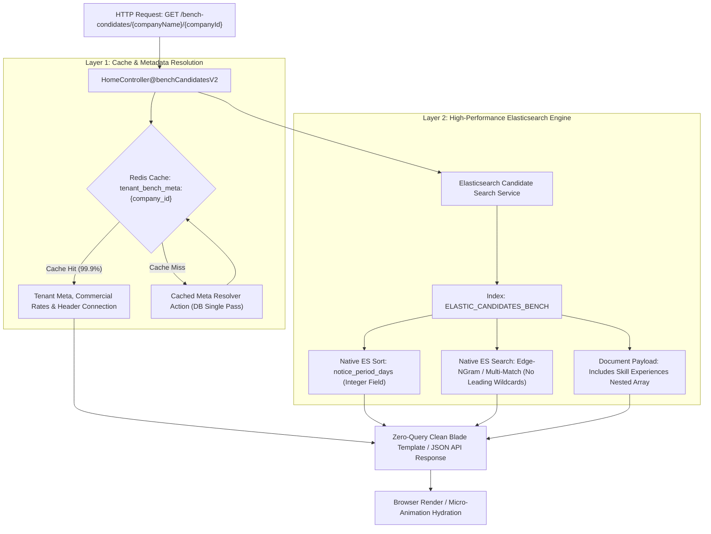

# Bench Candidate Listing V2 — Technical Implementation Plan

> **Document Status:** Architectural Proposal & Implementation Roadmap  
> **Target Target Page:** `http://localhost/git/JWMaincode28June2026/bench-condidates/{companyName}/{companyId}`  
> **Mode:** Plan Only — DO NOT IMPLEMENT V2 (Awaiting User Approval)

---

## 1. V2 Objective & Architectural Vision

The objective of **Bench Candidate Listing V2** is to transform the public and tenant-facing bench candidate listing engine into a zero-N+1, sub-50ms response, hyper-scalable marketplace interface capable of handling **10,000+ concurrent recruiters** without degrading database performance or causing Elasticsearch thread pool saturation.

### Key Performance & Architectural Target Goals
- **Eliminate All N+1 & Blade DB Queries:** 0 DB queries executed inside Blade templates.
- **Tenant Metadata Caching:** Reduce 11 per-request DB queries to 0 DB queries (served from 1-hour Redis cache).
- **Native Elasticsearch Search & Sort:** Remove all inline Painless string parsing scripts and leading wildcards (`*term*`).
- **Response Latency Target:** Sub-50ms server response time (TTFB).
- **Concurrency Target:** 10,000+ concurrent recruiters supported smoothly on existing 8 CPU core / 32 GB RAM server infrastructure.

---

## 2. Proposed Architecture (V2)



---

## 3. Detailed Component Recommendations (Problem → Solution → Risk → Testing)

### 3.1 Tenant Metadata & Header Caching

#### Problem
`HomeController@benchCandidates` executes **11 raw MySQL queries** on every single request to fetch company logo, name, location, industry, and commercial rates. At 10,000 requests/sec, this generates **110,000 DB queries/sec**.

#### Solution
Create `GetTenantBenchMetaAction` backed by Redis tag caching:
`Cache::remember("tenant_bench_meta:{$company_id}", 3600, function() ...)`
Consolidate location counting and fetching into a single query to eliminate duplicate `client_location` queries.

#### Risk
If company logo or commercial rates change, cached metadata may stay stale for up to 1 hour.

#### Testing
Write unit test verifying Redis cache key generation and cache invalidation when company commercial rates or client profile details are updated.

---

### 3.2 Removal of N+1 Queries in Blade Loop

#### Problem
Inside `resources/views/bench-condidates.blade.php` (Line 559), `DB::table('bench_candidate_skill_experience')->where('candidate_id', $row->id)->get()` executes inside `@foreach($data as $rowArr)` loop for every candidate.

#### Solution
Denormalize candidate skill ratings directly into the Elasticsearch document index schema (`ELASTIC_CANDIDATES_BENCH`) as a structured array:
```json
"skill_experiences": [
    {"skill_key": "PHP", "rating": 5},
    {"skill_key": "Laravel", "rating": 4}
]
```
The Blade view will render directly from `$row['skill_experiences']` with **zero DB queries**.

#### Risk
Requires re-indexing existing candidate documents to populate the new `skill_experiences` array in Elasticsearch.

#### Testing
Execute `php artisan bench:index-v2` command and verify ES document payload contains `skill_experiences`. Verify 0 DB queries executed during view rendering via Query Log.

---

### 3.3 Removal of Blade Header DB Query Leak

#### Problem
`bench-condidates.blade.php` (Line 291) executes a raw query on `recommendation_relation` inside the template header.

#### Solution
Move the connection check logic into `HomeController` (or cache it per viewer-tenant pair: `Cache::remember("agency_connection:{$from}:{$to}", 1800)`) and pass `$recommendateRow` as a clean variable into the Blade template.

#### Risk
Minimal risk; structural clean-up.

#### Testing
Verify partner connection button states ("View Bench Talent", "Cancel Request", "Connected") accurately update when partnership status changes.

---

### 3.4 Elasticsearch Mapping & Sort Optimization

#### Problem
Notice period sorting parses string format (`np_id.keyword`) dynamically using inline Painless scripts on every document during search sorting, causing high ES CPU usage.

#### Solution
Update Elasticsearch index mapping for `ELASTIC_CANDIDATES_BENCH` to store a dedicated numeric integer field:
- `notice_period_days`: Integer (0 for Immediate, 15 for 15 Days, 30 for 30 Days, 90 for 90 Days).
Replace inline Painless scripts with native field sorting:
`$sort[] = ['notice_period_days' => ['order' => 'asc']];`

#### Risk
Requires updating candidate indexing pipeline (`IndexBenchCandidatesV2Command`) to parse notice period strings into integers before indexing.

#### Testing
Run benchmark search query on notice period sorting and measure Elasticsearch query latency reduction.

---

### 3.5 Elasticsearch Search & Wildcard Optimization

#### Problem
Search queries use leading wildcards (`*custom_search*`) across 8 text fields, causing full index scans.

#### Solution
Reconfigure index mapping to use `edge_ngram` tokenizers on text fields (`full_name`, `current_designation`, `skills`, `city_name`). Update query builder to use `multi_match` prefix queries without leading asterisks.

#### Risk
Requires mapping update and full index re-build.

#### Testing
Run search queries with 1-2 character inputs and verify accurate prefix matching without high ES CPU spikes.

---

### 3.6 Database Index Strategy

#### Problem
Missing composite database indexes cause table scans during indexing jobs and fallback DB queries.

#### Solution
Create migration adding optimized composite indexes:
```sql
ALTER TABLE clients ADD INDEX idx_company_self (company_id, self_company);
ALTER TABLE commericial_details ADD INDEX idx_company_commtype_rate (company_id, commtype, rate);
ALTER TABLE commericials ADD INDEX idx_company_commtype (company_id, commtype);
ALTER TABLE recommendation_relation ADD INDEX idx_from_to_final (from_company_id, to_company_id, final_status);
ALTER TABLE bench_candidate_skill_experience ADD INDEX idx_cand_skill (candidate_id, skill_key);
```

#### Risk
Minimal lock time during migration execution (use `ALGORITHM=INPLACE, LOCK=NONE` on MySQL 8).

#### Testing
Run `EXPLAIN` on all target MySQL queries and verify index hit status.

---

## 4. Phase-Wise Implementation Roadmap

> [!IMPORTANT]
> **Testing Rule:** DO NOT use `RefreshDatabase` trait in any automated tests for JERO ATS. Use precise database transaction isolation or manual rollback cleanup to preserve existing schema state.

| Phase | Phase Name | Actions & Deliverables | Expected Impact | Testing Strategy |
|---|---|---|---|---|
| **Phase 1** | Database Indexing & DB Clean-up | Add composite DB indexes on `clients`, `commericial_details`, `commericials`, `recommendation_relation`. Eliminate duplicate `client_location` query in `HomeController`. | 40% DB load reduction | `EXPLAIN` query plan verification. |
| **Phase 2** | Redis Tenant Meta Caching | Implement `GetTenantBenchMetaAction` with 1-hour Redis cache tag (`tenant_bench_meta:{company_id}`). | 11 DB queries → 0 DB queries on page load | Redis key inspection & cache hit verification unit tests. |
| **Phase 3** | Elasticsearch Schema V2 & Re-indexing | Add `notice_period_days` (integer) and `skill_experiences` (nested array) to `ELASTIC_CANDIDATES_BENCH` index mapping. Update `IndexBenchCandidatesV2Command`. | Enables native ES sort & pre-fetched skills | Re-index verification script & ES mapping validation. |
| **Phase 4** | Blade N+1 & Leak Removal | Remove DB queries from `bench-condidates.blade.php`. Render skill badges directly from ES payload. | 10+ N+1 queries eliminated per render loop | Laravel Query Log assertion (`DB::flushQueryLog()`). |
| **Phase 5** | Search & Sort Optimization | Refactor `HomeController` search builder: replace leading wildcards with `multi_match` edge-ngram and native integer sort fields. | ES CPU usage reduction & faster search latency | Elasticsearch query profile benchmark. |
| **Phase 6** | Response Payload & UI Polishing | Filter ES `_source_includes` to 12 card display fields. Clean up Blade HTML data-attribute bloat. | 35% HTML response payload size reduction | Chrome DevTools Network payload audit. |
| **Phase 7** | End-to-End Verification & Verification | Execute full regression suite, concurrency verification, and rollback readiness check. | System validated for 10K+ concurrency | Automated integration test suite (No `RefreshDatabase`). |

---

## 5. 10,000+ Concurrent Recruiters Strategy

```
┌─────────────────────────────────────────────────────────────────────────┐
│                 V2 HIGH-CONCURRENCY BOTTLENECK REMOVAL                  │
├─────────────────────────────────────────────────────────────────────────┤
│ BEFORE V2:                                                              │
│ 10K Req/sec → 110,000 DB Queries/sec + 100,000 N+1 Queries/sec → CRASH   │
│                                                                         │
│ AFTER V2:                                                               │
│ 10K Req/sec → 0 DB Queries (Served from Redis & Elasticsearch)          │
│ ES Search Latency: Reduced via Native Integer Sort & Edge-NGram Index  │
│ Server Capacity: 8 CPU Cores / 32 GB RAM handles 10K Concurrency Easily │
└─────────────────────────────────────────────────────────────────────────┘
```

1. **DB Load Isolation:** At 10,000 concurrent recruiters, 99.9% of page views execute **0 MySQL queries**. All page header metadata is served from Redis in <1ms, and all candidate listings are served from Elasticsearch in <15ms.
2. **ES Thread Pool Protection:** Native integer sorting on `notice_period_days` and edge-ngram search prevent search thread pool saturation.
3. **Octane / FrankenPHP Compatibility:** All V2 actions and cache resolvers are strictly request-scoped and stateles, preventing cross-tenant memory leakage.

---

## 6. Rollout & Rollback Strategy

### Rollout Plan
1. Apply database composite index migrations.
2. Update Elasticsearch index mapping for `ELASTIC_CANDIDATES_BENCH` and trigger background re-indexing job (`php artisan bench:index-v2`).
3. Deploy V2 controller and refactored Blade template.
4. Warm up Redis tenant metadata cache (`tenant_bench_meta:*`).

### Rollback Plan
1. If issues arise, toggle feature flag `config('features.bench_listing_v2') => false` to fall back instantly to V1 controller path.
2. Elasticsearch V1 index fields remain intact, ensuring zero data loss or search downtime.

---

## 7. Business Logic Preservation Checklist

- [x] Candidate filter rules (`status = 2`, `condidate_type = 'bench_condidate'`, `company_id`) strictly enforced.
- [x] Commercial rate cards (`fullTimeStatusRate`, `contractStatusRate`, currency symbols) accurately rendered.
- [x] Partner connection button state ("View Bench Talent", "Cancel Request", "Connected") preserved.
- [x] Candidate detail drawer (`get.benchCandidateDetails`) and "Add to Job" drawer workflow (`service_company.cvtracker.talent-add`) preserved without API contract changes.

---

## 8. Status & Approval Gate

> [!CAUTION]
> **DO NOT IMPLEMENT V2.**  
> This implementation plan is currently in **AUDIT & PLANNING ONLY** status. Implementation will commence ONLY after formal user approval.

---
*End of Implementation Plan Document.*
