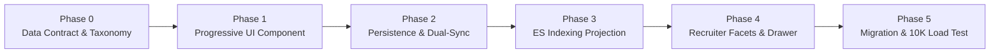

# Work Authorization & Placement Eligibility — Enterprise Architecture, Audit & Multi-Phase Implementation Plan (V2)

> **Document Version:** 2.0 (Post-Architectural Review & Decoupling)  
> **Status:** Architecture Approved / Ready for Phased Execution  
> **Scope:** Service Company Bench Candidate Creation & Lifecycle (`resources/views/service_company/bench-candidates/create.blade.php`), Data Persistence, Elasticsearch Projection, and Recruiter Marketplace Discovery.  
> **Core Architectural Principle:** Decouple legal right-to-work, tax engagement eligibility, sponsorship context, expiration tracking, and verification into a normalized **Work Authorization Profile**. Preserve `visastatu` strictly as a backward-compatible projection.

---

## 1. Executive Summary & Review Verdict

The initial audit diagnosed the symptoms: a 5-item hardcoded select, domain inaccuracies (`F1` as work authorization), zero multi-geo support, and a copy-pasted UI banner. 

However, cramming country, visa type, sponsorship, C2C/W2 eligibility, expiration, clearance, and verification into a single column (`visastatu`) is an architectural anti-pattern. 

```
┌─────────────────────────────────────────────────────────────────────────────────┐
│                           ARCHITECTURAL ANTI-PATTERN                            │
│  Attempting to make `visastatu` answer: Legal Right + Country + Sponsorship +   │
│  Tax Engagement (C2C/W2) + Expiry + Verification in one flat string.            │
└─────────────────────────────────────────────────────────────────────────────────┘
                                       ▼
┌─────────────────────────────────────────────────────────────────────────────────┐
│                       ENTERPRISE V2 MULTI-DIMENSIONAL MODEL                      │
│                                                                                 │
│   1. Work Authorization (Country + Legal Right to Work + Permit Code)           │
│   2. Sponsorship Context (Not Required / May Require Later / Required)         │
│   3. Engagement Eligibility (C2C, W2, 1099, Direct Hire - Tax/Contract Model)   │
│   4. Authorization Expiry (Conditional date picker & countdown alerts)          │
│   5. Verification State (Self-Declared vs Document Provided vs Verified)       │
│   6. Backward Compatibility Projection (`visastatu` preserved as display sync) │
└─────────────────────────────────────────────────────────────────────────────────┘
```

---

## 2. Multi-Dimensional Information Architecture

### Dimension 1: Work Authorization (Where & What)
- **Work Jurisdiction / Country:** Country where the candidate is legally permitted to work (US, CA, IN, UK, UAE, SG, AU, Other).
- **Authorization Category:**
  - Citizen
  - Permanent Resident
  - Open Work Permit
  - Employer-Specific Work Permit
  - Student / Training Authorization
  - Not Applicable / Global Remote
- **Canonical Authorization Code:** Stable, immutable identifiers (e.g., `US_CITIZEN`, `US_H1B`, `CA_PR`, `IN_CITIZEN`, `SG_EP`).

### Dimension 2: Sponsorship Profile
Immigration sponsorship is not a universal constant; it is contextual to the hiring company and role:
- `NOT_REQUIRED`: Candidate holds unrestricted authorization (Citizen, PR, EAD).
- `FUTURE_REQUIRED`: Valid today, but will eventually require employer sponsorship petition (e.g. STEM-OPT, temporary permit).
- `IMMEDIATE_REQUIRED`: Requires visa transfer or new petition sponsor prior to day 1 (e.g. H-1B transfer, E-3, O-1).
- `Sponsorship Notes`: Optional text for recruiter context (e.g. *"I-140 approved, priority date 2018"*).

### Dimension 3: Engagement Eligibility (Commercial Model)
> **Separation Principle:** Immigration authorization is legal compliance. C2C / W2 / 1099 is tax and commercial contracting. They must never be merged.
- `C2C` (Corp-to-Corp): Prime vendor / employer-to-client staffing.
- `W2`: Direct vendor payroll or client payroll.
- `1099`: Independent contractor / self-employed.
- `DIRECT_HIRE`: Permanent full-time placement.

### Dimension 4: Expiration & Temporal Validity
- Displayed conditionally: Only shown when an authorization is expiring or temporary.
- Fields: `Valid From` (optional), `Valid Until` (date).
- Dynamic Recruiter Flags:
  - `ACTIVE_HEALTHY` (> 90 days remaining)
  - `EXPIRING_SOON` (30–90 days remaining — warning indicator)
  - `CRITICAL` (< 30 days remaining — urgent extension required)
  - `EXPIRED` (Expired date — submission blocked/flagged)

### Dimension 5: Verification & Trust State
JERO does not certify legal status unless verified through an authoritative workflow:
- `SELF_DECLARED`: Candidate or agency recruiter entered details without document upload.
- `DOCUMENT_PROVIDED`: Right-to-work documents uploaded (I-797, Passport, EAD copy, Work permit).
- `VERIFIED`: Operations/compliance team reviewed and approved documents.
- `VERIFICATION_EXPIRED`: Periodic re-verification required (e.g. updated I-9 reverification).

---

## 3. Configuration-Driven Taxonomy (`config/work_authorization.php`)

To prevent hardcoded business logic and endless Blade modifications, all taxonomies are defined in a centralized configuration file:

```php
<?php
// config/work_authorization.php — Canonical Taxonomies for Global Work Authorization & Compliance.
// Decouples UI presentation, stable database codes, and Elasticsearch indexing facets.

return [
    'jurisdictions' => [
        'US' => [
            'label' => 'United States',
            'categories' => [
                'CITIZEN' => [
                    'label' => 'Citizenship & Permanent Residency',
                    'items' => [
                        'US_CITIZEN' => ['label' => 'US Citizen (USC)', 'expires' => false, 'default_sponsorship' => 'NOT_REQUIRED'],
                        'US_PERMANENT_RESIDENT' => ['label' => 'Permanent Resident (Green Card)', 'expires' => false, 'default_sponsorship' => 'NOT_REQUIRED'],
                    ],
                ],
                'EAD' => [
                    'label' => 'Employment Authorization Document (EAD)',
                    'items' => [
                        'US_GC_EAD' => ['label' => 'GC-EAD (Adjustment of Status)', 'expires' => true, 'default_sponsorship' => 'NOT_REQUIRED'],
                        'US_H4_EAD' => ['label' => 'H-4 EAD (Spouse Dependent)', 'expires' => true, 'default_sponsorship' => 'NOT_REQUIRED'],
                        'US_L2_EAD' => ['label' => 'L-2 / L-2S EAD', 'expires' => true, 'default_sponsorship' => 'NOT_REQUIRED'],
                        'US_OPT_EAD' => ['label' => 'OPT / STEM-OPT EAD', 'expires' => true, 'default_sponsorship' => 'FUTURE_REQUIRED'],
                        'US_OTHER_EAD' => ['label' => 'Other US EAD (TPS / Asylee)', 'expires' => true, 'default_sponsorship' => 'NOT_REQUIRED'],
                    ],
                ],
                'TEMPORARY_WORK' => [
                    'label' => 'Non-Immigrant Work Visas',
                    'items' => [
                        'US_H1B' => ['label' => 'H-1B (Specialty Occupation)', 'expires' => true, 'default_sponsorship' => 'IMMEDIATE_REQUIRED'],
                        'US_TN' => ['label' => 'TN Visa (USMCA - Canada/Mexico)', 'expires' => true, 'default_sponsorship' => 'FUTURE_REQUIRED'],
                        'US_E3' => ['label' => 'E-3 (Australian Specialty)', 'expires' => true, 'default_sponsorship' => 'IMMEDIATE_REQUIRED'],
                        'US_O1' => ['label' => 'O-1 (Extraordinary Ability)', 'expires' => true, 'default_sponsorship' => 'IMMEDIATE_REQUIRED'],
                        'US_L1' => ['label' => 'L-1 (Intracompany Transferee)', 'expires' => true, 'default_sponsorship' => 'IMMEDIATE_REQUIRED'],
                        'US_CPT' => ['label' => 'CPT (Student Curricular Training)', 'expires' => true, 'default_sponsorship' => 'FUTURE_REQUIRED'],
                    ],
                ],
            ],
        ],

        'CA' => [
            'label' => 'Canada',
            'categories' => [
                'GENERAL' => [
                    'label' => 'Status & Work Permits',
                    'items' => [
                        'CA_CITIZEN' => ['label' => 'Canadian Citizen', 'expires' => false, 'default_sponsorship' => 'NOT_REQUIRED'],
                        'CA_PR' => ['label' => 'Permanent Resident (PR)', 'expires' => false, 'default_sponsorship' => 'NOT_REQUIRED'],
                        'CA_OPEN_WP' => ['label' => 'Open Work Permit / PGWP', 'expires' => true, 'default_sponsorship' => 'FUTURE_REQUIRED'],
                        'CA_CLOSED_WP' => ['label' => 'Employer-Specific / LMIA Work Permit', 'expires' => true, 'default_sponsorship' => 'IMMEDIATE_REQUIRED'],
                    ],
                ],
            ],
        ],

        'IN' => [
            'label' => 'India',
            'categories' => [
                'GENERAL' => [
                    'label' => 'Indian Right to Work',
                    'items' => [
                        'IN_CITIZEN' => ['label' => 'Indian Citizen / Domestic Right to Work', 'expires' => false, 'default_sponsorship' => 'NOT_REQUIRED'],
                        'IN_OCI_PIO' => ['label' => 'OCI / PIO Cardholder', 'expires' => false, 'default_sponsorship' => 'NOT_REQUIRED'],
                        'IN_WORK_VISA' => ['label' => 'Employment Visa (India)', 'expires' => true, 'default_sponsorship' => 'IMMEDIATE_REQUIRED'],
                    ],
                ],
            ],
        ],

        'UK' => [
            'label' => 'United Kingdom',
            'categories' => [
                'GENERAL' => [
                    'label' => 'UK Right to Work',
                    'items' => [
                        'UK_CITIZEN' => ['label' => 'British Citizen', 'expires' => false, 'default_sponsorship' => 'NOT_REQUIRED'],
                        'UK_ILR' => ['label' => 'Indefinite Leave to Remain (ILR)', 'expires' => false, 'default_sponsorship' => 'NOT_REQUIRED'],
                        'UK_SKILLED_WORKER' => ['label' => 'Skilled Worker / Tier 2 Visa', 'expires' => true, 'default_sponsorship' => 'IMMEDIATE_REQUIRED'],
                        'UK_GRADUATE' => ['label' => 'Graduate / Youth Mobility Visa', 'expires' => true, 'default_sponsorship' => 'FUTURE_REQUIRED'],
                    ],
                ],
            ],
        ],

        'AE' => [
            'label' => 'United Arab Emirates & GCC',
            'categories' => [
                'GENERAL' => [
                    'label' => 'UAE & Gulf Work Authorizations',
                    'items' => [
                        'AE_GOLDEN_VISA' => ['label' => 'UAE Golden Visa (10-Year Self-Sponsored)', 'expires' => true, 'default_sponsorship' => 'NOT_REQUIRED'],
                        'AE_GREEN_VISA' => ['label' => 'UAE Green Visa (5-Year Skilled / Freelance)', 'expires' => true, 'default_sponsorship' => 'NOT_REQUIRED'],
                        'AE_EMPLOYMENT_VISA' => ['label' => 'UAE Employment Residence Visa (Company / Freezone)', 'expires' => true, 'default_sponsorship' => 'IMMEDIATE_REQUIRED'],
                        'AE_FREELANCE_VISA' => ['label' => 'UAE Freelance / Remote Work Visa', 'expires' => true, 'default_sponsorship' => 'NOT_REQUIRED'],
                        'AE_NATIONAL' => ['label' => 'UAE / GCC National', 'expires' => false, 'default_sponsorship' => 'NOT_REQUIRED'],
                        'GCC_IQAMA' => ['label' => 'GCC Resident Work Permit / Iqama', 'expires' => true, 'default_sponsorship' => 'IMMEDIATE_REQUIRED'],
                    ],
                ],
            ],
        ],

        'SG' => [
            'label' => 'Singapore',
            'categories' => [
                'GENERAL' => [
                    'label' => 'Singapore Work Passes',
                    'items' => [
                        'SG_CITIZEN' => ['label' => 'Singapore Citizen (SC)', 'expires' => false, 'default_sponsorship' => 'NOT_REQUIRED'],
                        'SG_PR' => ['label' => 'Singapore Permanent Resident (PR)', 'expires' => false, 'default_sponsorship' => 'NOT_REQUIRED'],
                        'SG_EP' => ['label' => 'Employment Pass (EP)', 'expires' => true, 'default_sponsorship' => 'IMMEDIATE_REQUIRED'],
                        'SG_SPASS' => ['label' => 'S Pass (Skilled Staff)', 'expires' => true, 'default_sponsorship' => 'IMMEDIATE_REQUIRED'],
                        'SG_ONE_PASS' => ['label' => 'ONE Pass / Tech.Pass / PEP', 'expires' => true, 'default_sponsorship' => 'NOT_REQUIRED'],
                        'SG_LOC_DP' => ['label' => 'Letter of Consent (LOC / Dependant Pass)', 'expires' => true, 'default_sponsorship' => 'NOT_REQUIRED'],
                    ],
                ],
            ],
        ],

        'AU' => [
            'label' => 'Australia & New Zealand',
            'categories' => [
                'GENERAL' => [
                    'label' => 'Australia & NZ Right to Work',
                    'items' => [
                        'AU_CITIZEN_PR' => ['label' => 'Australian Citizen / Permanent Resident', 'expires' => false, 'default_sponsorship' => 'NOT_REQUIRED'],
                        'AU_TSS_482' => ['label' => 'TSS Visa (Subclass 482 - Temporary Skill)', 'expires' => true, 'default_sponsorship' => 'IMMEDIATE_REQUIRED'],
                        'AU_SKILLED_189_190' => ['label' => 'Skilled Work Visa (Subclass 189 / 190)', 'expires' => false, 'default_sponsorship' => 'NOT_REQUIRED'],
                        'AU_GRADUATE_485' => ['label' => 'Temporary Graduate Visa (Subclass 485)', 'expires' => true, 'default_sponsorship' => 'FUTURE_REQUIRED'],
                        'NZ_CITIZEN_PR' => ['label' => 'New Zealand Citizen / Resident', 'expires' => false, 'default_sponsorship' => 'NOT_REQUIRED'],
                    ],
                ],
            ],
        ],

        'GLOBAL' => [
            'label' => 'European Union & Global',
            'categories' => [
                'GENERAL' => [
                    'label' => 'International & Other',
                    'items' => [
                        'EU_CITIZEN' => ['label' => 'EU / EEA Citizen', 'expires' => false, 'default_sponsorship' => 'NOT_REQUIRED'],
                        'EU_BLUE_CARD' => ['label' => 'EU Blue Card', 'expires' => true, 'default_sponsorship' => 'IMMEDIATE_REQUIRED'],
                        'GLOBAL_AUTH_PERMIT' => ['label' => 'Authorized Work Permit (Country Specific)', 'expires' => true, 'default_sponsorship' => 'NOT_REQUIRED'],
                        'GLOBAL_REQUIRES_SPONSOR' => ['label' => 'Requires International Visa Sponsorship', 'expires' => false, 'default_sponsorship' => 'IMMEDIATE_REQUIRED'],
                        'NOT_APPLICABLE' => ['label' => 'Not Applicable / Global Remote Contractor', 'expires' => false, 'default_sponsorship' => 'NOT_REQUIRED'],
                    ],
                ],
            ],
        ],
    ],
];
```

---

## 4. Data Migration & Legacy Preservation (Zero Data Corruption)

### The Fallacy of Silent Reinterpretation
Historical candidate records with `F1` or `L1` must **never be silently converted** into `OPT-EAD` or another permit:
- A candidate saved with `F1` in 2024 might simply be a student without work authorization, or might have CPT or OPT. Converting it silently is **data corruption**.
- Legacy values are tagged with an explicit **Normalization Confidence State**:
  - `VERIFIED_CANONICAL`: New submission or edited selection using verified taxonomy code.
  - `LEGACY_MAPPED`: Unambiguous historical mapping (e.g., `H1B` → `US_H1B`, `Green Card` → `US_PERMANENT_RESIDENT`).
  - `LEGACY_UNVERIFIED`: Ambiguous historical values (e.g., `F1`, `L1`, custom text). Rendered as **`Legacy Value (Unverified: F1)`** with an alert badge in recruiter view prompting confirmation.

### Dual-Layer Storage Contract
```
┌─────────────────────────────────────────────────────────────┐
│  MySQL Database                                             │
├─────────────────────────────────────────────────────────────┤
│  1. `bench_applications.visastatu` (Preserved String)       │
│     • Kept 100% in sync for backward compatibility.         │
│     • Stores human-readable display string or legacy text.  │
│                                                             │
│  2. `bench_additional_detail` / JSON Metadata Store         │
│     • `work_auth_code`: "US_H1B" (Canonical key)           │
│     • `work_auth_country`: "US"                             │
│     • `work_auth_sponsorship`: "NOT_REQUIRED"              │
│     • `work_auth_engagement`: ["C2C", "W2"]                │
│     • `work_auth_expires_at`: "2027-08-31"                  │
│     • `work_auth_verification`: "SELF_DECLARED"             │
│     • `work_auth_confidence`: "VERIFIED_CANONICAL"          │
└─────────────────────────────────────────────────────────────┘
```

---

## 5. Elasticsearch Read Projection (CQRS Architecture)

In adherence to Rule 2 (Elasticsearch is ONLY for Read), queries and filters in candidate listings and drawers do NOT parse unstructured text. 

The candidate index projection contains a dedicated, strongly-typed `work_authorization` object:

```json
{
  "work_authorization": {
    "jurisdiction": "US",
    "code": "US_H1B",
    "category": "TEMPORARY_WORK",
    "display_label": "H-1B (Specialty Occupation)",
    "sponsorship_requirement": "IMMEDIATE_REQUIRED",
    "engagement_models": ["C2C", "W2"],
    "has_expiry": true,
    "expires_at": "2027-08-31",
    "expiry_bucket": "HEALTHY",
    "verification_status": "SELF_DECLARED",
    "normalization_confidence": "VERIFIED_CANONICAL"
  }
}
```

### Recruiter Filtering Facets (Sub-30ms ES Queries)
Recruiters can now execute compound, authoritative searches with zero DB load:
```json
{
  "query": {
    "bool": {
      "filter": [
        { "term": { "work_authorization.jurisdiction": "US" } },
        { "terms": { "work_authorization.code": ["US_CITIZEN", "US_PERMANENT_RESIDENT", "US_GC_EAD", "US_H1B"] } },
        { "term": { "work_authorization.engagement_models": "C2C" } },
        { "range": { "work_authorization.expires_at": { "gte": "now+180d" } } }
      ]
    }
  }
}
```

---

## 6. Progressive Disclosure UI Design (15.6" Screen Fit)

Rather than overwhelming the recruiter with a giant compliance block, the card uses a clean **Progressive Disclosure** pattern:

### 1. Primary View (Clean & Compact)
- **Work Jurisdiction / Country:** Curated country select (defaults to candidate's Location country if selected).
- **Work Authorization:** Filtered select showing relevant status options for that country.
- **Sponsorship Pill Selector:** `[ Not Required ]` `[ May Require Later ]` `[ Required ]`.
- **Engagement Eligibility:** Checkbox pills `[ C2C ]` `[ W2 ]` `[ 1099 ]` `[ Direct Hire ]`.

### 2. Secondary View (Conditional & Progressive)
- **Authorization Expiry:** Revealed automatically only when a temporary/expiring status is selected (`has_expiry = true`).
- **Expand Advanced Compliance (`+ Additional Details`):**
  - Verification State (`Self-Declared` vs `Document Provided`).
  - Sponsorship Context / Notes (e.g. I-140 approval date, petition receipt number).

### 3. Responsive Metronic Standards (Rule 14)
- Scoped strictly under `#talent_create_app`.
- Poppins font, max font 14px, 12px for badges/hints.
- 100% responsive for 1366×768 (standard laptop) and 1920×1080 (full HD desktop) with internal scrolling and zero viewport overflow.

---

## 7. Revised 6-Phase Implementation Roadmap



### Phase 0: Data Contract & Taxonomy
- Create `config/work_authorization.php` with canonical jurisdictions, codes, labels, expiry rules, and default sponsorship.
- Define canonical code list (`US_CITIZEN`, `US_H1B`, etc.) and legacy mapping dictionary.

### Phase 1: Progressive UI Component
- Update `resources/views/service_company/bench-candidates/create.blade.php` to consume `config('work_authorization')`.
- Implement progressive disclosure: Primary controls (Country + Authorization + Sponsorship + Engagement) and conditional controls (Expiry date picker).
- Apply scoped Metronic styles in `_form_styles.blade.php`.

### Phase 2: Persistence & Dual-Sync
- In `ServiceCompanyBenchCandidatesController@store`:
  - Preserve `bench_applications.visastatu` with canonical display string (100% backward compatible).
  - Store structured metadata (`work_auth_code`, `work_auth_sponsorship`, `work_auth_engagement`, `work_auth_expires_at`, `work_auth_verification`).

### Phase 3: Elasticsearch Projection
- Update `GeneralMethod::indexCandidateElastic` and `ProcessCandidateUpdateJob`:
  - Map normalized `work_authorization` object into `ats_candidates_elastic`.
  - Maintain zero MySQL queries on read paths.

### Phase 4: Recruiter Discovery & Drawer Badges
- Update the bench candidate drawer (`benchCandidateDetails/public_show`) and listing card:
  - Display clean, professional badges (e.g. `[US: H-1B]` `[C2C / W2]` `[Exp: Aug 2027]`).
  - Visually flag `LEGACY_UNVERIFIED` data with a confirmation prompt.

### Phase 5: Verification, Migration & 10K Concurrency Testing
- Verify zero regression across other drawers, modals, and frozen folders (`product_company`, `staffing_company`).
- Validate responsive rendering at 1366×768 and 1920×1080.
- Execute unit and feature tests (`php artisan test`).
