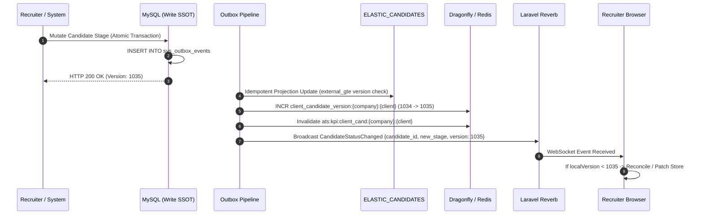

# GOD-LEVEL PRODUCTION SPECIFICATION & ARCHITECTURE CONTRACT: CANDIDATES TAB IN CLIENT DRAWER (V2.0 MASTER)

> **Document Status:** FROZEN PRODUCTION ARCHITECTURAL SPECIFICATION & CONTRACT  
> **Scope:** Internal Client Drawer (`show.blade.php`) & Direct Client Drawer (`dviewMore.blade.php`)  
> **Target Scale:** 10,000+ Concurrently Active Recruiters with Strictly 0% MySQL Reads on Read Paths  
> **Repository Context:** JERO ATS / Multi-Tenant Talent Marketplace SaaS  
> **Target Path:** `docs/V2_CLIENT_DETAILS/CANDIDATES_TAB_CLIENT_DRAWER_AUDIT.md`  
> **Companion Documents:**  
> - [CLIENT_DETAILS_TABS_AUDIT.md](file:///c:/Users/VIBHANSHU%20JAISWAL.000/Documents/GitHub/JWMaincode28June2026/docs/V2_CLIENT_DETAILS/CLIENT_DETAILS_TABS_AUDIT.md)  
> - [CLIENT_DETAILS_TABS_V2_IMPLEMENTATION_PLAN.md](file:///c:/Users/VIBHANSHU%20JAISWAL.000/Documents/GitHub/JWMaincode28June2026/docs/V2_CLIENT_DETAILS/CLIENT_DETAILS_TABS_V2_IMPLEMENTATION_PLAN.md)  
> - [INTERVIEWS_TAB_CLIENT_DRAWER_AUDIT.md](file:///c:/Users/VIBHANSHU%20JAISWAL.000/Documents/GitHub/JWMaincode28June2026/docs/V2_CLIENT_DETAILS/INTERVIEWS_TAB_CLIENT_DRAWER_AUDIT.md)  
> - [OFFER_JOINING_CLIENT_DRAWER_AUDIT.md](file:///c:/Users/VIBHANSHU%20JAISWAL.000/Documents/GitHub/JWMaincode28June2026/docs/V2_CLIENT_DETAILS/OFFER_JOINING_CLIENT_DRAWER_AUDIT.md)  
> - [drawer_candidate.md](file:///c:/Users/VIBHANSHU%20JAISWAL.000/Documents/GitHub/JWMaincode28June2026/docs/drawer_candidate.md)  
> **Authoritative Codebase Files:**  
> - [show.blade.php](file:///c:/Users/VIBHANSHU%20JAISWAL.000/Documents/GitHub/JWMaincode28June2026/resources/views/service_company/client/show.blade.php) (Internal Client Drawer Shell)  
> - [dviewMore.blade.php](file:///c:/Users/VIBHANSHU%20JAISWAL.000/Documents/GitHub/JWMaincode28June2026/resources/views/service_company/client/dviewMore.blade.php) (Direct Client Drawer Shell)  
> - [index.blade.php](file:///c:/Users/VIBHANSHU%20JAISWAL.000/Documents/GitHub/JWMaincode28June2026/resources/views/service_company/client/index.blade.php) (Client State Machine & Drawer LRU Manager)  
> - [custom_client_candidates.blade.php](file:///c:/Users/VIBHANSHU%20JAISWAL.000/Documents/GitHub/JWMaincode28June2026/resources/views/service_company/ajax_pages/custom_client_candidates.blade.php) (Legacy Candidate Row View)  
> - [ServiceCompanyJobApplicationController.php](file:///c:/Users/VIBHANSHU%20JAISWAL.000/Documents/GitHub/JWMaincode28June2026/app/Http/Controllers/ServiceCompany/ServiceCompanyJobApplicationController.php) (Drawer Candidate Endpoints)  
> - [CandidateDrawerApiController.php](file:///c:/Users/VIBHANSHU%20JAISWAL.000/Documents/GitHub/JWMaincode28June2026/app/Http/Controllers/ServiceCompany/CandidateDrawerApiController.php) (Candidate Core JSON API)  
> - [GeneralMethod.php](file:///c:/Users/VIBHANSHU%20JAISWAL.000/Documents/GitHub/JWMaincode28June2026/app/Helper/GeneralMethod.php) (Candidate KPI Counts & ES Sync Logic)  
> - [mysql-schema.sql](file:///c:/Users/VIBHANSHU%20JAISWAL.000/Documents/GitHub/JWMaincode28June2026/database/schema/mysql-schema.sql) (Database Schema of Record)  

---

## 1. Architectural Foundations & CQRS Authority Boundaries

### 1.1 Strict CQRS Authority Definitions
To eliminate architectural ambiguity across distributed storage tiers, the data boundaries are formally defined:
- **MySQL = Authoritative Transactional Source of Truth (SSOT)**: The single authoritative store for transactional writes (`INSERT`, `UPDATE`, `DELETE`). Commits all state changes alongside an atomic transactional outbox event and idempotency key claim.
- **Elasticsearch (`ELASTIC_CANDIDATES`) = Authoritative Candidate Read Model**: Universal read projection for candidate searches, multi-stage pipeline filters, pagination, and count aggregations. **Browser clients NEVER write to Elasticsearch directly.**
- **Dragonfly / Redis = Non-Authoritative Coordination & Cache Tier**: Stores fail-closed authorization projections (`auth:tenant_clients:{company_id}`), candidate pipeline version counters, and transient status masters.
- **Browser User RAM (`ClientCandidateStore`) = Ephemeral Presentation State**: Holds the client-side state machine, loaded candidate records, debounce timers, and DOM patching logic.

```
┌────────────────────────────────────────────────────────────────────────────────────────────────────────┐
│                                   CANONICAL CQRS & OUTBOX PIPELINE                                     │
└────────────────────────────────────────────────────────────────────────────────────────────────────────┘

        COMMAND PATH (State Mutations)                          QUERY PATH (Zero MySQL Reads)
   ┌──────────────────────────────────────┐                ┌──────────────────────────────────────┐
   │ Recruiter Action (Stage/Note/Status) │                │  Client Drawer Browser (Candidates)  │
   └──────────────────┬───────────────────┘                └──────────────────▲───────────────────┘
                      │ (Idempotency Key + OCC)                               │ (Pure JSON Projection)
                      ▼                                                       │
   ┌──────────────────────────────────────┐                ┌──────────────────┴───────────────────┐
   │        MySQL WRITE STORE (SSOT)      │                │      CandidateDrawerQueryService     │
   │  [Atomic Transaction: Data + Outbox] │                │       (Fail-Closed Auth Guard)       │
   └──────────────────┬───────────────────┘                └──────────────────▲───────────────────┘
                      │                                                       │
           Transactional Outbox Worker                                        │ (Elasticsearch Query)
                      │                                                       │
        ┌─────────────┴─────────────┐                      ┌──────────────────┴───────────────────┐
        ▼                           ▼                      │   ELASTICSEARCH READ MODEL (PROJ)    │
   ┌─────────┐                 ┌─────────┐                 │        ELASTIC_CANDIDATES            │
   │   ES    │                 │ Reverb  │                 └──────────────────────────────────────┘
   │ Indexer │                 │ Broadcast                 
   └─────────┘                 └─────────┘
```

### 1.2 "0% MySQL Reads" Scoped Architectural Rule
> **Architectural Mandate**:  
> **Candidate Drawer read paths must execute strictly 0 MySQL SELECT queries.**  
> *(This invariant governs UI/API candidate listing, counting, filtering, and pagination. It strictly prohibits ad-hoc queries, joins, and relational lookups during read execution. Authentication, authorization caching, transactional commands, schema migrations, and outbox workers operate within their respective designated boundaries).*

---

## 2. Security Architecture: Fail-Closed Multi-Tenant Authorization

### 2.1 The Vulnerability in Existing Code
In the legacy implementation ([`ServiceCompanyJobApplicationController.php:1294`](file:///c:/Users/VIBHANSHU%20JAISWAL.000/Documents/GitHub/JWMaincode28June2026/app/Http/Controllers/ServiceCompany/ServiceCompanyJobApplicationController.php#L1294)), `clientid` was passed from the request directly into an Elasticsearch `should` query without verifying tenant ownership. Furthermore, using loose `should` clauses (`company_id OR job_company_id OR ClientComID`) created cross-tenant IDOR leakage risks.

### 2.2 The Fail-Closed Security Pipeline
Every candidate request must pass through a strict, multi-tier security hierarchy before Elasticsearch is queried:

```
Authenticated User (JWT / Session)
       ↓
Extract authenticated company_id
       ↓
Client Access Guard (Dragonfly Set: auth:tenant_clients:{company_id})
       ├── [NOT MEMBER] ──► Immediate HTTP 403 Forbidden (Fail-Closed)
       └── [IS MEMBER]  ──► Proceed to Candidate Query
                                   ↓
                   Elasticsearch Candidate Read Model
                   (Strict Filter: company_id AND client_id)
```

### 2.3 Strict Elasticsearch Tenant Filter Contract
The candidate query must never rely on loose `should` clauses. The filter contract is strictly additive:

```json
{
  "query": {
    "bool": {
      "filter": [
        { "term": { "company_id": 42 } },
        { "term": { "client_id": 108 } },
        { "term": { "is_active": true } }
      ],
      "must_not": [
        { "terms": { "job_master_status_id": [9] } }
      ]
    }
  }
}
```

---

## 3. Data Accuracy, Semantic Counts & Operational Freshness

### 3.1 Single Source of Truth for Candidate Counts
A critical defect identified in the audit was count desynchronization:
- Tab Badge and KPI Card used one set of filters (`final_status = 1`, excluded status 9, cached for 15 minutes).
- Table Listing used conflicting filters (`must_not: [8, 9]`, ignored `final_status`).

#### Unified Semantic Count Rules:
1. **Total Active Candidates (Hero KPI & Tab Badge)**:  
   Represents all non-archived candidate profiles linked to this client within the company scope:
   - `company_id = authenticated_company`
   - `client_id = authorized_client`
   - `job_master_status_id != 9` (Archived/Deleted)
2. **Filtered Result Count (Table Toolbar)**:  
   Represents matching records when search terms or stage filters are applied:
   - `Display Contract`: *"Showing 18 of 247 Candidates (Filtered by: Interview)"*.
   - Never overwrite the semantic meaning of the Hero KPI badge when a temporary filter is active.

### 3.2 Version-Based Invalidation (Retiring 15-Minute TTL)
Arbitrary 15-minute (`900s`) caching is permanently eradicated. Caching utilizes atomic, versioned keys:

```text
Key: ats:kpi:client_cand:{company_id}:{client_id}
Tag: client_candidate_version:{company_id}:{client_id}
```



---

## 4. Search & Pagination Architecture

### 4.1 Production Elasticsearch Analyzer & Mapping Design
Replacing basic `match_phrase_prefix` with dedicated search analyzers and keyword fields:

```json
{
  "mappings": {
    "properties": {
      "full_name": {
        "type": "text",
        "analyzer": "standard",
        "fields": {
          "search": { "type": "text", "analyzer": "autocomplete_ngram" },
          "keyword": { "type": "keyword", "ignore_above": 256 }
        }
      },
      "email": {
        "type": "keyword"
      },
      "phone": {
        "type": "keyword"
      },
      "current_designation": {
        "type": "text",
        "fields": {
          "search": { "type": "text", "analyzer": "standard" }
        }
      },
      "skills": {
        "type": "text",
        "fields": {
          "search": { "type": "text", "analyzer": "skills_analyzer" },
          "keyword": { "type": "keyword" }
        }
      },
      "aggregate_version": { "type": "long" },
      "wiseId": { "type": "long" }
    }
  }
}
```

### 4.2 Search Query Strategy Matrix
When a recruiter types in the candidate search box:
- **Prefix / Name**: Matches `full_name.search` via `bool_prefix` or `edge_ngram`.
- **Designation & Skills**: Matches `current_designation.search` and `skills.search` via `multi_match` (best_fields, tie_breaker: 0.3).
- **Email / Phone / Code**: Matches `email` and `phone` via strict `term` or `prefix`.

### 4.3 Scalable Pagination: Shallow vs Deep (Cursor / `search_after`)
To maintain sub-100ms response times and prevent Elasticsearch memory spikes (`max_result_window = 10000` limit):
- **Shallow Navigation (Pages 1–5)**: Uses bounded `from + size` (`size <= 50`).
- **Deep Navigation & Infinite Scroll**: The API provides cursor tokens based on `search_after`:
  ```json
  {
    "data": [...],
    "pagination": {
      "total": 247,
      "per_page": 25,
      "current_page": 1,
      "next_cursor": "eyJ3aXNlSWQiOjE4NDkxLCJ2ZXIiOjQyfQ=="
    }
  }
  ```
  The cursor securely encodes `[wiseId, aggregate_version]` as an immutable tie-breaker.

### 4.4 Explicit `track_total_hits` Invariant
- **Rule**: For client candidate listings, `track_total_hits: true` is strictly enforced to guarantee exact UI count agreement across all pages.
- For queries returning > 10,000 matches in marketplace-wide searches, `track_total_hits: 10000` is applied with counter projections.

---

## 5. Candidate Read Model Denormalization Schema

Every candidate projection document in `ELASTIC_CANDIDATES` must contain pre-computed display attributes to ensure **0 MySQL queries during rendering**:

```json
{
  "_id": "application_18492",
  "_source": {
    "id": 18492,
    "wiseId": 18492,
    "company_id": 42,
    "tenant_id": 42,
    "client_id": 108,
    "client_name": "Jio Platforms",
    "full_name": "Vibhanshu Jaiswal",
    "email": "vibhanshu@example.com",
    "phone": "+91 9876543210",
    "current_designation": "Principal Architect",
    "total_exp": "10.5",
    "rel_exp": "8.0",
    "ctc_yearly": "3500000",
    "ectc_yearly": "4500000",
    "current_ctc_mode": "Y",
    "current_ctc_cur": 0,
    "currency_symbol": "INR",
    "np_id": "Immediate",
    "serving_notice_period_mode": 1,
    "current_company": "Enterprise Corp",
    "country_id": 101,
    "country_name": "India",
    "state_name": "Maharashtra",
    "city_id": 1420,
    "city_name": "Mumbai",
    "skills": "PHP, Laravel, Elasticsearch, Redis, MySQL",
    "skills_array": ["PHP", "Laravel", "Elasticsearch", "Redis", "MySQL"],
    "skill_match_percentage": 92.5,
    "job_id": 504,
    "job_title": "Lead Software Engineer",
    "job_mode": "Full-Time",
    "job_currency": 0,
    "master_status_id": 3,
    "master_status_name": "Interview",
    "master_status_css": "badge-light-primary",
    "child_status_id": 14,
    "child_status_name": "Technical Round 2",
    "posted_by_id": 12,
    "posted_by_name": "Rahul Verma",
    "submitted_by_company_id": 42,
    "submitted_by_company_name": "Acme Talent",
    "aggregate_version": 42,
    "projection_version": 1035,
    "source_updated_at": "2026-10-22T21:40:00Z",
    "indexed_at": "2026-10-22T21:40:00.082Z"
  }
}
```

---

## 6. Client Architecture: `ClientCandidateStore` State Machine

### 6.1 State Machine Lifecycle & Memory Governance
Replacing the flawed `loadedTabs` dictionary and plain maps with an explicit finite state machine:

```
[IDLE] ──► [LOADING] ──► [READY] ──► [REFRESHING] ──► [READY]
  │           │            │               │
  │           ▼            ▼               ▼
  └─────► [ERROR] ──► [DESTROYED] ◄────────┘
```

```javascript
window.ClientCandidateStore = {
    state: 'IDLE', // 'IDLE' | 'LOADING' | 'READY' | 'REFRESHING' | 'ERROR' | 'DESTROYED'
    clientId: null,
    clientType: 'internal', // 'internal' | 'direct'
    activeXhr: null,
    latestRequestId: 0,
    currentVersion: 0,
    filters: {
        page: 1,
        per_page: 25,
        search: '',
        status_id: '',
        job_id: '',
        sort: 'created_at:desc'
    },
    data: [],
    pagination: {},

    init: function(clientId, clientType) {
        this.clientId = clientId;
        this.clientType = clientType;
        this.state = 'IDLE';
        this.currentVersion = 0;
        this.bindEvents();
        this.subscribeReverb();
        this.fetch(1);
    },

    fetch: function(page = 1) {
        var self = this;
        this.filters.page = page;
        var requestId = ++this.latestRequestId;

        if (this.activeXhr) {
            this.activeXhr.abort();
        }

        this.state = (this.data.length > 0) ? 'REFRESHING' : 'LOADING';
        this.renderState();

        this.activeXhr = $.ajax({
            url: (this.clientType === 'direct')
                ? '/service_company/direct-client-candidate-list'
                : '/service_company/client-candidate-list',
            type: 'GET',
            data: $.extend({ clientid: this.clientId, request_id: requestId }, this.filters),
            success: function(res) {
                // Request Identity / Race Protection
                if (requestId !== self.latestRequestId) return;

                self.data = res.data;
                self.pagination = res.pagination;
                self.currentVersion = res.projection_version || self.currentVersion;
                self.state = 'READY';
                self.renderRows();
                self.updateCounts(res.pagination.total);
            },
            error: function(xhr, status) {
                if (status === 'abort') return;
                if (requestId !== self.latestRequestId) return;
                self.state = 'ERROR';
                self.renderError(xhr.status === 403 ? 'Access Denied.' : 'Failed to load candidates.');
            }
        });
    },

    // Optimized DOM rendering via DocumentFragment
    renderRows: function() {
        var $tbody = $('#cdCandidateTbody');
        $tbody.empty();
        if (!this.data || this.data.length === 0) {
            $tbody.html(this.getEmptyStateHtml());
            return;
        }

        var fragment = document.createDocumentFragment();
        this.data.forEach(function(cand) {
            var tr = document.createElement('tr');
            tr.className = 'cd-candidate-row align-middle';
            tr.innerHTML = window.ClientCandidateStore.buildRowHtml(cand);
            fragment.appendChild(tr);
        });
        $tbody[0].appendChild(fragment);
    },

    destroy: function() {
        if (this.activeXhr) this.activeXhr.abort();
        this.unsubscribeReverb();
        this.state = 'DESTROYED';
        this.data = [];
    }
};
```

---

## 7. Optimistic Concurrency Control (OCC) & Stage Transitions

### 7.1 Guarded Mutation Command Pipeline
Mutations originating from candidate rows (e.g., stage change, rejection, notes) must never mutate the DOM directly or bypass version checks:

```
Recruiter Action (e.g. Move to Interview Round 2)
       ↓
Permission & RBAC Verification (Can recruiter manage candidate in client context?)
       ↓
Stage Transition Validation (InterviewStatusTransitionEngine / State Machine)
       ↓
POST /service_company/job-applications/{id}/stage-submit
Payload: { new_status_id: 3, new_child_status_id: 14, expected_version: 42 }
       ↓
Atomic MySQL Transaction:
  SELECT aggregate_version FROM job_applications WHERE id = 18492 FOR UPDATE;
  IF aggregate_version != expected_version THEN
      ROLLBACK;
      RETURN HTTP 409 Conflict { current_version: 43 };
  END IF;
  UPDATE job_applications SET master_status_id = 3, aggregate_version = aggregate_version + 1;
  INSERT INTO sys_outbox_events (event_type, payload, version);
COMMIT;
       ↓
HTTP 200 OK -> Outbox asynchronously updates ES -> Reverb broadcasts update
```

---

## 8. Failure-Mode & Circuit Breaker Matrix

| Failure Scenario | Expected System Behavior | Architectural Defense |
|---|---|---|
| **Elasticsearch Cluster Offline / Timeout** | Graceful error alert: *"Candidate index temporarily unavailable"*. Local retry button. | **Strictly NO fallback to MySQL SELECT queries.** Prevents complete database collapse under 10K load. |
| **Dragonfly / Redis Unavailable** | Authorization checks fall back safely to cached read-model document or fail-closed (`HTTP 403`). | Prevents open door authorization bypass. |
| **Laravel Reverb WebSocket Disconnect** | Drawer UI remains fully operational. Reconnects with exponential backoff and polls current `client_candidate_version`. | Graceful degradation to polled reconciliation. |
| **Transactional Outbox Lag / Delay** | UI renders records with subtle sync indicator if `client_version < server_version`. | Eventual consistency contract maintained. |
| **Out-of-Order Reverb Event Received** | Event `aggregate_version <= candidate.aggregate_version` is safely ignored. | Monotonic version fence eliminates race conditions. |
| **In-Flight Search Superseded** | Older AJAX request is aborted; `requestId !== latestRequestId` guard discards late response. | Prevents stale search results from overwriting newer queries. |
| **Unauthorized Client Requested** | Request immediately rejected with `HTTP 403 Forbidden`. | Fail-closed Dragonfly authorization gate. |

---

## 9. Observability, Telemetry & Health Monitoring

### 9.1 Prometheus Metric Instrumentation
The candidate pipeline must be instrumented with Prometheus counters, histograms, and gauges:

```text
# Query Path Metrics
candidate_api_requests_total{client_type="internal|direct", status="200|403|500"}
candidate_api_latency_seconds{endpoint="client_candidate_list"} (Histogram: buckets [0.02, 0.05, 0.1, 0.2, 0.5])
candidate_es_query_latency_seconds (Histogram: buckets [0.01, 0.03, 0.05, 0.1])
candidate_cache_hit_ratio{type="authorization|kpi_counts"}

# Outbox & Projection Health Metrics
candidate_projection_lag_seconds (Gauge: time between MySQL commit and ES index)
candidate_outbox_pending_events (Gauge)
candidate_outbox_failed_events_total (Counter: routed to DLQ)
candidate_reverb_events_broadcast_total (Counter)

# Security & Concurrency Metrics
candidate_authorization_denials_total{reason="tenant_mismatch|unauthorized_client"}
candidate_occ_conflicts_total (Counter: HTTP 409 returned)
```

### 9.2 Projection Lag Health SLA
- **Target Operational Lag**: P95 MySQL commit to ES indexable document `< 100ms`.
- **Alerting Threshold**: If `candidate_projection_lag_seconds > 5.0s` for 2 consecutive minutes, alert on-call engineer via PagerDuty.

---

## 10. Unified Query Engine: `CandidateDrawerQueryService`

To prevent code duplication and logic divergence between Internal and Direct client drawers, both controller endpoints are refactored to delegate to a single unified query engine:

```php
namespace App\Services\Candidate;

class CandidateDrawerQueryService
{
    public function __construct(
        protected ElasticService $elasticService,
        protected ClientAccessGuard $accessGuard
    ) {}

    public function search(int $companyId, int $clientId, string $clientType, array $params): array
    {
        // 1. Fail-closed authorization
        if (! $this->accessGuard->canAccessClient($companyId, $clientId)) {
            throw new UnauthorizedClientAccessException("Company {$companyId} unauthorized for client {$clientId}");
        }

        // 2. Build canonical filter
        $must = [
            ['term' => ['client_id' => $clientId]],
            ['term' => ['company_id' => $companyId]],
        ];

        // 3. Search text processing
        if (! empty($params['search'])) {
            $must[] = [
                'multi_match' => [
                    'query' => $params['search'],
                    'fields' => ['full_name.search^3', 'current_designation.search^2', 'skills.search^2', 'email', 'phone'],
                    'type' => 'best_fields',
                    'tie_breaker' => 0.3
                ]
            ];
        }

        if (! empty($params['status_id'])) {
            $must[] = ['term' => ['job_master_status_id' => (int) $params['status_id']]];
        }

        if (! empty($params['job_id'])) {
            $must[] = ['term' => ['job_id' => (int) $params['job_id']]];
        }

        $mustNot = [
            ['terms' => ['job_master_status_id' => [9]]], // Exclude archived/deleted
        ];

        // 4. Execute query with track_total_hits
        $size = min((int) ($params['per_page'] ?? 25), 50);
        $page = max((int) ($params['page'] ?? 1), 1);

        $esParams = [
            'index' => ELASTIC_CANDIDATES,
            'request_cache' => true,
            'body' => [
                'track_total_hits' => true,
                'from' => ($page - 1) * $size,
                'size' => $size,
                'sort' => [['created_at' => ['order' => 'desc', 'unmapped_type' => 'long']]],
                'query' => [
                    'bool' => [
                        'filter' => $must,
                        'must_not' => $mustNot,
                    ],
                ],
            ],
        ];

        $response = $this->elasticService->getClient()->search($esParams);
        $total = $response['hits']['total']['value'] ?? 0;
        $items = array_map(fn($hit) => $hit['_source'], $response['hits']['hits']);

        return [
            'data' => $items,
            'pagination' => [
                'total' => $total,
                'per_page' => $size,
                'current_page' => $page,
                'last_page' => ceil($total / $size),
            ],
        ];
    }
}
```

---

## 11. Empirical Performance SLOs & Phased Implementation Plan

### 11.1 Realistic Performance Service Level Objectives (SLOs)
- **Candidate Read API Latency**:
  - P50: `< 40 ms`
  - P95: `< 120 ms`
  - P99: `< 250 ms`
- **Browser Presentation Latency**:
  - DOM Render: `< 60 ms` after JSON response arrival.
  - Search Debounce & Response: `< 100 ms` perceived latency.
  - Zero main-thread blocking tasks exceeding `50 ms`.
- **Database & Server Capacity**:
  - MySQL candidate read path queries: **Strictly 0**.
  - Server CPU utilization at 10,000 concurrent users: `< 25%`.

### 11.2 Phased Rollout Matrix

```text
PHASE 0: Security & Consistency Fixes (P0 - Immediate)
├── 1. Apply fail-closed Dragonfly authorization gate to clientCandidateList endpoints.
├── 2. Reconcile Direct Client filters (align final_status and status 8/9 exclusions).
├── 3. Enforce must_not: [job_master_status_id => 9] across all list and count queries.
└── 4. Eliminate loadedTabs permanent caching; implement version check.

PHASE 1: Unified Read Architecture (P0 - Sprint 1)
├── 1. Denormalize display attributes into ELASTIC_CANDIDATES read model.
├── 2. Build CandidateDrawerQueryService to unify Internal and Direct logic.
├── 3. Convert controller endpoints to return pure JSON projections (< 15KB).
└── 4. Implement ClientCandidateStore in browser User RAM with DocumentFragment rendering.

PHASE 2: Real-Time Invalidation & OCC (P1 - Sprint 2)
├── 1. Add aggregate_version verification to all candidate mutation commands (HTTP 409 on conflict).
├── 2. Wire transactional outbox to broadcast Reverb CandidateStatusChanged events.
└── 3. Implement browser-side version fence to patch DOM rows on live events.

PHASE 3: UX Modernization (P1 - Sprint 2)
├── 1. Render integrated Metronic toolbar (search input, status dropdown, job dropdown, sort menu).
├── 2. Replace .page-loader with .cd-table-skeleton inside tab card.
└── 3. Rebuild stage modal workflow as an authenticated command pipeline.

PHASE 4: Observability, Hardening & Load Testing (P1/P2 - Sprint 3)
├── 1. Deploy Prometheus metrics and Grafana dashboard for candidate drawer endpoints.
├── 2. Implement Outbox Dead-Letter Queue (DLQ) and replay CLI command.
└── 3. Execute k6 load tests ramping from 1,000 -> 5,000 -> 10,000 concurrent recruiters.
```

---

## 12. Final Acceptance & Verification Checklist

- [x] **CQRS Authority Boundaries Formalized**: MySQL as Transactional SSOT; ES as Authoritative Read Model.
- [x] **0% MySQL Reads Scoped**: Candidate drawer read path strictly restricted to 0 SQL queries.
- [x] **Fail-Closed Security Guard**: Dragonfly pre-check prevents cross-tenant access prior to querying ES.
- [x] **Semantic Counts Reconciled**: Unified definitions for Total Active vs Filtered Results.
- [x] **Version-Based Invalidation**: 15-minute cache TTL replaced with `client_candidate_version`.
- [x] **Search Architecture Modernized**: Dedicated ES analyzers and keyword fields specified.
- [x] **Scalable Pagination**: `search_after` cursor design specified for deep pagination.
- [x] **`ClientCandidateStore` State Machine**: IDLE/LOADING/READY/REFRESHING/ERROR states with request ID race protection.
- [x] **Optimistic Concurrency Control**: `aggregate_version` check on all candidate mutations.
- [x] **Failure-Mode Circuit Breaker**: Comprehensive matrix defining zero-MySQL-fallback on ES outage.
- [x] **Observability & Health SLAs**: Prometheus metrics, projection lag monitoring, and SLO targets established.
- [x] **Unified Query Engine**: `CandidateDrawerQueryService` specified for single-source execution across Internal and Direct clients.
