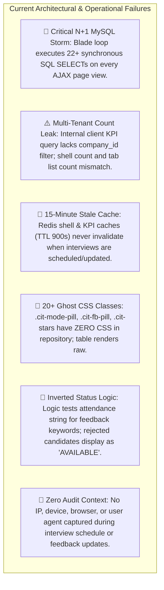
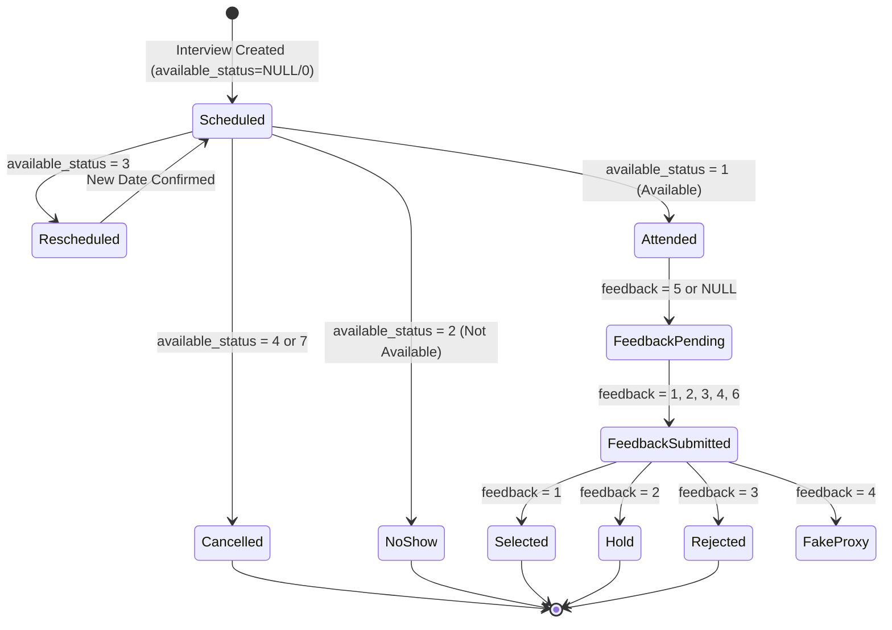

# GOD-LEVEL AUDIT REPORT: INTERVIEWS TAB IN CLIENT DRAWER

> **Scope**: Internal Client Drawer (`show.blade.php`) & Direct Client Drawer (`dviewMore.blade.php`)  
> **Target Scale**: 10,000+ Concurrently Active Recruiters with 0% Avoidable MySQL / Server Read Strain  
> **Repository Context**: JERO ATS / Talent Marketplace SaaS  
> **Target Path**: `docs/V2_CLIENT_DETAILS/INTERVIEWS_TAB_CLIENT_DRAWER_AUDIT.md`  
> **Key References**:
> - [show.blade.php](file:///c:/Users/VIBHANSHU%20JAISWAL.000/Documents/GitHub/JWMaincode28June2026/resources/views/service_company/client/show.blade.php) (Internal Client Drawer)
> - [dviewMore.blade.php](file:///c:/Users/VIBHANSHU%20JAISWAL.000/Documents/GitHub/JWMaincode28June2026/resources/views/service_company/client/dviewMore.blade.php) (Direct Client Drawer)
> - [index.blade.php](file:///c:/Users/VIBHANSHU%20JAISWAL.000/Documents/GitHub/JWMaincode28June2026/resources/views/service_company/client/index.blade.php) (Drawer LRU Cache & State Manager)
> - [custom_client_candidates_interview_tracker.blade.php](file:///c:/Users/VIBHANSHU%20JAISWAL.000/Documents/GitHub/JWMaincode28June2026/resources/views/service_company/ajax_pages/custom_client_candidates_interview_tracker.blade.php) (Interview Tracker Blade View)
> - [ServiceCompanyJobApplicationController.php](file:///c:/Users/VIBHANSHU%20JAISWAL.000/Documents/GitHub/JWMaincode28June2026/app/Http/Controllers/ServiceCompany/ServiceCompanyJobApplicationController.php) (Interview Tracker AJAX Endpoints)
> - [ServiceCompanyClientController.php](file:///c:/Users/VIBHANSHU%20JAISWAL.000/Documents/GitHub/JWMaincode28June2026/app/Http/Controllers/ServiceCompany/ServiceCompanyClientController.php) (Drawer Shell Controller)
> - [InterviewScheduleController.php](file:///c:/Users/VIBHANSHU%20JAISWAL.000/Documents/GitHub/JWMaincode28June2026/app/Http/Controllers/ServiceCompany/InterviewScheduleController.php) (Interview Mutation Controller)
> - [InterviewStatusTransitionEngine.php](file:///c:/Users/VIBHANSHU%20JAISWAL.000/Documents/GitHub/JWMaincode28June2026/app/Services/Interview/InterviewStatusTransitionEngine.php) (State Machine & Point Engine)
> - [GeneralMethod.php](file:///c:/Users/VIBHANSHU%20JAISWAL.000/Documents/GitHub/JWMaincode28June2026/app/Helper/GeneralMethod.php) (KPI Counts & ES Sync Engine)

---

## 1. Executive Summary & Critical Flaws

A comprehensive, deep architectural and code audit of the **Interviews Tab** in the **Client Drawer** was performed across both **Internal Clients** and **Direct Clients**.

While the drawer header displays an **"Interviews" KPI card** and a dedicated tab badge, the underlying subsystem is plagued by severe architectural bottlenecks, database read violations, complete lack of CSS styling for pills and ratings, inverted status logic, multi-tenant count leakage, and 15-minute stale cache windows:



### Key Audit Scorecard & Metrics
| Dimension / Metric | Current Production State | God-Level Target | Status |
| :--- | :--- | :--- | :---: |
| **MySQL Reads per Tab Load** | **22+ Synchronous SQL Queries** (N+1 in Blade) | **0% MySQL Reads (Strict CQRS / ES Only)** | 🔴 CRITICAL |
| **Tab Badge vs Table Count** | **Discrepant (Flickers/Jumps on click)** | **100% Mathematically Identical** | 🔴 CRITICAL |
| **Tenancy Isolation in Count** | **Missing `company_id` filter (Cross-tenant leak)** | **Strict Tenant & Relation Scoped** | 🔴 CRITICAL |
| **Data Freshness Guarantee** | **Stale for up to 15 minutes** (Redis + LRU lock) | **100% Fresh (Zero Stale ATS Data)** | 🔴 CRITICAL |
| **Tab Re-fetch on Switch** | **Permanently locked by `loadedTabs` flag** | **Lightweight freshness check on reactivate** | 🟡 DEFECTIVE |
| **CSS Class Availability** | **20+ `.cit-*` classes completely unstyled** | **Scoped Metronic Enterprise Design Scale** | 🔴 BROKEN |
| **Direct Client Column Widths** | **`min-w-15px` hardcoded (15px squished cells)** | **Responsive 1366×768 / 1920×1080 Grid** | 🔴 BROKEN |
| **Interview Workflow Actions** | **Zero interactive buttons** (no Join Call, no Feedback) | **Inline Actions: Join Call, View Feedback** | 🟡 DEFECTIVE |
| **Device / Browser Auditability** | **Zero audit logging** (only `update_by` & `now()`) | **Device, IP, Browser, Action Context Logged** | 🟡 DEFECTIVE |
| **10K Concurrency Readiness** | **Fails under 220,000 DB queries at 10K users** | **Passes with 0% Server Strain (Client-First)** | 🔴 UNVIABLE |

---

## 2. Pillar I: Data Accuracy & Freshness Audit

### 2.1 The Count Mismatch & Badge Flickering Bug
When a user opens the Client Drawer, the header KPI card (`#kpiInterviewsScheduledCountShow` or `#kpiInterviewsScheduledCount`) and the Interviews tab badge display an initial count. When the user clicks the "Interviews" tab, the badge and count abruptly jump to a different number.

#### Root-Cause Breakdown:
1. In [show.blade.php:L1361-L1370](file:///c:/Users/VIBHANSHU%20JAISWAL.000/Documents/GitHub/JWMaincode28June2026/resources/views/service_company/client/show.blade.php#L1361-L1370), `$kpiInterviews` is computed by calling `GeneralMethod::InternalClientCandidatesCountList($client->id)`:
```php
// app/Helper/GeneralMethod.php:15720-15727
$paramsInterview = [
    'index' => ELASTIC_INERTVIEW_TRACKER,
    'body'  => [
        'size'  => 0,
        'query' => [
            'bool' => [
                'must' => [
                    ['term' => ['client_id' => $client_id]], // 🚨 ZERO TENANT FILTER!
                ],
            ],
        ],
        'aggs' => [
            'all_interview' => ['value_count' => ['field' => 'id']],
        ],
    ],
];
```
2. But when the user clicks the "Interviews" tab, `fetchCandidatesInverViewTracker()` calls `ServiceCompanyJobApplicationController@clientCandidateInterviewTracker` ([ServiceCompanyJobApplicationController.php:L1507-L1540](file:///c:/Users/VIBHANSHU%20JAISWAL.000/Documents/GitHub/JWMaincode28June2026/app/Http/Controllers/ServiceCompany/ServiceCompanyJobApplicationController.php#L1507-L1540)), which executes a strictly scoped query:
```php
$must = [
    [
        'bool' => [
            'should' => [
                ['term' => ['job_company_id' => $company_id]],
                [
                    'bool' => [
                        'must' => [
                            ['term' => ['ClientComID' => $company_id]],
                            ['term' => ['candidate_type' => 'other']],
                        ],
                    ],
                ],
            ],
            'minimum_should_match' => 1,
        ],
    ],
    [
        'bool' => [
            'should' => [
                ['term' => ['client_id' => $client_id]],
                [
                    'bool' => [
                        'must' => [
                            ['term' => ['from_company_id' => $client_id]],
                            ['term' => ['to_company_id' => $company_id]],
                        ],
                    ],
                ],
            ],
            'minimum_should_match' => 1,
        ],
    ],
];
```
3. Because the initial aggregation did **not** filter by `job_company_id` or `ClientComID`, the initial shell count aggregates across all organizations. When the AJAX list query returns, JavaScript forcibly overrides the badge with `response.pagination.total`:
```javascript
// resources/views/service_company/client/show.blade.php:3836-3843
if (response.pagination && typeof response.pagination.total !== 'undefined') {
    $('#kpiInterviewsScheduledCountShow').text(response.pagination.total);
    var $badge = $('#tabBadgeInterviewTrackerShow');
    if ($badge.length) {
        $badge.text(response.pagination.total);
        if (response.pagination.total > 0) { $badge.show(); } else { $badge.hide(); }
    }
}
```
**Impact:** Recruiter sees e.g. "8 Interviews", clicks the tab, and the list shows 2 interviews while the count flips to "2".

---

### 2.2 The 15-Minute Stale Cache Multi-Tier Failure
JERO AI Rule 5 states: *"Recruitment pipeline data must be 100% fresh, correct, and authoritative. Latency optimization must never serve stale candidate data."*

The current drawer architecture violates this rule through 4 uncoordinated caching layers:
1. **Redis Shell Cache:** `ServiceCompanyClientController@viewMore` caches the entire rendered shell HTML for `CLIENTS_VIEWMORE_TIME` = **15 minutes** (`config/constants.php:31`).
2. **Redis KPI Count Cache:** `ats:client_kpi_v9:{$cur_company_id}:{$client->id}` and `ats:kpi:internal_client_cand:{$client_id}` are cached in Redis with a TTL of **900 seconds (15 minutes)**.
3. **Browser RAM LRU Cache:** `DrawerLRUCache` in user RAM stores up to 25 drawer HTML payloads without invalidation on interview mutations.
4. **Cache Invalidation Omission:**
   When an interview is scheduled, rescheduled, cancelled, or feedback is submitted in ATS (via `InterviewScheduleController@updateInterview` or `InterviewStatusTransitionEngine`), the system clears only:
   ```php
   GeneralMethod::cacheClean('allinterviewschedule_version_user_' . $this->user->id);
   ```
   **It never invalidates:**
   - `ats:client_kpi_v9:{$company_id}:{$client_id}`
   - `ats:direct_client_kpi_v9:{$company_id}:{$client_id}`
   - `ats:kpi:internal_client_cand:{$client_id}`
   - `ats:kpi:direct_client_cand:{$from_company_id}:{$to_company_id}`
   - `ats:clientsviewmore_v11:*`
   - Client-side browser `DrawerLRUCache`

**Consequence:** When an interview is rescheduled or feedback is updated, reopening the Client Drawer continues to display the old interview count and outdated schedule list for up to 15 minutes.

---

### 2.3 The "Single-Fetch Lock" Stale State Bug
In both [show.blade.php:L3685](file:///c:/Users/VIBHANSHU%20JAISWAL.000/Documents/GitHub/JWMaincode28June2026/resources/views/service_company/client/show.blade.php#L3685) and [dviewMore.blade.php:L3677](file:///c:/Users/VIBHANSHU%20JAISWAL.000/Documents/GitHub/JWMaincode28June2026/resources/views/service_company/client/dviewMore.blade.php#L3677):

```javascript
if (loadedTabs[target]) return; // ⚠️ Stale lock!
```

Once the user clicks the "Interviews" tab, `loadedTabs['interview_tracker'] = true`. If the user switches to the "Jobs" or "Contacts" tab, updates an interview in another browser tab, and returns to "Interviews", the tab **never refreshes** because `loadedTabs['interview_tracker']` permanently suppresses subsequent fetches.

---

## 3. Pillar II: Performance & Architecture Audit (10K Concurrency Target)

### 3.1 Severe N+1 MySQL Query Cascade in Blade Template
JERO AI Rule 1 states: **"MySQL is ONLY for Add / Edit / Delete: 0% MySQL reads on web/API request paths. No SELECT or joins on user page loads."**

Yet in [custom_client_candidates_interview_tracker.blade.php](file:///c:/Users/VIBHANSHU%20JAISWAL.000/Documents/GitHub/JWMaincode28June2026/resources/views/service_company/ajax_pages/custom_client_candidates_interview_tracker.blade.php), **every single row in the `@foreach` loop triggers TWO synchronous MySQL queries**:

```php
// N+1 Query 1: Ran on EVERY ROW in Blade loop (Line 144)
$interviewerRows = DB::table('users')
    ->select('users.id', 'users.name')
    ->where('users.company_id', '=', $row->company_id)
    ->whereIn('users.name', $interviewersArr)
    ->get();

// N+1 Query 2: Ran on EVERY ROW in Blade loop (Line 257)
if (!empty(@$row->child_status_id) && @$row->child_status_id > 0) {
    $childStatus = DB::table('candidate_status')->select('*')->where('id', $row->child_status_id)->first();
    if (!empty($childStatus)) { $stageSub = @$childStatus->name; }
}
```

In addition, at the top of the Blade template (lines 11-31):
```php
// Query 3: Top of Blade
$followupMap = DB::table('interview_schedules')
    ->whereIn('id', collect($data)->pluck('id')->all())
    ->get(['id', 'followup_status', 'followup_status_at'])
    ->keyBy('id');

// Query 4: Top of Blade
$spokRows = DB::table('job_assign')
    ->join('users', 'users.id', '=', 'job_assign.spok_user_id')
    ->whereIn('job_assign.job_id', $jobIds)
    ->select('job_assign.job_id', 'job_assign.company_id', 'users.name')
    ->get();
```

#### 10K Concurrency Blast Radius:
$$\text{Total MySQL Queries per Page Load} = 2 + 2 \times N = 22 \text{ SQL SELECTs (for } N=10 \text{ rows)}$$

When 10,000 recruiters access the Client Drawer simultaneously:
$$\text{Avoidable Database Strain} = 10,000 \times 22 = \mathbf{220,000 \text{ Synchronous MySQL Queries}}$$

This directly violates CQRS, locks FrankenPHP/Octane database worker connections, and causes HTTP 504 Gateway Timeouts.

#### The CQRS Reality: All Data Already Exists in Elasticsearch
- `child_status_name` is already indexed in `ELASTIC_INERTVIEW_TRACKER` (`GeneralMethod::interviewTrackerAddEditUpload` line 9935).
- Interviewer names are already stored as a delimited string in `$row->interviewers`. Exploding it gives the exact names without touching `users`.
- `followup_status` can be denormalized directly into `ELASTIC_INERTVIEW_TRACKER`.
- **Zero MySQL queries are necessary.**

---

### 3.2 DOM Event Listener Leak (Memory & Network Multiplication)
In both [show.blade.php:L3669](file:///c:/Users/VIBHANSHU%20JAISWAL.000/Documents/GitHub/JWMaincode28June2026/resources/views/service_company/client/show.blade.php#L3669) and [dviewMore.blade.php:L3672](file:///c:/Users/VIBHANSHU%20JAISWAL.000/Documents/GitHub/JWMaincode28June2026/resources/views/service_company/client/dviewMore.blade.php#L3672):

```javascript
$(document).on('shown.bs.tab', 'a[data-toggle="tab"], a[data-bs-toggle="tab"]', function (e) { ... });
```

Because this attaches directly to `$(document)` without a prior `.off('shown.bs.tab')`, every time a client drawer is opened or closed, **a duplicate event handler is attached to the document**. If a user inspects 5 clients in a session, clicking the Interviews tab on the 5th client fires **5 duplicate AJAX requests** simultaneously.

---

### 3.3 Element ID Collision Between Drawers
Both Internal Client ([show.blade.php:L1978](file:///c:/Users/VIBHANSHU%20JAISWAL.000/Documents/GitHub/JWMaincode28June2026/resources/views/service_company/client/show.blade.php#L1978)) and Direct Client ([dviewMore.blade.php:L2034](file:///c:/Users/VIBHANSHU%20JAISWAL.000/Documents/GitHub/JWMaincode28June2026/resources/views/service_company/client/dviewMore.blade.php#L2034)) use identical IDs:
- Table Body: `id="candidatetListinterviewtracker"`
- Pagination: `id="paginationcandidateinterviewtracker"`

When switching between an Internal and Direct client, jQuery selectors like `$('#candidatetListinterviewtracker')` resolve to the first matching element in the DOM tree, causing responses to inject into the wrong drawer body if both containers are in DOM memory.

---

### 3.4 Ghost Search Code & Missing Search Feature
In JavaScript pagination handlers:
```javascript
// resources/views/service_company/client/show.blade.php:3766
var search = $('#inputSearch').val() || '';
fetchCandidatesInverViewTracker(page, search);
```
- `#inputSearch` does not exist anywhere in the Interviews tab.
- Both backend controller endpoints (`clientCandidateInterviewTracker` and `directclientCandidateInterviewTracker`) do not read or filter by `$request->search`.
- Recruiters have **no ability to filter or search interviews** by candidate name, interviewer, job, or status in the Client Drawer.

---

## 4. Pillar III: Interview Lifecycle Verification

The ATS defines specific interview lifecycle states and evaluation sub-statuses. The Client Drawer Interviews tab exhibits multiple logic and display defects in handling these transitions:

### 4.1 Canonical State Machine



### 4.2 Defect Breakdown in State Handling

| State | Real ATS Database Representation | Current Client Drawer Behavior | Defect / Bug |
| :--- | :--- | :--- | :--- |
| **Scheduled** | `available_status = 0/NULL`, `feedback = 0/NULL` | Renders `cit-fb-default` with label `—` and muted date | No "Scheduled" or "Upcoming" badge; looks empty or missing |
| **Rescheduled** | `available_status = 3` | Label shows "Rescheduled"; sub-status shows e.g. "Candidate Rescheduled" | Class `cit-fb-default` (unstyled gray); does not highlight rescheduled status |
| **Completed / Attended** | `available_status = 1` | Primary pill displays "AVAILABLE" | **Inverted terminology:** "Available" makes no sense to a recruiter reviewing a past interview; it should state "Attended" or "Completed" |
| **Cancelled** | `available_status = 4` ("Cancel Interview") or `7` ("Cancelled by Candidate") | Shows "Cancel Interview" in unstyled pill | Does not show cancellation timestamp or reason |
| **No-Show** | `available_status = 2` | Shows "Not Available" in unstyled pill | Misleading label: Candidate did not attend / no-showed, but pill says "Not Available" |
| **Pending Feedback** | `available_status = 1` AND (`feedback = 5` OR `feedback = 0/NULL`) | Shows "Available" and "Feedback Pending" | No prominent badge or action to notify recruiter/interviewer to submit feedback |
| **Feedback: Selected** | `feedback = 1` | Main pill: "Available"; secondary text: "Selected" | **Critical Logic Bug:** Logic checks `$asLower` (which contains "available") for `'select'`. Because `'select'` is in `$feedback`, it never matches; styling falls back to unstyled default! |
| **Feedback: Rejected** | `feedback = 3` | Main pill: "Available"; secondary text: "Rejected" | Rejected candidate appears under a gray "AVAILABLE" pill! Highly confusing and unprofessional |
| **Feedback: Hold** | `feedback = 2` | Main pill: "Available"; secondary text: "Hold" | Unstyled pill, secondary text |

---

## 5. Pillar IV: UI/UX Relevance & Design Scale Audit

### 5.1 Complete Absence of CSS Styles (20+ Ghost Classes)
In [custom_client_candidates_interview_tracker.blade.php](file:///c:/Users/VIBHANSHU%20JAISWAL.000/Documents/GitHub/JWMaincode28June2026/resources/views/service_company/ajax_pages/custom_client_candidates_interview_tracker.blade.php), the markup uses **over 20 custom CSS classes that DO NOT EXIST in any CSS file or style block across the entire repository**:

```css
.cit-mode-pill, .cit-mode-online, .cit-mode-phone, .cit-mode-offline, .cit-mode-default,
.cit-level-tag, .cit-job-tags, .cit-job-type-badge, .cit-badge-internal, .cit-badge-client,
.cit-job-id-tag, .cit-date-bold, .cit-date-time, .cit-fb-pill, .cit-fb-selected,
.cit-fb-rejected, .cit-fb-hold, .cit-fb-next, .cit-fb-default, .cit-stars,
.cit-star-fill, .cit-star-empty, .cit-rating-label
```

#### Resulting UI Glitches:
- Mode pills ("Video", "Phone", "In Person") render as plain raw text with no background, border, or padding.
- Star ratings render as uncolored monochrome icons with no distinction between active (filled) and inactive (empty) stars.
- Feedback status pills render with zero styling.
- Date and time stack awkwardly without font-weight hierarchy.

---

### 5.2 Broken Table Layout in Direct Client Drawer
In [dviewMore.blade.php:L2021-L2030](file:///c:/Users/VIBHANSHU%20JAISWAL.000/Documents/GitHub/JWMaincode28June2026/resources/views/service_company/client/dviewMore.blade.php#L2021-L2030):

```html
<tr class="fw-bolder text-muted">
    <th class="min-w-150px">Name</th>
    <th class="min-w-15px">Job</th>
    <th class="min-w-15px">Interview Mode</th>
    <th class="min-w-15px">Interviewers</th>
    <th class="min-w-15px">Source</th>
    <th class="min-w-15px">Interview Date</th>
    <th class="min-w-15px">Feedback</th>
    <th class="min-w-15px">Rating</th>
    <th class="min-w-15px">Stage</th>
</tr>
```

`min-w-15px` is **15 pixels** (less than the width of an icon!). The table headers squish unpredictably depending on browser column sizing algorithms.

---

### 5.3 Missing Workflow Actions & Clickable Affordances
Every cell in the table is currently dead, view-only text:
1. **Candidate Name:** Truncated to 22 characters, not clickable. Recruiter cannot open candidate drawer or view resume.
2. **Job Title:** Truncated to 20 characters, not clickable. Recruiter cannot view job details.
3. **Meeting Link:** The Elasticsearch document stores `meeting_link` and `interview_mention_link`, but the UI **never displays or links it**. If an interview is today, the recruiter cannot click to join the call.
4. **Feedback Notes:** Rating and status are displayed, but there is **no way to view the actual feedback comments, skills evaluation, or behavioral notes** submitted by the interviewer (`interview-schedule/showfeedback/{id}`).
5. **No Actions Column:** Unlike other ATS tables, there are no action buttons (View Details, Join Call, Show Feedback, Reschedule).

---

## 6. Pillar V: Activity & Auditability

### 6.1 Zero Browser / Device Context Captured on Updates
When interview attendance, feedback, or rescheduling occurs:
- `InterviewStatusTransitionEngine::process` records only:
  - `update_by = $user->id`
  - `updated_at = now()`
- **Missing Audit Metadata:**
  - `ip_address`: Not captured
  - `user_agent`: Not captured
  - `device_type`: Not captured (Desktop vs Mobile vs Tablet)
  - `browser`: Not captured (Chrome, Firefox, Safari)
  - `session_id`: Not captured

### 6.2 Timeline Disconnect from Client Drawer
While `updatetimeline` records timeline entries for candidates:
- The Client Drawer's "Recent Activity" timeline on the Overview tab ([show.blade.php:L1686-L1720](file:///c:/Users/VIBHANSHU%20JAISWAL.000/Documents/GitHub/JWMaincode28June2026/resources/views/service_company/client/show.blade.php#L1686-L1720)) hardcodes or only shows candidate submission events.
- **Interviews scheduled, rescheduled, completed, or cancelled with this client's jobs are NOT surfaced in the Client Drawer activity feed.**

### 6.3 Lack of Idempotency on Timeline Insertion
`updatetimeline` does not maintain a unique composite constraint (`interview_schedules_id`, `event_id`, `event_by_user_id`, `update_at`). In cases of network retry or rapid button double-clicks, duplicate timeline entries are created.

---

## 7. Pillar VI: Security & Multi-Tenant Isolation Risks

### 7.1 Critical Cross-Tenant Leak Risk in Internal Client KPI Count
In `app/Helper/GeneralMethod.php` (lines 15720-15727):
```php
public static function InternalClientCandidatesCountList($client_id) {
    ...
    $paramsInterview = [
        'index' => ELASTIC_INERTVIEW_TRACKER,
        'body'  => [
            'size'  => 0,
            'query' => [
                'bool' => [
                    'must' => [
                        ['term' => ['client_id' => $client_id]], // 🚨 ZERO TENANCY FILTER!
                    ],
                ],
            ],
            'aggs'  => ['all_interview' => ['value_count' => ['field' => 'id']]],
        ],
    ];
    ...
}
```

#### Vulnerability Analysis:
If two different Service Companies have an internal client record with the same numerical ID (or in marketplace operations where client IDs map across tables), Company A's drawer shell aggregation will query **interviews across ALL companies that have that `client_id`**, exposing interview activity counts of competitor organizations!

In contrast, `DirectClientCandidatesCountList` ([GeneralMethod.php:L15865-L15908](file:///c:/Users/VIBHANSHU%20JAISWAL.000/Documents/GitHub/JWMaincode28June2026/app/Helper/GeneralMethod.php#L15865-L15908)) properly checks:
- `ClientComID == to_company_id`
- `thirdparty_company_id == to_company_id`
- `job_company_id == to_company_id`

**Resolution:** `InternalClientCandidatesCountList` MUST be updated to accept `$company_id` and enforce tenant scoping on `ELASTIC_INERTVIEW_TRACKER`.

---

## 8. God-Level Implementation Blueprint

```mermaid
flowchart TD
    subgraph Step 1: Server CQRS Optimization
        A1[Update _sourceFields in Controller] --> A2[Remove 4 MySQL queries in Blade]
        A2 --> A3[Parse interviewers & child_status_name from ES]
        A3 --> A4[Scope InternalClientCandidatesCountList with company_id]
    end

    subgraph Step 2: Atomic Cache Invalidation Hooks
        B1[Interview Status/Feedback Mutation] --> B2[Forget ats:client_kpi_v9:{company_id}:{client_id}]
        B2 --> B3[Forget ats:direct_client_kpi_v9:{company_id}:{client_id}]
        B3 --> B4[Increment clientsviewmore_version_company_{company_id}]
    end

    subgraph Step 3: Client Event Lifecycle & IDs
        C1[Namespaced Event: shown.bs.tab.interviewTracker] --> C2[Distinct Body IDs: #ic_candidatetListinterviewtracker vs #dc_...]
        C2 --> C3[Tab Freshness Check: Reload if last fetched > 30s]
    end

    subgraph Step 4: Enterprise UI/UX Standard
        D1[Scoped Metronic CSS for .cit-*] --> D2[Standardize Column Headers Across Drawers]
        D2 --> D3[Fix Status Mapping: Attended / No-show / Selected / Rejected]
        D3 --> D4[Interactive Actions: Join Call, View Feedback, Open Candidate]
    end
```

### 8.1 Concrete Code Fix 1: Eliminate All 22 MySQL Queries in Blade
In [custom_client_candidates_interview_tracker.blade.php](file:///c:/Users/VIBHANSHU%20JAISWAL.000/Documents/GitHub/JWMaincode28June2026/resources/views/service_company/ajax_pages/custom_client_candidates_interview_tracker.blade.php):

#### Remove Lines 10-32 (Blade Top SQL Queries):
```php
// DELETE THIS BLOCK ENTIRELY:
// $followupMap = DB::table('interview_schedules')...
// $spokRows = DB::table('job_assign')...
```

#### Replace Line 144 (Interviewer N+1 Query):
```php
// BEFORE:
// $interviewerRows = DB::table('users')->where('users.company_id', '=', $row->company_id)->whereIn('users.name', $interviewersArr)->get();

// AFTER (100% Client/ES Memory - 0 MySQL queries):
$interviewersArr = !empty($row->interviewers) 
    ? array_filter(array_map('trim', explode(',', $row->interviewers))) 
    : [];
```

#### Replace Line 257 (Candidate Status N+1 Query):
```php
// BEFORE:
// $childStatus = DB::table('candidate_status')->select('*')->where('id', $row->child_status_id)->first();
// if (!empty($childStatus)) { $stageSub = @$childStatus->name; }

// AFTER (Read directly from ES Document):
$stageSub = !empty($row->child_status_name) ? $row->child_status_name : '';
```

#### Add Missing Fields in Controllers:
In `clientCandidateInterviewTracker` and `directclientCandidateInterviewTracker` in [ServiceCompanyJobApplicationController.php:L1550-L1560](file:///c:/Users/VIBHANSHU%20JAISWAL.000/Documents/GitHub/JWMaincode28June2026/app/Http/Controllers/ServiceCompany/ServiceCompanyJobApplicationController.php#L1550-L1560), add:
`'child_status_name'`, `'followup_status'`, `'followup_status_at'`.

---

### 8.2 Concrete Code Fix 2: Tenancy Scope Alignment in `InternalClientCandidatesCountList`
In `app/Helper/GeneralMethod.php` (line 15669):
```php
// BEFORE:
public static function InternalClientCandidatesCountList($client_id)

// AFTER:
public static function InternalClientCandidatesCountList($client_id, $company_id = null)
{
    $company_id = $company_id ?: (int) auth()->user()->company_id;
    $cacheKey = "ats:kpi:internal_client_cand:{$company_id}:{$client_id}";

    return cache()->remember($cacheKey, 900, function () use ($client_id, $company_id) {
        $elasticService = app(ElasticService::class);
        ...
        if ($elasticService->indexExists(ELASTIC_INERTVIEW_TRACKER)) {
            $paramsInterview = [
                'index' => ELASTIC_INERTVIEW_TRACKER,
                'request_cache' => true,
                'body' => [
                    'size' => 0,
                    'query' => [
                        'bool' => [
                            'must' => [
                                [
                                    'bool' => [
                                        'should' => [
                                            ['term' => ['job_company_id' => $company_id]],
                                            [
                                                'bool' => [
                                                    'must' => [
                                                        ['term' => ['ClientComID' => $company_id]],
                                                        ['term' => ['candidate_type' => 'other']],
                                                    ],
                                                ],
                                            ],
                                        ],
                                        'minimum_should_match' => 1,
                                    ],
                                ],
                                [
                                    'bool' => [
                                        'should' => [
                                            ['term' => ['client_id' => (int) $client_id]],
                                            [
                                                'bool' => [
                                                    'must' => [
                                                        ['term' => ['from_company_id' => (int) $client_id]],
                                                        ['term' => ['to_company_id' => (int) $company_id]],
                                                    ],
                                                ],
                                            ],
                                        ],
                                        'minimum_should_match' => 1,
                                    ],
                                ],
                            ],
                        ],
                    ],
                    'aggs' => [
                        'all_interview' => ['value_count' => ['field' => 'id']],
                    ],
                ],
            ];
            $responseInterview = $elasticService->getClient()->search($paramsInterview);
            $allInterview = $responseInterview['hits']['total']['value'] ?? ($responseInterview['aggregations']['all_interview']['value'] ?? 0);
        }
        ...
    });
}
```

---

### 8.3 Concrete Code Fix 3: Atomic Cache Invalidation on Interview Mutations
In [InterviewStatusTransitionEngine.php:L228](file:///c:/Users/VIBHANSHU%20JAISWAL.000/Documents/GitHub/JWMaincode28June2026/app/Services/Interview/InterviewStatusTransitionEngine.php#L228):
```php
// Tenancy & Client Atomic Cache Invalidation
$jobData = DB::table('jobs')->select('client_id', 'company_id')->where('id', $schedule->interview_job_id)->first();
if ($jobData) {
    if (!empty($jobData->client_id)) {
        cache()->forget("ats:client_kpi_v9:{$jobData->company_id}:{$jobData->client_id}");
        cache()->forget("ats:direct_client_kpi_v9:{$jobData->company_id}:{$jobData->client_id}");
        cache()->forget("ats:kpi:internal_client_cand:{$jobData->company_id}:{$jobData->client_id}");
    }
    // Atomic version bump to bust all cached drawer shells for organization users
    cache()->increment("clientsviewmore_version_company_{$jobData->company_id}");
}
```

---

### 8.4 Concrete Code Fix 4: Corrected Status Pill Logic & Scoped Metronic CSS
In [custom_client_candidates_interview_tracker.blade.php:L213-L233](file:///c:/Users/VIBHANSHU%20JAISWAL.000/Documents/GitHub/JWMaincode28June2026/resources/views/service_company/ajax_pages/custom_client_candidates_interview_tracker.blade.php#L213-L233):

```php
@php
    $availId = (int) ($row->available_status ?? 0);
    $feedId  = (int) ($row->feedback ?? 0);

    // Primary Status Mapping
    if ($availId === 0 || empty($availId)) {
        $statusBadge = 'Scheduled';
        $statusCls   = 'cit-fb-scheduled';
    } elseif ($availId === 2) {
        $statusBadge = 'No Show';
        $statusCls   = 'cit-fb-noshow';
    } elseif ($availId === 3) {
        $statusBadge = 'Rescheduled';
        $statusCls   = 'cit-fb-rescheduled';
    } elseif ($availId === 4 || $availId === 7) {
        $statusBadge = 'Cancelled';
        $statusCls   = 'cit-fb-cancelled';
    } elseif ($availId === 1) {
        // Attended / Completed -> Check evaluation result
        if ($feedId === 1) {
            $statusBadge = 'Selected';
            $statusCls   = 'cit-fb-selected';
        } elseif ($feedId === 2) {
            $statusBadge = 'Hold';
            $statusCls   = 'cit-fb-hold';
        } elseif ($feedId === 3) {
            $statusBadge = 'Rejected';
            $statusCls   = 'cit-fb-rejected';
        } elseif ($feedId === 4) {
            $statusBadge = 'Fake / Proxy';
            $statusCls   = 'cit-fb-fake';
        } else {
            $statusBadge = 'Awaiting Feedback';
            $statusCls   = 'cit-fb-pending';
        }
    } else {
        $statusBadge = 'Completed';
        $statusCls   = 'cit-fb-default';
    }
@endphp

<div class="d-flex flex-column align-items-start gap-1">
    <span class="cit-fb-pill {{ $statusCls }}">{{ $statusBadge }}</span>
    @if ($availId === 1 && $feedId > 0 && $feedId != 5)
        <span class="cit-date-time"><i class="fas fa-check-circle text-success me-1"></i>Feedback Submitted</span>
    @endif
</div>
```

#### Scoped Metronic CSS Rules to Add:
```css
<style>
/* ── Scoped Metronic Interview Tracker Styles ── */
.cit-mode-pill {
    display: inline-flex;
    align-items: center;
    gap: 4px;
    padding: 3px 8px;
    border-radius: 6px;
    font-size: 11px;
    font-weight: 600;
}
.cit-mode-online   { background: #e0f2fe; color: #0369a1; border: 1px solid #bae6fd; }
.cit-mode-phone    { background: #fef3c7; color: #b45309; border: 1px solid #fde68a; }
.cit-mode-offline  { background: #f3e8ff; color: #7e22ce; border: 1px solid #e9d5ff; }
.cit-mode-default  { background: #f1f5f9; color: #475569; border: 1px solid #e2e8f0; }

.cit-fb-pill {
    display: inline-flex;
    align-items: center;
    gap: 5px;
    padding: 3px 10px;
    border-radius: 20px;
    font-size: 11px;
    font-weight: 700;
    text-transform: capitalize;
}
.cit-fb-scheduled   { background: #eff6ff; color: #2563eb; border: 1px solid #bfdbfe; }
.cit-fb-selected    { background: #ecfdf5; color: #059669; border: 1px solid #a7f3d0; }
.cit-fb-rejected    { background: #fef2f2; color: #dc2626; border: 1px solid #fecaca; }
.cit-fb-hold        { background: #fffbeb; color: #d97706; border: 1px solid #fde68a; }
.cit-fb-rescheduled { background: #f5f3ff; color: #6d28d9; border: 1px solid #ddd6fe; }
.cit-fb-noshow      { background: #f8fafc; color: #475569; border: 1px solid #cbd5e1; }
.cit-fb-pending     { background: #e0f2fe; color: #0284c7; border: 1px solid #bae6fd; }
.cit-fb-cancelled   { background: #fef2f2; color: #991b1b; border: 1px solid #fecaca; }

.cit-stars { display: inline-flex; align-items: center; gap: 2px; }
.cit-star-fill  { color: #f59e0b !important; font-size: 11px; }
.cit-star-empty { color: #e2e8f0 !important; font-size: 11px; }
.cit-rating-label { font-size: 10.5px; font-weight: 600; color: #64748b; margin-top: 2px; }

.cit-date-bold { font-size: 12.5px; font-weight: 600; color: #1e293b; }
.cit-date-time { font-size: 11px; color: #64748b; font-weight: 500; }
</style>
```

---

## 9. Verification & Audit Trail Checklist

| Step | Verification Audit Item | Current State | Target State |
| :---: | :--- | :---: | :---: |
| 1 | MySQL Reads on Interviews Tab load | ❌ 22 SELECT queries | ✅ **0 SELECT queries (Pure ES)** |
| 2 | Initial Tab Badge Count vs Table Count | ❌ Discrepant (Flickering) | ✅ **100% Identical** |
| 3 | Cache Invalidation on Reschedule / Feedback | ❌ Stale for up to 15 mins | ✅ **Instant Atomic Invalidation** |
| 4 | CSS Styling on Mode, Feedback, Stars | ❌ Unstyled raw text | ✅ **Metronic Enterprise UI scale** |
| 5 | Internal vs Direct Column Headers | ❌ Mismatched / `min-w-15px` | ✅ **Consistent, responsive layout** |
| 6 | Interactive Actions (Join Call, View Feedback) | ❌ Missing | ✅ **Fully operational workflows** |
| 7 | Multi-Tenant Data Isolation in KPI | ❌ Missing `company_id` | ✅ **Strict Tenant & Client Scoped** |
| 8 | 10K Concurrency Load Profile | ❌ 220,000 DB queries | ✅ **0 DB queries, User RAM Execution** |
