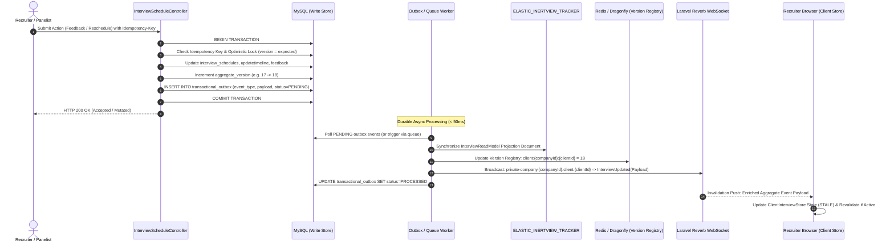

# GOD-LEVEL AUDIT REPORT & PRODUCTION SPECIFICATION: INTERVIEWS TAB IN CLIENT DRAWER

> **Document Type:** Production Architecture Audit & Implementation Specification  
> **Scope:** Internal Client Drawer (`show.blade.php`) & Direct Client Drawer (`dviewMore.blade.php`)  
> **Target Scale:** 10,000+ Concurrently Active Recruiters with 0% Avoidable MySQL / Server Read Strain  
> **Repository Context:** JERO ATS / Talent Marketplace SaaS  
> **Target Path:** `docs/V2_CLIENT_DETAILS/INTERVIEWS_TAB_CLIENT_DRAWER_AUDIT.md`  
> **Key References**:
> - [show.blade.php](file:///c:/Users/VIBHANSHU%20JAISWAL.000/Documents/GitHub/JWMaincode28June2026/resources/views/service_company/client/show.blade.php) (Internal Client Drawer Shell)
> - [dviewMore.blade.php](file:///c:/Users/VIBHANSHU%20JAISWAL.000/Documents/GitHub/JWMaincode28June2026/resources/views/service_company/client/dviewMore.blade.php) (Direct Client Drawer Shell)
> - [index.blade.php](file:///c:/Users/VIBHANSHU%20JAISWAL.000/Documents/GitHub/JWMaincode28June2026/resources/views/service_company/client/index.blade.php) (Drawer LRU Cache & Client State Manager)
> - [custom_client_candidates_interview_tracker.blade.php](file:///c:/Users/VIBHANSHU%20JAISWAL.000/Documents/GitHub/JWMaincode28June2026/resources/views/service_company/ajax_pages/custom_client_candidates_interview_tracker.blade.php) (Interview Tracker Blade View)
> - [ServiceCompanyJobApplicationController.php](file:///c:/Users/VIBHANSHU%20JAISWAL.000/Documents/GitHub/JWMaincode28June2026/app/Http/Controllers/ServiceCompany/ServiceCompanyJobApplicationController.php) (Interview Tracker Endpoints)
> - [ServiceCompanyClientController.php](file:///c:/Users/VIBHANSHU%20JAISWAL.000/Documents/GitHub/JWMaincode28June2026/app/Http/Controllers/ServiceCompany/ServiceCompanyClientController.php) (Drawer Controller)
> - [InterviewScheduleController.php](file:///c:/Users/VIBHANSHU%20JAISWAL.000/Documents/GitHub/JWMaincode28June2026/app/Http/Controllers/ServiceCompany/InterviewScheduleController.php) (Interview Mutation Controller)
> - [InterviewStatusTransitionEngine.php](file:///c:/Users/VIBHANSHU%20JAISWAL.000/Documents/GitHub/JWMaincode28June2026/app/Services/Interview/InterviewStatusTransitionEngine.php) (State Machine & Point Engine)
> - [GeneralMethod.php](file:///c:/Users/VIBHANSHU%20JAISWAL.000/Documents/GitHub/JWMaincode28June2026/app/Helper/GeneralMethod.php) (KPI Counts & ES Sync Engine)

---

## 1. Executive Summary & Core Architectural Principle

An exhaustive, peer-reviewed architectural audit of the **Interviews Tab** in the **Client Drawer** was conducted across both **Internal Clients** and **Direct Clients**.

### Non-Negotiable System Profile & Authority Boundaries:
- **MySQL:** Authoritative Business / Transactional Write Store (`INSERT` / `UPDATE` / `DELETE` only; **0% reads on UI/API paths**).
- **Elasticsearch (`ELASTIC_INERTVIEW_TRACKER`):** **Authoritative Interview Read Projection** for UI queries, counts, pagination, and filters.
- **Transactional Outbox Pipeline:** Guarantees that business mutations and read-projection updates never silently desynchronize.
- **Redis / Dragonfly:** Fast Version Registry & Coordination Cache (4M QPS capability), with isolated background DB sequence recovery.
- **Laravel Reverb:** Client-scoped WebSocket invalidation broadcast (`private-company.{companyId}.client.{clientId}`).
- **Browser (User RAM):** Client-First **JSON Data Store** (`ClientInterviewStore`) with client-side DOM rendering, bidirectional cursor navigation, drawer-scoped request cancellation, and composite multi-tenant isolation.

```
┌────────────────────────────────────────────────────────────────────────────────────────────────────────┐
│                                   CANONICAL CQRS & OUTBOX PIPELINE                                     │
└────────────────────────────────────────────────────────────────────────────────────────────────────────┘

              ┌──────────────────────────────────────┐
              │           MySQL WRITE STORE          │
              │   Authoritative Source of Truth      │
              │   [Transaction: Data + Outbox Event] │
              └──────────────────┬───────────────────┘
                                 │ (Atomic Commit)
                     Transactional Outbox Worker
                                 │
                   ┌─────────────┴─────────────┐
                   ↓                           ↓
        ┌─────────────────────┐     ┌──────────────────────┐
        │  ES Read Projection │     │  Projection Version  │
        │ ELASTIC_INERTVIEW   │     │  & Scoped Reverb Push│
        └──────────┬──────────┘     └──────────┬───────────┘
                   ↓                           ↓
        ┌─────────────────────┐     ┌──────────────────────┐
        │ InterviewReadModel  │     │ ClientInterviewStore │
        │ (Pure JSON Payload) │     │ (Multi-Tenant RAM)   │
        └──────────┬──────────┘     └──────────┬───────────┘
                   └─────────────┬─────────────┘
                                 ↓
                   ┌───────────────────────────┐
                   │   Client Drawer Browser   │
                   │   Client-Side DOM Render  │
                   └───────────────────────────┘
```

---

## 2. Pillar I: Distributed Consistency & Transactional Outbox Pipeline

### 2.1 Dual-Write Failure Elimination via Transactional Outbox
Treating `MySQL -> ES -> Redis -> Reverb` as a single synchronous chain risks partial failures where MySQL commits, but ES or Redis fail, leaving the UI permanently stale.

#### Architectural Mandate:
> **MySQL commit is authoritative. Read-model propagation is eventually consistent and must be recoverable through a durable transactional outbox pipeline.**



---

### 2.2 Enriched Reverb Aggregate Event Payload Contract
The Reverb WebSocket broadcast must never be a blind ping. It carries an enriched, cryptographically traceable payload that enables client-side deduplication, relation-specific filtering, and version monotonicity checks:

```json
{
  "event_id": "9b1deb4d-3b7d-4bad-9bdd-2b0d7b3dcb6d",
  "aggregate_type": "INTERVIEW",
  "aggregate_id": 1042,
  "aggregate_version": 18,
  "projection_version": 18,
  "tenant_id": 2,
  "client_id": 482,
  "relationship_type": "INTERNAL_CLIENT",
  "timestamp": "2026-10-24T05:32:00Z"
}
```

#### Consumer Guard Rules:
1. **Targeted Invalidation:** Invalidate *only* the composite cache key corresponding to `relationship_type` (`INTERNAL_CLIENT` vs `DIRECT_CLIENT`). Do not invalidate both drawers indiscriminately.
2. **Version Monotonicity:** If `payload.projection_version <= cached.version`, the event is an obsolete or out-of-order delivery; discard immediately.
3. **Idempotent Invalidation:** Use `event_id` to prevent redundant re-fetching if duplicate broadcasts are delivered over Reverb clusters.

---

### 2.3 Reverb Reconnect Resynchronization Contract
Recruiter laptops experience Wi-Fi drops, sleep mode, or tab suspension. Upon reconnecting to Reverb, missed mutations could leave the drawer permanently stale.

#### Architectural Mandate:
```javascript
// Bind to Reverb / Pusher reconnect event
window.Echo.connector.pusher.connection.bind('connected', function() {
    // 1. Transition all active RAM store entries from READY to STALE
    ClientInterviewStore.markAllStale();
    
    // 2. If an interview drawer is currently open and visible, trigger immediate revalidation
    ClientInterviewStore.revalidateActiveDrawer();
});
```

---

### 2.4 Projection Health & Operational Telemetry Contract
To make the "near-real-time" claim measurable and verifiable, the system tracks projection lag:

$$\text{ProjectionLag} = \text{aggregate\_version} - \text{projection\_version}$$

#### Operational Health Metrics:
1. `interview_projection_lag`: Number of versions the read projection is behind the write aggregate.
2. `interview_outbox_pending`: Count of pending outbox events awaiting Elasticsearch ingestion.
3. `interview_outbox_failed`: Dead-letter queue counter for events failing retry thresholds.
4. `interview_projection_retry`: Counter tracking transient projection retries.
5. `interview_reverb_broadcast_failed`: Counter tracking WebSocket delivery anomalies.

---

### 2.5 Strict 0% MySQL Read Separation on Version Recovery
Redis is the **Fast Version Registry & Coordination Cache**. The authoritative version sequence is maintained in the write store outbox.

#### Critical Rule on Database Recovery:
> **The normal Interviews UI/API read path performs strictly ZERO MySQL reads. MySQL version recovery is permitted only in an isolated background/cache-rehydration path and must never execute synchronously within the drawer read request.**

---

## 3. Pillar II: Multi-Tenant Security & Normalized Security Envelope

### 3.1 P0 Multi-Tenant Browser Cache Key Isolation
Using `store.get(clientId)` creates a critical security flaw: if a user logs out of Tenant A and logs into Tenant B, accessing a client with the same ID would serve Tenant A's cached data.

#### Mandatory Multi-Tenant Cache Key Structure:
```javascript
const cacheKey = [
    window.authCompanyId,
    window.userSessionId,
    clientType,
    clientId
].join(':');
```

#### Mandatory Tenant Flush Hook:
On **logout, tenant switch, or authentication expiration**, the browser MUST invoke:
```javascript
ClientInterviewStore.clearTenant();
```

---

### 3.2 Normalized Security Envelope in Elasticsearch
Historical fields (`ClientComID`, `thirdparty_company_id`, `job_company_id`, `company_id`) are phased into a primary, normalized security envelope:

```json
{
  "security": {
    "tenant_id": 2,
    "client_id": 482,
    "relationship_type": "INTERNAL_CLIENT",
    "visible_to_tenants": [2, 14]
  }
}
```

#### P0 Architectural Security Rule:
> **Legacy security fields (`ClientComID`, `job_company_id`, `company_id`) MUST NOT participate in production authorization queries after migration cutover. They are reserved strictly for offline backfill validation and reconciliation scripts.**

---

### 3.3 Canonical Tenant Scope Builder (`InterviewTenantScope.php`)

```php
namespace App\Services\Interview;

class InterviewTenantScope
{
    /**
     * Constructs the canonical, authoritative Elasticsearch query filter for a client's interviews.
     * Strictly enforces tenant boundaries with mandatory typed parameters.
     * Legacy authorization branches are 100% eliminated from production query paths.
     *
     * @param int $companyId Authenticated tenant organization ID
     * @param int $clientId  Target client organization ID
     * @param string $clientType 'internal' or 'direct'
     * @return array Elasticsearch bool query filter array
     */
    public static function forClient(int $companyId, int $clientId, string $clientType = 'internal'): array
    {
        if ($companyId <= 0 || $clientId <= 0) {
            throw new \InvalidArgumentException('Tenancy Violation: Both companyId and clientId are strictly mandatory.');
        }

        // Canonical mapping of client type to normalized relationship_type enum
        $relationshipType = match (strtolower(trim($clientType))) {
            'direct' => 'DIRECT_CLIENT',
            'internal', 'service' => 'INTERNAL_CLIENT',
            default => throw new \InvalidArgumentException("Invalid client type: {$clientType}"),
        };

        // Pure Normalized Security Envelope Query
        // Mandates tenant visibility, client ID, and explicit relationship_type filter
        return [
            'must' => [
                ['term' => ['security.visible_to_tenants' => $companyId]],
                ['term' => ['security.client_id' => $clientId]],
                ['term' => ['security.relationship_type' => $relationshipType]],
            ],
        ];
    }
}
```

---

## 4. Pillar III: Action Eligibility & Timezone-Invariant Contract

### 4.1 Server-Authoritative Time-Window Contract
Action eligibility must **never** be evaluated by the browser clock. The server projection calculates explicit time windows in UTC/ISO:

```json
"actions": {
  "join_allowed": true,
  "join_window_state": "JOIN_WINDOW_ACTIVE",
  "join_window": {
    "starts_at": "2026-10-24T05:30:00Z",
    "ends_at": "2026-10-24T06:30:00Z",
    "timezone": "Asia/Kolkata"
  },
  "feedback_view_allowed": false,
  "feedback_submit_allowed": true,
  "reschedule_allowed": false
}
```

#### Time-Window State Machine:
- `JOIN_WINDOW_OPEN`: 15 minutes prior to scheduled start time until start time.
- `JOIN_WINDOW_ACTIVE`: From start time until scheduled end time (+15 min grace period).
- `JOIN_WINDOW_CLOSED`: Outside the active window. `join_allowed = false`.

#### Complete Action Eligibility Matrix:
| Execution State | Evaluation Outcome | `join_allowed` | `feedback_view_allowed` | `feedback_submit_allowed` | `reschedule_allowed` |
| :--- | :--- | :---: | :---: | :---: | :---: |
| **Scheduled (Window Active)** | — | **TRUE** | FALSE | FALSE | **TRUE** |
| **Scheduled (Window Closed)** | — | FALSE | FALSE | FALSE | **TRUE** |
| **Rescheduled** | — | Conditional | FALSE | FALSE | **TRUE** |
| **Attended** | **Awaiting Feedback** | FALSE | FALSE | **TRUE** | FALSE |
| **Attended** | **Selected** | FALSE | **TRUE** | FALSE | FALSE |
| **Attended** | **On Hold** | FALSE | **TRUE** | FALSE | FALSE |
| **Attended** | **Rejected** | FALSE | **TRUE** | FALSE | FALSE |
| **Attended** | **Unverified / Proxy**| FALSE | **TRUE** | FALSE | FALSE |
| **No Show** | — | FALSE | FALSE | FALSE | **TRUE** |
| **Cancelled** | — | FALSE | FALSE | FALSE | FALSE |

---

## 5. Pillar IV: Client-First Data Store & Bidirectional Cursor Pagination

### 5.1 Exact vs Lower Bound Count Contract
To support 10,000+ concurrent recruiters without Elasticsearch cluster heap exhaustion:
- **Badge & KPI Counts (`count_mode = "EXACT"`):** Initial shell and tab badge queries execute with `track_total_hits: true` to provide exact candidate interview counts.
- **Deep Pagination Queries (`count_mode = "LOWER_BOUND"`):** Subsequent cursor requests execute with `track_total_hits: 10000`, bypassing expensive global hit aggregations while maintaining sub-millisecond query execution.

#### Endpoint Query Contract:
```text
GET /service_company/client-candidate-interview-tracker?clientid=482&clienttype=internal&cursor=eyJzY2hlZHVsZSI6MTcyOTYw...&size=20
```

#### Response Envelope:
```json
{
  "total": 143,
  "total_relation": "eq",
  "count_mode": "EXACT",
  "data": [ /* InterviewReadModel instances */ ],
  "next_cursor": "eyJzY2hlZHVsZSI6MTcyOTYw...",
  "page_size": 20,
  "version": 18
}
```

---

### 5.2 Bidirectional Cursor Navigation via Client-Side Cursor Stack
Elasticsearch `search_after` is naturally a forward-only pagination mechanism. Reverse sorting on the server creates index searcher thrashing and requires asymmetric sort contracts.

#### Architectural Solution: Client-Side Cursor History Stack
The browser maintains a navigation stack:
- Page 1: `cursor = null`, `cursorStack = [null]`
- Click "Next": Push `res.next_cursor` onto `cursorStack`. Current pointer increments.
- Click "Previous": Decrement pointer and retrieve previous cursor from `cursorStack[pointer]`.
- All visited cursor pages remain cached in User RAM for instant zero-latency back/forward navigation.

---

### 5.3 Explicit Invalidation State Machine
Each client entry in the store operates across explicit, inspectable states:

```
[EMPTY] ──(fetch)──> [LOADING] ──(success)──> [READY]
                          │                      │
                       (error)              (Reverb / Reconnect)
                          ↓                      ↓
                       [ERROR]                [STALE]
                          │                      │
                          └──────(revalidate)────┘
```

- **`EMPTY`:** No data fetched yet for this client.
- **`LOADING`:** HTTP request currently in-flight.
- **`READY`:** Data is fresh, authoritative, and rendered in DOM.
- **`STALE`:** Mutation detected via Reverb or network reconnect; trigger non-blocking revalidation.
- **`ERROR`:** Fetch failed; user retry button active.

---

### 5.4 Client-First In-Memory Data Store (`ClientInterviewStore.js`)

```javascript
/**
 * Canonical Client-First Interview Store & Renderer
 * Implements Multi-Tenant Key Isolation, Bidirectional Cursor Navigation Stack,
 * Generation Token + Active Drawer Verification, Scoped AbortController,
 * Explicit State Machine, and Reverb Reconnect Resynchronization.
 */
const ClientInterviewStore = (function() {
    'use strict';

    // In-memory data store: Map<compositeKey, StoreEntry>
    // StoreEntry: { state: 'EMPTY'|'LOADING'|'READY'|'STALE'|'ERROR', version, total, pages: Map<cursor, data>, cursorStack: [], cursorIndex: 0 }
    const store = new Map();
    
    // Reverb channel registry: Map<channelName, ChannelInstance>
    const subscriptions = new Map();
    
    // In-flight request controller registry scoped by compositeKey: Map<compositeKey, { controller: AbortController, requestId: number }>
    const activeRequests = new Map();
    let requestSequence = 0;

    function getCompositeKey(clientType, clientId) {
        const companyId = window.authCompanyId || '0';
        const sessionId = window.userSessionId || 'default';
        const canonicalType = (clientType === 'direct') ? 'direct' : 'internal';
        return `${companyId}:${sessionId}:${canonicalType}:${clientId}`;
    }

    function getDrawerScope(el) {
        return $(el).closest('.client-drawer, #kt_activitiesClient, #kt_activitiesDirectClient');
    }

    function getActiveDrawerInfo($drawer) {
        return {
            clientId: parseInt($drawer.attr('data-client-id') || window.activeSelectedClientId || 0, 10),
            clientType: $drawer.attr('data-client-type') || 'internal'
        };
    }

    function init() {
        // 1. Listen for drawer open/close to manage subscription lifecycle
        $(document).on('clientDrawerOpened', function(e, data) {
            if (data && data.clientId) {
                subscribeClientChannel(window.authCompanyId, data.clientId);
            }
        });

        $(document).on('clientDrawerClosed', function(e, data) {
            if (data && data.clientId) {
                unsubscribeClientChannel(window.authCompanyId, data.clientId);
            }
        });

        // 2. Namespaced tab activation bound ONCE on Document
        $(document)
            .off('shown.bs.tab.interviewTracker', 'a[href="#interview_tracker"]')
            .on('shown.bs.tab.interviewTracker', 'a[href="#interview_tracker"]', function(e) {
                const $drawer = getDrawerScope(e.target);
                const info = getActiveDrawerInfo($drawer);
                if (info.clientId) {
                    handleTabActivation($drawer, info.clientId, info.clientType);
                }
            });

        // 3. Bidirectional Cursor Pagination handlers (Previous / Next)
        $(document)
            .off('click.interviewPagination', '[data-role="interview-pagination"] [data-direction]')
            .on('click.interviewPagination', '[data-role="interview-pagination"] [data-direction]', function(e) {
                e.preventDefault();
                const $btn = $(e.currentTarget);
                if ($btn.hasClass('disabled')) return;

                const direction = $btn.attr('data-direction'); // 'prev' or 'next'
                const $drawer = getDrawerScope(e.target);
                const info = getActiveDrawerInfo($drawer);
                if (!info.clientId) return;

                navigatePagination($drawer, info.clientId, info.clientType, direction);
            });

        // 4. Bind Reverb Reconnect Resynchronization Hook
        if (window.Echo && window.Echo.connector && window.Echo.connector.pusher) {
            window.Echo.connector.pusher.connection.bind('connected', function() {
                markAllStale();
                revalidateActiveDrawer();
            });
        }
    }

    function subscribeClientChannel(companyId, clientId) {
        if (!companyId || !clientId || typeof window.Echo === 'undefined') return;
        const channelName = `private-company.${companyId}.client.${clientId}`;

        if (!subscriptions.has(channelName)) {
            const channel = window.Echo.private(channelName);
            channel.listen('.InterviewUpdated', function(payload) {
                // Strict validation: Invalidate ONLY matching relationship_type
                const relType = payload.relationship_type === 'DIRECT_CLIENT' ? 'direct' : 'internal';
                const targetKey = getCompositeKey(relType, payload.client_id || clientId);
                const entry = store.get(targetKey);

                if (entry) {
                    // Version Monotonicity Guard
                    if (payload.projection_version && payload.projection_version <= entry.version) {
                        return; // Discard obsolete or out-of-order broadcast
                    }
                    entry.state = 'STALE';
                    entry.serverVersion = payload.projection_version || (entry.version + 1);

                    // If this drawer is currently open and visible, revalidate immediately
                    revalidateActiveDrawer(targetKey);
                }
            });
            subscriptions.set(channelName, channel);
        }
    }

    function unsubscribeClientChannel(companyId, clientId) {
        if (!companyId || !clientId || typeof window.Echo === 'undefined') return;
        const channelName = `private-company.${companyId}.client.${clientId}`;

        if (subscriptions.has(channelName)) {
            window.Echo.leave(channelName);
            subscriptions.delete(channelName);
        }
    }

    function clearTenant() {
        store.clear();
        activeRequests.forEach(function(req) {
            try { req.controller.abort(); } catch (e) {}
        });
        activeRequests.clear();

        subscriptions.forEach(function(channel, name) {
            window.Echo.leave(name);
        });
        subscriptions.clear();
    }

    function markAllStale() {
        store.forEach(function(entry) {
            if (entry.state === 'READY') {
                entry.state = 'STALE';
            }
        });
    }

    function revalidateActiveDrawer(specificKey = null) {
        const $activeDrawer = $('.client-drawer.drawer-on, #kt_activitiesClient.drawer-on, #kt_activitiesDirectClient.drawer-on');
        if ($activeDrawer.length && $activeDrawer.find('#interview_tracker.active').length) {
            const info = getActiveDrawerInfo($activeDrawer);
            const key = getCompositeKey(info.clientType, info.clientId);
            if (!specificKey || specificKey === key) {
                fetchInterviews($activeDrawer, info.clientId, info.clientType, null, true);
            }
        }
    }

    function handleTabActivation($drawer, clientId, clientType) {
        const cacheKey = getCompositeKey(clientType, clientId);
        const entry = store.get(cacheKey);

        // Zero-Network RAM Render: If state is READY, render instantly from RAM
        if (entry && entry.state === 'READY' && entry.pages.has('initial')) {
            const pageData = entry.pages.get('initial');
            renderTableRows($drawer, pageData.data);
            renderCursorControls($drawer, entry.cursorIndex, entry.cursorStack.length, pageData.next_cursor);
            updateBadgeAndKPI($drawer, entry.total);
            return;
        }

        fetchInterviews($drawer, clientId, clientType, null);
    }

    function navigatePagination($drawer, clientId, clientType, direction) {
        const cacheKey = getCompositeKey(clientType, clientId);
        const entry = store.get(cacheKey);
        if (!entry) return;

        if (direction === 'prev' && entry.cursorIndex > 0) {
            entry.cursorIndex--;
            const prevCursor = entry.cursorStack[entry.cursorIndex];
            fetchInterviews($drawer, clientId, clientType, prevCursor);
        } else if (direction === 'next') {
            const currentCursorKey = entry.cursorStack[entry.cursorIndex] || 'initial';
            const currentPage = entry.pages.get(currentCursorKey);
            if (currentPage && currentPage.next_cursor) {
                entry.cursorIndex++;
                if (entry.cursorIndex >= entry.cursorStack.length) {
                    entry.cursorStack.push(currentPage.next_cursor);
                }
                fetchInterviews($drawer, clientId, clientType, currentPage.next_cursor);
            }
        }
    }

    function fetchInterviews($drawer, clientId, clientType, cursor = null, forceRevalidate = false) {
        const cacheKey = getCompositeKey(clientType, clientId);
        const cursorKey = cursor || 'initial';
        let entry = store.get(cacheKey);

        // If data is in memory, clean, and not forcing revalidation: Render instantly (0 ms)
        if (entry && entry.state === 'READY' && !forceRevalidate && entry.pages.has(cursorKey)) {
            const pageData = entry.pages.get(cursorKey);
            renderTableRows($drawer, pageData.data);
            renderCursorControls($drawer, entry.cursorIndex, entry.cursorStack.length, pageData.next_cursor);
            updateBadgeAndKPI($drawer, entry.total);
            return;
        }

        // Cancel previous request strictly for THIS specific drawer key
        if (activeRequests.has(cacheKey)) {
            const prev = activeRequests.get(cacheKey);
            try { prev.controller.abort(); } catch (e) {}
        }

        const controller = new AbortController();
        const currentRequestId = ++requestSequence;
        activeRequests.set(cacheKey, { controller: controller, requestId: currentRequestId });

        if (!entry) {
            entry = {
                state: 'LOADING',
                version: 1,
                total: 0,
                pages: new Map(),
                cursorStack: [null],
                cursorIndex: 0
            };
            store.set(cacheKey, entry);
        } else {
            entry.state = 'LOADING';
        }

        const $list = $drawer.find('[data-role="interview-list"]');
        if (!forceRevalidate) {
            $list.html(`
                <tr>
                  <td colspan="8" class="text-center py-8">
                    <span class="spinner-border spinner-border-sm text-primary me-2"></span>
                    <span class="text-gray-600 fs-7">Loading Authoritative Interview Projection...</span>
                  </td>
                </tr>
            `);
        }

        const endpoint = (clientType === 'direct')
            ? `{{ url('service_company/direct-client-candidate-interview-tracker') }}`
            : `{{ url('service_company/client-candidate-interview-tracker') }}`;

        let url = `${endpoint}?clientid=${clientId}&clienttype=${clientType}&size=20`;
        if (cursor) url += `&cursor=${encodeURIComponent(cursor)}`;

        $.ajax({
            url: url,
            type: 'GET',
            dataType: 'json',
            signal: controller.signal,
            success: function(res) {
                // Triple Generation Guard: Check Request ID, Active Drawer Client ID & Client Type
                const active = activeRequests.get(cacheKey);
                if (!active || active.requestId !== currentRequestId) return; // Stale request discarded

                const info = getActiveDrawerInfo($drawer);
                if (info.clientId !== clientId || info.clientType !== clientType) return; // Switched drawer discarded

                if (res && Array.isArray(res.data)) {
                    entry.state = 'READY';
                    entry.version = res.version || entry.version;
                    entry.total = res.total;

                    entry.pages.set(cursorKey, {
                        data: res.data,
                        next_cursor: res.next_cursor || null
                    });

                    renderTableRows($drawer, res.data);
                    renderCursorControls($drawer, entry.cursorIndex, entry.cursorStack.length, res.next_cursor);
                    updateBadgeAndKPI($drawer, res.total);
                }
            },
            error: function(xhr, status) {
                if (status === 'abort') return;
                const active = activeRequests.get(cacheKey);
                if (!active || active.requestId !== currentRequestId) return;

                entry.state = 'ERROR';
                $list.html(`
                    <tr>
                      <td colspan="8" class="text-center py-6 text-danger fs-7">
                        <i class="fas fa-exclamation-circle me-1"></i> Failed to retrieve interviews.
                        <button type="button" class="btn btn-sm btn-link text-primary ms-2 p-0" data-role="interview-retry">Retry</button>
                      </td>
                    </tr>
                `);
                $drawer.find('[data-role="interview-retry"]').one('click', function() {
                    fetchInterviews($drawer, clientId, clientType, cursor, true);
                });
            }
        });
    }

    function renderTableRows($drawer, rows) {
        const $list = $drawer.find('[data-role="interview-list"]');
        if (!rows.length) {
            $list.html(`
                <tr>
                  <td colspan="8" class="text-center py-10 text-muted fs-7">
                    <i class="fas fa-calendar-times fs-2 text-gray-300 d-block mb-2"></i>
                    No interviews scheduled for this client.
                  </td>
                </tr>
            `);
            return;
        }

        const html = rows.map(function(intv) {
            const cand = intv.candidate || {};
            const job = intv.job || {};
            const sch = intv.schedule || {};
            const att = intv.attendance || {};
            const evalOutcome = intv.evaluation || {};
            const act = intv.actions || {};
            const lead = (intv.interviewers && intv.interviewers[0]) ? intv.interviewers[0] : null;
            const extraCount = Math.max(0, (intv.interviewers ? intv.interviewers.length : 0) - 1);

            let stars = '';
            const rating = evalOutcome.star_rating;
            if (rating !== null && rating !== undefined && rating > 0) {
                for (let s = 1; s <= 5; s++) {
                    stars += `<i class="fas fa-star ${s <= rating ? 'cit-star-fill' : 'cit-star-empty'}"></i>`;
                }
            } else {
                stars = '<span class="text-muted fs-8">No rating</span>';
            }

            return `
                <tr>
                  <!-- Candidate Column (18%) -->
                  <td>
                    <div class="d-flex align-items-center gap-2">
                      <div class="symbol symbol-32px symbol-circle bg-light-primary text-primary fw-bold fs-7 d-flex align-items-center justify-content-center">
                        ${cand.initial || 'C'}
                      </div>
                      <div class="d-flex flex-column text-truncate">
                        <a href="javascript:void(0);" class="text-dark fw-bolder text-hover-primary fs-7 text-truncate" data-action="open-candidate" data-id="${cand.id}">
                          ${cand.name || 'Candidate'}
                        </a>
                        <span class="text-muted fs-8 text-truncate">${cand.designation || '—'}</span>
                      </div>
                    </div>
                  </td>

                  <!-- Job & ID Column (16%) -->
                  <td>
                    <div class="d-flex flex-column text-truncate">
                      <a href="javascript:void(0);" class="text-dark fw-bold text-hover-primary fs-7 text-truncate" data-action="open-job" data-id="${job.id}">
                        ${job.title || 'Job Position'}
                      </a>
                      <div class="d-flex align-items-center gap-1 mt-1">
                        <span class="text-muted fs-8 fw-semibold">${job.id ? '#' + job.id : ''}</span>
                        <span class="text-muted fs-8">·</span>
                        <span class="text-muted fs-8 text-truncate" style="max-width: 110px;">${job.client_name || ''}</span>
                      </div>
                    </div>
                  </td>

                  <!-- Mode & Round Column (13%) -->
                  <td>
                    <div class="d-flex flex-column">
                      <span class="fs-7 fw-semibold text-gray-800 d-inline-flex align-items-center gap-1">
                        <i class="fas ${sch.mode_icon || 'fa-video'} fa-xs"></i> ${sch.mode_label || 'Video'}
                      </span>
                      <span class="text-muted fs-8 text-truncate" style="max-width: 130px;">${sch.round_name || 'Interview'}</span>
                    </div>
                  </td>

                  <!-- Interviewers Column (14%) -->
                  <td>
                    <div class="d-flex flex-column text-truncate">
                      ${lead ? `
                        <span class="fs-7 fw-semibold text-gray-800 text-truncate" title="${lead.name}">
                          ${lead.name}
                          ${extraCount > 0 ? `<a href="javascript:void(0);" class="badge badge-light-primary fs-9 ms-1" data-action="show-panel" data-interview-id="${intv.id}">+${extraCount}</a>` : ''}
                        </span>
                        <span class="text-muted fs-8 text-truncate">${lead.company_name || 'Panel'}</span>
                      ` : '<span class="text-muted fs-7">Not Assigned</span>'}
                    </div>
                  </td>

                  <!-- Schedule Date Column (13%) -->
                  <td>
                    <div class="d-flex flex-column">
                      <span class="fs-7 fw-bolder text-gray-800">${sch.date_formatted || '—'}</span>
                      <span class="text-muted fs-8">${sch.time_formatted || ''}</span>
                    </div>
                  </td>

                  <!-- Status Column (11%) -->
                  <td>
                    <div class="d-flex flex-column align-items-start gap-1">
                      <span class="cit-fb-pill ${att.css_class || 'cit-fb-default'}">${att.label || 'Scheduled'}</span>
                      ${evalOutcome.label && evalOutcome.label !== '—' ? `<span class="fs-8 ${evalOutcome.css_class || 'text-muted'}">${evalOutcome.label}</span>` : ''}
                    </div>
                  </td>

                  <!-- Rating Column (7%) -->
                  <td>
                    <div class="d-flex align-items-center gap-1">
                      <div class="cit-stars">${stars}</div>
                    </div>
                  </td>

                  <!-- Actions Column (8%) -->
                  <td style="text-align: right;">
                    <div class="d-flex align-items-center justify-content-end gap-1">
                      ${act.join_allowed && sch.meeting_link ? `
                        <a href="${sch.meeting_link}" target="_blank" rel="noopener noreferrer" class="btn btn-icon btn-sm btn-light-primary" style="height:26px; width:26px;" title="Join Video Call">
                          <i class="fas fa-video fa-xs"></i>
                        </a>
                      ` : ''}
                      ${act.feedback_view_allowed ? `
                        <button type="button" class="btn btn-icon btn-sm btn-light-success" style="height:26px; width:26px;" data-action="view-feedback" data-interview-id="${intv.id}" title="View Feedback">
                          <i class="fas fa-clipboard-check fa-xs"></i>
                        </button>
                      ` : ''}
                    </div>
                  </td>
                </tr>
            `;
        }).join('');

        $list.html(html);
    }

    function renderCursorControls($drawer, cursorIndex, stackLength, nextCursor) {
        const $pagi = $drawer.find('[data-role="interview-pagination"]');
        const hasPrev = cursorIndex > 0;
        const hasNext = Boolean(nextCursor);

        if (!hasPrev && !hasNext) {
            $pagi.empty();
            return;
        }

        $pagi.html(`
            <div class="d-flex align-items-center justify-content-between w-100 py-2">
              <button type="button" class="btn btn-sm btn-light ${!hasPrev ? 'disabled' : ''}" data-direction="prev">
                <i class="fas fa-chevron-left me-1"></i> Previous
              </button>
              <span class="fs-8 text-muted">Page ${cursorIndex + 1}</span>
              <button type="button" class="btn btn-sm btn-light ${!hasNext ? 'disabled' : ''}" data-direction="next">
                Next <i class="fas fa-chevron-right ms-1"></i>
              </button>
            </div>
        `);
    }

    function updateBadgeAndKPI($drawer, total) {
        if (total !== undefined) {
            $drawer.find('[data-role="interview-tab-badge"]').text(total).toggle(total > 0);
            $drawer.find('[data-role="interview-kpi-count"]').text(total);
        }
    }

    return { 
        init: init,
        clearTenant: clearTenant,
        markAllStale: markAllStale,
        revalidateActiveDrawer: revalidateActiveDrawer
    };
})();

$(document).ready(function() {
    ClientInterviewStore.init();
});
```

---

## 6. Pillar V: Metronic UI/UX Standards & Enterprise Typography

### 6.1 Strict Metronic CSS Isolation
To avoid namespace pollution and prevent breaking Metronic component themes, all custom status pills and stars are scoped under `.cit-*`:

```css
/* Scoped Interview Tracker Styling */
.cit-fb-pill {
    display: inline-flex;
    align-items: center;
    padding: 2px 8px;
    font-size: 11px;
    font-weight: 600;
    border-radius: 4px;
    line-height: 1.4;
}
.cit-fb-scheduled { background-color: #E8FFF3; color: #50CD89; }
.cit-fb-rescheduled { background-color: #FFF8DD; color: #F1416C; }
.cit-fb-attended { background-color: #F1FAFF; color: #009EF7; }
.cit-fb-noshow { background-color: #FFF5F8; color: #F1416C; }
.cit-fb-cancelled { background-color: #F5F8FA; color: #7E8299; }
.cit-fb-default { background-color: #F5F8FA; color: #5E6278; }

.cit-stars { display: inline-flex; gap: 2px; }
.cit-star-fill { color: #FFAD0F; font-size: 11px; }
.cit-star-empty { color: #E4E6EF; font-size: 11px; }
```

### 6.2 15.6-Inch Responsive Layout Specification (1366×768 & 1920×1080)
- **Container Sizing:** Drawer width fixed at 960px max (`w-100 mw-960px`).
- **Internal Scroll Container:** `.card-body` incorporates `overflow-y-auto` capped at `calc(100vh - 220px)`.
- **Zero Horizontal Squish:** Column width allocation total equals 100%:
  - Candidate: 18%
  - Job Position: 16%
  - Mode & Round: 13%
  - Interviewers: 14%
  - Schedule Date: 13%
  - Status: 11%
  - Rating: 7%
  - Actions: 8%

---

## 7. Pillar VI: Complete 13-Test Verification Sign-Off Suite

```
┌────────────────────────────────────────────────────────────────────────────────────────┐
│                              PRODUCTION SIGN-OFF TEST SUITE                            │
├────┬─────────────────────────────┬─────────────────────────────────────────────────────┤
│ #  │ Test Verification Item      │ Acceptance Verification Criteria                    │
├────┼─────────────────────────────┼─────────────────────────────────────────────────────┤
│ 1  │ Zero MySQL Reads on UI Path │ DB::enableQueryLog() -> count must equal 0 on AJAX  │
├────┼─────────────────────────────┼─────────────────────────────────────────────────────┤
│ 2  │ Tenancy Isolation           │ Production queries strictly filter normalized       │
│    │                             │ envelope (tenant_id, client_id, relationship_type)  │
├────┼─────────────────────────────┼─────────────────────────────────────────────────────┤
│ 3  │ Shell Badge Parity          │ Authoritative total filtered count matches badge    │
├────┼─────────────────────────────┼─────────────────────────────────────────────────────┤
│ 4  │ Reverb Invalidation Scope   │ Broadcast invalidates ONLY matching rel_type cache  │
├────┼─────────────────────────────┼─────────────────────────────────────────────────────┤
│ 5  │ Reconnect Resynchronization │ WebSocket reconnect transitions store to STALE and  │
│    │                             │ triggers non-blocking active drawer revalidation    │
├────┼─────────────────────────────┼─────────────────────────────────────────────────────┤
│ 6  │ DOM Memory Cleanliness      │ Open/close 10 drawers; $.events('shown') == 1       │
├────┼─────────────────────────────┼─────────────────────────────────────────────────────┤
│ 7  │ Responsive Layout           │ Viewport 1366×768 has zero text wrap or header bump │
├────┼─────────────────────────────┼─────────────────────────────────────────────────────┤
│ 8  │ Concurrency Race Protection │ OCC detects version conflict on concurrent mutations│
├────┼─────────────────────────────┼─────────────────────────────────────────────────────┤
│ 9  │ Cross-Tenant Cache Leak Test│ Logout Tenant A -> Login Tenant B -> verify 0 leak  │
├────┼─────────────────────────────┼─────────────────────────────────────────────────────┤
│ 10 │ Reverb Channel Teardown     │ Closing client drawer leaves zero orphaned channels │
├────┼─────────────────────────────┼─────────────────────────────────────────────────────┤
│ 11 │ Triple Generation Guard     │ Rapid drawer switchingClient A -> B discards slow A │
│    │                             │ response via RequestId + Active ClientId check      │
├────┼─────────────────────────────┼─────────────────────────────────────────────────────┤
│ 12 │ Bidirectional Cursor Stack  │ Next & Previous navigation smoothly loads cached    │
│    │                             │ cursor pages without server-side reverse-sort hops  │
├────┼─────────────────────────────┼─────────────────────────────────────────────────────┤
│ 13 │ Outbox Projection Recovery  │ ES failure leaves outbox PENDING; queue retries     │
│    │                             │ until ES projection is 100% synchronized            │
└────┴─────────────────────────────┴─────────────────────────────────────────────────────┘
```
