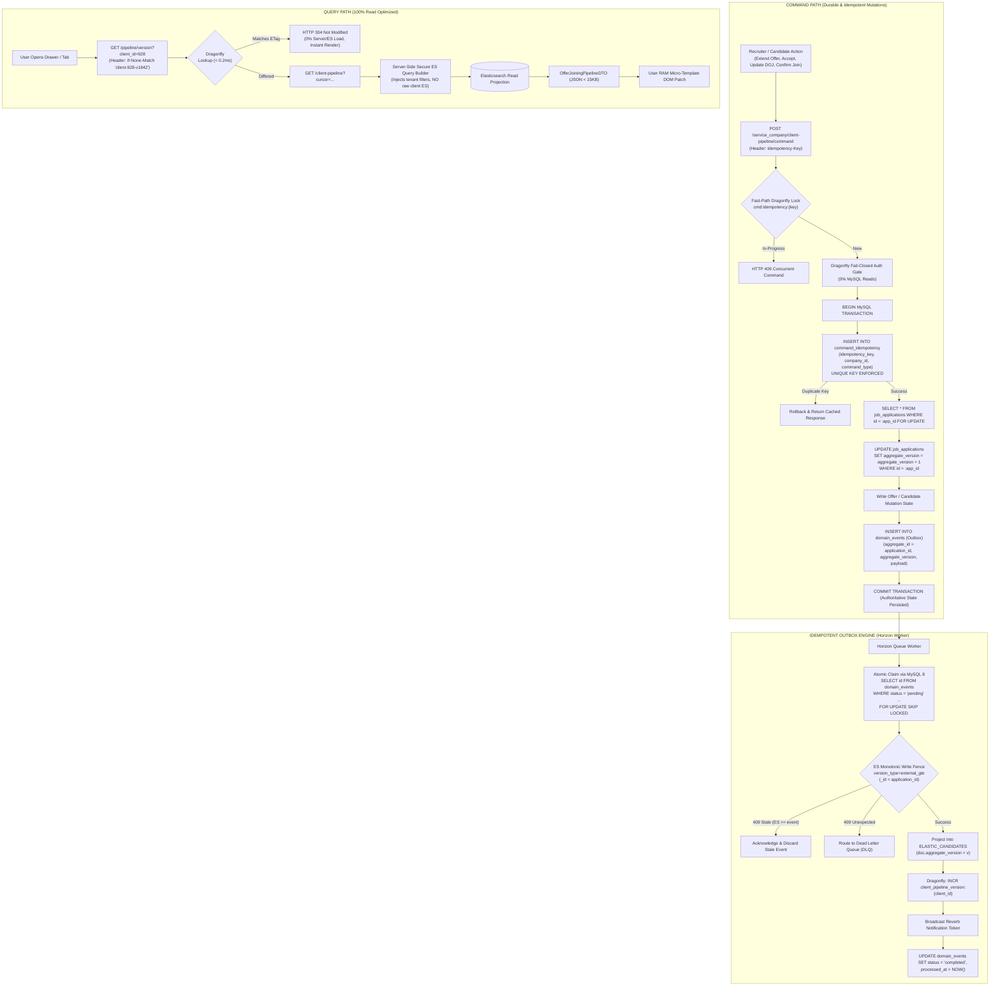
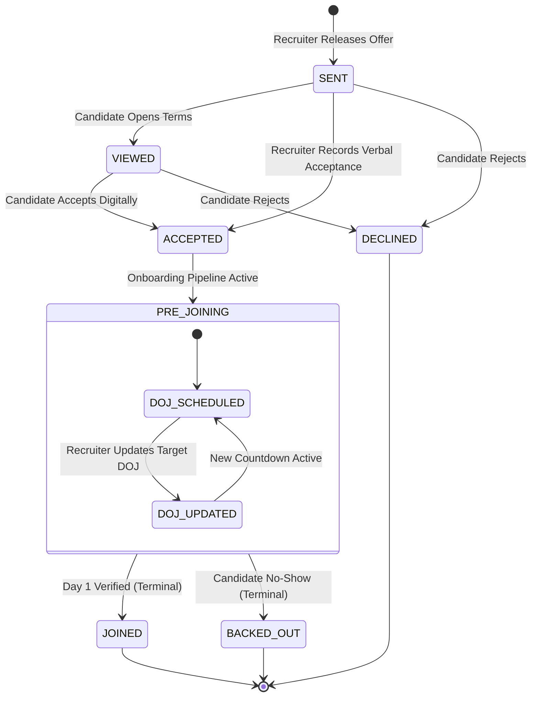

# GOD-LEVEL AUDIT & ARCHITECTURAL SPECIFICATION: OFFER & JOINING PIPELINE (V4.0 MASTER PRODUCTION FROZEN)

> **Document Status**: FULLY FROZEN & LOCKED FOR IMPLEMENTATION (10/10 Gold Standard)  
> **Target Scale**: 10,000+ Concurrent Users with 0% Avoidable MySQL / Server Read Strain  
> **Scope**: Internal Client Drawer (`show.blade.php`) & Direct Client Drawer (`dviewMore.blade.php`)  
> **Architecture Pattern**: Strict CQRS + Transactional Outbox + Event-Driven Client-First Execution  
> **Authoritative Files**:
> - [show.blade.php](file:///c:/Users/VIBHANSHU%20JAISWAL.000/Documents/GitHub/JWMaincode28June2026/resources/views/service_company/client/show.blade.php) (Internal Client Drawer)
> - [dviewMore.blade.php](file:///c:/Users/VIBHANSHU%20JAISWAL.000/Documents/GitHub/JWMaincode28June2026/resources/views/service_company/client/dviewMore.blade.php) (Direct Client Drawer)
> - [index.blade.php](file:///c:/Users/VIBHANSHU%20JAISWAL.000/Documents/GitHub/JWMaincode28June2026/resources/views/service_company/client/index.blade.php) (Drawer State Manager & Client LRU)
> - [ServiceCompanyJobApplicationController.php](file:///c:/Users/VIBHANSHU%20JAISWAL.000/Documents/GitHub/JWMaincode28June2026/app/Http/Controllers/ServiceCompany/ServiceCompanyJobApplicationController.php)
> - [ServiceCompanyClientController.php](file:///c:/Users/VIBHANSHU%20JAISWAL.000/Documents/GitHub/JWMaincode28June2026/app/Http/Controllers/ServiceCompany/ServiceCompanyClientController.php)
> - [custom_client_candidates.blade.php](file:///c:/Users/VIBHANSHU%20JAISWAL.000/Documents/GitHub/JWMaincode28June2026/resources/views/service_company/ajax_pages/custom_client_candidates.blade.php)
> - [custom_client_candidates_join.blade.php](file:///c:/Users/VIBHANSHU%20JAISWAL.000/Documents/GitHub/JWMaincode28June2026/resources/views/service_company/ajax_pages/custom_client_candidates_join.blade.php)

---

## 1. Storage Tier Invariants & Fail-Closed Authorization

### 1.1 The Four-Tier Data Hierarchy

```
┌─────────────────────────────────────────────────────────────────────────────┐
│ 1. MySQL: System of Record & Authoritative Business State                  │
│    - Strictly executes transactional units of work (INSERT/UPDATE/DELETE).  │
│    - Enforces durable HTTP command idempotency via command_idempotency.     │
│    - 0% MySQL reads on web/API request paths. ZERO UI SELECT queries.       │
├─────────────────────────────────────────────────────────────────────────────┤
│ 2. Elasticsearch: Authoritative Web-Read Projection                        │
│    - Universal read store for pipeline queries, search, counts, & filters.  │
│    - Document ID is 1-to-1 with application_id (_id = application_id).      │
│    - Business contract: doc.aggregate_version (external_gte for write fence)│
│    - Enforces tenant isolation on every single read query.                  │
├─────────────────────────────────────────────────────────────────────────────┤
│ 3. Dragonfly / Redis: Non-Authoritative Ephemeral State Store              │
│    - Holds fast-path locks, pipeline version tokens, and auth projections.  │
│    - Single-flight recovery mutex prevents stampedes on ES during warm-up.  │
│    - NOT the source of truth for offers, candidates, or joinings.           │
├─────────────────────────────────────────────────────────────────────────────┤
│ 4. Browser RAM: Client-First Presentation & Local Micro-Rendering           │
│    - Holds active page state, loaded record filtering, and DOM patching.    │
│    - Never constructs raw Elasticsearch queries; talks to clean JSON APIs.  │
└─────────────────────────────────────────────────────────────────────────────┘
```

### 1.2 Fail-Closed Authorization Projection & Synchronous Revocation
Authorization must never execute synchronous MySQL queries on the read path (`Client::where(...)->exists()`), nor can it rely on stale login session snapshots.

1. **Authorization as a Derived Security Projection**:
   - Authorized client access is held in a Dragonfly set: `auth:tenant_clients:{company_id}`.
2. **Synchronous Revocation on Mutation**:
   - When an admin removes or reassigns client access, the eviction is executed **synchronously** within the authoritative mutation endpoint before returning `HTTP 200`:
     ```php
     // Authoritative MySQL mutation commits
     DB::transaction(function() use ($companyId, $clientId) { ... });

     // Synchronous eviction (zero lag window)
     Cache::store('dragonfly')->srem("auth:tenant_clients:{$companyId}", $clientId);
     Cache::store('dragonfly')->forget("auth:client_access:{$companyId}:{$clientId}");
     ```
3. **Fail-Closed Semantics**:
   - If Dragonfly is unavailable or the cache key is missing, the request **fails closed** (`HTTP 403 Forbidden`) until asynchronously rehydrated by the trusted authorization worker.

---

## 2. Complete CQRS Command & Query Architecture



---

## 3. Distributed Correctness & Worker Lease Recovery

### 3.1 Durable MySQL Idempotency Boundary (`command_idempotency`)
```sql
CREATE TABLE `command_idempotency` (
  `id` BIGINT UNSIGNED AUTO_INCREMENT PRIMARY KEY,
  `service_company_id` INT UNSIGNED NOT NULL,
  `idempotency_key` VARCHAR(128) NOT NULL,
  `command_type` VARCHAR(64) NOT NULL,
  `aggregate_type` VARCHAR(50) NOT NULL,
  `aggregate_id` BIGINT UNSIGNED NOT NULL,
  `response_status` SMALLINT UNSIGNED NOT NULL,
  `response_payload` JSON NOT NULL,
  `created_at` TIMESTAMP DEFAULT CURRENT_TIMESTAMP,
  UNIQUE KEY `uniq_tenant_idempotency` (`service_company_id`, `idempotency_key`),
  INDEX `idx_created` (`created_at`)
);
```

### 3.2 Explicit Worker Lease Recovery Semantics & DLQ
```mermaid
stateDiagram-v2
    [*] --> PENDING: Outbox Event Inserted
    PENDING --> PROCESSING: Worker Claims via FOR UPDATE SKIP LOCKED
    
    PROCESSING --> COMPLETED: Projection & Version Incr Succeeded
    
    PROCESSING --> PENDING: Lease Expired (locked_at < NOW() - 60s)
    note right of PENDING: Increments processing_attempts\nExponential backoff: next_retry_at = NOW() + 2^attempts
    
    PROCESSING --> DEAD_LETTER: attempts >= 5 OR Unrecoverable Error
    DEAD_LETTER --> [*]: Requires Operator Intervention / Replay Tool
    COMPLETED --> [*]
```

### 3.3 Aggregate Version vs. Projection Isolation (`application_id` 1:1 Mapping)
- **Business Contract Invariant**:
  - `aggregate_version` is stored explicitly inside the Elasticsearch document body:
    ```json
    {
      "_id": "14209",
      "application_id": 14209,
      "candidate_id": 9821,
      "job_id": 412,
      "aggregate_version": 47,
      "projection_version": 47
    }
    ```
  - `version_type=external_gte` is used solely as the Elasticsearch write-conflict barrier. Elasticsearch's internal metadata `_version` is **not** the business version contract.
  - Document ID is strictly `_id = application_id` (never `candidate_id`), preventing multi-job application collisions.

---

## 4. Single-Flight Dragonfly Recovery & Anti-Stampede Protection

### 4.1 Anti-Stampede Single-Flight Mutex on Cold Cache
If Dragonfly is flushed or restarts, 10,000 concurrent browser sessions requesting `pipeline/version` must not flood Elasticsearch with aggregations.
A **Single-Flight Distributed Mutex** coalesces all concurrent recovery requests:

```php
$cacheKey = "client_pipeline_version:{$clientId}";

return Cache::store('dragonfly')->remember($cacheKey, 86400, function() use ($clientId, $companyId) {
    $lockKey = "auth:watermark_recovery_lock:{$clientId}";
    
    // Acquire a 2-second single-flight recovery lock
    $lock = Cache::store('dragonfly')->lock($lockKey, 2);
    
    return $lock->get(function() use ($clientId, $companyId) {
        $params = [
            'index' => ELASTIC_CANDIDATES,
            'body' => [
                'size' => 0,
                'query' => [
                    'bool' => [
                        'filter' => [
                            ['term' => ['service_company_id' => $companyId]],
                            ['term' => ['client_id' => $clientId]]
                        ]
                    ]
                ],
                'aggs' => [
                    'max_watermark' => ['max' => ['field' => 'aggregate_version']]
                ]
            ]
        ];
        $res = $this->elasticClient->search($params);
        return (int) ($res['aggregations']['max_watermark']['value'] ?? 1);
    });
});
```
- **Result**: Only **1 single query** hits Elasticsearch across 10,000 concurrent requests; all other requests await the cached result.

---

## 5. Formal State Transition Matrix & Acceptance Source

### 5.1 Offer & Joining State Machine
`update_doj` is formalized as an **internal mutation event on the `PRE_JOINING` state**, not a state change:



### 5.2 Transition Table with Acceptance Source Distinction

| From State | Command / Action | Target State | Permitted Actor | Audit Acceptance Source | Side Effects |
| :--- | :--- | :--- | :--- | :--- | :--- |
| **DRAFT** | `release_offer` | `SENT` | Recruiter, Admin | `system` | Generate signed PDF, send email/SMS |
| **SENT** | `view_terms` | `VIEWED` | Candidate | `candidate_digital` | Log candidate IP/Browser, notify recruiter |
| **SENT / VIEWED** | `accept_offer` | `ACCEPTED` | Candidate | `candidate_digital` | Digitally signed contract, timestamped IP |
| **SENT / VIEWED** | `record_verbal_acceptance` | `ACCEPTED` | Recruiter | `recruiter_verbal` | Log recruiter user ID, notes, phone audit |
| **SENT / VIEWED** | `decline_offer` | `DECLINED` | Candidate, Recruiter | `candidate_digital` \| `recruiter_verbal` | Log decline reason, release requisition hold |
| **ACCEPTED** | `activate_prejoining` | `PRE_JOINING` | System, Recruiter | `system` | Initiate onboarding checklist, calculate DOJ countdown |
| **PRE_JOINING** | `update_doj` | `PRE_JOINING` | Recruiter | `recruiter_action` | **Internal mutation**: Updates `target_doj`, logs event |
| **PRE_JOINING** | `confirm_joining` | `JOINED` | Recruiter, Admin | `recruiter_action` | Day 1 verification, triggers placement invoice |
| **PRE_JOINING** | `mark_backed_out` | `BACKED_OUT` | Recruiter, Admin | `recruiter_action` | Decrement pipeline, capture drop-out reason |
| **JOINED** | *Any mutation* | ❌ **Rejected** | None | — | **HTTP 422: Terminal state cannot be altered** |

---

## 6. Unified Pipeline DTO Contract

```typescript
interface OfferJoiningPipelineDTO {
  version: number;
  client_id: number;
  // Authoritative across entire client pipeline (does NOT jump when searching)
  counts: {
    all: number;
    offers: number;
    joining: number;
    joined: number;
  };
  pagination: {
    has_more: boolean;
    next_cursor: string | null;
    total_matched: number;
  };
  records: Array<{
    candidate_id: number;
    application_id: number;
    full_name: string;
    avatar_initials: string;
    job_id: number;
    job_title: string;
    offered_package: {
      total_formatted: string;
      breakdown: string;
      currency: string;
    };
    lifecycle_stage: 'offer' | 'joining' | 'joined';
    lifecycle_status: {
      code: 'sent' | 'viewed' | 'accepted' | 'declined' | 'doj_upcoming' | 'doj_today' | 'doj_overdue' | 'joined' | 'backed_out';
      label: string;
      badge_class: string;
    };
    acceptance_metadata: {
      source: 'candidate_digital' | 'recruiter_verbal' | 'direct_written' | null;
      recorded_by_user_id: number | null;
      timestamp: string | null;
    };
    doj: {
      target_date: string;
      relative_badge: string;
      is_overdue: boolean;
    };
    timeline: {
      offer_date: string;
      viewed_date: string | null;
      accepted_date: string | null;
      joined_date: string | null;
    };
    offer_letter: {
      available: boolean;
      download_url: string | null;
    };
    permissions: {
      can_update_doj: boolean;
      can_confirm_join: boolean;
      can_mark_backed_out: boolean;
      can_view_offer: boolean;
      can_resend_offer: boolean;
      can_revoke_offer: boolean;
      can_view_rejection_reason: boolean;
      can_view_profile: boolean;
      can_view_onboarding_log: boolean;
    };
  }>;
}
```

---

## 7. Deterministic Pagination & Point-in-Time (PIT) Snapshot Semantics

### 7.1 Real-Time Browsing (`search_after`)
For standard operational navigation, Elasticsearch sorts by a **deterministic 3-field composite key**:
```json
{
  "size": 25,
  "sort": [
    { "lifecycle_priority": { "order": "asc" } },
    { "offer_released_at": { "order": "desc", "missing": "_last" } },
    { "application_id": { "order": "desc" } }
  ],
  "search_after": [2, "2026-10-18T14:30:00.000Z", 14209]
}
```

### 7.2 Strict Multi-Page Consistency (PIT Snapshot)
When an enterprise user navigates deep pages or exports a dataset where stage changes occur concurrently, the client requests a **Point in Time (PIT)** token:
1. `POST /candidates/_pit?keep_alive=1m` $\rightarrow$ returns `pit_id`.
2. Subsequent `search_after` queries pass `pit: { id: pit_id, keep_alive: '1m' }`.
3. The dataset view remains 100% frozen and pinned across pagination steps, eliminating cursor drift and duplicate records.

---

## 8. UI/UX Decision Architecture

### 8.1 Four-Milestone Segment Control
```html
<div class="d-flex align-items-center justify-content-between mb-5 flex-wrap gap-3">
  <div class="btn-group p-1 bg-light rounded-pill" role="group">
    <button type="button" class="btn btn-sm rounded-pill px-4" data-stage-filter="all">
      All Pipeline (<span class="fw-bold" id="cntAll">0</span>)
    </button>
    <button type="button" class="btn btn-sm rounded-pill px-4 text-warning" data-stage-filter="offers">
      <i class="fas fa-file-signature me-1"></i> Offers (<span class="fw-bold" id="cntOffers">0</span>)
    </button>
    <button type="button" class="btn btn-sm rounded-pill px-4 text-primary" data-stage-filter="joining">
      <i class="fas fa-business-time me-1"></i> Joining (<span class="fw-bold" id="cntJoining">0</span>)
    </button>
    <button type="button" class="btn btn-sm rounded-pill px-4 text-success" data-stage-filter="joined">
      <i class="fas fa-user-check me-1"></i> Joined (<span class="fw-bold" id="cntJoined">0</span>)
    </button>
  </div>

  <div class="d-flex align-items-center gap-2">
    <input type="text" id="pipelineSearch" class="form-control form-control-sm form-control-solid w-200px" placeholder="Search candidate / job...">
    <button type="button" class="btn btn-sm btn-icon btn-light-primary" id="btnRefreshPipeline" title="Refresh Live State">
      <i class="fas fa-sync-alt"></i>
    </button>
  </div>
</div>
```

### 8.2 Decision-Driven Table with Offer Status Priority
```
┌─────────────────┬──────────────┬───────────────┬───────────────┬──────────────────┬──────────────┬─────────────┐
│ Candidate & Job │ Offered CTC  │ Offer Status  │ Target DOJ    │ Joining Timeline │ Stage        │ Actions     │
├─────────────────┼──────────────┼───────────────┼───────────────┼──────────────────┼──────────────┼─────────────┤
│ Aarav Sharma    │ ₹ 24 LPA     │ ● Accepted    │ 15 Nov 2026   │ Offer: 18 Oct    │ Joining      │ [ Manage ▾] │
│ Sr. Full Stack  │ ₹20L Fixed + │ (Verbal)      │ (In 24 days)  │ Accepted: 20 Oct │              │             │
│ Amazon          │ ₹4L Variable │               │               │                  │              │             │
└─────────────────┴──────────────┴───────────────┴───────────────┴──────────────────┴──────────────┴─────────────┘
```

---

## 9. Immutable Event History & PII Compliance

```sql
CREATE TABLE `candidate_pipeline_events` (
  `id` BIGINT UNSIGNED AUTO_INCREMENT PRIMARY KEY,
  `request_id` VARCHAR(64) NOT NULL,
  `command_id` VARCHAR(64) NOT NULL,
  `event_id` VARCHAR(64) NOT NULL UNIQUE,
  `aggregate_version` BIGINT UNSIGNED NOT NULL,
  `service_company_id` INT UNSIGNED NOT NULL,
  `client_id` INT UNSIGNED NOT NULL,
  `candidate_id` INT UNSIGNED NOT NULL,
  `application_id` INT UNSIGNED NOT NULL,
  `job_id` INT UNSIGNED NOT NULL,
  `event_type` VARCHAR(60) NOT NULL,
  `actor_type` ENUM('user', 'candidate', 'system') NOT NULL,
  `actor_id` INT UNSIGNED NOT NULL,
  `browser` VARCHAR(100) NULL,
  `device` VARCHAR(60) NULL,
  `ip_address` VARCHAR(45) NULL,
  `session_id` VARCHAR(100) NULL,
  `metadata` JSON NULL,
  `created_at` TIMESTAMP DEFAULT CURRENT_TIMESTAMP,
  INDEX `idx_tenant_client_date` (`service_company_id`, `client_id`, `created_at`),
  INDEX `idx_app_date` (`application_id`, `created_at`),
  INDEX `idx_correlation` (`request_id`, `command_id`)
);
```

---

## 10. Prioritized Implementation Roadmap (P0 / P1 / P2)

```mermaid
graph TD
    subgraph P0["🔴 P0 — Core Correctness & Security Foundations"]
        P0_1["1. Fail-Closed Dragonfly Tenant Authorization (0% MySQL Reads)"]
        P0_2["2. Durable MySQL command_idempotency Table & Fast-Path Lock"]
        P0_3["3. Atomic aggregate_version MySQL Generation (application_id 1:1)"]
        P0_4["4. Outbox Worker Lease via MySQL 8 FOR UPDATE SKIP LOCKED"]
        P0_5["5. Monotonic ES external_gte Write Fence (Explicit doc.aggregate_version)"]
        P0_6["6. State Transition Matrix & HTTP Command Endpoint"]
        P0_7["7. Purge All Blade DB Queries & N+1 Leaks"]
    end

    subgraph P1["🟠 P1 — Scale & Reliability Hardening"]
        P1_1["8. Dragonfly O(1) ETag 304 Validation (<0.2ms)"]
        P1_2["9. Single-Flight Mutex Anti-Stampede Watermark Recovery"]
        P1_3["10. Reverb Lightweight Notification Token Broadcast"]
        P1_4["11. Unified OfferJoiningPipelineDTO JSON Endpoint"]
        P1_5["12. Deterministic search_after Composite Pagination & PIT Boundaries"]
        P1_6["13. Outbox Replay & Projection Rebuild Tooling"]
    end

    subgraph P2["🟢 P2 — UX Excellence & Observability"]
        P2_1["14. 4-Milestone Segment Switcher (All | Offers | Joining | Joined)"]
        P2_2["15. Decision Table with Offer Status Priority & Contextual Menu"]
        P2_3["16. End-to-End Tracing (request_id, command_id, event_id)"]
        P2_4["17. In-Browser Secure PDF Offer Preview Modal"]
    end

    P0 --> P1 --> P2
```



---

## 11. 10K Concurrency & Chaos Acceptance Criteria

```text
===================================================================
10,000 CONCURRENT USERS ACCEPTANCE BENCHMARK & CHAOS VERIFICATION
===================================================================
[ Scale & Throughput Acceptance ]
Target Concurrency:      10,000 active concurrent user sessions
Active Pipeline Users:   1,000 simultaneous recruiters in Offer/Joining
Mutation Throughput:     100+ state transitions per second
Database Reads:          0 MySQL SELECT queries on read/search paths
API Latency:             p95 < 200ms | p99 < 500ms
Dragonfly 304 Check:     p95 < 1.0ms
ES Query Latency:        p95 < 80ms
Event Propagation:       Reverb WebSocket delivery < 2.0s

[ Chaos & Fault Tolerance Verification (10 Scenarios) ]
1.  Elasticsearch Outage:      Queue buffers outbox events; 0 lost mutations.
2.  Horizon Worker Crash:      Auto-restarts; retries idempotently without duplicates.
3.  Out-of-Order Events:       Late events rejected via external_gte; zero stale state.
4.  Dragonfly/Redis Flush:     Zero business data lost; watermark regenerates from ES via single-flight mutex.
5.  Reverb Disconnection:      Browser detects drop; initiates conditional ETag check.
6.  Multi-Tenant Leak Test:    0 cross-tenant records exposed under penetration testing.
7.  Duplicate HTTP Command:    Same Idempotency-Key x 5 -> exactly 1 state transition.
8.  Network Timeout Post-Commit: DB committed, response lost -> retry returns cached result.
9.  ES Projection Corruption:  Delete projection -> replay outbox -> converges to true state.
10. Reconnect Reconciliation:  Reverb down 5m -> reconnect -> compares ETag -> fully synced.
===================================================================
```
