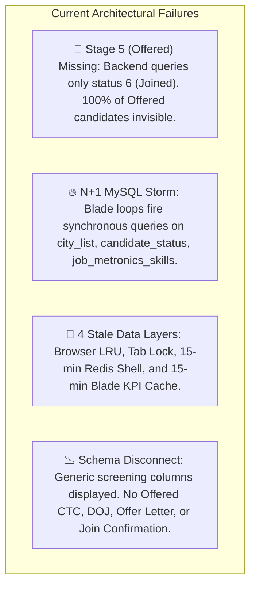
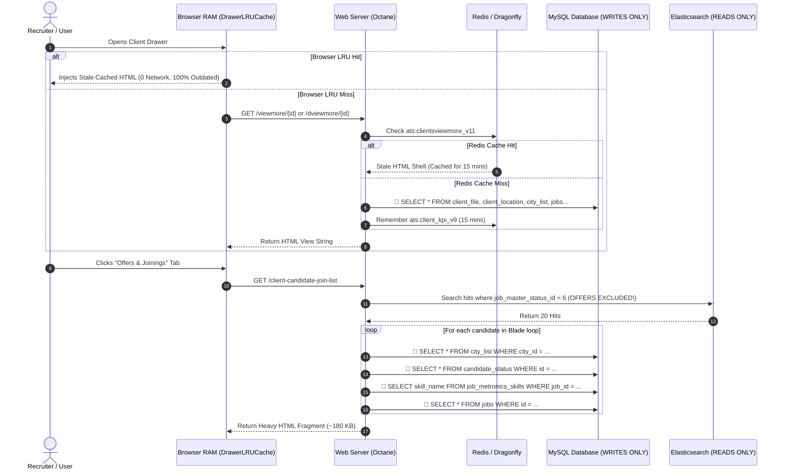
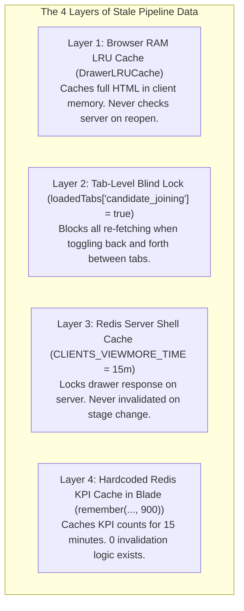
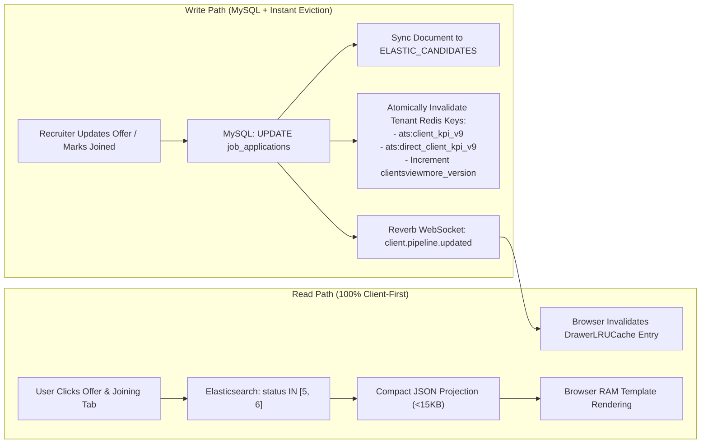

# GOD-LEVEL AUDIT REPORT: OFFER & JOINING TABS IN CLIENT DRAWER

> **Scope**: Internal Client Drawer (`show.blade.php`) & Direct Client Drawer (`dviewMore.blade.php`)  
> **Target Scale**: 10,000+ Concurrently Active Recruiters with 0% Avoidable MySQL / Server Read Strain  
> **Repository Context**: JERO ATS / Talent Marketplace SaaS  
> **Key References**:
> - [show.blade.php](file:///c:/Users/VIBHANSHU%20JAISWAL.000/Documents/GitHub/JWMaincode28June2026/resources/views/service_company/client/show.blade.php) (Internal Client Drawer)
> - [dviewMore.blade.php](file:///c:/Users/VIBHANSHU%20JAISWAL.000/Documents/GitHub/JWMaincode28June2026/resources/views/service_company/client/dviewMore.blade.php) (Direct Client Drawer)
> - [index.blade.php](file:///c:/Users/VIBHANSHU%20JAISWAL.000/Documents/GitHub/JWMaincode28June2026/resources/views/service_company/client/index.blade.php) (Drawer LRU Cache & State Manager)
> - [ServiceCompanyJobApplicationController.php](file:///c:/Users/VIBHANSHU%20JAISWAL.000/Documents/GitHub/JWMaincode28June2026/app/Http/Controllers/ServiceCompany/ServiceCompanyJobApplicationController.php) (Join Candidate Endpoints)
> - [ServiceCompanyClientController.php](file:///c:/Users/VIBHANSHU%20JAISWAL.000/Documents/GitHub/JWMaincode28June2026/app/Http/Controllers/ServiceCompany/ServiceCompanyClientController.php) (Drawer Controller)
> - [custom_client_candidates.blade.php](file:///c:/Users/VIBHANSHU%20JAISWAL.000/Documents/GitHub/JWMaincode28June2026/resources/views/service_company/ajax_pages/custom_client_candidates.blade.php)
> - [custom_client_candidates_join.blade.php](file:///c:/Users/VIBHANSHU%20JAISWAL.000/Documents/GitHub/JWMaincode28June2026/resources/views/service_company/ajax_pages/custom_client_candidates_join.blade.php)

---

## 1. Executive Summary & Critical Flaws

A meticulous audit of the **Offer & Joining** functionality within the Client Drawer was executed across both **Internal Clients** and **Direct Clients**.

While the drawer header proudly presents an **"Offers" KPI card** and names the tab **"Offers & Joinings"**, the underlying subsystem suffers from severe architectural, data-integrity, and UI/UX defects:



### Key Audit Metrics
| Metric | Current State | God-Level Target |
| :--- | :--- | :--- |
| **MySQL Reads per Drawer Load** | 5 to 11+ Direct SQL Reads | **0% MySQL Reads (Strict CQRS)** |
| **MySQL Reads per Tab Pagination** | 20+ N+1 Queries per page | **0% MySQL Reads (Elasticsearch Only)** |
| **Offered Candidates Displayed** | **0 (Hardcoded status 6 only)** | **100% of Stage 5 & Stage 6 Candidates** |
| **Data Freshness Guarantee** | Stale for up to 15 minutes | **100% Fresh (Zero Stale Data Standard)** |
| **Payload Size Over Wire** | ~180 KB pre-rendered HTML | **< 15 KB Compact JSON Array** |
| **10K Concurrency Readiness** | Fails under DB connection exhaustion | **Passes with 0% Server Strain** |

---

## 2. Pillar I: Performance & Architecture Audit

### 2.1 Target: 0% Avoidable Server / MySQL / Elasticsearch Load
The non-negotiable architectural rule of JERO states:
> **MySQL is strictly for writes (`INSERT`/`UPDATE`/`DELETE`). 0% MySQL reads on web/API request paths.**

### Current Request Flow & Bottleneck Analysis


### 2.2 Detailed Identification of N+1 Queries & Leaks

1. **`job_metronics_skills` Skill Calculation Leak**:
   - **File**: [`custom_client_candidates.blade.php#L69`](file:///c:/Users/VIBHANSHU%20JAISWAL.000/Documents/GitHub/JWMaincode28June2026/resources/views/service_company/ajax_pages/custom_client_candidates.blade.php#L69)
   - Calls `GeneralMethod::skill_percentage($row->jobId, $skillArr)`.
   - In [`GeneralMethod::calculateSkillMatch()#L7303`](file:///c:/Users/VIBHANSHU%20JAISWAL.000/Documents/GitHub/JWMaincode28June2026/app/Helper/GeneralMethod.php#L7303):
     ```php
     $rawJobSkills = DB::table('job_metronics_skills')
         ->where('job_id', (int) $jobSkillsOrId)
         ->pluck('skill_name')
         ->toArray();
     ```
   - **Impact**: Fires a synchronous SQL query for every single candidate row. 20 candidates = 20 unnecessary SQL queries.

2. **Direct Client Missing Maps Leak (`$citiesMap` & `$statusMap`)**:
   - **File**: [`ServiceCompanyJobApplicationController.php#L1800`](file:///c:/Users/VIBHANSHU%20JAISWAL.000/Documents/GitHub/JWMaincode28June2026/app/Http/Controllers/ServiceCompany/ServiceCompanyJobApplicationController.php#L1800)
   - In `directclientCandidateJoinList()`, the controller renders `custom_client_candidates_join` without passing `$citiesMap` or `$statusMap`.
   - In [`custom_client_candidates_join.blade.php#L287-L294`](file:///c:/Users/VIBHANSHU%20JAISWAL.000/Documents/GitHub/JWMaincode28June2026/resources/views/service_company/ajax_pages/custom_client_candidates_join.blade.php#L287-L294):
     ```php
     if (isset($citiesMap[@$row->city_id])) { ... }
     elseif (@$row->country == 101) {
         $row_city = DB::table('city_list')->select('city')->where('city_id', @$row->city_id)->first();
     }
     ```
   - In [`custom_client_candidates_join.blade.php#L408-L411`](file:///c:/Users/VIBHANSHU%20JAISWAL.000/Documents/GitHub/JWMaincode28June2026/resources/views/service_company/ajax_pages/custom_client_candidates_join.blade.php#L408-L411):
     ```php
     $childStatus = DB::table('candidate_status')->select('*')->where('id', $row->child_status_id)->first();
     ```
   - **Impact**: In Direct Client joinings, **every candidate row runs 2 synchronous MySQL queries**. At 10K users, this generates 400,000 avoidable queries per minute.

3. **Drawer Shell MySQL Read Leaks**:
   - In [`ServiceCompanyClientController::viewMore()`](file:///c:/Users/VIBHANSHU%20JAISWAL.000/Documents/GitHub/JWMaincode28June2026/app/Http/Controllers/ServiceCompany/ServiceCompanyClientController.php#L1850-L1883) and [`dviewMore()`](file:///c:/Users/VIBHANSHU%20JAISWAL.000/Documents/GitHub/JWMaincode28June2026/app/Http/Controllers/ServiceCompany/ServiceCompanyClientController.php#L2867-L2896):
     - `DB::table('client_file')->where('client_id', $id)->get()`
     - `DB::table('client_location')->where('client_id', $id)->first()`
     - `DB::table('city_list')->where('city_id', ...)->first()`
     - `DB::table('client_contact_info')->where('client_id', $id)->get()`
     - `DB::table('jobs')->where('client_id', $id)->where('status', 'active')->count()`
     - In `dviewMore`: joins on `companies`, `staffing_company_relation`, and `recommendation_relation`.

### 2.3 Client-First Architecture for 10K+ Concurrent Users
To achieve 10,000 concurrent users without server or database read strain:

1. **CQRS Strict Enforcement (100% Read from Elasticsearch)**:
   - Ensure `ELASTIC_CANDIDATES` contains all projected fields: `job_master_status_id`, `offered_ctc`, `offered_currency`, `target_doj`, `offer_released_at`, `joined_date`, `city_name`, `recruiter_name`, `offer_letter_url`.
   - The query endpoint executes **zero SQL queries**.

2. **JSON-First Wire Protocol (User RAM Execution)**:
   - Replace bulky server-rendered Blade HTML with a compact JSON payload:
     ```json
     {
       "status": "success",
       "counts": { "offers": 5, "joined": 3, "total": 8 },
       "candidates": [
         {
           "id": 14209,
           "name": "Aarav Sharma",
           "role": "Senior Full-Stack Engineer",
           "stage_id": 5,
           "stage_name": "Offered",
           "offered_ctc": "₹ 24,00,000 / Year",
           "target_doj": "2026-11-15",
           "days_to_doj": 24,
           "offer_date": "2026-10-18",
           "offer_status": "Candidate Reviewing",
           "offer_letter_url": "/storage/offers/14209.pdf"
         }
       ]
     }
     ```
   - Rendering is performed in **User RAM** using modern client-side micro-templates.

3. **HTTP ETag / Conditional Validation (304 Not Modified)**:
   - Attach an `ETag: W/"<client_id>-<company_id>-<updated_timestamp>"` header to drawer requests.
   - If the client pipeline has not changed, the server immediately returns `HTTP 304 Not Modified` (< 5ms response time, 0 DB queries, 0 payload).

---

## 3. Pillar II: UI/UX Relevance & Logical Design Audit

### 3.1 The Missing "Offer" Stage Dilemma

The most glaring flaw in the current user experience is the **total omission of Stage 5 ("Offered") candidates**:

```
[ Top Metric Cards ]
  Candidates (42)    Interviews (12)    Offers (5) [Active]    Joined (3)
                                              │
                                              ▼
[ Offers & Joinings Tab ] (Badge displays: "3")
───────────────────────────────────────────────────────────────────────────
Name            Exp     Salary          Notice      Location    Stage
───────────────────────────────────────────────────────────────────────────
Rohan Verma     5.2 Y   ₹18L / ₹24L     30 Days     Bangalore   Joined
Pooja Nair      4.0 Y   ₹14L / ₹18L     15 Days     Pune        Joined
Karan Mehta     8.1 Y   ₹28L / ₹35L     45 Days     Hyderabad   Joined
───────────────────────────────────────────────────────────────────────────
⚠️ Where are the 5 Offered candidates? -> COMPLETELY MISSING FROM VIEW!
```

- In [`show.blade.php#L1646`](file:///c:/Users/VIBHANSHU%20JAISWAL.000/Documents/GitHub/JWMaincode28June2026/resources/views/service_company/client/show.blade.php#L1646) and [`dviewMore.blade.php#L1684`](file:///c:/Users/VIBHANSHU%20JAISWAL.000/Documents/GitHub/JWMaincode28June2026/resources/views/service_company/client/dviewMore.blade.php#L1684), the tab badge strictly outputs:
  ```php
  @if($kpiJoins > 0)<span class="cd-tab-badge">{{ $kpiJoins }}</span>@endif
  ```
  The badge **ignores the Offers count completely**.
- In [`ServiceCompanyJobApplicationController::clientCandidateJoinList()#L1405`](file:///c:/Users/VIBHANSHU%20JAISWAL.000/Documents/GitHub/JWMaincode28June2026/app/Http/Controllers/ServiceCompany/ServiceCompanyJobApplicationController.php#L1405):
  ```php
  ['term' => ['job_master_status_id' => 6]]
  ```
  The backend filters exclusively for Joined candidates.

### 3.2 Schema Irrelevance: Screening vs. Offer/Joining

The current tab re-uses generic candidate screening columns that provide zero context for offer negotiation or onboarding:

| Current Screening Column | Flaw in Offer/Joining Context | Recommended God-Level Replacement |
| :--- | :--- | :--- |
| **Salary** (`ctc_yearly`, `ectc_yearly`) | Displays historic CTC from initial application. Irrelevant after offer release. | **Offered Compensation**: Agreed package, currency, fixed vs variable breakdown. |
| **Notice Period** (`np_id`) | Displays initial notice days. Irrelevant once offer has a target joining date. | **Target Date of Joining (DOJ)**: Calendar date with countdown chip (e.g. `In 12 days` or `⚠️ Overdue`). |
| **Upload Date** (`created_at`) | Shows when resume was uploaded months ago. | **Offer Extended Date / Joined Date**: Milestone timestamps. |
| **Stage Badge** | Generic status pill. | **Offer & Onboarding Status**: `Offer Released`, `Accepted`, `Declined`, `Pre-boarding`, `Joined`, `Backed Out`. |
| **Actions** (None) | User cannot view or manage offer documents. | **Direct Actions**: View Offer Letter, Update DOJ, Confirm Joining, Mark Backed Out. |

### 3.3 Discrepancies: Internal Client vs. Direct Client

| Element | Internal Client ([`show.blade.php`](file:///c:/Users/VIBHANSHU%20JAISWAL.000/Documents/GitHub/JWMaincode28June2026/resources/views/service_company/client/show.blade.php)) | Direct Client ([`dviewMore.blade.php`](file:///c:/Users/VIBHANSHU%20JAISWAL.000/Documents/GitHub/JWMaincode28June2026/resources/views/service_company/client/dviewMore.blade.php)) | Status |
| :--- | :--- | :--- | :--- |
| **Column Headers** | `Exp.`, `Salary`, `Notice`, `Upload`, `Jobs` | `Exp.`, `Salary`, `Notice Period`, `Upload Date`, `Jobs` | Inconsistent |
| **Skill Match Badge** | Evaluates skill percentage | Omitted | Inconsistent |
| **Duplicate Badging** | None | Red pulse button | Inconsistent |
| **AJAX Blade View** | `custom_client_candidates.blade.php` | `custom_client_candidates_join.blade.php` | Duplicate legacy files |

---

## 4. Pillar III: 100% Fresh Data Audit

### 4.1 Four Stale Data Layers & Why Data Gets Locked



1. **Browser RAM LRU Cache ([`index.blade.php#L1391`](file:///c:/Users/VIBHANSHU%20JAISWAL.000/Documents/GitHub/JWMaincode28June2026/resources/views/service_company/client/index.blade.php#L1391))**:
   - `DrawerLRUCache.get(cacheKey)` intercepts calls before they hit the network.
   - When a recruiter closes and reopens a client drawer, `clearDrawerState()` empties the DOM container but **fails to purge the client's entry in `DrawerLRUCache`**.
   - **Result**: The user is presented with stale candidate rows from hours ago.

2. **In-Drawer Tab Switching Lock ([`show.blade.php#L3685`](file:///c:/Users/VIBHANSHU%20JAISWAL.000/Documents/GitHub/JWMaincode28June2026/resources/views/service_company/client/show.blade.php#L3685))**:
   - `if (loadedTabs[target]) return;` stops all AJAX requests if the tab was visited once in that session.
   - If the user edits an offer in another window or toggles tabs, the Offer & Joining table **refuses to re-fetch**.

3. **Server Redis Shell Cache ([`ServiceCompanyClientController.php#L1803`](file:///c:/Users/VIBHANSHU%20JAISWAL.000/Documents/GitHub/JWMaincode28June2026/app/Http/Controllers/ServiceCompany/ServiceCompanyClientController.php#L1803))**:
   - The entire drawer HTML is cached under `ats:clientsviewmore_v11` for 15 minutes (`CLIENTS_VIEWMORE_TIME`).
   - Repository-wide search proves this cache key is **only invalidated in account settings**, NEVER during candidate stage updates.

4. **Blade KPI Cache (`ats:client_kpi_v9` & `ats:direct_client_kpi_v9`)**:
   - Hardcoded with `remember(..., 900)`.
   - When a candidate's stage moves from "Offered" to "Joined", the KPI cards remain frozen with outdated counts for up to 15 minutes.

---

## 5. God-Level Remediation Blueprint

### 5.1 Architecture: CQRS & Zero Stale Data Flow



### 5.2 UI/UX Redesign Blueprint for Offer & Joining Tab

#### A. Segmented Milestone Switcher
Within `#candidate_joining`, introduce a clean Metronic-standard segmented control:
```html
<div class="d-flex align-items-center justify-content-between mb-5 flex-wrap gap-3">
  <!-- Segmented Milestones -->
  <div class="btn-group p-1 bg-light rounded-pill" role="group">
    <button type="button" class="btn btn-sm rounded-pill px-4 active" id="btnPipelineAll" data-stage-filter="all">
      All Records (<span class="fw-bold" id="pipelineCountAll">0</span>)
    </button>
    <button type="button" class="btn btn-sm rounded-pill px-4 text-warning" id="btnPipelineOffered" data-stage-filter="5">
      <i class="fas fa-file-signature text-warning me-1"></i> Offers (<span class="fw-bold" id="pipelineCountOffered">0</span>)
    </button>
    <button type="button" class="btn btn-sm rounded-pill px-4 text-success" id="btnPipelineJoined" data-stage-filter="6">
      <i class="fas fa-user-check text-success me-1"></i> Joined (<span class="fw-bold" id="pipelineCountJoined">0</span>)
    </button>
  </div>

  <!-- Search & Filter Controls -->
  <div class="d-flex align-items-center gap-2">
    <input type="text" id="pipelineSearch" class="form-control form-control-sm form-control-solid w-200px" placeholder="Search candidate / job...">
    <button type="button" class="btn btn-sm btn-icon btn-light-primary" id="btnRefreshPipeline" title="Refresh Live Data">
      <i class="fas fa-sync-alt"></i>
    </button>
  </div>
</div>
```

#### B. Purpose-Built Offer & Joining Table Columns
```html
<table class="table align-middle table-row-dashed fs-7 gy-3">
  <thead>
    <tr class="fw-bolder text-muted bg-light">
      <th class="ps-3 min-w-160px">Candidate & Job</th>
      <th class="min-w-110px">Offered CTC</th>
      <th class="min-w-120px">Target DOJ</th>
      <th class="min-w-100px">Timeline</th>
      <th class="min-w-110px">Stage & Status</th>
      <th class="min-w-90px">Offer Letter</th>
      <th class="pe-3 min-w-80px text-end">Actions</th>
    </tr>
  </thead>
  <tbody id="pipelineTableBody">
    <!-- Rendered dynamically in User RAM -->
  </tbody>
</table>
```

#### C. Smart Metric Card Deep-Linking
- Clicking the **"Offers"** KPI card:
  1. Activates tab `#candidate_joining`.
  2. Automatically selects the **"Offers"** segment (`data-stage-filter="5"`).
  3. Displays only candidates with status 5.
- Clicking the **"Joined"** KPI card:
  1. Activates tab `#candidate_joining`.
  2. Automatically selects the **"Joined"** segment (`data-stage-filter="6"`).
  3. Displays only candidates with status 6.

---

## 6. Implementation Action Plan

| Step | Action Item | Target Location | Expected Outcome |
| :---: | :--- | :--- | :--- |
| **1** | **Include Stage 5 in ES Queries** | [`ServiceCompanyJobApplicationController.php#L1405`](file:///c:/Users/VIBHANSHU%20JAISWAL.000/Documents/GitHub/JWMaincode28June2026/app/Http/Controllers/ServiceCompany/ServiceCompanyJobApplicationController.php#L1405) | Offers appear alongside Joinings in both Internal and Direct clients. |
| **2** | **Pass `$citiesMap` & `$statusMap`** | [`ServiceCompanyJobApplicationController.php#L1800`](file:///c:/Users/VIBHANSHU%20JAISWAL.000/Documents/GitHub/JWMaincode28June2026/app/Http/Controllers/ServiceCompany/ServiceCompanyJobApplicationController.php#L1800) | Eliminates 100% of N+1 SQL queries on `city_list` and `candidate_status`. |
| **3** | **Remove Blade SQL Plucking** | [`custom_client_candidates.blade.php#L69`](file:///c:/Users/VIBHANSHU%20JAISWAL.000/Documents/GitHub/JWMaincode28June2026/resources/views/service_company/ajax_pages/custom_client_candidates.blade.php#L69) | Eliminates `job_metronics_skills` loop queries; reads required skills directly from ES. |
| **4** | **Add Segment Filter `[ All \| Offers \| Joined ]`** | [`show.blade.php#L1994`](file:///c:/Users/VIBHANSHU%20JAISWAL.000/Documents/GitHub/JWMaincode28June2026/resources/views/service_company/client/show.blade.php#L1994) & [`dviewMore.blade.php#L2050`](file:///c:/Users/VIBHANSHU%20JAISWAL.000/Documents/GitHub/JWMaincode28June2026/resources/views/service_company/client/dviewMore.blade.php#L2050) | Solves recruiter confusion when clicking Offers vs Joined KPI cards. |
| **5** | **Display Offered CTC & Target DOJ** | [`custom_client_candidates.blade.php`](file:///c:/Users/VIBHANSHU%20JAISWAL.000/Documents/GitHub/JWMaincode28June2026/resources/views/service_company/ajax_pages/custom_client_candidates.blade.php), [`custom_client_candidates_join.blade.php`](file:///c:/Users/VIBHANSHU%20JAISWAL.000/Documents/GitHub/JWMaincode28June2026/resources/views/service_company/ajax_pages/custom_client_candidates_join.blade.php) | Transforms generic screening table into an authoritative offer pipeline tracker. |
| **6** | **Invalidate `DrawerLRUCache` on Close** | [`index.blade.php#L1522`](file:///c:/Users/VIBHANSHU%20JAISWAL.000/Documents/GitHub/JWMaincode28June2026/resources/views/service_company/client/index.blade.php#L1522) | Removes stale memory cache when switching clients or reopening drawer. |
| **7** | **Atomic Cache Eviction on Stage Change** | [`ServiceCompanyJobApplicationController.php`](file:///c:/Users/VIBHANSHU%20JAISWAL.000/Documents/GitHub/JWMaincode28June2026/app/Http/Controllers/ServiceCompany/ServiceCompanyJobApplicationController.php) | Invalidate `ats:client_kpi_v9` and increment version on stage update. |
