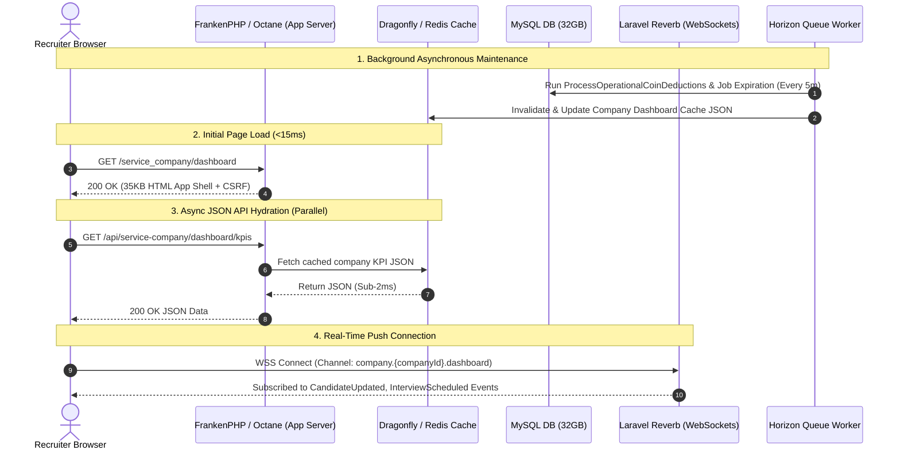

# High-Scale Implementation Report: Service Company Dashboard V2

**Project:** JERO B2B Hiring SaaS  
**Target Concurrency:** 10,000 Concurrent Recruiters  
**Target Infrastructure:**  
- **Application Server:** 32 GB RAM (Laravel Octane / FrankenPHP)  
- **Elasticsearch Server:** 32 GB RAM  
- **MySQL Database Server:** 32 GB RAM  

---

## Architectural Principles & Target State

The V2 Service Company Dashboard architecture decouples all synchronous computation from the web HTTP request cycle. The system transitions from a Server-Side Rendered (SSR) monolithic view with inline background tasks to an **Asynchronous App Shell + JSON API + WebSocket Push** architecture.



---

## Phased Implementation Roadmap

### Phase 1: Background Queue & Cron Decoupling
- **Goal:** Remove 100% of write queries (`UPDATE`, `INSERT`) and lifecycle background jobs from the GET `/service_company/dashboard` HTTP request handler.
- **Components to Create/Update:**
  - `app/Jobs/ProcessOperationalCoinDeductionsJob.php`: Queued job handling team & job daily coin deductions.
  - `app/Console/Kernel.php`: Register Horizon scheduled tasks running every 5 minutes:
    ```php
    $schedule->job(new ProcessOperationalCoinDeductionsJob)->everyFiveMinutes();
    $schedule->job(new AutoCloseExpiredJobsJob)->hourly();
    ```
  - **Elasticsearch Safety:** Remove `'refresh' => true` parameters from inline updates. Allow Elasticsearch's standard 1-second index refresh interval to commit index segments naturally.

### Phase 2: MySQL Query Optimization & Indexing
- **Goal:** Eliminate table scans and reduce MySQL CPU usage to <15% under 10k users.
- **SQL Range Query Refactoring:**
  - Replace `InterviewSchedule::where(DB::raw('DATE(schedule_date)'), $currentDate)` with:
    ```php
    InterviewSchedule::where('company_id', $companyId)
        ->where('schedule_date', '>=', now()->startOfDay())
        ->where('schedule_date', '<=', now()->endOfDay())
    ```
- **Database Schema Indexes (`database/schema/mysql-schema.sql`):**
  - Add compound B-Tree indexes:
    ```sql
    ALTER TABLE `interview_schedules` ADD INDEX `idx_comp_sched_status` (`company_id`, `schedule_date`, `status`);
    ALTER TABLE `offer_job_applications` ADD INDEX `idx_comp_created_status` (`company_id`, `created_at`, `candidate_status`);
    ALTER TABLE `jobs` ADD INDEX `idx_comp_status_created` (`company_id`, `status`, `created_at`);
    ALTER TABLE `coin_transection_logs` ADD INDEX `idx_comp_event_created` (`company_id`, `event_type`, `created_at`);
    ```

### Phase 3: Service Layer Extraction & Controller Refactoring
- **Goal:** Extract procedural logic from [`ServiceCompanyDashboardController.php`](file:///c:/Users/VIBHANSHU%20JAISWAL.000/Documents/GitHub/JWMaincode28June2026/app/Http/Controllers/ServiceCompany/ServiceCompanyDashboardController.php) into clean, testable domain services.
- **New Service Class:** `app/Services/ServiceCompanyDashboardService.php`
  - Methods:
    - `getCompanyKpiMetrics(int $companyId): array`
    - `getRecruiterLeaderboard(int $companyId): array`
    - `getTodayInterviews(int $companyId, int $userId): array`
- **Slim Controller:** Reduce `index()` in `ServiceCompanyDashboardController` to <30 lines, returning the lightweight Blade shell or delegating to JSON response handlers.

### Phase 4: Decoupled JSON API Endpoints & Dragonfly Cache
- **Goal:** Serve lightweight JSON data from Redis cache without loading full HTML strings.
- **New API Routes (`routes/api.php`):**
  - `GET /api/v2/service-company/dashboard/kpis`
  - `GET /api/v2/service-company/dashboard/leaderboards`
  - `GET /api/v2/service-company/dashboard/interviews`
- **Cache Format:**
  - Store raw metric arrays under Redis key `ats:v2:dashboard:{companyId}:kpis` (TTL 60 seconds).
  - Memory payload per entry drops from ~500 KB to ~2.5 KB.

### Phase 5: Near Real-Time WebSockets via Laravel Reverb
- **Goal:** Replace short-polling HTTP `setInterval` AJAX loops with event-driven WebSocket pushes.
- **Broadcasting Setup:**
  - Broadcast Events: `CandidateStatusChanged`, `InterviewScheduled`, `OperationalCoinUpdated`.
  - Channel: Private channel `private-company.{companyId}.dashboard`.
- **Fallback Policy:** If WebSockets drop, client falls back to Stale-While-Revalidate (SWR) fetching with exponential backoff (15s → 30s → 60s) and browser tab visibility checks (`document.hidden`).

### Phase 6: Front-End Shell & Client Resilience Layer
- **Goal:** Modularize JavaScript, eliminate inline Blade scripts, and provide offline fault tolerance.
- **New Front-End Module:** `public/js/service_company_dashboard.js`
  - Uses `AbortController` to cancel pending HTTP requests when user switches tabs/views.
  - Implements client-side state caching using `localStorage` / `sessionStorage` for immediate skeletal rendering.
  - Handles client-side metric sorting and chart rendering (Chart.js / ApexCharts).

---

## Verification & Load Testing Plan

1. **Syntax & Quality Checks:**
   - `php -l app/Http/Controllers/ServiceCompany/ServiceCompanyDashboardController.php`
   - `./vendor/bin/pint --test`
   - `php artisan test --filter=ServiceCompanyDashboardTest`

2. **Concurrency Benchmark (`k6` / `ApacheBench`):**
   - Execute concurrency load test representing 10,000 recruiters:
     ```bash
     ab -n 10000 -c 500 -H "Authorization: Bearer <token>" https://testing.jero.works/api/v2/service-company/dashboard/kpis
     ```
   - **Target Success Criteria:**
     - 0 HTTP 5xx errors.
     - P95 Response Time < 50ms.
     - MySQL CPU < 15%.
     - Elasticsearch disk IOPS < 5% utilization.
