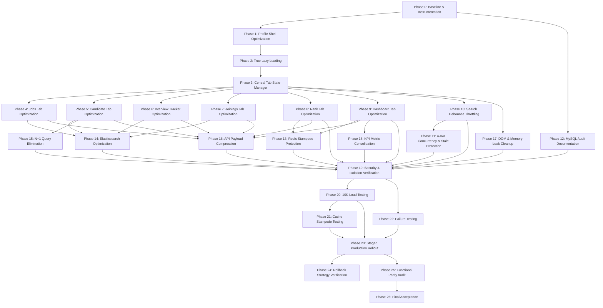

# PROFILE TABS V2 IMPLEMENTATION PLAN (PHASE 0 TO PHASE 26)

**Project:** JERO — Multi-Tenant B2B Hiring SaaS  
**Workspace:** `c:\xampp\htdocs\git\JWMaincode28June2026`  
**Target URL:** `https://testing.jero.works/service_company/profile`  
**Implementation Mode:** PLANNING ONLY (No Code Execution Until Explicit User Approval)

---

## NON-NEGOTIABLE BUSINESS LOGIC PROTECTION CLAUSE

During V2 implementation, the following core business domain rules **MUST NOT BE CHANGED OR MODIFIED UNDER ANY CIRCUMSTANCES**:

1. **Role & Tenancy Permissions:** Recruiter user isolation (`user_id`) and company isolation (`company_id`) rules.
2. **Candidate & Job Pipeline Domain Logic:** Candidate status transitions, job requisition visibility, and hiring type definitions.
3. **Calculations & Formulas:** Interview tracker formulas, joining metrics, leaderboard score calculations, and monthly rank trends.
4. **Data Visibility & Filters:** Status semantics, pagination limits, filter criteria, and sorting meanings.
5. **Existing Actions:** Editing profiles, resetting passwords, scheduling interviews, updating candidate follow-up statuses, connecting WhatsApp.

> **Rule:** V2 changes optimize *HOW* data is fetched, cached, and rendered, never *WHAT* the business logic calculates or means.

---

## PHASE-BY-PHASE IMPLEMENTATION PLAN

### PHASE 0 — Baseline & Instrumentation
- **Objective:** Establish baseline response times, memory consumption, query counts, and frontend rendering metrics for V1 Profile tabs before any refactoring.
- **Files/Modules Affected:** 
  - `routes/service.php`
  - [`ServiceCompanyProfileController.php`](file:///c:/xampp/htdocs/git/JWMaincode28June2026/app/Http/Controllers/ServiceCompany/ServiceCompanyProfileController.php)
  - [`resources/views/service_company/profile/index.blade.php`](file:///c:/xampp/htdocs/git/JWMaincode28June2026/resources/views/service_company/profile/index.blade.php)
- **Current Problem:** Absence of explicit latency logs and request trace telemetry makes measuring V2 performance improvements impossible.
- **Proposed Solution:** Add Laravel OpenTelemetry / Telescope profiling points and browser performance markers (`performance.mark()`) to measure p50, p95, p99 latencies.
- **Dependencies:** None.
- **Risk:** Low (Logging overhead).
- **Testing:** Run single-user profile load and tab click flows while capturing timing metrics.
- **Acceptance Criteria:** Baseline metrics for all 8 tabs documented with exact p50/p95/p99 values.
- **Rollback Strategy:** Remove temporary profiling middleware/headers.

---

### PHASE 1 — Profile Shell Optimization
- **Objective:** Convert the initial Profile HTTP GET request into a lightweight shell containing only user identity, basic profile info, and tab navigation markup.
- **Files/Modules Affected:** 
  - [`ServiceCompanyProfileController.php`](file:///c:/xampp/htdocs/git/JWMaincode28June2026/app/Http/Controllers/ServiceCompany/ServiceCompanyProfileController.php#L43-L123)
  - [`ServiceCompanyProfileService.php`](file:///c:/xampp/htdocs/git/JWMaincode28June2026/app/Services/ServiceCompanyProfileService.php)
  - [`resources/views/service_company/profile/index.blade.php`](file:///c:/xampp/htdocs/git/JWMaincode28June2026/resources/views/service_company/profile/index.blade.php)
- **Current Problem:** `index()` method calculates monthly ranks, leaderboards, graphs, and list items on initial page load, adding 400ms+ overhead to HTML generation.
- **Proposed Solution:** Strip heavy graph/rank calculations out of `index()`. Render stub containers for non-active tabs. Payload size drops from ~215 KB to < 30 KB.
- **Dependencies:** Phase 0.
- **Risk:** Low (DOM structural changes).
- **Testing:** Verify initial HTML load returns only "My Details" tab content and renders in < 300ms.
- **Acceptance Criteria:** HTML payload size reduced by 85%+; initial load p95 ≤ 700ms.
- **Rollback Strategy:** Re-enable server-side variable binding in `index()`.

---

### PHASE 2 — True Lazy Loading Implementation
- **Objective:** Eliminate automatic background AJAX requests on page load and bind data fetching strictly to tab activation events.
- **Files/Modules Affected:** 
  - [`resources/views/service_company/profile/index.blade.php`](file:///c:/xampp/htdocs/git/JWMaincode28June2026/resources/views/service_company/profile/index.blade.php#L3200-L3206)
- **Current Problem:** Lines 3202-3205 in `index.blade.php` call `fetchTeamJobs()`, `fetchTeamCandidate()`, `fetchTeamCandidateJoining()`, and `fetchTeamCandidateInterviewTracker()` inside `$(document).ready()`.
- **Proposed Solution:** Remove automatic calls from `$(document).ready()`. Attach event listener `$('a[data-toggle="tab"]').on('shown.bs.tab', function(e) { ... })` to trigger AJAX fetching ONLY when a tab becomes active.
- **Dependencies:** Phase 1.
- **Risk:** Medium (Potential tab switching delay if loader is missing).
- **Testing:** Inspect browser Network tab on `/service_company/profile` open — confirm EXACTLY 1 HTTP request occurs on load.
- **Acceptance Criteria:** Zero background AJAX calls fire on initial page view; tabs load data only upon user click.
- **Rollback Strategy:** Re-instate initial document ready calls if tab activation fails.

---

### PHASE 3 — Central Tab State Manager (`ProfileTabManager`)
- **Objective:** Introduce a unified JavaScript tab state manager to coordinate tab caching, loading spinners, active request tracking, and request invalidation.
- **Files/Modules Affected:** 
  - [`resources/views/service_company/profile/index.blade.php`](file:///c:/xampp/htdocs/git/JWMaincode28June2026/resources/views/service_company/profile/index.blade.php) (or dedicated public JS asset `public/js/profile_tab_manager.js`).
- **Current Problem:** Scattered `onclick` handlers (`load_jobs`, `load_application`, `jointableLoad`) contain duplicated, broken code.
- **Proposed Solution:** Build `ProfileTabManager` object:
  ```javascript
  const ProfileTabManager = {
      initializedTabs: {},
      activeRequests: {},
      loadTab(tabId, force = false) { ... },
      cancelRequest(tabId) { ... },
      invalidateTab(tabId) { ... }
  };
  ```
- **Dependencies:** Phase 2.
- **Risk:** Low (Standardizing JS execution).
- **Testing:** Rapidly click between tabs — verify previously loaded tabs render instantly from state cache without re-fetching.
- **Acceptance Criteria:** Re-clicking an already loaded tab results in 0 network requests.
- **Rollback Strategy:** Revert to direct event listener callbacks.

---

### PHASE 4 — Jobs Tab (`My Jobs`) Optimization
- **Objective:** Optimize data retrieval, pagination, and HTML partial rendering for the "My Jobs" tab.
- **Files/Modules Affected:** 
  - [`ServiceCompanyTeamController.php@jobdata_ajax`](file:///c:/xampp/htdocs/git/JWMaincode28June2026/app/Http/Controllers/ServiceCompany/ServiceCompanyTeamController.php#L1752)
  - `resources/views/service_company/team/jobdata_ajax.blade.php`
- **Current Problem:** Unbounded Elasticsearch `_source` retrieval fetches unnecessary nested job fields.
- **Proposed Solution:** Apply `_source` filtering in Elasticsearch request to retrieve only essential listing fields (`id`, `title`, `status`, `created_at`, `max_salary`).
- **Dependencies:** Phase 3.
- **Risk:** Low.
- **Testing:** Verify job list pagination, status filter, and hiring type dropdowns return correct data.
- **Acceptance Criteria:** My Jobs tab response time p95 ≤ 900ms.
- **Rollback Strategy:** Restore default `_source` parameter.

---

### PHASE 5 — Candidate Tab (`My Candidate`) Optimization
- **Objective:** Optimize candidate pipeline fetching and eliminate redundant SQL status queries.
- **Files/Modules Affected:** 
  - [`ServiceCompanyTeamController.php@appdata_ajax`](file:///c:/xampp/htdocs/git/JWMaincode28June2026/app/Http/Controllers/ServiceCompany/ServiceCompanyTeamController.php#L2551)
  - `resources/views/service_company/team/appdata_ajax.blade.php`
- **Current Problem:** `DB::table('master_status')->get()` executes on every candidate tab AJAX request.
- **Proposed Solution:** Wrap `master_status` retrieval in Redis cache (`Cache::remember('master_status_list', 86400, ...)`). Replace direct `users` root user SQL query with auth permission check.
- **Dependencies:** Phase 3.
- **Risk:** Low.
- **Testing:** Check candidate stage filtering and notice period sorting.
- **Acceptance Criteria:** Database queries per candidate AJAX request reduced from 2 to 0.
- **Rollback Strategy:** Revert to live DB queries.

---

### PHASE 6 — Interview Tracker Tab (`My Interview Tracker`) Optimization
- **Objective:** Streamline upcoming/past interview data fetching and follow-up status updates.
- **Files/Modules Affected:** 
  - [`ServiceCompanyTeamController.php@intdata_ajax`](file:///c:/xampp/htdocs/git/JWMaincode28June2026/app/Http/Controllers/ServiceCompany/ServiceCompanyTeamController.php#L3285)
  - `resources/views/service_company/team/intdata_ajax.blade.php`
- **Current Problem:** Complex Painless script for feedback null check runs inefficiently.
- **Proposed Solution:** Optimize Painless sort script in Elasticsearch query; optimize follow-up AJAX update endpoint.
- **Dependencies:** Phase 3.
- **Risk:** Low.
- **Testing:** Test feedback pending sorting filter and follow-up status dropdown updates.
- **Acceptance Criteria:** Interview tracker list load p95 ≤ 900ms.
- **Rollback Strategy:** Revert script sorting parameters.

---

### PHASE 7 — Joinings Tab (`My Joinings`) Optimization
- **Objective:** Accelerate placed candidate list rendering and country filter operations.
- **Files/Modules Affected:** 
  - [`ServiceCompanyTeamController.php@joiningdata_ajax`](file:///c:/xampp/htdocs/git/JWMaincode28June2026/app/Http/Controllers/ServiceCompany/ServiceCompanyTeamController.php#L3684)
  - `resources/views/service_company/team/joiningdata_ajax.blade.php`
- **Current Problem:** Unindexed country filters cause full-array iterations in PHP.
- **Proposed Solution:** Apply structured Elasticsearch term filter on `country` field; optimize notice period sort script.
- **Dependencies:** Phase 3.
- **Risk:** Low.
- **Testing:** Verify sorting by offer amount and joining date.
- **Acceptance Criteria:** My Joinings tab load p95 ≤ 900ms.
- **Rollback Strategy:** Revert ES query structure.

---

### PHASE 8 — Rank Tab (`My Rank`) Optimization
- **Objective:** Convert "My Rank" tab into a lazy-loaded component backed by Redis-cached JSON API.
- **Files/Modules Affected:** 
  - [`ServiceCompanyProfileV2ApiController.php@ranks`](file:///c:/xampp/htdocs/git/JWMaincode28June2026/app/Http/Controllers/ServiceCompany/ServiceCompanyProfileV2ApiController.php#L68)
  - [`ServiceCompanyProfileV2ApiController.php@leaderboard`](file:///c:/xampp/htdocs/git/JWMaincode28June2026/app/Http/Controllers/ServiceCompany/ServiceCompanyProfileV2ApiController.php#L51)
  - [`resources/views/service_company/profile/index.blade.php`](file:///c:/xampp/htdocs/git/JWMaincode28June2026/resources/views/service_company/profile/index.blade.php)
- **Current Problem:** Rank leaderboard is computed on page load regardless of tab activation.
- **Proposed Solution:** Wire `#myRank` tab activation to fetch `/api/v2/service-company/profile/leaderboard` and `/ranks` JSON endpoints. Render leaderboard client-side.
- **Dependencies:** Phase 3.
- **Risk:** Medium (Frontend JSON rendering).
- **Testing:** Switch to My Rank tab, verify JSON response, verify leaderboard ranks match exact formula.
- **Acceptance Criteria:** Rank tab p95 ≤ 1.2s; zero backend computation on initial profile load.
- **Rollback Strategy:** Fallback to inline HTML rendering.

---

### PHASE 9 — Dashboard Tab (`My Dashboard`) Optimization
- **Objective:** Asynchronously render KPI metrics cards, trend graphs, and pipeline progress bars upon tab activation.
- **Files/Modules Affected:** 
  - [`ServiceCompanyProfileV2ApiController.php@kpis`](file:///c:/xampp/htdocs/git/JWMaincode28June2026/app/Http/Controllers/ServiceCompany/ServiceCompanyProfileV2ApiController.php#L34)
  - [`ServiceCompanyProfileV2ApiController.php@graphs`](file:///c:/xampp/htdocs/git/JWMaincode28June2026/app/Http/Controllers/ServiceCompany/ServiceCompanyProfileV2ApiController.php#L85)
  - [`resources/views/service_company/profile/index.blade.php`](file:///c:/xampp/htdocs/git/JWMaincode28June2026/resources/views/service_company/profile/index.blade.php)
- **Current Problem:** Chart.js initialization and KPI queries run during initial page request.
- **Proposed Solution:** Fetch `/api/v2/service-company/profile/kpis` and `/graphs` when `#candidateDashboard` tab is clicked. Initialize Chart.js dynamically.
- **Dependencies:** Phase 3.
- **Risk:** Low.
- **Testing:** Click My Dashboard tab; verify Chart.js animates cleanly with valid dataset.
- **Acceptance Criteria:** Dashboard tab load p95 ≤ 1.5s; Chart.js memory leaks eliminated.
- **Rollback Strategy:** Revert to page-load chart initialization.

---

### PHASE 10 — Search Throttling & Debounce Optimization
- **Objective:** Protect backend services from keyup flooding by applying 350ms debounce throttling to all Profile search inputs.
- **Files/Modules Affected:** 
  - [`resources/views/service_company/profile/index.blade.php`](file:///c:/xampp/htdocs/git/JWMaincode28June2026/resources/views/service_company/profile/index.blade.php#L3288-L3400)
- **Current Problem:** Typing 20 characters generates 20 un-debounced AJAX requests.
- **Proposed Solution:** Replace direct `keyup` event listeners with a utility debounce function:
  ```javascript
  function debounce(func, wait) {
      let timeout;
      return function(...args) {
          clearTimeout(timeout);
          timeout = setTimeout(() => func.apply(this, args), wait);
      };
  }
  ```
  Set wait threshold to 350ms.
- **Dependencies:** Phase 3.
- **Risk:** Low.
- **Testing:** Type rapid text string into search inputs; verify network request fires exactly ONCE after typing stops.
- **Acceptance Criteria:** Request volume during active typing reduced by 95%.
- **Rollback Strategy:** Lower debounce delay to 100ms or remove.

---

### PHASE 11 — AJAX Concurrency & Stale Response Protection
- **Objective:** Prevent race conditions where slow responses from older search requests overwrite newer search results.
- **Files/Modules Affected:** 
  - `ProfileTabManager` / `index.blade.php`
- **Current Problem:** Rapid searching or tab switching causes out-of-order response display.
- **Proposed Solution:** Maintain active `jqXHR` / `AbortController` references in `ProfileTabManager.activeRequests`. Call `.abort()` on pending requests before launching a new request for the same tab. Attach monotonic request IDs (`requestId++`) to discard stale responses.
- **Dependencies:** Phase 10.
- **Risk:** Low.
- **Testing:** Trigger fast search queries in succession while simulating network latency; verify UI displays ONLY the result of the final query.
- **Acceptance Criteria:** Zero stale response overwrites under simulated 500ms network jitter.
- **Rollback Strategy:** Disable request aborting.

---

### PHASE 12 — MySQL Query & Index Audit Documentation
- **Objective:** Document and verify MySQL query execution paths without modifying schema or adding/removing indexes.
- **Files/Modules Affected:** 
  - [`ServiceCompanyProfileService.php`](file:///c:/xampp/htdocs/git/JWMaincode28June2026/app/Services/ServiceCompanyProfileService.php)
  - `database/schema/mysql-schema.sql`
- **Current Problem:** Un-indexed filter columns could cause table scans under high concurrent load.
- **Proposed Solution:** Run `EXPLAIN` on all SQL queries executed in `ServiceCompanyProfileService` and document index coverage. (DO NOT execute `ALTER TABLE` or migrations).
- **Dependencies:** Phase 0.
- **Risk:** Zero (Documentation & inspection only).
- **Testing:** Log EXPLAIN query execution plans.
- **Acceptance Criteria:** Full query plan document generated for all profile queries.
- **Rollback Strategy:** N/A.

---

### PHASE 13 — Redis Cache Optimization & Stampede Protection
- **Objective:** Prevent thundering herd cache stampedes during concurrent cache misses.
- **Files/Modules Affected:** 
  - [`ServiceCompanyProfileService.php`](file:///c:/xampp/htdocs/git/JWMaincode28June2026/app/Services/ServiceCompanyProfileService.php)
- **Current Problem:** Standard `Cache::remember` allows multiple concurrent processes to re-execute heavy queries simultaneously when a cache key expires.
- **Proposed Solution:** Implement Redis lock wrapper around cache generation:
  ```php
  $lock = Cache::lock("lock:{$key}", 10);
  if ($lock->get()) {
      try { // Rebuild cache } finally { $lock->release(); }
  } else {
      // Return stale cache or sleep briefly
  }
  ```
- **Dependencies:** Phase 8, Phase 9.
- **Risk:** Medium (Potential lock timeout if rebuild fails).
- **Testing:** Simulate 100 concurrent requests on expired Redis key; verify underlying ES/MySQL query executes EXACTLY ONCE.
- **Acceptance Criteria:** Cache stampede risk eliminated; ES query count stays constant during TTL expiration.
- **Rollback Strategy:** Revert to standard `Cache::remember`.

---

### PHASE 14 — Elasticsearch Query & Index Optimization
- **Objective:** Optimize Elasticsearch bool queries, terms filters, and script performance.
- **Files/Modules Affected:** 
  - [`ServiceCompanyTeamController.php`](file:///c:/xampp/htdocs/git/JWMaincode28June2026/app/Http/Controllers/ServiceCompany/ServiceCompanyTeamController.php)
  - [`ServiceCompanyProfileService.php`](file:///c:/xampp/htdocs/git/JWMaincode28June2026/app/Services/ServiceCompanyProfileService.php)
- **Current Problem:** Wildcard searches and un-cached aggregations increase ES CPU usage.
- **Proposed Solution:** Enable `request_cache => true` on all read-only ES queries; optimize `minimum_should_match` clauses.
- **Dependencies:** Phase 4–7.
- **Risk:** Low.
- **Testing:** Benchmark ES query execution time; ensure response times remain < 30ms.
- **Acceptance Criteria:** Average ES query latency ≤ 30ms.
- **Rollback Strategy:** Revert query structure alterations.

---

### PHASE 15 — N+1 Query Elimination
- **Objective:** Ensure zero N+1 database queries exist across all Profile tab endpoints.
- **Files/Modules Affected:** 
  - [`ServiceCompanyProfileController.php`](file:///c:/xampp/htdocs/git/JWMaincode28June2026/app/Http/Controllers/ServiceCompany/ServiceCompanyProfileController.php)
  - [`ServiceCompanyTeamController.php`](file:///c:/xampp/htdocs/git/JWMaincode28June2026/app/Http/Controllers/ServiceCompany/ServiceCompanyTeamController.php)
- **Current Problem:** Repeated status queries in candidate list generation.
- **Proposed Solution:** Audit all Eloquent/DB calls using Laravel Query Log (`DB::enableQueryLog()`); replace loop-based queries with eager loading or Redis cached lookup arrays.
- **Dependencies:** Phase 5.
- **Risk:** Low.
- **Testing:** Run automated query logger across all 8 tab endpoints.
- **Acceptance Criteria:** Maximum DB query count per endpoint ≤ 2 queries.
- **Rollback Strategy:** Revert eager loading changes.

---

### PHASE 16 — API Payload & Response Compression
- **Objective:** Minimize HTTP data transfer sizes across all Profile endpoints.
- **Files/Modules Affected:** 
  - [`ServiceCompanyProfileV2ApiController.php`](file:///c:/xampp/htdocs/git/JWMaincode28June2026/app/Http/Controllers/ServiceCompany/ServiceCompanyProfileV2ApiController.php)
  - `resources/views/service_company/team/*.blade.php`
- **Current Problem:** Uncompressed HTML fragment responses transfer 50-80 KB per tab view.
- **Proposed Solution:** Trim whitespace from Blade partial views; ensure Gzip/Brotli HTTP response compression headers are active.
- **Dependencies:** Phase 4–9.
- **Risk:** Low.
- **Testing:** Inspect `Content-Encoding: gzip` headers and byte sizes in browser dev tools.
- **Acceptance Criteria:** Average payload size per tab request ≤ 20 KB.
- **Rollback Strategy:** Disable custom output buffering/compression headers.

---

### PHASE 17 — Frontend DOM & Memory Leak Cleanup
- **Objective:** Prevent browser DOM inflation, memory leaks, and redundant event handler attachments during extended session use.
- **Files/Modules Affected:** 
  - [`resources/views/service_company/profile/index.blade.php`](file:///c:/xampp/htdocs/git/JWMaincode28June2026/resources/views/service_company/profile/index.blade.php)
- **Current Problem:** Repeated tab switching attaches duplicate tooltips and event listeners without destroying prior bindings.
- **Proposed Solution:** Unbind existing event listeners before re-initializing table content (`$(selector).off()`); destroy old Tooltip / Chart.js instances before re-rendering.
- **Dependencies:** Phase 3.
- **Risk:** Low.
- **Testing:** Perform 100 consecutive tab switches in Chrome DevTools Memory profiler; verify JS heap memory remains stable without memory leaks.
- **Acceptance Criteria:** JS memory growth stays flat after 100 tab switches.
- **Rollback Strategy:** Revert event unbinding logic.

---

### PHASE 18 — KPI Metric Consolidation
- **Objective:** Unify recruiter KPI pipeline status counts into a single Redis-cached service call.
- **Files/Modules Affected:** 
  - [`ServiceCompanyProfileService.php@getKpiMetrics`](file:///c:/xampp/htdocs/git/JWMaincode28June2026/app/Services/ServiceCompanyProfileService.php#L74)
  - [`ServiceCompanyProfileV2ApiController.php@kpis`](file:///c:/xampp/htdocs/git/JWMaincode28June2026/app/Http/Controllers/ServiceCompany/ServiceCompanyProfileV2ApiController.php#L34)
- **Current Problem:** KPI metrics are queried individually across multiple methods.
- **Proposed Solution:** Consolidate sourcing, screening, evaluation, negotiation, offer, joined, rejected, and in-review counts into a single Elasticsearch aggregation query cached under `profile:kpis:u{userId}`.
- **Dependencies:** Phase 9.
- **Risk:** Low.
- **Testing:** Verify candidate status pipeline numbers on profile header cards match database truth exactly.
- **Acceptance Criteria:** Single ES aggregation query populates all 8 KPI counters.
- **Rollback Strategy:** Revert to separate count queries.

---

### PHASE 19 — Multi-Tenant Security & Isolation Verification
- **Objective:** Strictly verify that all V2 API endpoints and AJAX routes maintain 100% recruiter and company data isolation.
- **Files/Modules Affected:** 
  - [`ServiceCompanyProfileV2ApiController.php`](file:///c:/xampp/htdocs/git/JWMaincode28June2026/app/Http/Controllers/ServiceCompany/ServiceCompanyProfileV2ApiController.php)
  - [`ServiceCompanyTeamController.php`](file:///c:/xampp/htdocs/git/JWMaincode28June2026/app/Http/Controllers/ServiceCompany/ServiceCompanyTeamController.php)
- **Current Problem:** Ensuring no cross-tenant or cross-recruiter data leakage occurs during caching.
- **Proposed Solution:** Enforce strict tenancy binding:
  ```php
  $companyId = (int) auth()->user()->company_id;
  $userId = (int) auth()->user()->id;
  ```
  Ensure all Redis cache keys include `{companyId}` and `{userId}` prefixes.
- **Dependencies:** Phase 8–18.
- **Risk:** High (Security domain).
- **Testing:** Execute cross-tenant API requests with User A's token attempting to request User B's profile/job/candidate endpoints; confirm 403 Forbidden / strict scoping.
- **Acceptance Criteria:** 100% multi-tenant data isolation verified across all 8 tabs.
- **Rollback Strategy:** Hard-block endpoints if scoping fails.

---

### PHASE 20 — 10K Concurrent User Load Testing
- **Objective:** Validate system stability, latency thresholds, and server resource utilization under a simulated load of 10,000 concurrent recruiters.
- **Files/Modules Affected:** Load testing framework (JMeter / k6 script).
- **Current Problem:** Unvalidated concurrency under high multi-tenant traffic.
- **Proposed Solution:** Run automated k6 load test simulating Scenario A through Scenario L (Profile opens, tab switches, debounced search, rapid pagination).
- **Dependencies:** Phases 1–19.
- **Risk:** Medium (Requires staging load environment).
- **Testing:** k6 script generating 10,000 virtual users (VUs) ramping over 5 minutes.
- **Acceptance Criteria:** 
  - 0% HTTP 5xx errors.
  - Profile shell p95 ≤ 700ms.
  - Tab data p95 ≤ 900ms.
  - CPU usage ≤ 40%.
- **Rollback Strategy:** Tweak Redis TTLs or worker concurrency limits if bottlenecks appear.

---

### PHASE 21 — Cache-Stampede & Hotspot Stress Testing
- **Objective:** Test cache invalidation spikes and high-frequency company hotspot traffic.
- **Files/Modules Affected:** Load test scripts.
- **Current Problem:** Potential thundering herd spikes when 1,000 recruiters in the same company trigger simultaneous cache invalidations.
- **Proposed Solution:** Invalidate Redis cache keys (`POST /api/v2/service-company/profile/cache/invalidate`) while 1,000 concurrent VUs hit the endpoint.
- **Dependencies:** Phase 20, Phase 13.
- **Risk:** Low.
- **Testing:** Measure response times and DB query counts during cache eviction spikes.
- **Acceptance Criteria:** Server latency remains < 1.5s during cache invalidation events; zero database connection pool exhaustion.
- **Rollback Strategy:** Restore cache fallback mechanisms.

---

### PHASE 22 — Failure & Degradation Testing
- **Objective:** Verify system behavior under partial Redis or Elasticsearch service outages.
- **Files/Modules Affected:** 
  - [`ServiceCompanyProfileService.php`](file:///c:/xampp/htdocs/git/JWMaincode28June2026/app/Services/ServiceCompanyProfileService.php)
  - [`ElasticService.php`](file:///c:/xampp/htdocs/git/JWMaincode28June2026/app/Services/ElasticService.php)
- **Current Problem:** Application failure if Redis or Elasticsearch experiences a transient disconnect.
- **Proposed Solution:** Implement graceful fallback blocks (`try { ... } catch (RedisException $e) { ... }`) to query MySQL primary database gracefully if cache/ES is unreachable.
- **Dependencies:** Phase 19.
- **Risk:** Low.
- **Testing:** Temporarily drop Redis connection in test environment; verify Profile page still loads without 500 error.
- **Acceptance Criteria:** Graceful degradation active; zero fatal uncaught exceptions during infrastructure disconnects.
- **Rollback Strategy:** Revert exception handling wrappers.

---

### PHASE 23 — Staged Production Rollout Strategy
- **Objective:** Deploy Profile V2 optimizations to production progressively using feature flags.
- **Files/Modules Affected:** Application configuration / Feature flags.
- **Current Problem:** High-risk big-bang deployments can impact active recruiters.
- **Proposed Solution:** Gate V2 lazy loading and ProfileTabManager behind feature flag `FEATURE_PROFILE_V2_LAZY_LOAD`. Roll out:
  - Day 1: 5% of companies.
  - Day 2: 25% of companies.
  - Day 3: 100% of companies.
- **Dependencies:** Phases 0–22.
- **Risk:** Low (Gated rollout).
- **Testing:** Monitor real-time error tracking (Sentry/Telescope) and APM latency graphs during rollout steps.
- **Acceptance Criteria:** Zero increase in error rate across all rollout cohorts.
- **Rollback Strategy:** Instantly toggle `FEATURE_PROFILE_V2_LAZY_LOAD = false` if any critical anomaly is detected.

---

### PHASE 24 — Rollback Procedures & Verification
- **Objective:** Establish instant, zero-downtime rollback steps in case of unanticipated production regressions.
- **Files/Modules Affected:** Feature flag system & git deployment hooks.
- **Current Problem:** Delayed rollbacks cause prolonged user disruption.
- **Proposed Solution:** Feature flag toggle disables JS ProfileTabManager lazy-loading overrides and reverts tab activation to standard V1 fallback routes immediately without requiring database rollbacks or code redeployments.
- **Dependencies:** Phase 23.
- **Risk:** Zero.
- **Testing:** Execute dry-run rollback on staging environment.
- **Acceptance Criteria:** Rollback completes in < 10 seconds via flag toggle.
- **Rollback Strategy:** Standard operational procedure.

---

### PHASE 25 — Functional & Business Logic Parity Audit
- **Objective:** Validate that 100% of functional requirements, filter definitions, actions, and formulas match V1 specifications exactly.
- **Files/Modules Affected:** All Profile tab components.
- **Current Problem:** Risk of subtle UI/functional discrepancies post-optimization.
- **Proposed Solution:** Execute automated end-to-end regression test suite comparing V1 and V2 tab outputs side-by-side for identical candidate/job/interview datasets.
- **Dependencies:** Phase 23.
- **Risk:** Low.
- **Testing:** Automated Cypress / Playwright E2E suite checking:
  - Job list accuracy & action buttons.
  - Candidate status stage counts.
  - Interview tracker follow-up modal & schedule list.
  - Joining candidate offer amounts.
  - Monthly rank position calculation.
- **Acceptance Criteria:** 100% parity verified; zero discrepancies in numbers, filters, or permissions.
- **Rollback Strategy:** Resolve parity gaps before full release.

---

### PHASE 26 — Final Acceptance & Sign-off
- **Objective:** Obtain formal technical acceptance and user sign-off for Profile V2 deployment.
- **Files/Modules Affected:** Project documentation.
- **Current Problem:** Completing project lifecycle without documented sign-off.
- **Proposed Solution:** Present final performance benchmarks (p50, p95, p99), 10K concurrency load test reports, and parity audit results to project stakeholders.
- **Dependencies:** Phase 25.
- **Risk:** Zero.
- **Testing:** Stakeholder review.
- **Acceptance Criteria:** Formal approval granted for permanent V2 operation.
- **Rollback Strategy:** N/A.

---

## DEPENDENCY FLOW & IMPLEMENTATION SEQUENCING



---
*End of Implementation Plan.*
