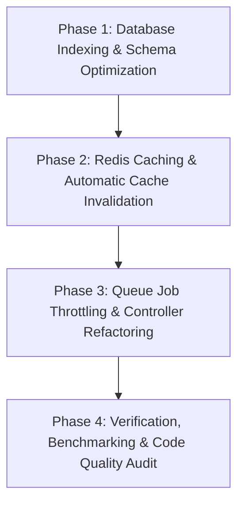

# Subscription Transactions 10K+ Scalability Implementation Plan
**Target URL Path**: `/service_company/new-subscribe/newindex#tab=transactions`  
**Goal**: Sub-50ms response time and linear scalability under 10,000+ concurrent recruiter sessions without database bottlenecks or Horizon job queue spam.

---

## 1. Executive Summary & Audit Findings

| Component | Vulnerability / Bottleneck | Scalability Impact | Resolution Strategy |
| :--- | :--- | :--- | :--- |
| **`cart_transaction_history` Table** | Table has **`PRIMARY KEY (id)` ONLY**. Missing index on `company_id` or `(company_id, id)`. | **CRITICAL**: Every pagination click performs a **FULL TABLE SCAN** on MySQL across millions of historical records. | Add composite index `KEY idx_company_id_id (company_id, id DESC)` in `mysql-schema.sql` and run `ALTER TABLE`. |
| **Related Tables Indexing** | `company_coins`, `top_up_logs`, `carts`, `package_active` lack `company_id` composite indexes. | High DB IOPS during tenant wallet summary calculation on page loads. | Add `company_id` composite indexes to all four tables. |
| **Page Load Redundancy (`newindex`)** | Accessing `/service_company/new-subscribe/newindex#tab=transactions` runs `getWalletCenterData()` (20+ DB queries) for overview data the user isn't viewing. | 20+ redundant DB queries per initial request before JS fires the AJAX transaction request. | Cache `getWalletCenterData()` in Redis (`tenant:{company_id}:wallet_center_data`) with auto-invalidation on payment events. |
| **Razorpay Sync Queue Spam** | `SyncPendingRazorpayPaymentsJob` dispatched on EVERY transaction request and pagination click without throttling. | Horizon/Redis queue spam (tens of thousands of duplicate jobs/min under 10K concurrency). | Wrap job dispatch in atomic Redis lock `Cache::lock("razorpay_sync_lock_{$company_id}", 300)`. |
| **PHP Memory & Payload** | `SELECT cart_transaction_history.*` fetches wide text columns not needed for listing. | Increased RAM consumption per worker in FrankenPHP/Octane. | Narrow query to select only required UI columns explicitly. |

---

## 2. Phased Implementation Roadmap



---

### Phase 1: Database Indexing & Schema Optimization
- **File**: `database/schema/mysql-schema.sql`
- **SQL Alter Statements**:
  ```sql
  ALTER TABLE `cart_transaction_history` ADD INDEX `idx_company_id_id` (`company_id`, `id` DESC);
  ALTER TABLE `cart_transaction_history` ADD INDEX `idx_company_gateway_payment` (`company_id`, `payment_gateway`, `payment_Id`);
  ALTER TABLE `company_coins` ADD INDEX `idx_company_event` (`company_id`, `event_type`);
  ALTER TABLE `top_up_logs` ADD INDEX `idx_company_event` (`company_id`, `event_type`);
  ALTER TABLE `carts` ADD INDEX `idx_company_status` (`company_id`, `status`);
  ALTER TABLE `package_active` ADD INDEX `idx_company_id` (`company_id`);
  ```

---

### Phase 2: Redis Caching & Automatic Invalidation
- **Files**:
  - `app/Services/SubscriptionService.php`
  - `app/Http/Controllers/PaymentController.php`
- **Logic**:
  - Cache `getWalletCenterData(int $companyId)` under Redis key `tenant:{company_id}:wallet_center_data` for 15 minutes.
  - Expose `clearTenantWalletCache(int $companyId)` in `SubscriptionService`.
  - Trigger `clearTenantWalletCache($companyId)` in `PaymentController` when payments/credits occur.

---

### Phase 3: Queue Job Throttling & Query Refactoring
- **File**: `app/Http/Controllers/ServiceCompany/ManageSubscriptionController.php`
- **Logic**:
  - Rate-limit `SyncPendingRazorpayPaymentsJob` dispatch using Redis lock (max 1 job per 5 minutes per company).
  - Explicitly select required columns in `loadTransactionHistory()`.
  - Add docblock annotations and tenancy comments per Rule #11.

---

### Phase 4: Verification & Code Quality Audit
- Run `php -l` on modified files.
- Run `./vendor/bin/pint --test`.
- Run `php artisan route:list --path=service_company/new-subscribe`.
- Generate `walkthrough.md`.
