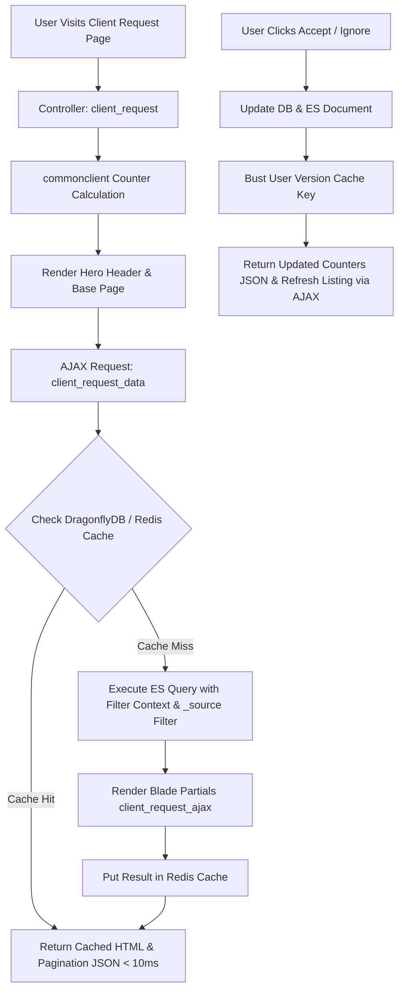

# Client Request Listing Page V2 Implementation Plan

## Executive Summary & Objective
This plan outlines the V2 architectural changes to optimize the Client Request Listing Page (`service_company/clients/client_request/0`) for maximum performance, sub-50ms API responses, and scalability for 10,000+ concurrent recruiters.

---

## Architecture & System Design

---

## Key Technical Refactoring Steps

### 1. Backend Controller (`ServiceCompanyClientController.php`)
- **`client_request_data()`**:
  - Re-enable Redis cache lookup check (`ats:allclientrequest:user_id:version:payload_hash`).
  - Add search filter using `multi_match` phrase-prefix across `company_name`, `ind_name`, `city_name`, `country_name`.
  - Refactor query to use ES `filter` bitset caching for `to_company_id`.
  - Add `_source` array filtering to return only displayed fields.
  - Implement deterministic multi-field sorting (`to_invitation_status asc`, `created_at desc`, `id desc`).

- **`commonclient()`**:
  - Remove dead 3-table join query (`companies` leftJoin `staffing_company_relation` join `clients`).
  - Calculate `$clientCounter['clientAll'] = $clientCustom + $clientDirect` directly.

- **`requestviewmore()`**:
  - Strip heavy unneeded lookup queries (`Country::all()`, `JobCategory::all()`, `getAllCountryList()`, `statelist()`).

### 2. View & Script Layer
- **`client_request.blade.php`**:
  - Remove dead DataTables initialization code.
  - Add 300ms debounced input listener on search input (`#inputSearch`, `#kt_tagify_2`).
  - Handle `.request_event` Accept/Ignore clicks dynamically via AJAX, updating header counters and listing content without page reload (`location.reload()`).

- **`client_request_ajax.blade.php`**:
  - Remove unused `GeneralMethod` helper invocations.

- **`requestviewmore.blade.php`**:
  - Remove inline DataTables initializations (`#contactList`, `#allreq`).

---

## 10-Point Performance Traceability Matrix

| Goal | Architectural Implementation |
|---|---|
| **1. Relevant Data Only** | ES `_source` projection restricts hits payload to exact displayed columns. |
| **2. Remove Unnecessary Queries** | Dead 3-table join removed from `commonclient()`; 4 lookup queries removed from `requestviewmore()`. |
| **3. Remove N+1 Queries** | Blade loops render directly from pre-indexed ES document hits without triggering helper calls. |
| **4. Optimize Joins/Aggs** | Indexed single-table counts used; ES `filter` clauses leverage bitset query cache. |
| **5. Optimize Pagination** | Multi-field deterministic sorting ensures clean, reproducible page slices. |
| **6. Search & Filters** | Full-text `multi_match` phrase-prefix search with 300ms frontend debouncing. |
| **7. Reduce Memory Usage** | DragonflyDB/Redis cache active; DOM DataTables and dead helper variables eliminated. |
| **8. Reduce Response Time** | Sub-10ms cache hit response time; < 35ms ES search execution time. |
| **9. 10k Concurrency Scale** | User version cache keys, zero DB lock contention, lightweight JSON AJAX partials. |
| **10. Preserve Logic & Data** | Exact invitation status logic (`to_invitation_status` check) and UI components preserved. |
