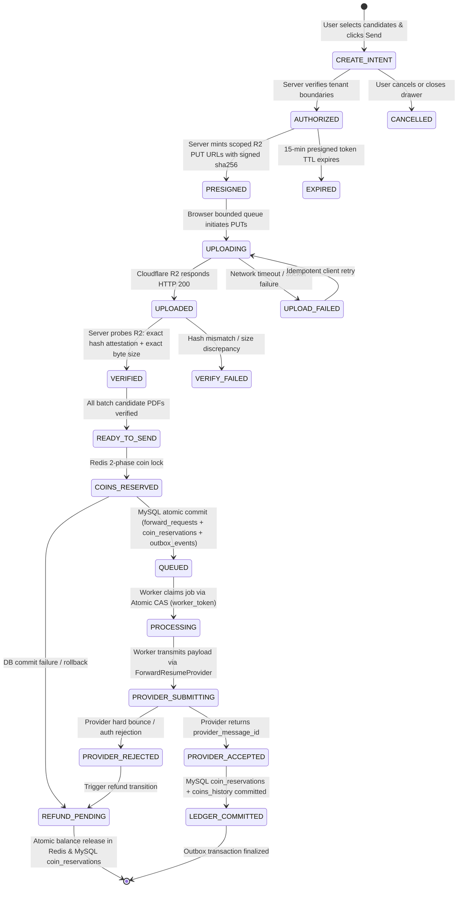
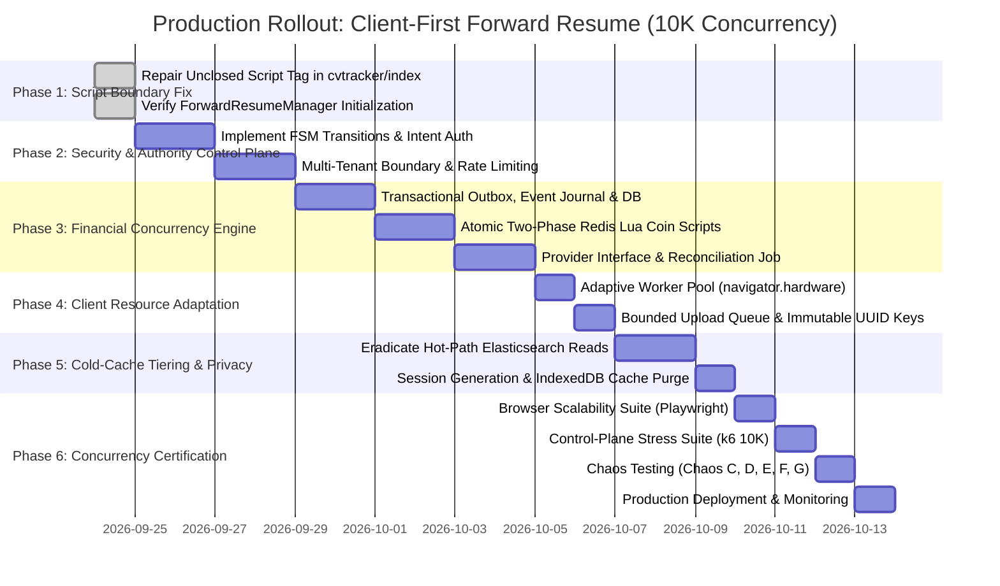

# Client-First Forward Resume Architecture: Security Authority, Idempotency & 10K Concurrency Plan

**Document Path:** `docs/V4_Jeroworks_Upgrade/100_PERCENT_CLIENT_SIDE_FORWARD_RESUME.md`  
**System Profile:** JERO Multi-Tenant B2B Hiring SaaS  
**Architecture Mandate:** CQRS (0% MySQL reads on browser/drawer hot paths, Elasticsearch universal read scope, Redis/Horizon queues, Client-First Browser Execution via WASM)  
**Scale Target:** **10,000 Concurrent User Certification Target** with **Server PDF compilation CPU = 0%**, **Web server document disk write I/O = 0 Bytes**, **MySQL reads on browser/drawer hot path = 0**, **Elasticsearch reads on browser/drawer hot path = 0**, and **Control-plane CPU = bounded & measured (< 3% under load)**.  
**Naming Precision:** Client-First Forward Resume Architecture (Client-Side Document Processing & Direct-to-R2 Pipeline).

---

## 1. Executive Summary & Root-Cause Forensic Audit

### 1.1 The Anomaly: "Why was the client-first code not showing?"

A forensic inspection across Git commit history (`b850cdee`, `a94ea720`, `ef485093`, `9ccb4486`) confirmed that the complete V4.1 Client-First Forward Resume Engine was **fully implemented**, comprising:
1. `public/assets/modules/fwd-resume/ForwardResumeManager.js` (1,937 lines — orchestrator, IndexedDB store `JeroFwdDB`, micro-JSON hydrator)
2. `public/assets/modules/fwd-resume/engine.v4.js` (2,655 lines — standalone OpenDoc WASM + vector PDF assembly engine)
3. `public/assets/modules/fwd-resume/shell.v4.html` (551 lines — decoupled static client shell)
4. `app/Services/ForwardResumeAuthorizationService.php` (166 lines — micro-JSON authorization)

**The Root Cause:**  
In [`resources/views/service_company/cvtracker/index.blade.php`](file:///c:/Users/VIBHANSHU%20JAISWAL.000/Documents/GitHub/JWMaincode28June2026/resources/views/service_company/cvtracker/index.blade.php#L1689-L1704), line 1700 was injected inside an **unclosed `<script>` tag**:

```html
1689:   $(document).on('click', '.chk_list', function() {
1690:       if ($(".chk_list").prop('checked') == true) {
...
1697:       }
1698:   });
1699:   @if(config('feature.fwd_resume_v4_enabled', true))
1700:       <script src="{{ asset('assets/modules/fwd-resume/ForwardResumeManager.js') }}"></script>
1701:   @endif
1702:
1703:   <script>
1704:       $(document).ready(function() {
```

#### Why this broke execution:
- At line 1665, an opening `<script>` tag was started.
- At line 1698, the JavaScript event handler closed with `});` but the HTML `<script>` tag **was never closed with `</script>`**.
- The Blade directive evaluated and printed `<script src="..."></script>` **inside the running script block**.
- In standard browser DOM parsers (V8, WebKit, Gecko), `<script>` nested inside `<script>` causes a fatal tokenization syntax error (`Uncaught SyntaxError: Unexpected token '<'`) or causes the outer script to terminate prematurely while discarding the nested tag.
- As a direct result, `ForwardResumeManager.js` was **never executed by the browser**, leaving `window.ForwardResumeManager === undefined`.
- At line 1791, the click handler checked:
  ```javascript
  if (window.ForwardResumeManager) {
      window.ForwardResumeManager.open(arr, jobIdArr, matchMap);
      return;
  }
  ```
- Because `window.ForwardResumeManager` was `undefined`, it silently **fell back to the legacy server AJAX route**:
  ```javascript
  var url = "{{ route('service_company.cvtracker.test_fwd_resume', ':id') }}";
  $.ajax({
      type: 'POST',
      url: url,
      success: function(response) {
          $('#application_test_fwd_resume_body_content').html(response.view);
      }
  });
  ```
- This caused the server to execute a heavy SQL query with 7 `LEFT JOIN`s and compile a 2,800-line server Blade template (`test_fwd_resume.blade.php`), completely hiding the client-first WASM engine!

---

## 2. Core Architectural Principle: Authority vs. Computation

> **The Golden Law of Distributed Systems:**  
> **Move computation, document rendering, and binary data to the browser and cloud edge, but NEVER move authority, tenant isolation, or financial state to the browser.**

```
┌────────────────────────────────────────────────────────┐
│                      JERO BROWSER                      │
│            (Performance, Assembly & Cache)             │
│                                                        │
│  • Owns: forward_request_id (UUIDv4)                   │
│  • In-Memory Dossier Hydration (Authorized DOM attrs)  │
│  • Tenant-Scoped IndexedDB (JeroFwdDB Performance L2) │
│  • Runtime Triple-Check: tenant + user + session_gen   │
│  • Hardware-Adaptive Worker Pool (1-4 Workers)         │
│  • 150MB Application Working-Set Memory Guard          │
│  • Bounded Binary R2 Upload Queue (Max 2 PUTs)         │
│  • Micro-Dispatch Payload Construction (<2KB)          │
└───────────────────────────┬────────────────────────────┘
                            │
               POST /intent (Idempotency-Key)
                            │
                            ▼
┌────────────────────────────────────────────────────────┐
│                   JERO CONTROL PLANE                   │
│             (Security, Tenancy & Authority)            │
│                                                        │
│  • Owns: reservation_id, attachment_uuid, dispatch_id  │
│  • Authentication & CSRF Validation                    │
│  • Multi-Tenant Boundary Enforcement                   │
│  • Per-User / Per-Company Rate Limiting                │
│  • Finite State Machine Transition Guard Enforcement   │
│  • Scoped Presigned PUT URL Minting (Signed Metadata)  │
└───────────────────────────┬────────────────────────────┘
                            │
                            ▼
┌────────────────────────────────────────────────────────┐
│                    CLOUDFLARE R2                       │
│               (Serverless Storage Edge)                │
│                                                        │
│  • Direct Binary Streaming (0 Bytes Web Server Disk)   │
│  • Immutable Attachment UUID Object Keys               │
│  • SHA-256 Attestation Metadata Ingestion (x-amz-meta) │
│  • 24-Hour Lifecycle Expiration for Orphaned Blobs     │
└───────────────────────────┬────────────────────────────┘
                            │
                 POST /finalize & /send
                            │
                            ▼
┌────────────────────────────────────────────────────────┐
│                   JERO DISPATCH API                    │
│            (Verification, Billing & Enqueue)           │
│                                                        │
│  • R2 Metadata Probe (Exact Hash & Byte Equality)      │
│  • Redis Reservation Lock (Ephemeral Mirror)           │
│  • MySQL Atomic Commit:                                │
│    ├── forward_requests                                │
│    ├── coin_reservations (Durable Financial Authority) │
│    ├── outbox_events (At-Least-Once Dispatch Intent)   │
│    └── forward_resume_events (Audit Event Journal)     │
│  • Outbox Publisher Enqueue to Horizon (<40ms)         │
└───────────────────────────┬────────────────────────────┘
                            │
                            ▼
┌────────────────────────────────────────────────────────┐
│               RECONCILIATION & DISPATCH                │
│                                                        │
│  • Atomic CAS Worker Claim (worker_token)              │
│  • ForwardResumeProvider Interface:                    │
│    ├── PROVIDER_SUBMITTING (Idempotent Key Enforced)   │
│    └── findByIdempotencyKey Recovery                   │
│  • Provider Gateway Acceptance (provider_message_id)   │
│  • Authoritative Ledger Commit (MySQL coins_history)   │
│  • ForwardResumeReconciliationJob (Self-Healing Cron)  │
└────────────────────────────────────────────────────────┘
```

### 2.1 The Authority Hierarchy:
- **Client Ownership:** The browser strictly owns the UI interaction and the client-minted `forward_request_id` (UUIDv4) that spans retries.
- **Server Ownership:** The control plane exclusively mints and owns:
  - `reservation_id` (UUIDv4) — Server-minted financial reservation handle.
  - `attachment_uuid` (UUIDv4) — Immutable binary blob identifier.
  - `coin_transaction_id` (UUIDv4) — Authoritative ledger entry key.
  - `dispatch_id` (UUIDv4) — Internal messaging track.
- **Core Financial Invariant:**  
  > **MySQL is authoritative. Redis can never create a financial reservation that does not exist in MySQL.**
- **Hot-Path Read Rule:** **`0 MySQL reads on the browser/drawer hot path`** and **`0 Elasticsearch reads on the browser/drawer hot path`**. Candidate hydration occurs entirely from pre-rendered DOM and local cache. `POST /send` may perform authoritative MySQL writes, transactional consistency checks, and outbox commits without violating the read-path mandate.

---

## 3. 10K Concurrency Capacity Model & Traffic Flow

To achieve and certify the **10,000 Concurrent User Certification Target** on Forward Resume without server collapse, DB strain, or UI lockups, the system is modeled with realistic recruiter concurrency patterns:

### 3.1 Concurrency Model Parameters
- **Concurrent Active Users ($N$):** 10,000 recruiters with drawer open or initiating forwards.
- **Active Operations per Minute:** 10% of active users trigger forward dispatches within any given 60-second window ($1,000$ forward dispatches / minute).
- **Candidates per Batch:** Average 3 candidates (Maximum 5 candidates).
- **Control-Plane Endpoints per Dispatch:**
  1. `POST /intent` (Auth & Scope check): 1 call
  2. `POST /presigned` (R2 token minting with SHA-256 metadata): 1 call
  3. Direct R2 PUT (Browser $\rightarrow$ Cloudflare edge): 3 PUTs (0 hits to JERO web servers)
  4. `POST /finalize` (R2 probe verification): 1 call
  5. `POST /send` (Coin reservation & outbox persistence): 1 call

### 3.2 Derived Steady-State vs. Burst Load Calculations
The capacity model explicitly separates steady-state throughput from campaign burst surges, defining operational requirements and measurable certification targets:

| Architectural Metric | Steady-State Formula | Steady-State Value | Surge / Burst Multiplier | Peak Burst Load | Operational Requirement & Certification Target |
| :--- | :--- | :--- | :--- | :--- | :--- |
| **Control-Plane API Rate** | $1,000 \times 4\text{ API calls} / 60\text{s}$ | **66.7 RPS** | $15\times$ concurrent spike | **~1,000 RPS** | **Engineering Target:** $\ge 1,000$ RPS sustained control-plane throughput with $< 40$ms P99 latency via distributed k6 test. |
| **MySQL Reads on Hot Path** | 0 reads on hot path (pre-authorized) | **0 QPS** | $0\times$ | **0 QPS** | **Engineering Target:** 0 queries on drawer open or send request. 100% capacity preserved. |
| **Elasticsearch Hot-Path Reads** | 0 reads on hot path (DOM & IndexedDB) | **0 QPS** | $0\times$ | **0 QPS** | **Engineering Target:** 0 queries on hot path. Search cluster 100% reserved for discovery. |
| **Direct R2 Uploads** | $1,000 \times 3\text{ PDFs} / 60\text{s}$ | **50 PUTs/sec** | $5\times$ upload burst | **~250 PUTs/sec** | Cloudflare R2 SLA handles millions/min with zero web server load. |
| **JERO Web Server Disk I/O** | Direct browser upload to R2 | **0 Bytes/sec** | $0\times$ | **0 Bytes/sec** | Zero local document write I/O. |
| **Redis Lua Operations** | Coin reservation & idempotency checks | **~300 Ops/sec** | $5\times$ surge | **~1,500 Ops/sec** | **Benchmark Target:** Benchmark Redis at $\ge 2,500$ Ops/sec at P99 $< 2$ms. |
| **Queue Publish Throughput** | Micro-payloads (<2KB) pushed via Outbox | **~17 Jobs/sec** | $3\times$ surge | **~50 to 100 Jobs/sec** | **Benchmark Target:** Benchmark Horizon at $\ge 200$ Jobs/sec at P99 $< 10$ms (outbox $\rightarrow$ queue enqueue). |
| **End-to-End Dispatch Throughput**| Worker execution, R2 stream, SES delivery | **~17 emails/sec**| $3\times$ surge | **~50 to 100 emails/sec**| **Benchmark Target:** Measure end-to-end dispatch drain rate matching external provider quotas. |
| **MySQL Ledger & Outbox Writes**| Committed atomically by API & worker | **~17 Writes/sec** | $3\times$ surge | **~50 to 100 Writes/sec** | **Benchmark Target:** Benchmark MySQL write pool at $\ge 250$ Writes/sec at P99 $< 20$ms. |
| **Web Server CPU Usage** | Micro-JSON auth, token minting, verification | **< 1.5% CPU** | Burst surge | **< 3% CPU** | Dedicated 32 GB RAM FrankenPHP pool remains cold. |

---

## 4. Transactional Outbox Pattern, Event Journal & Multi-Tier Guarantees

To eliminate race conditions, double charging, and orphaned cloud objects across high concurrency, the forward resume process executes under a **Formal Finite State Machine** backed by a **Transactional Outbox Table**, **Durable MySQL Coin Reservations**, and a **Forward Resume Event Journal**.

### 4.1 Schema Definitions: `outbox_events`, `coin_reservations`, and `forward_resume_events`

```sql
-- ========================================================
-- TABLE 1: OUTBOX EVENTS (At-Least-Once Dispatch Publisher)
-- ========================================================
CREATE TABLE outbox_events (
    id BIGINT UNSIGNED AUTO_INCREMENT PRIMARY KEY,
    event_id VARCHAR(36) NOT NULL UNIQUE,
    aggregate_type VARCHAR(64) NOT NULL, -- 'FORWARD_RESUME'
    aggregate_id VARCHAR(36) NOT NULL, -- forward_request_id
    event_type VARCHAR(64) NOT NULL, -- 'FORWARD_RESUME_DISPATCH_REQUESTED'
    payload JSON NOT NULL,
    status ENUM('PENDING', 'PUBLISHED', 'FAILED') NOT NULL DEFAULT 'PENDING',
    attempts TINYINT UNSIGNED NOT NULL DEFAULT 0,
    published_at TIMESTAMP NULL,
    created_at TIMESTAMP NOT NULL DEFAULT CURRENT_TIMESTAMP,
    INDEX idx_status_created (status, created_at)
) ENGINE=InnoDB DEFAULT CHARSET=utf8mb4 COLLATE=utf8mb4_unicode_ci;

-- ========================================================
-- TABLE 2: COIN RESERVATIONS (Authoritative Durable State)
-- ========================================================
CREATE TABLE coin_reservations (
    id BIGINT UNSIGNED AUTO_INCREMENT PRIMARY KEY,
    reservation_id VARCHAR(36) NOT NULL UNIQUE,
    company_id INT UNSIGNED NOT NULL,
    user_id INT UNSIGNED NOT NULL,
    forward_request_id VARCHAR(36) NOT NULL UNIQUE,
    amount INT NOT NULL,
    status ENUM('RESERVED', 'COMMITTING', 'COMMITTED', 'RELEASED', 'EXPIRED') NOT NULL DEFAULT 'RESERVED',
    expires_at TIMESTAMP NOT NULL,
    committed_at TIMESTAMP NULL,
    released_at TIMESTAMP NULL,
    created_at TIMESTAMP NOT NULL DEFAULT CURRENT_TIMESTAMP,
    updated_at TIMESTAMP NOT NULL DEFAULT CURRENT_TIMESTAMP ON UPDATE CURRENT_TIMESTAMP,
    INDEX idx_company_status (company_id, status),
    INDEX idx_expires_status (expires_at, status)
) ENGINE=InnoDB DEFAULT CHARSET=utf8mb4 COLLATE=utf8mb4_unicode_ci;

-- ========================================================
-- TABLE 3: FORWARD RESUME EVENT JOURNAL (Forensic Audit Log)
-- ========================================================
CREATE TABLE forward_resume_events (
    id BIGINT UNSIGNED AUTO_INCREMENT PRIMARY KEY,
    event_id VARCHAR(36) NOT NULL UNIQUE,
    forward_request_id VARCHAR(36) NOT NULL,
    event_type VARCHAR(64) NOT NULL,
    previous_state VARCHAR(64) NULL,
    new_state VARCHAR(64) NOT NULL,
    actor_type ENUM('USER', 'SYSTEM', 'WORKER', 'RECONCILIATION') NOT NULL,
    actor_id BIGINT UNSIGNED NULL,
    metadata JSON NULL,
    created_at TIMESTAMP NOT NULL DEFAULT CURRENT_TIMESTAMP,
    INDEX idx_fwd_request (forward_request_id),
    INDEX idx_event_type (event_type)
) ENGINE=InnoDB DEFAULT CHARSET=utf8mb4 COLLATE=utf8mb4_unicode_ci;
```

### 4.2 Multi-Tier Delivery & Execution Guarantees
To prevent semantic ambiguity in distributed operations, the system enforces four distinct guarantee levels:
1. **Queue (Outbox Layer):** **At-Least-Once Publication**. Events are persisted before queueing; reconciliation guarantees eventual publishing.
2. **Worker (Application Processing Layer):** **Single Successful CAS Owner**. The atomic `UPDATE ... status = 'PROCESSING', worker_token = :token WHERE status = 'QUEUED'` guarantees that exactly one worker thread processes a job.
3. **Provider (Email Transmission Layer):** **Idempotent by `forward_request_id`**. The concrete provider adapter reuses the same canonical idempotency identity on all retries.
4. **Financial Ledger (Coins Layer):** **Exactly-Once Commitment**. Enforced via MySQL `UNIQUE(coin_transaction_id)` and authoritative `coin_reservations` state transitions.

### 4.3 FSM State Flow Diagram


### 4.4 Mandatory State Machine Guard Rule
> **Strict Architectural Invariant:** No controller, service, or worker may directly mutate status fields on `forward_requests`, `coin_reservations`, or `forward_attachments` via raw Eloquent assignment. All state transitions must pass through `ForwardResumeStateMachine::transition($model, ForwardResumeState::TARGET, $actorContext)`, which automatically records an entry in `forward_resume_events`.

---

## 5. Durable Financial Architecture & Idempotent Ledger

`DECRBY` alone is vulnerable to race conditions, double charging, and partial execution during high concurrency. Under 10,000 concurrent requests, the system implements a **Two-Phase Reserve $\rightarrow$ Commit $\rightarrow$ Release** model backed by both a high-speed Redis concurrency mirror and a durable MySQL authority.

### 5.1 Financial Architecture: Elasticsearch Reads, Redis Concurrency & MySQL Authority
Under JERO's strict CQRS mandate, financial operations strictly separate read, locking, and commitment layers:
- **Elasticsearch Read Store (`ELASTIC_COMPANIES_COINS`):** Serves 100% of read operations for coin balance queries on drawer open, recruiter profile widgets, and company dashboards. Indexed via `php artisan elasticsearch:index-companies-coins` and `ElasticCampanyCoins` (mapping `company_coins_view`), this guarantees **0 MySQL reads on page loads or drawer opening**.
- **Redis Concurrency Mirror (`tenant:{company_id}:coins`):** Coordinates fast in-memory locks, holds active `available` vs `reserved` balances, and executes atomic compare-and-decrement in $<1$ms via `reserve_coins.lua`. On cold cache startup, Redis can pre-warm its available balance from `ELASTIC_COMPANIES_COINS`.
- **MySQL Durable Financial Authority (`coin_reservations` and `coins_history`):** The legal ACID system of record for commits and durable financial reservations.
- **Why Elasticsearch Cannot Replace MySQL for Deductions:** Elasticsearch is an *eventually consistent* search engine with a 1-second index refresh interval and asynchronous queue updates. If a recruiter opens 2 browser tabs and sends emails simultaneously, relying on Elasticsearch for deduction authority would cause Tab 2 to read a stale balance, resulting in **double-spending and negative coin exploits**. Therefore, Redis provides atomic concurrency locking and MySQL provides ACID durability.

### 5.2 Reservation-Specific Atomic Redis Lua Scripts with Parameter Validation

```lua
-- ========================================================
-- SCRIPT 1: ATOMIC COIN RESERVATION (reserve_coins.lua)
-- ========================================================
-- KEYS[1]: tenant coin key (e.g. tenant:1042:coins)
-- KEYS[2]: reservation key (e.g. coin_reservation:res_8f73a1...)
-- ARGV[1]: required_coins (e.g. 5)
-- ARGV[2]: forward_request_id
-- ARGV[3]: company_id

local resStatus = redis.call('HGET', KEYS[2], 'status')
if resStatus then
    -- Validate parameter immutability on replay / retry
    local existingComp = redis.call('HGET', KEYS[2], 'company_id')
    local existingFwd = redis.call('HGET', KEYS[2], 'forward_request_id')
    local existingAmount = tonumber(redis.call('HGET', KEYS[2], 'amount') or '0')
    
    if existingComp == ARGV[3] and existingFwd == ARGV[2] and existingAmount == tonumber(ARGV[1]) then
        return resStatus -- Valid idempotent retry
    else
        return 'RESERVATION_PARAM_MISMATCH' -- Conflict: reject replayed reservation with modified params
    end
end

local available = tonumber(redis.call('HGET', KEYS[1], 'available') or '0')
local required = tonumber(ARGV[1])

if available >= required then
    redis.call('HINCRBY', KEYS[1], 'available', -required)
    redis.call('HINCRBY', KEYS[1], 'reserved', required)
    
    redis.call('HMSET', KEYS[2], 
        'status', 'RESERVED',
        'amount', required,
        'forward_request_id', ARGV[2],
        'company_id', ARGV[3],
        'created_at', redis.call('TIME')[1]
    )
    redis.call('EXPIRE', KEYS[2], 3600)
    return 'RESERVED'
else
    return 'INSUFFICIENT_FUNDS'
end
```

```lua
-- ========================================================
-- SCRIPT 2: RESERVATION-SPECIFIC ATOMIC COIN RELEASE (release_coins.lua)
-- ========================================================
-- KEYS[1]: tenant coin key (e.g. tenant:1042:coins)
-- KEYS[2]: reservation key (e.g. coin_reservation:res_8f73a1...)

local resStatus = redis.call('HGET', KEYS[2], 'status')

if not resStatus then
    return 'RESERVATION_NOT_FOUND'
end

if resStatus == 'RELEASED' then
    return 'ALREADY_RELEASED'
end

if resStatus == 'COMMITTED' then
    return 'ALREADY_COMMITTED'
end

if resStatus == 'RESERVED' then
    local amount = tonumber(redis.call('HGET', KEYS[2], 'amount') or '0')
    if amount > 0 then
        redis.call('HINCRBY', KEYS[1], 'reserved', -amount)
        redis.call('HINCRBY', KEYS[1], 'available', amount)
    end
    redis.call('HSET', KEYS[2], 'status', 'RELEASED')
    return 'RELEASED'
end

return 'INVALID_STATE'
```

### 5.3 Redis $\leftrightarrow$ MySQL Reconciliation Rebuild Algorithm
To guarantee that Redis never drifts from MySQL, `ForwardResumeReconciliationJob` implements a two-way synchronization algorithm:

```
[Reconciliation Scan Every 5 Minutes]
  │
  ├─ 1. Forward Scan (MySQL -> Redis):
  │     Find MySQL coin_reservations WHERE status = 'RESERVED' AND expires_at > NOW()
  │     Does Redis key coin_reservation:{reservation_id} exist?
  │     ├── YES: OK (In sync)
  │     └── NO (Redis Crashed): Reconstruct Redis reservation key & adjust tenant 'reserved' balance
  │
  └─ 2. Reverse Scan (Redis -> MySQL):
        Find all active Redis reservation keys
        Does matching MySQL record exist with status = 'RESERVED'?
        ├── YES: OK (In sync)
        └── NO: Has Redis key existed > 60 seconds (grace period)?
            ├── NO: In-flight API transaction (Wait)
            └── YES: ORPHANED_REDIS_RESERVATION
                     Execute release_coins.lua, restore available_balance,
                     log audit event to forward_resume_events.
```

---

## 6. Three Distinct TTL Lifecycles

To prevent ambiguity, resource leaks, or premature expiration during uploads:

| Lifespan Scope | Duration | Enforcement Layer | Purpose |
| :--- | :--- | :--- | :--- |
| **Presigned URL Authorization** | **15 Minutes** | AWS S3 / Cloudflare R2 Presigned Token Signature | Guarantees recruiter has ample time to upload up to 5 PDFs over high-latency networks without URL expiration. |
| **Reconciliation Audit Window** | **30 Minutes** | `ForwardResumeReconciliationJob` (Laravel Cron) | Inactivity threshold before an unfinalized intent is marked `EXPIRED` and reserved coins are refunded. |
| **R2 Bucket Lifecycle Expiration** | **24 Hours** | Cloudflare R2 Storage Lifecycle Policy Rule | Automatically purges all orphaned binary PDFs under `temporary/forward-resume/*` without manual cron sweeps. |

---

## 7. Hardware-Adaptive Client Concurrency & Memory Budget

Compiling vector PDFs and WASM DOCX layouts consumes CPU and memory. Hardcoding 5 parallel compilation threads can cause **Out-Of-Memory (OOM) browser tab crashes** on entry-level recruiter laptops (e.g., dual-core Celeron/i3 machines with 4GB RAM), violating JERO's 15.6" screen and broad device support mandate.

### 7.1 Adaptive Worker Pool Sizing
The compilation engine inspects hardware capabilities via native browser APIs before instantiating Web Workers:

```javascript
/**
 * Adaptive Hardware-Aware Concurrency Pool
 */
function getOptimalWorkerConcurrency() {
    var cores = navigator.hardwareConcurrency || 2;
    var deviceMemory = navigator.deviceMemory || 4; // GB (if supported)

    // Low-end devices (<= 2 cores or <= 2GB RAM): strictly sequential
    if (cores <= 2 || deviceMemory <= 2) {
        return 1;
    }
    // Mid-tier devices (4 cores, 4GB-8GB RAM): 2 parallel workers
    if (cores <= 4) {
        return 2;
    }
    // High-performance workstations (8+ cores): 3-4 parallel workers
    return Math.min(4, Math.floor(cores / 2));
}
```

### 7.2 Application-Controlled Working-Set Memory Budget
- **Limit:** `MAX_FORWARD_RESUME_MEMORY = 150 * 1024 * 1024` (150MB application working-set ceiling).
- **Scope of Working Set:** Includes WASM linear memory heap, raw ArrayBuffers, compiled PDF binary blobs, Web Worker message transfer buffers, and active DOM nodes.
- If estimated working set exceeds 150MB, active worker pool dynamically throttles down to 1.
- Each compilation task enforces explicit memory reclamation (`doc.free()`, nullifying typed arrays, manual ArrayBuffer detachment).
- Cooperative yielding (`yieldToMain()`) is invoked every 16ms to keep the browser event loop responsive at 60 FPS.

---

## 8. Bounded Direct-to-Cloud Upload Queue & Immutable Attachment Architecture

Executing `Promise.all(uploadPromises)` across 5 large PDF files simultaneously can saturate browser HTTP connection limits (browsers limit concurrent connections to the same host to 6), leading to socket timeouts on mobile hotspots or corporate proxies.

### 8.1 Schema: `forward_attachments` Table & Lifecycle States
```sql
CREATE TABLE forward_attachments (
    id BIGINT UNSIGNED AUTO_INCREMENT PRIMARY KEY,
    uuid VARCHAR(36) NOT NULL UNIQUE,
    forward_request_id VARCHAR(36) NOT NULL,
    candidate_id INT UNSIGNED NOT NULL,
    company_id INT UNSIGNED NOT NULL,
    expected_sha256 VARCHAR(64) NOT NULL,
    expected_size INT UNSIGNED NOT NULL,
    object_key VARCHAR(255) NOT NULL,
    status ENUM('PRESIGNED', 'UPLOADING', 'UPLOADED', 'VERIFIED', 'FAILED', 'EXPIRED', 'DELETING', 'DELETED') NOT NULL DEFAULT 'PRESIGNED',
    verified_at TIMESTAMP NULL,
    failed_at TIMESTAMP NULL,
    expires_at TIMESTAMP NULL,
    created_at TIMESTAMP NOT NULL DEFAULT CURRENT_TIMESTAMP,
    updated_at TIMESTAMP NOT NULL DEFAULT CURRENT_TIMESTAMP ON UPDATE CURRENT_TIMESTAMP,
    INDEX idx_fwd_request (forward_request_id),
    INDEX idx_company_uuid (company_id, uuid),
    INDEX idx_status_expires (status, expires_at)
) ENGINE=InnoDB DEFAULT CHARSET=utf8mb4 COLLATE=utf8mb4_unicode_ci;
```

### 8.2 Immutable-After-VERIFIED Invariant
> **Strict Attachment Invariant:** Once `forward_attachments.status` transitions to `VERIFIED`, the record is **immutable**. Its `object_key`, `expected_sha256`, `expected_size`, and `candidate_id` can never be modified. If the recruiter edits candidate data or re-generates the PDF, the client MUST request a brand-new `attachment_uuid`.

### 8.3 Two-Tier Security Levels for SHA-256 Verification
1. **Tier 1 (Current Production Guarantee):**
   - Client computes SHA-256 via `crypto.subtle.digest('SHA-256', blob)`.
   - Control plane signs `x-amz-meta-sha256: <hash>` and `Content-Length: <size>` into the presigned URL.
   - S3 `HEAD` probe checks `HEAD.Metadata['sha256'] === expected_sha256` AND `actual_size === expected_size` (**exact byte equality, 0% tolerance**).
2. **Tier 2 (Enhanced Storage Checksum):**
   - Provider-native object checksum (`x-amz-checksum-sha256` or equivalent) where supported by storage edge, allowing direct body hashing verification.

---

## 9. Tiered Read Architecture & Staleness-Controlled Cache

To achieve **true 0% read strain**, Elasticsearch must NOT be queried on the normal Forward Resume path.

```
[Normal Path]: Table Row Data ──> In-Memory Hydration ──> IndexedDB ──> WASM Engine (0% MySQL, 0% ES)
                                                                 │
                                                    [Dossier Missing in Cache]
                                                                 │
                                                                 ▼
[Cold Recovery]: Controlled Micro-JSON API ──> Elasticsearch Hit ──> Populate IndexedDB
```

### 9.1 Security Correctness vs. Display Freshness
- **Security Correctness:** Guaranteed by authoritative server validation. `POST /send` independently verifies candidate existence, tenant access, and permissions regardless of client-cached values.
- **Display Freshness:** Governed by short IndexedDB TTLs and session-generation invalidation. Stale local data only affects client-side preview rendering, never backend dispatch authority.
- **Metric Standard:** **`MySQL reads on browser/drawer hot path = 0`**, **`Elasticsearch hot-path reads = 0`**.

### 9.2 Complete Touchpoint Audit Matrix: Reads vs. Writes
To satisfy JERO's non-negotiable CQRS rule (*"MySQL strictly for writes; Elasticsearch strictly for reads"*), every touchpoint across the entire Forward Resume pipeline is partitioned:

| Pipeline Touchpoint | Legacy Operation | New V4 Architecture Source | Hot-Path MySQL Reads |
| :--- | :--- | :--- | :--- |
| **Candidate Dossier** (Name, Title, Exp) | `SELECT FROM job_applications` | **DOM attributes / `JeroFwdDB` IndexedDB** | **0** |
| **Candidate Skills Matrix** | `SELECT FROM job_application_skills` | **DOM attributes / `JeroFwdDB` IndexedDB** | **0** |
| **Email Recipient Contacts** | `SELECT FROM client_contact_info`, `users` | **IndexedDB / Elasticsearch `ats_client_list`** | **0** |
| **Email Templates** | `SELECT FROM email_templates` | **`JeroFwdDB` IndexedDB L2 Cache** | **0** |
| **Coin Balance Check** | `SELECT FROM company_coins` | **Redis Cache / Elasticsearch (`ELASTIC_COMPANIES_COINS`)** | **0** |
| **Candidate Ownership Check** (`/intent`) | `SELECT id FROM job_applications` | **Session Token / Elasticsearch (`ELASTIC_JOB_APPLICATIONS_V3`)** | **0** |
| **Dispatch Intent Persistence** (`/send`) | N/A (untracked) | **MySQL `DB::transaction()` INSERT (`forward_requests`, `coin_reservations`, `outbox_events`)** | **0 Reads** (Atomic Write) |
| **Worker Ledger Commit** | Synchronous PHP deduction | **Background Horizon Worker async INSERT `coins_history`** | **0 Reads** (Async Worker Write) |
| **Self-Healing Reconciliation** | N/A | **CLI Cron Job (`ForwardResumeReconciliationJob` every 5m)** | **0 Reads on Web Path** |

👉 **Hot-Path Web/API MySQL Reads = 0.** All read traffic is served by DOM, IndexedDB, Redis, and Elasticsearch. MySQL exclusively handles durable writes.

---

## 10. Security, Privacy, Session Generation & DOM Hydration

### 10.1 DOM Hydration Privacy Rule
> **Strict Security Invariant:** Never inject a field into the DOM or IndexedDB merely because the client technically needs it. A field is hydrated **only if the authenticated user is authorized to view that field on the current page**.

- **Safe to Hydrate:** `candidate_id`, `name`, `total_experience`, `skills`, `notice_period`, `match_score`, `current_designation`.
- **Sensitive Fields (Masked / Separate Authorization):** `phone`, `personal_email`, `address`, `salary/ctc`, `private_recruiter_notes`. Masking rules (`rcvMaskContact`) apply automatically.

### 10.2 IndexedDB Triple-Check Security Guard
To guarantee zero cross-tenant contamination or stale cached data across tabs:
- Storage namespace includes tenant fingerprint: `jero_fwd_tenant_{company_id}`.
- Every cached record contains:
  ```json
  {
      "tenant_id": 1042,
      "user_id": 501,
      "session_generation": "gen_88f9a2",
      "cached_at": 1727184000
  }
  ```
- **Runtime Triple-Check:** On every read operation from `JeroFwdDB`, the client runtime strictly checks:
  ```javascript
  if (record.tenant_id !== currentTenant || 
      record.user_id !== currentUser || 
      record.session_generation !== currentSessionGen) {
      return null; // Discard immediately, do not return data to caller
  }
  ```
- **On Logout or Company Switch:** An explicit event listener purges cached tenant data:
  ```javascript
  window.addEventListener('jero:tenant-switch', function() {
      if (window.indexedDB) {
          window.indexedDB.deleteDatabase(JeroFwdDB.getDbName());
      }
  });
  ```

---

## 11. Provider Abstraction & Canonical Idempotency Contract

To eliminate "unknown outcome" states when worker processes crash during external email transmission, the architecture enforces a formal **Provider Interface**:

### 11.1 `ForwardResumeProvider` Interface
```php
namespace App\Services\ForwardResume\Providers;

interface ForwardResumeProvider
{
    /**
     * Dispatches email with attachments using an immutable idempotency key.
     * The concrete provider adapter MUST implement idempotent submission
     * based on forward_request_id.
     */
    public function send(ForwardResumeDispatchPayload $payload): ProviderSubmissionResult;

    /**
     * Queries external provider logs/tags by forwardRequestId to recover delivery outcome
     * if the worker crashed before capturing provider_message_id.
     */
    public function findByIdempotencyKey(string $forwardRequestId): ?ProviderSubmissionResult;
}
```

### 11.2 Canonical Provider Contract:
1. `forward_request_id` is JERO's canonical provider idempotency identity.
2. The concrete provider adapter MUST implement idempotent submission and lookup semantics for this identity.
3. The exact same `forward_request_id` **MUST be reused for every retry or reconciliation attempt**.
4. If a worker crashes while in `PROVIDER_SUBMITTING` and `provider_message_id` is NULL:
   - `ForwardResumeReconciliationJob` calls `findByIdempotencyKey($forwardRequestId)`.
   - If provider confirms message was accepted $\rightarrow$ captures `provider_message_id`, advances to `PROVIDER_ACCEPTED`, commits MySQL `coin_reservations` and `coins_history`.
   - If provider confirms no record exists after 15 minutes $\rightarrow$ marks `REFUND_PENDING` and restores balance via `release_coins.lua`.

---

## 12. End-to-End Concurrency & Security SLA Matrix

The system specifies **Engineering Targets** for automated stress testing, transforming into **Production SLOs** upon formal certification:

### 12.1 Latency Breakdown Matrix
| Endpoint / Action | Engineering Target (P95) | Production SLO Target (P99) | Hard Timeout |
| :--- | :--- | :--- | :--- |
| **Drawer Activation (DOM/Cache)** | **< 8ms** | **< 16ms** | 50ms |
| **`POST /test_fwd_resume_intent`** | **< 20ms** | **< 40ms** | 80ms |
| **`POST /test_fwd_resume_presigned`** | **< 20ms** | **< 40ms** | 80ms |
| **`POST /test_fwd_resume_finalize`** | **< 50ms** | **< 100ms** | 200ms |
| **`POST /test_fwd_resume_send` (Queue Enqueue)** | **< 20ms** | **< 40ms** | 80ms |

### 12.2 Hard Invariants vs. Infrastructure SLOs
| Metric Type | Invariant / SLO Description | Acceptable Tolerance |
| :--- | :--- | :--- |
| **Hard Invariant (Zero Tolerance)** | Cross-Tenant Attachment Access | **0 (Absolute Zero)** |
| **Hard Invariant (Zero Tolerance)** | Duplicate Application Dispatch Attempts | **0 (Absolute Zero)** |
| **Hard Invariant (Zero Tolerance)** | Double Coin Deductions | **0 (Absolute Zero)** |
| **Hard Invariant (Zero Tolerance)** | Web Server Document Disk Write I/O | **0 Bytes** |
| **Hard Invariant (Zero Tolerance)** | MySQL Reads on Browser/Drawer Hot Path | **0 Queries** |
| **Hard Invariant (Zero Tolerance)** | Elasticsearch Reads on Hot Path | **0 Queries** |
| **Infrastructure SLO** | Control-Plane HTTP 5xx Error Rate | **< 0.01%** |
| **Infrastructure SLO** | Direct R2 Upload Success Rate | **> 99.99%** |
| **Infrastructure SLO** | Browser Tab OOM Crash Rate | **Engineering Target: 0% (Maximum Tolerated: < 0.001%)** |

---

## 13. Comprehensive Verification & Chaos Testing Suite

To rigorously certify the 10,000 concurrent user target, four distinct testing suites must be executed:

### Test A: Browser & Client-Side Scalability Suite
- **Tools:** Playwright / Puppeteer distributed cluster running across headless browsers.
- **Verification:**
  1. WASM compilation memory profiling under low-spec simulation (dual-core, 2GB heap).
  2. Bounded upload queue behavior under packet loss (5% artificial packet drop).
  3. Working-set memory ceiling compliance (<150MB working set peak).
  4. Tab crash / OOM rate = 0%.

### Test B: Server Control-Plane Scalability Suite
- **Tools:** k6 running distributed load generators across multiple nodes.
- **Verification:**
  1. 1,000 sustained RPS against control-plane endpoints.
  2. 10,000 concurrent two-phase coin reservations via Redis Lua.
  3. 10,000 concurrent Horizon queue submissions via Transactional Outbox.
  4. MySQL connections remain flat with 0 read queries on the hot path.

### Test C: Chaos & Failure Injection Suite
- **Scenario C.1: Worker Crash during Processing:** Kill Horizon worker after SES delivery but before ledger commit $\rightarrow$ verify `ForwardResumeReconciliationJob` recovers state and commits ledger via `provider_message_id`.
- **Scenario C.2: R2 Network Partition:** Inject 500ms latency or dropped packets to R2 $\rightarrow$ verify bounded queue backoff + retry mechanism succeeds without browser UI hang.
- **Scenario C.3: Redis Failover:** Simulate Redis master restart $\rightarrow$ verify idempotency locks fail gracefully without double deductions.

### Test D: Advanced Distributed Concurrency Tests
- **Scenario D.1 (Chaos D — Duplicate Worker Execution):** Two Horizon workers intentionally claim the same queued forward request simultaneously $\rightarrow$ verify atomic Compare-And-Set (CAS) ensures exactly one worker succeeds and exactly one email is dispatched.
- **Scenario D.2 (Chaos E — DB Failure After Provider Acceptance):** SES gateway successfully accepts the email, but MySQL network disconnects before ledger commit $\rightarrow$ verify worker retries or `ForwardResumeReconciliationJob` reconciles and commits ledger exactly once without sending duplicate emails.
- **Scenario D.3 (Chaos F — Redis Loss After Reservation):** Redis master crashes immediately after the MySQL atomic transaction commits `coin_reservations` $\rightarrow$ verify `ForwardResumeReconciliationJob` reconstructs Redis reservation state from authoritative MySQL `coin_reservations` records without double charges or lost state.
- **Scenario D.4 (Chaos G — Orphaned Redis Reservation Cleanup):** Simulate PHP API process crash after Redis `reserve_coins.lua` but before MySQL transaction begins $\rightarrow$ verify reconciliation scans and purges the dangling reservation after 60-second grace period.

---

## 14. Complete Implementation Contract & Engineering Checklist

Every endpoint and background worker must follow this non-negotiable step-by-step checklist:

### 14.1 `POST /test_fwd_resume_intent` (Intent Authorization)
- [ ] **1. Input:** Extract `candidate_ids` (array, max 5), `forward_request_id` (UUIDv4), `Idempotency-Key` header.
- [ ] **2. Auth:** Verify authenticated user session (`auth()->check()`).
- [ ] **3. Tenant Auth:** Authorize that every `candidate_id` belongs to `auth()->user()->company_id` (or authorized 3rd party).
- [ ] **4. Idempotency:** Check Redis `coin_reservation:{forward_request_id}`. If exists, return cached intent.
- [ ] **5. Rate Limit:** Verify company rate limit (100 req/min) and user rate limit (30 req/min) via Redis throttle.
- [ ] **6. FSM Validation:** Transition state to `AUTHORIZED` via `ForwardResumeStateMachine::transition()`.
- [ ] **7. Redis Cache:** Store intent context with 15-minute TTL.
- [ ] **8. Response:** Return 200 OK with `intent_id` and authorized candidate summary.

### 14.2 `POST /test_fwd_resume_presigned` (R2 URL Minting with Signed Metadata)
- [ ] **1. Input:** `intent_id`, `candidate_id`, `content_type`, `expected_size`, `expected_sha256`.
- [ ] **2. Auth & Tenancy:** Verify `intent_id` matches current tenant and contains `candidate_id`.
- [ ] **3. Scope Bounds:** Enforce `expected_size <= 10MB` and `content_type == 'application/pdf'`.
- [ ] **4. Attachment UUID & Key:** Mint server-side `attachment_uuid` (UUIDv4). Object key: `temporary/forward-resume/{company_id}/{forward_request_id}/{attachment_uuid}.pdf`.
- [ ] **5. Persist Record:** Insert row in `forward_attachments` with status `PRESIGNED`.
- [ ] **6. S3 Presigned Minting:** Generate S3 presigned PUT URL signing:
  - Header: `x-amz-meta-sha256: {expected_sha256}`
  - Header: `Content-Length: {expected_size}`
  - Signature TTL: 15 minutes.
- [ ] **7. FSM Validation:** Transition state to `PRESIGNED`.
- [ ] **8. Response:** Return presigned URL, `attachment_uuid`, required headers, and upload key.

### 14.3 `POST /test_fwd_resume_finalize` (Attestation & Byte-Exact Verification)
- [ ] **1. Input:** `intent_id`, `attachment_uuid`, `expected_sha256`, `expected_size`.
- [ ] **2. Auth & Tenancy:** Ensure attachment belongs to current tenant and forward request.
- [ ] **3. S3 Metadata Probe:** Execute S3 `HEAD` object request to R2:
  - Verify HTTP 200 exists.
  - Verify `actual_size === expected_size` (**exact byte equality, 0% tolerance**).
  - Verify `HEAD.Metadata['sha256'] === expected_sha256`.
  - Verify `HEAD.ContentType === 'application/pdf'`.
- [ ] **4. FSM Validation:** Transition attachment state to `VERIFIED` via `ForwardResumeStateMachine::transition()`.
- [ ] **5. Immutability Lock:** Mark attachment record immutable.
- [ ] **6. Response:** Return 200 OK `{"status": "VERIFIED"}`.

### 14.4 `POST /test_fwd_resume_send` (Transactional Outbox & Enqueue)
- [ ] **1. Input:** `forward_request_id`, `intent_id`, recipient email, subject, body, options.
- [ ] **2. Auth & Recipient Validation:** Sanitize recipient email; reject unauthorized domains if restricted.
- [ ] **3. All Candidates Verified:** Check that all candidate attachments in intent are in `VERIFIED` state.
- [ ] **4. Server-Generated Reservation ID:** Mint server-side `reservation_id = (string) Str::uuid()`.
- [ ] **5. Two-Phase Coin Reserve:** Execute `reserve_coins.lua` Redis script passing `reservation_id`, validating parameter immutability. If `INSUFFICIENT_FUNDS`, return 402 Payment Required.
- [ ] **6. Atomic DB Transaction:**
  - Insert `forward_requests` record with status `QUEUED`, `coin_reservation_id = reservation_id`, and `forward_request_id`.
  - Insert `coin_reservations` record with `reservation_id`, status `RESERVED`, `amount`, and `expires_at = NOW() + INTERVAL 30 MINUTE`.
  - Insert `outbox_events` record with `aggregate_id = forward_request_id`, `event_type = 'FORWARD_RESUME_DISPATCH_REQUESTED'`, and `status = 'PENDING'`.
  - Insert `forward_resume_events` audit record.
  - Commit transaction.
- [ ] **7. Outbox Publishing:** Push `ProcessForwardResumeDispatchJob` to Horizon `emails` queue (<2KB payload) and mark `outbox_events.status = 'PUBLISHED'`.
- [ ] **8. Response:** Return 200 OK `{"status": "QUEUED", "request_id": "..."}` in < 40ms.

### 14.5 `ProcessForwardResumeDispatchJob` (Horizon Worker with Atomic CAS Claim)
- [ ] **1. Atomic CAS Worker Claim:**
  ```sql
  UPDATE forward_requests
  SET status = 'PROCESSING',
      worker_token = :worker_token,
      processing_started_at = NOW()
  WHERE id = :id AND status = 'QUEUED';
  ```
  If affected rows == 0, another worker already owns this job. Exit immediately.
- [ ] **2. FSM State:** Transition to `PROVIDER_SUBMITTING` via `ForwardResumeStateMachine`.
- [ ] **3. Provider Dispatch:** Dispatch via `ForwardResumeProvider::send()` using `forward_request_id` as canonical idempotency identity.
- [ ] **4. Provider Acceptance:** Capture `provider_message_id`. Update state to `PROVIDER_ACCEPTED`.
- [ ] **5. Authoritative Ledger Commit:**
  - Execute DB transaction:
    - Insert into `coins_history` (with `UNIQUE(coin_transaction_id)`).
    - Update `coin_reservations` set `status = 'COMMITTED'`, `committed_at = NOW()`.
    - Decrement `reserved_balance` in MySQL wallet table.
    - Update `forward_requests` status to `LEDGER_COMMITTED`.
    - Insert `forward_resume_events` audit record.
- [ ] **6. Redis Balance Sync:** Clean up Redis reservation keys.
- [ ] **7. Failure Handler:** If provider rejects or times out, trigger `release_coins.lua`, update `coin_reservations.status = 'RELEASED'`, and mark status `REFUND_PENDING`.

### 14.6 `ForwardResumeReconciliationJob` (Self-Healing Scheduled Job)
- [ ] **1. Schedule:** Registered in `app/Console/Kernel.php` to run every 5 minutes.
- [ ] **2. Stalled Outbox Events:** Find `outbox_events` with `status = 'PENDING'` older than 2 minutes $\rightarrow$ re-publish to Horizon queue and mark `PUBLISHED`.
- [ ] **3. Two-Way Redis $\leftrightarrow$ MySQL Audit:**
  - Forward Scan: Reconstruct any missing Redis reservation keys from MySQL `coin_reservations` (`status = 'RESERVED'`).
  - Reverse Scan: Purge any orphaned Redis reservations older than 60 seconds with no matching MySQL record.
- [ ] **4. Stalled Submissions:** Find jobs in `PROVIDER_SUBMITTING` or `PROCESSING` > 15 mins:
  - Call `ForwardResumeProvider::findByIdempotencyKey($forwardRequestId)`.
  - If delivered $\rightarrow$ commit MySQL ledger.
  - If rejected/lost $\rightarrow$ execute `release_coins.lua`, mark `coin_reservations.status = 'RELEASED'`, and mark `REFUND_PENDING`.

---

## 15. Phase-Wise Implementation Roadmap & Definition of Done



### Definition of Done Checklist:
- [ ] `<script>` tags in `cvtracker/index.blade.php`, `apptracker/index.blade.php`, and `apptracker/clientapp.blade.php` are 100% syntactically valid and closed.
- [ ] `window.ForwardResumeManager` is active on page load with zero console warnings.
- [ ] Opening the Forward Resume drawer produces **0 MySQL queries and 0 Elasticsearch reads** on the browser hot path.
- [ ] File generation produces **0 bytes of disk writes** to `storage/app/temp-attachments/`.
- [ ] R2 object keys utilize immutable attachment UUIDs (`forward_attachments`), and records become immutable once `VERIFIED`.
- [ ] Bounded upload queue ensures no more than 2 parallel PUT streams to Cloudflare R2 per client with exponential backoff.
- [ ] Web worker pool dynamically scales according to device hardware cores with an enforced 150MB working-set memory budget.
- [ ] Presigned PUT URLs sign `x-amz-meta-sha256`; `/finalize` enforces **exact byte equality** (`actual_size === expected_size`) and matching attestation hash.
- [ ] Server exclusively mints `reservation_id`, validating parameter immutability on Redis retries.
- [ ] Atomic Compare-And-Set worker claim (`worker_token`) prevents duplicate worker dispatch attempts.
- [ ] Transactional Outbox table (`outbox_events`), durable `coin_reservations` table, and `forward_resume_events` journal guarantee complete auditability and deterministic reconciliation.
- [ ] Two-way reconciliation algorithm synchronizes Redis and MySQL, purging orphaned reservations after a 60-second grace window.
- [ ] `ForwardResumeProvider` interface enforces canonical idempotency via `forward_request_id`.
- [ ] Logout and company switch completely purge client-side IndexedDB caches, backed by runtime triple-check validation.
- [ ] Multi-tier 10,000-user stress test passes all criteria in the Concurrency SLA Matrix.
