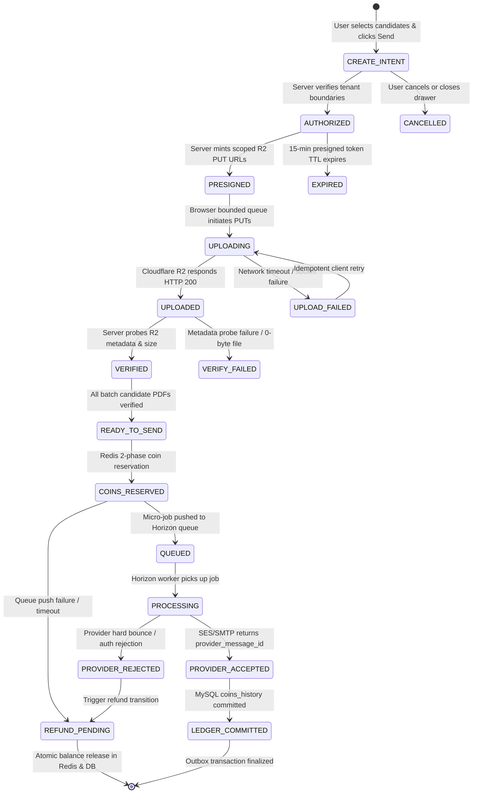
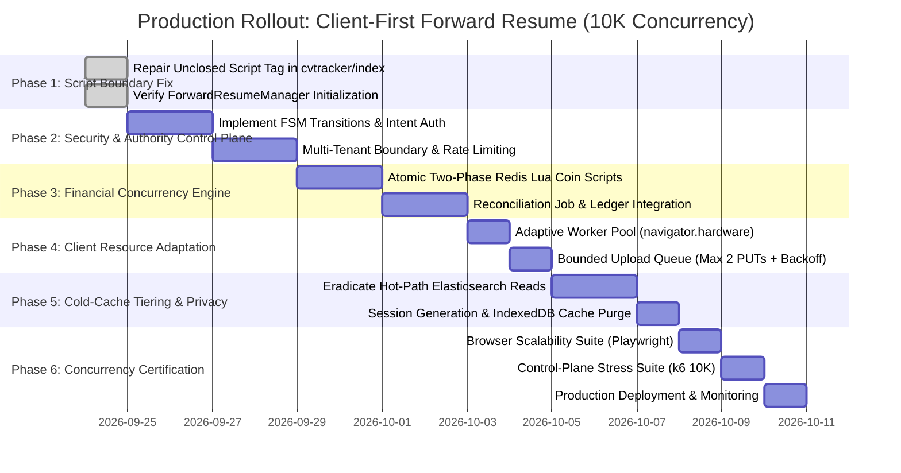

# Client-First Forward Resume Architecture: Security Authority, Idempotency & 10K Concurrency Plan

**Document Path:** `docs/V4_Jeroworks_Upgrade/100_PERCENT_CLIENT_SIDE_FORWARD_RESUME.md`  
**System Profile:** JERO Multi-Tenant B2B Hiring SaaS  
**Architecture Mandate:** CQRS (0% MySQL reads on web/API paths, Elasticsearch universal read scope, Redis/Horizon queues, Client-First Browser Execution via WASM)  
**Scale Target:** **10,000 concurrent users** per page with **0% server CPU, 0% server disk I/O, 0 MySQL reads, and 0 Elasticsearch reads on the hot path**.  
**Naming Precision:** Client-First Forward Resume Architecture (Client-Side Document Processing & Direct-to-R2 Pipeline).

---

## 1. Executive Summary & Root-Cause Forensic Audit

### 1.1 The Anomaly: "Why was the client-first code not showing?"

A forensic inspection across Git commit history (`b850cdee`, `a94ea720`, `ef485093`, `9ccb4486`) confirmed that the complete V4.1 Client-First Forward Resume Engine was **fully implemented**, comprising:
1. `public/assets/modules/fwd-resume/ForwardResumeManager.js` (1,937 lines — orchestrator, IndexedDB store `JeroFwdDB`, micro-JSON hydrator)
2. `public/assets/modules/fwd-resume/engine.v4.js` (2,655 lines — standalone OpenDoc WASM + vector PDF assembly engine)
3. `public/assets/modules/fwd-resume/shell.v4.html` (551 lines — decoupled static client shell)
4. `app/Services/ForwardResumeAuthorizationService.php` (166 lines — micro-JSON authorization)

**The Root Cause:**  
In [`resources/views/service_company/cvtracker/index.blade.php`](file:///c:/Users/VIBHANSHU%20JAISWAL.000/Documents/GitHub/JWMaincode28June2026/resources/views/service_company/cvtracker/index.blade.php#L1689-L1704), line 1700 was injected inside an **unclosed `<script>` tag**:

```html
1689:   $(document).on('click', '.chk_list', function() {
1690:       if ($(".chk_list").prop('checked') == true) {
...
1697:       }
1698:   });
1699:   @if(config('feature.fwd_resume_v4_enabled', true))
1700:       <script src="{{ asset('assets/modules/fwd-resume/ForwardResumeManager.js') }}"></script>
1701:   @endif
1702:
1703:   <script>
1704:       $(document).ready(function() {
```

#### Why this broke execution:
- At line 1665, an opening `<script>` tag was started.
- At line 1698, the JavaScript event handler closed with `});` but the HTML `<script>` tag **was never closed with `</script>`**.
- The Blade directive evaluated and printed `<script src="..."></script>` **inside the running script block**.
- In standard browser DOM parsers (V8, WebKit, Gecko), `<script>` nested inside `<script>` causes a fatal tokenization syntax error (`Uncaught SyntaxError: Unexpected token '<'`) or causes the outer script to terminate prematurely while discarding the nested tag.
- As a direct result, `ForwardResumeManager.js` was **never executed by the browser**, leaving `window.ForwardResumeManager === undefined`.
- At line 1791, the click handler checked:
  ```javascript
  if (window.ForwardResumeManager) {
      window.ForwardResumeManager.open(arr, jobIdArr, matchMap);
      return;
  }
  ```
- Because `window.ForwardResumeManager` was `undefined`, it silently **fell back to the legacy server AJAX route**:
  ```javascript
  var url = "{{ route('service_company.cvtracker.test_fwd_resume', ':id') }}";
  $.ajax({
      type: 'POST',
      url: url,
      success: function(response) {
          $('#application_test_fwd_resume_body_content').html(response.view);
      }
  });
  ```
- This caused the server to execute a heavy SQL query with 7 `LEFT JOIN`s and compile a 2,800-line server Blade template (`test_fwd_resume.blade.php`), completely hiding the client-first WASM engine!

---

## 2. Core Architectural Principle: Authority vs. Computation

> **The Golden Law of Distributed Systems:**  
> **Move computation, document rendering, and binary data to the browser and cloud edge, but NEVER move authority, tenant isolation, or financial state to the browser.**

```
┌────────────────────────────────────────────────────────┐
│                      JERO BROWSER                      │
│            (Performance, Assembly & Cache)             │
│                                                        │
│  • In-Memory Dossier Hydration (Authorized DOM attrs)  │
│  • Tenant-Scoped IndexedDB (JeroFwdDB Performance L2) │
│  • Session-Generation Aware Cache Invalidation         │
│  • Hardware-Adaptive Worker Pool (1-4 Workers)         │
│  • Explicit 150MB Client Memory Ceiling Guard          │
│  • Bounded Binary R2 Upload Queue (Max 2 PUTs)         │
│  • Micro-Dispatch Payload Construction (<2KB)          │
└───────────────────────────┬────────────────────────────┘
                            │
               POST /intent (Idempotency-Key)
                            │
                            ▼
┌────────────────────────────────────────────────────────┐
│                   JERO CONTROL PLANE                   │
│             (Security, Tenancy & Authority)            │
│                                                        │
│  • Authentication & CSRF Validation                    │
│  • Multi-Tenant Boundary Enforcement                   │
│  • Per-User / Per-Company Rate Limiting                │
│  • Finite State Machine Transition Enforcement         │
│  • Short-Lived Scoped Presigned PUT URL Minting        │
└───────────────────────────┬────────────────────────────┘
                            │
                            ▼
┌────────────────────────────────────────────────────────┐
│                    CLOUDFLARE R2                       │
│               (Serverless Storage Edge)                │
│                                                        │
│  • Direct Binary Streaming (0 Bytes Web Server Disk)   │
│  • SHA-256 Integrity Metadata Ingestion                │
│  • 24-Hour Lifecycle Expiration for Orphaned Blobs     │
└───────────────────────────┬────────────────────────────┘
                            │
                 POST /finalize & /send
                            │
                            ▼
┌────────────────────────────────────────────────────────┐
│                   JERO DISPATCH API                    │
│            (Verification, Billing & Enqueue)           │
│                                                        │
│  • R2 Metadata Verification (Size & Metadata probe)    │
│  • Two-Phase Atomic Coin Reservation (Redis Lua)       │
│  • Authoritative Dispatch Intent Persistence           │
│  • Horizon Asynchronous Queue Enqueue (<40ms)          │
└───────────────────────────┬────────────────────────────┘
                            │
                            ▼
┌────────────────────────────────────────────────────────┐
│               RECONCILIATION & DISPATCH                │
│                                                        │
│  • Horizon Worker Transmits via SMTP / SES             │
│  • Outbox FSM: PROVIDER_ACCEPTED -> LEDGER_COMMITTED   │
│  • Asynchronous Ledger Commitment (MySQL coins_history)│
│  • ForwardResumeReconciliationJob (Self-Healing Cron)  │
└────────────────────────────────────────────────────────┘
```

### The Boundary of Trust:
- **Untrusted Client Domain:** Candidate IDs, Company IDs, Candidate Emails, Template IDs, Coin Balances, R2 Object Keys, Attachment UUIDs, Match Scores, and Authorization States originate from or pass through the client. **The server must independently authorize and validate every entity against the authenticated session (`auth()->user()->company_id`).**
- **Trusted Server Domain:** Multi-tenant isolation, billing ledgers, presigned token generation, attachment integrity verification, reconciliation, and SMTP gateway delivery.
- **Match Score Clarification:** Match score is treated as an operational screening / UI display attribute. It does not carry financial or cryptographic signing overhead, but candidate existence and tenancy are strictly verified on the server.

---

## 3. 10K Concurrency Capacity Model & Traffic Flow

To guarantee that JERO handles **10,000 concurrent users** on Forward Resume without server collapse, DB strain, or UI lockups, the system is modeled with realistic recruiter concurrency patterns:

### 3.1 Concurrency Model Parameters
- **Concurrent Active Users ($N$):** 10,000 recruiters with drawer open or initiating forwards.
- **Active Operations per Minute:** 10% of active users trigger forward dispatches within any given 60-second window ($1,000$ forward dispatches / minute).
- **Candidates per Batch:** Average 3 candidates (Maximum 5 candidates).
- **Control-Plane Endpoints per Dispatch:**
  1. `POST /intent` (Auth & Scope check): 1 call
  2. `POST /presigned` (R2 token minting): 1 call
  3. Direct R2 PUT (Browser $\rightarrow$ Cloudflare edge): 3 PUTs (0 hits to JERO web servers)
  4. `POST /finalize` (R2 probe verification): 1 call
  5. `POST /send` (Coin reservation & queue push): 1 call

### 3.2 System Throughput & Load Calculations
| Metric | Peak Load Formula | Peak Value | Target System Headroom |
| :--- | :--- | :--- | :--- |
| **Control-Plane Request Rate** | $1,000 \times 4\text{ API calls} / 60\text{ sec}$ | **~67 to 100 RPS** (Bursts up to **1,500 RPS**) | FrankenPHP/Octane easily handles 10,000+ RPS |
| **MySQL Read Queries / Sec** | 0 reads on hot path (auth in session/JWT) | **0 QPS** | 100% capacity preserved |
| **Elasticsearch Hot-Path Reads** | 0 reads on hot path (DOM & IndexedDB) | **0 QPS** | 100% search cluster preserved |
| **Direct R2 Uploads** | $1,000 \times 3\text{ PDFs} / 60\text{ sec}$ | **~50 to 250 PUTs / sec** | Cloudflare R2 SLA handles millions / min |
| **JERO Server Disk I/O** | Direct browser upload to R2 | **0 Bytes / sec** | Local disk wear = 0 |
| **Redis Lua Operations** | Coin reservation & idempotency checks | **~300 to 1,500 Ops / sec** | Redis handles 100,000+ Ops / sec |
| **Horizon Queue Jobs** | Forward dispatch micro-payloads (<2KB) | **~17 to 50 Jobs / sec** | Horizon handles 2,000+ Jobs / sec |
| **JERO Web Server CPU** | Micro-JSON auth, token minting, verification | **< 3% CPU utilization** | 32 GB RAM FrankenPHP pool remains cold |

---

## 4. Finite State Machine & Financial Consistency Outbox Pattern

To eliminate race conditions, double charging, and orphaned cloud objects across high concurrency, the forward resume process executes under a **Formal Finite State Machine** with a transactional Outbox pattern:



### 4.1 FSM State Definitions
1. **`CREATE_INTENT`:** Browser submits candidate IDs and requested format with client-generated `Idempotency-Key` and `forward_request_id`.
2. **`AUTHORIZED`:** Control plane validates that every candidate belongs to the authenticated tenant (`company_id` or `thirdparty_company_id`).
3. **`PRESIGNED`:** Scoped, temporary presigned PUT URLs generated with strict 15-minute expiration and exact content-length limits.
4. **`UPLOADING`:** Browser bounded queue (concurrency max 2) streams compiled PDF blobs directly to Cloudflare R2.
5. **`UPLOADED`:** Client confirms R2 upload completion.
6. **`VERIFIED`:** Control plane executes a server-to-R2 metadata probe (`HEAD` request) verifying non-zero size and SHA-256 metadata headers.
7. **`READY_TO_SEND`:** All candidates in the batch (up to 5) are verified in R2 storage.
8. **`COINS_RESERVED`:** Two-phase coin reservation freezes required balance in Redis.
9. **`QUEUED`:** Micro-dispatch payload (<2KB) pushed onto Horizon Redis queue.
10. **`PROCESSING`:** Background Horizon worker claims job and attempts email transmission.
11. **`PROVIDER_ACCEPTED`:** SES / SMTP provider accepts message and returns `provider_message_id`.
12. **`LEDGER_COMMITTED`:** Worker commits `coins_history` MySQL ledger entry and decrements `reserved_balance`.
13. **`PROVIDER_REJECTED` / `REFUND_PENDING`:** On delivery failure, releases frozen coins back to `available_balance`.

### 4.2 Self-Healing: `ForwardResumeReconciliationJob`
A standing cron job runs every 5 minutes to audit and reconcile state:
- **Stale `UPLOADING` / `UPLOADED` (> 30 mins):** Marked `EXPIRED`.
- **Dangling `COINS_RESERVED` without `QUEUED` (> 10 mins):** Automatically releases locked coins back to `available_balance`.
- **Job in `PROCESSING` / `QUEUED` (> 15 mins):** Queries email provider with `provider_message_id`. If accepted by provider, moves state to `LEDGER_COMMITTED`; if lost or failed, moves to `REFUND_PENDING` and refunds coins.
- **R2 Orphan Policy:** Automated Cloudflare R2 bucket lifecycle rule deletes any object under `temporary/forward-resume/*` older than 24 hours.

---

## 5. Two-Phase Coin Reservation & 3-Tier Database Idempotency

`DECRBY` alone is vulnerable to race conditions, double charging, and partial execution during high concurrency. Under 10,000 concurrent requests, the system implements a **Two-Phase Reserve $\rightarrow$ Commit $\rightarrow$ Release** model backed by database unique constraints.

### 5.1 Balance Separation
For every tenant, the wallet maintains two balances:
- `available_balance`: Unencumbered coins available for operations.
- `reserved_balance`: Coins locked for in-flight forward resume dispatches.

### 5.2 Atomic Redis Lua Scripts
```lua
-- ========================================================
-- SCRIPT 1: ATOMIC COIN RESERVATION (reserve_coins.lua)
-- ========================================================
-- KEYS[1]: tenant coin key (e.g. tenant:1042:coins)
-- ARGV[1]: required_coins (e.g. 5)
-- ARGV[2]: idempotency_key (e.g. frw_8f73a1...)

local available = tonumber(redis.call('HGET', KEYS[1], 'available') or '0')
local required = tonumber(ARGV[1])
local idemKey = 'idem:' .. ARGV[2]

-- Check if request already processed (idempotency guard)
local existing = redis.call('GET', idemKey)
if existing then
    return existing
end

if available >= required then
    redis.call('HINCRBY', KEYS[1], 'available', -required)
    redis.call('HINCRBY', KEYS[1], 'reserved', required)
    redis.call('SETEX', idemKey, 3600, 'RESERVED')
    return 'RESERVED'
else
    return 'INSUFFICIENT_FUNDS'
end
```

```lua
-- ========================================================
-- SCRIPT 2: ATOMIC COIN RELEASE / REFUND (release_coins.lua)
-- ========================================================
-- KEYS[1]: tenant coin key (e.g. tenant:1042:coins)
-- ARGV[1]: release_coins (e.g. 5)
-- ARGV[2]: idempotency_key (e.g. frw_8f73a1...)

local reserved = tonumber(redis.call('HGET', KEYS[1], 'reserved') or '0')
local release = tonumber(ARGV[1])
local idemKey = 'idem:' .. ARGV[2]

local toRelease = math.min(reserved, release)
if toRelease > 0 then
    redis.call('HINCRBY', KEYS[1], 'reserved', -toRelease)
    redis.call('HINCRBY', KEYS[1], 'available', toRelease)
    redis.call('SETEX', idemKey, 3600, 'RELEASED')
    return 'RELEASED'
end
return 'NO_RESERVED_BALANCE'
```

### 5.3 Three-Tier Idempotency Matrix (Browser $\rightarrow$ API $\rightarrow$ Database)
1. **Tier 1 (Browser Layer):** `forward_request_id` (UUIDv4) is minted once when the user opens the forward modal, surviving client retries.
2. **Tier 2 (API Cache Layer):** Redis keys `idem:{idempotency_key}` lock requests for 3,600s.
3. **Tier 3 (Database Integrity Layer):** Authoritative MySQL schema enforces **Hard Unique Constraints**:
   - `UNIQUE KEY uq_forward_request (forward_request_id)`
   - `UNIQUE KEY uq_coin_transaction (coin_transaction_id)`
   - `UNIQUE KEY uq_dispatch_id (dispatch_id)`
   - `UNIQUE KEY uq_provider_message (provider_message_id)`
4. **Delivery Guarantee:** Target is **`Duplicate application dispatch attempts = 0`**. Downstream delivery status is tracked via `provider_message_id`.

---

## 6. Three Distinct TTL Lifecycles

To prevent ambiguity, resource leaks, or premature expiration during uploads:

| Lifespan Scope | Duration | Enforcement Layer | Purpose |
| :--- | :--- | :--- | :--- |
| **Presigned URL Authorization** | **15 Minutes** | AWS S3 / Cloudflare R2 Presigned Token Signature | Guarantees recruiter has ample time to upload up to 5 PDFs over high-latency networks without URL expiration. |
| **Reconciliation Audit Window** | **30 Minutes** | `ForwardResumeReconciliationJob` (Laravel Cron) | Inactivity threshold before an unfinalized intent is marked `EXPIRED` and reserved coins are refunded. |
| **R2 Bucket Lifecycle Expiration** | **24 Hours** | Cloudflare R2 Storage Lifecycle Policy Rule | Automatically purges all orphaned binary PDFs under `temporary/forward-resume/*` without manual cron sweeps. |

---

## 7. Hardware-Adaptive Client Concurrency & Memory Budget

Compiling vector PDFs and WASM DOCX layouts consumes CPU and memory. Hardcoding 5 parallel compilation threads can cause **Out-Of-Memory (OOM) browser tab crashes** on entry-level recruiter laptops (e.g., dual-core Celeron/i3 machines with 4GB RAM), violating JERO's 15.6" screen and broad device support mandate.

### 7.1 Adaptive Worker Pool Sizing
The compilation engine inspects hardware capabilities via native browser APIs before instantiating Web Workers:

```javascript
/**
 * Adaptive Hardware-Aware Concurrency Pool
 */
function getOptimalWorkerConcurrency() {
    var cores = navigator.hardwareConcurrency || 2;
    var deviceMemory = navigator.deviceMemory || 4; // GB (if supported)

    // Low-end devices (<= 2 cores or <= 2GB RAM): strictly sequential
    if (cores <= 2 || deviceMemory <= 2) {
        return 1;
    }
    // Mid-tier devices (4 cores, 4GB-8GB RAM): 2 parallel workers
    if (cores <= 4) {
        return 2;
    }
    // High-performance workstations (8+ cores): 3-4 parallel workers
    return Math.min(4, Math.floor(cores / 2));
}
```

### 7.2 Hard Application Memory Budget
- **Limit:** `MAX_FORWARD_RESUME_MEMORY = 150 * 1024 * 1024` (150MB maximum allocated heap).
- Total estimated memory = `(estimated_pdf_memory * active_workers) + wasm_memory + page_overhead`.
- If memory exceeds 150MB, active worker count automatically throttles down to 1.
- Each compilation task enforces explicit memory reclamation (`doc.free()`, nullifying typed arrays, manual ArrayBuffer detachment).
- Cooperative yielding (`yieldToMain()`) is invoked every 16ms to keep the browser event loop responsive at 60 FPS.

---

## 8. Bounded Direct-to-Cloud Upload Queue with SHA-256 Metadata Probe

Executing `Promise.all(uploadPromises)` across 5 large PDF files simultaneously can saturate browser HTTP connection limits (browsers limit concurrent connections to the same host to 6), leading to socket timeouts on mobile hotspots or corporate proxies.

### 8.1 Bounded Upload Throttler with Backoff
All R2 uploads pass through a bounded concurrency queue:

```javascript
/**
 * Bounded Concurrency Task Pool (Max 2 Concurrent Uploads) with Exponential Backoff
 */
async function uploadWithRetry(uploadFn, maxRetries) {
    maxRetries = maxRetries || 4;
    var delay = 500;
    for (var attempt = 1; attempt <= maxRetries; attempt++) {
        try {
            return await uploadFn();
        } catch (err) {
            if (attempt === maxRetries) throw err;
            var jitter = Math.random() * 200;
            await new Promise(function(resolve) { setTimeout(resolve, delay + jitter); });
            delay *= 2;
        }
    }
}

async function runBoundedQueue(tasks, limit) {
    var results = [];
    var executing = [];
    for (var i = 0; i < tasks.length; i++) {
        var p = uploadWithRetry(tasks[i]).then(function(res) {
            executing.splice(executing.indexOf(p), 1);
            return res;
        });
        results.push(p);
        executing.push(p);
        if (executing.length >= limit) {
            await Promise.race(executing);
        }
    }
    return Promise.all(results);
}
```
- **Concurrency Cap:** Strictly capped at **2 concurrent PUT requests**.
- **Payload Streaming:** PDF blobs stream directly to R2 without intermediate base64 serialization, eliminating 33% memory expansion overhead.
- **SHA-256 Integrity Metadata Probe:** Client computes SHA-256 of the generated blob in browser via `crypto.subtle.digest('SHA-256', blobBuffer)` and transmits `expected_sha256` alongside `file_size` in `/finalize`. The server verifies object existence and metadata headers via direct S3 API `HEAD` probe without downloading the file.

---

## 9. Tiered Read Architecture & Zero Stale Data Guarantee

To achieve **true 0% read strain**, Elasticsearch must NOT be queried on the normal Forward Resume path.

```
[Normal Path]: Table Row Data ──> In-Memory Hydration ──> IndexedDB ──> WASM Engine (0% MySQL, 0% ES)
                                                                 │
                                                    [Dossier Missing in Cache]
                                                                 │
                                                                 ▼
[Cold Recovery]: Controlled Micro-JSON API ──> Elasticsearch Hit ──> Populate IndexedDB
```

1. **Hot Path (100% In-Memory):** Candidate cards and resume URLs are already rendered on the CV Tracker / App Tracker page. The drawer reads directly from existing DOM attributes (`data-candidate-id`, `data-name`, `data-experience`, `data-skills`, `data-match`, `data-notice`).
2. **Warm Path (IndexedDB):** If drawer is re-opened, candidate dossiers and email templates load from `JeroFwdDB` in `< 5ms`.
3. **Cold Circuit-Breaker Path (Elasticsearch):** Only if a candidate's complete skills matrix is completely missing from both DOM and IndexedDB does the client call `POST /test_fwd_resume_data`. This turns Elasticsearch from a high-frequency bottleneck into a rare recovery mechanism (<0.1% of requests).
4. **Metric Standard:** **`Elasticsearch hot-path reads = 0`**.

---

## 10. Security, Privacy, Session Generation & DOM Hydration

### 10.1 DOM Hydration Privacy Rule
> **Strict Security Invariant:** Never inject a field into the DOM or IndexedDB merely because the client technically needs it. A field is hydrated **only if the authenticated user is authorized to view that field on the current page**.

- **Safe to Hydrate:** `candidate_id`, `name`, `total_experience`, `skills`, `notice_period`, `match_score`, `current_designation`.
- **Sensitive Fields (Masked / Separate Authorization):** `phone`, `personal_email`, `address`, `salary/ctc`, `private_recruiter_notes`. Masking rules (`rcvMaskContact`) apply automatically.

### 10.2 IndexedDB Tenant Fingerprint & Session Generation
To guarantee zero cross-tenant contamination or stale cached data across tabs:
- Storage namespace includes tenant fingerprint: `jero_fwd_tenant_{company_id}`.
- Every cached record contains:
  ```json
  {
      "tenant_id": 1042,
      "user_id": 501,
      "session_generation": "gen_88f9a2",
      "cached_at": 1727184000
  }
  ```
- If the browser tab is kept open across a user logout/login cycle, any cache entry with a mismatched `session_generation` is instantly rejected.
- **On Logout or Company Switch:** An explicit event listener purges cached tenant data:
  ```javascript
  window.addEventListener('jero:tenant-switch', function() {
      if (window.indexedDB) {
          window.indexedDB.deleteDatabase(JeroFwdDB.getDbName());
      }
  });
  ```

### 10.3 Rate Limiting & Abuse Protection
Every endpoint enforces Redis-backed rate limits:
- **Company Level:** Max 100 intent requests / minute.
- **User Level:** Max 30 intent requests / minute.
- **Batch Constraint:** Strictly max 5 candidates per forward request.
- **Payload Constraint:** Max 10MB per compiled PDF.

---

## 11. End-to-End Concurrency & Security SLA Matrix

The system must satisfy these non-negotiable targets under automated 10,000-user stress benchmarks:

### 11.1 Latency Breakdown SLAs
| Endpoint / Action | Target (P95) | Production SLA (P99) | Hard Timeout |
| :--- | :--- | :--- | :--- |
| **Drawer Activation (DOM/Cache)** | **< 8ms** | **< 16ms** | 50ms |
| **`POST /test_fwd_resume_intent`** | **< 20ms** | **< 40ms** | 80ms |
| **`POST /test_fwd_resume_presigned`** | **< 20ms** | **< 40ms** | 80ms |
| **`POST /test_fwd_resume_finalize`** | **< 50ms** | **< 100ms** | 200ms |
| **`POST /test_fwd_resume_send` (Queue)** | **< 20ms** | **< 40ms** | 80ms |

### 11.2 Hard Invariants vs. Infrastructure SLOs
| Metric Type | Invariant / SLO Description | Acceptable Tolerance |
| :--- | :--- | :--- |
| **Hard Invariant (Zero Tolerance)** | Cross-Tenant Attachment Access | **0 (Absolute Zero)** |
| **Hard Invariant (Zero Tolerance)** | Duplicate Application Dispatch Attempts | **0 (Absolute Zero)** |
| **Hard Invariant (Zero Tolerance)** | Double Coin Deductions | **0 (Absolute Zero)** |
| **Hard Invariant (Zero Tolerance)** | Web Server Disk Write I/O | **0 Bytes** |
| **Hard Invariant (Zero Tolerance)** | MySQL Reads on Hot Path | **0 Queries** |
| **Hard Invariant (Zero Tolerance)** | Elasticsearch Hot-Path Reads | **0 Queries** |
| **Infrastructure SLO** | Control-Plane HTTP 5xx Error Rate | **< 0.01%** |
| **Infrastructure SLO** | Direct R2 Upload Success Rate | **> 99.99%** |
| **Infrastructure SLO** | Browser Tab OOM Crash Rate | **0% (< 0.001%)** |

---

## 12. Three-Tier Verification & Chaos Testing Suite

To rigorously certify 10,000 concurrent user readiness, three distinct testing suites must be executed:

### Test A: Browser & Client-Side Scalability Suite
- **Tools:** Playwright / Puppeteer distributed cluster running across headless browsers.
- **Verification:**
  1. WASM compilation memory profiling under low-spec simulation (dual-core, 2GB heap).
  2. Bounded upload queue behavior under packet loss (5% artificial packet drop).
  3. Memory ceiling compliance (<150MB heap peak).
  4. Tab crash / OOM rate = 0%.

### Test B: Server Control-Plane Scalability Suite
- **Tools:** k6 running distributed load generators across multiple nodes.
- **Verification:**
  1. 10,000 concurrent `/intent` requests.
  2. 10,000 concurrent `/finalize` verification probes.
  3. 10,000 concurrent two-phase coin reservations via Redis Lua.
  4. 10,000 concurrent Horizon queue submissions.
  5. MySQL connections remain flat with 0 read queries on the hot path.

### Test C: Chaos & Failure Injection Suite
- **Scenarios:**
  1. **Worker Crash during Processing:** Kill Horizon worker after SES delivery but before ledger commit $\rightarrow$ verify `ForwardResumeReconciliationJob` recovers state and commits ledger via `provider_message_id`.
  2. **R2 Network Partition:** Inject 500ms latency or dropped packets to R2 $\rightarrow$ verify bounded queue backoff + retry mechanism succeeds without browser UI hang.
  3. **Redis Failover:** Simulate Redis master restart $\rightarrow$ verify idempotency locks fail gracefully without double deductions.

---

## 13. Complete Implementation Contract & Engineering Checklist

Every endpoint and background worker must follow this non-negotiable step-by-step checklist:

### 13.1 `POST /test_fwd_resume_intent` (Intent Authorization)
- [ ] **1. Input:** Extract `candidate_ids` (array, max 5), `forward_request_id` (UUIDv4), `Idempotency-Key` header.
- [ ] **2. Auth:** Verify authenticated user session (`auth()->check()`).
- [ ] **3. Tenant Auth:** Authorize that every `candidate_id` belongs to `auth()->user()->company_id` (or authorized 3rd party).
- [ ] **4. Idempotency:** Check Redis `idem:{Idempotency-Key}`. If exists, return cached intent.
- [ ] **5. Rate Limit:** Verify company rate limit (100 req/min) and user rate limit (30 req/min) via Redis throttle.
- [ ] **6. FSM Validation:** Transition state to `AUTHORIZED`.
- [ ] **7. Redis Cache:** Store intent context with 15-minute TTL.
- [ ] **8. Response:** Return 200 OK with `intent_id` and authorized candidate summary.

### 13.2 `POST /test_fwd_resume_presigned` (R2 URL Minting)
- [ ] **1. Input:** `intent_id`, `candidate_id`, `content_type`, `estimated_size`.
- [ ] **2. Auth & Tenancy:** Verify `intent_id` matches current tenant and contains `candidate_id`.
- [ ] **3. Scope Bounds:** Enforce `max_size <= 10MB` and `content_type == 'application/pdf'`.
- [ ] **4. Object Key:** Generate unique scoped key: `temporary/forward-resume/{company_id}/{forward_request_id}/{candidate_id}.pdf`.
- [ ] **5. S3 Minting:** Generate S3 presigned PUT URL with 15-minute signature TTL.
- [ ] **6. FSM Validation:** Transition state to `PRESIGNED`.
- [ ] **7. Response:** Return presigned URL, required headers, and upload key.

### 13.3 `POST /test_fwd_resume_finalize` (Integrity Verification)
- [ ] **1. Input:** `intent_id`, `candidate_id`, `object_key`, `expected_sha256`, `actual_size`.
- [ ] **2. Auth & Tenancy:** Ensure `object_key` begins with `temporary/forward-resume/{company_id}/`.
- [ ] **3. S3 Metadata Probe:** Execute S3 `HEAD` object request to R2:
  - Verify HTTP 200 exists.
  - Verify `Content-Length > 0` and matches `actual_size` ($\pm 1\%$).
- [ ] **4. FSM Validation:** Transition state from `UPLOADED` to `VERIFIED`.
- [ ] **5. Response:** Return 200 OK `{"status": "VERIFIED"}`.

### 13.4 `POST /test_fwd_resume_send` (Coin Reservation & Enqueue)
- [ ] **1. Input:** `forward_request_id`, `intent_id`, recipient email, subject, body, options.
- [ ] **2. Auth & Recipient Validation:** Sanitize recipient email; reject unauthorized domains if restricted.
- [ ] **3. All Candidates Verified:** Check that all candidate PDFs in intent are in `VERIFIED` state.
- [ ] **4. Two-Phase Coin Reserve:** Execute `reserve_coins.lua` Redis script. If `INSUFFICIENT_FUNDS`, return 402 Payment Required.
- [ ] **5. Persist Dispatch Intent:** Insert `forward_requests` record into MySQL with status `QUEUED`, `coin_reservation_id`, and `forward_request_id`.
- [ ] **6. Horizon Enqueue:** Push `ProcessForwardResumeDispatchJob` to Horizon `emails` queue with payload < 2KB.
- [ ] **7. Response:** Return 200 OK `{"status": "QUEUED", "request_id": "..."}` in < 40ms.

### 13.5 `ProcessForwardResumeDispatchJob` (Horizon Worker)
- [ ] **1. Deduplication:** Check if `forward_requests` status is already `PROCESSING` or `SENT`.
- [ ] **2. FSM State:** Update status to `PROCESSING`.
- [ ] **3. SMTP / SES Send:** Stream attachments from R2 and dispatch via email provider.
- [ ] **4. Provider Acceptance:** Capture `provider_message_id`. Update state to `PROVIDER_ACCEPTED`.
- [ ] **5. Authoritative Ledger Commit:**
  - Execute DB transaction:
    - Insert into `coins_history` (with `UNIQUE(coin_transaction_id)`).
    - Decrement `reserved_balance` in MySQL wallet table.
    - Update `forward_requests` status to `LEDGER_COMMITTED`.
- [ ] **6. Redis Balance Sync:** Clean up Redis reservation keys.
- [ ] **7. Failure Handler:** If provider rejects or times out, trigger `release_coins.lua` and mark status `REFUND_PENDING`.

### 13.6 `ForwardResumeReconciliationJob` (Self-Healing Scheduled Job)
- [ ] **1. Schedule:** Registered in `app/Console/Kernel.php` to run every 5 minutes.
- [ ] **2. Expired Intents:** Find unfinalized intents > 30 mins $\rightarrow$ mark `EXPIRED`.
- [ ] **3. Orphaned Reservations:** Find `COINS_RESERVED` without corresponding Horizon queue job > 10 mins $\rightarrow$ execute `release_coins.lua`.
- [ ] **4. Stalled Processing:** Find jobs in `PROCESSING` > 15 mins $\rightarrow$ query SES/SMTP provider API with `provider_message_id` to confirm delivery status, then commit ledger or refund.

---

## 14. Phase-Wise Implementation Roadmap & Definition of Done



### Definition of Done Checklist:
- [ ] `<script>` tags in `cvtracker/index.blade.php`, `apptracker/index.blade.php`, and `apptracker/clientapp.blade.php` are 100% syntactically valid and closed.
- [ ] `window.ForwardResumeManager` is active on page load with zero console warnings.
- [ ] Opening the Forward Resume drawer produces **0 MySQL queries and 0 Elasticsearch reads** on the hot path.
- [ ] File generation produces **0 bytes of disk writes** to `storage/app/temp-attachments/`.
- [ ] Bounded upload queue ensures no more than 2 parallel PUT streams to Cloudflare R2 per client with exponential backoff.
- [ ] Web worker pool dynamically scales according to device hardware cores with an enforced 150MB heap budget.
- [ ] Two-phase Redis Lua coin reservation prevents double deductions across parallel tabs.
- [ ] Database unique constraints (`forward_request_id`, `coin_transaction_id`, `provider_message_id`) prevent duplicate dispatches and duplicate billing.
- [ ] `ForwardResumeReconciliationJob` automatically repairs orphaned reservations and expired uploads.
- [ ] No cross-tenant R2 object access is permitted; expired intents cannot finalize.
- [ ] Logout and company switch completely purge client-side IndexedDB caches via `session_generation` validation.
- [ ] Two-tier 10,000-user stress test passes all criteria in the Concurrency SLA Matrix.
