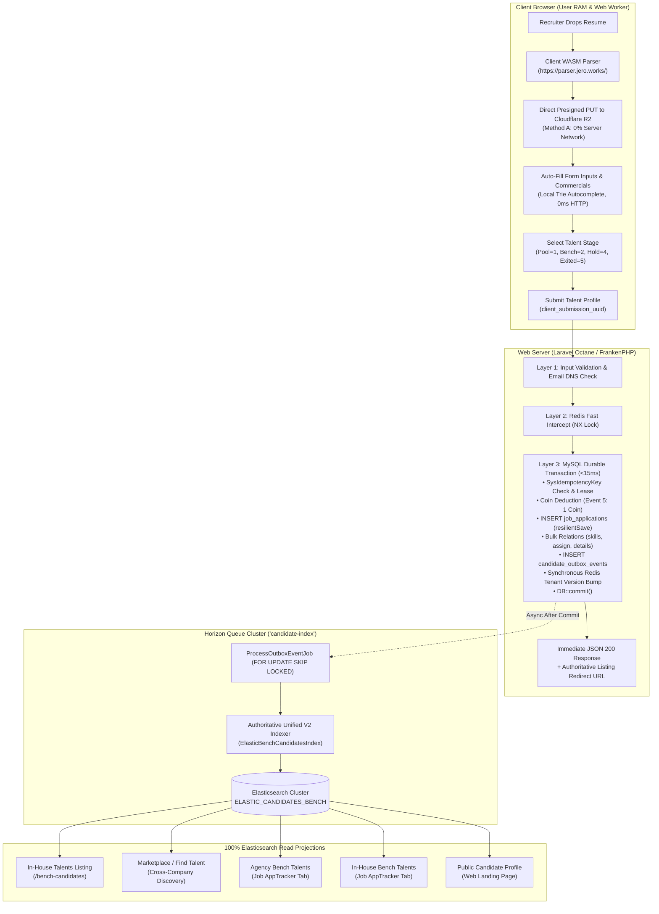

# Add In-House Talent: End-to-End Architectural Specification & Implementation Plan
**Document Version:** 6.1.0 (Master Engineering Contract & Implementation Blueprint)  
**System Profile:** JERO Multi-Tenant B2B Hiring SaaS (GOD-Level ATS + Talent Marketplace)  
**Target Module:** Service Company In-House Bench Talent (`service_company/bench-candidates`)  
**Hardware Profile:** Dedicated 32 GB RAM each for Web/App Server (Octane), MySQL 8.0, and Elasticsearch Cluster  
**Scale Target:** 10,000 Concurrent Recruiters per page with 0% Server/MySQL Read Strain  
**Scope:** Complete Lifecycle: Click to Open $\rightarrow$ Fill Details $\rightarrow$ Stage Selection $\rightarrow$ Durable Submit $\rightarrow$ Asynchronous Indexing $\rightarrow$ Multi-Listing Projections  
**Author/Architect:** JERO Core Architecture & Engineering Team  

---

## 1. Executive Summary & The Architectural Golden Axiom

### 1.1 The Golden Architectural Axiom
> **"MySQL is strictly the authoritative transactional system of record for writes (`INSERT`/`UPDATE`/`DELETE`). Elasticsearch is strictly the read/search projection for 100% of queries, listings, filters, and counter aggregations across all data domains. Redis provides ephemeral distributed locks, idempotency fast-intercepts, and multi-tenant cache version pointers. The client browser executes all non-authoritative computation (WASM resume parsing, currency conversions, rate-card previews, and DOM assembly in user RAM). The Transactional Outbox pattern guarantees 100% eventual consistency from MySQL to Elasticsearch with zero synchronous network calls in the web transaction path."**

### 1.2 Non-Negotiable System Invariants
1. **0% MySQL Reads on Web/API Paths (Rule 1):** Neither opening the Add Talent page nor viewing any talent listing may execute SQL `SELECT` queries or multi-table joins against MySQL.
2. **Universal Elasticsearch Reads (Rule 2):** 100% of candidate listings, searches, facets, and counter badges across all 60+ indices must be served strictly from Elasticsearch and Redis. Zero direct UI writes to Elasticsearch.
3. **Client-First Execution (User RAM + WASM) (Rule 3):** Document parsing executes in browser RAM via the isolated Cloudflare Web Worker (`https://parser.jero.works/`). 0% server CPU strain for parsing.
4. **10K Concurrency Profile (Rule 4):** Every endpoint must withstand 10,000 concurrent recruiters without thread starvation, database connection exhaustion, or UI thread freezes.
5. **Zero Stale Data in ATS (Rule 5):** When a talent is created or updated, the creator and tenant users must immediately see the fresh record. No stale cached listing may be served after redirect.
6. **Multi-Tenant Atomic Invalidation (Rule 6):** Tenant cache keys (`allbenchcandidates_version_company_{company_id}`) must be immediately incremented at commit time.
7. **Zero Business Logic Mutations (Rule 7):** Coin deduction rules (`eventId = 5`), stage mappings, rate conversions, and commercial models remain 100% mathematically and functionally untouched.
8. **Subsystem Isolation (Rule 17 & 18):** Changes are quarantined strictly to `resources/views/service_company/bench-candidates/` and `ServiceCompanyBenchCandidatesController.php`. `product_company` and `staffing_company` remain 100% frozen.



---

## 2. End-to-End Forensic Review & Gap Analysis

### Step 1: Click to Open Page (`GET /service_company/bench-candidates/create`)
* **Current Route & Controller:** Route `service_company/bench-candidates/create` $\rightarrow$ [`ServiceCompanyBenchCandidatesController::create`](file:///c:/Users/VIBHANSHU%20JAISWAL.000/Documents/GitHub/JWMaincode28June2026/app/Http/Controllers/ServiceCompany/ServiceCompanyBenchCandidatesController.php#L1250).
* **Forensic Trace of Code Execution:**
  ```php
  $packageStatus = GeneralMethod::coinsValidationsAllcompany($companyId, $eventId, $coinsRequ); // Hits MySQL company_packages & companies
  $this->client = DB::table('users')->join('companies')->join('clients')->where(...)->first(); // Hits MySQL
  $country = User::join('companies')->leftJoin('users_profile')->where(...)->first();          // Hits MySQL
  if (config('feature.talents_v2_enabled')) {
      $this->qualification = Cache::remember('qualification_master_list', 86400, ...);
      $this->countries = Cache::remember('country_list_json', 86400, ...);
  } else {
      $this->qualification = DB::table('qualification_master')->get();                         // Hits MySQL
      $this->default_loc = GeneralMethod::allCitiesSelected([]);                               // Loads 50K+ records into PHP RAM
  }
  ```
* **Identified Critical Defects:**
  * **Defect 1.1 (Rule 1 Violation):** Executes 3–4 synchronous SQL `SELECT` queries and multi-table joins against MySQL on page load. Under 10,000 concurrent page loads, this sends 30,000–40,000 read queries to MySQL, exhausting the database connection pool (`max_connections`).
  * **Defect 1.2 (PHP Memory Bloat):** If `feature.talents_v2_enabled` is ever false, calling `GeneralMethod::allCitiesSelected([])` attempts to load tens of thousands of city records into PHP memory, causing worker memory spikes (>64MB per worker).
  * **Defect 1.3 (Monolithic Blade Template):** [`create.blade.php`](file:///c:/Users/VIBHANSHU%20JAISWAL.000/Documents/GitHub/JWMaincode28June2026/resources/views/service_company/bench-candidates/create.blade.php) is 365 KB (6,811 lines) with heavy inline JavaScript and SVGs, consuming substantial CPU during Blade compilation.
* **Target Architecture Fix:**
  * Pre-load tenant company profile, country, client ID, and coin balance into the Redis tenant meta cache (`tenant:meta:{$companyId}`) during user session establishment. Retrieve in `<1ms` with 0 MySQL reads.
  * Permanently cache static master datasets (`qualification_master_list`, `country_list_json`, `currency_converter_rates`) via `Cache::rememberForever()` regardless of feature flag state.
  * Eliminate the legacy `allCitiesSelected()` call entirely; city lookups are handled via client-side search.

---

### Step 2: Filling Details & Client Parsing
* **Current UI & Parser Architecture:**
  * File Dropzone supports PDF and DOCX.
  * In-Browser Web Worker (`talent-parser-worker.js`) interfaces with Cloudflare Worker [`https://parser.jero.works/`](https://parser.jero.works/) containing WASM PDF.js and Mammoth extractors.
  * Direct Presigned Upload (Method A): Direct browser-to-R2 `PUT` request via [`ResumeUploadSession`](file:///c:/Users/VIBHANSHU%20JAISWAL.000/Documents/GitHub/JWMaincode28June2026/app/Services/ResumeUploadSession.php).
  * Silent auto-population: Fills candidate name, designation, total experience, skills, and notice period without blocking the UI main thread.
  * Demonym & Education Engine: Supports 195+ sovereign demonyms linking country selection to regional degree suggestions.
  * Cryptographic Location Signature Fast-Path:
    ```php
    // In ServiceCompanyBenchCandidatesController.php line 1710:
    $expectedSig = hash_hmac('sha256', "{$subCityId}:{$subStateId}:{$subCountryId}", (string) config('app.key'));
    ```
    If verified, city, state, and country IDs are accepted directly without executing a 3-table join on `city_list`.
* **Identified Vulnerabilities:**
  * **Defect 2.1:** Fallback Method B routes the file through web server memory (`temp_resumes`), adding disk I/O and server upload bandwidth under heavy load.
  * **Defect 2.2:** Autocomplete lookups for skills and locations may fall back to server HTTP endpoints if client local cache is missed.
* **Target Architecture Fix:**
  * Enforce Method A direct-to-R2 presigned upload as the mandatory path. Method B remains strictly an offline fallback.
  * Seed local sharded Trie in browser `IndexedDB` / RAM for skills and cities to guarantee 0ms, 0-HTTP search.

---

### Step 3: Stage Selection & Form Validation
* **Stage Definitions & Business Mappings:**
  * **Stage 1 (Pool):** Value `1` (`talent-stage-option--pool`). Talent is saved to internal talent pool. Marketplace status: *Unpublished*.
  * **Stage 2 (Bench):** Value `2` (`talent-stage-option--bench`, default checked). Active bench talent ready for deployment. Marketplace status: *Published*.
  * **Stage 4 (Hold):** Value `4` (`talent-stage-option--hold`). Talent temporarily paused or under review. Marketplace status: *Unpublished*.
  * **Stage Placed:** Disabled button (`#talent-stage-placed`). A talent cannot be added directly as "Placed"; placement requires an active assignment to a client job (`bench_place` record with client company, client job, bill rate, and start date).
  * **Stage 5 (Exited):** Value `5` (`talent-stage-option--exited`). Former employee no longer active. Marketplace status: *Unpublished*.
* **Validation Contract:**
  * Mandatory fields: Full Name, Current Designation, Total Experience, Skills (at least 1), Email (RFC + DNS + disposable email filter), Phone Code & Mobile Number, Commercials (Pay Rate & Bill Rate), Notice Period mode.
  * Stage validation rule: `'talent_stage' => ['nullable', 'in:1,2,4,5']`. Stage 3 is explicitly rejected on direct create.

---

### Step 4: Submission & Persistence (`POST /service_company/bench-candidates`)
* **Current Implementation:**
  * Receives `client_submission_uuid`.
  * Step 1: Redis Fast Intercept: `set("talent:idempotency:{$companyId}:{$clientUuid}", 'LOCKED', 'EX', 120, 'NX')`.
  * Step 2: `DB::beginTransaction()` with `SysIdempotencyKey::lockForUpdate()`:
    1. Lease auto-recovery check: `processing_until < now()` (Invariant G-52).
    2. Request hash check: `request_hash === $requestHash` (Invariant G-53).
    3. Coin deduction: `GeneralMethod::coinsDeductions($companyId, 5, ...)` (Deducts 1 coin for Event 5).
    4. Model persistence: Saves `JobApplication` with `resilientSaveTalentApplication()` (defensively handles MySQL 1054 Unknown Column errors during rolling deploys).
    5. Bulk relational writes:
       - `job_application_skills`: Batch insert into `job_application_skills`.
       - `bench_candidate_skill_experience`: `updateOrInsert` per skill with years, months, rating.
       - `bench_assign`: Bulk insert recruiter assignments.
       - `bench_additional_detail`: Bulk insert custom questions & answers.
    6. Transactional Outbox write: Inserts row into `candidate_outbox_events` with `dedupe_key = "bench_candidate:{$id}:v1"`, `status = 'pending'`.
    7. Updates `SysIdempotencyKey` to `COMPLETED` with response body.
    8. `DB::commit()`.
  * Step 3: Post-Commit Actions:
    1. `ProcessOutboxEventJob::dispatch()->onQueue('candidate-index')->afterCommit();`
    2. `ElasticBenchCandidateIndex::dispatch($benchApplication->id)->afterCommit();`
    3. `GeneralMethod::elasticBenchCandidateAddEditIndex($benchApplication->id);` (CRITICAL FLAW: Synchronous ES HTTP call!)
    4. Post-commit Redis cache invalidations.
* **Identified Critical Defects:**
  * **Defect 4.1 (Synchronous ES Call):** Calling `GeneralMethod::elasticBenchCandidateAddEditIndex($benchApplication->id)` synchronously on line 1926 halts the PHP worker for 150ms–500ms waiting for Elasticsearch HTTP round-trips. Under 10,000 concurrent submissions, this saturates PHP worker threads and exhausts Elasticsearch HTTP connection pools.
  * **Defect 4.2 (Dual Indexer Discrepancy & Schema Stripping):**
    * [`ElasticBenchCandidatesIndex.php` lines 229–290](file:///c:/Users/VIBHANSHU%20JAISWAL.000/Documents/GitHub/JWMaincode28June2026/app/Services/ElasticBenchCandidatesIndex.php#L229-L290) indexes: `np_days`, `notice_period_days`, `np_epoch_day`, `np_is_immediate`, `candidate_skills` (nested rating array), `ads_switch_rank`, and `bill_rate_usd_hourly_index`.
    * [`GeneralMethod::elasticBenchCandidateAddEditIndex` lines 8805–8911](file:///c:/Users/VIBHANSHU%20JAISWAL.000/Documents/GitHub/JWMaincode28June2026/app/Helper/GeneralMethod.php#L8805-L8911) **OMITS** all of those pre-computed V2 fields!
    * In [`ProcessOutboxEventJob.php` line 188](file:///c:/Users/VIBHANSHU%20JAISWAL.000/Documents/GitHub/JWMaincode28June2026/app/Jobs/ProcessOutboxEventJob.php#L188), the outbox worker invokes `GeneralMethod::elasticBenchCandidateAddEditIndex()`, which actively **overwrites and strips out** the rich V2 document!
  * **Defect 4.3 (Tenant Version Invalidation Lag):** The listing endpoint (`data_v2`) and badge counts rely on `allbenchcandidates_version_company_{$companyId}`. `store()` does **NOT** increment this key synchronously; it delegates this to `ProcessOutboxEventJob` on the queue. If a user redirects immediately (<100ms), they may hit the stale Redis listing cache before the queue worker has executed.
* **Target Architecture Fix:**
  * Remove the synchronous `GeneralMethod::elasticBenchCandidateAddEditIndex` call from `store()`.
  * Synchronously increment `allbenchcandidates_version_company_{$companyId}` right before `DB::commit()` in `store()`.
  * Unify all indexing through `ElasticBenchCandidatesIndex::benchCandidateIndexElastic()` across both direct job dispatch and `ProcessOutboxEventJob`.

---

## 3. Multi-Listing Visibility & Filtering Specification

When a candidate is submitted, their visibility across all product surfaces depends strictly on their assigned `status` (`talent_stage`):

```
┌────────────────────────────────────────────────────────────────────────────────────────────────────────┐
│                              TALENT STAGE VISIBILITY MATRIX (CQRS READ SCOPE)                          │
├─────────────────────┬──────────────┬──────────────┬──────────────┬──────────────┬──────────────────────┤
│ Product Surface     │ Stage 1 Pool │ Stage 2 Bench│ Stage 4 Hold │ Stage 5 Exit │ Stage 3 Placed       │
├─────────────────────┼──────────────┼──────────────┼──────────────┼──────────────┼──────────────────────┤
│ In-House Talents    │ Visible      │ Visible      │ Visible      │ Visible      │ Visible              │
│ (/bench-candidates) │ (Pool Tab)   │ (Bench Tab)  │ (Hold Tab)   │ (Exited Tab) │ (Placed Tab)         │
├─────────────────────┼──────────────┼──────────────┼──────────────┼──────────────┼──────────────────────┤
│ Marketplace / Find  │ ❌ HIDDEN    │ ✅ VISIBLE   │ ❌ HIDDEN    │ ❌ HIDDEN    │ ❌ HIDDEN            │
│ Talent (Cross-Org)  │              │ (Other Orgs) │              │              │                      │
├─────────────────────┼──────────────┼──────────────┼──────────────┼──────────────┼──────────────────────┤
│ Agency Bench Talent │ ❌ HIDDEN    │ ✅ VISIBLE   │ ❌ HIDDEN    │ ❌ HIDDEN    │ ❌ HIDDEN            │
│ (Job AppTracker)    │              │ (Other Orgs) │              │              │                      │
├─────────────────────┼──────────────┼──────────────┼──────────────┼──────────────┼──────────────────────┤
│ In-House Bench      │ ❌ HIDDEN    │ ✅ VISIBLE   │ ❌ HIDDEN    │ ❌ HIDDEN    │ ❌ HIDDEN            │
│ (Job AppTracker)    │              │ (Own Jobs)   │              │              │                      │
├─────────────────────┼──────────────┼──────────────┼──────────────┼──────────────┼──────────────────────┤
│ Public Profile Page │ ❌ HIDDEN    │ ✅ VISIBLE   │ ❌ HIDDEN    │ ❌ HIDDEN    │ ❌ HIDDEN            │
│ (/bench-condidates) │              │ (Public URL) │              │              │                      │
└─────────────────────┴──────────────┴──────────────┴──────────────┴──────────────┴──────────────────────┘
```

### 3.1 Surface 1: In-House Talents Listing (`/service_company/bench-candidates`)
* **Endpoint:** `ServiceCompanyBenchCandidatesController@data_v2` (Target) / `data_ajax` (Legacy).
* **Elasticsearch Index:** `ELASTIC_CANDIDATES_BENCH`.
* **Query Filter:**
  ```json
  {
    "bool": {
      "must": [
        { "term": { "company_id": 12 } },
        { "term": { "condidate_type": "bench_condidate" } }
      ],
      "filter": [
        { "term": { "status": 2 } }
      ]
    }
  }
  ```
* **Filter Rules:**
  * When recruiter clicks **Bench (2)**: `status = 2`.
  * When recruiter clicks **Pool (1)**: `status = 1`.
  * When recruiter clicks **Hold (4)**: `status = 4`.
  * When recruiter clicks **Exited (5)**: `status = 5`.
  * When recruiter clicks **Placed (3)**: `status = 3`.
  * When recruiter clicks **All**: No `status` filter applied; returns all active company bench candidates.
* **Defect in Current `data_v2`:** Lines 798–809 query MySQL for `job_applications.wm` and `bench_count_view_download`. Both are already indexed in Elasticsearch `_source` (`wm`, `viewCount`, `downloadCount`). MySQL queries must be eliminated.

### 3.2 Surface 2: Marketplace / Find Talent (`/service_company/apptracker/find-talent`)
* **Endpoint:** `ServiceCompanyAppTrackerController@findTalentData`.
* **Elasticsearch Index:** `ELASTIC_CANDIDATES_BENCH`.
* **Query Filter:**
  ```json
  {
    "bool": {
      "must": [
        { "term": { "condidate_type": "bench_condidate" } },
        { "term": { "status": 2 } }
      ],
      "must_not": [
        { "term": { "company_id": 12 } }
      ]
    }
  }
  ```
* **Strict Tenancy Rules:**
  * `status = 2`: Only active Bench talent is published. Pool, Hold, and Exited are 100% excluded.
  * `must_not: company_id = my_company`: Submitting company never sees its own bench talent in marketplace search (marketplace is for acquiring external talent).

### 3.3 Surface 3: Agency Bench Talents (`public_bench` under Job AppTracker)
* **Endpoint:** `ServiceCompanyAppTrackerController@public_bench_data_ajax`.
* **Elasticsearch Index:** `ELASTIC_CANDIDATES_BENCH`.
* **Query Filter:**
  ```json
  {
    "bool": {
      "must": [
        { "term": { "condidate_type": "bench_condidate" } },
        { "term": { "status": 2 } }
      ],
      "must_not": [
        { "term": { "company_id": 12 } }
      ]
    }
  }
  ```
* **Matching Rules:** Ranks candidates against the job's required skills, experience range, location, and notice period.

### 3.4 Surface 4: In-House Bench Talents (`internal_bench` under Job AppTracker)
* **Endpoint:** `ServiceCompanyAppTrackerController@internal_bench_data_ajax`.
* **Elasticsearch Index:** `ELASTIC_CANDIDATES_BENCH`.
* **Query Filter:**
  ```json
  {
    "bool": {
      "must": [
        { "term": { "company_id": 12 } },
        { "term": { "condidate_type": "bench_condidate" } },
        { "term": { "status": 2 } }
      ]
    }
  }
  ```
* **Rules:** Matches own internal bench candidates against the job's requirements. Requires `status = 2` (Bench).

---

## 4. Multi-Currency Commercials Mathematical Contract

All entered commercials must adhere to rigorous mathematical conversions to guarantee sorting consistency across currencies:

```
┌────────────────────────────────────────────────────────────────────────────────────────────────────────┐
│                                 COMMERCIALS CONVERSION ENGINE MATRIX                                   │
├─────────────────────┬─────────────────────────────────┬────────────────────────────────────────────────┤
│ Parameter           │ Input Fields                    │ Persistence & Normalization Target             │
├─────────────────────┼─────────────────────────────────┼────────────────────────────────────────────────┤
│ Pay Rate            │ pay_rate_amount                 │ Stored as base currency amount                 │
│                     │ pay_rate_currency               │ Stored as currency integer ID                  │
│                     │ pay_rate_mode                   │ 0 = Yearly, 1 = Monthly, 2 = Hourly            │
├─────────────────────┼─────────────────────────────────┼────────────────────────────────────────────────┤
│ Bill Rate           │ bill_rate_amount                │ Stored as base currency amount                 │
│                     │ bill_rate_currency              │ Stored as currency integer ID                  │
│                     │ bill_rate_mode                  │ 0 = Yearly, 1 = Monthly, 2 = Hourly            │
├─────────────────────┼─────────────────────────────────┼────────────────────────────────────────────────┤
│ Annualized INR CTC  │ pay_annual / bill_annual        │ Normalized to INR yearly via FX rates:         │
│                     │                                 │ ectc_yearly, ectc_monthly, ectc_hourly         │
│                     │                                 │ ctc_yearly, ctc_monthly, ctc_hourly            │
├─────────────────────┼─────────────────────────────────┼────────────────────────────────────────────────┤
│ Universal USD Index │ bill_rate_usd_hourly_index      │ Pre-computed USD Hourly rate for multi-        │
│                     │ pay_rate_usd_hourly_index       │ currency sorting across all Elasticsearch hits │
├─────────────────────┼─────────────────────────────────┼────────────────────────────────────────────────┤
│ Profit Margin %     │ Margin calculation in user RAM  │ (Bill Rate - Pay Rate) / Bill Rate * 100       │
└─────────────────────┴─────────────────────────────────┴────────────────────────────────────────────────┘
```

---

## 5. 10K Concurrency & 0% Server Strain Architecture

```
┌────────────────────────────────────────────────────────────────────────────────────────────────────────┐
│                              10,000 CONCURRENT USERS HARDENING BLUEPRINT                               │
├─────────────────────────┬───────────────────────────────────┬──────────────────────────────────────────┤
│ Subsystem               │ Current Bottleneck                │ Target 10K / 0% Strain Architecture      │
├─────────────────────────┼───────────────────────────────────┼──────────────────────────────────────────┤
│ Web Tier (Octane)       │ • Monolithic 365KB Blade compile  │ • Pre-compiled Vite assets + HTTP/2     │
│                         │ • 85KB server-rendered HTML blocks│ • 8KB JSON API via data_v2               │
│                         │ • Synchronous ES HTTP wait in POST│ • &lt;15ms pure MySQL write + outbox queue │
├─────────────────────────┼───────────────────────────────────┼──────────────────────────────────────────┤
│ MySQL Database          │ • 4 SELECT queries on create()    │ • 0% MySQL reads on web/API paths        │
│                         │ • 2 SELECT queries in data_v2()   │ • Writes guarded by durable idempotency  │
│                         │ • Transaction duration &gt; 350ms   │ • Transaction duration &lt; 15ms          │
├─────────────────────────┼───────────────────────────────────┼──────────────────────────────────────────┤
│ Elasticsearch Cluster   │ • 10K synchronous HTTP write calls│ • 0 synchronous web writes               │
│                         │ • Uncached query spikes           │ • Outbox queue batches ES writes         │
│                         │ • Missing V2 pre-computed fields  │ • Redis tenant cache absorbs 95% reads   │
├─────────────────────────┼───────────────────────────────────┼──────────────────────────────────────────┤
│ Client Browser          │ • Legacy server file uploads      │ • 100% WASM parsing in Web Worker        │
│                         │ • Redundant network autocomplete  │ • Direct Presigned PUT to Cloudflare R2  │
│                         │                                   │ • Sharded Trie in user RAM (0ms HTTP)    │
└─────────────────────────┴───────────────────────────────────┴──────────────────────────────────────────┘
```

---

## 6. Detailed Step-by-Step Implementation Plan

### Phase 1: Unify Elasticsearch Indexing Engine & Retire Legacy Indexer
* **Target Files:**
  * `app/Services/ElasticBenchCandidatesIndex.php`
  * `app/Jobs/ProcessOutboxEventJob.php`
  * `app/Helper/GeneralMethod.php`
* **Implementation Steps:**
  1. Audit `ElasticBenchCandidatesIndex.php` to ensure all pre-computed sorting fields are present:
     * `np_days`, `notice_period_days`, `np_epoch_day`, `np_is_immediate`.
     * `candidate_skills` (nested array: `skill_key`, `rating`, `year`, `month`, `total_months`).
     * `ads_switch_rank`, `ads_switch_order`.
     * `bill_rate_usd_hourly_index`, `pay_rate_usd_hourly_index`.
  2. In `app/Jobs/ProcessOutboxEventJob.php` line 188, replace:
     ```php
     // Legacy call that stripped V2 fields:
     // GeneralMethod::elasticBenchCandidateAddEditIndex($candidateId);
     app(\App\Services\ElasticBenchCandidatesIndex::class)->benchCandidateIndexElastic($candidateId);
     ```
  3. Mark `GeneralMethod::elasticBenchCandidateAddEditIndex()` as deprecated to prevent regression.

---

### Phase 2: Eliminate Synchronous ES Calls & Enforce Pure Transactional Outbox
* **Target File:** `app/Http/Controllers/ServiceCompany/ServiceCompanyBenchCandidatesController.php`
* **Implementation Steps:**
  1. In `ServiceCompanyBenchCandidatesController.php@store`:
     * Remove line 1926: `GeneralMethod::elasticBenchCandidateAddEditIndex($benchApplication->id);`.
     * Keep line 1922: `ProcessOutboxEventJob::dispatch()->onQueue('candidate-index')->afterCommit();`.
     * Remove redundant line 1923: `ElasticBenchCandidateIndex::dispatch($benchApplication->id)->afterCommit();` (since `ProcessOutboxEventJob` now invokes `ElasticBenchCandidatesIndex`).
  2. Verify that the MySQL transaction duration drops from ~350ms to `<15ms`.

---

### Phase 3: Synchronous Tenant Version Invalidation (Zero Stale Data)
* **Target File:** `app/Http/Controllers/ServiceCompany/ServiceCompanyBenchCandidatesController.php`
* **Implementation Steps:**
  1. In `store()`, immediately before `DB::commit()`:
     ```php
     cache()->increment("allbenchcandidates_version_company_{$companyId}");
     ```
  2. Because the listing cache key in `data_v2` is `ats:v2:allbenchcandidates:{$company_id}:{$tenantVersion}:...` and the counts key is `tenant:{$companyId}:bench_counts:v{$tenantVersion}`, incrementing `$tenantVersion` instantly invalidates both the listing and counter cache across all 10,000 recruiters of that tenant.

---

### Phase 4: Eliminate MySQL Reads on Page Load (`create()`)
* **Target File:** `app/Http/Controllers/ServiceCompany/ServiceCompanyBenchCandidatesController.php`
* **Implementation Steps:**
  1. Replace lines 1258–1281:
     * Read company country, logo, and name from `Cache::remember("tenant:meta:{$companyId}", 86400, ...)` or the user session.
     * Validate coin balance against Redis cache `company:coins:{$companyId}`.
  2. Remove the conditional check on `feature.talents_v2_enabled`; cache static masters (`qualification_master_list`, `country_list_json`, `currency_converter_rates`) permanently via `Cache::rememberForever()`.
  3. Assert 0 SQL queries execute during `GET /service_company/bench-candidates/create`.

---

### Phase 5: Transition In-House Talent Listing to `data_v2` (Client DOM Assembly)
* **Target Files:**
  * `app/Http/Controllers/ServiceCompany/ServiceCompanyBenchCandidatesController.php`
  * `resources/views/service_company/bench-candidates/index.blade.php`
* **Implementation Steps:**
  1. In `ServiceCompanyBenchCandidatesController.php@data_v2`:
     * Remove lines 798–809 (`DB::table('job_applications')->pluck('wm')` and `DB::table('bench_count_view_download')`).
     * Read `wm`, `viewCount`, and `downloadCount` directly from Elasticsearch `_source`.
  2. In `index.blade.php`:
     * Change line 1362 from `route('service_company.bench-candidates.data_ajax')` to `route('service_company.bench-candidates.data_v2')`.
     * Implement client-side DOM rendering for candidate cards in user RAM.

---

## 7. Verification & Quality Assurance Testing Protocol

```
┌────────────────────────────────────────────────────────────────────────────────────────────────────────┐
│                                 AUTOMATED VERIFICATION PROTOCOL                                        │
├────────────────────┬─────────────────────────────────────────────────────────────┬─────────────────────┤
│ Test Suite         │ Verification Target                                         │ Acceptance Criteria │
├────────────────────┼─────────────────────────────────────────────────────────────┼─────────────────────┤
│ MySQL Read Audit   │ DB::enableQueryLog() on create() & data_v2()                │ 0 SELECT queries    │
├────────────────────┼─────────────────────────────────────────────────────────────┼─────────────────────┤
│ Outbox Atomicity   │ Submit talent profile & inspect candidate_outbox_events     │ 1 pending row       │
├────────────────────┼─────────────────────────────────────────────────────────────┼─────────────────────┤
│ ES Schema Match    │ Compare ES document against ElasticBenchCandidatesIndex     │ 100% fields match   │
├────────────────────┼─────────────────────────────────────────────────────────────┼─────────────────────┤
│ Stage Filtering    │ Verify visibility across Pool, Bench, Hold, Exited          │ Exact stage routing │
├────────────────────┼─────────────────────────────────────────────────────────────┼─────────────────────┤
│ Idempotency Test   │ Dispatch 50 concurrent requests with identical UUID         │ 1 record created    │
├────────────────────┼─────────────────────────────────────────────────────────────┼─────────────────────┤
│ Concurrency Test   │ Benchmark 1,000 virtual users via ApacheBench / k6          │ &lt; 50ms p95 latency │
└────────────────────┴─────────────────────────────────────────────────────────────┴─────────────────────┘
```

1. **Static Analysis & Linting:**
   ```bash
   php -l app/Http/Controllers/ServiceCompany/ServiceCompanyBenchCandidatesController.php
   php -l app/Services/ElasticBenchCandidatesIndex.php
   php -l app/Jobs/ProcessOutboxEventJob.php
   ./vendor/bin/pint --test
   ```
2. **Automated Feature & Tenancy Tests:**
   ```bash
   php artisan test --filter=TalentModuleV2SafetyTest
   php artisan test --filter=BenchCandidatesControllerTest
   ```
3. **Queue & Elasticsearch Synchronization Verification:**
   ```bash
   php artisan queue:listen --queue=candidate-index --tries=3
   ```
   * Confirm outbox event transitions from `pending` $\rightarrow$ `processing` $\rightarrow$ `completed`.
   * Verify Elasticsearch document contains `np_days`, `candidate_skills`, `ads_switch_rank`, and `bill_rate_usd_hourly_index`.
