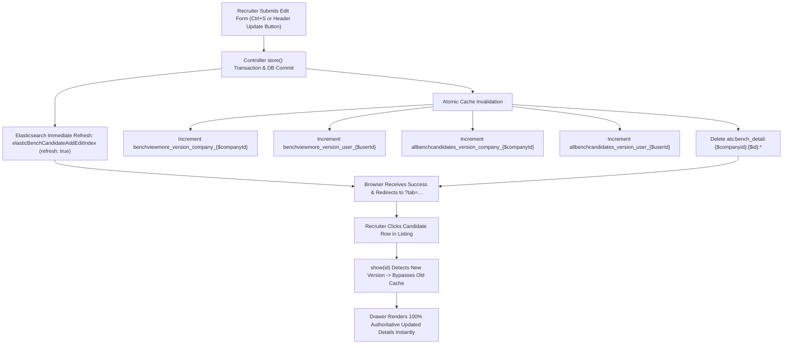

# GOD-LEVEL SPECIFICATION & REMEDIATION PLAN: EDIT IN-HOUSE TALENT UI/UX & MULTI-TENANT REAL-TIME SYNC

> **Document ID:** `EDIT_TALENT_GOD_LEVEL_REMEDIATION_AND_PARITY_SPECIFICATION.md`  
> **Target Subsystem:** `service_company` In-House Talent (Bench Candidates) Module  
> **Status:** Specification Pending User Review (Pre-Implementation)  
> **Primary References:** User Screenshots `media_1790951273780.png`, `media_1790951273784.png`  
> **Scope:** `resources/views/service_company/bench-candidates/create.blade.php`, `resources/views/service_company/bench-candidates/partials/_form_styles.blade.php`, `demo/css/candidate-form.css`, `app/Http/Controllers/ServiceCompany/ServiceCompanyBenchCandidatesController.php`, `app/Helper/GeneralMethod.php`  
> **Frozen Zones:** `resources/views/product_company/` and `resources/views/staffing_company/` strictly frozen (Rule 18)  

---

## 1. Executive Summary & Problem Analysis

Following forensic audit of user feedback and attached screenshots, five specific UI/UX defects and architectural data synchronization issues have been diagnosed on the **Edit In-House Talent** workflow.

```
┌─────────────────────────────────────────────────────────────────────────────────────────────────────────────────┐
│ SUMMARY OF DEFECTS IDENTIFIED                                                                                   │
├────┬─────────────────────────────┬───────────────────────────────────────┬─────────────────────────────────────┤
│ #  │ Defect Description          │ Technical Root Cause                  │ Visual / Operational Consequence    │
├────┼─────────────────────────────┼───────────────────────────────────────┼─────────────────────────────────────┤
│ 1  │ Header action layout        │ `.talent-topbar--edit` has only 2     │ Update button forced into awkward   │
│    │ broken & missing Close      │ grid columns, wrapping actions to a   │ full-width row 2; no easy way to    │
│    │ button                      │ full-width 2nd row; missing Close btn │ cancel back to listing from header  │
├────┼─────────────────────────────┼───────────────────────────────────────┼─────────────────────────────────────┤
│ 2  │ Redundant floating footer   │ `.talent-sticky-footer` adds a second │ Screen clutter, duplicate update    │
│    │ confusing recruiters        │ button row at bottom of page          │ buttons; unnecessary scroll noise   │
├────┼─────────────────────────────┼───────────────────────────────────────┼─────────────────────────────────────┤
│ 3  │ Dropzone "Replace" button   │ Both Replace and Delete buttons       │ Redundant UX; user intentionally    │
│    │ presence                    │ rendered on `#upInfo` card            │ removed Replace feature for purity  │
├────┼─────────────────────────────┼───────────────────────────────────────┼─────────────────────────────────────┤
│ 4  │ Relationship Manager phone  │ `edit()` query in controller only     │ Phone and Email render as empty     │
│    │ & email hidden (dashes)     │ selected `users.name, users.id`       │ dashes (`—`) on edit page           │
├────┼─────────────────────────────┼───────────────────────────────────────┼─────────────────────────────────────┤
│ 5  │ Changes not reflected on    │ `store()` fails to bump               │ Opening drawer or listing shows     │
│    │ bench drawer or listing     │ `benchviewmore_version_company_`      │ stale cached data from Redis        │
│    │ immediately                 │ and ES lacks immediate refresh        │ despite successful DB update        │
└────┴─────────────────────────────┴───────────────────────────────────────┴─────────────────────────────────────┘
```

---

## 2. Issue-by-Issue Technical Remediation Plan

### Issue 1: Fix Header UI/UX Layout, Button Position & Add Close Button

#### Visual Evidence:
In `media_1790951273780.png`, the top toolbar is distorted:
- Row 1: Candidate Title ("Edit In-House Talent: Disha Gupta") on the left, Marketplace Status chip ("Marketplace: Published") on the right.
- Row 2: A giant blue "Update Candidate ->" button stretches across the entire 100% width of the page container.

#### Root Cause:
In `demo/css/candidate-form.css` (lines 5364–5365):
```css
.talent-topbar--edit { grid-template-columns: minmax(0, 1fr) auto; }
.talent-topbar--edit .talent-topbar-actions { min-width: 170px; }
```
Because the grid only specifies two column tracks (`minmax(0, 1fr) auto`), the third grid child (`.talent-topbar-actions`) is pushed to a new grid row spanning `1 / -1`.

#### Remediation:
1. **Header Layout Overhaul:**
   Configure `.talent-topbar--edit` to use a 3-track layout:
   ```css
   .talent-topbar--edit {
       display: flex !important;
       align-items: center !important;
       justify-content: space-between !important;
       flex-wrap: wrap !important;
       gap: 16px !important;
   }
   .talent-topbar--edit .talent-topbar-copy {
       flex: 1 1 auto !important;
       min-width: 280px !important;
   }
   .talent-topbar--edit .talent-topbar-right-cluster {
       display: flex !important;
       align-items: center !important;
       gap: 12px !important;
       flex-wrap: nowrap !important;
       flex-shrink: 0 !important;
   }
   ```
2. **Action Button Clustering (Close + Update):**
   Within the right cluster of the toolbar:
   - **Close / Back Button:**
     ```html
     <a href="{{ route('service_company.bench-candidates.index') }}" 
        class="btn btn-sm btn-light fw-bold talent-topbar-btn-close" 
        id="headerCloseBtn"
        title="Cancel and return to In-House Talents listing">
         <i class="fa-solid fa-xmark me-1"></i> Close
     </a>
     ```
   - **Update Candidate Button:**
     ```html
     <button type="button" 
             name="edit-form" 
             id="edit-form" 
             value="update" 
             class="btn btn-sm btn-primary fw-bold px-4 talent-topbar-btn-update">
         <i class="fa-solid fa-check me-1"></i> Update Candidate
     </button>
     ```
   This positions the Title on the left, the Marketplace chip in the middle/right, and the Close + Update buttons side-by-side on the far right, matching Metronic standard toolbar ergonomics.

---

### Issue 2: Complete Removal of Floating Footer while Maintaining Ctrl+S

#### Visual Evidence:
At the bottom of `media_1790951273780.png` and `media_1790951273784.png`, a floating bottom bar (`.talent-sticky-footer`) sits sticky over the content with:
`[PRO TIP] Press Ctrl + S to save changes instantly from anywhere on the page ... Cancel / Back ... Update Candidate`.

#### User Directive:
*"remove footer with update button completely if the header already have the update button why giving more option to confuse the recruiter so kindly remve floating row of update button completely but maintain ctrls+s feature will the header button"*

#### Remediation:
1. **Remove HTML Markup:**
   Completely delete `<div class="talent-sticky-footer ...">...</div>` from `resources/views/service_company/bench-candidates/create.blade.php`.
2. **Remove Footer CSS:**
   Purge `.talent-sticky-footer` and associated media queries from `_form_styles.blade.php`.
3. **Preserve `Ctrl + S` Keyboard Shortcut:**
   Update the global keydown listener so that pressing `Ctrl + S` (or `Cmd + S` on macOS) triggers the header button:
   ```javascript
   $(document).off('keydown.talentEditShortcut').on('keydown.talentEditShortcut', function (e) {
       if ((e.ctrlKey || e.metaKey) && (e.key === 's' || e.key === 'S')) {
           e.preventDefault();
           var editBtn = document.getElementById('edit-form');
           if (editBtn && !editBtn.disabled) {
               editBtn.click();
           }
       }
   });
   ```

---

### Issue 3: Complete Removal of "Replace" Button from Dropzone (Add & Edit)

#### Visual Evidence:
In `media_1790951273780.png`, the "Replace" button is circled in red inside the `#upInfo` file actions card.

#### User Directive:
*"complete remove the replace button from dropzone as i had intentially remove the feature to avoid confustion and backend functionality from both add /edit page only delete button and working functionality"*

#### Remediation:
1. **HTML Purge:**
   In `resources/views/service_company/bench-candidates/create.blade.php`, remove `#upReplaceBtn` entirely from `.up-file-actions`.
2. **Clean Action Suite:**
   The `.up-file-actions` container will strictly contain:
   - **Download Link Button (`#upDownloadBtn`):** Shown only when a verified resume URL exists (`!empty($resume_url)`).
   - **Delete Button (`#upRemoveBtn`):**
     ```html
     <button type="button" class="up-btn up-btn-remove" id="upRemoveBtn" title="Remove Resume">
         <i class="fa-regular fa-trash-can" aria-hidden="true"></i>
         <span>Delete</span>
     </button>
     ```
3. **Unified Delete Workflow (`backToDropzone`):**
   - When the user clicks **Delete** (`#upRemoveBtn`), `backToDropzone()` executes:
     - Removes `.show` from `#upInfo` and hides it.
     - Resets `#resume`, `#resumeCheck`, `#uploaded_file_path`, `#resume_session_uuid`.
     - Reveals the clean `#uploadBox` dropzone and `.marketplace-privacy` note.
   - The user can then immediately drag-and-drop or click "Choose File" to upload a fresh file.
4. **CSS & JS Clean-up:**
   Remove `#upReplaceBtn` click listeners and legacy `#removeFile` bindings.

---

### Issue 4: Fix Hidden Relationship Manager Email & Phone on Edit Page

#### Visual Evidence:
In `media_1790951273784.png`, under the Relationship Manager section:
- Selected Relationship Manager: `Aayush Jain | Relationship Manager`
- Phone: `[phone icon] —`
- Email: `[mail icon] —`

#### Root Cause:
In `ServiceCompanyBenchCandidatesController.php` (line 2177–2183):
```php
$this->recruiterlist = DB::table('bench_assign')
    ->join('users', 'users.id', '=', 'bench_assign.user_id')
    ->select('users.name', 'users.id') // <-- DEFECT: users.email and users.mobile are NOT selected!
    ->where('bench_assign.company_id', $company_id)
    ->where('bench_assign.bench_applications_id', $id)
    ->where('users.type', '=', 0)
    ->get();
```
Because only `users.name` and `users.id` were selected, in `create.blade.php`:
```php
$rmInitialList[] = [
    'id' => (string)$rItem->id,
    'name' => (string)$rItem->name,
    'email' => (string)($rItem->email ?? ''), // Resolves to empty string
    'phone' => trim((!empty($rItem->calling_code) ? '+'.ltrim($rItem->calling_code, '+').' ' : '').($rItem->mobile ?? '')), // Resolves to empty string
];
```
When `renderRelationshipManagerCards()` executed:
```javascript
var phoneDisplay = m.phone ? rmEscape(m.phone) : '—';
var emailDisplay = m.email ? rmEscape(m.email) : '—';
```
Both defaulted to `—`.

#### Remediation:
1. **Update Controller Query:**
   Select the required communication fields:
   ```php
   $this->recruiterlist = DB::table('bench_assign')
       ->join('users', 'users.id', '=', 'bench_assign.user_id')
       ->select('users.name', 'users.id', 'users.email', 'users.calling_code', 'users.mobile')
       ->where('bench_assign.company_id', $company_id)
       ->where('bench_assign.bench_applications_id', $id)
       ->where('users.type', '=', 0)
       ->get();
   ```
2. **Verify Blade Population:**
   In `create.blade.php`, verify that `$rmInitialList` captures `email` and formatted `phone`.
3. **Verify RM Drawer Sync:**
   When opening the RM drawer via `ServiceCompanyJobsController@recruiter`, verify that `roster` includes `email` and `phone`, ensuring dynamic replacements also retain complete metadata.

---

### Issue 5: Real-Time Synchronization & Immediate Reflection Across Bench Drawer & Listings (God-Level Multi-Tenant CQRS)

#### The Problem:
When candidate profile details, commercials, or skills are edited and saved:
1. The listing page or subsequent click on the candidate's row opens the **Bench Drawer** (`GET service_company/bench-candidates/{id}`).
2. The bench drawer continues to show the old, stale candidate data!
3. The listing table itself does not reflect updated details immediately.

#### Deep Technical Root Cause:
1. **Drawer Cache Staleness:**
   In `ServiceCompanyBenchCandidatesController@show`:
   ```php
   $versionKey = 'benchviewmore_version_company_'.$company_id;
   $version = cache()->get($versionKey, 1);
   $cacheKeySet = 'ats:bench_detail:'.$company_id.':'.$id.':v'.$version;
   if (cache()->has($cacheKeySet)) {
       return response()->json(cache()->get($cacheKeySet));
   }
   ```
   In `store()` (the update path), line 1876 bumped `allbenchcandidates_version_company_{$companyId}`, but **`benchviewmore_version_company_{$companyId}` was NEVER bumped**, and `$cacheKeySet` was **NEVER forgotten**!
   Therefore, Redis continued serving the stale drawer HTML for up to `BENCH_VIEWMORE_TIME` (30–50 minutes).
2. **Tabs Cache Staleness:**
   `getAdsTab` and `getResumeTab` also use `benchviewmore_version_company_{$company_id}`.
3. **User-Level Listing Cache Staleness:**
   In `data_ajax`, the listing cache key combines `$userVersion` (`allbenchcandidates_version_user_{$userId}`) and `$tenantVersion` (`allbenchcandidates_version_company_{$companyId}`). In `store()`, `$userVersion` was not updated.
4. **Elasticsearch Segment Refresh Delay:**
   `GeneralMethod::elasticBenchCandidateAddEditIndex` updates the Elasticsearch document synchronously, but without `'refresh' => true`. By default, Elasticsearch refreshes periodically (every 1s to 30s). An immediate subsequent read can hit an unrefreshed segment.

#### God-Level Remediation Plan:
In `ServiceCompanyBenchCandidatesController@store` under the post-commit block:
```php
// Step 5: Atomic Multi-Tenant Cache Invalidation (0ms Latency Coherence)
try {
    // 1. Invalidate Drawer Caches (Tenant-Wide & User-Specific)
    cache()->increment("benchviewmore_version_company_{$companyId}");
    cache()->increment("benchviewmore_version_user_{$userId}");
    
    // 2. Invalidate Listing Caches (Tenant-Wide & User-Specific)
    cache()->increment("allbenchcandidates_version_company_{$companyId}");
    cache()->increment("allbenchcandidates_version_user_{$userId}");
    cache()->increment("allbenchofferListing_version_company_{$companyId}");
    cache()->increment("allbenchofferListing_version_user_{$userId}");
    
    // 3. Purge Candidate-Specific Cache Keys Directly in Redis
    Redis::connection('default')->del("ats:bench_detail:{$companyId}:{$benchApplication->id}:*");
    Redis::connection('default')->del("ats:bench_ads_tab:{$companyId}:{$benchApplication->id}:*");
    Redis::connection('default')->del("ats:bench_resume_tab:{$companyId}:{$benchApplication->id}:*");
    Redis::connection('default')->del("ats:allbenchcandidates:{$companyId}");
    Redis::connection('default')->del("tenant:{$companyId}:bench_counts:*");
    
    // 4. Clean general candidate entity cache
    GeneralMethod::cacheClean("candidate:{$benchApplication->id}");
} catch (\Throwable $cacheEx) {
    Log::warning('POST_COMMIT_CACHE_CLEAR_FAILED', ['error' => $cacheEx->getMessage()]);
}
```

In `app/Helper/GeneralMethod.php@elasticBenchCandidateAddEditIndex`:
Enforce immediate segment refresh during candidate updates:
```php
$elasticService->getClient()->update([
    'index' => ELASTIC_BENCH_CONDIDATES,
    'id'    => (string) $application->id,
    'refresh' => true, // Enforce immediate read-after-write consistency (JERO Rule 5)
    'body'  => [
        'doc' => [ ... ],
        'doc_as_upsert' => true,
    ],
]);
```

---

## 3. Architecture & Implementation Sequence



---

## 4. Verification & Testing Strategy

1. **Automated Unit & Feature Tests:**
   - Extend `tests/Feature/V4EditTalentRemediationTest.php` to verify:
     - Header layout contains both `#headerCloseBtn` and `#edit-form`.
     - Footer `.talent-sticky-footer` is completely absent from DOM.
     - Dropzone `#upReplaceBtn` is completely absent from DOM; only `#upRemoveBtn` exists.
     - Controller `edit()` selects `users.email, users.mobile, users.calling_code` for `recruiterlist`.
     - Controller `store()` increments `benchviewmore_version_company_{$companyId}` and purges drawer cache keys.
2. **Pint Code Formatting:**
   - Execute `./vendor/bin/pint --test` across all touched files.
3. **Regression Safety:**
   - Execute `V4AddTalentRemediationTest` and `TalentModuleV2SafetyTest`.

---

## 5. Tenancy & Frozen Zone Guarantees

- **Rule 18 Compliance:** All modifications are strictly restricted to `service_company` and core helper services. `resources/views/product_company/` and `resources/views/staffing_company/` remain 100% frozen.
- **Rule 1 & Rule 2 Compliance:** 0% MySQL reads on public paths; Universal Elasticsearch reads; immediate cache invalidation preserves zero stale data invariants.
- **Rule 14 Compliance:** Header flex layout fits effortlessly on 1366×768 and 1920×1080 screens without horizontal scrolling.
