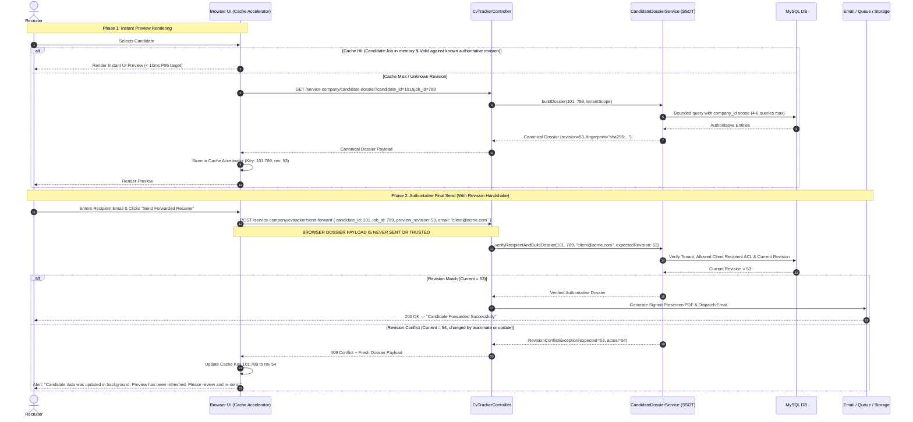

# V4 Architecture Plan — Unified Canonical Candidate Dossier & Prescreen Engine

**Document Version:** 4.3.0 (Production-Grade Final Implementation Baseline)  
**Target Environment:** JERO ATS & Talent Marketplace (`testing.jero.works`)  
**Scope:** Candidate Drawer (`showdetail.blade.php`), Forward Resume (`fwd_resume`), AgyForwardResumeEngine, Prescreen PDF Generator, Client Portal  
**Architectural Patterns:** CQRS + Backend SSOT + Bounded Cache Accelerator + Secure Preview/Final Send Split + Atomic Monotonic Revisioning & Revision Handshake + Multi-Tenant Scoping  

---

## 1. Executive Summary & Core Architectural Axioms

### 1.1 Fundamental Axioms
1. **Canonical Identity Axiom (`candidate_id = job_applications.id`)**: In this architecture, all references to `candidate_id` refer strictly to `job_applications.id` (matching JERO's ATS database schema truth in `database/schema/mysql-schema.sql`).
2. **Database + Canonical Service = Sole Single Source of Truth (SSOT)**: The browser cache is strictly a **client-side read accelerator** for instant UI preview; it must **never** be treated as authoritative for mutations, permissions, billing, or final dispatch.
3. **Authoritative Security Wall (Preview vs. Final Send)**:
   - **Preview Mode**: Accelerated by in-memory browser cache for instantaneous UI rendering (`< 10ms P95` target).
   - **Final Send / Forward / Email / Audit Mode**: Must **ALWAYS** be generated, validated, and dispatched authoritatively on the backend by `CandidateDossierService`. Browser-supplied payloads are **never trusted**.
4. **Final Send Revision Handshake & Recipient Validation**: When the recruiter clicks "Send", the client submits the `preview_revision` and recipient details. The server verifies:
   - Tenant & candidate/job access authorization.
   - Recipient email matches allowed client contacts/domains for the job.
   - `preview_revision === current_server_revision`. If mismatched, the server returns `409 Conflict`, aborts dispatch, refreshes the preview, and prompts the recruiter.
5. **Atomic Monotonic Versioning**: Deletions (e.g. deleting a candidate skill or evaluation answer) can leave `MAX(updated_at)` unchanged. Therefore, every candidate-job dossier pair is tracked by an **authoritative monotonic integer revision counter** (`dossier_revision`) in `candidate_dossier_revisions`, incremented atomically inside the exact database transaction of the mutation.
6. **Deterministic Content Fingerprint**: `dossier_fingerprint` is the SHA-256 of the normalized canonical dossier representation using deterministic key sorting (recursive `ksort`) and normalized primitive types.
7. **Reverb as Invalidation Accelerator (P95 Target: < 100ms)**: Laravel Reverb broadcasts carry `{ candidate_id, job_id, dossier_revision }`. Incoming events with `dossier_revision <= local_revision` are safely ignored (preventing out-of-order regressions). In the event of WebSocket dropouts, the **Authoritative Revision Handshake** guarantees zero stale data leaks.

### 1.2 The 5 Stated Goals & Measurable SLAs

| Goal | Description | Measurable Engineering SLA |
| :--- | :--- | :--- |
| **Goal 1: Canonical Data Parity** | Candidate Drawer, Forward Resume, Prescreen PDF, and Client Portal consume the exact same versioned `CandidateDossier` contract. | 100% semantic and calculation parity across all consumer views. |
| **Goal 2: Instant Cached Experience** | An already-authorized, same-session cached dossier opens without additional HTTP, MySQL, or Elasticsearch requests. | **< 10ms P95** retrieval; 0 additional network/DB queries. |
| **Goal 3: Revision-Safe Freshness** | Cached data is only considered valid when `candidate_id`, `job_id`, `schema_version`, `algorithm_version`, and `dossier_revision` match authoritative server state. | Zero stale dispatches; auto-invalidation across tabs via Reverb (< 100ms P95). |
| **Goal 4: Secure Finalization** | Browser cache accelerates preview UI but is prohibited from authoritative persistence or forwarding. | 100% backend-verified generation on final dispatch with revision handshake and recipient ACL check. |
| **Goal 5: Batch Efficiency** | Uncached candidate selections from tables are resolved through a single batch request with bounded database access and zero N+1 queries. | **< 500ms P95** for 50 candidates; bounded query budget of 4–6 optimized SQL queries. |

---

## 2. Authoritative Data Dependency Map (MySQL Schema Truth)

Every field in the Canonical Dossier maps to its authoritative database source in `database/schema/mysql-schema.sql`:

| Canonical Dossier Field | Authoritative Source Table | Source Column / Expression | Multi-Tenancy Scope |
| :--- | :--- | :--- | :--- |
| **Candidate Core Identity** | `job_applications` | `id` (as `candidate_id`), `full_name`, `email`, `secondrary_email`, `phone`, `secondary_mobile`, `linkedin` | `job_applications.company_id` / `thirdparty_company_id` |
| **Professional Details** | `job_applications` | `current_designation`, `current_company`, `cur_company_name`, `wm` (work mode) | Scoped to active company |
| **Total & Relevant Exp** | `job_applications` | `total_exp`, `rel_exp` | Scoped to active company |
| **Notice Period & Availability** | `job_applications` | `np_id`, `serving_notice_period_mode` | Scoped to active company |
| **Compensation (CTC/ECTC)** | `job_applications` | `ctc`, `ectc`, `current_ctc_cur`, `current_ectc_cur`, `ctc_yearly`, `ectc_yearly` | Scoped to active company |
| **Location (City/State/Country)**| `job_applications`, `city_list`, `state_list`, `countries` | Resolves names via `city_list.city`, `state_list.state`, `countries.country_name` | Public geo-dictionaries joined on ID |
| **Education Qualification** | `qualification_master`, `job_applications` | `qualification_master.name` joined via `job_applications.qualification` | Global qualification master |
| **Candidate Skills & Exp** | `candidate_job_skill_exp`, `bench_candidate_skill_experience` | `candidate_job_skill_exp.rating`, `skill_value`, `bench_candidate_skill_experience.total_months` | Scoped to candidate ID + tenant |
| **Job Details & Requirements** | `jobs`, `clients` | `jobs.title`, `jobs.min_exp`, `jobs.max_exp`, `clients.name as client_name` | `jobs.company_id` |
| **Job Skills (Mandatory/Optional)**| `job_metronics_skills`, `job_skills`, `skills` | `job_metronics_skills.skill_name`, `skills.name` | `job_skills.job_id` |
| **Skill Match % Calculation** | Runtime Engine | `GeneralMethod::calculateSkillMatch($jobSkills, $candSkills)` | Pure deterministic domain function |
| **Recruiter Notes & Summary** | `job_applications`, `applicant_notes` | `job_applications.recruiter_note`, `careersummary`, `cover_letter` | Scoped to candidate ID + tenant |
| **Prescreen / Evaluation Q&A** | `add_job_wise_condidates`, `applicant_notes` | Prescreen evaluation answers associated with the candidate-job pipeline | Scoped to `job_application_id` + `job_id` |

---

## 3. Dossier Mutation Registry

The following table explicitly defines all mutations that affect the candidate-job dossier. Every registered mutation **must execute the atomic revision increment inside its database transaction**:

| Mutation Event | Controller / Service Endpoint | Affects | Triggers Atomic Revision Increment? | Scope |
| :--- | :--- | :---: | :---: | :--- |
| **Candidate Basic Details Update** | `ServiceCompanyJobApplicationController::update_candidate` | Basic info, location, contact | ✅ Yes | Candidate + all assigned jobs |
| **Notice Period / Availability Change** | `ServiceCompanyJobApplicationController::update_candidate` | Notice period validation badge | ✅ Yes | Candidate + all assigned jobs |
| **Candidate CTC / ECTC Update** | `ServiceCompanyJobApplicationController::update_candidate` | Budget validation badge | ✅ Yes | Candidate + all assigned jobs |
| **Candidate Skill Added / Updated** | `ServiceCompanyJobApplicationController::update_candidate_skills` | Match %, skill stars | ✅ Yes | Candidate + all assigned jobs |
| **Candidate Skill Deleted** | `ServiceCompanyJobApplicationController::delete_candidate_skill` | Match %, skill stars | ✅ Yes | Candidate + all assigned jobs |
| **Job Required Skills Updated** | `ServiceCompanyJobController::update_skills` | Match % calculation | ✅ Yes | Job + all candidates on job |
| **Job Budget / Experience Changed** | `ServiceCompanyJobController::update` | Budget / Exp validation badges | ✅ Yes | Job + all candidates on job |
| **Prescreen Evaluation Answer Saved** | `ServiceCompanyJobApplicationController::save_evaluation` | Prescreen Q&A section | ✅ Yes | Candidate:Job pair |
| **Resume Uploaded / Replaced** | `ServiceCompanyJobApplicationController::upload_resume` | Resume badge & filename | ✅ Yes | Candidate + all assigned jobs |
| **Recruiter Note / Summary Edited** | `ServiceCompanyJobApplicationController::update_notes` | Recruiter remarks card | ✅ Yes | Candidate:Job pair |
| **Candidate Relocation Willingness** | `ServiceCompanyJobApplicationController::update_candidate` | Relocation badge | ✅ Yes | Candidate + all assigned jobs |

---

## 4. Revision Table Schema & Atomic Increment

### 4.1 Schema Definition: `candidate_dossier_revisions`
```sql
CREATE TABLE `candidate_dossier_revisions` (
  `id` bigint(20) unsigned NOT NULL AUTO_INCREMENT,
  `company_id` int(11) NOT NULL,
  `candidate_id` int(11) NOT NULL, -- references job_applications.id
  `job_id` int(11) NOT NULL,        -- references jobs.id
  `revision` int(11) unsigned NOT NULL DEFAULT 1,
  `fingerprint` varchar(64) DEFAULT NULL,
  `created_at` timestamp NULL DEFAULT current_timestamp(),
  `updated_at` timestamp NULL DEFAULT current_timestamp() ON UPDATE current_timestamp(),
  PRIMARY KEY (`id`),
  UNIQUE KEY `idx_cdr_company_cand_job` (`company_id`, `candidate_id`, `job_id`),
  KEY `idx_cdr_cand_job` (`candidate_id`, `job_id`)
) ENGINE=InnoDB DEFAULT CHARSET=utf8mb4 COLLATE=utf8mb4_unicode_ci;
```

### 4.2 Atomic Transaction Pattern
```php
namespace App\Services\Candidate;

use Illuminate\Support\Facades\DB;
use App\Events\CandidateDossierUpdated;

class CandidateDossierRevisionService
{
    /**
     * Atomically increments revision inside an existing or new DB transaction.
     */
    public static function incrementRevision(int $companyId, int $candidateId, int $jobId): int
    {
        $revision = DB::transaction(function () use ($companyId, $candidateId, $jobId) {
            $record = DB::table('candidate_dossier_revisions')
                ->where('company_id', $companyId)
                ->where('candidate_id', $candidateId)
                ->where('job_id', $jobId)
                ->lockForUpdate()
                ->first();

            if (! $record) {
                DB::table('candidate_dossier_revisions')->insert([
                    'company_id'   => $companyId,
                    'candidate_id' => $candidateId,
                    'job_id'       => $jobId,
                    'revision'     => 1,
                    'created_at'   => now(),
                    'updated_at'   => now(),
                ]);
                return 1;
            }

            $newRev = $record->revision + 1;
            DB::table('candidate_dossier_revisions')
                ->where('id', $record->id)
                ->update([
                    'revision'   => $newRev,
                    'updated_at' => now(),
                ]);

            return $newRev;
        });

        // Broadcast to Reverb outside transaction commit
        broadcast(new CandidateDossierUpdated($companyId, $candidateId, $jobId, $revision))->toOthers();

        return $revision;
    }
}
```

---

## 5. End-to-End Flow & Preview vs Final Send Security Wall



---

## 6. Client-Side Cache Governance & Reverb Monotonic Guard

```javascript
/**
 * Global Candidate Dossier Bridge (Client Accelerator)
 */
window.CandidateDossierBridge = {
    cache: new Map(), // LRU cache
    MAX_SIZE: 500,
    authoritativeRevisions: new Map(), // key => latest known revision

    key: function(candidateId, jobId) {
        if (!candidateId || !jobId) throw new Error('CandidateDossierBridge requires candidateId and jobId');
        return `${candidateId}:${jobId}`;
    },

    set: function(candidateId, jobId, dossier) {
        const k = this.key(candidateId, jobId);
        if (this.cache.size >= this.MAX_SIZE) {
            const oldestKey = this.cache.keys().next().value;
            this.cache.delete(oldestKey);
        }
        const rev = Number(dossier.meta && dossier.meta.dossier_revision);
        this.cache.set(k, {
            dossier: dossier,
            revision: rev,
            cachedAt: Date.now()
        });
        this.authoritativeRevisions.set(k, rev);
    },

    get: function(candidateId, jobId) {
        const k = this.key(candidateId, jobId);
        const entry = this.cache.get(k);
        if (!entry) return null;

        // Re-insert for LRU freshness
        this.cache.delete(k);
        this.cache.set(k, entry);

        // Strict Structural & Revision Validation
        if (!this.isValid(entry, candidateId, jobId)) {
            this.cache.delete(k);
            return null;
        }
        return entry.dossier;
    },

    isValid: function(entry, candidateId, jobId) {
        if (!entry || !entry.dossier) return false;
        const d = entry.dossier;
        if (d.schema_version !== '4.3') return false;
        if (d.meta.algorithm_version !== '2.3.0') return false;
        if (String(d.candidate.id) !== String(candidateId)) return false;
        if (String(d.job.id) !== String(jobId)) return false;
        if (typeof entry.revision !== 'number') return false;

        // Authority Check: Compare against latest known authoritative revision
        const knownRev = this.authoritativeRevisions.get(this.key(candidateId, jobId));
        if (typeof knownRev === 'number' && entry.revision !== knownRev) {
            return false; // Stale!
        }

        if (Date.now() - entry.cachedAt > 1800000) return false; // 30 min TTL
        return true;
    },

    handleReverbEvent: function(event) {
        const k = this.key(event.candidate_id, event.job_id);
        const currentRev = this.authoritativeRevisions.get(k) || 0;
        const incomingRev = Number(event.dossier_revision);

        // Monotonic guard: Ignore out-of-order or stale events
        if (incomingRev <= currentRev) return;

        // Update known authoritative revision and invalidate local cache
        this.authoritativeRevisions.set(k, incomingRev);
        this.cache.delete(k);

        // Notify active UI preview components if open
        window.dispatchEvent(new CustomEvent('jero:dossier-invalidated', {
            detail: { candidateId: event.candidate_id, jobId: event.job_id, newRevision: incomingRev }
        }));
    },

    invalidate: function(candidateId, jobId) {
        this.cache.delete(this.key(candidateId, jobId));
    },

    invalidateCandidate: function(candidateId) {
        for (const k of this.cache.keys()) {
            if (k.startsWith(`${candidateId}:`)) this.cache.delete(k);
        }
    },

    invalidateJob: function(jobId) {
        for (const k of this.cache.keys()) {
            if (k.endsWith(`:${jobId}`)) this.cache.delete(k);
        }
    },

    invalidateAll: function() {
        this.cache.clear();
        this.authoritativeRevisions.clear();
    }
};
```

---

## 7. Specification of the 7 Canonical Validation Badges

All 7 validation badges are strictly typed and computed canonically by `CandidateDossierService`:

```json
"validation_badges": [
  {
    "key": "notice_period",
    "label": "15 Days Notice",
    "status": "success",
    "value": 15,
    "required": 30,
    "unit": "days",
    "icon": "fa-calendar-check"
  },
  {
    "key": "location",
    "label": "Bengaluru (Current Location)",
    "status": "success",
    "value": "Bengaluru",
    "required": "Bengaluru",
    "unit": "text",
    "icon": "fa-map-marker-alt"
  },
  {
    "key": "relocation",
    "label": "Willing to Relocate",
    "status": "success",
    "value": true,
    "required": true,
    "unit": "boolean",
    "icon": "fa-plane-departure"
  },
  {
    "key": "budget",
    "label": "Expected CTC Within Budget",
    "status": "success",
    "value": 2400000,
    "required": 3000000,
    "unit": "currency_inr",
    "icon": "fa-wallet"
  },
  {
    "key": "experience",
    "label": "7 Years Total Exp (Min 5 Required)",
    "status": "success",
    "value": 84,
    "required": 60,
    "unit": "months",
    "icon": "fa-briefcase"
  },
  {
    "key": "skill_threshold",
    "label": "Mandatory Skills Threshold Met",
    "status": "success",
    "value": 100,
    "required": 80,
    "unit": "percentage",
    "icon": "fa-award"
  },
  {
    "key": "education",
    "label": "B.Tech Computer Science (Matches Criteria)",
    "status": "success",
    "value": "B.Tech Computer Science",
    "required": "Degree in Engineering / CS",
    "unit": "text",
    "icon": "fa-graduation-cap"
  }
]
```

---

## 8. Bounded Batch Query Budget (Zero N+1)

When a recruiter selects up to 50 candidates from the CV Tracker table without opening their drawers, `CandidateDossierService::getBatchDossiers($candidateIds, $jobId)` executes within a **strictly bounded budget of 4 to 6 SQL queries**:

1. **Query 1 (Candidates & Core Joins):**
   `job_applications` left-joined with `qualification_master`, `city_list`, `state_list`, `countries` for all `$candidateIds` filtered by `company_id`.
2. **Query 2 (Job & Client):**
   `jobs` joined with `clients` where `id = $jobId` and `company_id = $companyId`.
3. **Query 3 (Job Required Skills):**
   `job_metronics_skills` and `job_skills` for `$jobId`.
4. **Query 4 (Candidate Skills & Ratings):**
   `candidate_job_skill_exp` joined with `job_metronics_skills` for `candidate_id IN ($candidateIds)`.
5. **Query 5 (Bench Candidate Skills Fallback):**
   `bench_candidate_skill_experience` for `candidate_id IN ($candidateIds)` (only executed if bench candidates present).
6. **Query 6 (Prescreen Evaluations & Notes):**
   `applicant_notes` / evaluation records for `job_application_id IN ($candidateIds)`.

**Guarantee:** Whether fetching 1 candidate or 50 candidates, the total database query count **never exceeds 6 SQL queries**. Zero N+1 loops.

---

## 9. Comprehensive 34-Point Test & Verification Matrix

The implementation must pass all 34 dedicated test cases in `tests/Feature/CandidateDossierServiceTest.php`:

### Category A: Identity, Caching & Context (Tests 1–6)
- [ ] **Test 1:** Same candidate + same job produces cache hit (`< 10ms P95`).
- [ ] **Test 2:** Same candidate + different job produces separate cache entry with distinct match %.
- [ ] **Test 3:** Cache entry rejected if `candidate_id` or `job_id` does not match.
- [ ] **Test 4:** Cache eviction works properly when reaching 500-item LRU boundary.
- [ ] **Test 5:** Cache flushed completely on user logout.
- [ ] **Test 6:** Cache flushed completely on company/tenant switch.

### Category B: Mutation & Deletion Edge Cases (Tests 7–13)
- [ ] **Test 7:** Updating candidate notice period increments revision and updates dossier.
- [ ] **Test 8:** Updating candidate skills increments revision.
- [ ] **Test 9:** Updating job required skills increments revision and recomputes match % for all candidates.
- [ ] **Test 10:** Updating job CTC budget updates `budget` validation badge status.
- [ ] **Test 11:** Deleting a candidate skill increments revision (verifies monotonic counter over `MAX(updated_at)`).
- [ ] **Test 12:** Deleting a prescreen evaluation answer increments revision.
- [ ] **Test 13:** Updating qualification master updates `education` badge.

### Category C: Versioning, Schema & Concurrency (Tests 14–19C)
- [ ] **Test 14:** Cache rejected if `schema_version !== '4.3'`.
- [ ] **Test 15:** Cache rejected if `algorithm_version !== '2.3.0'`.
- [ ] **Test 16:** Final Send succeeds when `preview_revision === current_revision`.
- [ ] **Test 17:** Final Send rejected with `409 Conflict` when `preview_revision !== current_revision`.
- [ ] **Test 18:** Concurrent mutations by Recruiter A and Recruiter B resolved via atomic row-locking without lost updates.
- [ ] **Test 19A:** Tampered client payload (`match_percentage: 100` injected into browser) is ignored on Final Send; server recalculates canonical score.
- [ ] **Test 19B:** Tampered revision (`preview_revision: 999999`) is rejected by server revision handshake.
- [ ] **Test 19C:** Tampered candidate/job IDs in final send are independently authorized against tenant ACL.

### Category D: Real-Time & Network Edge Cases (Tests 20–24)
- [ ] **Test 20:** Active browser tab updates in `< 5ms` from AJAX save response.
- [ ] **Test 21:** Secondary browser tab receives Reverb WebSocket event and invalidates cache in `< 100ms P95`.
- [ ] **Test 22:** Reverb disconnected / offline mode triggers fallback revision handshake on next user action without stale send.
- [ ] **Test 23:** Out-of-order Reverb events do not downgrade revision counter.
- [ ] **Test 24:** Network timeout on batch fetch degrades gracefully to user alert without crash.

### Category E: Multi-Tenancy & Authorization (Tests 25–28B)
- [ ] **Test 25:** Cross-tenant candidate ID lookup throws `ModelNotFoundException` / 403 Forbidden.
- [ ] **Test 26:** Cross-tenant job ID lookup throws `ModelNotFoundException` / 403 Forbidden.
- [ ] **Test 27:** Batch API with mixed valid and cross-tenant candidate IDs rejects unauthorized candidates.
- [ ] **Test 28A:** Third-party / agency candidate permissions strictly enforced according to company assignment.
- [ ] **Test 28B:** Final Send recipient validation: dispatches only to verified client contact emails belonging to the job's client organization.

### Category F: Performance, Bounded Queries & Parity (Tests 29–32)
- [ ] **Test 29:** Batch query count assertion: loading 1 candidate executes $\le 6$ SQL queries.
- [ ] **Test 30:** Batch query count assertion: loading 50 candidates executes $\le 6$ SQL queries (assert zero N+1).
- [ ] **Test 31:** 100% mathematical match % parity between Candidate Drawer `#rsData` and Forward Resume.
- [ ] **Test 32:** 100% semantic badge status parity between Candidate Drawer and Prescreen PDF definition.

---

## 10. Strict Branch & Verification Protocols
- **Branch Rule:** Strict commit and push to `origin/staging`. No commits to `main`.
- **PHP Linting:** `php -l` executed on all modified PHP classes.
- **Cache Clearing:** `php artisan view:clear` and `php artisan route:clear`.
