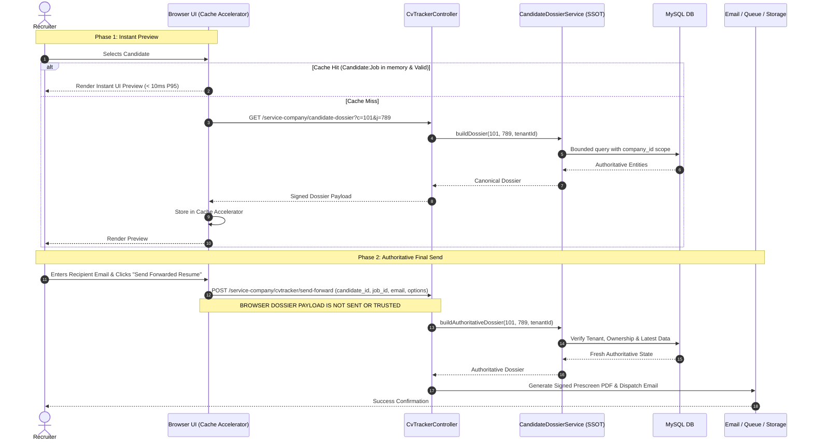

# V4 Architecture Plan — Unified Canonical Candidate Dossier & Prescreen Engine

**Document Version:** 4.1.0 (Principal Architect Reviewed & Hardened)  
**Target Environment:** JERO ATS & Talent Marketplace (`testing.jero.works`)  
**Scope:** Candidate Drawer (`showdetail.blade.php`), Forward Resume (`fwd_resume`), AgyForwardResumeEngine, Prescreen PDF Generator, Client Portal  
**Architectural Patterns:** CQRS + Backend SSOT + Bounded Cache Accelerator + Secure Preview/Final Send Split + Multi-Tenant Scoping  

---

## 1. Executive Summary & Core Architectural Goals

### 1.1 Engineering Principles
1. **Database + Canonical Service = Single Source of Truth (SSOT)**: The browser cache is strictly a **client-side read accelerator** for instant UI rendering; it must **never** be treated as authoritative.
2. **Authoritative Security Wall (Preview vs. Final Send)**:
   - **Preview Mode**: Accelerated by validated browser cache for instant UI rendering (`< 10ms P95`).
   - **Final Send / Forward / Email / Audit Mode**: Must **ALWAYS** be generated, validated, and signed authoritatively on the backend by `CandidateDossierService`. Browser-supplied payloads are **never trusted** for billing, emailing, client delivery, or permission validation.
3. **Composite Identity & Context-Aware Caching**: Candidate dossiers are intrinsically linked to both Candidate and Job. Cache identity is strictly `${candidate_id}:${job_id}` with composite revision tracking.
4. **Tenant Isolation by Construction**: All dossier resolutions enforce strict multi-tenant scoping (`company_id`, candidate access scope, and job ownership) to prevent data leaks across organizations.

### 1.2 The 5 Stated Goals & Measurable SLAs

| Goal | Description | Measurable SLA |
| :--- | :--- | :--- |
| **Goal 1: Canonical Data Parity** | Candidate Drawer, Forward Resume, Prescreen PDF, and Client Portal consume the exact same versioned `CandidateDossier` contract. | 100% semantic and calculation parity across all consumer views. |
| **Goal 2: Instant Cached Experience** | An already-authorized, same-session cached dossier opens without additional HTTP, MySQL, or Elasticsearch requests. | **< 10ms P95** retrieval; 0 additional network/DB queries. |
| **Goal 3: Revision-Safe Freshness** | Every dossier contains a server-generated `dossier_revision`. Cached data is only considered fresh when `candidate_id`, `job_id`, `schema_version`, and `dossier_revision` match. | Zero stale reads on mutations; auto-invalidation across tabs via Reverb. |
| **Goal 4: Secure Finalization** | Browser cache accelerates preview UI but is prohibited from authoritative persistence or forwarding. | 100% backend-verified generation on final dispatch. |
| **Goal 5: Batch Efficiency** | Uncached candidate selections from tables are resolved through a single batch request with bounded database access and zero N+1 queries. | **< 500ms P95** for 50 candidates; 3–6 optimized queries max. |

---

## 2. Target System Architecture

```
                    ┌────────────────────────────────────────┐
                    │               MySQL DB                 │
                    │   Authoritative State & Transactions   │
                    └───────────────────┬────────────────────┘
                                        │
                                        ▼
                 ┌──────────────────────────────────────────────┐
                 │       CandidateDossierService (SSOT)         │
                 │                                              │
                 │ • Tenant Scoping (company_id enforcement)    │
                 │ • RBAC & Candidate/Job Authorization Check   │
                 │ • Canonical Skill Match (GeneralMethod)      │
                 │ • 7 Canonical Validation Badges              │
                 │ • Prescreen Evaluation Answers               │
                 │ • Composite dossier_revision Calculation     │
                 └──────────────────────┬───────────────────────┘
                                        │
                                        ▼
                 ┌──────────────────────────────────────────────┐
                 │          Canonical Dossier Contract          │
                 │   schema_version: "4.1"                      │
                 │   dossier_revision: "c:101:j:789:rev_52"     │
                 │   algorithm_version: "2.3.0"                 │
                 └──────────────────────┬───────────────────────┘
                                        │
         ┌──────────────────────────────┼──────────────────────────────┐
         │                              │                              │
         ▼                              ▼                              ▼
┌──────────────────┐          ┌──────────────────┐           ┌──────────────────┐
│ Candidate Drawer │          │  Forward Resume  │           │  Client Portal   │
│ (showdetail DOM) │          │  Modal (Preview) │           │  (Shared View)   │
└────────┬─────────┘          └────────┬─────────┘           └──────────────────┘
         │                             │
         ▼                             ▼
┌────────────────────────────────────────────────┐
│   Browser Memory Cache (Accelerator Only)      │
│   Key: `${candidate_id}:${job_id}`             │
│   LRU: 500 max, session-only, clear on logout  │
└────────────────────────────────────────────────┘
```

---

## 3. The Preview vs Final Send Security Wall



---

## 4. Cache Key, Revision & Identity Architecture

### 4.1 Composite Cache Key
A candidate's match percentage, experience thresholds, and validation badges depend directly on the specific Job applied for.
```javascript
// Strict Composite Key
const cacheKey = `${candidateId}:${jobId}`;
window.CandidateDossierBridge.get(candidateId, jobId);
```

### 4.2 Composite `dossier_revision` Token
A dossier can change even if `candidate.updated_at` does not change (e.g. job requirements change, job budget changes, prescreen answers updated).
The backend computes a deterministic composite revision token:
$$\text{dossier\_revision} = \text{hash}(C_{\text{ver}} + CS_{\text{ver}} + J_{\text{ver}} + JS_{\text{ver}} + E_{\text{ver}})$$
Where:
- $C_{\text{ver}}$ = `candidates.updated_at`
- $CS_{\text{ver}}$ = `candidate_job_skill_exp.max(updated_at)`
- $J_{\text{ver}}$ = `jobs.updated_at`
- $JS_{\text{ver}}$ = `job_skills.max(updated_at)`
- $E_{\text{ver}}$ = `candidate_evaluations.max(updated_at)`

### 4.3 Validation on Read
```javascript
function validateCacheEntry(entry, candidateId, jobId) {
    if (!entry || !entry.dossier) return false;
    const d = entry.dossier;
    if (d.schema_version !== '4.1') return false;
    if (String(d.candidate.id) !== String(candidateId)) return false;
    if (String(d.job.id) !== String(jobId)) return false;
    if (!d.meta || !d.meta.dossier_revision) return false;
    if (Date.now() - entry.cachedAt > 1800000) return false; // 30 min max session TTL
    return true;
}
```

---

## 5. Specification of the 7 Canonical Validation Badges

Every validation badge is formally typed with clear thresholds:

```json
"validation_badges": [
  {
    "key": "notice_period",
    "label": "15 Days Notice",
    "status": "success",
    "value": 15,
    "required": 30,
    "unit": "days",
    "icon": "fa-calendar-check"
  },
  {
    "key": "location",
    "label": "Bengaluru (Current Location)",
    "status": "success",
    "value": "Bengaluru",
    "required": "Bengaluru",
    "unit": "text",
    "icon": "fa-map-marker-alt"
  },
  {
    "key": "relocation",
    "label": "Willing to Relocate",
    "status": "success",
    "value": true,
    "required": true,
    "unit": "boolean",
    "icon": "fa-plane-departure"
  },
  {
    "key": "budget",
    "label": "Expected CTC Within Budget",
    "status": "success",
    "value": 2400000,
    "required": 3000000,
    "unit": "currency_inr",
    "icon": "fa-wallet"
  },
  {
    "key": "experience",
    "label": "7 Years Total Exp (Min 5 Required)",
    "status": "success",
    "value": 84,
    "required": 60,
    "unit": "months",
    "icon": "fa-briefcase"
  },
  {
    "key": "skill_threshold",
    "label": "Mandatory Skills Threshold Met",
    "status": "success",
    "value": 100,
    "required": 80,
    "unit": "percentage",
    "icon": "fa-award"
  },
  {
    "key": "education",
    "label": "B.Tech Computer Science (Matches Criteria)",
    "status": "success",
    "value": "B.Tech Computer Science",
    "required": "Degree in Engineering / CS",
    "unit": "text",
    "icon": "fa-graduation-cap"
  }
]
```

---

## 6. Multi-Tenant Scoping & Security Hardening

### 6.1 Strict Tenancy Rule
The `CandidateDossierService` must **never** execute un-scoped queries like `Candidate::find($id)` or `Job::find($jobId)`. Every query must enforce the active tenant:
```php
$companyId = auth()->user()->company_id;

$candidate = Candidate::where('company_id', $companyId)
    ->where('id', $candidateId)
    ->firstOrFail();

$job = Job::where('company_id', $companyId)
    ->where('id', $jobId)
    ->firstOrFail();
```

### 6.2 Safe Bounded Batch Queries (Zero N+1)
For table selections where candidates have not been cached, the batch resolver uses exactly 4 bounded queries:
1. `Candidate::whereIn('id', $candidateIds)->where('company_id', $companyId)`
2. `Job::where('id', $jobId)->where('company_id', $companyId)->with('skills')`
3. `CandidateSkillExp::whereIn('candidate_id', $candidateIds)->where('company_id', $companyId)`
4. `CandidateEvaluation::whereIn('candidate_id', $candidateIds)->where('job_id', $jobId)`

**Result:** Maximum 4 optimized SQL queries for up to 50 candidates, zero N+1 queries, full tenant isolation.

---

## 7. Real-Time Mutation Invalidation (Reverb WebSockets + Domain Events)

```mermaid
flowchart TD
    M[Recruiter Updates Candidate / Skills / Job / Questions] --> T[DB Transaction in Controller]
    T --> S[CandidateDossierService::rebuildDossier(candidateId, jobId)]
    S --> E[Dispatch Laravel Event: CandidateDossierUpdated]
    
    E --> R[Laravel Reverb / WebSockets Broadcast]
    E --> HTTP[HTTP Response contains Fresh Canonical Dossier]
    
    HTTP --> LOCAL[Active Tab updates Local Cache Accelerator immediately]
    R --> TABS[Other Open Tabs & Other Teammates' Browsers receive Invalidation]
    TABS --> INVALIDATE[Evict key from window.CandidateDossierBridge]
    INVALIDATE --> REFRESH[If Forward Resume Modal is Open -> Silent Re-fetch]
```

This guarantees:
- **Same Tab**: Updated within `< 5ms` from the AJAX response payload.
- **Other Tabs / Other Recruiters**: Invalidated within `< 100ms` via Reverb WebSocket broadcast.
- **Zero Stale Reads**: Stale cache cannot survive a mutation.

---

## 8. Client Cache Governance & PII Protection

1. **Session Scope**: All cached dossiers live strictly in volatile JavaScript heap memory (`window.__candidateDossierCache`).
2. **Zero Persistent Storage**: Dossiers are **never written to `localStorage` or `IndexedDB`** to prevent PII retention on shared machines.
3. **Capacity Limit & LRU Eviction**: Maximum 500 dossiers per session. Oldest entries evicted automatically using LRU algorithm.
4. **Lifecycle Cleansing**:
   - Immediate cache flush on `window.beforeunload` or user logout.
   - Cache flush on tenant / company switch.

---

## 9. Failure Modes & Graceful Degradation Matrix

| Failure State | Root Cause | Client Handling | Server Handling |
| :--- | :--- | :--- | :--- |
| `CACHE_HIT_VALID` | Entity in memory, revision matches | Instant render (< 10ms) | No request required |
| `CACHE_MISS` | Candidate drawer not opened | Show skeleton loader; trigger fetch | Resolve via canonical batch API (< 500ms) |
| `REVISION_MISMATCH` | Job or candidate updated since cache | Invalidate key; show loader; fetch fresh | Return canonical dossier + new revision token |
| `UNAUTHORIZED` | Candidate belongs to different tenant | Display error alert; purge cache key | Return 403 Forbidden + log security event |
| `JOB_NOT_FOUND` | Job deleted or unassigned | Show "Job not available" state | Return 404 with structured error JSON |
| `NETWORK_FAILURE` | Connection lost during batch fetch | Display "Offline - retry" toast | Graceful timeout (3s max) |

---

## 10. Verification & Implementation Roadmap

| Phase | Milestone | Deliverable |
| :---: | :--- | :--- |
| **Phase 1** | SSOT Canonical Service | Create `app/Services/Candidate/CandidateDossierService.php` with tenant scoping, canonical `calculateSkillMatch`, and 7 validation badges. |
| **Phase 2** | Upgraded Client Bridge | Build `public/js/opendoc/AgyCandidateDossierBridge.js` with composite keys `${candidate_id}:${job_id}`, LRU eviction, and revision validation. |
| **Phase 3** | Candidate Drawer Integration | Connect `showdetail.blade.php` to consume the canonical dossier contract and feed the bridge. |
| **Phase 4** | Forward Resume Preview & Final Send Wall | Refactor `ServiceCompanyCvTrackerController.php` — use cache for UI preview; force authoritative backend generation on final send. |
| **Phase 5** | Reverb WebSocket Broadcast | Wire `CandidateDossierUpdated` event to Reverb for real-time cross-tab invalidation. |
| **Phase 6** | Automated Tests & Verification | Verify against `php -l`, verify tenant scoping tests, verify zero N+1 queries. Commit strictly to `origin/staging`. |
