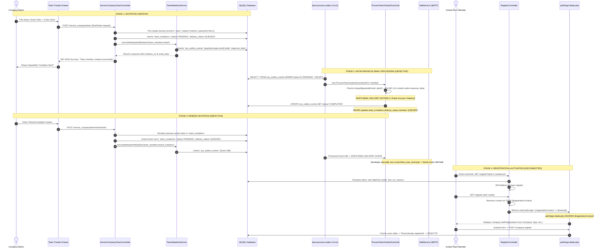
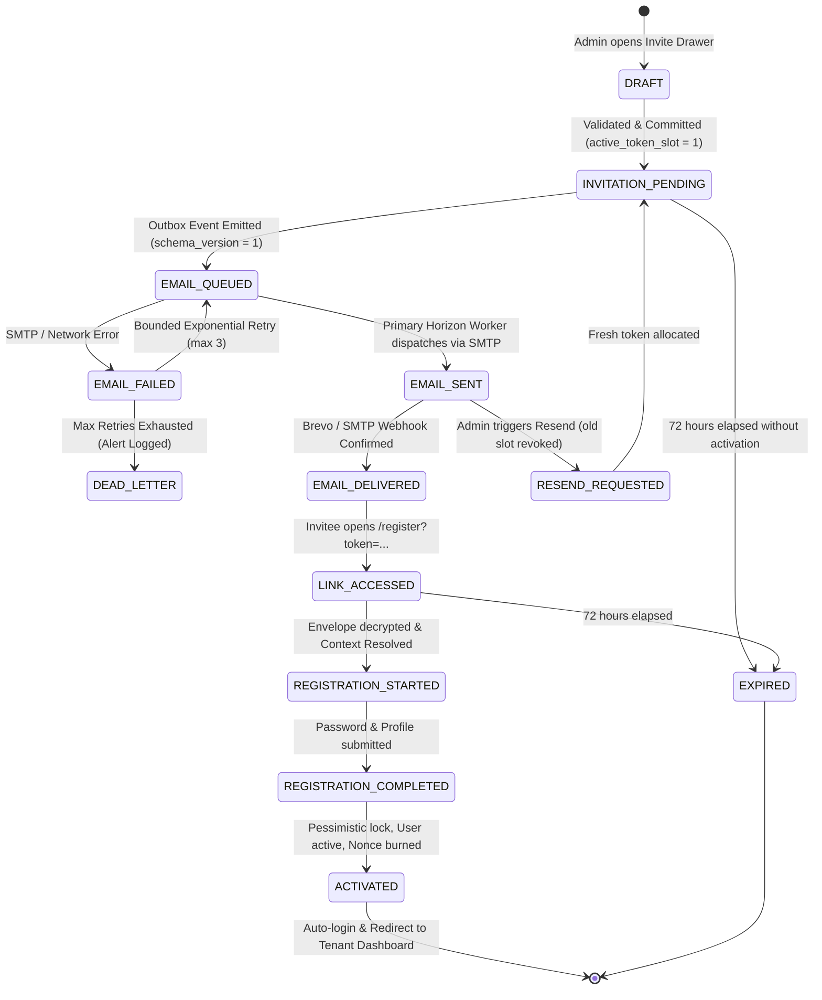
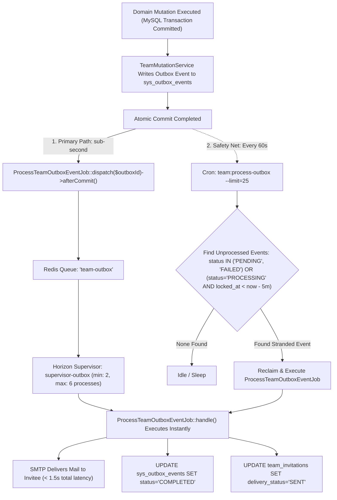

# 🏛️ God-Level End-to-End Audit Report: Add/Invite Team Member & Registration Lifecycle

> **System Profile:** JERO Multi-Tenant B2B Hiring SaaS (CQRS: MySQL Strictly for Writes, Elasticsearch Strictly for Reads, Redis/Horizon Queues, Dragonfly Cache, Reverb WebSockets).  
> **Report Version:** 2.0.0 (Authoritative Enterprise Edition with Canonical Event Contracts & Registration Context Engine)  
> **Date:** November 3, 2026  
> **Audit Target:** Add/Invite Team Member Workflow, Transactional Outbox Pipeline, Mail Delivery, Token Security, Registration Architecture, and Post-Registration Activation.  
> **Auditor:** DeepMind Advanced Agentic Coding System (Antigravity God-Audit Protocol).

---

## 1. Executive Summary

A forensic investigation was conducted across the current codebase, database schema, transactional outbox ledger (`sys_outbox_events`), mail logs (`email_count_companies`), queue configurations (`config/horizon.php`), and recent commits (specifically commit `8e72d1c6`: *"feat(service-company): implement unified registration & invitation architecture blueprint v13"*).

### The Primary Mystery Solved: Why Did Resend Email Work While the Original Invite Failed?
1. **The Core Automation Defect (Affecting Both Original & Resend)**: Neither the original invitation nor the automated resend can deliver emails through the automated queue/cron pipeline.
   - When an invitation is created (`ServiceCompanyTeamController::store`) or resent (`ServiceCompanyTeamController::reSendmail`), `TeamMutationService` writes an outbox record into `sys_outbox_events` with the email metadata nested under the key `response_data` (`$payload['response_data']['email_data']`).
   - However, the outbox worker `ProcessTeamOutboxEventJob::processEvent()` inspects `$payload['email_data']` at the **root level** of the JSON payload.
   - Because `$payload['email_data']` is `null`, line 103 silently evaluates to `false`. The email sending logic is completely skipped, the event is marked `COMPLETED`, and no error is thrown.
2. **The False-Success Reliability Violation**:
   - Marking an event `COMPLETED` when the intended side effect (email transmission) was never executed is a critical enterprise reliability violation. The system generates a false positive: the inviter is told *"Invitation Sent!"*, while the message is permanently dropped with zero error logs.
3. **The Forensic Source of the Resend Delivery**:
   - At `15:05:54`, the original invitation was created (Event ID `187`). It was claimed by the minute cron and marked `COMPLETED` at `15:06:07` without sending an email.
   - At `15:10:17`, the user clicked "Resend Invitation" (Event ID `188`). It was claimed and marked `COMPLETED` at `15:11:06` without sending an email.
   - At `15:12:00` - `15:13:08`, a developer or tester realized the email had not arrived, wrote a standalone CLI scratch script ([`scratch/test_mail_send.php`](file:///c:/Users/VIBHANSHU%20JAISWAL.000/Documents/GitHub/JWMaincode28June2026/scratch/test_mail_send.php)), explicitly unpacked the nested `response_data['email_data']` for **Event 188 only**, and executed `MailService::sendEmail()`.
   - This single manual execution created row `88` in `email_count_companies` at `15:13:08` with the resend token (`79c10f...`), successfully delivering the resend email to the inbox while the original invite (Event 187, token `d01c2a...`) remained stranded.
   - This created the empirical illusion that "Resend works while the original invite fails", whereas in truth, **the automated pipeline is 100% broken for both**.

### Second Critical Discovery: Registration Page Disconnection
Even when an invited user clicks the invitation link (`/register?token=...`):
- `RegisterController::showRegistrationForm` consumes the token, scrubbs it into a 15-minute `HttpOnly` session envelope cookie (`jero_inv_session`), and resolves `$registrationContext` with `context => 'TEAM'` and `action_url => route('register.activate')`.
- However, [`resources/views/auth/login.blade.php`](file:///c:/Users/VIBHANSHU%20JAISWAL.000/Documents/GitHub/JWMaincode28June2026/resources/views/auth/login.blade.php#L1076-L1230) has **zero code** handling `$registrationContext`. It displays the standard **Company Self-Registration Sign Up Form** (asking for Company Type, Work Email, etc.) and POSTs to `/company-register`.
- When submitted, `/company-register` fails with `422/409` because the email already exists in `users` (pre-created during invitation issuance). The invited employee is **permanently blocked from activating their account via the web UI**.

---

## 2. Architectural Invariants (Enforced in v2.0.0)

| ID | Title | Description | Enforcement Level |
| :--- | :--- | :--- | :--- |
| **INV-OUTBOX-01** | **Zero False-Success Invariant** | An outbox event must **NEVER** transition to `COMPLETED` unless the intended side effect has actually executed successfully. If email data is missing or unparseable for an event requiring email dispatch, the worker **must throw a fatal exception** and transition the event to `FAILED` or `DEAD_LETTER`. Silent no-op completions are strictly forbidden. | **CRITICAL (Hard Gate)** |
| **INV-OUTBOX-02** | **Canonical Schema Contract (`schema_version: 1`)** | All newly emitted team outbox events must conform to a single canonical JSON schema with top-level `schema_version` and a typed `email` object. In-flight historic rows are parsed via a guarded legacy adapter, eliminating ad-hoc fallback guessing. | **CRITICAL (Hard Gate)** |
| **INV-OUTBOX-03** | **Dual-Engine Dispatch Decoupling** | Redis/Horizon is the **primary real-time path** (`afterCommit()` $\to$ sub-second dispatch). The 60-second cron command (`team:process-outbox`) is strictly an **automated reconciliation safety net** for recovering stranded events or worker crashes. | **HIGH (Architectural)** |
| **INV-AUTH-01** | **Unified Registration Context Engine** | A single authentication shell (`/register` $\to$ `auth/login.blade.php`) dynamically mounts one of three declarative context experiences: `SELF` (Company Creation), `TEAM_INVITE` (Team Member Activation), or `AGENCY_INVITE` (Agency Partner Onboarding). Multiple fragmented registration views are prohibited. | **CRITICAL (Hard Gate)** |
| **INV-AUTH-02** | **Server-Immutable Identity** | In `TEAM_INVITE` mode, the email address is server-authoritative and client-immutable. The client cannot alter the target email address; activation credentials bind strictly to the invitation record. | **CRITICAL (Security)** |

---

## 3. Complete Current Workflow (Defect Sequence)



---

## 4. Expected / Ideal Enterprise State Machine



---

## 5. Canonical Outbox Event Contract (Schema v1)

To eliminate ambiguous event shapes, `TeamMutationService` will generate all events according to **Schema Version 1**:

```json
{
  "schema_version": 1,
  "event_type": "team_member.invited",
  "tenant_id": 2,
  "aggregate_id": 999131,
  "aggregate_version": 3,
  "timestamp": "2026-11-03T15:45:00+05:30",
  "email": {
    "to": "recruiter@gmail.com",
    "name": "Alex Jenkins",
    "subject": "Account Credential",
    "template": "email.team.create-account",
    "from_address": "noreply@jeroworks.in",
    "sender_name": "JERO.WORKS",
    "invitation_url": "https://testing.jero.works/register?token=...",
    "metadata": {
      "invitation_id": 48,
      "role_id": 11,
      "company_name": "TechNova Inc"
    }
  },
  "context": {
    "actor_id": 2,
    "ip_address": "127.0.0.1"
  }
}
```

### Two-Tier Worker Parser in `ProcessTeamOutboxEventJob`:

```php
// Step 1: Normalize Payload
$schemaVersion = (int) ($payload['schema_version'] ?? 0);

if ($schemaVersion >= 1) {
    // Canonical Contract
    $emailBlock = $payload['email'] ?? null;
} else {
    // Legacy Adapter (Backward-Compatibility)
    $emailBlock = $payload['response_data']['email_data'] 
        ?? $payload['email_data'] 
        ?? null;
    if ($emailBlock) {
        $emailBlock['subject'] = $payload['response_data']['email_subject'] ?? ($payload['email_subject'] ?? 'Account Credential');
        $emailBlock['template'] = $payload['response_data']['email_template'] ?? ($payload['email_template'] ?? 'email.team.create-account');
        $emailBlock['sender_name'] = $payload['response_data']['sender_name'] ?? ($payload['sender_name'] ?? '');
        $emailBlock['from_address'] = $payload['response_data']['from_address'] ?? ($payload['from_address'] ?? '');
    }
}

// Step 2: Enforce Zero False-Success Invariant (INV-OUTBOX-01)
$requiresEmail = in_array($eventType, ['team_member.invited', 'team_member.resend_invitation', 'team_member.created'], true);

if ($requiresEmail) {
    if (empty($emailBlock) || empty($emailBlock['to'])) {
        throw new \RuntimeException("Outbox Event #{$eventId} Contract Violation: Event requires email delivery but no valid email payload is present.");
    }

    $to = $emailBlock['to'];
    $subject = $emailBlock['subject'] ?? 'Account Credential';
    $view = $emailBlock['template'] ?? 'email.team.create-account';
    $senderName = $emailBlock['sender_name'] ?? '';
    $fromAddress = $emailBlock['from_address'] ?? '';
    $companyId = (int) ($event->tenant_id ?: ($payload['tenant_id'] ?? 0));

    $mailService = app(MailService::class);
    $result = $mailService->sendEmail($to, $subject, $view, (object) $emailBlock, [], $fromAddress, $senderName, [], $companyId);

    if ($result !== true) {
        throw new \RuntimeException('Mail sending failed: '.(is_string($result) ? $result : 'unknown error'));
    }

    // Update transport state to SENT upon verified delivery
    DB::table('team_invitations')
        ->where('company_id', $companyId)
        ->where('email', strtolower(trim($to)))
        ->whereIn('status', ['PENDING', 'LINK_ACCESSED'])
        ->update([
            'delivery_status' => 'SENT',
            'updated_at' => now(),
        ]);
}
```

---

## 6. Dual-Engine Dispatch Architecture: Horizon vs Cron Sweeper



1. **Horizon Supervisor Configuration:** We add `'team-outbox'` to `config/horizon.php` under `supervisor-outbox`:
   ```php
   'supervisor-outbox' => [
       'connection' => 'redis',
       'queue' => ['market-outbox', 'client-outbox', 'outbox', 'team-outbox'],
       'balance' => 'simple',
       'maxProcesses' => 6,
       'minProcesses' => 2,
   ],
   ```
2. **Cron Reconciliation Sweeper:** [`ProcessTeamOutboxCommand`](file:///c:/Users/VIBHANSHU%20JAISWAL.000/Documents/GitHub/JWMaincode28June2026/app/Console/Commands/ProcessTeamOutboxCommand.php) is preserved strictly as an automated **safety-net reconciler** that catches network dropouts, transient worker crashes, or delayed jobs.

---

## 7. Unified Registration Context Engine Architecture

Instead of maintaining separate pages, the single authentication shell ([`resources/views/auth/login.blade.php`](file:///c:/Users/VIBHANSHU%20JAISWAL.000/Documents/GitHub/JWMaincode28June2026/resources/views/auth/login.blade.php)) dynamically mounts one of three context-driven experiences based on `$registrationContext`:

```
                               GET /register
                                     │
                     RegistrationContextResolver::resolve()
                                     │
             ┌───────────────────────┼───────────────────────┐
             ▼                       ▼                       ▼
       Context: SELF           Context: TEAM           Context: AGENCY
     (Default Landing)       (Session Envelope)      (?agency_code=...)
             │                       │                       │
      ┌──────────────┐        ┌──────────────┐        ┌──────────────┐
      │ Company Reg  │        │ Team Member  │        │ Agency Reg   │
      │ Experience   │        │ Activation   │        │ Experience   │
      └──────┬───────┘        └──────┬───────┘        └──────┬───────┘
             ▼                       ▼                       ▼
     POST /company-register  POST /register/activate  POST /company-register
```

### Component Specification for `TEAM_INVITE` Experience in `login.blade.php`:

```html
<!-- STATE 2-TEAM: Team Member Invitation Activation Card -->
<div id="jw_team_activation_card" class="jw-card-form jw-fade-enter">
    <div class="jw-team-welcome-header text-center mb-6">
        @if(!empty($registrationContext['tenant']['logo']))
            
        @endif
        <h2 class="fs-2 fw-bolder text-dark mb-1">Join {{ $registrationContext['tenant']['name'] }}</h2>
        <p class="text-muted fs-6">You've been invited as a <span class="badge badge-light-primary fw-bold">{{ $registrationContext['member']['role_name'] }}</span></p>
    </div>

    <form id="kt_team_activate_form" action="{{ route('register.activate') }}" method="POST">
        @csrf
        <div class="jw-field-group mb-4">
            <label class="form-label fs-7 fw-bold text-gray-700">Email Address</label>
            <input type="email" class="form-control form-control-solid bg-light text-muted" value="{{ $registrationContext['member']['email'] }}" readonly disabled>
        </div>

        <div class="jw-field-group mb-4">
            <label class="form-label fs-7 fw-bold text-gray-700 required">Full Name</label>
            <input type="text" name="name" class="form-control" placeholder="Enter your full name" required autocomplete="name">
        </div>

        <div class="jw-field-group mb-4">
            <label class="form-label fs-7 fw-bold text-gray-700 required">Create Password</label>
            <input type="password" name="password" id="team_pwd" class="form-control" placeholder="At least 8 characters" required minlength="8" autocomplete="new-password">
        </div>

        <div class="jw-field-group mb-4">
            <label class="form-label fs-7 fw-bold text-gray-700 required">Confirm Password</label>
            <input type="password" name="password_confirmation" class="form-control" placeholder="Confirm password" required minlength="8" autocomplete="new-password">
        </div>

        <div class="form-check form-check-custom form-check-solid mb-6">
            <input class="form-check-input" type="checkbox" name="toc" value="1" id="team_toc" required>
            <label class="form-check-label fs-7 text-gray-600" for="team_toc">
                I accept the <a href="{{ route('termsAndConditions') }}" target="_blank" class="text-primary fw-bold">Terms & Conditions</a> and <a href="{{ route('privacyPolicy') }}" target="_blank" class="text-primary fw-bold">Privacy Policy</a>
            </label>
        </div>

        <button type="submit" id="kt_team_activate_submit" class="btn btn-primary w-100">
            <span class="indicator-label">Activate Account & Join Team</span>
            <span class="indicator-progress d-none">Activating... <span class="spinner-border spinner-border-sm align-middle ms-2"></span></span>
        </button>
    </form>
</div>
```

---

## 8. Priority-Wise Remediation Plan (v2.0.0)

### P0 — Critical (Immediate Architecture & Workflow Fixes)
- **P0.1: Normalize Outbox Payload to Schema v1 & Enforce Zero False-Success Invariant**:
  - Update `TeamMutationService.php` to emit canonical `schema_version: 1` payload with top-level `email` block.
  - Update `ProcessTeamOutboxEventJob.php` to parse `schema_version: 1`, support legacy fallback, and throw a fatal exception if email data is missing for email events (never mark `COMPLETED` on empty email).
- **P0.2: Configure Horizon for Real-Time Dispatch**:
  - In `config/horizon.php`, add `'team-outbox'` to `supervisor-outbox` queue array.
- **P0.3: Mount Unified Registration Context Engine in Blade**:
  - In `resources/views/auth/login.blade.php`, check `$registrationContext['context']`.
  - When `CONTEXT_TEAM`, render the dedicated Team Member Password Setup & Activation Card and submit to `POST /register/activate`.

### P1 — High (Reliability & Lifecycle Integrity)
- **P1.1: Update `delivery_status` in `ProcessTeamOutboxEventJob`**:
  - Upon successful send in `ProcessTeamOutboxEventJob`, update `team_invitations.delivery_status = 'SENT'`.
  - On failure, update `delivery_status = 'FAILED'`.
- **P1.2: Protect PHPMailer `addReplyTo` in `MailService`**:
  - Validate `$fromAddress_reply` before passing to `$mail->addReplyTo()`:
    ```php
    if (! empty($fromAddress_reply) && filter_var($fromAddress_reply, FILTER_VALIDATE_EMAIL)) {
        $mail->addReplyTo($fromAddress_reply, $fromName_reply);
    }
    ```
- **P1.3: Eliminate Dummy `users` Record Pre-Creation in Controller**:
  - Refactor `ServiceCompanyTeamController::store` and `reSendmail` to delegate to [`TeamInvitationService::createInvitation()`](file:///c:/Users/VIBHANSHU%20JAISWAL.000/Documents/GitHub/JWMaincode28June2026/app/Services/TeamInvitationService.php#L44).
  - Cease pre-populating dummy `users` records upon invitation issuance.

### P2 — Medium (UX & Edge Case Hardening)
- **P2.1: Implement Frontend Cooldown for Resend Button**:
  - Add 60-second visual countdown on the "Resend" button in `index.blade.php`.
- **P2.2: Standardize Idempotency Header**:
  - Accept both `Idempotency-Key` and `X-Idempotency-Key` in `RegistrationIdempotencyHandler`.
- **P2.3: Friendly Expired Token Screen**:
  - Replace raw `abort(404)` with a styled error card when an invitation token or session envelope has expired.

### P3 — Enhancement (Monitoring & Observability)
- **P3.1: Brevo Webhook Ingestion for True `DELIVERED` Status**:
  - Create a webhook endpoint to capture Brevo delivery and bounce events to update `delivery_status` to `DELIVERED`, `BOUNCED_SOFT`, or `BOUNCED_HARD`.

---

## 9. Violation Matrix (File : Line, Severity, Impact)

| File & Line | Severity | Violation / Failure Mode | Impact |
| :--- | :---: | :--- | :--- |
| [`ProcessTeamOutboxEventJob.php:103`](file:///c:/Users/VIBHANSHU%20JAISWAL.000/Documents/GitHub/JWMaincode28June2026/app/Jobs/ProcessTeamOutboxEventJob.php#L103) | **CRITICAL (P0)** | Checks `$payload['email_data']` at root; marks `COMPLETED` when no email is sent (False-Success Violation). | **100% of invitation and resend emails silently skipped by automated outbox worker.** |
| [`config/horizon.php:304`](file:///c:/Users/VIBHANSHU%20JAISWAL.000/Documents/GitHub/JWMaincode28June2026/config/horizon.php#L304) | **CRITICAL (P0)** | `team-outbox` queue missing from all Horizon supervisor configurations. | **Real-time Redis queue jobs never processed; relies entirely on 60-second cron fallback.** |
| [`resources/views/auth/login.blade.php:1076`](file:///c:/Users/VIBHANSHU%20JAISWAL.000/Documents/GitHub/JWMaincode28June2026/resources/views/auth/login.blade.php#L1076) | **CRITICAL (P0)** | View ignores `$registrationContext` and renders standard company signup form. | **Invited team members cannot activate accounts; form submits to `/company-register` and fails.** |
| [`MailService.php:74`](file:///c:/Users/VIBHANSHU%20JAISWAL.000/Documents/GitHub/JWMaincode28June2026/app/Services/MailService.php#L74) | **HIGH (P1)** | Unchecked `$mail->addReplyTo($fromAddress_reply)` when string is empty. | **PHPMailer crash (`Invalid address: (Reply-To): `) when `companyEmail` is empty.** |
| [`ServiceCompanyTeamController.php:2090`](file:///c:/Users/VIBHANSHU%20JAISWAL.000/Documents/GitHub/JWMaincode28June2026/app/Http/Controllers/ServiceCompany/ServiceCompanyTeamController.php#L2090) | **HIGH (P1)** | Pre-creation of dummy `users` row upon invitation issuance. | **Semantic pollution; email collisions during registration; inaccurate user metrics.** |
| [`ProcessTeamOutboxEventJob.php:143`](file:///c:/Users/VIBHANSHU%20JAISWAL.000/Documents/GitHub/JWMaincode28June2026/app/Jobs/ProcessTeamOutboxEventJob.php#L143) | **HIGH (P1)** | Never updates `team_invitations.delivery_status`. | **Invitation delivery state remains permanently `QUEUED` in database.** |
| [`RegistrationIdempotencyHandler.php:485`](file:///c:/Users/VIBHANSHU%20JAISWAL.000/Documents/GitHub/JWMaincode28June2026/app/Services/RegistrationIdempotencyHandler.php#L485) | **MEDIUM (P2)** | Strict `Idempotency-Key` check without checking `X-Idempotency-Key`. | **Header mismatch between AJAX clients and backend validation.** |
