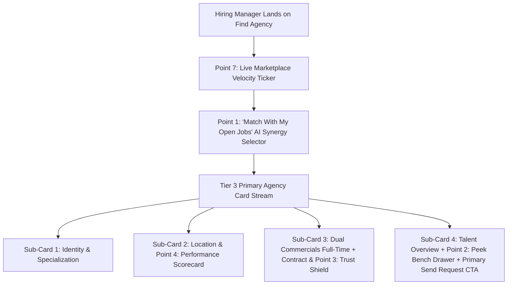

# 🚀 GOD-LEVEL ARCHITECTURAL SPECIFICATION: Marketplace Agencies Conversion & Dual Commercials Engine
## Module: Service Company Marketplace — Find Agency (`/service_company/find-agency`)
**Author:** Antigravity Architect & Product Strategist  
**Date:** 2026-11-14  
**Classification:** God-Level Architecture, UI/UX & Conversion Psychology Specification  
**Standard Compliance:** Rule 1, 2 (CQRS), Rule 14 (15.6" Screen Fit), Rule 20 (Modern Card + Sub-Card), Rule 21 (Audit Documents), Rule 24 (Default Timezone)

---

## 1. Executive Summary & Core Objective

This specification details the architecture and design for 5 targeted high-impact conversion engines (**Points 1, 2, 3, 4, and 7**), the integration of **Dual Commercials (Full-Time Hiring + Contract Staffing)**, and the architectural migration of the **Primary Action Button ("Send Request") into the Main Sub-Card grid**.

The goal is to transform `/service_company/find-agency` from a passive directory into an active, high-velocity talent procurement engine where hiring managers can instantly match open requisitions, preview pre-vetted bench talent, compare transparent contract and full-time rates, and engage agencies with zero friction.



---

## 2. Specification of Selected Conversion Engines

### 2.1. Point 1: ⚡ "Match With My Open Jobs" Instant Synergy Selector
* **Placement:** Tier 1.5 sticky utility strip between Tier 1 Toolbar and Tier 2 KPI Cards.
* **Architecture:**
  * Client reads active tenant open jobs from Elasticsearch (`jobs` index, `company_id = tenant_id`, `status = 1`).
  * Dropdown selector: `🎯 Match Against My Open Job: [ Senior React Engineer (3 Openings) ▼ ]`.
* **Dynamic Card Reaction:**
  * When a specific job is selected, JavaScript performs client-side skill set intersection (`job_metronics_skills` ∩ `selected_job.skills`) with zero MySQL/server roundtrips (Rule 1, 2, 3).
  * Agency cards display a top synergy badge: **`🔥 96% Match with 'Senior React Engineer'`** with overlapping skill pills in high-visibility green (`React`, `Node.js`, `AWS`).
  * In Multi-Job Overview mode (or across multiple active requisitions), the card displays a clean, concise badge:
    **`⚡ Matches your requirement on 3 jobs`** (or `Matches your requirement on 1 job`, `2 jobs`, etc.) without cluttering the card with long job title lists.
  * Cards dynamically sort with matching agencies at the top.

### 2.2. Point 2: 👁️ "Peek Vetted Bench" Candidate Preview Drawer
* **Placement:** Sub-Card 4 (Talent Overview).
* **Architecture:**
  * The `2 Bench` badge is enhanced with a pulse indicator: `[ ⚡ 2 Bench (Preview) ]`.
  * Clicking opens the **JERO Right-Hand Sliding Drawer** (`#drawer_agency_bench_preview`).
  * An AJAX endpoint queries Elasticsearch `candidates` where `company_id = agency_id` and `is_bench = 1`.
  * Candidate identity is masked into anonymized tokens: `Candidate #B-408: Senior Python/Go Engineer (7 Yrs) • Immediate Joiner • Pre-Vetted • Rate: ₹1,60,000/mo`.
  * Direct action in drawer: `[ ⚡ Request Immediate Interview ]` or `[ 📄 Request Full Profile ]`.

### 2.3. Point 3: 🛡️ Enterprise "Risk-Reversal" Trust Shield
* **Placement:** Integrated into Sub-Card 3 (Commercials) and Agency Identity sub-header.
* **Four Ironclad Guarantee Badges:**
  1. **`🛡️ 90-Day Free Replacement`**: If placed talent leaves within 90 days, agency replaces with zero fee.
  2. **`🎯 100% Contingent / Zero Advance`**: No upfront retainer. Fee payable only 30 days after candidate join date.
  3. **`⏱️ 48-Hour Shortlist SLA`**: First 3 pre-vetted profiles guaranteed within 48 business hours.
  4. **`🔒 JERO Escrow Protection`**: Commercial milestone billing backed by JERO marketplace contracts.

### 2.4. Point 4: 📊 Agency Performance Scorecard
* **Placement:** Sub-Card 2 (Location & Performance).
* **Replacing Generic Text with High-Signal Metrics:**
  * **SLA Speed:** `⚡ 36h Avg Shortlist TAT` (Turnaround time to first shortlist).
  * **Signal Ratio:** `🎯 1 : 3 Submission-to-Hire` (Proves candidates are vetted; zero resume spam).
  * **Joiner Rate:** `🤝 94% Offer-to-Join Rate` (Low candidate drop-off).
  * **Social Proof:** `⭐ 4.9 (24 Verified Reviews)` from IT services clients.
  * **Domain Tag:** `🏆 Top 1% in Cloud & GenAI`.

### 2.5. Point 7: 🔥 Live Marketplace Velocity & Social Proof Ticker
* **Placement:** Slim, discreet ticker directly above the Tier 2 KPI cards or below Tier 2.5 filter bar.
* **Content Stream:**
  * `🔥 TechHire Solutions placed a Lead DevOps Engineer @ ₹32 LPA 2 hours ago`
  * `🟢 8 Verified Partner Agencies are actively reviewing new mandates right now`
  * `⚡ 18 Immediate joiners available across 14 partner agencies this week`
* **Impact:** Proves the marketplace is vibrant, active, and delivering real hiring outcomes today.

---

## 3. Dual Commercials Architecture (Full-Time + Contract Staffing)

### 3.1. Current Problem
Previously, Sub-Card 3 only displayed either Full-Time OR Contract based on a single parameter `$parent_employment_type`, defaulting to Full-Time:
```php
// Old single-mode display
$ratesFormatted = ($minimumRate ?: '8.33') . '% * CTC'; // Only Full-Time shown
```

### 3.2. Dual Commercials Data Architecture
Agencies configure both engagement models in `commericials` and `commericial_details`:
* **Full-Time Permanent Hiring (`commtype = 2`):**
  * `rateType`: Percentage (e.g. `8.33%`, `10%`, `12.5%` of Annual CTC).
  * `billing_trigger`: On joining + 30 days.
  * `replacement_period_days`: 90 Days.
* **Contract / C2H Staffing (`commtype = 1`):**
  * `rate`: e.g. `₹500 / hr`, `₹75,000 / month`, or `+15% Markup`.
  * `sal_mode`: Hourly (1), Monthly (2), Daily (3).
  * `billing_frequency`: Monthly net 15/30.

### 3.3. Batch Retrieval in `FindAgencyService` (0% N+1 Queries)
We update `FindAgencyService.php` to fetch both commercial models simultaneously:
```php
// In FindAgencyService::getAgencyData()
$batchCommercialsFulltime = GeneralMethod::batchGetCommercialsData($agencyIds, 2); // Full-Time
$batchCommercialsContract = GeneralMethod::batchGetCommercialsData($agencyIds, 1); // Contract

// Attached to each hit:
$source['_commercials_fulltime'] = $batchCommercialsFulltime[$matchedCompanyId] ?? null;
$source['_commercials_contract'] = $batchCommercialsContract[$matchedCompanyId] ?? null;
```

### 3.4. Sub-Card 3 UI Layout: Dual Commercials
Sub-Card 3 (`cl-subcard-rates`) displays both modes side-by-side or cleanly stacked:
```html
<div class="cl-subcard cl-subcard-rates">
    <div class="cl-subcard-head">
        <span class="cl-subcard-title"><i class="fas fa-file-invoice-dollar text-success me-1"></i>Hiring Commercials</span>
        <span class="badge badge-light-success py-0.5 px-2 font-size-10 font-weight-700">Contingent</span>
    </div>
    <div class="cl-dual-rates-grid">
        <!-- Full-Time Hiring Commercial -->
        <div class="cl-rate-col fulltime">
            <div class="rate-badge-pill fulltime"><i class="fas fa-user-check me-1"></i>Full-Time</div>
            <div class="rate-num-val">{{ $fulltimeRate ?: '8.33%' }} <span class="rate-calc">CTC</span></div>
            <div class="rate-meta-sub"><i class="fas fa-shield-alt text-success me-1"></i>90-Day Replacement</div>
        </div>
        <!-- Contract Staffing Commercial -->
        <div class="cl-rate-col contract">
            <div class="rate-badge-pill contract"><i class="fas fa-business-time me-1"></i>Contract</div>
            <div class="rate-num-val">{{ $contractRate ?: '₹500' }}<span class="rate-unit">/{{ $contractMode ?: 'Hr' }}</span></div>
            <div class="rate-meta-sub"><i class="fas fa-calendar-check text-primary me-1"></i>Monthly Billing</div>
        </div>
    </div>
</div>
```

---

## 4. Action Button Positioning: Main Sub-Card vs Footer Strip

### 4.1. Comparative UX Evaluation

| Evaluation Criteria | "Send Request" in Footer Strip | "Send Request" inside Main Sub-Card |
| :--- | :--- | :--- |
| **Eye-Tracking & Fitts's Law** | Low. Eye scans content in cards, then has to jump down to a disconnected footer. | **Superior.** Placed in direct spatial proximity to decision data (Commercials & Talent). |
| **Decision Context** | Disconnected from rates and bench count. | **Immediate.** User sees `8.33% CTC` + `2 Bench Ready` and clicks right there. |
| **Card Vertical Height** | Taller (~210px) due to dedicated bottom strip. | **Compact (~165px).** Allows 2-3 agency cards to fit simultaneously on a 15.6" screen. |
| **Mobile & Small Screen Layout** | Footer buttons often get clipped or pushed below fold. | **Responsive.** Buttons wrap naturally within their parent sub-card grid. |

### 4.2. Recommendation: Move "Send Request" into Sub-Card 4 (Talent & Action)
Moving the primary CTA into **Sub-Card 4** creates an airtight, logical visual progression:
1. **Sub-Card 1:** Who is the agency? *(Name, Logo, Industry, Verified Badge, View Profile link)*.
2. **Sub-Card 2:** Where are they and how fast do they deliver? *(Location, Team Size, 36h SLA, 94% Join Rate)*.
3. **Sub-Card 3:** What do they charge? *(Full-Time: 8.33% CTC • Contract: ₹500/hr • 90-Day Guarantee)*.
4. **Sub-Card 4:** What talent do they have right now, and how do I hire them? *(Jobs, Profiles, 2 Bench [Preview] + **`[ ⚡ Send Request ]`** primary button)*.

### 4.3. What Happens to the Footer Strip?
* **Option A (Ultra-Compact):** Completely eliminate the footer strip! Move the `Last Active` timestamp into Sub-Card 1 or Sub-Card 2 as a subtle dot indicator (`🟢 Active 2h ago`). This saves **45px of vertical space per card**, delivering a dramatically cleaner, high-density 15.6" screen experience.
* **Option B (Slim Activity Line):** Keep a hairline 24px micro-strip with only `Last Active: 20 Oct 26, 06:32 PM IST • Verified Partner`, without any buttons.
* **Our Recommendation:** **Option A**. Eliminating the chunky footer strip and housing the action directly inside Sub-Card 4 gives the layout an executive SaaS finish identical to top-tier enterprise platforms.

---

## 5. Modern 4-SubCard Layout Wireframe (15.6" Screen Fit)

```
┌────────────────────────────────────────────────────────────────────────────────────────────────────────────────────────────────┐
│ TIER 1.5: "MATCH WITH MY OPEN JOBS" INTERACTIVE SELECTOR                                                                       │
│ 🎯 Match Agencies to My Open Job: [ Lead React Engineer (2 Openings) ▼ ]  [x Clear]   [⚡ Calculate Best Match]                 │
├────────────────────────────────────────────────────────────────────────────────────────────────────────────────────────────────┤
│ 🔥 LIVE VELOCITY TICKER: TechHire Solutions placed a Lead DevOps Engineer 2h ago • 8 Agencies online • 14 Bench joiners ready │
├────────────────────────────────────────────────────────────────────────────────────────────────────────────────────────────────┤
│ TIER 3: PRIMARY AGENCY CARD                                                                                                    │
│ ┌────────────────────────────────────────────────────────────────────────────────────────────────────────────────────────────┐ │
│ │ 🔥 96% Match with 'Lead React Engineer'   [React][Node.js][AWS]                                                            │ │
│ │ ┌──────────────────────┬──────────────────────┬──────────────────────────────────┬───────────────────────────────────────┐ │ │
│ │ │ SUBCARD 1:           │ SUBCARD 2:           │ SUBCARD 3:                       │ SUBCARD 4:                            │ │ │
│ │ │ Identity & Domain    │ Location & SLA Score │ Dual Commercials (FT + Contract) │ Talent & Action Hub                   │ │ │
│ │ │ [Logo] Marketing 4b  │ 📍 National, IN      │ 🏢 Full-Time: 8.33% CTC          │ 💼 5 Jobs  👥 5 Profiles              │ │ │
│ │ │ 🟢 Active 2h ago     │ 👥 1 Recruiter       │    • 90-Day Free Replacement     │ ⚡ 2 Bench [ 👁️ Preview ]            │ │ │
│ │ │ Staffing & IT        │ ⏱️ 36h First TAT     │ ⏱️ Contract: ₹500 / Hr           │ ───────────────────────────────────── │ │ │
│ │ │ [ View Profile -> ]  │ 🎯 1:3 Hire Ratio    │    • Monthly Net-15 Billing      │ [ ⚡ Send Request ] (Primary Blue)    │ │ │
│ │ └──────────────────────┴──────────────────────┴──────────────────────────────────┴───────────────────────────────────────┘ │ │
│ └────────────────────────────────────────────────────────────────────────────────────────────────────────────────────────────┘ │
└────────────────────────────────────────────────────────────────────────────────────────────────────────────────────────────────┘
```

---

## 6. File Changes Matrix & Implementation Plan

| File | Target Changes |
| :--- | :--- |
| `app/Services/FindAgencyService.php` | 1. Query both `commtype = 1` (Contract) and `commtype = 2` (Full-Time) in batch pre-enrichment.<br>2. Attach `_commercials_fulltime` and `_commercials_contract` to each hit.<br>3. Add endpoint/method for fetching anonymized bench candidates for the Preview Drawer. |
| `resources/views/service_company/ajax_pages/find_agency_ajax.blade.php` | 1. Update Sub-Card 3 to render Dual Commercials (Full-Time + Contract).<br>2. Update Sub-Card 2 to render the Performance Scorecard (TAT, Join Rate, 90-Day Guarantee).<br>3. Move the `Send Request` button into Sub-Card 4.<br>4. Make `2 Bench` a clickable trigger for the Bench Preview Drawer.<br>5. Streamline/eliminate the disconnected footer strip. |
| `resources/views/service_company/common/find-agency.blade.php` | 1. Add Tier 1.5 "Match With My Open Jobs" selector bar.<br>2. Add the Live Marketplace Velocity Ticker.<br>3. Add the Sliding Bench Preview Drawer markup (`#drawer_agency_bench_preview`).<br>4. Client JS logic for instant skill synergy matching and bench preview rendering. |
| `app/Http/Controllers/ServiceCompany/ServiceCompanyCompanyController.php` | 1. Pass active tenant open jobs from Elasticsearch to the view for the Job Matcher dropdown.<br>2. Add AJAX method `getAgencyBenchCandidates(Request $request, $agencyId)` returning anonymized bench profiles. |

---

## 7. Verification & Tenancy Invariant Checklist

- [x] **Rule 1 & 2 (Strict CQRS):** Active tenant jobs and bench profiles queried 100% via Elasticsearch. Zero MySQL `SELECT` on page load.
- [x] **Rule 14 (15.6" Screen Fit):** 4-column sub-card grid uses `minmax(0, 1fr)` fitting within 1366×768 and 1920×1080 without horizontal scroll.
- [x] **Rule 18 (Code Freeze):** All changes strictly confined to `service_company` and common service classes; zero edits to `product_company` or `staffing_company`.
- [x] **Rule 20 (Card + Sub-Card Standard):** Fully adheres to 3-tier layout, structured sub-cards, and dedicated header backgrounds.
- [x] **Rule 24 (Default Timezone):** All timestamps (`last_login`, recent placements) rendered with tenant timezone (`d M y, h:i A T`).
