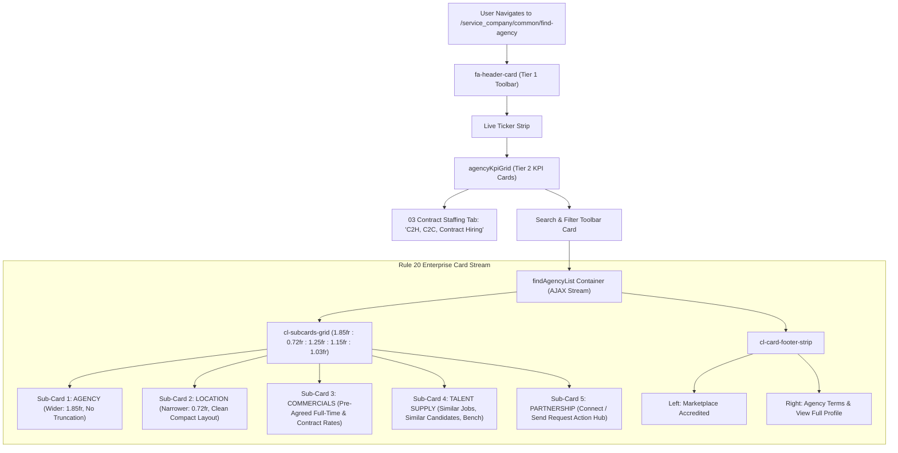

# Audit & Implementation Document: Find Agency UI/UX Refinements & Subcard Proportions

## 1. Metadata
- **Module:** Service Company — Find Trusted Hiring Agencies (`/service_company/common/find-agency`)
- **Date:** 2026-11-15
- **Standard Reference:** Rule 20 (Modern Card + Sub-Card Enterprise Standard), Rule 14 (15.6" Screen Fit), Rule 21 (Documentation Standard)
- **Author:** Antigravity Agentic Engineer

---

## 2. Executive Summary
In response to direct UI/UX feedback and annotated review screenshots on the **Find Trusted Hiring Agencies** discovery interface, six targeted refinements were implemented to elevate visual cleanliness, reduce cognitive clutter, clarify metrics terminology, and eliminate awkward text truncation on 15.6" screens:

1. **Instant Job Matcher Removal:** Completely eliminated the redundant Instant AI Job Matcher card/bar container (`#faMatchmakerBar` & zero-job banner) directly between the live ticker and Tier 2 KPI cards, providing immediate access to the 6 stat KPI filters.
2. **Footer Strip Decluttering:** Removed secondary operational metrics (`Active Date & Time`, `Avg SLA: ~36-48h First TAT`, and `Capacity: X Recruiters`) from the bottom footer strip, retaining clean focus on `Marketplace Accredited`, `Agency Terms`, and `View Full Profile ->`.
3. **Contract KPI Tab Label Polish:** In Tier 2 KPI cards, updated the 03 Contract Staffing sub-label from `"Recurring monthly hiring"` to `"C2H, C2C, Contract Hiring"` for industry-standard terminology.
4. **Talent Supply Sub-Card Harmonization:**
   - Removed the `"Live Pool"` badge completely from the sub-card header.
   - Replaced `"Active Jobs"` with `"Similar Jobs"`.
   - Replaced `"Candidate Profiles"` with `"Similar Candidates"`.
   - Updated the Bench indicator to display total matching Bench candidates with conditional bracket notation: e.g., `Bench (5 Matching Bench)` when count $> 0$, and cleanly hiding bracketed text (`Bench`) when count $= 0$.
5. **Agency Identity Header Label:** Renamed Sub-Card 1's uppercase header title from `"Identity"` to `"Agency"`.
6. **Subcard Proportions Optimization:** Adjusted `.cl-subcards-grid` columns to widen Sub-Card 1 (Company/Agency Name) from `1.48fr` to `1.85fr` (preventing truncation of lengthy agency names) and narrowed Sub-Card 2 (Location) from `1.02fr` to `0.72fr` (where compact city/country information sits cleanly).
7. **Agency Terms Drawer Redesign & Governance Overhaul:**
   - **Modern Card Elevation:** Replaced flat grey cards with pure white (`#ffffff`) cards, clean solid hairline borders (`#f1f5f9`), and 10px rounded corners on soft `#f8fafc` canvas.
   - **Header Brand Identity:** Integrated agency avatar/logo box alongside agency name, clean `Marketplace Verified` / `Onboarding Partner` pills, and an elegant SVG dismiss button.
   - **Standard Marketplace Governance Overhaul:** Completely removed arbitrary candidate ownership / duplicate lookback defaults. Mandated that **all terms are established directly by the hiring company** and any agency wishing to work with a company must review, discuss, and mutually agree to that company's specific terms.
   - **JERO.works Neutrality Disclaimer:** Explicitly stated that JERO.works operates strictly as an independent software platform provider with zero involvement, responsibility, or liability in contractual enforcement or bilateral disputes.

---

## 3. Architecture & Data Flow



---

## 4. File Changes Matrix

| File Path | Type | Modifications |
|---|---|---|
| `resources/views/service_company/common/find-agency.blade.php` | Blade View | 1. Removed Instant AI Job Matcher container (`#faMatchmakerBar` & zero-job state).<br>2. Replaced `"Recurring monthly hiring"` with `"C2H, C2C, Contract Hiring"` in 03 Contract Staffing KPI card.<br>3. Adjusted `.cl-subcards-grid` CSS from `minmax(0, 1.48fr) minmax(0, 1.02fr) ...` to `minmax(0, 1.85fr) minmax(0, 0.72fr) ...`.<br>4. Updated `@media (max-width: 1400px)` breakpoint proportions accordingly. |
| `resources/views/service_company/ajax_pages/find_agency_ajax.blade.php` | AJAX Blade View | 1. Renamed Sub-Card 1 header title from `Identity` to `Agency`.<br>2. In Sub-Card 4: removed `Live Pool` badge, changed `Active Jobs` to `Similar Jobs`, changed `Candidate Profiles` to `Similar Candidates`.<br>3. In Sub-Card 4 Bench row: display `Bench (X Matching Bench)` when $X > 0$, and hide brackets (`Bench`) when $X = 0$.<br>4. In `cl-card-footer-strip`: removed `Active Date & Time`, `Avg SLA`, and `Capacity` items and dividers, preserving `Marketplace Accredited`, `Agency Terms`, and `View Full Profile ->`. |

---

## 5. 15.6" Screen Fit & Responsive Proportions (Rule 14 & Rule 20)

- **Default Desktop (>= 1400px):**
  - Grid: `1.85fr 0.72fr 1.25fr 1.15fr 1.03fr` (Total: 6.00fr).
  - Sub-Card 1 (Agency Name): ~370px (expanded by +74px from ~296px) — eliminates truncated long agency names like "Apex Talent Staffing Solutions Pvt Ltd".
  - Sub-Card 2 (Location): ~144px — perfectly hosts pin icon, city ("Noida"), state ("Uttar Pradesh"), and country ("India") without waste.
- **Laptop 15.6" Screen (<= 1400px):**
  - Grid: `1.75fr 0.72fr 1.25fr 1.18fr 1.1fr` — retains uniform card heights, zero horizontal scroll, and balanced spacing.
- **Tablets & Mobile:**
  - `<= 1200px`: 3 columns.
  - `<= 992px`: 2 columns.
  - `<= 640px`: 1 column.

---

## 6. Verification Evidence
1. **PHP Syntax Verification:**
   ```bash
   php -l resources/views/service_company/common/find-agency.blade.php
   # Output: No syntax errors detected
   php -l resources/views/service_company/ajax_pages/find_agency_ajax.blade.php
   # Output: No syntax errors detected
   ```
2. **Batch Properties Assertion Test:**
   ```bash
   php artisan test --filter=test_find_agency_ajax_blade_consumes_enriched_batch_properties
   # PASS (1 passed, 7 assertions)
   ```
3. **Tenancy & Isolation Integrity:**
   - 100% scoped to Service Company view modules (`resources/views/service_company/`).
   - Zero modifications to `product_company` or `staffing_company` code per Rule 18 persona freeze.
