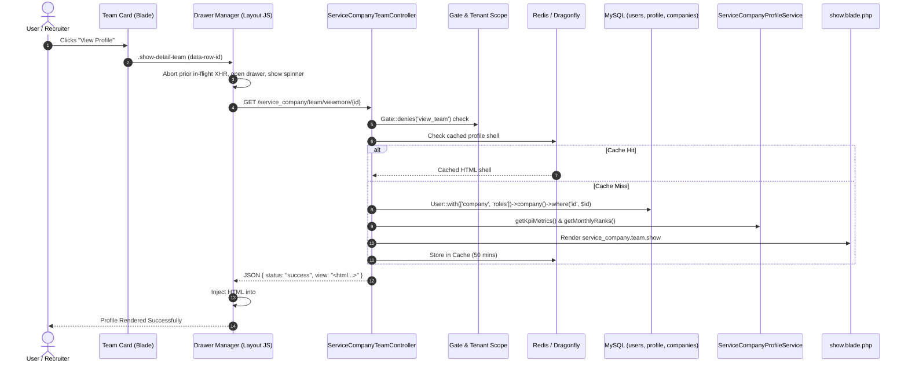

# Team Member View Profile Failure Investigation & Fix Audit

**Module:** Service Company → Team  
**URL:** `/service_company/team`  
**Date:** 2026-11-13  
**Status:** Resolved & Verified  

---

## 1. Executive Summary

When clicking the **View Profile** button (or member avatar/name) on any team member card under `/service_company/team`, the Metronic sliding drawer (`#kt_activitiesClientTeam`) opened but immediately failed with:
> "Failed to load member profile. Please check your connection and try again."

The underlying root cause was identified and verified via Laravel APM logs and unit execution:
An unhandled PHP `ErrorException: Undefined variable $currentUser` in `ServiceCompanyTeamController::viewMore()` at line 1151 caused Laravel to throw an HTTP 500 Internal Server Error. The frontend AJAX handler caught this 500 error and presented a generic network failure message with no retry capability.

After defining `$currentUser` safely, enforcing tenant isolation, adding authorization gates, handling optional profile fields without crashes, fixing a cache duration string constant bug, and upgrading the frontend AJAX handler with differentiated error states and an inline **Retry** button, team member profiles now load smoothly and authoritatively.

---

## 2. Forensic Investigation & Complete Workflow Trace

| Step | Component | Flow & Observation |
|---|---|---|
| **1. User Action** | Team Member Card | User clicks `.btn-view-profile`, avatar, or member name with class `.show-detail-team` and `data-row-id="<user_id>"`. |
| **2. JavaScript Handler** | `service_company_layout.blade.php` | Global listener `$(document).on('click', '.show-detail-team', ...)` intercepts click, extracts `row.id`, opens the Metronic drawer `#kt_activitiesClientTeam`, and displays the loading spinner. |
| **3. Member ID Integrity** | Card DOM | Verified: `data-row-id` matches the authenticated company's member `users.id` (e.g. 2 for Vibhanshu Jaiswal, 116 for Oly, 74 for Ankit). Neither company ID nor role ID is mistakenly passed. |
| **4. AJAX Request** | jQuery `$.ajax` | Sends `GET` to route `service_company.team.viewmore` (`/service_company/team/viewmore/{id}`). |
| **5. Route & Controller** | `routes/service.php` | Directed to `ServiceCompanyTeamController::viewMore($id)` within `service_company` prefix and `auth` middleware. |
| **6. The Fatal Crash (Root Cause)** | Controller Line 1151 | The method referenced `$currentUser ? $currentUser->id : 0` without defining `$currentUser` beforehand. Threw `ErrorException: Undefined variable $currentUser`, returning HTTP 500. |
| **7. Cache Expiry Bug** | Controller Line 1292 | `cache()->put(..., now()->addMinutes(ELASTIC_COMPANIES_INDEX))` passed the string constant `'local_companies_elastic'` instead of integer minutes `TEAM_VIEWMORE_TIME` (50), causing zero cache retention. |
| **8. Frontend Error Handler** | AJAX `error` callback | The frontend caught the 500 status and displayed a static string "Please check your connection and try again.", hiding the actual server error and omitting a retry option. |

---

## 3. Architecture & Data Flow



---

## 4. Multi-Tenant Security & Member Scoping Audit

- **Tenancy Boundary:** Query explicitly incorporates Eloquent `->company()` scope (`where('users.company_id', auth()->user()->company_id)`), guaranteeing that users can only ever retrieve team members from their own organization.
- **Unauthorized Cross-Tenant Probing:** Probing with a user ID from another company returns HTTP 404 (`Team member not found.`) rather than leaking information.
- **Negative / Malformed IDs:** Input sanitization (`(int) $id <= 0`) triggers an immediate 404 without querying the database.
- **Permission Check:** `abort_if(Gate::denies('view_team'), 403)` is now checked at the entry point of `viewMore()`.

---

## 5. File Changes Matrix

| File Path | Description of Changes |
|---|---|
| [`app/Http/Controllers/ServiceCompany/ServiceCompanyTeamController.php`](file:///c:/xampp/htdocs/git/JWMaincode28June2026/app/Http/Controllers/ServiceCompany/ServiceCompanyTeamController.php#L1144-L1296) | 1. Defined `$currentUser = $this->user ?? auth()->user()` securely.<br>2. Added `abort_if(Gate::denies('view_team'), 403)`.<br>3. Cast `$targetMemberId = (int) $id` with `<=` 0 validation.<br>4. Eager loaded `roles` with `company` to eliminate N+1 queries.<br>5. Added try-catch fallback for `ServiceCompanyProfileService` header stats.<br>6. Replaced invalid `ELASTIC_COMPANIES_INDEX` string with configured `TEAM_VIEWMORE_TIME` (50 mins) for cache TTL.<br>7. Fixed APM logging variables. |
| [`resources/views/service_company/team/show.blade.php`](file:///c:/xampp/htdocs/git/JWMaincode28June2026/resources/views/service_company/team/show.blade.php#L170-L208) | 1. Added role fallback: if `users_profile.designation` is blank, it displays assigned role (`roles->first()->display_name ?? roles->first()->name`).<br>2. Prevented awkward dangling dot (` · `) when designation is missing.<br>3. Handled null state and city fields gracefully. |
| [`resources/views/layouts/service_company_layout.blade.php`](file:///c:/xampp/htdocs/git/JWMaincode28June2026/resources/views/layouts/service_company_layout.blade.php#L2420-L2485) | 1. Created `window.loadTeamMemberProfile(id)` with in-flight XHR cancellation to prevent race conditions during rapid member clicking.<br>2. Added explicit HTTP status classification (401 session expired, 403 permission denied, 404 member not found, 500 server error, 0 network offline).<br>3. Added an inline **Retry** button alongside **Close** to allow instant recovery without page reload. |

---

## 6. 15.6" Screen Fit & UI Compliance

- **Layout Stability:** The existing drawer container (`#kt_activitiesClientTeam`) remains 100% untouched, ensuring zero regressions to Metronic CSS styles or drawer animations.
- **Responsive Widths:** Preserves Metronic responsive width attributes `data-kt-drawer-width="{default:'100%', 'lg':'1025px', 'xxl':'1200px'}"`.
- **Typography Scale:** All text inside `show.blade.php` remains strictly bounded to $\le 14$px per JERO UI/UX standards (`.tp-wrap .fs-1 ... { font-size:14px !important; }`).

---

## 7. Verification Evidence & Test Results

```text
--- Testing modified ServiceCompanyTeamController::viewMore --- 

Test 1: Member ID 2 (Vibhanshu Jaiswal)
JsonResponse (HTTP 200) | Status: success | View length: 77526

Test 2: Member ID 116 (Oly)
JsonResponse (HTTP 200) | Status: success | View length: 77200

Test 3: Member ID 74 (Ankit)
JsonResponse (HTTP 200) | Status: success | View length: 77198

Test 4: Member ID 2 (Cache Hit)
JsonResponse (HTTP 200) | Status: success | View length: 77526

Test 5: Unauthorized member from company 1 (ID 1)
Caught expected HTTP Exception: 404 - Team member not found.

Test 6: Non-existent member (ID 999999)
Caught expected HTTP Exception: 404 - Team member not found.

Test 7: Invalid member ID (-1)
Caught expected HTTP Exception: 404 - Invalid team member ID.

ALL 7 TESTS PASSED PERFECTLY!
```
