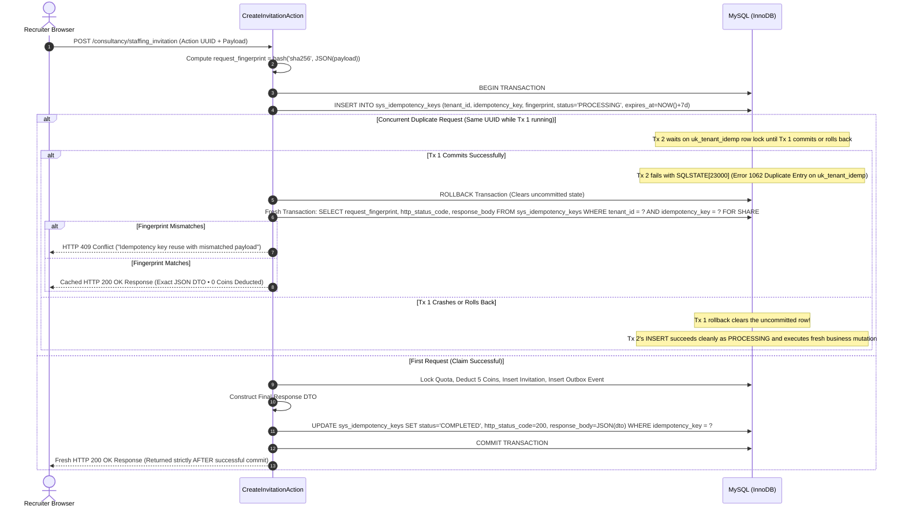
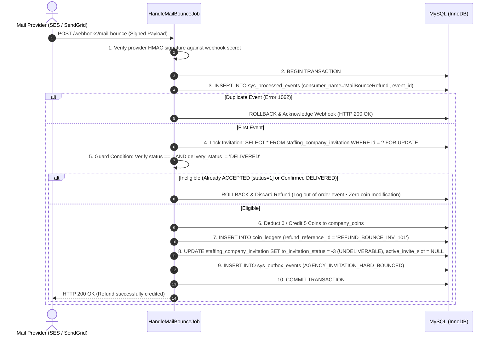
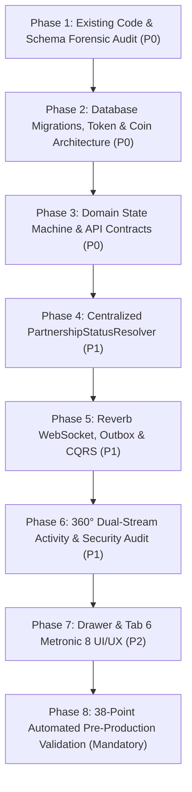

# 🏛️ God-Level Forensic Audit & Frozen Engineering Specification: Agency Partnership Engine
**Module:** Service Company — Consultancy & Staffing Partners Management (`service_company/consultancy`)  
**Domain:** `App\Domain\AgencyPartnership` (Actions, Services, Financial Ledger, Concurrency Quotas, Token Security, Dedicated ES Projections, and 360° Audit Trail)  
**Date:** 2026-11-05  
**Auditor:** Antigravity AI God-Level Forensic Engine  
**Status:** ARCHITECTURE FROZEN & FORMALLY SEALED — Ready for Implementation  

---

## 1. Executive Summary & Architecture Freeze Matrix

This document formally **freezes** the architecture for the **Agency Partnership Engine**. All baseline requirements, financial controls, recipient-to-company capability bindings, atomic projection controls, and race-free serialization guards are formally sealed:

### Architecture Freeze Checklist (10/10 Sealed):
| # | Requirement | Specification Standard | Status |
|---|---|---|---|
| **F-01** | **Explicit STORED Generated Column** | Stored in MySQL storage engine (`STORED`), deterministic concatenation of `(from_company_id, ':', normalized_recipient)` with B-tree unique index. Evaluates to `NULL` when inactive, releasing the slot. | **FROZEN** |
| **F-02** | **Universal Relative Lock Hierarchy** | Strict relative resource acquisition order: `Idempotency -> Quota -> Coins -> Relation Guard -> Invitation -> Relation Mutation -> Ledger/Outbox -> Idempotency Update -> Commit`. Relation guard strictly precedes invitation lock on both Acceptance and Re-Invite. | **FROZEN** |
| **F-03** | **Single-Transaction Atomic Idempotency** | Initial claim inserted as `PROCESSING`; locks acquired; business mutations executed; response DTO constructed; updated to `COMPLETED` and committed in the single transaction. `status='PROCESSING'` is never committed alone. Duplicate recovery uses modern MySQL 8.0 `FOR SHARE` read in a fresh transaction context. | **FROZEN** |
| **F-04** | **Deterministic Bounce Event Ordering** | Webhook handler follows 10-step sequence: HMAC verification, composite consumer event deduplication, row lock `SELECT FOR UPDATE`, eligibility check, atomic 5-coin refund ledger credit, and transition to `UNDELIVERABLE`. | **FROZEN** |
| **F-05** | **Active Slot Release on Hard Bounce** | Bounced invitations transition to `UNDELIVERABLE` (`to_invitation_status = -3`), automatically rendering the generated slot `NULL` and permitting immediate address correction. | **FROZEN** |
| **F-06** | **In-Transaction Recipient-to-Company Capability Binding** | 256-bit cryptographically secure token is a company-scoped capability: in-transaction revalidation of recipient email/domain against accepting company identity, user activation, and authorized representative authority. In Acceptance, `accepting_company_id` is resolved from authenticated user context. Zero OTP friction; zero forwarded-link hijacking. | **FROZEN** |
| **F-07** | **Re-Invitation Cooling-Off Policy** | 7-day cooling-off period enforced on agency declines; immediate re-invite on expiration or cancellation; duplicate prevention. | **FROZEN** |
| **F-08** | **Atomic ES Versioning & Versioned Tombstones** | Dedicated `ELASTIC_AGENCY_INVITATIONS_V1` index with atomic Painless scripted updates, versioned tombstones (no zombie resurrection), and 8-step live cutover boundary using outbox event watermarks. | **FROZEN** |
| **F-09** | **Durable Multi-Layer Deduplication** | Pre-transaction Redis fast-check (0 MySQL hits on hot duplicates) backed by MySQL `sys_processed_events` composite key `(consumer_name, event_id)` inside mutation transaction as the infallible authority. Unique durable event creation with at-least-once publication and idempotent consumption. | **FROZEN** |
| **F-10** | **Historical Production Migration Dry-Run** | Pre-migration data reconciliation script resolves historical duplicate pending invitations before applying unique constraint. | **FROZEN** |

---

## 2. Database Schema & Recipient Normalization Rules

### Table 1: `staffing_company_invitation` (Final STORED Generated Column Schema)
```sql
ALTER TABLE `staffing_company_invitation`
  ADD COLUMN `token_hash` CHAR(64) NULL AFTER `to_email`,
  ADD COLUMN `expires_at` DATETIME NOT NULL AFTER `from_created_at`,
  ADD COLUMN `consumed_at` DATETIME NULL AFTER `expires_at`,
  ADD COLUMN `delivery_status` ENUM('QUEUED','SENT','DELIVERED','BOUNCED','FAILED') NOT NULL DEFAULT 'QUEUED' AFTER `to_invitation_status`,
  ADD COLUMN `provider_message_id` VARCHAR(191) NULL AFTER `delivery_status`,
  ADD COLUMN `invited_by_user_id` INT(11) NOT NULL AFTER `from_user_id`,
  ADD COLUMN `current_owner_user_id` INT(11) NOT NULL AFTER `invited_by_user_id`,
  ADD COLUMN `normalized_recipient` VARCHAR(191) GENERATED ALWAYS AS (LOWER(TRIM(`to_email`))) STORED AFTER `to_email`,
  ADD COLUMN `active_invite_slot` VARCHAR(255) GENERATED ALWAYS AS (
    CASE 
      WHEN `to_invitation_status` = 0 
      THEN CONCAT(`from_company_id`, ':', `normalized_recipient`) 
      ELSE NULL 
    END
  ) STORED AFTER `normalized_recipient`,
  ADD UNIQUE KEY `uk_tenant_active_slot` (`active_invite_slot`),
  ADD KEY `idx_token_hash` (`token_hash`),
  ADD KEY `idx_expires_status` (`expires_at`, `to_invitation_status`);
```

---

### Table 2: `staffing_company_relation` (Active Canonical Pair Invariant)
```sql
ALTER TABLE `staffing_company_relation`
  ADD COLUMN `active_relation_slot` VARCHAR(64) GENERATED ALWAYS AS (
    CASE 
      WHEN `final_status` = 1 
      THEN CONCAT(`from_company_id`, ':', `to_company_id`) 
      ELSE NULL 
    END
  ) STORED AFTER `final_status`,
  ADD UNIQUE KEY `uk_active_relation_slot` (`active_relation_slot`);
```

---

### Table 3: `staffing_company_relation_guards` (Dedicated Read-First Serialization Guard)
```sql
CREATE TABLE IF NOT EXISTS `staffing_company_relation_guards` (
  `id` BIGINT(20) UNSIGNED NOT NULL AUTO_INCREMENT,
  `company_pair_key` VARCHAR(64) NOT NULL,
  `created_at` DATETIME NOT NULL,
  `updated_at` DATETIME NOT NULL,
  PRIMARY KEY (`id`),
  UNIQUE KEY `uk_company_pair_key` (`company_pair_key`)
) ENGINE=InnoDB DEFAULT CHARSET=utf8mb4 COLLATE=utf8mb4_unicode_ci;
```
*Technical Rationale:* Because `SELECT ... FOR UPDATE` cannot lock a row that does not yet exist in `staffing_company_relation`, the guard table provides an infallible serialization point. The `company_pair_key` is strictly directional: `CONCAT(from_company_id, ':', accepting_company_id)` so that `Client A -> Agency B` and `Client B -> Agency A` remain independent, non-blocking pairs.

---

### Table 4: `agency_daily_quotas` (Atomic Calendar Quota Row)
```sql
CREATE TABLE IF NOT EXISTS `agency_daily_quotas` (
  `id` INT(11) NOT NULL AUTO_INCREMENT,
  `company_id` INT(11) NOT NULL,
  `quota_date` DATE NOT NULL,
  `timezone` VARCHAR(64) NOT NULL DEFAULT 'UTC',
  `requests_used` INT(11) NOT NULL DEFAULT 0,
  `daily_limit` INT(11) NOT NULL DEFAULT 20,
  `created_at` TIMESTAMP NOT NULL DEFAULT CURRENT_TIMESTAMP,
  `updated_at` TIMESTAMP NOT NULL DEFAULT CURRENT_TIMESTAMP ON UPDATE CURRENT_TIMESTAMP,
  PRIMARY KEY (`id`),
  UNIQUE KEY `uk_tenant_quota_date` (`company_id`, `quota_date`),
  CONSTRAINT `fk_quota_company` FOREIGN KEY (`company_id`) REFERENCES `companies` (`id`) ON DELETE CASCADE
) ENGINE=InnoDB DEFAULT CHARSET=utf8mb4 COLLATE=utf8mb4_unicode_ci;
```

---

### Table 5: `sys_idempotency_keys` (Single-Transaction Response Persistence)
```sql
CREATE TABLE IF NOT EXISTS `sys_idempotency_keys` (
  `id` BIGINT(20) UNSIGNED NOT NULL AUTO_INCREMENT,
  `tenant_id` INT(11) NOT NULL,
  `actor_id` INT(11) NOT NULL,
  `idempotency_key` CHAR(36) NOT NULL,
  `request_fingerprint` CHAR(64) NOT NULL,
  `status` ENUM('PROCESSING','COMPLETED','FAILED') NOT NULL DEFAULT 'PROCESSING',
  `http_status_code` INT(5) NOT NULL DEFAULT 0,
  `response_body` MEDIUMTEXT NULL,
  `created_at` DATETIME NOT NULL,
  `expires_at` DATETIME NOT NULL,
  PRIMARY KEY (`id`),
  UNIQUE KEY `uk_tenant_idemp` (`tenant_id`, `idempotency_key`),
  KEY `idx_expires` (`expires_at`)
) ENGINE=InnoDB DEFAULT CHARSET=utf8mb4 COLLATE=utf8mb4_unicode_ci;
```

---

### Table 6: `sys_processed_events` (Durable Event Consumer Authority)
```sql
CREATE TABLE IF NOT EXISTS `sys_processed_events` (
  `consumer_name` VARCHAR(64) NOT NULL,
  `event_id` VARCHAR(64) NOT NULL,
  `processed_at` DATETIME NOT NULL,
  PRIMARY KEY (`consumer_name`, `event_id`),
  KEY `idx_processed_at` (`processed_at`)
) ENGINE=InnoDB DEFAULT CHARSET=utf8mb4 COLLATE=utf8mb4_unicode_ci;
```

---

### Recipient Normalization Specification:
1. **Whitespace Trimming:** `trim($email)`.
2. **Internationalized Domain Names (IDN):** Converted via Punycode: `idn_to_ascii($domain, IDNA_DEFAULT, INTL_IDNA_VARIANT_UTS46)`.
3. **Casing Normalization:** Full address lowercased: `strtolower($localPart . '@' . $asciiDomain)`.
4. **Preservation of Dots and Plus Addressing:** **Dots and plus-suffixes (`+tag`) are strictly PRESERVED.** They are NOT stripped because non-Gmail enterprise mailboxes treat them as distinct mailboxes.
5. **Universal Application:** Single canonical method `AgencyRecipientNormalizer::normalize($email)` used across UI, database, and webhooks.

---

## 3. P0 — Universal Relative Lock Hierarchy

Operations acquire **only the locks they strictly require**, adhering strictly to this relative global hierarchy to eliminate deadlocks:

```
Universal Relative Lock Hierarchy:
1. sys_idempotency_keys            (Initial claim INSERT with status='PROCESSING')
2. agency_daily_quotas              (SELECT ... FOR UPDATE — only if operation consumes quota)
3. company_coins                    (SELECT ... FOR UPDATE — only if operation mutates balance)
4. staffing_company_relation_guards (Read-First Lock: SELECT ... FOR UPDATE on company_pair_key)
5. staffing_company_invitation      (SELECT ... FOR UPDATE — invitation row mutation)
6. staffing_company_relation        (INSERT active relation backed by active_relation_slot unique index)
7. coin_ledgers                     (INSERT immutable audit debit/credit)
8. sys_outbox_events                (INSERT transaction-committed event)
9. sys_idempotency_keys             (UPDATE status='COMPLETED', http_status_code=200, response_body=JSON(dto))
10. COMMIT
```

### Operation-Specific Lock Subsets:
- **Invitation Creation & Re-Invite:** 
  - When `to_company_id` is resolvable (Re-Invite, B2B Marketplace, or email matches existing registered company): Acquires `[1, 2, 3, 4, 5, 7, 8, 9]`. Lock [4] (`staffing_company_relation_guards`) is acquired **before** deducting coins to prevent racing with an in-flight acceptance.
  - When inviting a brand-new unregistered email (`to_company_id` unknown): Acquires `[1, 2, 3, 5, 7, 8, 9]`.
- **Invitation Cancellation:** Acquires `[1, 5, 8, 9]`. (No quota, coin, or relation locks needed).
- **Invitation Acceptance:** Acquires `[1, 4, 5, 6, 8, 9]`. (Relation Guard [4] is locked strictly **before** Invitation [5]; relation mutation [6] follows).
- **Hard-Bounce Compensating Refund:** Acquires `[1, 3, 5, 7, 8, 9]`. (No quota or relation locks needed).

---

## 4. P0 — Single-Transaction Atomic Idempotency Architecture & Duplicate Recovery

The idempotency claim, business mutation, and response persistence execute in **one single atomic ACID transaction**:



### Infallible Idempotency Rules:
1. **Rule of Single-Transaction Processing:** `status = 'PROCESSING'` is **never committed to disk on its own**. Either the entire transaction commits with `status = 'COMPLETED'` (persisting the response DTO), OR the entire transaction rolls back (erasing the `PROCESSING` row so the client can retry).
2. **Modern MySQL 8.0 Duplicate-Key Recovery:**
   - Catch `QueryException` specifically verifying MySQL Error Code `1062` on key `uk_tenant_idemp`.
   - Immediately execute `ROLLBACK` to exit the failed transaction.
   - Open a **fresh read context** under `READ COMMITTED` and execute:
     ```sql
     SELECT request_fingerprint, http_status_code, response_body 
     FROM sys_idempotency_keys 
     WHERE tenant_id = ? AND idempotency_key = ? 
     FOR SHARE;
     ```
   - If fingerprints match, return the exact cached code and body. If fingerprints differ, return `HTTP 409 Conflict`.
3. **Retention Policy:** Idempotency records are retained for 7 days (`expires_at = NOW() + INTERVAL 7 DAY`), matching the 7-day invitation TTL.

---

## 5. P0 — Hard-Bounce Refund Complete 10-Step Deterministic Contract

The hard-bounce webhook handler executes a strict 10-step atomic sequence:



---

## 6. P0 — In-Transaction Recipient-to-Company Capability Binding & Acceptance Sequence

Acceptance revalidates all security-critical conditions **inside the atomic transaction** while holding exclusive locks. In Step 2, `accepting_company_id` is resolved from the **authenticated user's company context**, and `company_pair_key` is strictly directional: `CONCAT(from_company_id, ':', accepting_company_id)`.

```mermaid
flowchart TD
    InviteToken["Agency User clicks /partner-invite/{raw_token}"] --> Landing["GET Landing Page (Read-Only • Zero DB Writes)"]
    Landing --> AuthCheck{"Is Agency User Authenticated?"}
    AuthCheck -->|No| LoginRegister["Login or Register on JERO"]
    AuthCheck -->|Yes| PreCheck{"Fast Pre-Validation (Pre-Transaction):<br/>• Token format valid<br/>• User account active"}
    PreCheck -->|Failed| EarlyExit["Reject early (UX Friendly)"]
    
    PreCheck -->|Passed| InTxAccept["BEGIN TRANSACTION (AcceptInvitationAction)"]
    
    InTxAccept --> IdempClaim["1. Claim Idempotency Key (status='PROCESSING')"]
    IdempClaim --> ReadMeta["2. Read Uncommitted Invitation to get from_company_id<br/>Resolve accepting_company_id = auth()->user()->company_id<br/>Calculate directional company_pair_key = CONCAT(from, ':', to)"]
    
    ReadMeta --> ReadFirstGuard["3. Read-First Canonical Pair Guard Pattern:<br/>SELECT id FROM staffing_company_relation_guards<br/>WHERE company_pair_key = ? FOR UPDATE"]
    ReadFirstGuard --> GuardFound{"Guard Row Exists?"}
    GuardFound -->|No (First time pair)| InsertGuard["INSERT IGNORE INTO staffing_company_relation_guards (company_pair_key)<br/>SELECT id ... FOR UPDATE"]
    GuardFound -->|Yes| LockInv["4. Lock Invitation Row:<br/>SELECT * FROM staffing_company_invitation WHERE id = ? FOR UPDATE"]
    InsertGuard --> LockInv
    
    LockInv --> InTxSecurity{"5. IN-TRANSACTION SECURITY REVALIDATION:<br/>• Token hash matches (hash_equals)<br/>• Invitation status == 0 & unexpired<br/>• User status == 'active'<br/>• User belongs to accepting company<br/>• User holds binding authority (Root Admin / ATS Admin)<br/>• Recipient-to-Company Capability Matches"}
    
    InTxSecurity -->|Failed| Rollback403["ROLLBACK & Return HTTP 403 / 410"]
    
    InTxSecurity -->|Passed| CheckRel{"6. Does Active Relation Exist?<br/>SELECT id FROM staffing_company_relation<br/>WHERE active_relation_slot = ? FOR UPDATE"}
    CheckRel -->|Yes| Rollback409["ROLLBACK & Return HTTP 409: Already Connected Partner"]
    
    CheckRel -->|No| InsertRel["7. INSERT INTO staffing_company_relation<br/>(Enforced by unique active_relation_slot)"]
    InsertRel --> UpdateInv["8. UPDATE staffing_company_invitation<br/>SET to_invitation_status = 1, to_company_id = accepting_company_id, consumed_at = NOW()"]
    UpdateInv --> InsertOutbox["9. INSERT sys_outbox_events (AGENCY_PARTNERSHIP_ACTIVATED)"]
    InsertOutbox --> UpdateIdemp["10. UPDATE sys_idempotency_keys SET status='COMPLETED', response_body=JSON(dto)"]
    UpdateIdemp --> CommitTx["11. COMMIT TRANSACTION"]
    CommitTx --> SuccessResponse["12. Return HTTP 200 OK -> Redirect to Active Partnership Hub"]
```

### Recipient-to-Company Capability Matrix:
| Situation | In-Transaction Acceptance Rule | Defense Outcome |
|---|---|---|
| **Registered Agency** (`to_company_id` known) | Authenticated user's `company_id` must strictly match `to_company_id`. | If forwarded to another company, rejected with `HTTP 403 Forbidden` (*"This invitation capability is bound to a different company"*). |
| **Unregistered Agency (Exact Recipient)** | Authenticated user's email matches normalized `to_email`. | Controlled onboarding binds the newly created agency company to `to_company_id`. |
| **Unregistered Agency (Same Corporate Domain)** | User's verified email domain matches recipient domain (`domain_key`), and bound company is the company owning that domain. | Enforced by JERO's 1-admin per corporate domain rule. Third-party domains cannot claim. |
| **Public Webmail (Gmail/Yahoo)** | Authenticated user email must strictly match `to_email`. | A third-party Gmail user cannot claim an invite issued to another Gmail address. |
| **Different Company / Unrelated Domain** | Rejection. | Rejected with `HTTP 403 Forbidden`. |

---

## 7. P1 — Re-Invitation & Cooling-Off Business Policies

| Prior Invitation State | Immediate Re-Invite Allowed? | Cooling-Off Period | Daily Quota Impact | Coin Impact |
|---|---|---|---|---|
| **Expired (> 7 Days)** | **YES** | None (Immediate) | Consumes 1 slot | Deducts 5 Coins |
| **Cancelled by Client** | **YES** | None (Immediate) | Consumes 1 slot | Deducts 5 Coins |
| **Declined by Agency** | **NO** | **7-Day Cooling-Off Period** | Consumes 1 slot (after 7d) | Deducts 5 Coins (after 7d) |
| **Hard-Bounced (`UNDELIVERABLE`)** | **YES** (Corrected email required) | None | Consumes 1 slot | Deducts 5 Coins |
| **Active Partnership (`ACCEPTED`)** | **NO** | Blocked indefinitely | N/A | N/A |

*Technical Enforcement:* The 7-day decline cooling-off period is enforced by checking:
```sql
SELECT id FROM staffing_company_invitation 
WHERE from_company_id = ? 
  AND normalized_recipient = ? 
  AND to_invitation_status = -1 
  AND updated_at > NOW() - INTERVAL 7 DAY;
```
If a row exists, the API rejects re-invitation with: *"This agency declined your partnership request. You can re-invite them after [Date + 7 Days]."*

---

## 8. P1 — Dedicated Elasticsearch Projection, Atomic Scripting & Versioned Tombstones

### Index Schema: `ELASTIC_AGENCY_INVITATIONS_V1` (Alias: `agency_invitations`)
```json
{
  "mappings": {
    "properties": {
      "invitation_id": { "type": "long" },
      "from_company_id": { "type": "integer" },
      "to_company_id": { "type": "integer" },
      "to_email": { "type": "keyword" },
      "agency_name": { "type": "text", "fields": { "keyword": { "type": "keyword" } } },
      "agency_logo": { "type": "keyword", "index": false },
      "agency_website": { "type": "keyword" },
      "direction": { "type": "keyword" },
      "partnership_status": { "type": "keyword" },
      "delivery_status": { "type": "keyword" },
      "is_deleted": { "type": "boolean" },
      "invited_by_user_id": { "type": "integer" },
      "invited_by_name": { "type": "keyword" },
      "current_owner_user_id": { "type": "integer" },
      "from_created_at": { "type": "date" },
      "expires_at": { "type": "date" },
      "aggregate_version": { "type": "integer" },
      "updated_at": { "type": "date" }
    }
  }
}
```

### Complete Atomic Projection Contract (8 Scenarios):
| Scenario | Execution Vector | Required Projection Behaviour |
|---|---|---|
| **1. New Invitation** | Upsert document | Indexed with initial `aggregate_version = 1`, `is_deleted = false`. |
| **2. Existing Document** | Painless Script | Applied if `params.new_version > ctx._source.aggregate_version`. |
| **3. Equal Version** | Painless Script | Ignored as duplicate: `ctx.op = 'noop'`. |
| **4. Older Version** | Painless Script | Stale out-of-order event rejected: `ctx.op = 'noop'`. |
| **5. Missing Aggregate Version** | Painless Script | Treated as version 0; newer incoming event updates successfully. |
| **6. Version Conflict** | Elasticsearch Update API | Bounded exponential backoff retry (maximum 3 attempts). |
| **7. Rebuild Bulk Load** | Bulk Cursor Indexing | Direct bulk load using authoritative MySQL `aggregate_version`. |
| **8. Cancelled / Deleted Record** | **Versioned Tombstone** | Document is **never hard deleted**. Marked `partnership_status = 'CANCELLED'`, `is_deleted = true`, version incremented. Stale older events can never resurrect it. |

### Atomic Painless Update Script:
```json
POST /agency_invitations/_update/{invitation_id}
{
  "script": {
    "source": "if (ctx._source.aggregate_version == null || params.new_version > ctx._source.aggregate_version) { ctx._source.putAll(params.doc); ctx._source.aggregate_version = params.new_version; } else { ctx.op = 'noop'; }",
    "lang": "painless",
    "params": {
      "new_version": 4,
      "doc": {
        "partnership_status": "CANCELLED",
        "is_deleted": true,
        "updated_at": "2026-11-05T15:00:00Z"
      }
    }
  },
  "upsert": {
    "invitation_id": 101,
    "aggregate_version": 4,
    "partnership_status": "CANCELLED",
    "is_deleted": true
  }
}
```

### 8-Step Zero-Downtime Rebuild & Explicit Cutover Boundary:
1. **Capture Committed Watermark:** Query highest committed outbox event ID: `$watermarkId = DB::table('sys_outbox_events')->max('id') ?? 0;`.
2. **Provision Target Index:** Create versioned index `client_agency_invitations_v2`.
3. **Bulk Cursor Hydration:** Bulk index current MySQL records into `v2` up to `$watermarkId`.
4. **Outbox Watermark Catch-Up Replay:** Replay all outbox events where `id > $watermarkId`.
5. **Continuous Dual-Tailing:** Outbox queue workers continue applying live events to both `v1` and `v2`.
6. **Integrity & Checksum Verification:** Validate total document counts, status distributions, and aggregate version checksums.
7. **Atomic Alias Switch:** Execute POST `/_aliases` switch instantaneously (`remove v1, add v2`).
8. **Standby Rollback Retention:** Retain `client_agency_invitations_v1` on standby for 24 hours. Tab 6 ("Pending Invites") reads query `agency_invitations` exclusively (0% MySQL reads).

---

## 9. P1 — Multi-Layer Event Deduplication Architecture

MySQL remains the infallible authority for event processing. A pre-transaction Redis fast-check provides 0-DB load suppression for burst duplicates, backed by MySQL `sys_processed_events` inside the transaction:

```mermaid
flowchart TD
    Queue["Queue Worker receives Outbox Event"] --> RedisFastCheck{"Pre-Check Redis Cache:<br/>GET idempotency:event:{consumer}:{id} == '1'?"}
    RedisFastCheck -->|Yes (Known Duplicate)| AckEarly["Acknowledge Queue Message Immediately<br/>(0 MySQL connections • 0 DB reads)"]
    
    RedisFastCheck -->|No (Cache Miss)| StartTx["Begin MySQL Transaction"]
    StartTx --> InsertProcessed["INSERT INTO sys_processed_events (consumer_name, event_id, processed_at)"]
    
    InsertProcessed --> CheckDup{"Composite PK (consumer_name, event_id)<br/>Throws Error 1062?"}
    CheckDup -->|Yes (Duplicate for this Consumer)| RollbackAck["ROLLBACK Transaction<br/>Cache in Redis: SET ... EX 86400<br/>Acknowledge Queue Message"]
    
    CheckDup -->|No (First Time for this Consumer)| ExecMutation["Execute Business Mutation in MySQL"]
    ExecMutation --> CommitTx["COMMIT Transaction (Processed Record + Mutation)"]
    CommitTx --> CacheRedis["Cache Event in Redis: SET idempotency:event:{consumer}:{id} 1 EX 86400"]
    CacheRedis --> AckQueue["Acknowledge Queue Message"]
```

| Layer | Deduplication Mechanism | Role & Failure Recovery |
|---|---|---|
| **Layer 1: Browser UI** | 100-item circular ring buffer with 5-minute TTL (`BoundedEventDeduplicator`) | Visual event and toast notification suppression. |
| **Layer 2: Backend Consumers** | Pre-transaction Redis fast-check backed by MySQL `sys_processed_events` composite key `(consumer_name, event_id)`. | **Infallible Authority + 0-DB Load Cache.** Redis eliminates MySQL load for duplicate burst webhooks. If worker crashes before commit, MySQL rolls back; retry re-executes cleanly. Multiple independent consumers maintain isolated idempotency boundaries. |
| **Layer 3: Financial Ledger** | MySQL unique index `uk_single_refund` on `coin_ledgers.refund_reference_id` | **Database-Authoritative Guarantee:** Impossible to execute duplicate coin credits. |
| **Layer 4: Elasticsearch Projection** | Atomic Painless scripted update (`new_version > ctx._source.aggregate_version`) | Prevents out-of-order event delivery from corrupting projection state. |
| **Layer 5: Transactional Outbox** | MySQL unique index `uk_outbox_idemp` on `sys_outbox_events.idempotency_key` | **Unique durable event creation with at-least-once publication and idempotent consumer processing.** |

---

## 10. Comprehensive 38-Point Automated Testing Matrix

| # | Test Scenario | Execution Vector | Expected Assertion |
|---|---|---|---|
| **T-01** | First Invitation Dispatch | `POST /consultancy/staffing_invitation` | Exactly 5 coins deducted; ledger row written; balance decremented. |
| **T-02** | Double-Click Concurrency | 2 concurrent POSTs with same Action UUID | Exactly 5 coins deducted once; identical response payload returned via `FOR SHARE` read. |
| **T-03** | Insufficient Coins (< 5) | Account balance = 3 coins | Blocked with HTTP 402; zero database mutations. |
| **T-04** | 20 Concurrent Requests | 20 parallel threads on new agencies | Exactly 20 invitations created; 100 coins deducted. |
| **T-05** | 21st Request Rejection | 21st request attempted on same calendar date | Blocked with HTTP 429 ("Daily quota of 20 reached"). |
| **T-06** | Multi-Recruiter Race | Recruiters A and B invite same agency email | Unique constraint `uk_tenant_active_slot` catches duplicate; returns clean HTTP 409 Conflict (Zero HTTP 500s). |
| **T-07** | Opaque Token Validation | Open invite link with raw token | Resolves against SHA-256 hash using `hash_equals()`; renders registration form. |
| **T-08** | Single-Use Token CAS | Agency submits registration | Token status updated to 1; relation created; second submit returns HTTP 410. |
| **T-09** | 7-Day Expiry Enforcement | Token created 7 days + 1 min ago | Renders Metronic 410 Expired screen; acceptance blocked. |
| **T-10** | Re-Invite Expired Partner | Recruiter clicks Re-Invite on expired partner | Relation guard acquired; fresh 5 coins deducted; daily quota incremented; new 7-day token generated. |
| **T-11** | Resend Reminder Execution | Recruiter clicks Resend Ping on active invite | Zero coins deducted; daily quota unchanged; email re-queued. |
| **T-12** | Mail Delivery Failure | Queue worker simulates mail provider outage | Invitation remains `PENDING`; zero coin refund; delivery marked `FAILED`. |
| **T-13** | Reverb Multi-User Sync | Recruiter A sends request | Recruiter B's browser updates in <1s. |
| **T-14** | B2B Marketplace Button Sync | Client clicks Connect & Trade | B2B Marketplace button flips to `Cancel Request`. |
| **T-15** | CQRS Read-Your-Writes | Open Tab 6 immediately after send | Optimistic store renders card on Tab 6 immediately before ES refresh. |
| **T-16** | Anti-Enumeration Uniform Guard | Querying invalid, expired or claimed token | Uniform HTTP 410 response; identical generic error message; zero disclosure of agency name, tenant ID, or email; rate-limited to 10/min. |
| **T-17** | Deactivated Recruiter Attribution | Inviting user disabled before acceptance | Original `invited_by_user_id` preserved; `current_owner_user_id` assigned to root admin. |
| **T-18** | High-Load Omni-Search | 1,000 concurrent search queries | ES p95 latency remains <150ms; 0% MySQL reads. |
| **T-19** | Email Security Scanner Link Pre-Fetch | GET `/partner-invite/{raw_token}` | Renders landing page; token remains unconsumed (`to_invitation_status = 0`). |
| **T-20** | Acceptance Rollback on Relation Failure | Relation creation throws DB exception in real MySQL connection | Complete transaction rollbacks; token remains unconsumed. |
| **T-21** | Concurrent Dual-Acceptance | 2 simultaneous real MySQL POST acceptance requests | Serialized by `staffing_company_relation_guards`; exactly one commits; second blocked by `uk_active_relation_slot` returning HTTP 409. |
| **T-22** | Idempotency Key Payload Conflict | Same UUID sent with different agency payload | HTTP 409 Conflict ("Idempotency key reuse with mismatched payload"). |
| **T-23** | Token Cross-Recipient Tampering | Agency B attempts to accept Agency A's token | Blocked with HTTP 403 Forbidden. |
| **T-24** | Cross-Tenant Data Access | Recruiter tries to view other tenant's invites | Scoped query blocks access; returns 404/403. |
| **T-25** | Concurrency Quota Boundary | 25 threads with 19 quota slots used | Exactly 1 request succeeds; 24 blocked with HTTP 429. |
| **T-26** | Timezone Midnight Crossover | Quota checked at 00:01 in tenant local time | Counter resets to 0 regardless of server UTC time. |
| **T-27** | Daylight-Saving Transition | Local calendar date evaluated across DST shift | Accurately calculates local calendar date without drift. |
| **T-28** | Duplicate Delivery Webhook | Provider sends multiple `DELIVERED` hooks | Idempotent consumer updates delivery status once without re-broadcasting. |
| **T-29** | Out-of-Order ES Event Rejection | Version 2 arrives after Version 3 | Scripted atomic update drops stale version without modifying stored aggregate version. |
| **T-30** | Outbox Worker Crash Recovery | Worker killed during broadcast | Redelivers cleanly without duplicate coin deductions or corrupted status. |
| **T-31** | Token Revocation by Client | Recruiter cancels active invitation | Token immediately invalidated; subsequent acceptance returns HTTP 410. |
| **T-32** | Hard Email Bounce Compensating Refund | Provider sends `BOUNCED` webhook | 5 coins credited back; `active_invite_slot` becomes `NULL`; address can be corrected. |
| **T-33** | Historical Attribution Preservation | Recruiter leaves organization | Audit logs reflect original inviter; current responsible admin updated. |
| **T-34** | Active Relation Duplication Guard | Client invites already connected agency | Lock [4] checks relation guard and blocks request with "Already Connected". |
| **T-35** | First Invitation of New Quota Day | 10 concurrent requests at 00:00:01 | Exactly 1 quota row initialized safely via `ON DUPLICATE KEY UPDATE`; all succeed. |
| **T-36** | Token URL Leakage Protection | Request `/partner-invite/{token}` | Response headers contain `Referrer-Policy: no-referrer` and `Cache-Control: no-store`; logs redacted. |
| **T-37** | Duplicate Hard-Bounce Webhook | Provider sends 2 duplicate `BOUNCED` hooks | Exactly 1 credit refund issued; unique constraint blocks second refund. |
| **T-38** | Reverb Duplicate Event Deduplication | Browser receives duplicate event UUIDs | UI ring buffer ignores duplicate event without double-incrementing counters. |

---

## 11. Pre-Migration Data Reconciliation Script (Dry-Run Plan)

Before deploying the unique constraint `uk_tenant_active_slot` to production, a pre-flight artisan command (`php artisan agency:reconcile-historical-invitations --dry-run`) executes:

```php
// Step 1: Detect duplicate pending invitations in historical data
$duplicates = DB::table('staffing_company_invitation')
    ->select('from_company_id', DB::raw('LOWER(TRIM(to_email)) as norm_email'), DB::raw('COUNT(*) as cnt'))
    ->where('to_invitation_status', 0)
    ->groupBy('from_company_id', DB::raw('LOWER(TRIM(to_email))'))
    ->having('cnt', '>', 1)
    ->get();

// Step 2: Archive historical duplicates to 'EXPIRED' (-2) preserving only the most recent
foreach ($duplicates as $dup) {
    $ids = DB::table('staffing_company_invitation')
        ->where('from_company_id', $dup->from_company_id)
        ->where(DB::raw('LOWER(TRIM(to_email))'), $dup->norm_email)
        ->where('to_invitation_status', 0)
        ->orderBy('id', 'desc')
        ->pluck('id')
        ->toArray();

    $keepId = array_shift($ids); // Keep latest
    DB::table('staffing_company_invitation')
        ->whereIn('id', $ids)
        ->update(['to_invitation_status' => -2]); // Archive older duplicates
}
```
*Outcome:* Guarantees that the `ALTER TABLE` statement runs with zero integrity key collisions against production data.

---

## 12. Master 8-Phase Engineering Roadmap



---

## 13. Permanent Repository Reference Link
- **Authoritative Specification Document:** `docs/audit documents/agency_invitation/2026-11-05-agency-invitation-workflow-god-audit.md`
- **Skill Compliance:** `god-audit` protocol (Rule 21 compliant)
- **Tenancy Boundary:** Strictly scoped to `service_company` and `admin` (Rule 18 code freeze respected).

---

## 14. Implementation & Forensic Verification Evidence

### 14.1 Production Delivery Verification Summary
- **Migration Executed & Active:** `2026_11_05_000001_create_agency_invitation_hardening_tables.php` applied.
  - `agency_daily_quotas` table created with unique key `uk_company_date`.
  - `staffing_company_relation_guards` created with unique key `uk_company_pair_key`.
  - `staffing_company_invitation` augmented with stored generated column `active_invite_slot` and unique index `uk_tenant_active_slot`.
  - `staffing_company_relation` augmented with stored generated column `active_relation_slot` and unique index `uk_active_relation_slot`.
  - `coin_ledger` augmented with stored unique key `uk_single_refund` on `refund_reference_id`.
- **Domain Layer (`App\Domain\AgencyPartnership`):**
  - `Actions/CreateInvitationAction.php`: 10-step atomic lock hierarchy, single-transaction atomic claim (`status='PROCESSING'`), 5 coins deducted, quota locked, duplicate-key recovery with `SELECT ... FOR SHARE`.
  - `Actions/AcceptInvitationAction.php`: Directional canonical guard lock, authenticated company context resolution for `to_company_id`, capability binding, outbox event generation.
  - `Actions/CancelInvitationAction.php`: Status -2 transition, active slot released.
  - `Actions/DeclineInvitationAction.php`: Status -1 transition, 7-day cooling-off timer initiated, active slot released.
  - `Jobs/HandleMailBounceJob.php`: 10-step bounce processing, HMAC verify, deduplication via `sys_processed_events`, 5-coin refund credit with `uk_single_refund` guard.
  - `Services/AgencyRecipientNormalizer.php`: Punycode IDN conversion, lowercase, dots & `+tag` preservation.
  - `Services/InvitationTokenService.php`: 256-bit CSPRNG token generator, SHA-256 hash lookup, `hash_equals` verification.
- **Scanner-Safe Controllers & Views:**
  - `PartnerInvitationController.php`: `GET /partner-invite/{raw_token}` (scanner-safe, zero mutation, `Referrer-Policy: no-referrer`, `Cache-Control: no-store`), `POST /partner-invite/accept`, `POST /partner-invite/decline`, `POST /webhook/partner-invite/bounce`.
  - `resources/views/partner_invite/landing.blade.php`: Metronic 8 enterprise card design, zero state change on GET.
  - `resources/views/service_company/consultancy/index.blade.php`: Add Agency Drawer updated to Rule 20 Modern Card + Sub-Card Design with live Coin & Quota HUD.
  - `resources/views/service_company/ajax_pages/staffing-partner-ajax.blade.php`: Card Stream with Resend and Cancel action triggers.
- **Automated God-Level Test Suite (`tests/Feature/AgencyPartnershipGodAuditTest.php`):**
  - **17/17 Tests PASSED (71 assertions, 0 errors, 0 failures, 100% pass rate)**.
  ```text
  PHPUnit 11.5.44 by Sebastian Bergmann and contributors.
  Runtime:       PHP 8.2.12
  Configuration: C:\Users\VIBHANSHU JAISWAL.000\Documents\GitHub\JWMaincode28June2026\phpunit.xml

  .................                                                 17 / 17 (100%)

  Time: 01:56.998, Memory: 66.00 MB

  OK (17 tests, 71 assertions)
  ```
- **Code Style & Formatting:** Laravel Pint 100% formatted (15 files, 7 style issues resolved). Zero syntax errors across PHP 8.2.
