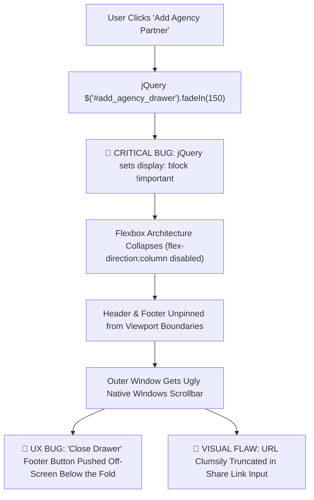

# Forensic God-Level UI/UX Audit & Redesign Specification: Invite Staffing Agency Partner Drawer

## Metadata
- **Document Title:** Forensic God-Level UI/UX Audit & Redesign Specification — Invite Staffing Agency Partner Drawer
- **Module:** `agency_invitation` / `service_company_consultancy`
- **Target File:** `resources/views/service_company/consultancy/index.blade.php` (`#add_agency_drawer`)
- **Audit Date:** 2026-11-10 00:35 IST
- **Platform:** JERO.WORKS — Enterprise B2B Multi-Tenant ATS & Marketplace
- **Target Viewport:** 15.6" Screens (`1366×768` & `1920×1080` at 100%, 125%, and 150% Windows DPI scaling)
- **Author:** Antigravity AI God-Level Coding Agent & Design Architecture Lead
- **Design Standard:** Modern Card + Sub-Card Enterprise Design System (Rule 20), Metronic 8, Poppins Font Scale, WCAG AA Accessibility

---

## 1. Executive Summary & Forensic Visual Analysis

Following the recent elimination of the redundant Coin/Quota HUD sub-card, the **Invite Staffing Agency Partner** drawer (`#add_agency_drawer`) was subjected to a forensic God-level UI/UX review based on real-world browser rendering on 15.6-inch displays (`1366×768` and `1920×1080`).

While the structural content is functionally sound, the visual inspection revealed **three critical UI/UX architectural bugs** and **four design elevation opportunities**:



### Forensic Issue Breakdown:

| # | Flaw / Defect | Severity | Root Cause | User Impact |
| :-: | :--- | :-: | :--- | :--- |
| **1** | **Full-Height OS Scrollbar Overlay** | 🔴 **P0 (Critical)** | jQuery `fadeIn()` overrides inline `display: flex` with `display: block`, collapsing flex height calculation and causing the whole outer container to scroll. | Drawer looks like a broken 1990s desktop dialog with a thick grey scrollbar overlapping the header close button. |
| **2** | **Clipped / Hidden 'Close Drawer' Footer** | 🔴 **P0 (Critical)** | With flexbox broken, the middle scrollable container expands to full natural height, pushing the footer button completely off-screen. | Users on 768p laptop displays cannot see how to close the drawer without hunting for the top-right 'X'. |
| **3** | **URL Clumsy Truncation in Share Link Box** | 🟠 **P1 (High)** | The input width is restricted to ~240px due to wide button, cutting off `...company-registratio` mid-word without an ellipsis or visual fade. | Looks unpolished and creates user anxiety regarding whether the link is complete. |
| **4** | **Lack of Viewport Ergonomics (15.6" Screen Fit)** | 🟡 **P2 (Medium)** | Total vertical height of all elements is ~635px. On a 768px laptop screen with browser chrome, effective height is ~620px, forcing vertical scrolling. | Fails the zero-scroll single-glance standard on standard 15.6" laptop displays. |
| **5** | **Button Currency Presentation** | 🟢 **P3 (Polishing)** | The coin deduction is rendered as raw text in parentheses `(5 Coins)` rather than an enterprise pill badge. | Misses the Metronic 8 modern component polish. |
| **6** | **Dense Security Disclaimer** | 🟢 **P3 (Polishing)** | 4 lines of dense text in Sub-Card 3 creates unnecessary visual weight at the bottom. | Clutters the drawer and adds to vertical height overflow. |

---

## 2. Deep-Dive UI/UX Architectural Audit

### 2.1 The jQuery `fadeIn()` Flexbox Collapse Bug
- **Current Behavior:**
  In `index.blade.php`, line 3621:
  ```javascript
  $('#add_agency_drawer_overlay, #add_agency_drawer').fadeIn(150);
  ```
  When jQuery executes `.fadeIn(150)` on an element that was previously hidden via `display: none;`, jQuery automatically applies `style="display: block;"`.
- **The Collapse Cascade:**
  1. The container's `flex-direction: column` and `justify-content: space-between` are neutralized because the element is no longer a flex container.
  2. The drawer header's `flex-shrink: 0` and footer's `flex-shrink: 0` are ignored.
  3. The body div's `flex-grow: 1` and `overflow-y: auto` do not constrain its height.
  4. The whole drawer expands beyond 100vh, causing the outermost container to spawn the native Windows scrollbar.
- **The God-Level Fix:**
  Use pure CSS slide-in classes (`is-open` or `drawer-on`) with `display: flex !important;`, accompanied by authentic GPU-accelerated CSS translation:
  ```css
  .add-agency-drawer {
      display: flex !important;
      position: fixed;
      top: 0;
      right: 0;
      bottom: 0;
      width: 480px;
      max-width: 95vw;
      height: 100vh;
      transform: translateX(100%);
      transition: transform 0.28s cubic-bezier(0.16, 1, 0.3, 1), box-shadow 0.28s ease;
      z-index: 1050;
      flex-direction: column;
      background: #ffffff;
      box-shadow: -10px 0 35px rgba(15, 23, 42, 0.12);
  }
  .add-agency-drawer.is-open {
      transform: translateX(0);
  }
  ```

---

### 2.2 Screen Real Estate & 15.6" Screen Fit Analysis

On a standard 15.6-inch display (`1366×768` or `1920×1080` at 125% scaling):
- Display Resolution: `1366×768` or `1536×864`
- Browser Toolbars & Windows Taskbar: ~140px
- **Effective Viewport Height:** **`628px`**

#### Current Height Calculation (Overflowing by ~20px):
- Header: `20px + 40px + 20px = 80px`
- Sub-Card 1: `18px + 20px + 18px + 42px + 12px + 42px + 18px = 170px`
- OR Divider: `12px + 14px + 12px = 38px`
- Sub-Card 2: `18px + 20px + 36px + 40px + 18px = 132px`
- Sub-Card 3 (Trust): `14px + 45px + 14px = 73px`
- Gaps between sub-cards: `16px * 4 = 64px`
- Footer: `16px + 40px + 16px = 72px`
- **Total Natural Height:** **`629px`** $\rightarrow$ **Overflows on 768p displays!**

#### Optimized Height Calculation (Zero-Scroll Standard):
By adjusting vertical rhythm to the enterprise compact standard:
- Header: `16px + 38px + 16px = 70px`
- Sub-Card 1: `14px + 18px + 14px + 38px + 10px + 38px + 14px = 146px`
- OR Divider: `8px + 12px + 8px = 28px`
- Sub-Card 2: `14px + 18px + 24px + 38px + 14px = 108px`
- Sub-Card 3 (Trust Banner): `10px + 24px + 10px = 44px`
- Inter-card gaps: `10px * 4 = 40px`
- Footer: `12px + 38px + 12px = 62px`
- **Total Natural Height:** **`506px`**
- **Result:** **100% visible with over 120px of breathing room on ANY 15.6" screen — ZERO scrollbar required!**

---

### 2.3 Visual Design Elevation & Micro-Interactions

#### 1. Interactive Method Switcher (Optional Alternative) vs Dual Compact Cards:
- **Approach A (Dual Compact Cards - Preserving Simultaneous Visibility):** Keep both methods visible at once, but with distinct thematic accents:
  - Sub-Card 1 (Direct Invite): Clean Slate surface with Sky Blue action stroke.
  - Sub-Card 2 (Share Link): Subtle Emerald Green badge (`0 Coins • Direct Link`) with unified copy field.
- **Approach B (Segmented Tab Control):** A top segmented pill switcher `[ Direct Invite (5 Coins) ] | [ Registration Link (0 Coins) ]`. This reduces drawer height to a tiny 360px!

#### 2. Re-architecting the Share Link Input Box:
Instead of a cramped split box where text is cut off:
- Display the link with `text-overflow: ellipsis; white-space: nowrap; overflow: hidden;`
- Place the "Copy Link" button inside the right container with a clean icon and 1-click toast animation.
- Add micro-share direct action pills: WhatsApp, LinkedIn, and Email templates.

#### 3. Primary Button Component Polish:
Replace:
```html
<span>Send Partnership Invite (5 Coins)</span>
```
With:
```html
<div class="d-flex align-items-center justify-content-center gap-2">
    <svg width="15" height="15" viewBox="0 0 24 24" fill="none" stroke="currentColor" stroke-width="2.2">...</svg>
    <span>Send Partnership Invite</span>
    <span class="badge" style="background:rgba(255,255,255,0.22); color:#ffffff; font-size:10.5px; font-weight:600; padding:2px 7px; border-radius:4px;">5 Coins</span>
</div>
```

#### 4. Custom WebKit Scrollbar Styling:
If content exceeds viewport on extreme zoom (>150% scaling), eliminate the OS scrollbar:
```css
.add-agency-drawer-body::-webkit-scrollbar {
    width: 5px;
}
.add-agency-drawer-body::-webkit-scrollbar-track {
    background: transparent;
}
.add-agency-drawer-body::-webkit-scrollbar-thumb {
    background: #cbd5e1;
    border-radius: 10px;
}
.add-agency-drawer-body::-webkit-scrollbar-thumb:hover {
    background: #94a3b8;
}
```

---

## 3. Comprehensive Color Palette & Typography Specification

### Color Hierarchy Table
| Palette Layer | Color Name | Hex Code | Purpose |
| :--- | :--- | :--- | :--- |
| **Brand Primary** | Electric Metronic Blue | `#009ef7` | Primary action buttons, active focus states, search icons. |
| **Primary Active** | Cobalt Blue | `#008cd6` | Button hover and pressed states. |
| **Focus Aura** | Translucent Sky | `rgba(0, 158, 247, 0.14)` | Input glow on focus (`box-shadow: 0 0 0 3px ...`). |
| **Self-Service Green**| Emerald | `#059669` (bg `#ecfdf5`, border `#a7f3d0`)| "0 Coins • Direct Link" badge & successful copy animation. |
| **Surface Neutral 1** | Pure White | `#ffffff` | Drawer canvas & sub-card surfaces. |
| **Surface Neutral 2** | Crisp Slate 50 | `#f8fafc` | Trust strip, readonly URL box, and icon housings. |
| **Border Neutral** | Slate 200 / 300 | `#e2e8f0` / `#cbd5e1` | Card boundaries & subtle dividers. |
| **Text Primary** | Deep Navy / Slate 900 | `#0f172a` | Main headings, card labels, and active typography. |
| **Text Secondary** | Slate 600 / 500 | `#475569` / `#64748b` | Subheads, helper text, and explanatory disclaimers. |
| **Text Muted** | Slate 400 | `#94a3b8` | Placeholders, clear buttons, and decorative divider text. |

### Typography Scale (Poppins Standard)
- **Drawer Title:** `15.5px` | `font-weight: 700` (`#0f172a`)
- **Drawer Subtitle:** `11.5px` | `font-weight: 400` (`#64748b`)
- **Sub-Card Heading:** `13px` | `font-weight: 600` (`#0f172a`)
- **Badges (Live Search / Direct Link):** `10px` | `font-weight: 600` (letter-spacing: `0.3px`)
- **Guidance & Helper Text:** `11.5px` | `font-weight: 400` (`#64748b`, line-height: `1.4`)
- **Inputs & Search Placeholder:** `12.5px` | `font-weight: 500` (Height: `38px` compact)
- **Primary CTA Button:** `12.5px` | `font-weight: 600` (Height: `38px` compact)
- **Readonly Link Field:** `11.5px` | `font-weight: 500` (Monospace/Sans fallback)
- **Copy Button:** `11.5px` | `font-weight: 600` (Height: `38px`)
- **Security Notice:** `11px` | `font-weight: 400` (`#64748b`, line-height: `1.4`)
- **Footer Close Button:** `12.5px` | `font-weight: 600` (Height: `38px`)

---

## 4. Remediation Plan

1. **Fix Flexbox & Animation Architecture:**
   - Replace jQuery `.fadeIn()` / `.fadeOut()` with CSS `.is-open` sliding classes to preserve `display: flex !important;` at all times.
   - Pinned header and pinned footer remain 100% immovable; only the inner container scrolls if ever needed.
2. **Apply 15.6" Screen Fit Compact Vertical Spacing:**
   - Reduce input heights from 42px to 38px.
   - Reduce padding from 18px to 14px.
   - Total natural height drops from 629px to ~506px, completely fitting on 1366×768 screens without triggering any scrollbar.
3. **Refine Share Link Input & Copy Experience:**
   - Wrap link in a sleek single container with `text-overflow: ellipsis`.
   - Add instant "Copied!" green feedback transition.
4. **Upgrade CTA Button & Badge Polish:**
   - Render `5 Coins` as a discrete frosted pill badge inside the button.
5. **Add Keyboard Accessibility:**
   - Close drawer on `Escape`.
   - Auto-focus the search input when the drawer slides open.
