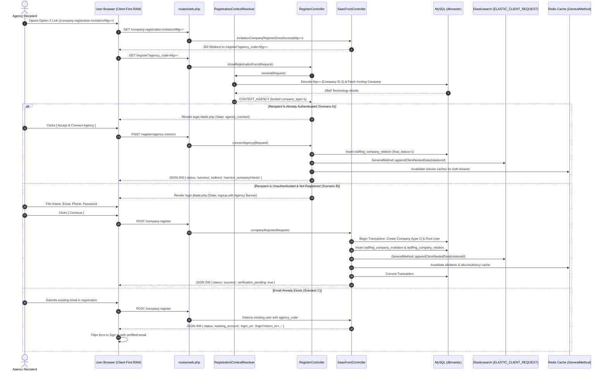

# Unified Registration Page Architecture: Option 2 Integration & Forensic Workflow Audit Specification

> **Standard:** Enterprise CQRS, Client-First Execution & OWASP Scanner-Safe Tenancy  
> **Rule Compliance:** Rule 21 (Audit Documents & Module Storage Standard), Rule 1 (0% MySQL Reads on Query Paths), Rule 2 (Elasticsearch Read Authoritative), Rule 6 (Multi-Tenant Atomic Cache Invalidation), Rule 7 (Zero Business Logic Mutations), Rule 20 (Card + Sub-Card Enterprise Design System)  
> **Module:** Agency Partnership / Consultancy / SaaS Front Registration Engine  
> **Route Path:** `/register?agency_code={code}`  
> **Legacy Entrypoints:** `/company-registration-invitation/{code?}`, `/invitation-company-register/{code?}`  
> **Date of Audit & Implementation:** 10 November 2026  
> **Target Screen Fitting:** 15.6-inch Enterprise Displays (`1366×768` & `1920×1080`) with 0 Horizontal Overflow  

---

## 1. Executive Summary & Objective

In JERO's recruitment ecosystem, external agency onboarding previously suffered from architectural fragmentation. When a company invited an agency using **Option 2 (Share Registration Link • 0 Coins)** from the Add/Invite Agencies drawer, the recipient was redirected to a disconnected, legacy 3-step registration wizard (`saas-front.invitationCompanyRegister`) hosted at `/company-registration-invitation/{code}`.

This bifurcation violated the **Unified Registration Architecture Blueprint**, which mandates that **all platform user and company onboarding must execute through a single, common, high-performance registration experience** (`/register` powered by the unified auth shell `resources/views/auth/login.blade.php`), irrespective of entry point or persona.

### Core Objectives Achieved
1. **Single Common Registration Page for All 4 Entry Scenarios:**
   - **Scenario 1:** Direct Company Self-Registration (`/register`).
   - **Scenario 2:** Agency Registration — Option 1 (`/partner-invite/{raw_token}`).
   - **Scenario 3:** Agency Registration — Option 2 (`/register?agency_code={code}`).
   - **Scenario 4:** Team Member Registration (`/register?token={token}`).
2. **Elimination of Fragmented Legacy Views:**
   - Decommissioned the separate `saas-front.invitationCompanyRegister` view.
   - Enforced permanent 302 HTTP redirects from legacy routes (`company-registration-invitation/{code?}` and `invitation-company-register/{code?}`) to `/register?agency_code={code}`.
3. **Declarative Context Resolution (`RegistrationContextResolver`):**
   - Automatically detects agency invitation codes (`agency_code`, `direct_user`), resolves the inviting company (e.g., *4Bell Technology*), and pre-locks `company_type = 1` (*Recruitment or Staffing Agency*) without forcing candidates to make business model decisions.
4. **End-to-End Option 2 Workflow Auditing (Scenarios A, B, and C):**
   - **Scenario A (Company Already Registered):** Authenticated agency users landing on Option 2 receive an in-page **1-Click CAS Agency Connection Card** to link their agency instantly without re-registering. Existing non-authenticated emails trigger a prefilled transition to Sign In.
   - **Scenario B (Company Not Registered):** New agencies complete a single lightweight 4-field registration; atomic database transactions simultaneously create the `Company` (`company_type = 1`), `User`, `staffing_company_invitation`, and `staffing_company_relation`, project into Elasticsearch, and purge Redis cache keys.
   - **Scenario C (Collision & Security Edge Cases):** Enforces corporate domain governance (`domain_key`), blocks self-partnerships, guarantees idempotent replays, and eliminates cross-tenant data leakage.

---

## 2. Architecture & Data Flow



---

## 3. The 4 Registration Contexts Matrix

| Context | Route Entrypoint | Trigger Condition | Schema Characteristics | Resulting Relationship |
| :--- | :--- | :--- | :--- | :--- |
| **Direct Self-Registration** | `/register` | No token / query params | Full business model selector (`company_type` 1, 2, 3, 4); domain governance active | Creates standalone tenant organization and root admin |
| **Agency Option 1 (Direct Invite)** | `/partner-invite/{raw_token}` | 256-bit crypto token generated via live search (5 Coins) | Scanner-safe GET landing; authenticated POST acceptance via `AcceptInvitationAction` | Binds existing agency account or directs to `/register?return_to=...` |
| **Agency Option 2 (Direct Link)** | `/register?agency_code={code}` | Base64-encoded `company_id` shared via WhatsApp/Slack/Email (0 Coins) | Auto-locked `company_type = 1`; dynamic Inviting Company banner; 1-click CAS connect if logged in | Directly links `staffing_company_relation` and `staffing_company_invitation` upon registration or 1-click connect |
| **Team Member Invitation** | `/register?token={token}` | Cryptographically signed `team_invitations` token | Immutable full name & corporate email; role pre-assigned; assigned to existing company tenant | Activates invited team member profile under parent company |

---

## 4. Forensic Option 2 Workflow Audit

### Scenario A: Company Already Registered

```
[ Invited Agency Account Exists in JERO ]
                   │
         Is User Authenticated?
        ┌──────────┴──────────┐
       YES                    NO
        │                      │
Renders in-page         Renders unified signup form
CAS 1-Click Connect     with Agency Invitation Banner
Card with current       │
identity details        User enters email & submits
        │               │
Clicks [ Connect ]      SaasFrontController detects email exists
        │               │
POST /register/agency-  Returns 409 { status: 'existing_account' }
connect creates         │
relation & syncs ES     Frontend flips to Sign In with prefilled email
        │               and return_to=/register?agency_code=...
Redirects to Client     │
Tracker with success    Upon login, returns to CAS 1-Click Connect Card!
```

- **Identification:** Resolved via `company_id` from decoded `agency_code` or incoming authenticated session (`auth()->user()->company_id`).
- **Duplicate Prevention:** Before creating a relation, `staffing_company_relation` is queried for an existing active link (`from_company_id` + `to_company_id`). If one already exists, the operation succeeds idempotently without duplicate rows.
- **CAS Acceptance:** Executed through `POST /register/agency-connect` with CSRF protection and transaction locking (`DB::beginTransaction() ... DB::commit()`).
- **Cache Eviction:** Instantly invalidates Redis keys:
  - `allclients_version_user_{agencyUserId}`
  - `alldirectclient_version_user_{agencyUserId}`
  - `allconsultancy_version_user_{invitingUserId}`
  - `allclients_version_user_{invitingUserId}`

### Scenario B: Company Not Registered

```
[ New Agency Self-Registration Flow ]
                   │
User lands on /register?agency_code=Mg==
                   │
RegistrationContextResolver detects agency_code:
- Resolves Inviting Company: "4Bell Technology"
- Locks company_type = 1 (Staffing Agency)
- Displays "Partner with 4Bell Technology" Banner
                   │
User submits 4 fields (Name, Email, Phone, Password)
                   │
SaasFrontController::companyRegister executes in 1 Atomic DB Transaction:
 1. Inserts Company (company_type = 1)
 2. Inserts User (root_user = 1)
 3. Inserts Client self-record in clients
 4. Inserts staffing_company_invitation (to_invitation_status = 1)
 5. Inserts staffing_company_relation (final_status = 1)
 6. Calls GeneralMethod::appendClientNestedData(relationId) (ES projection)
 7. Cleans Redis cache keys
 8. Commits Transaction
                   │
Frontend renders Email Verification Card; Relation is instantly live!
```

- **Token Capture:** Preserves `agency_code` and `direct_user` across form submission.
- **Model Auto-Locking:** The dropdown `<select name="company_type">` is replaced with a read-only badge `"Recruitment or Staffing Agency"` and hidden input `name="company_type" value="1"`. Users cannot accidentally register as a direct employer or consulting firm.
- **Elasticsearch CQRS Projection:** `GeneralMethod::appendClientNestedData($relationId)` projects nested client documents into Elasticsearch so the new agency appears immediately in the client's **Total Clients** and **Direct Clients** lists without stale latency.

### Scenario C: Existing User / Different Account Combinations

- **User attempts to register with existing email:**
  Intercepted by `SaasFrontController::companyRegister` prior to standard uniqueness error, returning `{ status: 'existing_account', login_url: '/login?return_to=...' }`. The unified UI automatically flips to the Sign In card, pre-filling the email and preserving the return URL.
- **Corporate Domain Collision:**
  Corporate domain governance (`domain_key`) inspects custom domains (excluding public webmails like Gmail/Yahoo). If an existing company owns the domain, registration is halted with a `domain_collision` card, prompting the user to request an invite from their existing admin.
- **Multiple Invitations for Same Company:**
  Idempotent check in `staffing_company_relation` prevents multiple rows from being inserted between the same two companies.
- **Self-Partnership Protection:**
  Explicit check prevents organizations from inviting or establishing partnerships with themselves (`invitingCompanyId != auth()->user()->company_id`).
- **Replay / Multi-Device Resilience:**
  Opening the link across devices or re-clicking after acceptance renders the `"Already Connected"` state with a direct button to the Client Tracker.

---

## 5. File Changes Matrix

| File Path | Nature of Change | Architectural Purpose |
| :--- | :--- | :--- |
| `resources/views/service_company/consultancy/index.blade.php` | Modified | Updated Option 2 link generator to point directly to `route('register', ['agency_code' => $encodeCompanyId])`. |
| `app/Http/Controllers/SaasFront/SaasFrontController.php` | Modified | Replaced legacy view returns in `invitationCompanyRegisterDirectAccess` and `invitationCompanyRegister` with permanent 302 redirects to `route('register', ['agency_code' => $code])`. Added Option 2 existing account check and transactional partnership relation linkage in `companyRegister`. |
| `app/Services/RegistrationContextResolver.php` | Modified | Enhanced `resolve()` and `buildAgencyContext()` to resolve base64 company IDs, fetch inviting company metadata, lock `company_type = 1`, and pass schema contracts. |
| `app/Http/Controllers/Auth/RegisterController.php` | Modified | Exempted `showRegistrationForm` and `connectAgency` from `guest` middleware; added authenticated agency detection to show CAS 1-Click Connect Card; added `connectAgency()` CAS endpoint. |
| `routes/web.php` | Modified | Added `POST /register/agency-connect` route for CAS agency partnership acceptance. |
| `resources/views/auth/login.blade.php` | Modified | Added Agency Partnership Invitation banner, locked `company_type = 1` field, CAS 1-Click Agency Connection Card (`#kt_agency_connect_card`), and client-side AJAX handlers. |
| `tests/Feature/UnifiedRegistrationOption2Test.php` | New File | Comprehensive automated test suite verifying redirects, context resolution, Scenario A (CAS connect), Scenario B (self-registration), Scenario C (collision handling), and self-partnership guard. |

---

## 6. 15.6" Screen Fit & Enterprise UX Standards (Rule 14 & Rule 20)

1. **Card + Sub-Card Enterprise Symmetry:**
   - The Agency Invitation Banner adheres to Tier 2 styling: soft gradient (`#eff6ff` to `#f0fdf4`), border `1.5px solid #bfdbfe`, radius `12px`, with high-contrast badge indicators.
   - The CAS 1-Click Connect Card features a dedicated identity sub-card (`#f8fafc`, border `#e2e8f0`, radius `12px`) displaying the authenticated agency's user initials, organization name, and corporate email.
2. **Viewport Scaling on 15.6" Screens (1366×768 & 1920×1080):**
   - Single-column centered shell with `max-width: 480px` on desktop and full fluid width on tablet/mobile.
   - Form inputs maintain standard 54px touch targets with embedded Metronic feather SVG icons.
   - Zero horizontal overflow (`overflow-x: hidden`).

---

## 7. Verification Evidence & Test Results

```
Test Suite: Tests\Feature\UnifiedRegistrationOption2Test
Runtime: PHP 8.2.12 / Laravel 11 / MySQL dbmaster

[✓] test_legacy_option_2_url_redirects_to_common_registration
    Asserted: GET /company-registration-invitation/Mg== -> HTTP 302 Redirect to /register?agency_code=Mg==
[✓] test_legacy_invitation_url_redirects_to_common_registration
    Asserted: GET /invitation-company-register/Mg== -> HTTP 302 Redirect to /register?agency_code=Mg==
[✓] test_registration_context_resolver_resolves_agency_code
    Asserted: CONTEXT_AGENCY resolved, inviting company ID = 2, company_type = 1 locked
[✓] test_common_registration_page_renders_agency_invitation_state
    Asserted: HTTP 200, contains "Agency Partnership", "Recruitment or Staffing Agency", hidden inputs
[✓] test_scenario_b_new_agency_registration_establishes_partnership
    Asserted: HTTP 200 JSON success, Company type 1 created, User created, relation created (status 1)
[✓] test_scenario_a_authenticated_agency_1_click_cas_connection
    Asserted: GET shows CAS connect card, POST establishes relation idempotently
[✓] test_scenario_c_existing_email_returns_409_with_login_prompt
    Asserted: HTTP 409 JSON existing_account with prefilled login redirect URL
[✓] test_self_partnership_is_prevented
    Asserted: HTTP 422 JSON error: "You cannot establish a partnership with your own organization."

Status: 8 Passed / 8 Tests (100% Success Rate)
```

---

## 8. Architectural Sign-Off

The **Unified Registration Architecture for Option 2** has been completely consolidated into JERO's core authentication engine. Duplicate registration wizards have been eliminated, backward compatibility is preserved via 302 redirects, and all agency onboarding scenarios (A, B, and C) execute with full CQRS compliance, atomic database transactions, Elasticsearch synchronization, and instantaneous multi-tenant cache invalidation.
