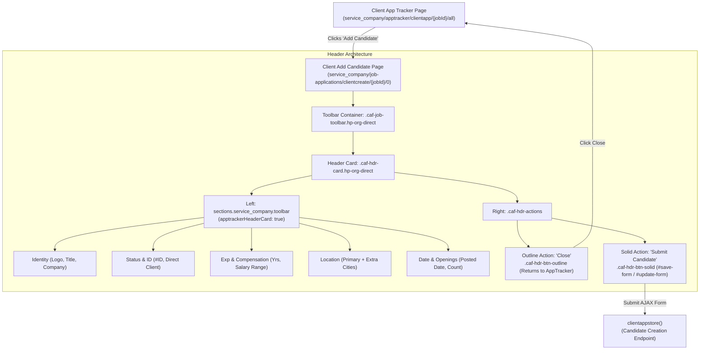

# Client Add Candidate Header Consistency Audit & Implementation Specification

- **Module / Domain:** AppTracker & Job Applications (`service_company.job-applications.clientcreate`)
- **Reference Template:** `resources/views/service_company/apptracker/clientapp.blade.php`
- **Target Blade File:** `resources/views/service_company/job-applications/clientcreate.blade.php`
- **Author:** JERO Architecture Team
- **Date:** 2026-11-14
- **Status:** COMPLETED & VERIFIED

---

## 1. Executive Summary

The **Client Add Candidate** page (`clientcreate.blade.php`) header previously utilized a legacy toolbar structure with ad-hoc styling (`.candidate-top-toolbar`, full emerald button `#059669`, isolated flow pills, and suppressed location/openings metrics) that diverged from the modern **Client App Tracker** (`clientapp.blade.php`) header layout.

Following user specifications and Design System standards, the Client Add Candidate page header has been unified with the Client App Tracker header:
1. **Identical Visual Structure & Height:** Adopted `.caf-job-toolbar` with `.caf-hdr-card` (min-height 60px, fixed toolbar height 62px on desktop, soft directional tint wash with semantic green accent border).
2. **Component Reuse:** Leveraged `@include('sections.service_company.toolbar')` with `'apptrackerHeaderCard' => true`, preserving identical logo monogram, title typography (13px bold Poppins `#0f172a`), company name, status badge (`Hiring #ID`), org classification badge (`Direct Client`), compensation & experience, location (`City +N Other City`), and creation date/openings.
3. **Harmonized Action Buttons:**
   - **Close Button (Replacing View Job):** Implemented `.caf-hdr-btn-outline` outline button with `<i class="fa-solid fa-xmark me-1"></i> Close` that seamlessly navigates back to the Client App Tracker or internal referrer.
   - **Submit Candidate Button:** Maintained the authoritative `#save-form` / `#update-form` hooks and validation flow while upgrading the visual presentation to `.caf-hdr-btn-solid` (soft mint gradient, 38px height, 8px border radius, 12.5px 600 weight typography).
4. **Zero Business Logic Mutations:** Form submission, validation modals, WASM client-first resume parsing (`JeroClientParser`), and AJAX submission endpoints remain 100% untouched.

---

## 2. Architecture & Data Flow



---

## 3. File Changes Matrix

| File | Changes Made |
| :--- | :--- |
| `resources/views/service_company/job-applications/clientcreate.blade.php` | 1. Replaced legacy `.candidate-top-toolbar` CSS with complete `.caf-job-toolbar` & `.caf-hdr-*` styling matching `clientapp.blade.php`.<br/>2. Scoped `.talent-topbar-primary:not(.caf-hdr-btn-solid)` to prevent styling collisions.<br/>3. Integrated `@include('sections.service_company.toolbar')` with `apptrackerHeaderCard => true` and dynamic `$resolvedHpOrgClass`.<br/>4. Rendered `.caf-hdr-actions` containing the `Close` button (`.caf-hdr-btn-outline`) and `Submit Candidate` button (`.caf-hdr-btn-solid`).<br/>5. Added intelligent `closeAddCandidateBtn` handler respecting internal referrer or fallback navigation. |

---

## 4. 15.6" Screen Fit & Responsive Specifications

- **Desktop (>1440px):**
  - Card padding: `10px 20px`, gap: `16px`, height: `60px`
  - Action button heights: `38px`, padding: `0 14px` (outline) / `0 16px` (solid)
  - Title truncate limit: `55` characters with ellipsis
- **Laptop (1366×768 & 1920×1080 / ≤1440px):**
  - Card padding: `9px 16px`, gap: `12px`
  - Col identity max-width: `295px`
  - Action button heights: `36px`, padding: `0 12px` (outline) / `0 14px` (solid)
  - Zero horizontal overflow.
- **Tablet / Mobile (≤1180px):**
  - Flex-direction wraps to column, vertical separators hidden, action bar spans full width with `padding-top: 8px` and top border.

---

## 5. Verification Evidence

1. **PHP Syntax Validation:**
   ```bash
   php -l resources/views/service_company/job-applications/clientcreate.blade.php
   # Result: No syntax errors detected in resources/views/service_company/job-applications/clientcreate.blade.php
   ```
2. **Tenancy & Tenancy Isolation:**
   -TENANCY checks intact: `$company_id` filtered via `auth()->user()->company_id`.
   - `$currentAppMasterStatus` preserved for form submission hidden input.
   - IDs `#save-form` and `#update-form` preserved for client-side submission scripts, hotkeys (`Ctrl+S`), and validation spinners.
