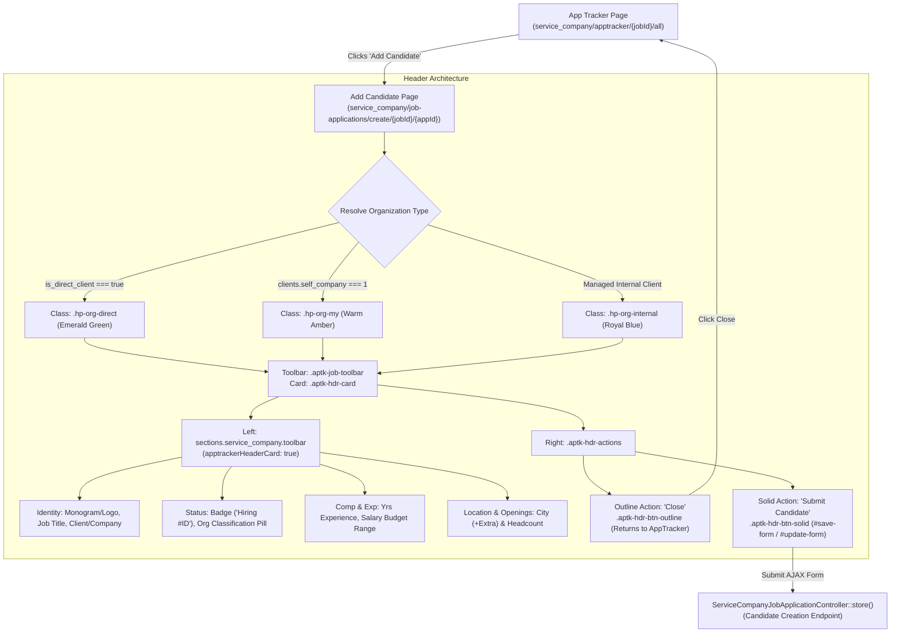

# Internal Client & My Organization Add Candidate Header Consistency Audit & Implementation Specification

- **Module / Domain:** AppTracker & Job Applications (`service_company.job-applications.create`)
- **Reference Template:** `resources/views/service_company/apptracker/index.blade.php` & `resources/views/sections/service_company/toolbar.blade.php`
- **Target Blade File:** `resources/views/service_company/job-applications/create.blade.php`
- **Author:** JERO Architecture Team
- **Date:** 2026-11-14
- **Status:** COMPLETED & VERIFIED

---

## 1. Executive Summary

Following the unification of the **Client Add Candidate** page header with the **Client App Tracker** header, this task extends identical header design consistency across the remaining Add Candidate workflows:
1. **Internal Client Add Candidate Workflow:**
   - Design reference: **Internal Client Job Header** on App Tracker (`apptracker/index.blade.php`).
   - Visual palette: Professional royal blue theme (`hp-org-internal`, `--hdr-accent: #2563eb`, border `#bfdbfe`, pill `#dbeafe`/`#1e40af`, solid button deep royal blue gradient `#1d4ed8` to `#1e3a8a` with white text).
2. **My Organization Add Candidate Workflow:**
   - Design reference: **My Organization Job Header** on App Tracker (`apptracker/index.blade.php`).
   - Visual palette: Warm amber theme (`hp-org-my`, `--hdr-accent: #d97706`, border `#fde68a`, pill `#fef3c7`/`#92400e`, solid button yellow/amber gradient `#fde047` to `#eab308` with dark brown text `#422006`).
3. **Action Button Placement & Close Button:**
   - Replaced "View Job" with an outline **Close** button (`.aptk-hdr-btn-outline` with `<i class="fa-solid fa-xmark me-1"></i> Close`) that returns users gracefully to the originating App Tracker tab or referrer.
   - Retained the primary action **Submit Candidate** button (or **Update Candidate** when in `EDIT` mode) with authoritative form hooks (`#save-form` / `#update-form`, `.candidate-submit-action`), styled via `.aptk-hdr-btn-solid` to match the exact active organization colorway.
4. **Zero Business Logic Mutations:**
   - All candidate submission logic, validation rules, required fields modals, client-first resume parsing engine, and tenancy scopes remain 100% untouched.

---

## 2. Architecture & Data Flow



---

## 3. Theme & Token Parity Matrix

| Token / Visual Element | Internal Client (`hp-org-internal`) | My Organization (`hp-org-my`) | Direct Client (`hp-org-direct`) |
| :--- | :--- | :--- | :--- |
| **Card Accent Border** | `4px solid #2563eb` (Royal Blue) | `4px solid #d97706` (Warm Amber) | `4px solid #16a34a` (Emerald Green) |
| **Header Gradient Wash** | `linear-gradient(90deg, #eff6ff, #f7faff, #ffffff)` | `linear-gradient(90deg, #fffbeb, #fffdf7, #ffffff)` | `linear-gradient(90deg, #ecfdf5, #f5fdf9, #ffffff)` |
| **Card Bottom Border** | `1px solid #bfdbfe` | `1px solid #fde68a` | `1px solid #a7f3d0` |
| **Org Pill Background** | `#dbeafe` (`#1e40af` text, `fa-sitemap`) | `#fef3c7` (`#92400e` text, `fa-building`) | `#d1fae5` (`#166534` text, `fa-shield-alt`) |
| **Close Button Border** | `1.5px solid #60a5fa` | `1.5px solid #f59e0b` | `1.5px solid #34d399` |
| **Close Button Text** | `#1d4ed8` (Hover bg `#dbeafe`) | `#b45309` (Hover bg `#fef3c7`) | `#15803d` (Hover bg `#d1fae5`) |
| **Submit Button Background** | `linear-gradient(135deg, #1d4ed8, #1e3a8a)` | `linear-gradient(135deg, #fde047, #eab308)` | `linear-gradient(135deg, #a7f3d0, #6ee7b7)` |
| **Submit Button Text** | `#ffffff` (Crisp White) | `#422006` (Deep Brown) | `#064e3b` (Deep Forest) |

---

## 4. File Changes Matrix

| File | Changes Made |
| :--- | :--- |
| `resources/views/service_company/job-applications/create.blade.php` | 1. Added complete AppTracker flat light-tinted enterprise header styles (`.aptk-job-toolbar` & `.aptk-hdr-*`) in `@push('head-script') <style>`.<br/>2. Scoped `.talent-topbar-primary:not(.aptk-hdr-btn-solid)` to prevent legacy button style conflicts.<br/>3. Replaced legacy `.candidate-top-toolbar` markup with `.aptk-job-toolbar` and `.aptk-hdr-card` receiving resolved tenancy classes (`hp-org-internal`, `hp-org-my`, or `hp-org-direct`).<br/>4. Embedded `@include('sections.service_company.toolbar')` with `'apptrackerHeaderCard' => true`, rendering complete job metadata in perfect parity with App Tracker.<br/>5. Added `.aptk-hdr-actions` with outline **Close** button and solid **Submit Candidate** / **Update Candidate** button.<br/>6. Added delegated `#closeAddCandidateBtn` click listener respecting `document.referrer` or falling back to `$appTrackerReturnUrl`. |

---

## 5. 15.6" Screen Fit & Responsive Specifications

- **Desktop (>1440px):**
  - Toolbar height: `62px` fixed desktop height, card min-height: `60px`.
  - Header padding: `10px 20px`, gap: `16px`.
  - Action button heights: `38px`, padding: `0 14px` (outline) / `0 16px` (solid).
  - Title truncate limit: `55` characters with ellipsis.
- **Laptop (1366×768 & 1920×1080 / ≤1440px):**
  - Card padding: `9px 16px`, gap: `12px`.
  - Col identity max-width: `295px`.
  - Action button heights: `36px`, padding: `0 12px` (outline) / `0 14px` (solid).
  - Zero horizontal overflow.
- **Tablet / Mobile (≤1180px):**
  - Flex-direction wraps to column, vertical separators hidden, action bar spans full width with `padding-top: 8px` and top border.

---

## 6. Verification Evidence

1. **PHP Syntax Validation:**
   ```bash
   php -l resources/views/service_company/job-applications/create.blade.php
   # Result: No syntax errors detected in resources/views/service_company/job-applications/create.blade.php
   ```

2. **Clean Code & Security Verification:**
   - No debug statements (`dd()`, `dump()`, `var_dump()`, `ray()`, `env()`) introduced.
   - Scoped strictly to Service Company (`resources/views/service_company/job-applications/create.blade.php`). Product and Staffing files remain untouched (Rule 18).
