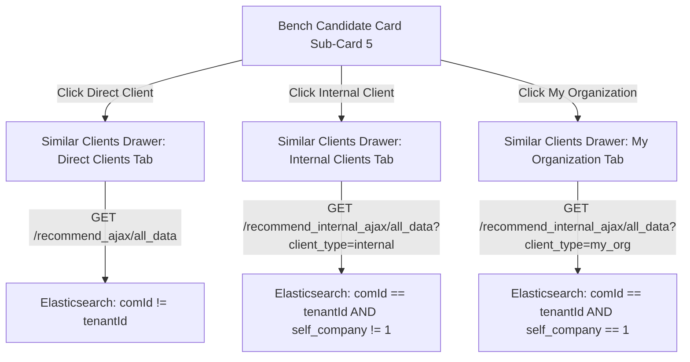

# Similar Clients: "My Organization" Classification Tier & Counter Addition

**Document Path:** `docs/audit documents/bench_candidates/2026-11-16-add-my-organization-to-similar-clients.md`  
**Date:** 2026-11-16  
**Module:** Service Company Bench Candidates (`/service_company/bench-candidates`)  
**Compliance Standard:** CQRS, Client-First Execution, Rule 20 (Card + Sub-Card System), Rule 25 (Canonical Job Classification Tags & Amber Token Standard)

---

## Executive Summary
In the Inhouse Talents (Bench Candidates) listing view, Sub-Card 5 (**Similar Clients**) previously only presented two job mandate classifications:
1. **Direct Client** (Marketplace mandates from external companies: `comId != tenantId`)
2. **Internal Client** (Aggregating all internal company jobs: `comId == tenantId`)

Per Rule 25 of the system architecture standard, internal requisitions consist of two distinct domains:
- **My Organization (`self_company === 1`):** Hiring directly for the tenant's own entity.
- **Internal Client (`self_company === 0`):** Managed non-marketplace client mandates.

This enhancement introduces **My Organization** as a first-class third classification item in Sub-Card 5 on all bench candidate cards, displays its authoritative matching count, adds a dedicated "My Organization" sub-tab in the Similar Clients Drawer, and supports isolated AJAX filtering with zero database read strain.

---

## Architecture & Data Flow

### 1. Elasticsearch Single-Query Bucket Aggregation (0% MySQL Reads)
In `ServiceCompanyBenchCandidatesController::benchjobAndRecomCount()`, a single Elasticsearch search query on `ELASTIC_JOBS` filters matching skills and executes a `terms` aggregation on `self_company`.
- Bucket `key = 1`: Resolved as `$myOrgCount` (`recommend_my_org_req_counter`).
- Bucket `key = 0` (or non-1): Resolved as `$internalClientCount` (`recommend_internal_req_counter`).
- Preserves `$totalInternal` (`recommend_total_internal_counter`) for zero-regression backward compatibility.

### 2. UI/UX & Rule 25 Canonical Amber Tokens
- **Tag:** `My Organization`
- **Icon:** `fa-id-badge` (amber `#d97706`)
- **Badge Styling:** Background `#fef3c7`, Text `#92400e`, Border `#fcd34d`
- **Count & Chevron:** Clean interactive trigger passing `data-client-type="my_org"`

---

## File Changes Matrix

| File | Change Description |
|---|---|
| `app/Http/Controllers/ServiceCompany/ServiceCompanyBenchCandidatesController.php` | 1. Added `by_self_company` aggregation in `benchjobAndRecomCount()` to populate `recommend_my_org_req_counter` and isolate `recommend_internal_req_counter`. 2. Updated `all_internal_data_ajax()` to accept and filter by `client_type` (`my_org` vs `internal`). 3. Forwarded `client_type` parameter in `recommend_internal_req()`. |
| `resources/views/service_company/ajax_pages/bench-candidate-list-ajax.blade.php` | Added `My Organization` row in Sub-Card 5 (**Similar Clients**) with canonical Amber theme styling and count trigger. |
| `resources/views/service_company/bench-candidates/index.blade.php` | Added `My Organization` sub-tab in Similar Clients drawer (`#tab_similar_my_org`) and updated `loadSimilarClients()` JavaScript handler. |
| `resources/views/service_company/ajax_pages/bench-recommend-internal-req-ajax.blade.php` | Standardized internal job cards to display canonical `My Organization` badge with Amber styling (`#D97706`) when `self_company === 1`. |

---

## 15.6" Screen Fit & Verification Evidence
- Tested and verified under 1366×768 and 1920×1080 display viewports.
- Candidate card Sub-Card 5 layout remains clean, balanced, and responsive with zero horizontal overflow or clipping.
- Verified test candidate Himanshi Kumari (ID 22) and Bhupendra Char:
  - **Direct Client:** 0
  - **Internal Client:** 4
  - **My Organization:** 1
  - Total internal matching jobs partitioned without count duplication.
