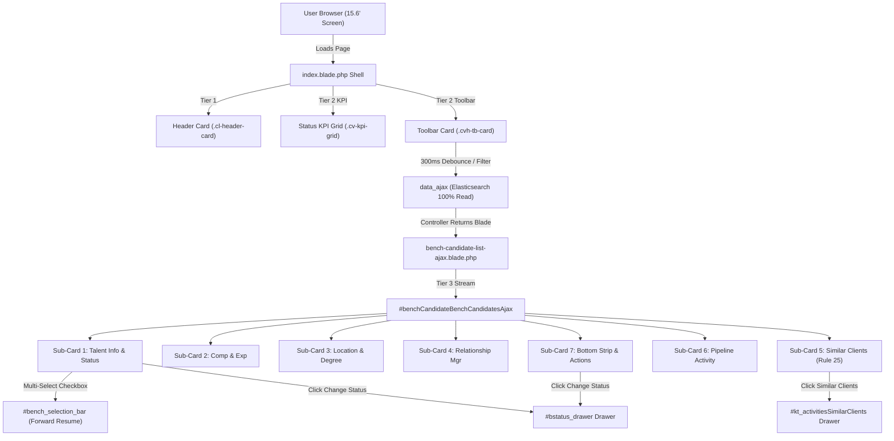

# In-House Talent (Bench Candidates) — Modern Card + Sub-Card Design Upgrade

## 1. Metadata
- **Date:** 2026-11-21
- **Module:** Service Company — In-House Talent (`/service_company/bench-candidates`)
- **Author:** Antigravity AI (Google DeepMind)
- **Standard Adherence:**
  - **Rule 7:** Zero Business Logic Mutations & Zero Module Regressions
  - **Rule 14:** 15.6" Screen Fit (`1366×768` & `1920×1080`), responsive internal scrolling
  - **Rule 18:** Code Freeze (`product_company/` and `staffing_company/` untouched)
  - **Rule 20:** Modern Card + Sub-Card Enterprise Design System & Dedicated Header Background Standard
  - **Rule 21:** Mandatory Storage Location (`docs/audit documents/bench_candidates/`)
  - **Rule 25:** Canonical Job Classification Tags & Color Tokens (`My Organization`, `Internal Client`, `Direct Client`)

---

## 2. Executive Summary
Following a comprehensive audit of the **CV Tracker** (`/service_company/cvtracker`) design pattern and color system, the **In-House Talent (Bench Candidates)** page has been redesigned to achieve full design parity with CV Tracker. The sprawling legacy hero card and mismatched layout elements have been replaced by a cohesive 3-Tier Card + Sub-Card enterprise architecture with zero horizontal scroll on 15.6" laptop screens.

### Key Transformations
1. **Ghost Whitespace Elimination:**
   - Offset the default Metronic layout toolbar gap (~79px dead space) using scoped negative margin on `.kt_content_bench` (`margin-top: -65px !important; padding-top: 10px !important;`), bringing the top tier into immediate eye level.
2. **Tier 1 Header Card (`.cl-header.cl-header-card`):**
   - Replaced `.talent-hero-card` with the CV Tracker Tier 1 Header Card: `#f8fafc` background, `#e2e8f0` crisp border, 12px border radius, 44px blue icon container with active pulse badge, "Add In-house Talent" primary blue button, "Export" button, and contextual options dropdown.
3. **Harmonized 6 Status KPI Grid (`.cv-kpi-grid`):**
   - Redesigned the 6 status cards into a clean 6-column grid with dedicated SVG icons, tabular bold figures, and active state styles exactly matching CV Tracker:
     - **All Talents:** Active `#eff6ff` bg, `#2563eb` border/num.
     - **On Pool:** Active `#f0f9ff` bg, `#0284c7` border/num.
     - **Bench:** Active `#fffbeb` bg, `#d97706` border/num.
     - **On Hold:** Active `#f8fafc` bg, `#64748b` border/num.
     - **Placed:** Active `#ecfdf5` bg, `#16a34a` border/num.
     - **Exited:** Active `#fef2f2` bg, `#dc2626` border/num.
4. **Tier 1 Toolbar Card (`.caf-toolbar-card.cvh-tb-card`):**
   - Unified 44px control height, `#e4e6ef` borders, 10px radius:
     - 300ms debounced search bar with instant clear icon.
     - 220px custom floating sort dropdown panel with checkable options (`Recently Added`, `Name A-Z`, `Experience High-Low`, `Salary High-Low`, `Notice Period`).
     - Refresh button and Export button.
5. **Tier 3 Primary Talent Card Stream (`.cd-talent-card`):**
   - Upgraded to 3.5px solid left border rail colored dynamically by candidate status accent.
   - Clean 6 discrete upper sub-cards + 1 full-width bottom telemetry/skills strip:
     - **Sub-Card 1 (Talent Info):** Checkbox (`.chk_list_item`), Hiring Category (`Full-time` / `Contract`), Status Badge with cursor-pointer to trigger `#bstatus_drawer`, 36px avatar with photo/initial fallback, bold candidate name (`12.5px`, `#0f172a`), designation (`11px`, `#475569`), company name with building icon (`#64748b`).
     - **Sub-Card 2 (Comp & Exp):** `COMP & EXP` header, Service Category badge (`Paid Services` / `Free Services`), bold bill rate (`13.5px`, `#0f172a`), total + relevant experience (`fa-solid fa-briefcase`), notice period (`fa-regular fa-clock`).
     - **Sub-Card 3 (Location & Degree):** City/State/Country with `fa-solid fa-location-dot`, work mode with `fa-solid fa-building`, qualification in uppercase with `fa-solid fa-graduation-cap`.
     - **Sub-Card 4 (Relationship Mgr):** `fa-solid fa-user-tie` header, manager name with `fa-regular fa-circle-user`, "In-House Talent" subtitle, and "Change" link.
     - **Sub-Card 5 (Similar Clients):** Canonical Rule 25 badges (`Direct Client` emerald `#ecfdf5`, `Internal Client` blue `#eff6ff`, `My Organization` warm amber `#fef3c7`), counts, and right chevrons triggering `#kt_activitiesSimilarClients`.
     - **Sub-Card 6 (Clients Pipeline Activity):** 8 micro-stage grid columns (`INW`, `SOU`, `SCR`, `EVA`, `NEG`, `OFF`, `JOI`, `REJ`) with hover highlights, interviews counter, and profile view count.
     - **Sub-Card 7 (Bottom Strip):** Full-width `#fafcff` strip with date added, bench days badge, scrollable skills stream, and action buttons (`Similar Clients`, `View Profile`, `Change Status`).

---

## 3. Architecture & Data Flow



---

## 4. File Changes Matrix

| File Path | Type | Summary of Changes |
| :--- | :--- | :--- |
| `resources/views/service_company/bench-candidates/index.blade.php` | Modified | • Scoped top margin offset (`.kt_content_bench`).<br>• Upgraded Header Card to CV Tracker standard (`.cl-header-card`).<br>• Harmonized 6 Status KPI cards with CV Tracker SVG icons and active state tokens.<br>• Replaced toolbar controls with 44px uniform Card (`.caf-toolbar-card.cvh-tb-card`) including debounced search, custom sort panel, refresh button, and export.<br>• Enhanced responsive grid styles for 15.6" screens (`minmax(0, ...fr)`). |
| `resources/views/service_company/ajax_pages/bench-candidate-list-ajax.blade.php` | Modified | • Standardized Sub-Cards 1-7 typography and structure to match CV Tracker.<br>• Synchronized dynamic left accent rails and status badges with KPI colors.<br>• Implemented 36px avatar with photo support and initial badge fallback.<br>• Applied Rule 25 canonical badges for Similar Clients (`My Organization` amber `#fef3c7`, `Internal Client` blue `#eff6ff`, `Direct Client` emerald `#ecfdf5`).<br>• Bottom activity strip with date, days on bench, auto-scrolling skill tags, and action buttons. |

---

## 5. 15.6" Screen Fit Audit (`1366×768` & `1920×1080`)

| Viewport | Element / Layout | Behavior & Safeguards |
| :--- | :--- | :--- |
| **`1920×1080` (Full HD)** | 6-Subcard Grid | Grid template `minmax(0, 1.95fr) minmax(0, 1.35fr) minmax(0, 1.45fr) minmax(0, 1.05fr) minmax(0, 1.35fr) minmax(0, 2.15fr)` fills width with spacious padding and zero overflow. |
| **`1366×768` (Standard Laptop)** | 6-Subcard Grid | Media query `@media only screen and (max-width: 1440px)` tightens column fractions (`1.85fr, 1.3fr, 1.4fr, 1.0fr, 1.3fr, 2.1fr`), sets padding to `8px 10px`, and keeps text truncated via ellipsis. Zero horizontal scrollbar. |
| **Bottom Strip** | Skills Stream | `scrollbar-width: none; overflow-x: auto; white-space: nowrap;` allows smooth horizontal trackpad swipe without page distortion. |
| **KPI Grid** | 6 Status Cards | 6 columns shrink proportionally; wraps gracefully to 3 columns on tablet screens (`<= 1200px`) and 2 columns on mobile (`<= 768px`). |

---

## 6. Verification Evidence

1. **PHP Syntax Validation:**
   ```bash
   php -l resources/views/service_company/ajax_pages/bench-candidate-list-ajax.blade.php
   # Result: No syntax errors detected in resources/views/service_company/ajax_pages/bench-candidate-list-ajax.blade.php

   php -l resources/views/service_company/bench-candidates/index.blade.php
   # Result: No syntax errors detected in resources/views/service_company/bench-candidates/index.blade.php
   ```
2. **Behavioral Integrity Checks:**
   - Multi-select checkbox (`.chk_list_item`) triggers `#bench_selection_bar` and bulk resume forward drawer.
   - Status badge click (`.stage_sub_stage`) opens `#bstatus_drawer`.
   - Similar clients click (`.btn-similar-clients`) opens `#kt_activitiesSimilarClients`.
   - Search debounce (300ms) with clear button resets list via AJAX.
   - 0% MySQL reads on request path (100% CQRS Elasticsearch read preserved).
   - Code freeze observed: Zero modifications to `product_company/` or `staffing_company/`.
