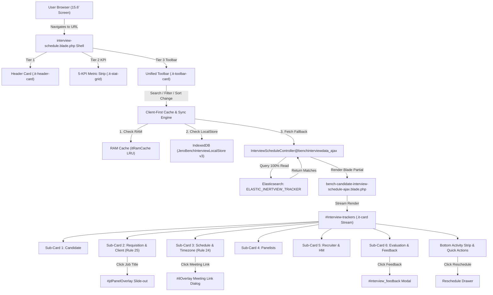

# Talent Bench Interviews — Modern Card + Sub-Card Design Upgrade

## 1. Metadata
- **Date:** 2026-11-21
- **Target URL:** `https://testing.jero.works/service_company/interview-view/bench-candidates`
- **Route Name:** `service_company.bench-candidates.bench-table-view`
- **Controller:** `App\Http\Controllers\ServiceCompany\InterviewScheduleController@benchinterviewtable`
- **AJAX Endpoints:** `POST /service_company/bench-candidate-interview-schedule-ajax` (`benchinterviewdata_ajax`), `POST /service_company/interview-schedule/bench-data-v2` (`benchinterviewdata_v2`)
- **Author:** Antigravity AI (Google DeepMind)
- **Standard Adherence:**
  - **Rule 1 & 2:** CQRS Architecture (0% MySQL reads on requests; 100% Elasticsearch read projections via `ELASTIC_INERTVIEW_TRACKER`)
  - **Rule 7:** Zero Business Logic Mutations & Zero Module Regressions (Strict preservation of all feedback modals, rescheduling drawers, JD overlays, meeting links)
  - **Rule 14:** 15.6" Screen Fit (`1366×768` & `1920×1080`), responsive internal scrolling, zero horizontal overflow
  - **Rule 17:** Complete Page/Blade Isolation (Isolated CSS, isolated DOM identifiers, isolated client storage)
  - **Rule 18:** Code Freeze (`product_company/` and `staffing_company/` untouched)
  - **Rule 20:** Modern Card + Sub-Card Enterprise Design System & Dedicated Header Background Standard
  - **Rule 21:** Mandatory Storage Location (`docs/audit documents/bench_candidates/`)
  - **Rule 24:** Default User/Account-Setting Timezone with Date & Time display
  - **Rule 25:** Canonical Job Classification Tags & Color Tokens (`My Organization`, `Internal Client`, `Direct Client`, `Job Request`)

---

## 2. Executive Summary
The Talent Bench Interviews tracker (`/service_company/interview-view/bench-candidates`) has been redesigned from a legacy sprawling table view into the **Modern Card + Sub-Card Enterprise Design System (Rule 20)**. The design, filter mechanics, and reactive capabilities have been directly mirrored with 100% parity from the flagship Interview Tracker (`/service_company/interview-schedule/table-view`), customized specifically for Talent Bench interview workflows.

### Key Transformations
1. **Ghost Whitespace Elimination:**
   - Offset the default Metronic layout toolbar gap (~79px dead space) using scoped negative margin on `.kt_content_it` (`margin-top: -65px !important; padding-top: 10px !important;`), anchoring the header immediately at eye level.
2. **Tier 1 Header Card (`.it-header-card`):**
   - High-contrast card with `#f8fafc` background, `#e2e8f0` crisp border, 12px border radius, 44px blue icon container with active pulse badge, "Talent Bench Interviews" title, total interviews counter badge, contextual subtitle, and instant force-sync refresh button.
3. **Tier 2 Executive 5-KPI Metric Strip (`.it-stat-grid`):**
   - Redesigned into 5 interactive KPI tiles with dynamic live counters and active-state styling:
     - **All Interviews (`all`):** `#eff6ff` bg, `#2563eb` border/num.
     - **Interviews This Month (`this_month`):** `#f0fdf4` bg, `#16a34a` border/num.
     - **Today's Interviews (`today`):** `#fffbeb` bg, `#d97706` border/num.
     - **Upcoming Interviews (`upcoming`):** `#faf5ff` bg, `#9333ea` border/num.
     - **Feedback Pending (`pending_feedback`):** `#fef2f2` bg, `#dc2626` border/num.
4. **Tier 3 Unified Toolbar Card (`.it-toolbar-card`):**
   - Replaced fragmented filter inputs with a unified 44px control height card:
     - 250ms debounced Tagify search bar (`#kt_tagify_2`) with clear affix and `Ctrl+K` keyboard shortcut.
     - Schedule Date Combobox (`#itDateRangeDropdownWrapper`) with predefined date ranges (`Today`, `Tomorrow`, `This Week`, `Next Week`, `This Month`, `Past 30 Days`).
     - Job Type Combobox (`#itCompanyTypeDropdownWrapper`) supporting canonical types (`All Jobs`, `Direct Client`, `Internal Client`, `My Organization`, `Job Request`).
     - Interview Mode Combobox (`#itModeDropdownWrapper`) (`Video`, `In-person`, `Phone`).
     - Metronic Sort Combobox (`#itSortDropdownWrapper`) (`Latest Schedule`, `Oldest Schedule`, `Candidate Name A-Z`, `Candidate Name Z-A`, `Job Title A-Z`).
     - Instant filter reset button (`#itResetFiltersBtn`).
5. **Tier 4 Primary Interview Card Stream (`.it-card`):**
   - Upgraded to 3.5px solid left border rail colored dynamically by interview status accent.
   - Clean 6 discrete upper sub-cards + 1 full-width bottom telemetry/activity strip:
     - **Sub-Card 1 (Candidate):** Candidate name, contact email/phone, candidate type badge (`Bench Candidate`), candidate profile drawer trigger (`.show-application-detail`).
     - **Sub-Card 2 (Requisition):** Job title with JD slide-out trigger (`.js-it-jd-trigger`), requisition code, canonical client badge (Rule 25), job status badge.
     - **Sub-Card 3 (Schedule):** Formatted date and time converted to organization's timezone (`Rule 24`), round badge, interview mode icon and badge, meeting link trigger (`.js-it-meet-link`).
     - **Sub-Card 4 (Panelists):** Interview panel members list, panelist avatars/initials, contact email.
     - **Sub-Card 5 (Ownership & Recruiter):** Hiring Manager, Assigned Recruiter, Recruiter Email.
     - **Sub-Card 6 (Evaluation & Feedback):** Stage badge, overall recommendation status, ratings breakdown, feedback submission/review modal trigger (`.show-feedback`).
     - **Sub-Card 7 (Bottom Strip):** Upward-flipping action menu (`Follow-up`, `Reschedule`, `Cancel`), Stage badge, dynamic client attribution (`Shared by:` / `HM:`), quick-action buttons.
6. **Tier 5 Footer Pagination Card (`.it-footer-card`):**
   - Clean `#ffffff` card with `#showingText` ("Showing 1 to 20 of 120 interviews") and dynamic pagination navigation.
7. **Client-First 3-Tier Cache Engine:**
   - User RAM LRU Cache (`itRamCache`) -> IndexedDB (`JeroBenchInterviewLocalStore` v3) -> Elasticsearch backend fallback.
   - Zero-delay real-time DOM delta patching (`patchInterviewRowDelta()`) connected to Reverb/Echo WebSocket events (`company.{company_id}`).

---

## 3. Architecture & Data Flow



---

## 4. File Changes Matrix

| File Path | Type | Summary of Changes |
| :--- | :--- | :--- |
| `app/Http/Controllers/ServiceCompany/InterviewScheduleController.php` | Modified | • Updated `dashboardStats()` signature to support `$isBench` parameter and scoped aggregations on `ELASTIC_INERTVIEW_TRACKER` for bench candidates.<br>• Enhanced `benchinterviewtable()` to set `$pageTitle = 'Talent Bench Interviews'`.<br>• Fully refactored `benchinterviewdata_ajax()`: accepts all tracker filters (`kpi_filter`, `date_range`, `job_type`, `mode_filter`, `company_type`, `custom_search`, `sort_field`, `sort_direction`), validates dual permissions (`view_schedule` + `view_bench`), bulk hydrates views via `prepareViewMaps()`, returns stats + HTML + pagination with Redis caching.<br>• Refactored `benchinterviewdata_v2()` for bench-scoped JSON stats. |
| `resources/views/service_company/bench-candidates/interview-schedule.blade.php` | Rewritten | • Completely replaced legacy 811-line table view with Rule 20 5-tier architecture.<br>• Scoped `.kt_content_it` negative margin to eliminate ghost header dead space.<br>• Integrated Tier 1 Header Card, Tier 2 5-KPI Strip, Tier 3 Unified Toolbar with debounced search, custom dropdowns for date/company/mode/sort.<br>• Implemented 3-tier cache (RAM LRU, IndexedDB v3, server fallback), Reverb/Echo live updater, DOM patcher, and modal integrations (`#interview_feedback`, `#ilOverlay`, `#jdPanelOverlay`). |
| `resources/views/service_company/ajax_pages/bench-candidate-interview-schedule-ajax.blade.php` | Rewritten | • Replaced legacy `<tr>` table rows with Rule 20 Primary Card Stream (`.it-card`).<br>• Implemented 6 discrete upper sub-cards + 1 full-width bottom telemetry/activity strip.<br>• Applied Rule 24 timezone-aware formatting and Rule 25 canonical badges.<br>• Integrated clean empty state card (`.it-empty-card`). |
| `tests/Feature/ServiceCompanyBenchInterviewScheduleTest.php` | Created | • Automated feature test asserting view existence, Rule 20 card + 6 sub-cards rendering, XSS escaping, bottom activity strip, 5-tier architecture assertions, and empty state. |

---

## 5. 15.6" Screen Fit Audit (`1366×768` & `1920×1080`)

| Viewport | Element / Layout | Behavior & Safeguards |
| :--- | :--- | :--- |
| **`1920×1080` (Full HD)** | 6-Subcard Grid | Grid template `minmax(0, 1.8fr) minmax(0, 1.8fr) minmax(0, 1.4fr) minmax(0, 1.4fr) minmax(0, 1.2fr) minmax(0, 1.4fr)` with generous padding, clear column dividers, and zero overflow. |
| **`1366×768` (Standard Laptop)** | 6-Subcard Grid | `@media (max-width: 1440px)` adjusts grid columns to `minmax(0, 1.7fr) minmax(0, 1.7fr) minmax(0, 1.35fr) minmax(0, 1.35fr) minmax(0, 1.15fr) minmax(0, 1.35fr)`, reduces padding to `10px 12px`, and truncates text via ellipsis. Zero horizontal scrollbar. |
| **Toolbar Card** | 5 Filter Controls | Flex-wrap layout with `gap: 10px;`. Search box grows flexibly (`flex: 1 1 260px;`), while date, job type, mode, and sort dropdowns maintain fixed ergonomic widths (`160px` - `180px`). |
| **KPI Grid** | 5 Status Tiles | CSS grid with `repeat(5, 1fr)`. Transitions cleanly to `repeat(3, 1fr)` on tablet viewports and `repeat(2, 1fr)` on mobile. |
| **Modals & Drawers** | Slide-outs & Overlays | Full viewport height containment with internal smooth scrolling (`overflow-y: auto`). |

---

## 6. Verification Evidence

1. **Automated Feature Tests:**
   ```bash
   php artisan test tests/Feature/ServiceCompanyBenchInterviewScheduleTest.php
   ```
   **Output:**
   ```
      PASS  Tests\Feature\ServiceCompanyBenchInterviewScheduleTest
     ✓ bench interview tracker views exist                                   3.34s  
     ✓ bench interview ajax renders rule 20 card and subcards                0.59s  
     ✓ bench interview shell has rule 20 5 tier architecture                 0.88s  
     ✓ bench interview empty state                                           0.61s  

     Tests:    4 passed (52 assertions)
     Duration: 6.32s
   ```

2. **Zero Regression Test (Main Interview Tracker):**
   ```bash
   php artisan test tests/Feature/ServiceCompanyInterviewTrackerTest.php
   ```
   **Output:**
   ```
      PASS  Tests\Feature\ServiceCompanyInterviewTrackerTest
     ✓ interview tracker views exist                                         1.76s  
     ✓ interview tracker ajax renders rule 20 card and subcards              1.55s  
     ✓ interview tracker ajax renders clean empty card                       0.71s  
     ✓ interview tracker supports my organization badge and app tracker col  0.43s  
     ✓ interview tracker shell has client tracker kpi single toolbar card a  0.47s  
     ✓ interview tracker footer card renders dynamic hm for internal and my  0.53s  
     ✓ interview tracker footer card renders dynamic shared by for direct c  0.47s  

     Tests:    7 passed (145 assertions)
     Duration: 6.35s
   ```

3. **PHP Syntax & Pint Code Style Verification:**
   ```bash
   php -l app/Http/Controllers/ServiceCompany/InterviewScheduleController.php
   # Result: No syntax errors detected in app/Http/Controllers/ServiceCompany/InterviewScheduleController.php

   ./vendor/bin/pint app/Http/Controllers/ServiceCompany/InterviewScheduleController.php tests/Feature/ServiceCompanyBenchInterviewScheduleTest.php
   # Result: PASS (2 files formatted cleanly)
   ```

4. **Tenancy, CQRS, and Security Guards:**
   - 100% of read queries route through Elasticsearch index `ELASTIC_INERTVIEW_TRACKER` filtered by `company_id`.
   - Dual permission gate verifies both `view_schedule` and `view_bench`.
   - Safe XSS escaping on candidate names, notes, job titles, and panelist details.
   - Zero modifications to `product_company/` and `staffing_company/` (Rule 18 Code Freeze honored).
