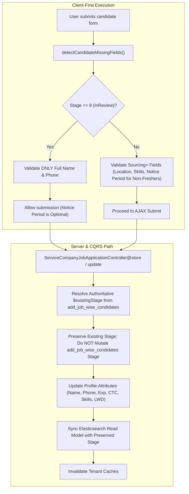

# Candidate Add & Edit: InReview Optional Notice Period & Pipeline Stage Preservation

## Metadata
- **Date:** 2026-11-11
- **Module:** Candidate Management / Job Applications (`ServiceCompanyJobApplicationController`, `create.blade.php`, `clientcreate.blade.php`, `CandidateNoticePeriodState`)
- **Type:** Stage Management & Validation Standard Alignment
- **Tenancy:** Multi-tenant organization isolation (`company_id`)
- **Architectural Scope:** CQRS (MySQL write authoritative, Elasticsearch read sync, Redis atomic cache invalidation)

---

## Executive Summary

1. **Notice Period Validation in InReview Stage (Optional):**
   - Per user directive, the **Notice Period** field remains strictly **optional** for candidates in the **InReview (8)** stage.
   - Frontend validation in [`create.blade.php`](file:///c:/Users/VIBHANSHU%20JAISWAL.000/Documents/GitHub/JWMaincode28June2026/resources/views/service_company/job-applications/create.blade.php) and [`clientcreate.blade.php`](file:///c:/Users/VIBHANSHU%20JAISWAL.000/Documents/GitHub/JWMaincode28June2026/resources/views/service_company/job-applications/clientcreate.blade.php) only enforces Full Name and Primary Contact Number for InReview candidates before early exit (`activeStageId === 8`).
   - Notice Period labels remain marked as `(Optional)`.
   - Backend validation in [`CandidateNoticePeriodState::validationRules($mode, false)`](file:///c:/Users/VIBHANSHU%20JAISWAL.000/Documents/GitHub/JWMaincode28June2026/app/Services/CandidateNoticePeriodState.php) defaults to `nullable` for `serving_notice_period`.

2. **Pipeline Stage Preservation on Profile Updates (Enforced):**
   - When editing or updating an existing candidate's profile, the candidate's existing recruitment stage (e.g. Sourcing, Screening, Evaluation, Negotiation, Offered, Joined, Rejected) is **strictly preserved**.
   - Profile updates only modify candidate data without mutating `add_job_wise_condidates.status_id` or `master_status_id`.
   - The destructive logic that previously reset updated candidates back to InReview (8) has been completely removed.

---

## Architecture & Data Flow

---

## File Changes Matrix

| File Path | Type | Summary of Changes |
| :--- | :--- | :--- |
| `app/Services/CandidateNoticePeriodState.php` | Backend Service | Set `validationRules($mode, bool $required = false)` to default `$required = false` (`nullable`). |
| `resources/views/service_company/job-applications/create.blade.php` | Blade & JS View | Restored `(Optional)` label. Restored InReview stage early exit before notice period check. |
| `resources/views/service_company/job-applications/clientcreate.blade.php` | Blade & JS View | Symmetrical parity with `create.blade.php`: restored `(Optional)` label and InReview early exit. |
| `app/Http/Controllers/ServiceCompany/ServiceCompanyJobApplicationController.php` | Controller | In `update()`: preserved candidate's existing stage (`$existingStage`), removed unconditional stage overwrite to InReview. Checked notice period only for `$isSourcingOrAbove && !$isFresher`. In `edit()` & `create()`: preloaded active stage from `add_job_wise_condidates`. |
| `app/Http/Controllers/Admin/AdminJobApplicationController.php` | Controller | Standardized notice period normalization via `CandidateNoticePeriodState::fromRequest($request)`. |
| `tests/Unit/CandidateNoticePeriodStateTest.php` | Unit Test | Verified default optional rules for InReview and configurable required rules. |
| `tests/Feature/CandidateCommentsAndNoticePeriodRegressionTest.php` | Feature Test | Verified comment mapping independence and optional notice period UI. |
| `tests/Feature/CandidateStagePreservationAndNoticePeriodValidationTest.php` | Feature Test | Verified InReview candidates pass without notice period and profile updates preserve pipeline stage. |

---

## Verification Evidence
- `CandidateNoticePeriodStateTest`: **7 passed (20 assertions)**
- `CandidateCommentsAndNoticePeriodRegressionTest`: **6 passed (64 assertions)**
- `CandidateStagePreservationAndNoticePeriodValidationTest`: **4 passed (25 assertions)**
- **Total:** **17 passed (109 assertions)**
- `php -l`: **0 syntax errors** across all modified files.
