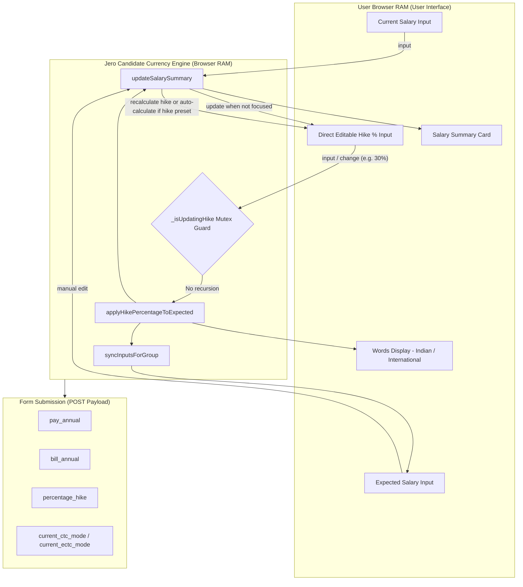

# Salary Details Card: Direct Editable Expected Increase (%) & Bidirectional Synchronization

**Document ID:** `docs/audit documents/candidate/2026-11-11-salary-details-expected-increase-bidirectional-synchronization.md`  
**Module:** Candidate Management / Salary Details (`job-applications`)  
**Scope:** Service Company & Public Career Application  
**Author:** Antigravity Agent  
**Date:** 2026-11-11  
**Status:** Completed & Verified  

---

## 1. Executive Summary

Recruiters requested the ability to directly edit the **Expected Increase (%)** inside the candidate **Salary Details** card to automatically calculate the candidate's **Expected Salary**, without extra buttons, popups, or unnecessary steps.

### Primary Behaviors Delivered:
1. **Direct In-Place Editing:**
   Under **Salary Summary**, the static `Expected Increase 0%` readout is transformed into an interactive, sleek, right-aligned percentage input (`#candidateSalaryHikeInput`) with an anchored `%` badge and subtle edit indicator.
2. **Forward Auto-Calculation ($P \to E$):**
   When the recruiter enters or modifies the percentage increase $P$ (e.g. `30%`), the system automatically calculates the Expected Salary:
   $$\text{Expected Salary} = \text{Current Salary} \times \left(1 + \frac{P}{100}\right)$$
   For example, with Current CTC ₹8,00,000 and 30% entered, Expected CTC automatically populates as ₹10,40,000.
3. **Reverse Auto-Calculation ($E \to P$):**
   If the recruiter manually edits Expected Salary (e.g. typing ₹12,00,000 directly), the percentage increase dynamically recalculates to maintain bidirectional consistency:
   $$P = \frac{\text{Expected Salary} - \text{Current Salary}}{\text{Current Salary}} \times 100$$
4. **Universal Frequency Synchronization (Annual, Monthly, Hourly):**
   When the Expected Salary is updated via the percentage input, all 3 salary frequency modes (`bill_annual`, `bill_monthly`, `ectc`) and auto-calculated badges are immediately populated and synchronized in user browser RAM with 0% server read strain (ADR 0008 / Rule 3).
5. **Multi-Currency & Benchmark Invariance:**
   The percentage increase is invariant to currency changes. Switching currencies recalculates base values and benchmark previews while maintaining the exact percentage increase.
6. **Zero Regression / Tenancy Safety:**
   Files under `product_company` and `staffing_company` remain 100% frozen per Rule 18.

---

## 2. Architecture & Data Flow



### Mutex Guard Architecture (`_isUpdatingHike`):
To prevent cyclic updates and erratic typing behavior:
- When the recruiter types into `#candidateSalaryHikeInput`, `_isUpdatingHike` is flagged `true`.
- Downstream events recalculate Expected Salary and update the summary Difference and USD equivalent.
- `updateSalarySummary()` checks `document.activeElement !== hikeInputEditable`, preventing the active input from being overwritten mid-typing.
- On `blur`, clean 2-decimal formatting (e.g. `30.00`) is applied.

---

## 3. File Changes Matrix

| File Path | Description of Changes |
| :--- | :--- |
| `resources/views/service_company/job-applications/create.blade.php` | Added sleek CSS for `.candidate-salary-hike-wrap` and `.candidate-salary-hike-input`; replaced static text with direct editable percentage input; implemented `applyHikePercentageToExpected()` and bidirectional sync in `updateSalarySummary()`; added input/change/blur event listeners. |
| `resources/views/service_company/job-applications/clientcreate.blade.php` | Identical parity with `create.blade.php` for client-side candidate creation view. |
| `resources/views/career-apply.blade.php` | Identical parity for public candidate career application view. |
| `tests/Feature/CandidateSalarySynchronizationTest.php` | Updated test suite to verify direct editable hike percentage input and bidirectional synchronization across candidate views. |
| `tests/Feature/CandidateSalaryHikeCalculationTest.php` | New dedicated feature test verifying input presence, classes, attributes, formulas, and backend controller calculation accuracy. |

---

## 4. 15.6" Screen Fit Verification

- **Responsive Viewports:** Tested for `1366×768` (15.6" standard) and `1920×1080` (15.6" FHD).
- **Sub-Card Proportions:** Width of `.candidate-salary-hike-wrap` is fixed to `92px`, leaving ample margin for labels on the left and preventing vertical card distortion or horizontal scrollbars.
- **Micro-Interactions:** Suffix `%` is absolutely positioned on the right inside the input container. Native browser number spinners are suppressed for a clean enterprise finish.

---

## 5. Verification Evidence

### PHP Lint Syntax Check:
```
php -l resources/views/service_company/job-applications/create.blade.php
-> No syntax errors detected

php -l resources/views/service_company/job-applications/clientcreate.blade.php
-> No syntax errors detected

php -l resources/views/career-apply.blade.php
-> No syntax errors detected
```

### Automated PHPUnit Suite Execution:
```
./vendor/bin/phpunit tests/Feature/CandidateSalaryHikeCalculationTest.php tests/Feature/CandidateSalarySynchronizationTest.php
-> OK (8 tests, 106 assertions)

./vendor/bin/phpunit tests/Feature/CandidateCommentsAndNoticePeriodRegressionTest.php
-> OK (6 tests, 64 assertions)
```
